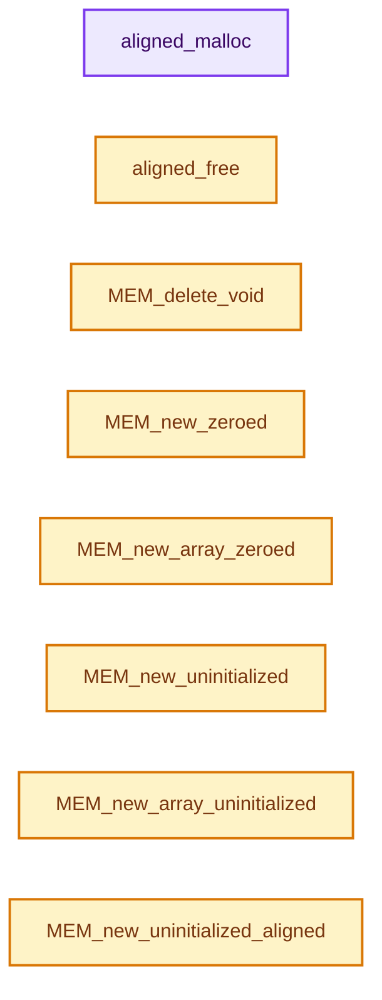
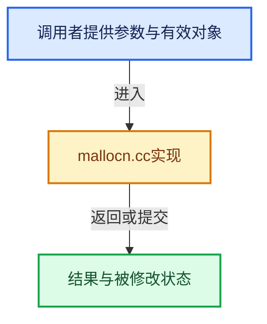

# 实现依赖专题：intern/guardedalloc/intern/mallocn.cc

[实现依赖导航](../../../README.md) · [符号索引](../../../../00-课程指南/02-源码与提交索引/符号依赖与实现索引.md)

本专题从正文实际调用进入，集中保存共享实现。函数有稳定锚点，可从调用处直接跳到对应完整函数；递归与互相调用通过回链组织。

## 本文件的实现关系






## 完整成员与函数实现

<a id="f-48812794cdf34f28"></a>

### `aligned_malloc`

选择当前平台的对齐存储API。

实现位置：[intern/guardedalloc/intern/mallocn.cc](../../../../../../../../intern/guardedalloc/intern/mallocn.cc) · L77—L97。

接口参数：

- `size_t size`
- `size_t alignment`

**教学注释版**

<!-- annotated:2482482f0e2f73 -->

```cpp
void *aligned_malloc(size_t size, size_t alignment)
{
  /* #posix_memalign requires alignment to be a multiple of `sizeof(void *)`. */
  // [讲解] assert：检查开发者预期条件，配置可能关闭；不承担完整输入处理或自动修复。
  assert(alignment >= ALIGNED_MALLOC_MINIMUM_ALIGNMENT);

#ifdef _WIN32
  // [讲解] 当前Windows路径；请求字节数和对齐交给运行库，失败可返回空指针。
  return _aligned_malloc(size, alignment);
#elif defined(__APPLE__) || defined(__FreeBSD__) || defined(__NetBSD__) || defined(__OpenBSD__)
  void *result;

  // [讲解] POSIX返回错误码；非零时不把result当作成功分配。
  if (posix_memalign(&result, alignment, size)) {
    /* non-zero means allocation error
     * either no allocation or bad alignment value
     */
    return NULL;
  }
  return result;
#else /* This is for Linux. */
  // [讲解] Linux适配路径；释放仍须匹配该分配机制。
  return memalign(alignment, size);
#endif
}
```

<details>
<summary>核对原始源码：intern/guardedalloc/intern/mallocn.cc · L77—L97</summary>

<!-- original:2482482f0e2f73:intern/guardedalloc/intern/mallocn.cc:77:97 -->

```cpp
void *aligned_malloc(size_t size, size_t alignment)
{
  /* #posix_memalign requires alignment to be a multiple of `sizeof(void *)`. */
  assert(alignment >= ALIGNED_MALLOC_MINIMUM_ALIGNMENT);

#ifdef _WIN32
  return _aligned_malloc(size, alignment);
#elif defined(__APPLE__) || defined(__FreeBSD__) || defined(__NetBSD__) || defined(__OpenBSD__)
  void *result;

  if (posix_memalign(&result, alignment, size)) {
    /* non-zero means allocation error
     * either no allocation or bad alignment value
     */
    return NULL;
  }
  return result;
#else /* This is for Linux. */
  return memalign(alignment, size);
#endif
}
```

</details>

**机制与执行推导**

Windows分支使用_aligned_malloc，释放时需要_aligned_free；其他平台可能使用posix_memalign或memalign。

这里是Blender内部实现的最后平台适配层，再往下属于系统/运行库契约。

这些接口的失败返回不能被讲成C++ new必然抛异常的语义。

**结果出口**

- `return _aligned_malloc(size, alignment);`
- `return NULL;`
- `return result;`
- `return memalign(alignment, size);`

**继续追踪实现**

- `assert` → [外部契约](https://eel.is/c++draft/assertions)：检查开发者预期条件，配置可能关闭；不承担完整输入处理或自动修复。
- `_aligned_malloc` → [外部契约](https://learn.microsoft.com/en-us/cpp/c-runtime-library/reference/aligned-malloc?view=msvc-170)：Windows对齐分配；失败可返回NULL，使用_aligned_free归还。到这里停止深入运行库内部实现。
- `posix_memalign` → [外部契约](https://eel.is/c++draft/)：这个边界按实际表达式及所属类型核对参数、返回值、寿命与失败行为。这里提供接口入口，不声称已解释该第三方版本的内部实现。
- `memalign` → [外部契约](https://eel.is/c++draft/)：这个边界按实际表达式及所属类型核对参数、返回值、寿命与失败行为。这里提供接口入口，不声称已解释该第三方版本的内部实现。

<a id="f-9dceace8dd60fe03"></a>

### `aligned_free`

按当前平台释放对齐分配取得的基地址。

实现位置：[intern/guardedalloc/intern/mallocn.cc](../../../../../../../../intern/guardedalloc/intern/mallocn.cc) · L99—L107。

接口参数：

- `void *ptr`

**教学注释版**

<!-- annotated:bfadc908d7b534 -->

```cpp
void aligned_free(void *ptr)
{
  PRF_memory_free(ptr);
#ifdef _WIN32
  // [讲解] Windows需要与_aligned_malloc配对；不要替换成普通free。
  _aligned_free(ptr);
#else
  // [讲解] 非Windows平台的相应对齐分配按该分支使用free归还。
  free(ptr);
#endif
}
```

<details>
<summary>核对原始源码：intern/guardedalloc/intern/mallocn.cc · L99—L107</summary>

<!-- original:bfadc908d7b534:intern/guardedalloc/intern/mallocn.cc:99:107 -->

```cpp
void aligned_free(void *ptr)
{
  PRF_memory_free(ptr);
#ifdef _WIN32
  _aligned_free(ptr);
#else
  free(ptr);
#endif
}
```

</details>

**机制与执行推导**

MEM后端先恢复真正的分配基地址，再来到这一层。用户数据地址可能位于块头之后，不能绕过恢复过程直接传给系统释放。

**继续追踪实现**

- `PRF_memory_free` → [PRF_memory_free · L82](../../profile/PRF_profile.hh.md#m-7e85956a936f)；[PRF_memory_free · L105](../../profile/PRF_profile.hh.md#m-afc21d064bc2)。宏定义由构建条件选择。
- `_aligned_free` → [外部契约](https://learn.microsoft.com/en-us/cpp/c-runtime-library/reference/aligned-free?view=msvc-170)：与Windows对齐分配配对，传入分配基地址。MEM用户地址可能位于块头之后，应先由MEM后端恢复基地址。
- `free` → [外部契约](https://eel.is/c++draft/c.malloc)：归还相匹配的C分配存储，不自动执行C++析构；不可用于Windows的_aligned_malloc结果。

<a id="f-9a07b26421f2bee6"></a>

### `MEM_delete_void`

以原始存储释放约定调用当前后端。

实现位置：[intern/guardedalloc/intern/mallocn.cc](../../../../../../../../intern/guardedalloc/intern/mallocn.cc) · L109—L112。

接口参数：

- `void *vmemh`

**教学注释版**

<!-- annotated:35a66d925e391a -->

```cpp
void MEM_delete_void(void *vmemh)
{
  // [讲解] 分派到对应freeN实现，并传递与原始分配匹配的析构标记。
  mem_freeN_ex(vmemh, DestructorType::Trivial);
}
```

<details>
<summary>核对原始源码：intern/guardedalloc/intern/mallocn.cc · L109—L112</summary>

<!-- original:35a66d925e391a:intern/guardedalloc/intern/mallocn.cc:109:112 -->

```cpp
void MEM_delete_void(void *vmemh)
{
  mem_freeN_ex(vmemh, DestructorType::Trivial);
}
```

</details>

**机制与执行推导**

mem_freeN_ex与分配后端成组切换。跨后端释放现存块会误解块头布局，因此切换器要求没有活分配块。

**继续追踪实现**

- `mem_freeN_ex` → [MEM_lockfree_freeN · L146](mallocn_lockfree_impl.cc.md#f-da4b6d2cf3cb90d8)；[MEM_guarded_freeN · L1054](mallocn_guarded_impl.cc.md#f-3bf9a51e62b87ccb)。同名重载需按实参类型选择。

<a id="f-e04cf01c64c8b180"></a>

### `MEM_new_zeroed`

实现位置：[intern/guardedalloc/intern/mallocn.cc](../../../../../../../../intern/guardedalloc/intern/mallocn.cc) · L114—L117。

接口参数：

- `size_t len`
- `const char *str`

**教学注释版**

<!-- annotated:333c99a8d190d4 -->

```cpp
void *MEM_new_zeroed(size_t len, const char *str)
{
  return mem_callocN(len, str);
}
```

<details>
<summary>核对原始源码：intern/guardedalloc/intern/mallocn.cc · L114—L117</summary>

<!-- original:333c99a8d190d4:intern/guardedalloc/intern/mallocn.cc:114:117 -->

```cpp
void *MEM_new_zeroed(size_t len, const char *str)
{
  return mem_callocN(len, str);
}
```

</details>

**结果出口**

- `return mem_callocN(len, str);`

**继续追踪实现**

- `mem_callocN` → [调用协议](../../../../00-课程指南/01-路线与规范/模板宏与动态分派协议.md)：函数指针、局部可调用对象或未展开的宏；必须结合调用者环境。调用位置L116。

<a id="f-6825557da566fdbe"></a>

### `MEM_new_array_zeroed`

实现位置：[intern/guardedalloc/intern/mallocn.cc](../../../../../../../../intern/guardedalloc/intern/mallocn.cc) · L119—L122。

接口参数：

- `size_t len`
- `size_t size`
- `const char *str`

**教学注释版**

<!-- annotated:cf501d171f71ed -->

```cpp
void *MEM_new_array_zeroed(size_t len, size_t size, const char *str)
{
  return mem_calloc_arrayN(len, size, str);
}
```

<details>
<summary>核对原始源码：intern/guardedalloc/intern/mallocn.cc · L119—L122</summary>

<!-- original:cf501d171f71ed:intern/guardedalloc/intern/mallocn.cc:119:122 -->

```cpp
void *MEM_new_array_zeroed(size_t len, size_t size, const char *str)
{
  return mem_calloc_arrayN(len, size, str);
}
```

</details>

**结果出口**

- `return mem_calloc_arrayN(len, size, str);`

**继续追踪实现**

- `mem_calloc_arrayN` → [调用协议](../../../../00-课程指南/01-路线与规范/模板宏与动态分派协议.md)：函数指针、局部可调用对象或未展开的宏；必须结合调用者环境。调用位置L121。

<a id="f-28a7e00a1e67f699"></a>

### `MEM_new_uninitialized`

实现位置：[intern/guardedalloc/intern/mallocn.cc](../../../../../../../../intern/guardedalloc/intern/mallocn.cc) · L124—L127。

接口参数：

- `size_t len`
- `const char *str`

**教学注释版**

<!-- annotated:87fe4fb6c49663 -->

```cpp
void *MEM_new_uninitialized(size_t len, const char *str)
{
  return mem_mallocN(len, str);
}
```

<details>
<summary>核对原始源码：intern/guardedalloc/intern/mallocn.cc · L124—L127</summary>

<!-- original:87fe4fb6c49663:intern/guardedalloc/intern/mallocn.cc:124:127 -->

```cpp
void *MEM_new_uninitialized(size_t len, const char *str)
{
  return mem_mallocN(len, str);
}
```

</details>

**结果出口**

- `return mem_mallocN(len, str);`

**继续追踪实现**

- `mem_mallocN` → [调用协议](../../../../00-课程指南/01-路线与规范/模板宏与动态分派协议.md)：函数指针、局部可调用对象或未展开的宏；必须结合调用者环境。调用位置L126。

<a id="f-bf6ef4ddcfb6e5df"></a>

### `MEM_new_array_uninitialized`

实现位置：[intern/guardedalloc/intern/mallocn.cc](../../../../../../../../intern/guardedalloc/intern/mallocn.cc) · L129—L132。

接口参数：

- `size_t len`
- `size_t size`
- `const char *str`

**教学注释版**

<!-- annotated:05f9610e6cf90c -->

```cpp
void *MEM_new_array_uninitialized(size_t len, size_t size, const char *str)
{
  return mem_malloc_arrayN(len, size, str);
}
```

<details>
<summary>核对原始源码：intern/guardedalloc/intern/mallocn.cc · L129—L132</summary>

<!-- original:05f9610e6cf90c:intern/guardedalloc/intern/mallocn.cc:129:132 -->

```cpp
void *MEM_new_array_uninitialized(size_t len, size_t size, const char *str)
{
  return mem_malloc_arrayN(len, size, str);
}
```

</details>

**结果出口**

- `return mem_malloc_arrayN(len, size, str);`

**继续追踪实现**

- `mem_malloc_arrayN` → [调用协议](../../../../00-课程指南/01-路线与规范/模板宏与动态分派协议.md)：函数指针、局部可调用对象或未展开的宏；必须结合调用者环境。调用位置L131。

<a id="f-9f3d21bd7da93c68"></a>

### `MEM_new_uninitialized_aligned`

把公开MEM分配接口转交给当前选择的对齐分配后端。

实现位置：[intern/guardedalloc/intern/mallocn.cc](../../../../../../../../intern/guardedalloc/intern/mallocn.cc) · L134—L137。

接口参数：

- `size_t len`
- `size_t alignment`
- `const char *str`

**教学注释版**

<!-- annotated:2e51f25c1274f1 -->

```cpp
void *MEM_new_uninitialized_aligned(size_t len, size_t alignment, const char *str)
{
  // [讲解] 通过当前函数指针分派到真实分配实现；不能把这个间接调用遗漏在依赖链之外。
  return mem_mallocN_aligned_ex(len, alignment, str, DestructorType::Trivial);
}
```

<details>
<summary>核对原始源码：intern/guardedalloc/intern/mallocn.cc · L134—L137</summary>

<!-- original:2e51f25c1274f1:intern/guardedalloc/intern/mallocn.cc:134:137 -->

```cpp
void *MEM_new_uninitialized_aligned(size_t len, size_t alignment, const char *str)
{
  return mem_mallocN_aligned_ex(len, alignment, str, DestructorType::Trivial);
}
```

</details>

**机制与执行推导**

调用目标是mem_mallocN_aligned_ex函数指针。默认初始化指向lockfree后端，MEM_use_guarded_allocator会改为guarded后端。

DestructorType::Trivial描述此块按原始存储方式释放的约定，不是在这里证明Vector元素T具有平凡析构。

元素的非平凡析构由容器自己执行，后端负责块头、统计、对齐等存储机制。

**结果出口**

- `return mem_mallocN_aligned_ex(len, alignment, str, DestructorType::Trivial);`

**继续追踪实现**

- `mem_mallocN_aligned_ex` → [MEM_lockfree_mallocN_aligned · L406](mallocn_lockfree_impl.cc.md#f-0d9870a941cc5e2d)；[MEM_guarded_mallocN_aligned · L600](mallocn_guarded_impl.cc.md#f-43ec041c5c806b76)。同名重载需按实参类型选择。

<a id="f-7a16d9233cb67bd0"></a>

### `MEM_dupalloc_void`

实现位置：[intern/guardedalloc/intern/mallocn.cc](../../../../../../../../intern/guardedalloc/intern/mallocn.cc) · L139—L142。

接口参数：

- `const void *vmemh`

**教学注释版**

<!-- annotated:dc37c14e2b4430 -->

```cpp
void *MEM_dupalloc_void(const void *vmemh)
{
  return mem_dupallocN(vmemh);
}
```

<details>
<summary>核对原始源码：intern/guardedalloc/intern/mallocn.cc · L139—L142</summary>

<!-- original:dc37c14e2b4430:intern/guardedalloc/intern/mallocn.cc:139:142 -->

```cpp
void *MEM_dupalloc_void(const void *vmemh)
{
  return mem_dupallocN(vmemh);
}
```

</details>

**结果出口**

- `return mem_dupallocN(vmemh);`

**继续追踪实现**

- `mem_dupallocN` → [调用协议](../../../../00-课程指南/01-路线与规范/模板宏与动态分派协议.md)：函数指针、局部可调用对象或未展开的宏；必须结合调用者环境。调用位置L141。
