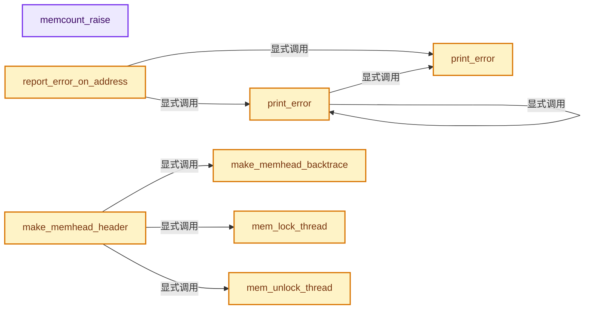
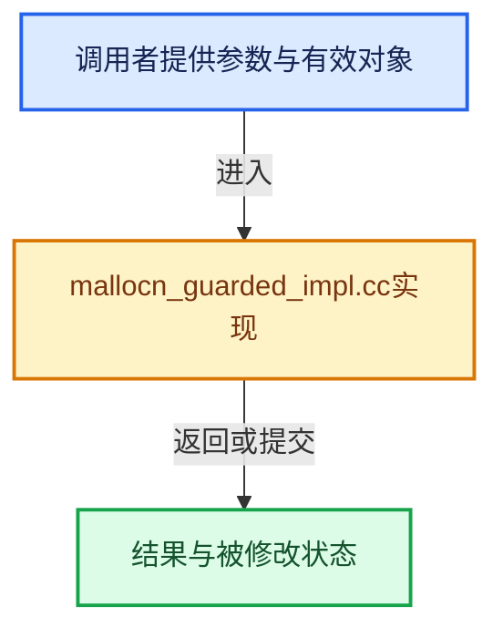

# 实现依赖专题：intern/guardedalloc/intern/mallocn_guarded_impl.cc

[实现依赖导航](../../../README.md) · [符号索引](../../../../00-课程指南/02-源码与提交索引/符号依赖与实现索引.md)

本专题从正文实际调用进入，集中保存共享实现。函数有稳定锚点，可从调用处直接跳到对应完整函数；递归与互相调用通过回链组织。

## 本文件的实现关系






<a id="m-779187692eba"></a>

## 宏 `MEMNEXT`

<!-- annotated:948281e72987fd -->

```cpp
#define MEMNEXT(x) ((MemHead *)(((char *)x) - offsetof(MemHead, next)))

```

<details>
<summary>核对原始源码：intern/guardedalloc/intern/mallocn_guarded_impl.cc · L185—L186</summary>

<!-- original:948281e72987fd:intern/guardedalloc/intern/mallocn_guarded_impl.cc:185:186 -->

```cpp
#define MEMNEXT(x) ((MemHead *)(((char *)x) - offsetof(MemHead, next)))

```

</details>

宏在预处理阶段展开，参数替换、重复求值和条件编译应直接从该定义检查。与普通函数不同，宏不会自动提供参数类型检查；构建配置选择哪个定义需结合外围条件。

## 完整成员与函数实现

<a id="f-8c0438d4b00848de"></a>

### `memcount_raise`

实现位置：[intern/guardedalloc/intern/mallocn_guarded_impl.cc](../../../../../../../../intern/guardedalloc/intern/mallocn_guarded_impl.cc) · L94—L97。

接口参数：

- `const char *name`

**教学注释版**

<!-- annotated:a252d6b0e0a1f0 -->

```cpp
static void memcount_raise(const char *name)
{
  fprintf(stderr, "%s: memcount-leak, %d\n", name, _mallocn_count);
}
```

<details>
<summary>核对原始源码：intern/guardedalloc/intern/mallocn_guarded_impl.cc · L94—L97</summary>

<!-- original:a252d6b0e0a1f0:intern/guardedalloc/intern/mallocn_guarded_impl.cc:94:97 -->

```cpp
static void memcount_raise(const char *name)
{
  fprintf(stderr, "%s: memcount-leak, %d\n", name, _mallocn_count);
}
```

</details>

**继续追踪实现**

- `fprintf` → [外部契约](https://eel.is/c++draft/)：这个边界按实际表达式及所属类型核对参数、返回值、寿命与失败行为。这里提供接口入口，不声称已解释该第三方版本的内部实现。

<a id="f-3159271ffda1f35d"></a>

### `print_error`

实现位置：[intern/guardedalloc/intern/mallocn_guarded_impl.cc](../../../../../../../../intern/guardedalloc/intern/mallocn_guarded_impl.cc) · L217—L231。

接口参数：

- `const char *message`
- `va_list str_format_args`

**教学注释版**

<!-- annotated:bfd76b3e46e612 -->

```cpp
__attribute__((format(printf, 1, 0)))
#endif
static void print_error(const char *message, va_list str_format_args)
{
  char buf[512];
  vsnprintf(buf, sizeof(buf), message, str_format_args);
  buf[sizeof(buf) - 1] = '\0';

  if (error_callback) {
    error_callback(buf);
  }
  else {
    fputs(buf, stderr);
  }
}
```

<details>
<summary>核对原始源码：intern/guardedalloc/intern/mallocn_guarded_impl.cc · L217—L231</summary>

<!-- original:bfd76b3e46e612:intern/guardedalloc/intern/mallocn_guarded_impl.cc:217:231 -->

```cpp
__attribute__((format(printf, 1, 0)))
#endif
static void print_error(const char *message, va_list str_format_args)
{
  char buf[512];
  vsnprintf(buf, sizeof(buf), message, str_format_args);
  buf[sizeof(buf) - 1] = '\0';

  if (error_callback) {
    error_callback(buf);
  }
  else {
    fputs(buf, stderr);
  }
}
```

</details>

**继续追踪实现**

- `vsnprintf` → [外部契约](https://eel.is/c++draft/)：这个边界按实际表达式及所属类型核对参数、返回值、寿命与失败行为。这里提供接口入口，不声称已解释该第三方版本的内部实现。
- `error_callback` → [blender::error_callback · L90](../../../08-其他Blender模块/imbuf/intern/format_jp2.cc.md#f-8ef41e8f7158aa46)。
- `fputs` → [调用协议](../../../../00-课程指南/01-路线与规范/模板宏与动态分派协议.md)：函数指针、局部可调用对象或未展开的宏；必须结合调用者环境。调用位置L229。

<a id="f-d4a4dd1e9d0ee783"></a>

### `print_error`

实现位置：[intern/guardedalloc/intern/mallocn_guarded_impl.cc](../../../../../../../../intern/guardedalloc/intern/mallocn_guarded_impl.cc) · L234—L242。

接口参数：

- `const char *message`

**教学注释版**

<!-- annotated:41104990f2ae7d -->

```cpp
__attribute__((format(printf, 1, 2)))
#endif
static void print_error(const char *message, ...)
{
  va_list str_format_args;
  va_start(str_format_args, message);
  print_error(message, str_format_args);
  va_end(str_format_args);
}
```

<details>
<summary>核对原始源码：intern/guardedalloc/intern/mallocn_guarded_impl.cc · L234—L242</summary>

<!-- original:41104990f2ae7d:intern/guardedalloc/intern/mallocn_guarded_impl.cc:234:242 -->

```cpp
__attribute__((format(printf, 1, 2)))
#endif
static void print_error(const char *message, ...)
{
  va_list str_format_args;
  va_start(str_format_args, message);
  print_error(message, str_format_args);
  va_end(str_format_args);
}
```

</details>

**继续追踪实现**

- `va_start` → [调用协议](../../../../00-课程指南/01-路线与规范/模板宏与动态分派协议.md)：函数指针、局部可调用对象或未展开的宏；必须结合调用者环境。调用位置L239。
- `print_error` → [print_error · L217](mallocn_guarded_impl.cc.md#f-3159271ffda1f35d)；[print_error · L234](mallocn_guarded_impl.cc.md#f-d4a4dd1e9d0ee783)。同名重载需按实参类型选择。
- `va_end` → [调用协议](../../../../00-课程指南/01-路线与规范/模板宏与动态分派协议.md)：函数指针、局部可调用对象或未展开的宏；必须结合调用者环境。调用位置L241。

<a id="f-c3836988d9efe365"></a>

### `report_error_on_address`

实现位置：[intern/guardedalloc/intern/mallocn_guarded_impl.cc](../../../../../../../../intern/guardedalloc/intern/mallocn_guarded_impl.cc) · L245—L273。

接口参数：

- `const void *vmemh`
- `const char *message`

**教学注释版**

<!-- annotated:e9530fcbcff343 -->

```cpp
__attribute__((format(printf, 2, 3)))
#endif
static void report_error_on_address(const void *vmemh, const char *message, ...)
{
  va_list str_format_args;

  va_start(str_format_args, message);
  print_error(message, str_format_args);
  va_end(str_format_args);

  if (vmemh == nullptr) {
    MEM_trigger_error_on_memory_block(nullptr, 0);
    return;
  }

  const MemHead *memh = static_cast<const MemHead *>(vmemh);
  memh--;
  size_t len = memh->len;

  const void *address = memh;
  size_t size = len + sizeof(*memh) + sizeof(MemTail);
  if (memh->alignment > 0) [[unlikely]] {
    const MemHeadAligned *memh_aligned = memh;
    address = MEMHEAD_REAL_PTR(memh_aligned);
    size = len + sizeof(*memh_aligned) + MEMHEAD_ALIGN_PADDING(memh_aligned->alignment) +
           sizeof(MemTail);
  }
  MEM_trigger_error_on_memory_block(address, size);
}
```

<details>
<summary>核对原始源码：intern/guardedalloc/intern/mallocn_guarded_impl.cc · L245—L273</summary>

<!-- original:e9530fcbcff343:intern/guardedalloc/intern/mallocn_guarded_impl.cc:245:273 -->

```cpp
__attribute__((format(printf, 2, 3)))
#endif
static void report_error_on_address(const void *vmemh, const char *message, ...)
{
  va_list str_format_args;

  va_start(str_format_args, message);
  print_error(message, str_format_args);
  va_end(str_format_args);

  if (vmemh == nullptr) {
    MEM_trigger_error_on_memory_block(nullptr, 0);
    return;
  }

  const MemHead *memh = static_cast<const MemHead *>(vmemh);
  memh--;
  size_t len = memh->len;

  const void *address = memh;
  size_t size = len + sizeof(*memh) + sizeof(MemTail);
  if (memh->alignment > 0) [[unlikely]] {
    const MemHeadAligned *memh_aligned = memh;
    address = MEMHEAD_REAL_PTR(memh_aligned);
    size = len + sizeof(*memh_aligned) + MEMHEAD_ALIGN_PADDING(memh_aligned->alignment) +
           sizeof(MemTail);
  }
  MEM_trigger_error_on_memory_block(address, size);
}
```

</details>

**沿实际写入检查状态**

- `address = MEMHEAD_REAL_PTR(memh_aligned);`
- `size = len + sizeof(*memh_aligned) + MEMHEAD_ALIGN_PADDING(memh_aligned->alignment) +`

**继续追踪实现**

- `va_start` → [调用协议](../../../../00-课程指南/01-路线与规范/模板宏与动态分派协议.md)：函数指针、局部可调用对象或未展开的宏；必须结合调用者环境。调用位置L251。
- `print_error` → [print_error · L217](mallocn_guarded_impl.cc.md#f-3159271ffda1f35d)；[print_error · L234](mallocn_guarded_impl.cc.md#f-d4a4dd1e9d0ee783)。同名重载需按实参类型选择。
- `va_end` → [调用协议](../../../../00-课程指南/01-路线与规范/模板宏与动态分派协议.md)：函数指针、局部可调用对象或未展开的宏；必须结合调用者环境。调用位置L253。
- `MEM_trigger_error_on_memory_block` → [MEM_trigger_error_on_memory_block · L40](mallocn_inline.hh.md#f-557d15ff50eac9ef)；[MEM_trigger_error_on_memory_block · L63](mallocn_inline.hh.md#f-1d5c4efbe30e6ace)。同名重载需按实参类型选择。
- `MEMHEAD_REAL_PTR` → [MEMHEAD_REAL_PTR · L81](mallocn_intern.hh.md#m-fb3c50621d05)。宏定义由构建条件选择。
- `MEMHEAD_ALIGN_PADDING` → [MEMHEAD_ALIGN_PADDING · L77](mallocn_intern.hh.md#m-5e6458a50df3)。宏定义由构建条件选择。

<a id="f-dce6887bd5a15594"></a>

### `mem_lock_thread`

实现位置：[intern/guardedalloc/intern/mallocn_guarded_impl.cc](../../../../../../../../intern/guardedalloc/intern/mallocn_guarded_impl.cc) · L277—L280。

**教学注释版**

<!-- annotated:736c086b360324 -->

```cpp
static void mem_lock_thread()
{
  pthread_mutex_lock(&thread_lock);
}
```

<details>
<summary>核对原始源码：intern/guardedalloc/intern/mallocn_guarded_impl.cc · L277—L280</summary>

<!-- original:736c086b360324:intern/guardedalloc/intern/mallocn_guarded_impl.cc:277:280 -->

```cpp
static void mem_lock_thread()
{
  pthread_mutex_lock(&thread_lock);
}
```

</details>

**继续追踪实现**

- `pthread_mutex_lock` → [调用协议](../../../../00-课程指南/01-路线与规范/模板宏与动态分派协议.md)：函数指针、局部可调用对象或未展开的宏；必须结合调用者环境。调用位置L279。

<a id="f-e33383b6749472e2"></a>

### `mem_unlock_thread`

实现位置：[intern/guardedalloc/intern/mallocn_guarded_impl.cc](../../../../../../../../intern/guardedalloc/intern/mallocn_guarded_impl.cc) · L282—L285。

**教学注释版**

<!-- annotated:c60cb2dd6fc7d9 -->

```cpp
static void mem_unlock_thread()
{
  pthread_mutex_unlock(&thread_lock);
}
```

<details>
<summary>核对原始源码：intern/guardedalloc/intern/mallocn_guarded_impl.cc · L282—L285</summary>

<!-- original:c60cb2dd6fc7d9:intern/guardedalloc/intern/mallocn_guarded_impl.cc:282:285 -->

```cpp
static void mem_unlock_thread()
{
  pthread_mutex_unlock(&thread_lock);
}
```

</details>

**继续追踪实现**

- `pthread_mutex_unlock` → [调用协议](../../../../00-课程指南/01-路线与规范/模板宏与动态分派协议.md)：函数指针、局部可调用对象或未展开的宏；必须结合调用者环境。调用位置L284。

<a id="f-f21b729f91450412"></a>

### `make_memhead_backtrace`

实现位置：[intern/guardedalloc/intern/mallocn_guarded_impl.cc](../../../../../../../../intern/guardedalloc/intern/mallocn_guarded_impl.cc) · L477—L480。

接口参数：

- `MemHead *memh`

**教学注释版**

<!-- annotated:a2784222eb93a4 -->

```cpp
static void make_memhead_backtrace(MemHead *memh)
{
  memh->backtrace_size = backtrace(memh->backtrace, BACKTRACE_SIZE);
}
```

<details>
<summary>核对原始源码：intern/guardedalloc/intern/mallocn_guarded_impl.cc · L477—L480</summary>

<!-- original:a2784222eb93a4:intern/guardedalloc/intern/mallocn_guarded_impl.cc:477:480 -->

```cpp
static void make_memhead_backtrace(MemHead *memh)
{
  memh->backtrace_size = backtrace(memh->backtrace, BACKTRACE_SIZE);
}
```

</details>

**沿实际写入检查状态**

- `memh->backtrace_size = backtrace(memh->backtrace, BACKTRACE_SIZE);`

**继续追踪实现**

- `backtrace` → [调用协议](../../../../00-课程指南/01-路线与规范/模板宏与动态分派协议.md)：函数指针、局部可调用对象或未展开的宏；必须结合调用者环境。调用位置L479。

<a id="f-2ba658f1ef148903"></a>

### `make_memhead_header`

实现位置：[intern/guardedalloc/intern/mallocn_guarded_impl.cc](../../../../../../../../intern/guardedalloc/intern/mallocn_guarded_impl.cc) · L496—L534。

接口参数：

- `MemHead *memh`
- `size_t len`
- `const char *str`
- `const DestructorType destructor_type`

**教学注释版**

<!-- annotated:56f2e23e3f97b5 -->

```cpp
static void make_memhead_header(MemHead *memh,
                                size_t len,
                                const char *str,
                                const DestructorType destructor_type)
{
  MemTail *memt;

  memh->tag1 = MEMTAG1;
  memh->name = str;
  memh->nextname = nullptr;
  memh->len = len;
  memh->flag = (destructor_type == DestructorType::NonTrivial ?
                    MEMHEAD_FLAG_NONTRIVIAL_DESTRUCTOR :
                    0);
  memh->alignment = 0;
  memh->tag2 = MEMTAG2;

#ifdef DEBUG_MEMDUPLINAME
  memh->need_free_name = 0;
#endif

#ifdef DEBUG_BACKTRACE_EXECINFO
  make_memhead_backtrace(memh);
#endif

  memt = (MemTail *)(((char *)memh) + sizeof(MemHead) + len);
  memt->tag3 = MEMTAG3;

  atomic_add_and_fetch_u(&totblock, 1);
  atomic_add_and_fetch_z(&mem_in_use, len);

  mem_lock_thread();
  addtail(membase, &memh->next);
  if (memh->next) {
    memh->nextname = MEMNEXT(memh->next)->name;
  }
  peak_mem = mem_in_use > peak_mem ? mem_in_use : peak_mem;
  mem_unlock_thread();
}
```

<details>
<summary>核对原始源码：intern/guardedalloc/intern/mallocn_guarded_impl.cc · L496—L534</summary>

<!-- original:56f2e23e3f97b5:intern/guardedalloc/intern/mallocn_guarded_impl.cc:496:534 -->

```cpp
static void make_memhead_header(MemHead *memh,
                                size_t len,
                                const char *str,
                                const DestructorType destructor_type)
{
  MemTail *memt;

  memh->tag1 = MEMTAG1;
  memh->name = str;
  memh->nextname = nullptr;
  memh->len = len;
  memh->flag = (destructor_type == DestructorType::NonTrivial ?
                    MEMHEAD_FLAG_NONTRIVIAL_DESTRUCTOR :
                    0);
  memh->alignment = 0;
  memh->tag2 = MEMTAG2;

#ifdef DEBUG_MEMDUPLINAME
  memh->need_free_name = 0;
#endif

#ifdef DEBUG_BACKTRACE_EXECINFO
  make_memhead_backtrace(memh);
#endif

  memt = (MemTail *)(((char *)memh) + sizeof(MemHead) + len);
  memt->tag3 = MEMTAG3;

  atomic_add_and_fetch_u(&totblock, 1);
  atomic_add_and_fetch_z(&mem_in_use, len);

  mem_lock_thread();
  addtail(membase, &memh->next);
  if (memh->next) {
    memh->nextname = MEMNEXT(memh->next)->name;
  }
  peak_mem = mem_in_use > peak_mem ? mem_in_use : peak_mem;
  mem_unlock_thread();
}
```

</details>

**沿实际写入检查状态**

- `memh->tag1 = MEMTAG1;`
- `memh->name = str;`
- `memh->nextname = nullptr;`
- `memh->len = len;`
- `memh->flag = (destructor_type == DestructorType::NonTrivial ?`
- `memh->alignment = 0;`
- `memh->tag2 = MEMTAG2;`
- `memh->need_free_name = 0;`
- `memt = (MemTail *)(((char *)memh) + sizeof(MemHead) + len);`
- `memt->tag3 = MEMTAG3;`
- `memh->nextname = MEMNEXT(memh->next)->name;`
- `peak_mem = mem_in_use > peak_mem ? mem_in_use : peak_mem;`

**继续追踪实现**

- `make_memhead_backtrace` → [make_memhead_backtrace · L477](mallocn_guarded_impl.cc.md#f-f21b729f91450412)。
- `atomic_add_and_fetch_u` → [atomic_add_and_fetch_u · L137](../../atomic/intern/atomic_ops_ext.h.md#f-c5c7b5e130dd3f41)。
- `atomic_add_and_fetch_z` → [atomic_add_and_fetch_z · L58](../../atomic/intern/atomic_ops_ext.h.md#f-9fbfc0f4f649e839)。
- `mem_lock_thread` → [mem_lock_thread · L277](mallocn_guarded_impl.cc.md#f-dce6887bd5a15594)。
- `addtail` → [addtail · L1138](mallocn_guarded_impl.cc.md#f-64a1f91039847d91)。
- `MEMNEXT` → [MEMNEXT · L185](mallocn_guarded_impl.cc.md#m-779187692eba)。宏定义由构建条件选择。
- `mem_unlock_thread` → [mem_unlock_thread · L282](mallocn_guarded_impl.cc.md#f-e33383b6749472e2)。

<a id="f-43ec041c5c806b76"></a>

### `MEM_guarded_mallocN_aligned`

实现位置：[intern/guardedalloc/intern/mallocn_guarded_impl.cc](../../../../../../../../intern/guardedalloc/intern/mallocn_guarded_impl.cc) · L600—L673。

接口参数：

- `size_t len`
- `size_t alignment`
- `const char *str`
- `const DestructorType destructor_type`

**教学注释版**

<!-- annotated:b65293e8b50675 -->

```cpp
void *MEM_guarded_mallocN_aligned(size_t len,
                                  size_t alignment,
                                  const char *str,
                                  const DestructorType destructor_type)
{
  PRF_scope(blender::ProfileCategory::Core);
  /* Huge alignment values doesn't make sense and they wouldn't fit into 'short' used in the
   * MemHead. */
  // [讲解] assert：检查开发者预期条件，配置可能关闭；不承担完整输入处理或自动修复。
  assert(alignment < 1024);

  /* We only support alignments that are a power of two. */
  assert(IS_POW2(alignment));

  /* Some OS specific aligned allocators require a certain minimal alignment. */
  /* And #MEM_guarded_freeN also checks that it is freeing a pointer aligned with `sizeof(void *)`.
   */
  if (alignment < ALIGNED_MALLOC_MINIMUM_ALIGNMENT) {
    alignment = ALIGNED_MALLOC_MINIMUM_ALIGNMENT;
  }

  /* It's possible that MemHead's size is not properly aligned,
   * do extra padding to deal with this.
   *
   * We only support small alignments which fits into short in
   * order to save some bits in MemHead structure.
   */
  size_t extra_padding = MEMHEAD_ALIGN_PADDING(alignment);

#ifdef WITH_MEM_VALGRIND
  const size_t len_unaligned = len;
#endif
  len = SIZET_ALIGN_4(len);

  // [讲解] aligned_malloc：选择当前平台的对齐存储API。
  MemHead *memh = (MemHead *)aligned_malloc(
      len + extra_padding + sizeof(MemHead) + sizeof(MemTail), alignment);
  PRF_memory_alloc(memh, len + extra_padding + sizeof(MemHead) + sizeof(MemTail));

  if (memh) [[likely]] {
    /* We keep padding in the beginning of MemHead,
     * this way it's always possible to get MemHead
     * from the data pointer.
     */
    memh = (MemHead *)((char *)memh + extra_padding);

    // [讲解] 写头尾保护元信息与分配来源，继续追到该辅助函数。
    make_memhead_header(memh, len, str, destructor_type);
    // [讲解] 保留释放时恢复系统基地址所需的对齐信息。
    memh->alignment = short(alignment);
    if (len) [[likely]] {
      if (malloc_debug_memset) [[unlikely]] {
        // [讲解] memset：填充字节，不调用T构造函数，也不保证任意类型的全零表示是合法或期望值。
        memset(memh + 1, 255, len);
      }
#ifdef WITH_MEM_VALGRIND
      if (malloc_debug_memset) {
        VALGRIND_MAKE_MEM_UNDEFINED(memh + 1, len_unaligned);
      }
      else {
        VALGRIND_MAKE_MEM_DEFINED((const char *)(memh + 1) + len_unaligned, len - len_unaligned);
      }
#endif /* WITH_MEM_VALGRIND */
    }

#ifdef DEBUG_MEMCOUNTER
    if (_mallocn_count == DEBUG_MEMCOUNTER_ERROR_VAL) {
      memcount_raise(__func__);
    }
    memh->_count = _mallocn_count++;
#endif
    // [讲解] 跳过块头，返回用户存储起点。
    return (++memh);
  }
  print_error("aligned_malloc returns null: len=" SIZET_FORMAT " in %s, total " SIZET_FORMAT "\n",
              SIZET_ARG(len),
              str,
              mem_in_use);
  // [讲解] 失败返回空地址，未在此处转换为bad_alloc。
  return nullptr;
}
```

<details>
<summary>核对原始源码：intern/guardedalloc/intern/mallocn_guarded_impl.cc · L600—L673</summary>

<!-- original:b65293e8b50675:intern/guardedalloc/intern/mallocn_guarded_impl.cc:600:673 -->

```cpp
void *MEM_guarded_mallocN_aligned(size_t len,
                                  size_t alignment,
                                  const char *str,
                                  const DestructorType destructor_type)
{
  PRF_scope(blender::ProfileCategory::Core);
  /* Huge alignment values doesn't make sense and they wouldn't fit into 'short' used in the
   * MemHead. */
  assert(alignment < 1024);

  /* We only support alignments that are a power of two. */
  assert(IS_POW2(alignment));

  /* Some OS specific aligned allocators require a certain minimal alignment. */
  /* And #MEM_guarded_freeN also checks that it is freeing a pointer aligned with `sizeof(void *)`.
   */
  if (alignment < ALIGNED_MALLOC_MINIMUM_ALIGNMENT) {
    alignment = ALIGNED_MALLOC_MINIMUM_ALIGNMENT;
  }

  /* It's possible that MemHead's size is not properly aligned,
   * do extra padding to deal with this.
   *
   * We only support small alignments which fits into short in
   * order to save some bits in MemHead structure.
   */
  size_t extra_padding = MEMHEAD_ALIGN_PADDING(alignment);

#ifdef WITH_MEM_VALGRIND
  const size_t len_unaligned = len;
#endif
  len = SIZET_ALIGN_4(len);

  MemHead *memh = (MemHead *)aligned_malloc(
      len + extra_padding + sizeof(MemHead) + sizeof(MemTail), alignment);
  PRF_memory_alloc(memh, len + extra_padding + sizeof(MemHead) + sizeof(MemTail));

  if (memh) [[likely]] {
    /* We keep padding in the beginning of MemHead,
     * this way it's always possible to get MemHead
     * from the data pointer.
     */
    memh = (MemHead *)((char *)memh + extra_padding);

    make_memhead_header(memh, len, str, destructor_type);
    memh->alignment = short(alignment);
    if (len) [[likely]] {
      if (malloc_debug_memset) [[unlikely]] {
        memset(memh + 1, 255, len);
      }
#ifdef WITH_MEM_VALGRIND
      if (malloc_debug_memset) {
        VALGRIND_MAKE_MEM_UNDEFINED(memh + 1, len_unaligned);
      }
      else {
        VALGRIND_MAKE_MEM_DEFINED((const char *)(memh + 1) + len_unaligned, len - len_unaligned);
      }
#endif /* WITH_MEM_VALGRIND */
    }

#ifdef DEBUG_MEMCOUNTER
    if (_mallocn_count == DEBUG_MEMCOUNTER_ERROR_VAL) {
      memcount_raise(__func__);
    }
    memh->_count = _mallocn_count++;
#endif
    return (++memh);
  }
  print_error("aligned_malloc returns null: len=" SIZET_FORMAT " in %s, total " SIZET_FORMAT "\n",
              SIZET_ARG(len),
              str,
              mem_in_use);
  return nullptr;
}
```

</details>

**机制与执行推导**

分配带头尾校验与跟踪信息的对齐块，用额外元信息换取内存错误诊断。

与lockfree后端相比，系统请求额外包含MemTail。make_memhead_header写入头部信息、尾部标记并纳入块跟踪结构；它的实现必须沿依赖链接继续读。

alignment的2次幂、大小上限与平台最小对齐处理仍然存在。padding位于头前，所以返回用户数据时不能丢失释放所需的对齐信息。

malloc_debug_memset与Valgrind分支服务诊断，不能替代T的默认/复制/移动构造。DEBUG_MEMCOUNTER分支仅在对应构建配置中存在。

成功返回++memh，即跨过一个完整MemHead；失败诊断后返回nullptr。GuardedAllocator这个类名不保证运行时一定选择guarded后端，选择来自全局MEM函数指针。

**沿实际写入检查状态**

- `alignment = ALIGNED_MALLOC_MINIMUM_ALIGNMENT;`
- `len = SIZET_ALIGN_4(len);`
- `memh = (MemHead *)((char *)memh + extra_padding);`
- `memh->alignment = short(alignment);`
- `memh->_count = _mallocn_count++;`

**结果出口**

- `return (++memh);`
- `return nullptr;`

**继续追踪实现**

- `PRF_scope` → [PRF_scope · L51](../../profile/PRF_profile.hh.md#m-9f5e4ea0487b)；[PRF_scope · L90](../../profile/PRF_profile.hh.md#m-8fc74ae4419e)。宏定义由构建条件选择。
- `assert` → [外部契约](https://eel.is/c++draft/assertions)：检查开发者预期条件，配置可能关闭；不承担完整输入处理或自动修复。
- `IS_POW2` → [IS_POW2 · L74](mallocn_intern.hh.md#m-fe7cc82e6c52)。宏定义由构建条件选择。
- `MEMHEAD_ALIGN_PADDING` → [MEMHEAD_ALIGN_PADDING · L77](mallocn_intern.hh.md#m-5e6458a50df3)。宏定义由构建条件选择。
- `SIZET_ALIGN_4` → [SIZET_ALIGN_4 · L46](mallocn_intern.hh.md#m-a6f9f87859ec)。宏定义由构建条件选择。
- `aligned_malloc` → [aligned_malloc · L77](mallocn.cc.md#f-48812794cdf34f28)。
- `PRF_memory_alloc` → [PRF_memory_alloc · L81](../../profile/PRF_profile.hh.md#m-cc7683e7f1d1)；[PRF_memory_alloc · L104](../../profile/PRF_profile.hh.md#m-e02bfcfa18fb)。宏定义由构建条件选择。
- `make_memhead_header` → [make_memhead_header · L496](mallocn_guarded_impl.cc.md#f-2ba658f1ef148903)。
- `memset` → [外部契约](https://eel.is/c++draft/cstring.syn)：填充字节，不调用T构造函数，也不保证任意类型的全零表示是合法或期望值。
- `VALGRIND_MAKE_MEM_UNDEFINED` → [调用协议](../../../../00-课程指南/01-路线与规范/模板宏与动态分派协议.md)：配置相关检测或外部运行时接口。调用位置L652。
- `VALGRIND_MAKE_MEM_DEFINED` → [调用协议](../../../../00-课程指南/01-路线与规范/模板宏与动态分派协议.md)：配置相关检测或外部运行时接口。调用位置L655。
- `memcount_raise` → [memcount_raise · L94](mallocn_guarded_impl.cc.md#f-8c0438d4b00848de)。
- `print_error` → [print_error · L217](mallocn_guarded_impl.cc.md#f-3159271ffda1f35d)；[print_error · L234](mallocn_guarded_impl.cc.md#f-d4a4dd1e9d0ee783)。同名重载需按实参类型选择。
- `SIZET_ARG` → [SIZET_ARG · L44](mallocn_intern.hh.md#m-b6c84cb3beae)。宏定义由构建条件选择。

<a id="f-3bf9a51e62b87ccb"></a>

### `MEM_guarded_freeN`

实现位置：[intern/guardedalloc/intern/mallocn_guarded_impl.cc](../../../../../../../../intern/guardedalloc/intern/mallocn_guarded_impl.cc) · L1054—L1132。

接口参数：

- `void *vmemh`
- `const DestructorType destructor_type`

**教学注释版**

<!-- annotated:df21067d20b6d4 -->

```cpp
void MEM_guarded_freeN(void *vmemh, const DestructorType destructor_type)
{
  MemTail *memt;
  MemHead *memh = static_cast<MemHead *>(vmemh);
  const char *name;

  if (memh == nullptr) {
    MemorY_ErroR("free", "attempt to free nullptr pointer");
    // print_error(err_stream, "%d\n", (memh+4000)->tag1);
    return;
  }

  if (sizeof(intptr_t) == 8) {
    if (intptr_t(memh) & 0x7) {
      MemorY_ErroR("free", "attempt to free illegal pointer");
      return;
    }
  }
  else {
    if (intptr_t(memh) & 0x3) {
      MemorY_ErroR("free", "attempt to free illegal pointer");
      return;
    }
  }

  // [讲解] 由用户区域回退到紧邻的块头。
  memh--;

  if (destructor_type != DestructorType::NonTrivial &&
      (memh->flag & MEMHEAD_FLAG_NONTRIVIAL_DESTRUCTOR))
  {
    report_error_on_address(vmemh,
                            "Attempt to use C-style MEM_delete_void on a pointer created with "
                            "CPP-style MEM_new or new\n");
  }

  if (memh->tag1 == MEMFREE && memh->tag2 == MEMFREE) {
    MemorY_ErroR(memh->name, "double free");
    return;
  }

  if ((memh->tag1 == MEMTAG1) && (memh->tag2 == MEMTAG2) && ((memh->len & 0x3) == 0)) {
    memt = (MemTail *)(((char *)memh) + sizeof(MemHead) + memh->len);
    if (memt->tag3 == MEMTAG3) {

      if (leak_detector_has_run) {
        MemorY_ErroR(memh->name, free_after_leak_detection_message);
      }

      // [讲解] 正常释放前先标记头部状态；对象已经不能再被调用者使用。
      memh->tag1 = MEMFREE;
      memh->tag2 = MEMFREE;
      // [讲解] 尾部保护标记一并切换到已释放状态。
      memt->tag3 = MEMFREE;
      /* after tags !!! */
      // [讲解] 正常路径在辅助实现中移除跟踪并归还实际存储。
      rem_memblock(memh);

      return;
    }
    MemorY_ErroR(memh->name, "end corrupt");
    name = check_memlist(memh);
    if (name != nullptr) {
      if (name != memh->name) {
        MemorY_ErroR(name, "is also corrupt");
      }
    }
  }
  else {
    mem_lock_thread();
    name = check_memlist(memh);
    mem_unlock_thread();
    if (name == nullptr) {
      MemorY_ErroR("free", "pointer not in memlist");
    }
    else {
      MemorY_ErroR(name, "error in header");
    }
  }

  totblock--;
  /* here a DUMP should happen */
}
```

<details>
<summary>核对原始源码：intern/guardedalloc/intern/mallocn_guarded_impl.cc · L1054—L1132</summary>

<!-- original:df21067d20b6d4:intern/guardedalloc/intern/mallocn_guarded_impl.cc:1054:1132 -->

```cpp
void MEM_guarded_freeN(void *vmemh, const DestructorType destructor_type)
{
  MemTail *memt;
  MemHead *memh = static_cast<MemHead *>(vmemh);
  const char *name;

  if (memh == nullptr) {
    MemorY_ErroR("free", "attempt to free nullptr pointer");
    // print_error(err_stream, "%d\n", (memh+4000)->tag1);
    return;
  }

  if (sizeof(intptr_t) == 8) {
    if (intptr_t(memh) & 0x7) {
      MemorY_ErroR("free", "attempt to free illegal pointer");
      return;
    }
  }
  else {
    if (intptr_t(memh) & 0x3) {
      MemorY_ErroR("free", "attempt to free illegal pointer");
      return;
    }
  }

  memh--;

  if (destructor_type != DestructorType::NonTrivial &&
      (memh->flag & MEMHEAD_FLAG_NONTRIVIAL_DESTRUCTOR))
  {
    report_error_on_address(vmemh,
                            "Attempt to use C-style MEM_delete_void on a pointer created with "
                            "CPP-style MEM_new or new\n");
  }

  if (memh->tag1 == MEMFREE && memh->tag2 == MEMFREE) {
    MemorY_ErroR(memh->name, "double free");
    return;
  }

  if ((memh->tag1 == MEMTAG1) && (memh->tag2 == MEMTAG2) && ((memh->len & 0x3) == 0)) {
    memt = (MemTail *)(((char *)memh) + sizeof(MemHead) + memh->len);
    if (memt->tag3 == MEMTAG3) {

      if (leak_detector_has_run) {
        MemorY_ErroR(memh->name, free_after_leak_detection_message);
      }

      memh->tag1 = MEMFREE;
      memh->tag2 = MEMFREE;
      memt->tag3 = MEMFREE;
      /* after tags !!! */
      rem_memblock(memh);

      return;
    }
    MemorY_ErroR(memh->name, "end corrupt");
    name = check_memlist(memh);
    if (name != nullptr) {
      if (name != memh->name) {
        MemorY_ErroR(name, "is also corrupt");
      }
    }
  }
  else {
    mem_lock_thread();
    name = check_memlist(memh);
    mem_unlock_thread();
    if (name == nullptr) {
      MemorY_ErroR("free", "pointer not in memlist");
    }
    else {
      MemorY_ErroR(name, "error in header");
    }
  }

  totblock--;
  /* here a DUMP should happen */
}
```

</details>

**机制与执行推导**

先校验地址、块头和块尾，再通过rem_memblock移除跟踪并释放匹配块。

空地址与明显不满足指针对齐的地址会报告错误并返回。该检查无法让任意野指针变得安全；随后读取块头仍依赖指针确实来自本后端。

memh--从用户区域退回块头。析构标记用于诊断C式原始释放是否误用于需要析构的分配，Vector自己的元素析构已在此之前完成。

头标记、长度低位、尾标记都通过后，将标记改为MEMFREE，再调用rem_memblock。标记更新的顺序明确写在源码中，不能随意移到释放之后。

尾损坏与头损坏路径调用不同诊断，并可能遍历分配列表。正常释放的实际系统释放在rem_memblock内部，不能把本函数末尾totblock--当作正常路径的全部释放实现。

double free检查属于诊断，不能据此允许应用读取或重复释放已经交还系统的内存。

**沿实际写入检查状态**

- `memt = (MemTail *)(((char *)memh) + sizeof(MemHead) + memh->len);`
- `memh->tag1 = MEMFREE;`
- `memh->tag2 = MEMFREE;`
- `memt->tag3 = MEMFREE;`
- `name = check_memlist(memh);`

**继续追踪实现**

- `MemorY_ErroR` → [MemorY_ErroR · L1230](mallocn_guarded_impl.cc.md#f-8f841689c20eaf10)。
- `report_error_on_address` → [report_error_on_address · L245](mallocn_guarded_impl.cc.md#f-c3836988d9efe365)。
- `rem_memblock` → [rem_memblock · L1195](mallocn_guarded_impl.cc.md#f-a805255c1fdcd6aa)。
- `check_memlist` → [check_memlist · L1239](mallocn_guarded_impl.cc.md#f-381ba8590210212b)。
- `mem_lock_thread` → [mem_lock_thread · L277](mallocn_guarded_impl.cc.md#f-dce6887bd5a15594)。
- `mem_unlock_thread` → [mem_unlock_thread · L282](mallocn_guarded_impl.cc.md#f-e33383b6749472e2)。

<a id="f-64a1f91039847d91"></a>

### `addtail`

实现位置：[intern/guardedalloc/intern/mallocn_guarded_impl.cc](../../../../../../../../intern/guardedalloc/intern/mallocn_guarded_impl.cc) · L1138—L1163。

接口参数：

- `volatile localListBase *listbase`
- `void *vlink`

**教学注释版**

<!-- annotated:7e75c28b1cae4a -->

```cpp
static void addtail(volatile localListBase *listbase, void *vlink)
{
  localLink *link = static_cast<localLink *>(vlink);

  /* for a generic API error checks here is fine but
   * the limited use here they will never be nullptr */
#if 0
  if (link == nullptr) {
    return;
  }
  if (listbase == nullptr) {
    return;
  }
#endif

  link->next = nullptr;
  link->prev = static_cast<localLink *>(listbase->last);

  if (listbase->last) {
    ((localLink *)listbase->last)->next = link;
  }
  if (listbase->first == nullptr) {
    listbase->first = link;
  }
  listbase->last = link;
}
```

<details>
<summary>核对原始源码：intern/guardedalloc/intern/mallocn_guarded_impl.cc · L1138—L1163</summary>

<!-- original:7e75c28b1cae4a:intern/guardedalloc/intern/mallocn_guarded_impl.cc:1138:1163 -->

```cpp
static void addtail(volatile localListBase *listbase, void *vlink)
{
  localLink *link = static_cast<localLink *>(vlink);

  /* for a generic API error checks here is fine but
   * the limited use here they will never be nullptr */
#if 0
  if (link == nullptr) {
    return;
  }
  if (listbase == nullptr) {
    return;
  }
#endif

  link->next = nullptr;
  link->prev = static_cast<localLink *>(listbase->last);

  if (listbase->last) {
    ((localLink *)listbase->last)->next = link;
  }
  if (listbase->first == nullptr) {
    listbase->first = link;
  }
  listbase->last = link;
}
```

</details>

**沿实际写入检查状态**

- `link->next = nullptr;`
- `link->prev = static_cast<localLink *>(listbase->last);`
- `listbase->first = link;`
- `listbase->last = link;`

**继续追踪实现**

本实现没有需要继续展开的显式调用；检查返回表达式、对象转换和调用者前置条件。

<a id="f-f2d298d965f4f083"></a>

### `remlink`

实现位置：[intern/guardedalloc/intern/mallocn_guarded_impl.cc](../../../../../../../../intern/guardedalloc/intern/mallocn_guarded_impl.cc) · L1165—L1193。

接口参数：

- `volatile localListBase *listbase`
- `void *vlink`

**教学注释版**

<!-- annotated:858904f771403d -->

```cpp
static void remlink(volatile localListBase *listbase, void *vlink)
{
  localLink *link = static_cast<localLink *>(vlink);

  /* for a generic API error checks here is fine but
   * the limited use here they will never be nullptr */
#if 0
  if (link == nullptr) {
    return;
  }
  if (listbase == nullptr) {
    return;
  }
#endif

  if (link->next) {
    link->next->prev = link->prev;
  }
  if (link->prev) {
    link->prev->next = link->next;
  }

  if (listbase->last == link) {
    listbase->last = link->prev;
  }
  if (listbase->first == link) {
    listbase->first = link->next;
  }
}
```

<details>
<summary>核对原始源码：intern/guardedalloc/intern/mallocn_guarded_impl.cc · L1165—L1193</summary>

<!-- original:858904f771403d:intern/guardedalloc/intern/mallocn_guarded_impl.cc:1165:1193 -->

```cpp
static void remlink(volatile localListBase *listbase, void *vlink)
{
  localLink *link = static_cast<localLink *>(vlink);

  /* for a generic API error checks here is fine but
   * the limited use here they will never be nullptr */
#if 0
  if (link == nullptr) {
    return;
  }
  if (listbase == nullptr) {
    return;
  }
#endif

  if (link->next) {
    link->next->prev = link->prev;
  }
  if (link->prev) {
    link->prev->next = link->next;
  }

  if (listbase->last == link) {
    listbase->last = link->prev;
  }
  if (listbase->first == link) {
    listbase->first = link->next;
  }
}
```

</details>

**沿实际写入检查状态**

- `link->next->prev = link->prev;`
- `link->prev->next = link->next;`
- `listbase->last = link->prev;`
- `listbase->first = link->next;`

**继续追踪实现**

本实现没有需要继续展开的显式调用；检查返回表达式、对象转换和调用者前置条件。

<a id="f-a805255c1fdcd6aa"></a>

### `rem_memblock`

实现位置：[intern/guardedalloc/intern/mallocn_guarded_impl.cc](../../../../../../../../intern/guardedalloc/intern/mallocn_guarded_impl.cc) · L1195—L1228。

接口参数：

- `MemHead *memh`

**教学注释版**

<!-- annotated:689f4dfaaca948 -->

```cpp
static void rem_memblock(MemHead *memh)
{
  mem_lock_thread();
  remlink(membase, &memh->next);
  if (memh->prev) {
    if (memh->next) {
      MEMNEXT(memh->prev)->nextname = MEMNEXT(memh->next)->name;
    }
    else {
      MEMNEXT(memh->prev)->nextname = nullptr;
    }
  }
  mem_unlock_thread();

  atomic_sub_and_fetch_u(&totblock, 1);
  atomic_sub_and_fetch_z(&mem_in_use, memh->len);

#ifdef DEBUG_MEMDUPLINAME
  if (memh->need_free_name) {
    // [讲解] free：归还相匹配的C分配存储，不自动执行C++析构；不可用于Windows的_aligned_malloc结果。
    free((char *)memh->name);
  }
#endif

  if (malloc_debug_memset && memh->len) [[unlikely]] {
    // [讲解] memset：填充字节，不调用T构造函数，也不保证任意类型的全零表示是合法或期望值。
    memset(memh + 1, 255, memh->len);
  }
  if (memh->alignment == 0) [[likely]] {
    PRF_memory_free(memh);
    free(memh);
  }
  else {
    // [讲解] aligned_free：按当前平台释放对齐分配取得的基地址。
    aligned_free(MEMHEAD_REAL_PTR(memh));
  }
}
```

<details>
<summary>核对原始源码：intern/guardedalloc/intern/mallocn_guarded_impl.cc · L1195—L1228</summary>

<!-- original:689f4dfaaca948:intern/guardedalloc/intern/mallocn_guarded_impl.cc:1195:1228 -->

```cpp
static void rem_memblock(MemHead *memh)
{
  mem_lock_thread();
  remlink(membase, &memh->next);
  if (memh->prev) {
    if (memh->next) {
      MEMNEXT(memh->prev)->nextname = MEMNEXT(memh->next)->name;
    }
    else {
      MEMNEXT(memh->prev)->nextname = nullptr;
    }
  }
  mem_unlock_thread();

  atomic_sub_and_fetch_u(&totblock, 1);
  atomic_sub_and_fetch_z(&mem_in_use, memh->len);

#ifdef DEBUG_MEMDUPLINAME
  if (memh->need_free_name) {
    free((char *)memh->name);
  }
#endif

  if (malloc_debug_memset && memh->len) [[unlikely]] {
    memset(memh + 1, 255, memh->len);
  }
  if (memh->alignment == 0) [[likely]] {
    PRF_memory_free(memh);
    free(memh);
  }
  else {
    aligned_free(MEMHEAD_REAL_PTR(memh));
  }
}
```

</details>

**继续追踪实现**

- `mem_lock_thread` → [mem_lock_thread · L277](mallocn_guarded_impl.cc.md#f-dce6887bd5a15594)。
- `remlink` → [remlink · L1165](mallocn_guarded_impl.cc.md#f-f2d298d965f4f083)。
- `MEMNEXT` → [MEMNEXT · L185](mallocn_guarded_impl.cc.md#m-779187692eba)。宏定义由构建条件选择。
- `mem_unlock_thread` → [mem_unlock_thread · L282](mallocn_guarded_impl.cc.md#f-e33383b6749472e2)。
- `atomic_sub_and_fetch_u` → [atomic_sub_and_fetch_u · L146](../../atomic/intern/atomic_ops_ext.h.md#f-b124689f7b317d03)。
- `atomic_sub_and_fetch_z` → [atomic_sub_and_fetch_z · L67](../../atomic/intern/atomic_ops_ext.h.md#f-a4e285627c757bd9)。
- `free` → [外部契约](https://eel.is/c++draft/c.malloc)：归还相匹配的C分配存储，不自动执行C++析构；不可用于Windows的_aligned_malloc结果。
- `memset` → [外部契约](https://eel.is/c++draft/cstring.syn)：填充字节，不调用T构造函数，也不保证任意类型的全零表示是合法或期望值。
- `PRF_memory_free` → [PRF_memory_free · L82](../../profile/PRF_profile.hh.md#m-7e85956a936f)；[PRF_memory_free · L105](../../profile/PRF_profile.hh.md#m-afc21d064bc2)。宏定义由构建条件选择。
- `aligned_free` → [aligned_free · L99](mallocn.cc.md#f-9dceace8dd60fe03)。
- `MEMHEAD_REAL_PTR` → [MEMHEAD_REAL_PTR · L81](mallocn_intern.hh.md#m-fb3c50621d05)。宏定义由构建条件选择。

<a id="f-8f841689c20eaf10"></a>

### `MemorY_ErroR`

实现位置：[intern/guardedalloc/intern/mallocn_guarded_impl.cc](../../../../../../../../intern/guardedalloc/intern/mallocn_guarded_impl.cc) · L1230—L1237。

接口参数：

- `const char *block`
- `const char *error`

**教学注释版**

<!-- annotated:ec60800b5a7668 -->

```cpp
static void MemorY_ErroR(const char *block, const char *error)
{
  print_error("Memoryblock %s: %s\n", block, error);

#ifdef WITH_ASSERT_ABORT
  // [讲解] abort：终止进程，不是可供调用者catch的普通C++异常恢复路径。
  abort();
#endif
}
```

<details>
<summary>核对原始源码：intern/guardedalloc/intern/mallocn_guarded_impl.cc · L1230—L1237</summary>

<!-- original:ec60800b5a7668:intern/guardedalloc/intern/mallocn_guarded_impl.cc:1230:1237 -->

```cpp
static void MemorY_ErroR(const char *block, const char *error)
{
  print_error("Memoryblock %s: %s\n", block, error);

#ifdef WITH_ASSERT_ABORT
  abort();
#endif
}
```

</details>

**继续追踪实现**

- `print_error` → [print_error · L217](mallocn_guarded_impl.cc.md#f-3159271ffda1f35d)；[print_error · L234](mallocn_guarded_impl.cc.md#f-d4a4dd1e9d0ee783)。同名重载需按实参类型选择。
- `abort` → [外部契约](https://eel.is/c++draft/support.start.term)：终止进程，不是可供调用者catch的普通C++异常恢复路径。

<a id="f-381ba8590210212b"></a>

### `check_memlist`

实现位置：[intern/guardedalloc/intern/mallocn_guarded_impl.cc](../../../../../../../../intern/guardedalloc/intern/mallocn_guarded_impl.cc) · L1239—L1370。

接口参数：

- `const MemHead *memh`

**教学注释版**

<!-- annotated:6d585af10e3b6b -->

```cpp
static const char *check_memlist(const MemHead *memh)
{
  MemHead *forw, *back, *forwok, *backok;
  const char *name;

  forw = static_cast<MemHead *>(membase->first);
  if (forw) {
    forw = MEMNEXT(forw);
  }
  forwok = nullptr;
  while (forw) {
    if (forw->tag1 != MEMTAG1 || forw->tag2 != MEMTAG2) {
      break;
    }
    forwok = forw;
    if (forw->next) {
      forw = MEMNEXT(forw->next);
    }
    else {
      forw = nullptr;
    }
  }

  back = (MemHead *)membase->last;
  if (back) {
    back = MEMNEXT(back);
  }
  backok = nullptr;
  while (back) {
    if (back->tag1 != MEMTAG1 || back->tag2 != MEMTAG2) {
      break;
    }
    backok = back;
    if (back->prev) {
      back = MEMNEXT(back->prev);
    }
    else {
      back = nullptr;
    }
  }

  if (forw != back) {
    return ("MORE THAN 1 MEMORYBLOCK CORRUPT");
  }

  if (forw == nullptr && back == nullptr) {
    /* no wrong headers found then but in search of memblock */

    forw = static_cast<MemHead *>(membase->first);
    if (forw) {
      forw = MEMNEXT(forw);
    }
    forwok = nullptr;
    while (forw) {
      if (forw == memh) {
        break;
      }
      if (forw->tag1 != MEMTAG1 || forw->tag2 != MEMTAG2) {
        break;
      }
      forwok = forw;
      if (forw->next) {
        forw = MEMNEXT(forw->next);
      }
      else {
        forw = nullptr;
      }
    }
    if (forw == nullptr) {
      return nullptr;
    }

    back = (MemHead *)membase->last;
    if (back) {
      back = MEMNEXT(back);
    }
    backok = nullptr;
    while (back) {
      if (back == memh) {
        break;
      }
      if (back->tag1 != MEMTAG1 || back->tag2 != MEMTAG2) {
        break;
      }
      backok = back;
      if (back->prev) {
        back = MEMNEXT(back->prev);
      }
      else {
        back = nullptr;
      }
    }
  }

  if (forwok) {
    name = forwok->nextname;
  }
  else {
    name = "No name found";
  }

  if (forw == memh) {
    /* to be sure but this block is removed from the list */
    if (forwok) {
      if (backok) {
        forwok->next = (MemHead *)&backok->next;
        backok->prev = (MemHead *)&forwok->next;
        forwok->nextname = backok->name;
      }
      else {
        forwok->next = nullptr;
        membase->last = (localLink *)&forwok->next;
      }
    }
    else {
      if (backok) {
        backok->prev = nullptr;
        membase->first = &backok->next;
      }
      else {
        membase->first = nullptr;
        membase->last = nullptr;
      }
    }
  }
  else {
    MemorY_ErroR(name, "Additional error in header");
    return ("Additional error in header");
  }

  return name;
}
```

<details>
<summary>核对原始源码：intern/guardedalloc/intern/mallocn_guarded_impl.cc · L1239—L1370</summary>

<!-- original:6d585af10e3b6b:intern/guardedalloc/intern/mallocn_guarded_impl.cc:1239:1370 -->

```cpp
static const char *check_memlist(const MemHead *memh)
{
  MemHead *forw, *back, *forwok, *backok;
  const char *name;

  forw = static_cast<MemHead *>(membase->first);
  if (forw) {
    forw = MEMNEXT(forw);
  }
  forwok = nullptr;
  while (forw) {
    if (forw->tag1 != MEMTAG1 || forw->tag2 != MEMTAG2) {
      break;
    }
    forwok = forw;
    if (forw->next) {
      forw = MEMNEXT(forw->next);
    }
    else {
      forw = nullptr;
    }
  }

  back = (MemHead *)membase->last;
  if (back) {
    back = MEMNEXT(back);
  }
  backok = nullptr;
  while (back) {
    if (back->tag1 != MEMTAG1 || back->tag2 != MEMTAG2) {
      break;
    }
    backok = back;
    if (back->prev) {
      back = MEMNEXT(back->prev);
    }
    else {
      back = nullptr;
    }
  }

  if (forw != back) {
    return ("MORE THAN 1 MEMORYBLOCK CORRUPT");
  }

  if (forw == nullptr && back == nullptr) {
    /* no wrong headers found then but in search of memblock */

    forw = static_cast<MemHead *>(membase->first);
    if (forw) {
      forw = MEMNEXT(forw);
    }
    forwok = nullptr;
    while (forw) {
      if (forw == memh) {
        break;
      }
      if (forw->tag1 != MEMTAG1 || forw->tag2 != MEMTAG2) {
        break;
      }
      forwok = forw;
      if (forw->next) {
        forw = MEMNEXT(forw->next);
      }
      else {
        forw = nullptr;
      }
    }
    if (forw == nullptr) {
      return nullptr;
    }

    back = (MemHead *)membase->last;
    if (back) {
      back = MEMNEXT(back);
    }
    backok = nullptr;
    while (back) {
      if (back == memh) {
        break;
      }
      if (back->tag1 != MEMTAG1 || back->tag2 != MEMTAG2) {
        break;
      }
      backok = back;
      if (back->prev) {
        back = MEMNEXT(back->prev);
      }
      else {
        back = nullptr;
      }
    }
  }

  if (forwok) {
    name = forwok->nextname;
  }
  else {
    name = "No name found";
  }

  if (forw == memh) {
    /* to be sure but this block is removed from the list */
    if (forwok) {
      if (backok) {
        forwok->next = (MemHead *)&backok->next;
        backok->prev = (MemHead *)&forwok->next;
        forwok->nextname = backok->name;
      }
      else {
        forwok->next = nullptr;
        membase->last = (localLink *)&forwok->next;
      }
    }
    else {
      if (backok) {
        backok->prev = nullptr;
        membase->first = &backok->next;
      }
      else {
        membase->first = nullptr;
        membase->last = nullptr;
      }
    }
  }
  else {
    MemorY_ErroR(name, "Additional error in header");
    return ("Additional error in header");
  }

  return name;
}
```

</details>

**沿实际写入检查状态**

- `forw = static_cast<MemHead *>(membase->first);`
- `forw = MEMNEXT(forw);`
- `forwok = nullptr;`
- `forwok = forw;`
- `forw = MEMNEXT(forw->next);`
- `forw = nullptr;`
- `back = (MemHead *)membase->last;`
- `back = MEMNEXT(back);`
- `backok = nullptr;`
- `backok = back;`
- `back = MEMNEXT(back->prev);`
- `back = nullptr;`
- `name = forwok->nextname;`
- `name = "No name found";`
- `forwok->next = (MemHead *)&backok->next;`
- `backok->prev = (MemHead *)&forwok->next;`
- `forwok->nextname = backok->name;`
- `forwok->next = nullptr;`
- `membase->last = (localLink *)&forwok->next;`
- `backok->prev = nullptr;`
- `membase->first = &backok->next;`
- `membase->first = nullptr;`
- `membase->last = nullptr;`

**结果出口**

- `return ("MORE THAN 1 MEMORYBLOCK CORRUPT");`
- `return nullptr;`
- `return ("Additional error in header");`
- `return name;`

**继续追踪实现**

- `MEMNEXT` → [MEMNEXT · L185](mallocn_guarded_impl.cc.md#m-779187692eba)。宏定义由构建条件选择。
- `MemorY_ErroR` → [MemorY_ErroR · L1230](mallocn_guarded_impl.cc.md#f-8f841689c20eaf10)。
