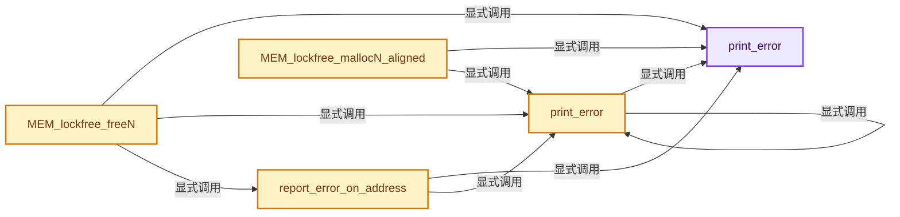
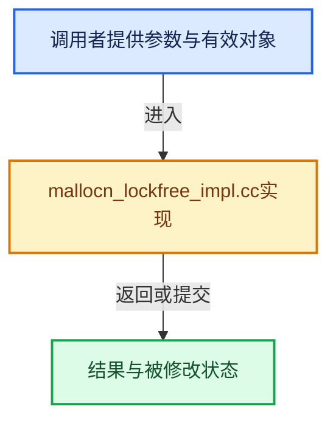

# 实现依赖专题：intern/guardedalloc/intern/mallocn_lockfree_impl.cc

[实现依赖导航](../../../README.md) · [符号索引](../../../../00-课程指南/02-源码与提交索引/符号依赖与实现索引.md)

本专题从正文实际调用进入，集中保存共享实现。函数有稳定锚点，可从调用处直接跳到对应完整函数；递归与互相调用通过回链组织。

## 本文件的实现关系






<a id="m-eac3f6447751"></a>

## 宏 `MEMHEAD_FROM_PTR`

<!-- annotated:2e5ab7a7df9bdf -->

```cpp
#define MEMHEAD_FROM_PTR(ptr) (((MemHead *)ptr) - 1)
#define PTR_FROM_MEMHEAD(memhead) (memhead + 1)
```

<details>
<summary>核对原始源码：intern/guardedalloc/intern/mallocn_lockfree_impl.cc · L75—L76</summary>

<!-- original:2e5ab7a7df9bdf:intern/guardedalloc/intern/mallocn_lockfree_impl.cc:75:76 -->

```cpp
#define MEMHEAD_FROM_PTR(ptr) (((MemHead *)ptr) - 1)
#define PTR_FROM_MEMHEAD(memhead) (memhead + 1)
```

</details>

宏在预处理阶段展开，参数替换、重复求值和条件编译应直接从该定义检查。与普通函数不同，宏不会自动提供参数类型检查；构建配置选择哪个定义需结合外围条件。

<a id="m-d4bf10bd980c"></a>

## 宏 `PTR_FROM_MEMHEAD`

<!-- annotated:4ce7083b014bdc -->

```cpp
#define PTR_FROM_MEMHEAD(memhead) (memhead + 1)
#define MEMHEAD_ALIGNED_FROM_PTR(ptr) (((MemHeadAligned *)ptr) - 1)
```

<details>
<summary>核对原始源码：intern/guardedalloc/intern/mallocn_lockfree_impl.cc · L76—L77</summary>

<!-- original:4ce7083b014bdc:intern/guardedalloc/intern/mallocn_lockfree_impl.cc:76:77 -->

```cpp
#define PTR_FROM_MEMHEAD(memhead) (memhead + 1)
#define MEMHEAD_ALIGNED_FROM_PTR(ptr) (((MemHeadAligned *)ptr) - 1)
```

</details>

宏在预处理阶段展开，参数替换、重复求值和条件编译应直接从该定义检查。与普通函数不同，宏不会自动提供参数类型检查；构建配置选择哪个定义需结合外围条件。

<a id="m-41e91a82266b"></a>

## 宏 `MEMHEAD_ALIGNED_FROM_PTR`

<!-- annotated:a2f72417eddfec -->

```cpp
#define MEMHEAD_ALIGNED_FROM_PTR(ptr) (((MemHeadAligned *)ptr) - 1)
#define MEMHEAD_IS_ALIGNED(memhead) ((memhead)->len & size_t(MEMHEAD_FLAG_ALIGN))
```

<details>
<summary>核对原始源码：intern/guardedalloc/intern/mallocn_lockfree_impl.cc · L77—L78</summary>

<!-- original:a2f72417eddfec:intern/guardedalloc/intern/mallocn_lockfree_impl.cc:77:78 -->

```cpp
#define MEMHEAD_ALIGNED_FROM_PTR(ptr) (((MemHeadAligned *)ptr) - 1)
#define MEMHEAD_IS_ALIGNED(memhead) ((memhead)->len & size_t(MEMHEAD_FLAG_ALIGN))
```

</details>

宏在预处理阶段展开，参数替换、重复求值和条件编译应直接从该定义检查。与普通函数不同，宏不会自动提供参数类型检查；构建配置选择哪个定义需结合外围条件。

<a id="m-0341abb16010"></a>

## 宏 `MEMHEAD_IS_ALIGNED`

<!-- annotated:e341079e08efda -->

```cpp
#define MEMHEAD_IS_ALIGNED(memhead) ((memhead)->len & size_t(MEMHEAD_FLAG_ALIGN))
#define MEMHEAD_HAS_NONTRIVIAL_DESTRUCTOR(memhead) \
```

<details>
<summary>核对原始源码：intern/guardedalloc/intern/mallocn_lockfree_impl.cc · L78—L79</summary>

<!-- original:e341079e08efda:intern/guardedalloc/intern/mallocn_lockfree_impl.cc:78:79 -->

```cpp
#define MEMHEAD_IS_ALIGNED(memhead) ((memhead)->len & size_t(MEMHEAD_FLAG_ALIGN))
#define MEMHEAD_HAS_NONTRIVIAL_DESTRUCTOR(memhead) \
```

</details>

宏在预处理阶段展开，参数替换、重复求值和条件编译应直接从该定义检查。与普通函数不同，宏不会自动提供参数类型检查；构建配置选择哪个定义需结合外围条件。

<a id="m-79778c058f19"></a>

## 宏 `MEMHEAD_HAS_NONTRIVIAL_DESTRUCTOR`

<!-- annotated:eb3a3b8ec7c7b5 -->

```cpp
#define MEMHEAD_HAS_NONTRIVIAL_DESTRUCTOR(memhead) \
  ((memhead)->len & size_t(MEMHEAD_FLAG_NONTRIVIAL_DESTRUCTOR))
#define MEMHEAD_LEN(memhead) ((memhead)->len & ~size_t(MEMHEAD_FLAG_MASK))
```

<details>
<summary>核对原始源码：intern/guardedalloc/intern/mallocn_lockfree_impl.cc · L79—L81</summary>

<!-- original:eb3a3b8ec7c7b5:intern/guardedalloc/intern/mallocn_lockfree_impl.cc:79:81 -->

```cpp
#define MEMHEAD_HAS_NONTRIVIAL_DESTRUCTOR(memhead) \
  ((memhead)->len & size_t(MEMHEAD_FLAG_NONTRIVIAL_DESTRUCTOR))
#define MEMHEAD_LEN(memhead) ((memhead)->len & ~size_t(MEMHEAD_FLAG_MASK))
```

</details>

宏在预处理阶段展开，参数替换、重复求值和条件编译应直接从该定义检查。与普通函数不同，宏不会自动提供参数类型检查；构建配置选择哪个定义需结合外围条件。

<a id="m-dcbb388a7914"></a>

## 宏 `MEMHEAD_LEN`

<!-- annotated:93c2a95957fccd -->

```cpp
#define MEMHEAD_LEN(memhead) ((memhead)->len & ~size_t(MEMHEAD_FLAG_MASK))

```

<details>
<summary>核对原始源码：intern/guardedalloc/intern/mallocn_lockfree_impl.cc · L81—L82</summary>

<!-- original:93c2a95957fccd:intern/guardedalloc/intern/mallocn_lockfree_impl.cc:81:82 -->

```cpp
#define MEMHEAD_LEN(memhead) ((memhead)->len & ~size_t(MEMHEAD_FLAG_MASK))

```

</details>

宏在预处理阶段展开，参数替换、重复求值和条件编译应直接从该定义检查。与普通函数不同，宏不会自动提供参数类型检查；构建配置选择哪个定义需结合外围条件。

## 完整成员与函数实现

<a id="f-82a1c7b50b497ee8"></a>

### `print_error`

实现位置：[intern/guardedalloc/intern/mallocn_lockfree_impl.cc](../../../../../../../../intern/guardedalloc/intern/mallocn_lockfree_impl.cc) · L84—L95。

接口参数：

- `const char *message`
- `va_list str_format_args`

**教学注释版**

<!-- annotated:722d4ef7bbfacd -->

```cpp
__attribute__((format(printf, 1, 0)))
#endif
static void print_error(const char *message, va_list str_format_args)
{
  char buf[512];
  vsnprintf(buf, sizeof(buf), message, str_format_args);
  buf[sizeof(buf) - 1] = '\0';

  if (error_callback) {
    error_callback(buf);
  }
}
```

<details>
<summary>核对原始源码：intern/guardedalloc/intern/mallocn_lockfree_impl.cc · L84—L95</summary>

<!-- original:722d4ef7bbfacd:intern/guardedalloc/intern/mallocn_lockfree_impl.cc:84:95 -->

```cpp
__attribute__((format(printf, 1, 0)))
#endif
static void print_error(const char *message, va_list str_format_args)
{
  char buf[512];
  vsnprintf(buf, sizeof(buf), message, str_format_args);
  buf[sizeof(buf) - 1] = '\0';

  if (error_callback) {
    error_callback(buf);
  }
}
```

</details>

**继续追踪实现**

- `vsnprintf` → [外部契约](https://eel.is/c++draft/)：这个边界按实际表达式及所属类型核对参数、返回值、寿命与失败行为。这里提供接口入口，不声称已解释该第三方版本的内部实现。
- `error_callback` → [blender::error_callback · L90](../../../08-其他Blender模块/imbuf/intern/format_jp2.cc.md#f-8ef41e8f7158aa46)。

<a id="f-635237b29d13b3b5"></a>

### `print_error`

实现位置：[intern/guardedalloc/intern/mallocn_lockfree_impl.cc](../../../../../../../../intern/guardedalloc/intern/mallocn_lockfree_impl.cc) · L98—L106。

接口参数：

- `const char *message`

**教学注释版**

<!-- annotated:217a006aff8ad0 -->

```cpp
__attribute__((format(printf, 1, 2)))
#endif
static void print_error(const char *message, ...)
{
  va_list str_format_args;
  va_start(str_format_args, message);
  print_error(message, str_format_args);
  va_end(str_format_args);
}
```

<details>
<summary>核对原始源码：intern/guardedalloc/intern/mallocn_lockfree_impl.cc · L98—L106</summary>

<!-- original:217a006aff8ad0:intern/guardedalloc/intern/mallocn_lockfree_impl.cc:98:106 -->

```cpp
__attribute__((format(printf, 1, 2)))
#endif
static void print_error(const char *message, ...)
{
  va_list str_format_args;
  va_start(str_format_args, message);
  print_error(message, str_format_args);
  va_end(str_format_args);
}
```

</details>

**继续追踪实现**

- `va_start` → [调用协议](../../../../00-课程指南/01-路线与规范/模板宏与动态分派协议.md)：函数指针、局部可调用对象或未展开的宏；必须结合调用者环境。调用位置L103。
- `print_error` → [print_error · L84](mallocn_lockfree_impl.cc.md#f-82a1c7b50b497ee8)；[print_error · L98](mallocn_lockfree_impl.cc.md#f-635237b29d13b3b5)。同名重载需按实参类型选择。
- `va_end` → [调用协议](../../../../00-课程指南/01-路线与规范/模板宏与动态分派协议.md)：函数指针、局部可调用对象或未展开的宏；必须结合调用者环境。调用位置L105。

<a id="f-cc5973ec4f740e08"></a>

### `report_error_on_address`

实现位置：[intern/guardedalloc/intern/mallocn_lockfree_impl.cc](../../../../../../../../intern/guardedalloc/intern/mallocn_lockfree_impl.cc) · L109—L135。

接口参数：

- `const void *vmemh`
- `const char *message`

**教学注释版**

<!-- annotated:0f6a5ddb56e183 -->

```cpp
__attribute__((format(printf, 2, 3)))
#endif
static void report_error_on_address(const void *vmemh, const char *message, ...)
{
  va_list str_format_args;

  va_start(str_format_args, message);
  print_error(message, str_format_args);
  va_end(str_format_args);

  if (vmemh == nullptr) {
    MEM_trigger_error_on_memory_block(nullptr, 0);
    return;
  }

  const MemHead *memh = MEMHEAD_FROM_PTR(vmemh);
  const size_t len = MEMHEAD_LEN(memh);

  const void *address = memh;
  size_t size = len + sizeof(*memh);
  if (MEMHEAD_IS_ALIGNED(memh)) [[unlikely]] {
    const MemHeadAligned *memh_aligned = MEMHEAD_ALIGNED_FROM_PTR(vmemh);
    address = MEMHEAD_REAL_PTR(memh_aligned);
    size = len + sizeof(*memh_aligned) + MEMHEAD_ALIGN_PADDING(memh_aligned->alignment);
  }
  MEM_trigger_error_on_memory_block(address, size);
}
```

<details>
<summary>核对原始源码：intern/guardedalloc/intern/mallocn_lockfree_impl.cc · L109—L135</summary>

<!-- original:0f6a5ddb56e183:intern/guardedalloc/intern/mallocn_lockfree_impl.cc:109:135 -->

```cpp
__attribute__((format(printf, 2, 3)))
#endif
static void report_error_on_address(const void *vmemh, const char *message, ...)
{
  va_list str_format_args;

  va_start(str_format_args, message);
  print_error(message, str_format_args);
  va_end(str_format_args);

  if (vmemh == nullptr) {
    MEM_trigger_error_on_memory_block(nullptr, 0);
    return;
  }

  const MemHead *memh = MEMHEAD_FROM_PTR(vmemh);
  const size_t len = MEMHEAD_LEN(memh);

  const void *address = memh;
  size_t size = len + sizeof(*memh);
  if (MEMHEAD_IS_ALIGNED(memh)) [[unlikely]] {
    const MemHeadAligned *memh_aligned = MEMHEAD_ALIGNED_FROM_PTR(vmemh);
    address = MEMHEAD_REAL_PTR(memh_aligned);
    size = len + sizeof(*memh_aligned) + MEMHEAD_ALIGN_PADDING(memh_aligned->alignment);
  }
  MEM_trigger_error_on_memory_block(address, size);
}
```

</details>

**沿实际写入检查状态**

- `address = MEMHEAD_REAL_PTR(memh_aligned);`
- `size = len + sizeof(*memh_aligned) + MEMHEAD_ALIGN_PADDING(memh_aligned->alignment);`

**继续追踪实现**

- `va_start` → [调用协议](../../../../00-课程指南/01-路线与规范/模板宏与动态分派协议.md)：函数指针、局部可调用对象或未展开的宏；必须结合调用者环境。调用位置L115。
- `print_error` → [print_error · L84](mallocn_lockfree_impl.cc.md#f-82a1c7b50b497ee8)；[print_error · L98](mallocn_lockfree_impl.cc.md#f-635237b29d13b3b5)。同名重载需按实参类型选择。
- `va_end` → [调用协议](../../../../00-课程指南/01-路线与规范/模板宏与动态分派协议.md)：函数指针、局部可调用对象或未展开的宏；必须结合调用者环境。调用位置L117。
- `MEM_trigger_error_on_memory_block` → [MEM_trigger_error_on_memory_block · L40](mallocn_inline.hh.md#f-557d15ff50eac9ef)；[MEM_trigger_error_on_memory_block · L63](mallocn_inline.hh.md#f-1d5c4efbe30e6ace)。同名重载需按实参类型选择。
- `MEMHEAD_FROM_PTR` → [MEMHEAD_FROM_PTR · L75](mallocn_lockfree_impl.cc.md#m-eac3f6447751)。宏定义由构建条件选择。
- `MEMHEAD_LEN` → [MEMHEAD_LEN · L81](mallocn_lockfree_impl.cc.md#m-dcbb388a7914)。宏定义由构建条件选择。
- `MEMHEAD_IS_ALIGNED` → [MEMHEAD_IS_ALIGNED · L78](mallocn_lockfree_impl.cc.md#m-0341abb16010)。宏定义由构建条件选择。
- `MEMHEAD_ALIGNED_FROM_PTR` → [MEMHEAD_ALIGNED_FROM_PTR · L77](mallocn_lockfree_impl.cc.md#m-41e91a82266b)。宏定义由构建条件选择。
- `MEMHEAD_REAL_PTR` → [MEMHEAD_REAL_PTR · L81](mallocn_intern.hh.md#m-fb3c50621d05)。宏定义由构建条件选择。
- `MEMHEAD_ALIGN_PADDING` → [MEMHEAD_ALIGN_PADDING · L77](mallocn_intern.hh.md#m-5e6458a50df3)。宏定义由构建条件选择。

<a id="f-da4b6d2cf3cb90d8"></a>

### `MEM_lockfree_freeN`

实现位置：[intern/guardedalloc/intern/mallocn_lockfree_impl.cc](../../../../../../../../intern/guardedalloc/intern/mallocn_lockfree_impl.cc) · L146—L180。

接口参数：

- `void *vmemh`
- `DestructorType destructor_type`

**教学注释版**

<!-- annotated:c9569c69367ce8 -->

```cpp
void MEM_lockfree_freeN(void *vmemh, DestructorType destructor_type)
{
  PRF_scope(blender::ProfileCategory::Core);
  if (leak_detector_has_run) [[unlikely]] {
    print_error("%s\n", free_after_leak_detection_message);
  }

  if (vmemh == nullptr) [[unlikely]] {
    report_error_on_address(vmemh, "Attempt to free nullptr pointer\n");
    return;
  }

  // [讲解] 用户指针回退到后端块头；不能对任意外部指针执行这一转换。
  MemHead *memh = MEMHEAD_FROM_PTR(vmemh);
  size_t len = MEMHEAD_LEN(memh);

  if (destructor_type != DestructorType::NonTrivial && MEMHEAD_HAS_NONTRIVIAL_DESTRUCTOR(memh)) {
    report_error_on_address(vmemh,
                            "Attempt to use C-style MEM_delete_void on a pointer created with "
                            "CPP-style MEM_new or new\n");
  }

  // [讲解] 减少活块数量与使用字节数。
  memory_usage_block_free(len);

  if (malloc_debug_memset && len) [[unlikely]] {
    // [讲解] memset：填充字节，不调用T构造函数，也不保证任意类型的全零表示是合法或期望值。
    memset(memh + 1, 255, len);
  }
  if (MEMHEAD_IS_ALIGNED(memh)) [[unlikely]] {
    MemHeadAligned *memh_aligned = MEMHEAD_ALIGNED_FROM_PTR(vmemh);
    // [讲解] aligned_free：按当前平台释放对齐分配取得的基地址。
    // [讲解] 恢复包含padding的系统基地址，再匹配对齐释放API。
    aligned_free(MEMHEAD_REAL_PTR(memh_aligned));
  }
  else {
    PRF_memory_free(memh);
    // [讲解] free：归还相匹配的C分配存储，不自动执行C++析构；不可用于Windows的_aligned_malloc结果。
    // [讲解] 普通malloc块的释放路径，基地址就是块头位置。
    free(memh);
  }
}
```

<details>
<summary>核对原始源码：intern/guardedalloc/intern/mallocn_lockfree_impl.cc · L146—L180</summary>

<!-- original:c9569c69367ce8:intern/guardedalloc/intern/mallocn_lockfree_impl.cc:146:180 -->

```cpp
void MEM_lockfree_freeN(void *vmemh, DestructorType destructor_type)
{
  PRF_scope(blender::ProfileCategory::Core);
  if (leak_detector_has_run) [[unlikely]] {
    print_error("%s\n", free_after_leak_detection_message);
  }

  if (vmemh == nullptr) [[unlikely]] {
    report_error_on_address(vmemh, "Attempt to free nullptr pointer\n");
    return;
  }

  MemHead *memh = MEMHEAD_FROM_PTR(vmemh);
  size_t len = MEMHEAD_LEN(memh);

  if (destructor_type != DestructorType::NonTrivial && MEMHEAD_HAS_NONTRIVIAL_DESTRUCTOR(memh)) {
    report_error_on_address(vmemh,
                            "Attempt to use C-style MEM_delete_void on a pointer created with "
                            "CPP-style MEM_new or new\n");
  }

  memory_usage_block_free(len);

  if (malloc_debug_memset && len) [[unlikely]] {
    memset(memh + 1, 255, len);
  }
  if (MEMHEAD_IS_ALIGNED(memh)) [[unlikely]] {
    MemHeadAligned *memh_aligned = MEMHEAD_ALIGNED_FROM_PTR(vmemh);
    aligned_free(MEMHEAD_REAL_PTR(memh_aligned));
  }
  else {
    PRF_memory_free(memh);
    free(memh);
  }
}
```

</details>

**机制与执行推导**

从用户地址恢复块头和系统基地址，更新统计后按原分配方式释放。

nullptr被报告为错误然后返回，这与C free(nullptr)直接无操作的契约不同。

MEMHEAD_FROM_PTR先回退到块头，MEMHEAD_LEN屏蔽标志位取实际记录长度。析构标记检查诊断接口不匹配，不会在这里替用户调用T析构。

释放之前先减少块统计，可选填255帮助发现释放后使用。对于对齐块，再取扩展块头并通过MEMHEAD_REAL_PTR扣除padding，最后交给aligned_free。

普通块直接free块头。不要把这两条路径混合；来自Windows_aligned_malloc的块必须交给_aligned_free。

名称中的lockfree不能推导成所有诊断、统计和调用者对象操作均无同步，更不表示Vector可被并发修改。

**继续追踪实现**

- `PRF_scope` → [PRF_scope · L51](../../profile/PRF_profile.hh.md#m-9f5e4ea0487b)；[PRF_scope · L90](../../profile/PRF_profile.hh.md#m-8fc74ae4419e)。宏定义由构建条件选择。
- `print_error` → [print_error · L84](mallocn_lockfree_impl.cc.md#f-82a1c7b50b497ee8)；[print_error · L98](mallocn_lockfree_impl.cc.md#f-635237b29d13b3b5)。同名重载需按实参类型选择。
- `report_error_on_address` → [report_error_on_address · L109](mallocn_lockfree_impl.cc.md#f-cc5973ec4f740e08)。
- `MEMHEAD_FROM_PTR` → [MEMHEAD_FROM_PTR · L75](mallocn_lockfree_impl.cc.md#m-eac3f6447751)。宏定义由构建条件选择。
- `MEMHEAD_LEN` → [MEMHEAD_LEN · L81](mallocn_lockfree_impl.cc.md#m-dcbb388a7914)。宏定义由构建条件选择。
- `MEMHEAD_HAS_NONTRIVIAL_DESTRUCTOR` → [MEMHEAD_HAS_NONTRIVIAL_DESTRUCTOR · L79](mallocn_lockfree_impl.cc.md#m-79778c058f19)。宏定义由构建条件选择。
- `memory_usage_block_free` → [memory_usage_block_free · L212](memory_usage.cc.md#f-9824aba7aee57b36)。
- `memset` → [外部契约](https://eel.is/c++draft/cstring.syn)：填充字节，不调用T构造函数，也不保证任意类型的全零表示是合法或期望值。
- `MEMHEAD_IS_ALIGNED` → [MEMHEAD_IS_ALIGNED · L78](mallocn_lockfree_impl.cc.md#m-0341abb16010)。宏定义由构建条件选择。
- `MEMHEAD_ALIGNED_FROM_PTR` → [MEMHEAD_ALIGNED_FROM_PTR · L77](mallocn_lockfree_impl.cc.md#m-41e91a82266b)。宏定义由构建条件选择。
- `aligned_free` → [aligned_free · L99](mallocn.cc.md#f-9dceace8dd60fe03)。
- `MEMHEAD_REAL_PTR` → [MEMHEAD_REAL_PTR · L81](mallocn_intern.hh.md#m-fb3c50621d05)。宏定义由构建条件选择。
- `PRF_memory_free` → [PRF_memory_free · L82](../../profile/PRF_profile.hh.md#m-7e85956a936f)；[PRF_memory_free · L105](../../profile/PRF_profile.hh.md#m-afc21d064bc2)。宏定义由构建条件选择。
- `free` → [外部契约](https://eel.is/c++draft/c.malloc)：归还相匹配的C分配存储，不自动执行C++析构；不可用于Windows的_aligned_malloc结果。

<a id="f-0d9870a941cc5e2d"></a>

### `MEM_lockfree_mallocN_aligned`

实现位置：[intern/guardedalloc/intern/mallocn_lockfree_impl.cc](../../../../../../../../intern/guardedalloc/intern/mallocn_lockfree_impl.cc) · L406—L476。

接口参数：

- `size_t len`
- `size_t alignment`
- `const char *str`
- `const DestructorType destructor_type`

**教学注释版**

<!-- annotated:86fe3b43ade616 -->

```cpp
void *MEM_lockfree_mallocN_aligned(size_t len,
                                   size_t alignment,
                                   const char *str,
                                   const DestructorType destructor_type)
{
  PRF_scope(blender::ProfileCategory::Core);
  /* Huge alignment values doesn't make sense and they wouldn't fit into 'short' used in the
   * MemHead. */
  // [讲解] assert：检查开发者预期条件，配置可能关闭；不承担完整输入处理或自动修复。
  // [讲解] 块头以short存对齐，接口还限制可接受的对齐范围。
  assert(alignment < 1024);

  /* We only support alignments that are a power of two. */
  // [讲解] 对齐值必须是2的幂；0不是有效对齐请求。
  assert(IS_POW2(alignment));

  /* Some OS specific aligned allocators require a certain minimal alignment. */
  if (alignment < ALIGNED_MALLOC_MINIMUM_ALIGNMENT) {
    alignment = ALIGNED_MALLOC_MINIMUM_ALIGNMENT;
  }

  /* It's possible that MemHead's size is not properly aligned,
   * do extra padding to deal with this.
   *
   * We only support small alignments which fits into short in
   * order to save some bits in MemHead structure.
   */
  // [讲解] 计算块头前的填充，使用户地址满足请求对齐。
  size_t extra_padding = MEMHEAD_ALIGN_PADDING(alignment);

#ifdef WITH_MEM_VALGRIND
  const size_t len_unaligned = len;
#endif
  // [讲解] 后端按4字节取整记账；不构造任何元素。
  len = SIZET_ALIGN_4(len);

  // [讲解] aligned_malloc：选择当前平台的对齐存储API。
  MemHeadAligned *memh = (MemHeadAligned *)aligned_malloc(
      len + extra_padding + sizeof(MemHeadAligned), alignment);
  PRF_memory_alloc(memh, len + extra_padding + sizeof(MemHeadAligned));

  if (memh) [[likely]] {
    /* We keep padding in the beginning of MemHead,
     * this way it's always possible to get MemHead
     * from the data pointer.
     */
    // [讲解] 保留系统基地址与块头之间的差，释放时反向恢复。
    memh = (MemHeadAligned *)((char *)memh + extra_padding);

    if (len) [[likely]] {
      if (malloc_debug_memset) [[unlikely]] {
        // [讲解] memset：填充字节，不调用T构造函数，也不保证任意类型的全零表示是合法或期望值。
        memset(memh + 1, 255, len);
      }
#ifdef WITH_MEM_VALGRIND
      if (malloc_debug_memset) {
        VALGRIND_MAKE_MEM_UNDEFINED(memh + 1, len_unaligned);
      }
      else {
        VALGRIND_MAKE_MEM_DEFINED((const char *)(memh + 1) + len_unaligned, len - len_unaligned);
      }
#endif /* WITH_MEM_VALGRIND */
    }

    memh->len = len | size_t(MEMHEAD_FLAG_ALIGN) |
                size_t(destructor_type == DestructorType::NonTrivial ?
                           MEMHEAD_FLAG_NONTRIVIAL_DESTRUCTOR :
                           0);
    memh->alignment = short(alignment);
    // [讲解] 成功后才计入活分配块统计。
    memory_usage_block_alloc(len);

    // [讲解] 返回块头后的用户区；不是aligned_malloc原始返回地址。
    return PTR_FROM_MEMHEAD(memh);
  }
  print_error("Malloc returns null: len=" SIZET_FORMAT " in %s, total " SIZET_FORMAT "\n",
              SIZET_ARG(len),
              str,
              memory_usage_current());
  // [讲解] 分配失败以空返回值表示，不是C++异常。
  return nullptr;
}
```

<details>
<summary>核对原始源码：intern/guardedalloc/intern/mallocn_lockfree_impl.cc · L406—L476</summary>

<!-- original:86fe3b43ade616:intern/guardedalloc/intern/mallocn_lockfree_impl.cc:406:476 -->

```cpp
void *MEM_lockfree_mallocN_aligned(size_t len,
                                   size_t alignment,
                                   const char *str,
                                   const DestructorType destructor_type)
{
  PRF_scope(blender::ProfileCategory::Core);
  /* Huge alignment values doesn't make sense and they wouldn't fit into 'short' used in the
   * MemHead. */
  assert(alignment < 1024);

  /* We only support alignments that are a power of two. */
  assert(IS_POW2(alignment));

  /* Some OS specific aligned allocators require a certain minimal alignment. */
  if (alignment < ALIGNED_MALLOC_MINIMUM_ALIGNMENT) {
    alignment = ALIGNED_MALLOC_MINIMUM_ALIGNMENT;
  }

  /* It's possible that MemHead's size is not properly aligned,
   * do extra padding to deal with this.
   *
   * We only support small alignments which fits into short in
   * order to save some bits in MemHead structure.
   */
  size_t extra_padding = MEMHEAD_ALIGN_PADDING(alignment);

#ifdef WITH_MEM_VALGRIND
  const size_t len_unaligned = len;
#endif
  len = SIZET_ALIGN_4(len);

  MemHeadAligned *memh = (MemHeadAligned *)aligned_malloc(
      len + extra_padding + sizeof(MemHeadAligned), alignment);
  PRF_memory_alloc(memh, len + extra_padding + sizeof(MemHeadAligned));

  if (memh) [[likely]] {
    /* We keep padding in the beginning of MemHead,
     * this way it's always possible to get MemHead
     * from the data pointer.
     */
    memh = (MemHeadAligned *)((char *)memh + extra_padding);

    if (len) [[likely]] {
      if (malloc_debug_memset) [[unlikely]] {
        memset(memh + 1, 255, len);
      }
#ifdef WITH_MEM_VALGRIND
      if (malloc_debug_memset) {
        VALGRIND_MAKE_MEM_UNDEFINED(memh + 1, len_unaligned);
      }
      else {
        VALGRIND_MAKE_MEM_DEFINED((const char *)(memh + 1) + len_unaligned, len - len_unaligned);
      }
#endif /* WITH_MEM_VALGRIND */
    }

    memh->len = len | size_t(MEMHEAD_FLAG_ALIGN) |
                size_t(destructor_type == DestructorType::NonTrivial ?
                           MEMHEAD_FLAG_NONTRIVIAL_DESTRUCTOR :
                           0);
    memh->alignment = short(alignment);
    memory_usage_block_alloc(len);

    return PTR_FROM_MEMHEAD(memh);
  }
  print_error("Malloc returns null: len=" SIZET_FORMAT " in %s, total " SIZET_FORMAT "\n",
              SIZET_ARG(len),
              str,
              memory_usage_current());
  return nullptr;
}
```

</details>

**机制与执行推导**

在系统对齐块前保存紧凑块头，返回块头后的用户数据地址。

alignment必须是小于1024的2次幂；断言表达的是内部接口契约。系统需要更大最小对齐时，先上调alignment。

extra_padding用于把块头后面的用户区域放到满足对齐的位置。系统取得的基地址、块头地址和返回给Vector的地址是三个不同位置。

len先按4字节取整。系统请求包含用户长度、块头和padding，不能把请求量当作可构造元素数量；Vector只按自己的capacity使用它。

成功分支移动块头指针，按调试配置填充字节，记录长度和析构标记，最后更新内存统计。填255是诊断机制，不是构造T。

底层失败时打印诊断并返回nullptr；这里没有throw std::bad_alloc。Vector的catch只处理异常，不能捕获这个返回值。

释放时必须通过MEM接口恢复真正基地址。如果直接把返回给Vector的用户地址交给_aligned_free，会把内部地址当成系统分配地址。

**沿实际写入检查状态**

- `alignment = ALIGNED_MALLOC_MINIMUM_ALIGNMENT;`
- `len = SIZET_ALIGN_4(len);`
- `memh = (MemHeadAligned *)((char *)memh + extra_padding);`
- `memh->len = len | size_t(MEMHEAD_FLAG_ALIGN) |`
- `memh->alignment = short(alignment);`

**结果出口**

- `return PTR_FROM_MEMHEAD(memh);`
- `return nullptr;`

**继续追踪实现**

- `PRF_scope` → [PRF_scope · L51](../../profile/PRF_profile.hh.md#m-9f5e4ea0487b)；[PRF_scope · L90](../../profile/PRF_profile.hh.md#m-8fc74ae4419e)。宏定义由构建条件选择。
- `assert` → [外部契约](https://eel.is/c++draft/assertions)：检查开发者预期条件，配置可能关闭；不承担完整输入处理或自动修复。
- `IS_POW2` → [IS_POW2 · L74](mallocn_intern.hh.md#m-fe7cc82e6c52)。宏定义由构建条件选择。
- `MEMHEAD_ALIGN_PADDING` → [MEMHEAD_ALIGN_PADDING · L77](mallocn_intern.hh.md#m-5e6458a50df3)。宏定义由构建条件选择。
- `SIZET_ALIGN_4` → [SIZET_ALIGN_4 · L46](mallocn_intern.hh.md#m-a6f9f87859ec)。宏定义由构建条件选择。
- `aligned_malloc` → [aligned_malloc · L77](mallocn.cc.md#f-48812794cdf34f28)。
- `PRF_memory_alloc` → [PRF_memory_alloc · L81](../../profile/PRF_profile.hh.md#m-cc7683e7f1d1)；[PRF_memory_alloc · L104](../../profile/PRF_profile.hh.md#m-e02bfcfa18fb)。宏定义由构建条件选择。
- `memset` → [外部契约](https://eel.is/c++draft/cstring.syn)：填充字节，不调用T构造函数，也不保证任意类型的全零表示是合法或期望值。
- `VALGRIND_MAKE_MEM_UNDEFINED` → [调用协议](../../../../00-课程指南/01-路线与规范/模板宏与动态分派协议.md)：配置相关检测或外部运行时接口。调用位置L454。
- `VALGRIND_MAKE_MEM_DEFINED` → [调用协议](../../../../00-课程指南/01-路线与规范/模板宏与动态分派协议.md)：配置相关检测或外部运行时接口。调用位置L457。
- `memory_usage_block_alloc` → [memory_usage_block_alloc · L188](memory_usage.cc.md#f-c61403f995d91ebf)。
- `PTR_FROM_MEMHEAD` → [PTR_FROM_MEMHEAD · L76](mallocn_lockfree_impl.cc.md#m-d4bf10bd980c)。宏定义由构建条件选择。
- `print_error` → [print_error · L84](mallocn_lockfree_impl.cc.md#f-82a1c7b50b497ee8)；[print_error · L98](mallocn_lockfree_impl.cc.md#f-635237b29d13b3b5)。同名重载需按实参类型选择。
- `SIZET_ARG` → [SIZET_ARG · L44](mallocn_intern.hh.md#m-b6c84cb3beae)。宏定义由构建条件选择。
- `memory_usage_current` → [memory_usage_current · L242](memory_usage.cc.md#f-3597d00ae55789c3)。
