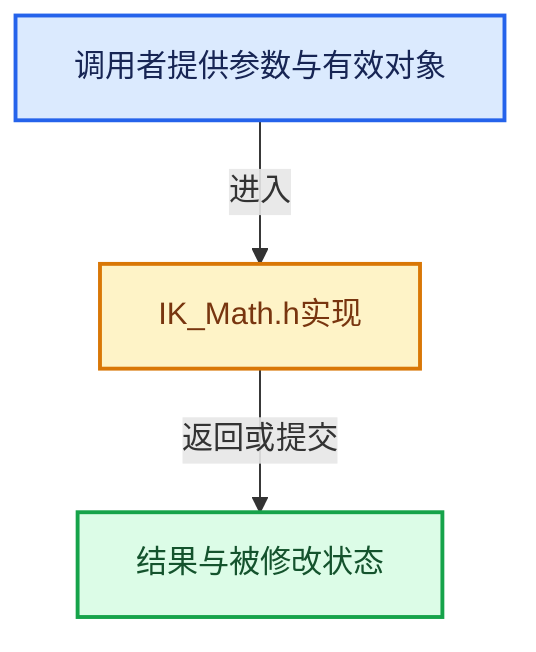

# 实现依赖专题：intern/iksolver/intern/IK_Math.h

[实现依赖导航](../../../README.md) · [符号索引](../../../../00-课程指南/02-源码与提交索引/符号依赖与实现索引.md)

本专题从正文实际调用进入，集中保存共享实现。函数有稳定锚点，可从调用处直接跳到对应完整函数；递归与互相调用通过回链组织。

## 本文件的实现关系





## 完整成员与函数实现

<a id="f-0eab8b703844d7f8"></a>

### `FuzzyZero`

实现位置：[intern/iksolver/intern/IK_Math.h](../../../../../../../../intern/iksolver/intern/IK_Math.h) · L25—L28。

接口参数：

- `double x`

**教学注释版**

<!-- annotated:162bc8898b6daa -->

```cpp
static inline bool FuzzyZero(double x)
{
  return fabs(x) < IK_EPSILON;
}
```

<details>
<summary>核对原始源码：intern/iksolver/intern/IK_Math.h · L25—L28</summary>

<!-- original:162bc8898b6daa:intern/iksolver/intern/IK_Math.h:25:28 -->

```cpp
static inline bool FuzzyZero(double x)
{
  return fabs(x) < IK_EPSILON;
}
```

</details>

**结果出口**

- `return fabs(x) < IK_EPSILON;`

**继续追踪实现**

- `fabs` → [外部契约](https://eel.is/c++draft/)：这个边界按实际表达式及所属类型核对参数、返回值、寿命与失败行为。这里提供接口入口，不声称已解释该第三方版本的内部实现。

<a id="f-1a1c851a5bd44fba"></a>

### `normalize`

实现位置：[intern/iksolver/intern/IK_Math.h](../../../../../../../../intern/iksolver/intern/IK_Math.h) · L109—L115。

接口参数：

- `const Eigen::Vector3d &v`

**教学注释版**

<!-- annotated:bb63fc43b63785 -->

```cpp
static inline Eigen::Vector3d normalize(const Eigen::Vector3d &v)
{
  // a sane normalize function that doesn't give (1, 0, 0) in case
  // of a zero length vector
  double len = v.norm();
  return FuzzyZero(len) ? Eigen::Vector3d(0, 0, 0) : Eigen::Vector3d(v / len);
}
```

<details>
<summary>核对原始源码：intern/iksolver/intern/IK_Math.h · L109—L115</summary>

<!-- original:bb63fc43b63785:intern/iksolver/intern/IK_Math.h:109:115 -->

```cpp
static inline Eigen::Vector3d normalize(const Eigen::Vector3d &v)
{
  // a sane normalize function that doesn't give (1, 0, 0) in case
  // of a zero length vector
  double len = v.norm();
  return FuzzyZero(len) ? Eigen::Vector3d(0, 0, 0) : Eigen::Vector3d(v / len);
}
```

</details>

**结果出口**

- `return FuzzyZero(len) ? Eigen::Vector3d(0, 0, 0) : Eigen::Vector3d(v / len);`

**继续追踪实现**

- `v.norm` → [Freestyle::VecMat::norm · L92](../../../08-其他Blender模块/freestyle/intern/geometry/VecMat.h.md#f-0254de55a1b6b2a1)。
- `FuzzyZero` → [FuzzyZero · L25](IK_Math.h.md#f-0eab8b703844d7f8)。
- `Eigen::Vector3d` → [外部契约](https://eel.is/c++draft/)：这个边界按实际表达式及所属类型核对参数、返回值、寿命与失败行为。这里提供接口入口，不声称已解释该第三方版本的内部实现。
