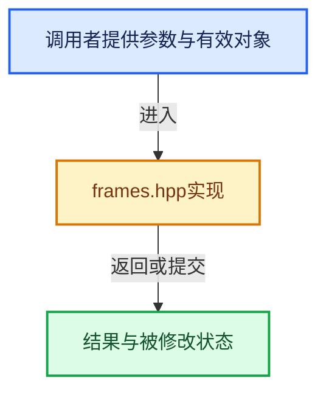

# 实现依赖专题：intern/itasc/kdl/frames.hpp

[实现依赖导航](../../../README.md) · [符号索引](../../../../00-课程指南/02-源码与提交索引/符号依赖与实现索引.md)

本专题从正文实际调用进入，集中保存共享实现。函数有稳定锚点，可从调用处直接跳到对应完整函数；递归与互相调用通过回链组织。

## 本文件的实现关系





## 相关类型布局与成员入口

<a id="t-7db3cae4c06c"></a>

### `KDL::Vector`

原始声明：[intern/itasc/kdl/frames.hpp](../../../../../../../../intern/itasc/kdl/frames.hpp) · L128—L128。

成员布局：

- `double data`
- `void GetValue`
- `Vector operator =`
- `double operator()`
- `double operator()`
- `double x`
- `double y`
- `double z`
- `void x`
- `void y`
- `void z`
- `void ReverseSign`
- `Vector operator-=`
- `Vector operator +=`
- `Vector operator *=`
- `friend operator*`
- `friend operator*`
- `friend operator/`
- `friend operator+`
- `friend operator-`
- `friend operator*`
- `friend operator-`
- `friend dot`
- `friend SetToZero`
- `Vector Zero`
- `double Normalize`
- `double Norm`
- `void Set2DXY`
- `void Set2DYZ`
- `void Set2DZX`
- `void Set2DPlane`
- `friend Equal`
- `friend Normalize`
- `friend operator==`
- `friend operator!=`

以下保留类的数据声明与编译条件，成员函数实现通过后面的精确链接阅读。

<!-- annotated:e5401b5adb9576 -->

```cpp
class Vector;
```

<details>
<summary>核对原始源码：intern/itasc/kdl/frames.hpp · L128—L128</summary>

<!-- original:e5401b5adb9576:intern/itasc/kdl/frames.hpp:128:128 -->

```cpp
class Vector;
```

</details>


<a id="t-d9f123375f9e"></a>

### `KDL::Vector`

原始声明：[intern/itasc/kdl/frames.hpp](../../../../../../../../intern/itasc/kdl/frames.hpp) · L142—L262。

成员布局：

- `double data`
- `void GetValue`
- `Vector operator =`
- `double operator()`
- `double operator()`
- `double x`
- `double y`
- `double z`
- `void x`
- `void y`
- `void z`
- `void ReverseSign`
- `Vector operator-=`
- `Vector operator +=`
- `Vector operator *=`
- `friend operator*`
- `friend operator*`
- `friend operator/`
- `friend operator+`
- `friend operator-`
- `friend operator*`
- `friend operator-`
- `friend dot`
- `friend SetToZero`
- `Vector Zero`
- `double Normalize`
- `double Norm`
- `void Set2DXY`
- `void Set2DYZ`
- `void Set2DZX`
- `void Set2DPlane`
- `friend Equal`
- `friend Normalize`
- `friend operator==`
- `friend operator!=`

以下保留类的数据声明与编译条件，成员函数实现通过后面的精确链接阅读。

<!-- annotated:ad94b6a0d0e8b7 -->

```cpp
class Vector
{
public:
    double data[3];
     //! Does not initialise the Vector to zero. use Vector::Zero() or SetToZero for that
```

<details>
<summary>核对原始源码：intern/itasc/kdl/frames.hpp · L142—L146</summary>

<!-- original:ad94b6a0d0e8b7:intern/itasc/kdl/frames.hpp:142:146 -->

```cpp
class Vector
{
public:
    double data[3];
     //! Does not initialise the Vector to zero. use Vector::Zero() or SetToZero for that
```

</details>

<!-- annotated:93aa1fb0e8754b -->

```cpp

     //! Constructs a vector out of the three values x, y and z
     inline Vector(double x,double y, double z);

     //! Constructs a vector out of an array of three values x, y and z
     inline Vector(double* xyz);

     //! Constructs a vector out of an array of three values x, y and z
     inline Vector(float* xyz);

	 //! Assignment operator. The normal copy by value semantics.
     inline Vector(const Vector& arg);

	 //! store vector components in array
	 inline void GetValue(double* xyz) const;

	 //! Assignment operator. The normal copy by value semantics.
     inline Vector& operator = ( const Vector& arg);

     //! Access to elements, range checked when NDEBUG is not set, from 0..2
     inline double operator()(int index) const;

     //! Access to elements, range checked when NDEBUG is not set, from 0..2
     inline double& operator() (int index);

	 //! Equivalent to double operator()(int index) const
```

<details>
<summary>核对原始源码：intern/itasc/kdl/frames.hpp · L148—L173</summary>

<!-- original:93aa1fb0e8754b:intern/itasc/kdl/frames.hpp:148:173 -->

```cpp

     //! Constructs a vector out of the three values x, y and z
     inline Vector(double x,double y, double z);

     //! Constructs a vector out of an array of three values x, y and z
     inline Vector(double* xyz);

     //! Constructs a vector out of an array of three values x, y and z
     inline Vector(float* xyz);

	 //! Assignment operator. The normal copy by value semantics.
     inline Vector(const Vector& arg);

	 //! store vector components in array
	 inline void GetValue(double* xyz) const;

	 //! Assignment operator. The normal copy by value semantics.
     inline Vector& operator = ( const Vector& arg);

     //! Access to elements, range checked when NDEBUG is not set, from 0..2
     inline double operator()(int index) const;

     //! Access to elements, range checked when NDEBUG is not set, from 0..2
     inline double& operator() (int index);

	 //! Equivalent to double operator()(int index) const
```

</details>

<!-- annotated:ff7339c9f0061c -->

```cpp

	 //! Equivalent to double& operator()(int index)
```

<details>
<summary>核对原始源码：intern/itasc/kdl/frames.hpp · L178—L179</summary>

<!-- original:ff7339c9f0061c:intern/itasc/kdl/frames.hpp:178:179 -->

```cpp

	 //! Equivalent to double& operator()(int index)
```

</details>

<!-- annotated:57cba986017fa6 -->

```cpp

     inline double x() const;
     inline double y() const;
     inline double z() const;
     inline void x(double);
     inline void y(double);
     inline void z(double);

     //! Reverses the sign of the Vector object itself
     inline void ReverseSign();


     //! subtracts a vector from the Vector object itself
     inline Vector& operator-=(const Vector& arg);


     //! Adds a vector from the Vector object itself
     inline Vector& operator +=(const Vector& arg);

     //! Multiply by a scalar
     inline Vector& operator *=(double arg);

     //! Scalar multiplication is defined
     inline friend Vector operator*(const Vector& lhs,double rhs);
     //! Scalar multiplication is defined
     inline friend Vector operator*(double lhs,const Vector& rhs);
     //! Scalar division is defined

     inline friend Vector operator/(const Vector& lhs,double rhs);
     inline friend Vector operator+(const Vector& lhs,const Vector& rhs);
     inline friend Vector operator-(const Vector& lhs,const Vector& rhs);
     inline friend Vector operator*(const Vector& lhs,const Vector& rhs);
     inline friend Vector operator-(const Vector& arg);
     inline friend double dot(const Vector& lhs,const Vector& rhs);

     //! To have a uniform operator to put an element to zero, for scalar values
     //! and for objects.
     inline friend void SetToZero(Vector& v);

     //! @return a zero vector
     inline static Vector Zero();

   /** Normalizes this vector and returns it norm
	* makes v a unitvector and returns the norm of v.
	* if v is smaller than eps, Vector(1,0,0) is returned with norm 0.
	* if this is not good, check the return value of this method.
	*/
     double Normalize(double eps=epsilon);

     //!    @return the norm of the vector
     double Norm() const;


     //! a 3D vector where the 2D vector v is put in the XY plane
     inline void Set2DXY(const Vector2& v);
     //! a 3D vector where the 2D vector v is put in the YZ plane
     inline void Set2DYZ(const Vector2& v);
     //! a 3D vector where the 2D vector v is put in the ZX plane
     inline void Set2DZX(const Vector2& v);
     //! a 3D vector where the 2D vector v_XY is put in the XY plane of the frame F_someframe_XY.
     inline void Set2DPlane(const Frame& F_someframe_XY,const Vector2& v_XY);


     //! do not use operator == because the definition of Equal(.,.) is slightly
     //! different.  It compares whether the 2 arguments are equal in an eps-interval
     inline friend bool Equal(const Vector& a,const Vector& b,double eps);

	 //! return a normalized vector
	 inline friend Vector Normalize(const Vector& a, double eps);

	 //! The literal equality operator==(), also identical.
     inline friend bool operator==(const Vector& a,const Vector& b);
	 //! The literal inequality operator!=().
     inline friend bool operator!=(const Vector& a,const Vector& b);

     friend class Rotation;
     friend class Frame;
};
```

<details>
<summary>核对原始源码：intern/itasc/kdl/frames.hpp · L184—L262</summary>

<!-- original:57cba986017fa6:intern/itasc/kdl/frames.hpp:184:262 -->

```cpp

     inline double x() const;
     inline double y() const;
     inline double z() const;
     inline void x(double);
     inline void y(double);
     inline void z(double);

     //! Reverses the sign of the Vector object itself
     inline void ReverseSign();


     //! subtracts a vector from the Vector object itself
     inline Vector& operator-=(const Vector& arg);


     //! Adds a vector from the Vector object itself
     inline Vector& operator +=(const Vector& arg);

     //! Multiply by a scalar
     inline Vector& operator *=(double arg);

     //! Scalar multiplication is defined
     inline friend Vector operator*(const Vector& lhs,double rhs);
     //! Scalar multiplication is defined
     inline friend Vector operator*(double lhs,const Vector& rhs);
     //! Scalar division is defined

     inline friend Vector operator/(const Vector& lhs,double rhs);
     inline friend Vector operator+(const Vector& lhs,const Vector& rhs);
     inline friend Vector operator-(const Vector& lhs,const Vector& rhs);
     inline friend Vector operator*(const Vector& lhs,const Vector& rhs);
     inline friend Vector operator-(const Vector& arg);
     inline friend double dot(const Vector& lhs,const Vector& rhs);

     //! To have a uniform operator to put an element to zero, for scalar values
     //! and for objects.
     inline friend void SetToZero(Vector& v);

     //! @return a zero vector
     inline static Vector Zero();

   /** Normalizes this vector and returns it norm
	* makes v a unitvector and returns the norm of v.
	* if v is smaller than eps, Vector(1,0,0) is returned with norm 0.
	* if this is not good, check the return value of this method.
	*/
     double Normalize(double eps=epsilon);

     //!    @return the norm of the vector
     double Norm() const;


     //! a 3D vector where the 2D vector v is put in the XY plane
     inline void Set2DXY(const Vector2& v);
     //! a 3D vector where the 2D vector v is put in the YZ plane
     inline void Set2DYZ(const Vector2& v);
     //! a 3D vector where the 2D vector v is put in the ZX plane
     inline void Set2DZX(const Vector2& v);
     //! a 3D vector where the 2D vector v_XY is put in the XY plane of the frame F_someframe_XY.
     inline void Set2DPlane(const Frame& F_someframe_XY,const Vector2& v_XY);


     //! do not use operator == because the definition of Equal(.,.) is slightly
     //! different.  It compares whether the 2 arguments are equal in an eps-interval
     inline friend bool Equal(const Vector& a,const Vector& b,double eps);

	 //! return a normalized vector
	 inline friend Vector Normalize(const Vector& a, double eps);

	 //! The literal equality operator==(), also identical.
     inline friend bool operator==(const Vector& a,const Vector& b);
	 //! The literal inequality operator!=().
     inline friend bool operator!=(const Vector& a,const Vector& b);

     friend class Rotation;
     friend class Frame;
};
```

</details>


## 完整成员与函数实现
