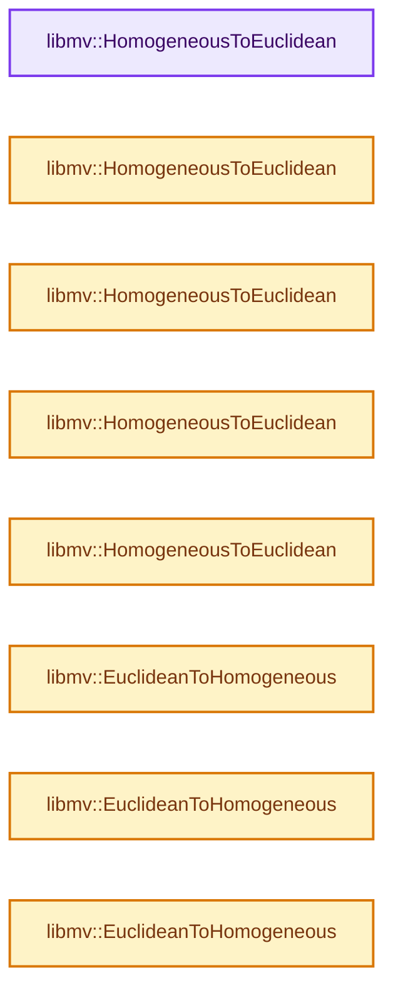
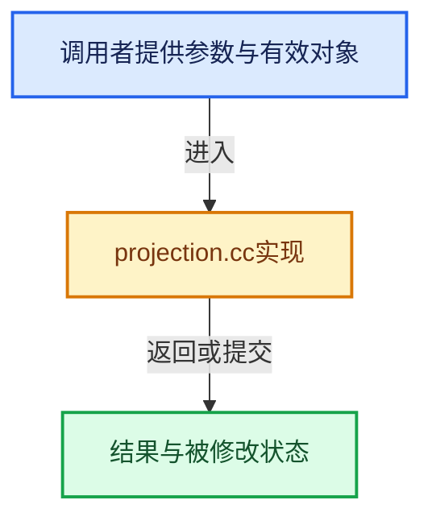

# 实现依赖专题：intern/libmv/libmv/multiview/projection.cc

[实现依赖导航](../../../../README.md) · [符号索引](../../../../../00-课程指南/02-源码与提交索引/符号依赖与实现索引.md)

本专题从正文实际调用进入，集中保存共享实现。函数有稳定锚点，可从调用处直接跳到对应完整函数；递归与互相调用通过回链组织。

## 本文件的实现关系






## 完整成员与函数实现

<a id="f-a66eea5b0cd29df2"></a>

### `libmv::HomogeneousToEuclidean`

实现位置：[intern/libmv/libmv/multiview/projection.cc](../../../../../../../../../intern/libmv/libmv/multiview/projection.cc) · L166—L176。

接口参数：

- `const Mat& H`
- `Mat* X`

**教学注释版**

<!-- annotated:ac0f7a7cac6a8d -->

```cpp
void HomogeneousToEuclidean(const Mat& H, Mat* X) {
  int d = H.rows() - 1;
  int n = H.cols();
  X->resize(d, n);
  for (size_t i = 0; i < n; ++i) {
    double h = H(d, i);
    for (int j = 0; j < d; ++j) {
      (*X)(j, i) = H(j, i) / h;
    }
  }
}
```

<details>
<summary>核对原始源码：intern/libmv/libmv/multiview/projection.cc · L166—L176</summary>

<!-- original:ac0f7a7cac6a8d:intern/libmv/libmv/multiview/projection.cc:166:176 -->

```cpp
void HomogeneousToEuclidean(const Mat& H, Mat* X) {
  int d = H.rows() - 1;
  int n = H.cols();
  X->resize(d, n);
  for (size_t i = 0; i < n; ++i) {
    double h = H(d, i);
    for (int j = 0; j < d; ++j) {
      (*X)(j, i) = H(j, i) / h;
    }
  }
}
```

</details>

**继续追踪实现**

- `H.rows` → [调用协议](../../../../../00-课程指南/01-路线与规范/模板宏与动态分派协议.md)：由接收对象具体类型或运行时策略提供实现。调用位置L167。
- `H.cols` → [调用协议](../../../../../00-课程指南/01-路线与规范/模板宏与动态分派协议.md)：由接收对象具体类型或运行时策略提供实现。调用位置L168。
- `X->resize` → [调用协议](../../../../../00-课程指南/01-路线与规范/模板宏与动态分派协议.md)：由接收对象具体类型或运行时策略提供实现。调用位置L169。
- `H` → [调用协议](../../../../../00-课程指南/01-路线与规范/模板宏与动态分派协议.md)：局部可调用对象，须结合其初始化与捕获环境。调用位置L171。
- `(*X)` → [调用协议](../../../../../00-课程指南/01-路线与规范/模板宏与动态分派协议.md)：局部可调用对象，须结合其初始化与捕获环境。调用位置L173。

<a id="f-22cf57d39a2756f5"></a>

### `libmv::HomogeneousToEuclidean`

实现位置：[intern/libmv/libmv/multiview/projection.cc](../../../../../../../../../intern/libmv/libmv/multiview/projection.cc) · L178—L182。

接口参数：

- `const Mat3X& h`
- `Mat2X* e`

**教学注释版**

<!-- annotated:e96fffdcbc8377 -->

```cpp
void HomogeneousToEuclidean(const Mat3X& h, Mat2X* e) {
  e->resize(2, h.cols());
  e->row(0) = h.row(0).array() / h.row(2).array();
  e->row(1) = h.row(1).array() / h.row(2).array();
}
```

<details>
<summary>核对原始源码：intern/libmv/libmv/multiview/projection.cc · L178—L182</summary>

<!-- original:e96fffdcbc8377:intern/libmv/libmv/multiview/projection.cc:178:182 -->

```cpp
void HomogeneousToEuclidean(const Mat3X& h, Mat2X* e) {
  e->resize(2, h.cols());
  e->row(0) = h.row(0).array() / h.row(2).array();
  e->row(1) = h.row(1).array() / h.row(2).array();
}
```

</details>

**继续追踪实现**

- `e->resize` → [调用协议](../../../../../00-课程指南/01-路线与规范/模板宏与动态分派协议.md)：由接收对象具体类型或运行时策略提供实现。调用位置L179。
- `h.cols` → [调用协议](../../../../../00-课程指南/01-路线与规范/模板宏与动态分派协议.md)：由接收对象具体类型或运行时策略提供实现。调用位置L179。
- `e->row` → [blender::ui::Layout::row · L5106](../../../../08-其他Blender模块/editors/interface/interface_layout.cc.md#f-24ee673b84edc004)；[blender::ui::Layout::row · L5246](../../../../08-其他Blender模块/editors/interface/interface_layout.cc.md#f-6523ad37239727e7)。同名重载需按实参类型选择。
- `h.row(0).array` → [调用协议](../../../../../00-课程指南/01-路线与规范/模板宏与动态分派协议.md)：接收对象类型依赖auto、返回值或模板实例；不按同名猜测目标。调用位置L180。
- `h.row` → [blender::ui::Layout::row · L5106](../../../../08-其他Blender模块/editors/interface/interface_layout.cc.md#f-24ee673b84edc004)；[blender::ui::Layout::row · L5246](../../../../08-其他Blender模块/editors/interface/interface_layout.cc.md#f-6523ad37239727e7)。同名重载需按实参类型选择。
- `h.row(2).array` → [调用协议](../../../../../00-课程指南/01-路线与规范/模板宏与动态分派协议.md)：接收对象类型依赖auto、返回值或模板实例；不按同名猜测目标。调用位置L180。
- `h.row(1).array` → [调用协议](../../../../../00-课程指南/01-路线与规范/模板宏与动态分派协议.md)：接收对象类型依赖auto、返回值或模板实例；不按同名猜测目标。调用位置L181。

<a id="f-1bc679a051cfb967"></a>

### `libmv::HomogeneousToEuclidean`

实现位置：[intern/libmv/libmv/multiview/projection.cc](../../../../../../../../../intern/libmv/libmv/multiview/projection.cc) · L183—L188。

接口参数：

- `const Mat4X& h`
- `Mat3X* e`

**教学注释版**

<!-- annotated:ce544b272d0ac1 -->

```cpp
void HomogeneousToEuclidean(const Mat4X& h, Mat3X* e) {
  e->resize(3, h.cols());
  e->row(0) = h.row(0).array() / h.row(3).array();
  e->row(1) = h.row(1).array() / h.row(3).array();
  e->row(2) = h.row(2).array() / h.row(3).array();
}
```

<details>
<summary>核对原始源码：intern/libmv/libmv/multiview/projection.cc · L183—L188</summary>

<!-- original:ce544b272d0ac1:intern/libmv/libmv/multiview/projection.cc:183:188 -->

```cpp
void HomogeneousToEuclidean(const Mat4X& h, Mat3X* e) {
  e->resize(3, h.cols());
  e->row(0) = h.row(0).array() / h.row(3).array();
  e->row(1) = h.row(1).array() / h.row(3).array();
  e->row(2) = h.row(2).array() / h.row(3).array();
}
```

</details>

**继续追踪实现**

- `e->resize` → [调用协议](../../../../../00-课程指南/01-路线与规范/模板宏与动态分派协议.md)：由接收对象具体类型或运行时策略提供实现。调用位置L184。
- `h.cols` → [调用协议](../../../../../00-课程指南/01-路线与规范/模板宏与动态分派协议.md)：由接收对象具体类型或运行时策略提供实现。调用位置L184。
- `e->row` → [blender::ui::Layout::row · L5106](../../../../08-其他Blender模块/editors/interface/interface_layout.cc.md#f-24ee673b84edc004)；[blender::ui::Layout::row · L5246](../../../../08-其他Blender模块/editors/interface/interface_layout.cc.md#f-6523ad37239727e7)。同名重载需按实参类型选择。
- `h.row(0).array` → [调用协议](../../../../../00-课程指南/01-路线与规范/模板宏与动态分派协议.md)：接收对象类型依赖auto、返回值或模板实例；不按同名猜测目标。调用位置L185。
- `h.row` → [blender::ui::Layout::row · L5106](../../../../08-其他Blender模块/editors/interface/interface_layout.cc.md#f-24ee673b84edc004)；[blender::ui::Layout::row · L5246](../../../../08-其他Blender模块/editors/interface/interface_layout.cc.md#f-6523ad37239727e7)。同名重载需按实参类型选择。
- `h.row(3).array` → [调用协议](../../../../../00-课程指南/01-路线与规范/模板宏与动态分派协议.md)：接收对象类型依赖auto、返回值或模板实例；不按同名猜测目标。调用位置L185。
- `h.row(1).array` → [调用协议](../../../../../00-课程指南/01-路线与规范/模板宏与动态分派协议.md)：接收对象类型依赖auto、返回值或模板实例；不按同名猜测目标。调用位置L186。
- `h.row(2).array` → [调用协议](../../../../../00-课程指南/01-路线与规范/模板宏与动态分派协议.md)：接收对象类型依赖auto、返回值或模板实例；不按同名猜测目标。调用位置L187。

<a id="f-f5bcabffd483b089"></a>

### `libmv::HomogeneousToEuclidean`

实现位置：[intern/libmv/libmv/multiview/projection.cc](../../../../../../../../../intern/libmv/libmv/multiview/projection.cc) · L190—L193。

接口参数：

- `const Vec3& H`
- `Vec2* X`

**教学注释版**

<!-- annotated:b4c8867e98f8fe -->

```cpp
void HomogeneousToEuclidean(const Vec3& H, Vec2* X) {
  double w = H(2);
  *X << H(0) / w, H(1) / w;
}
```

<details>
<summary>核对原始源码：intern/libmv/libmv/multiview/projection.cc · L190—L193</summary>

<!-- original:b4c8867e98f8fe:intern/libmv/libmv/multiview/projection.cc:190:193 -->

```cpp
void HomogeneousToEuclidean(const Vec3& H, Vec2* X) {
  double w = H(2);
  *X << H(0) / w, H(1) / w;
}
```

</details>

**继续追踪实现**

- `H` → [调用协议](../../../../../00-课程指南/01-路线与规范/模板宏与动态分派协议.md)：局部可调用对象，须结合其初始化与捕获环境。调用位置L191。

<a id="f-b884674e75f12027"></a>

### `libmv::HomogeneousToEuclidean`

实现位置：[intern/libmv/libmv/multiview/projection.cc](../../../../../../../../../intern/libmv/libmv/multiview/projection.cc) · L195—L198。

接口参数：

- `const Vec4& H`
- `Vec3* X`

**教学注释版**

<!-- annotated:c9419e56955093 -->

```cpp
void HomogeneousToEuclidean(const Vec4& H, Vec3* X) {
  double w = H(3);
  *X << H(0) / w, H(1) / w, H(2) / w;
}
```

<details>
<summary>核对原始源码：intern/libmv/libmv/multiview/projection.cc · L195—L198</summary>

<!-- original:c9419e56955093:intern/libmv/libmv/multiview/projection.cc:195:198 -->

```cpp
void HomogeneousToEuclidean(const Vec4& H, Vec3* X) {
  double w = H(3);
  *X << H(0) / w, H(1) / w, H(2) / w;
}
```

</details>

**继续追踪实现**

- `H` → [调用协议](../../../../../00-课程指南/01-路线与规范/模板宏与动态分派协议.md)：局部可调用对象，须结合其初始化与捕获环境。调用位置L196。

<a id="f-a5842bfa24b3fb3e"></a>

### `libmv::EuclideanToHomogeneous`

实现位置：[intern/libmv/libmv/multiview/projection.cc](../../../../../../../../../intern/libmv/libmv/multiview/projection.cc) · L200—L206。

接口参数：

- `const Mat& X`
- `Mat* H`

**教学注释版**

<!-- annotated:c0e8720ae0047c -->

```cpp
void EuclideanToHomogeneous(const Mat& X, Mat* H) {
  int d = X.rows();
  int n = X.cols();
  H->resize(d + 1, n);
  H->block(0, 0, d, n) = X;
  H->row(d).setOnes();
}
```

<details>
<summary>核对原始源码：intern/libmv/libmv/multiview/projection.cc · L200—L206</summary>

<!-- original:c0e8720ae0047c:intern/libmv/libmv/multiview/projection.cc:200:206 -->

```cpp
void EuclideanToHomogeneous(const Mat& X, Mat* H) {
  int d = X.rows();
  int n = X.cols();
  H->resize(d + 1, n);
  H->block(0, 0, d, n) = X;
  H->row(d).setOnes();
}
```

</details>

**继续追踪实现**

- `X.rows` → [调用协议](../../../../../00-课程指南/01-路线与规范/模板宏与动态分派协议.md)：由接收对象具体类型或运行时策略提供实现。调用位置L201。
- `X.cols` → [调用协议](../../../../../00-课程指南/01-路线与规范/模板宏与动态分派协议.md)：由接收对象具体类型或运行时策略提供实现。调用位置L202。
- `H->resize` → [调用协议](../../../../../00-课程指南/01-路线与规范/模板宏与动态分派协议.md)：由接收对象具体类型或运行时策略提供实现。调用位置L203。
- `H->block` → [调用协议](../../../../../00-课程指南/01-路线与规范/模板宏与动态分派协议.md)：由接收对象具体类型或运行时策略提供实现。调用位置L204。
- `H->row(d).setOnes` → [调用协议](../../../../../00-课程指南/01-路线与规范/模板宏与动态分派协议.md)：接收对象类型依赖auto、返回值或模板实例；不按同名猜测目标。调用位置L205。
- `H->row` → [blender::ui::Layout::row · L5106](../../../../08-其他Blender模块/editors/interface/interface_layout.cc.md#f-24ee673b84edc004)；[blender::ui::Layout::row · L5246](../../../../08-其他Blender模块/editors/interface/interface_layout.cc.md#f-6523ad37239727e7)。同名重载需按实参类型选择。

<a id="f-26ce89d4fd07ec92"></a>

### `libmv::EuclideanToHomogeneous`

实现位置：[intern/libmv/libmv/multiview/projection.cc](../../../../../../../../../intern/libmv/libmv/multiview/projection.cc) · L208—L210。

接口参数：

- `const Vec2& X`
- `Vec3* H`

**教学注释版**

<!-- annotated:92a84761c030e4 -->

```cpp
void EuclideanToHomogeneous(const Vec2& X, Vec3* H) {
  *H << X(0), X(1), 1;
}
```

<details>
<summary>核对原始源码：intern/libmv/libmv/multiview/projection.cc · L208—L210</summary>

<!-- original:92a84761c030e4:intern/libmv/libmv/multiview/projection.cc:208:210 -->

```cpp
void EuclideanToHomogeneous(const Vec2& X, Vec3* H) {
  *H << X(0), X(1), 1;
}
```

</details>

**继续追踪实现**

- `X` → [调用协议](../../../../../00-课程指南/01-路线与规范/模板宏与动态分派协议.md)：局部可调用对象，须结合其初始化与捕获环境。调用位置L209。

<a id="f-d235f999e66e4769"></a>

### `libmv::EuclideanToHomogeneous`

实现位置：[intern/libmv/libmv/multiview/projection.cc](../../../../../../../../../intern/libmv/libmv/multiview/projection.cc) · L212—L214。

接口参数：

- `const Vec3& X`
- `Vec4* H`

**教学注释版**

<!-- annotated:762b2d958a3fc5 -->

```cpp
void EuclideanToHomogeneous(const Vec3& X, Vec4* H) {
  *H << X(0), X(1), X(2), 1;
}
```

<details>
<summary>核对原始源码：intern/libmv/libmv/multiview/projection.cc · L212—L214</summary>

<!-- original:762b2d958a3fc5:intern/libmv/libmv/multiview/projection.cc:212:214 -->

```cpp
void EuclideanToHomogeneous(const Vec3& X, Vec4* H) {
  *H << X(0), X(1), X(2), 1;
}
```

</details>

**继续追踪实现**

- `X` → [调用协议](../../../../../00-课程指南/01-路线与规范/模板宏与动态分派协议.md)：局部可调用对象，须结合其初始化与捕获环境。调用位置L213。
