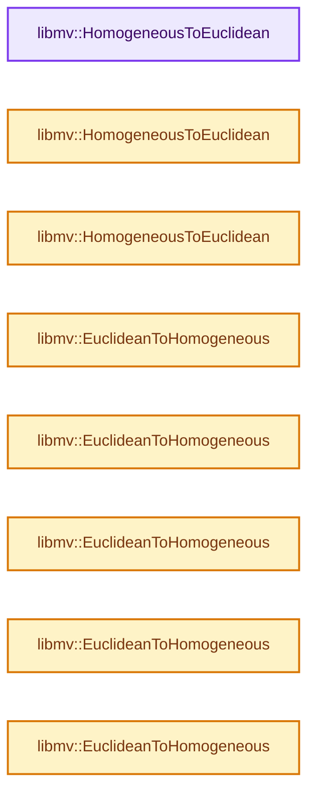
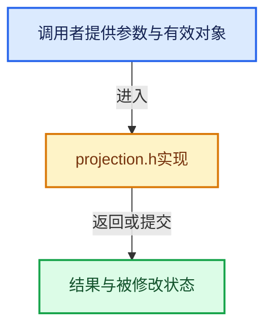

# 实现依赖专题：intern/libmv/libmv/multiview/projection.h

[实现依赖导航](../../../../README.md) · [符号索引](../../../../../00-课程指南/02-源码与提交索引/符号依赖与实现索引.md)

本专题从正文实际调用进入，集中保存共享实现。函数有稳定锚点，可从调用处直接跳到对应完整函数；递归与互相调用通过回链组织。

## 本文件的实现关系






## 完整成员与函数实现

<a id="f-50e3a45d1ca46e98"></a>

### `libmv::HomogeneousToEuclidean`

实现位置：[intern/libmv/libmv/multiview/projection.h](../../../../../../../../../intern/libmv/libmv/multiview/projection.h) · L53—L55。

接口参数：

- `const Vec3& h`

**教学注释版**

<!-- annotated:64d61e37c06280 -->

```cpp
inline Vec2 HomogeneousToEuclidean(const Vec3& h) {
  return h.head<2>() / h(2);
}
```

<details>
<summary>核对原始源码：intern/libmv/libmv/multiview/projection.h · L53—L55</summary>

<!-- original:64d61e37c06280:intern/libmv/libmv/multiview/projection.h:53:55 -->

```cpp
inline Vec2 HomogeneousToEuclidean(const Vec3& h) {
  return h.head<2>() / h(2);
}
```

</details>

**结果出口**

- `return h.head<2>() / h(2);`

**继续追踪实现**

- `h.head<2>` → [调用协议](../../../../../00-课程指南/01-路线与规范/模板宏与动态分派协议.md)：由接收对象具体类型或运行时策略提供实现。调用位置L54。
- `h` → [调用协议](../../../../../00-课程指南/01-路线与规范/模板宏与动态分派协议.md)：局部可调用对象，须结合其初始化与捕获环境。调用位置L54。

<a id="f-ed9556d666e66e2d"></a>

### `libmv::HomogeneousToEuclidean`

实现位置：[intern/libmv/libmv/multiview/projection.h](../../../../../../../../../intern/libmv/libmv/multiview/projection.h) · L56—L58。

接口参数：

- `const Vec4& h`

**教学注释版**

<!-- annotated:32510e8823af72 -->

```cpp
inline Vec3 HomogeneousToEuclidean(const Vec4& h) {
  return h.head<3>() / h(3);
}
```

<details>
<summary>核对原始源码：intern/libmv/libmv/multiview/projection.h · L56—L58</summary>

<!-- original:32510e8823af72:intern/libmv/libmv/multiview/projection.h:56:58 -->

```cpp
inline Vec3 HomogeneousToEuclidean(const Vec4& h) {
  return h.head<3>() / h(3);
}
```

</details>

**结果出口**

- `return h.head<3>() / h(3);`

**继续追踪实现**

- `h.head<3>` → [调用协议](../../../../../00-课程指南/01-路线与规范/模板宏与动态分派协议.md)：由接收对象具体类型或运行时策略提供实现。调用位置L57。
- `h` → [调用协议](../../../../../00-课程指南/01-路线与规范/模板宏与动态分派协议.md)：局部可调用对象，须结合其初始化与捕获环境。调用位置L57。

<a id="f-4346bffaa6d17013"></a>

### `libmv::HomogeneousToEuclidean`

实现位置：[intern/libmv/libmv/multiview/projection.h](../../../../../../../../../intern/libmv/libmv/multiview/projection.h) · L59—L64。

接口参数：

- `const Mat3X& h`

**教学注释版**

<!-- annotated:376f47bc866db1 -->

```cpp
inline Mat2X HomogeneousToEuclidean(const Mat3X& h) {
  Mat2X e(2, h.cols());
  e.row(0) = h.row(0).array() / h.row(2).array();
  e.row(1) = h.row(1).array() / h.row(2).array();
  return e;
}
```

<details>
<summary>核对原始源码：intern/libmv/libmv/multiview/projection.h · L59—L64</summary>

<!-- original:376f47bc866db1:intern/libmv/libmv/multiview/projection.h:59:64 -->

```cpp
inline Mat2X HomogeneousToEuclidean(const Mat3X& h) {
  Mat2X e(2, h.cols());
  e.row(0) = h.row(0).array() / h.row(2).array();
  e.row(1) = h.row(1).array() / h.row(2).array();
  return e;
}
```

</details>

**结果出口**

- `return e;`

**继续追踪实现**

- `h.cols` → [调用协议](../../../../../00-课程指南/01-路线与规范/模板宏与动态分派协议.md)：由接收对象具体类型或运行时策略提供实现。调用位置L60。
- `e.row` → [blender::ui::Layout::row · L5106](../../../../08-其他Blender模块/editors/interface/interface_layout.cc.md#f-24ee673b84edc004)；[blender::ui::Layout::row · L5246](../../../../08-其他Blender模块/editors/interface/interface_layout.cc.md#f-6523ad37239727e7)。同名重载需按实参类型选择。
- `h.row(0).array` → [调用协议](../../../../../00-课程指南/01-路线与规范/模板宏与动态分派协议.md)：接收对象类型依赖auto、返回值或模板实例；不按同名猜测目标。调用位置L61。
- `h.row` → [blender::ui::Layout::row · L5106](../../../../08-其他Blender模块/editors/interface/interface_layout.cc.md#f-24ee673b84edc004)；[blender::ui::Layout::row · L5246](../../../../08-其他Blender模块/editors/interface/interface_layout.cc.md#f-6523ad37239727e7)。同名重载需按实参类型选择。
- `h.row(2).array` → [调用协议](../../../../../00-课程指南/01-路线与规范/模板宏与动态分派协议.md)：接收对象类型依赖auto、返回值或模板实例；不按同名猜测目标。调用位置L61。
- `h.row(1).array` → [调用协议](../../../../../00-课程指南/01-路线与规范/模板宏与动态分派协议.md)：接收对象类型依赖auto、返回值或模板实例；不按同名猜测目标。调用位置L62。

<a id="f-a08ca367970fbe53"></a>

### `libmv::EuclideanToHomogeneous`

实现位置：[intern/libmv/libmv/multiview/projection.h](../../../../../../../../../intern/libmv/libmv/multiview/projection.h) · L67—L72。

接口参数：

- `const Mat2X& x`

**教学注释版**

<!-- annotated:c5ec753c7b8787 -->

```cpp
inline Mat3X EuclideanToHomogeneous(const Mat2X& x) {
  Mat3X h(3, x.cols());
  h.block(0, 0, 2, x.cols()) = x;
  h.row(2).setOnes();
  return h;
}
```

<details>
<summary>核对原始源码：intern/libmv/libmv/multiview/projection.h · L67—L72</summary>

<!-- original:c5ec753c7b8787:intern/libmv/libmv/multiview/projection.h:67:72 -->

```cpp
inline Mat3X EuclideanToHomogeneous(const Mat2X& x) {
  Mat3X h(3, x.cols());
  h.block(0, 0, 2, x.cols()) = x;
  h.row(2).setOnes();
  return h;
}
```

</details>

**结果出口**

- `return h;`

**继续追踪实现**

- `x.cols` → [调用协议](../../../../../00-课程指南/01-路线与规范/模板宏与动态分派协议.md)：由接收对象具体类型或运行时策略提供实现。调用位置L68。
- `h.block` → [调用协议](../../../../../00-课程指南/01-路线与规范/模板宏与动态分派协议.md)：由接收对象具体类型或运行时策略提供实现。调用位置L69。
- `h.row(2).setOnes` → [调用协议](../../../../../00-课程指南/01-路线与规范/模板宏与动态分派协议.md)：接收对象类型依赖auto、返回值或模板实例；不按同名猜测目标。调用位置L70。
- `h.row` → [blender::ui::Layout::row · L5106](../../../../08-其他Blender模块/editors/interface/interface_layout.cc.md#f-24ee673b84edc004)；[blender::ui::Layout::row · L5246](../../../../08-其他Blender模块/editors/interface/interface_layout.cc.md#f-6523ad37239727e7)。同名重载需按实参类型选择。

<a id="f-3a47f7d22a8953df"></a>

### `libmv::EuclideanToHomogeneous`

实现位置：[intern/libmv/libmv/multiview/projection.h](../../../../../../../../../intern/libmv/libmv/multiview/projection.h) · L73—L77。

接口参数：

- `const Mat2X& x`
- `Mat3X* h`

**教学注释版**

<!-- annotated:6f3acc0e447900 -->

```cpp
inline void EuclideanToHomogeneous(const Mat2X& x, Mat3X* h) {
  h->resize(3, x.cols());
  h->block(0, 0, 2, x.cols()) = x;
  h->row(2).setOnes();
}
```

<details>
<summary>核对原始源码：intern/libmv/libmv/multiview/projection.h · L73—L77</summary>

<!-- original:6f3acc0e447900:intern/libmv/libmv/multiview/projection.h:73:77 -->

```cpp
inline void EuclideanToHomogeneous(const Mat2X& x, Mat3X* h) {
  h->resize(3, x.cols());
  h->block(0, 0, 2, x.cols()) = x;
  h->row(2).setOnes();
}
```

</details>

**继续追踪实现**

- `h->resize` → [调用协议](../../../../../00-课程指南/01-路线与规范/模板宏与动态分派协议.md)：由接收对象具体类型或运行时策略提供实现。调用位置L74。
- `x.cols` → [调用协议](../../../../../00-课程指南/01-路线与规范/模板宏与动态分派协议.md)：由接收对象具体类型或运行时策略提供实现。调用位置L74。
- `h->block` → [调用协议](../../../../../00-课程指南/01-路线与规范/模板宏与动态分派协议.md)：由接收对象具体类型或运行时策略提供实现。调用位置L75。
- `h->row(2).setOnes` → [调用协议](../../../../../00-课程指南/01-路线与规范/模板宏与动态分派协议.md)：接收对象类型依赖auto、返回值或模板实例；不按同名猜测目标。调用位置L76。
- `h->row` → [blender::ui::Layout::row · L5106](../../../../08-其他Blender模块/editors/interface/interface_layout.cc.md#f-24ee673b84edc004)；[blender::ui::Layout::row · L5246](../../../../08-其他Blender模块/editors/interface/interface_layout.cc.md#f-6523ad37239727e7)。同名重载需按实参类型选择。

<a id="f-6b125a1820ff56ad"></a>

### `libmv::EuclideanToHomogeneous`

实现位置：[intern/libmv/libmv/multiview/projection.h](../../../../../../../../../intern/libmv/libmv/multiview/projection.h) · L78—L83。

接口参数：

- `const Mat3X& x`

**教学注释版**

<!-- annotated:9f0aa4140fd043 -->

```cpp
inline Mat4X EuclideanToHomogeneous(const Mat3X& x) {
  Mat4X h(4, x.cols());
  h.block(0, 0, 3, x.cols()) = x;
  h.row(3).setOnes();
  return h;
}
```

<details>
<summary>核对原始源码：intern/libmv/libmv/multiview/projection.h · L78—L83</summary>

<!-- original:9f0aa4140fd043:intern/libmv/libmv/multiview/projection.h:78:83 -->

```cpp
inline Mat4X EuclideanToHomogeneous(const Mat3X& x) {
  Mat4X h(4, x.cols());
  h.block(0, 0, 3, x.cols()) = x;
  h.row(3).setOnes();
  return h;
}
```

</details>

**结果出口**

- `return h;`

**继续追踪实现**

- `x.cols` → [调用协议](../../../../../00-课程指南/01-路线与规范/模板宏与动态分派协议.md)：由接收对象具体类型或运行时策略提供实现。调用位置L79。
- `h.block` → [调用协议](../../../../../00-课程指南/01-路线与规范/模板宏与动态分派协议.md)：由接收对象具体类型或运行时策略提供实现。调用位置L80。
- `h.row(3).setOnes` → [调用协议](../../../../../00-课程指南/01-路线与规范/模板宏与动态分派协议.md)：接收对象类型依赖auto、返回值或模板实例；不按同名猜测目标。调用位置L81。
- `h.row` → [blender::ui::Layout::row · L5106](../../../../08-其他Blender模块/editors/interface/interface_layout.cc.md#f-24ee673b84edc004)；[blender::ui::Layout::row · L5246](../../../../08-其他Blender模块/editors/interface/interface_layout.cc.md#f-6523ad37239727e7)。同名重载需按实参类型选择。

<a id="f-62d154fcc0e84630"></a>

### `libmv::EuclideanToHomogeneous`

实现位置：[intern/libmv/libmv/multiview/projection.h](../../../../../../../../../intern/libmv/libmv/multiview/projection.h) · L84—L88。

接口参数：

- `const Mat3X& x`
- `Mat4X* h`

**教学注释版**

<!-- annotated:3ff8096ec402b0 -->

```cpp
inline void EuclideanToHomogeneous(const Mat3X& x, Mat4X* h) {
  h->resize(4, x.cols());
  h->block(0, 0, 3, x.cols()) = x;
  h->row(3).setOnes();
}
```

<details>
<summary>核对原始源码：intern/libmv/libmv/multiview/projection.h · L84—L88</summary>

<!-- original:3ff8096ec402b0:intern/libmv/libmv/multiview/projection.h:84:88 -->

```cpp
inline void EuclideanToHomogeneous(const Mat3X& x, Mat4X* h) {
  h->resize(4, x.cols());
  h->block(0, 0, 3, x.cols()) = x;
  h->row(3).setOnes();
}
```

</details>

**继续追踪实现**

- `h->resize` → [调用协议](../../../../../00-课程指南/01-路线与规范/模板宏与动态分派协议.md)：由接收对象具体类型或运行时策略提供实现。调用位置L85。
- `x.cols` → [调用协议](../../../../../00-课程指南/01-路线与规范/模板宏与动态分派协议.md)：由接收对象具体类型或运行时策略提供实现。调用位置L85。
- `h->block` → [调用协议](../../../../../00-课程指南/01-路线与规范/模板宏与动态分派协议.md)：由接收对象具体类型或运行时策略提供实现。调用位置L86。
- `h->row(3).setOnes` → [调用协议](../../../../../00-课程指南/01-路线与规范/模板宏与动态分派协议.md)：接收对象类型依赖auto、返回值或模板实例；不按同名猜测目标。调用位置L87。
- `h->row` → [blender::ui::Layout::row · L5106](../../../../08-其他Blender模块/editors/interface/interface_layout.cc.md#f-24ee673b84edc004)；[blender::ui::Layout::row · L5246](../../../../08-其他Blender模块/editors/interface/interface_layout.cc.md#f-6523ad37239727e7)。同名重载需按实参类型选择。

<a id="f-d6968897b0bd421e"></a>

### `libmv::EuclideanToHomogeneous`

实现位置：[intern/libmv/libmv/multiview/projection.h](../../../../../../../../../intern/libmv/libmv/multiview/projection.h) · L91—L93。

接口参数：

- `const Vec2& x`

**教学注释版**

<!-- annotated:3dde4847338cd4 -->

```cpp
inline Vec3 EuclideanToHomogeneous(const Vec2& x) {
  return Vec3(x(0), x(1), 1);
}
```

<details>
<summary>核对原始源码：intern/libmv/libmv/multiview/projection.h · L91—L93</summary>

<!-- original:3dde4847338cd4:intern/libmv/libmv/multiview/projection.h:91:93 -->

```cpp
inline Vec3 EuclideanToHomogeneous(const Vec2& x) {
  return Vec3(x(0), x(1), 1);
}
```

</details>

**结果出口**

- `return Vec3(x(0), x(1), 1);`

**继续追踪实现**

- `Vec3` → [Freestyle::Vec3::Vec3 · L467](../../../../08-其他Blender模块/freestyle/intern/geometry/VecMat.h.md#f-f638e524b840d3a3)；[Freestyle::Vec3::Vec3 · L469](../../../../08-其他Blender模块/freestyle/intern/geometry/VecMat.h.md#f-f1892000970ed549)；[Freestyle::Vec3::Vec3 · L471](../../../../08-其他Blender模块/freestyle/intern/geometry/VecMat.h.md#f-0809236593253ce3)；[Freestyle::Vec3::Vec3 · L473](../../../../08-其他Blender模块/freestyle/intern/geometry/VecMat.h.md#f-8ac324e90d5afbaf)；[Freestyle::Vec3::Vec3 · L475](../../../../08-其他Blender模块/freestyle/intern/geometry/VecMat.h.md#f-ba623196212c3e1e)；[Freestyle::Vec3::Vec3 · L482](../../../../08-其他Blender模块/freestyle/intern/geometry/VecMat.h.md#f-55c941be1f69bc9b)。同名重载需按实参类型选择。
- `x` → [调用协议](../../../../../00-课程指南/01-路线与规范/模板宏与动态分派协议.md)：局部可调用对象，须结合其初始化与捕获环境。调用位置L92。

<a id="f-bf8e963285466a53"></a>

### `libmv::EuclideanToHomogeneous`

实现位置：[intern/libmv/libmv/multiview/projection.h](../../../../../../../../../intern/libmv/libmv/multiview/projection.h) · L94—L96。

接口参数：

- `const Vec3& x`

**教学注释版**

<!-- annotated:e28eb37fa89dee -->

```cpp
inline Vec4 EuclideanToHomogeneous(const Vec3& x) {
  return Vec4(x(0), x(1), x(2), 1);
}
```

<details>
<summary>核对原始源码：intern/libmv/libmv/multiview/projection.h · L94—L96</summary>

<!-- original:e28eb37fa89dee:intern/libmv/libmv/multiview/projection.h:94:96 -->

```cpp
inline Vec4 EuclideanToHomogeneous(const Vec3& x) {
  return Vec4(x(0), x(1), x(2), 1);
}
```

</details>

**结果出口**

- `return Vec4(x(0), x(1), x(2), 1);`

**继续追踪实现**

- `Vec4` → [调用协议](../../../../../00-课程指南/01-路线与规范/模板宏与动态分派协议.md)：函数指针、局部可调用对象或未展开的宏；必须结合调用者环境。调用位置L95。
- `x` → [调用协议](../../../../../00-课程指南/01-路线与规范/模板宏与动态分派协议.md)：局部可调用对象，须结合其初始化与捕获环境。调用位置L95。
