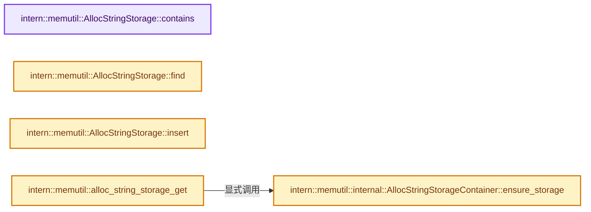
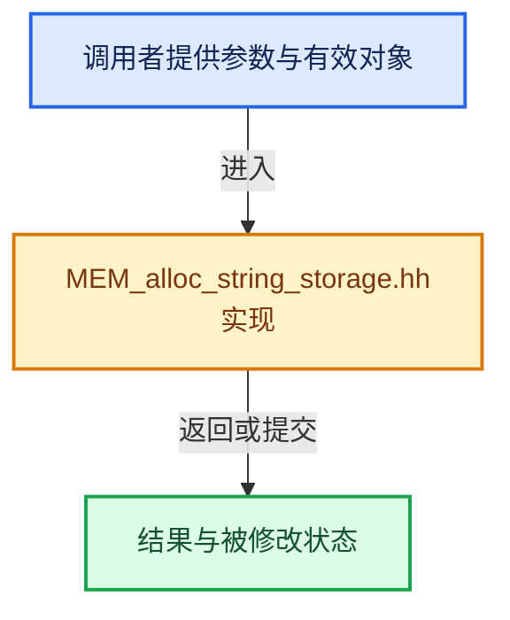

# 实现依赖专题：intern/memutil/MEM_alloc_string_storage.hh

[实现依赖导航](../../README.md) · [符号索引](../../../00-课程指南/02-源码与提交索引/符号依赖与实现索引.md)

本专题从正文实际调用进入，集中保存共享实现。函数有稳定锚点，可从调用处直接跳到对应完整函数；递归与互相调用通过回链组织。

## 本文件的实现关系






## 完整成员与函数实现

<a id="f-7176a4213252c4b1"></a>

### `intern::memutil::AllocStringStorage::contains`

实现位置：[intern/memutil/MEM_alloc_string_storage.hh](../../../../../../../intern/memutil/MEM_alloc_string_storage.hh) · L34—L37。

接口参数：

- `const keyT &key`

**教学注释版**

<!-- annotated:e5961249187265 -->

```cpp
  bool contains(const keyT &key)
  {
    return storage_.count(key) != 0;
  }
```

<details>
<summary>核对原始源码：intern/memutil/MEM_alloc_string_storage.hh · L34—L37</summary>

<!-- original:e5961249187265:intern/memutil/MEM_alloc_string_storage.hh:34:37 -->

```cpp
  bool contains(const keyT &key)
  {
    return storage_.count(key) != 0;
  }
```

</details>

**结果出口**

- `return storage_.count(key) != 0;`

**继续追踪实现**

- `storage_.count` → [外部契约](https://eel.is/c++draft/)：这个边界按实际表达式及所属类型核对参数、返回值、寿命与失败行为。这里提供接口入口，不声称已解释该第三方版本的内部实现。

<a id="f-de08142e6efdfc68"></a>

### `intern::memutil::AllocStringStorage::find`

实现位置：[intern/memutil/MEM_alloc_string_storage.hh](../../../../../../../intern/memutil/MEM_alloc_string_storage.hh) · L44—L50。

接口参数：

- `const keyT &key`

**教学注释版**

<!-- annotated:d7a8fae2f6badc -->

```cpp
  const char *find(const keyT &key)
  {
    if (storage_.count(key) != 0) {
      return storage_[key].c_str();
    }
    return nullptr;
  }
```

<details>
<summary>核对原始源码：intern/memutil/MEM_alloc_string_storage.hh · L44—L50</summary>

<!-- original:d7a8fae2f6badc:intern/memutil/MEM_alloc_string_storage.hh:44:50 -->

```cpp
  const char *find(const keyT &key)
  {
    if (storage_.count(key) != 0) {
      return storage_[key].c_str();
    }
    return nullptr;
  }
```

</details>

**结果出口**

- `return storage_[key].c_str();`
- `return nullptr;`

**继续追踪实现**

- `storage_.count` → [外部契约](https://eel.is/c++draft/)：这个边界按实际表达式及所属类型核对参数、返回值、寿命与失败行为。这里提供接口入口，不声称已解释该第三方版本的内部实现。
- `storage_[key].c_str` → [调用协议](../../../00-课程指南/01-路线与规范/模板宏与动态分派协议.md)：接收对象类型依赖auto、返回值或模板实例；不按同名猜测目标。调用位置L47。

<a id="f-27aea5dcb73821c2"></a>

### `intern::memutil::AllocStringStorage::insert`

实现位置：[intern/memutil/MEM_alloc_string_storage.hh](../../../../../../../intern/memutil/MEM_alloc_string_storage.hh) · L59—L65。

接口参数：

- `const keyT &key`
- `std::string alloc_string`

**教学注释版**

<!-- annotated:f91cdcfedf0b77 -->

```cpp
  const char *insert(const keyT &key, std::string alloc_string)
  {
#ifndef NDEBUG
    // [讲解] assert：检查开发者预期条件，配置可能关闭；不承担完整输入处理或自动修复。
    assert(storage_.count(key) == 0);
#endif
    // [讲解] std::move：把表达式转换成可供移动重载选择的值类别；不保证真的移动，不结束源对象寿命，对const值可能选择复制。
    return (storage_[key] = std::move(alloc_string)).c_str();
  }
```

<details>
<summary>核对原始源码：intern/memutil/MEM_alloc_string_storage.hh · L59—L65</summary>

<!-- original:f91cdcfedf0b77:intern/memutil/MEM_alloc_string_storage.hh:59:65 -->

```cpp
  const char *insert(const keyT &key, std::string alloc_string)
  {
#ifndef NDEBUG
    assert(storage_.count(key) == 0);
#endif
    return (storage_[key] = std::move(alloc_string)).c_str();
  }
```

</details>

**结果出口**

- `return (storage_[key] = std::move(alloc_string)).c_str();`

**继续追踪实现**

- `assert` → [外部契约](https://eel.is/c++draft/assertions)：检查开发者预期条件，配置可能关闭；不承担完整输入处理或自动修复。
- `storage_.count` → [外部契约](https://eel.is/c++draft/)：这个边界按实际表达式及所属类型核对参数、返回值、寿命与失败行为。这里提供接口入口，不声称已解释该第三方版本的内部实现。
- `(storage_[key] = std::move(alloc_string)).c_str` → [调用协议](../../../00-课程指南/01-路线与规范/模板宏与动态分派协议.md)：接收对象类型依赖auto、返回值或模板实例；不按同名猜测目标。调用位置L64。
- `std::move` → [外部契约](https://eel.is/c++draft/utility.forward)：把表达式转换成可供移动重载选择的值类别；不保证真的移动，不结束源对象寿命，对const值可能选择复制。

<a id="f-c76d62eb8f3f9a13"></a>

### `intern::memutil::internal::AllocStringStorageContainer::ensure_storage`

实现位置：[intern/memutil/MEM_alloc_string_storage.hh](../../../../../../../intern/memutil/MEM_alloc_string_storage.hh) · L83—L92。

接口参数：

- `const std::string &storage_identifier`

**教学注释版**

<!-- annotated:bdc4bc2d1e85d1 -->

```cpp
  template<typename keyT, template<typename> typename hashT>
  std::any &ensure_storage(const std::string &storage_identifier)
  {
    if (!storage_.contains(storage_identifier)) {
      AllocStringStorage<keyT, hashT> storage_for_identifier;
      return (storage_[storage_identifier] = std::make_any<AllocStringStorage<keyT, hashT>>(
                  // [讲解] std::move：把表达式转换成可供移动重载选择的值类别；不保证真的移动，不结束源对象寿命，对const值可能选择复制。
                  std::move(storage_for_identifier)));
    }
    return storage_[storage_identifier];
  }
```

<details>
<summary>核对原始源码：intern/memutil/MEM_alloc_string_storage.hh · L83—L92</summary>

<!-- original:bdc4bc2d1e85d1:intern/memutil/MEM_alloc_string_storage.hh:83:92 -->

```cpp
  template<typename keyT, template<typename> typename hashT>
  std::any &ensure_storage(const std::string &storage_identifier)
  {
    if (!storage_.contains(storage_identifier)) {
      AllocStringStorage<keyT, hashT> storage_for_identifier;
      return (storage_[storage_identifier] = std::make_any<AllocStringStorage<keyT, hashT>>(
                  std::move(storage_for_identifier)));
    }
    return storage_[storage_identifier];
  }
```

</details>

**结果出口**

- `return (storage_[storage_identifier] = std::make_any<AllocStringStorage<keyT, hashT>>(`
- `return storage_[storage_identifier];`

**继续追踪实现**

- `storage_.contains` → [外部契约](https://eel.is/c++draft/)：这个边界按实际表达式及所属类型核对参数、返回值、寿命与失败行为。这里提供接口入口，不声称已解释该第三方版本的内部实现。
- `std::make_any<AllocStringStorage<keyT, hashT>>` → [外部契约](https://eel.is/c++draft/)：这个边界按实际表达式及所属类型核对参数、返回值、寿命与失败行为。这里提供接口入口，不声称已解释该第三方版本的内部实现。
- `std::move` → [外部契约](https://eel.is/c++draft/utility.forward)：把表达式转换成可供移动重载选择的值类别；不保证真的移动，不结束源对象寿命，对const值可能选择复制。

<a id="f-5c7ac53e26caa644"></a>

### `intern::memutil::alloc_string_storage_get`

实现位置：[intern/memutil/MEM_alloc_string_storage.hh](../../../../../../../intern/memutil/MEM_alloc_string_storage.hh) · L110—L116。

接口参数：

- `const std::string &storage_identifier`

**教学注释版**

<!-- annotated:6ac3be0208d500 -->

```cpp
template<typename keyT, template<typename> typename hashT>
AllocStringStorage<keyT, hashT> &alloc_string_storage_get(const std::string &storage_identifier)
{
  internal::AllocStringStorageContainer &storage_container = internal::ensure_storage_container();
  std::any &storage = storage_container.ensure_storage<keyT, hashT>(storage_identifier);
  return std::any_cast<AllocStringStorage<keyT, hashT> &>(storage);
}
```

<details>
<summary>核对原始源码：intern/memutil/MEM_alloc_string_storage.hh · L110—L116</summary>

<!-- original:6ac3be0208d500:intern/memutil/MEM_alloc_string_storage.hh:110:116 -->

```cpp
template<typename keyT, template<typename> typename hashT>
AllocStringStorage<keyT, hashT> &alloc_string_storage_get(const std::string &storage_identifier)
{
  internal::AllocStringStorageContainer &storage_container = internal::ensure_storage_container();
  std::any &storage = storage_container.ensure_storage<keyT, hashT>(storage_identifier);
  return std::any_cast<AllocStringStorage<keyT, hashT> &>(storage);
}
```

</details>

**结果出口**

- `return std::any_cast<AllocStringStorage<keyT, hashT> &>(storage);`

**继续追踪实现**

- `internal::ensure_storage_container` → [intern::memutil::internal::ensure_storage_container · L14](intern/MEM_alloc_string_storage.cc.md#f-5aa55c5eca773126)。
- `storage_container.ensure_storage<keyT, hashT>` → [intern::memutil::internal::AllocStringStorageContainer::ensure_storage · L83](MEM_alloc_string_storage.hh.md#f-c76d62eb8f3f9a13)。
- `std::any_cast<AllocStringStorage<keyT, hashT> &>` → [外部契约](https://eel.is/c++draft/)：这个边界按实际表达式及所属类型核对参数、返回值、寿命与失败行为。这里提供接口入口，不声称已解释该第三方版本的内部实现。
