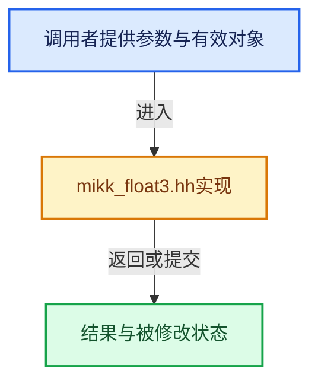

# 实现依赖专题：intern/mikktspace/mikk_float3.hh

[实现依赖导航](../../README.md) · [符号索引](../../../00-课程指南/02-源码与提交索引/符号依赖与实现索引.md)

本专题从正文实际调用进入，集中保存共享实现。函数有稳定锚点，可从调用处直接跳到对应完整函数；递归与互相调用通过回链组织。

## 本文件的实现关系





## 完整成员与函数实现

<a id="f-3da2c543aa1ab3fc"></a>

### `mikk::float3::length_squared`

实现位置：[intern/mikktspace/mikk_float3.hh](../../../../../../../intern/mikktspace/mikk_float3.hh) · L60—L63。

**教学注释版**

<!-- annotated:aa91dc360959a5 -->

```cpp
  float length_squared() const
  {
    return x * x + y * y + z * z;
  }
```

<details>
<summary>核对原始源码：intern/mikktspace/mikk_float3.hh · L60—L63</summary>

<!-- original:aa91dc360959a5:intern/mikktspace/mikk_float3.hh:60:63 -->

```cpp
  float length_squared() const
  {
    return x * x + y * y + z * z;
  }
```

</details>

**结果出口**

- `return x * x + y * y + z * z;`

**继续追踪实现**

本实现没有需要继续展开的显式调用；检查返回表达式、对象转换和调用者前置条件。

<a id="f-0774c42859ccbe88"></a>

### `mikk::float3::length`

实现位置：[intern/mikktspace/mikk_float3.hh](../../../../../../../intern/mikktspace/mikk_float3.hh) · L65—L68。

**教学注释版**

<!-- annotated:81cefb1480794f -->

```cpp
  float length() const
  {
    return sqrtf(length_squared());
  }
```

<details>
<summary>核对原始源码：intern/mikktspace/mikk_float3.hh · L65—L68</summary>

<!-- original:81cefb1480794f:intern/mikktspace/mikk_float3.hh:65:68 -->

```cpp
  float length() const
  {
    return sqrtf(length_squared());
  }
```

</details>

**结果出口**

- `return sqrtf(length_squared());`

**继续追踪实现**

- `sqrtf` → [外部契约](https://eel.is/c++draft/)：这个边界按实际表达式及所属类型核对参数、返回值、寿命与失败行为。这里提供接口入口，不声称已解释该第三方版本的内部实现。
- `length_squared` → [mikk::float3::length_squared · L60](mikk_float3.hh.md#f-3da2c543aa1ab3fc)。

<a id="f-c7811446b306b649"></a>

### `mikk::float3::normalize`

实现位置：[intern/mikktspace/mikk_float3.hh](../../../../../../../intern/mikktspace/mikk_float3.hh) · L92—L96。

**教学注释版**

<!-- annotated:4113912c124242 -->

```cpp
  float3 normalize() const
  {
    const float len = length();
    return (len != 0.0f) ? *this * (1.0f / len) : *this;
  }
```

<details>
<summary>核对原始源码：intern/mikktspace/mikk_float3.hh · L92—L96</summary>

<!-- original:4113912c124242:intern/mikktspace/mikk_float3.hh:92:96 -->

```cpp
  float3 normalize() const
  {
    const float len = length();
    return (len != 0.0f) ? *this * (1.0f / len) : *this;
  }
```

</details>

**结果出口**

- `return (len != 0.0f) ? *this * (1.0f / len) : *this;`

**继续追踪实现**

- `length` → [mikk::float3::length · L65](mikk_float3.hh.md#f-0774c42859ccbe88)。
