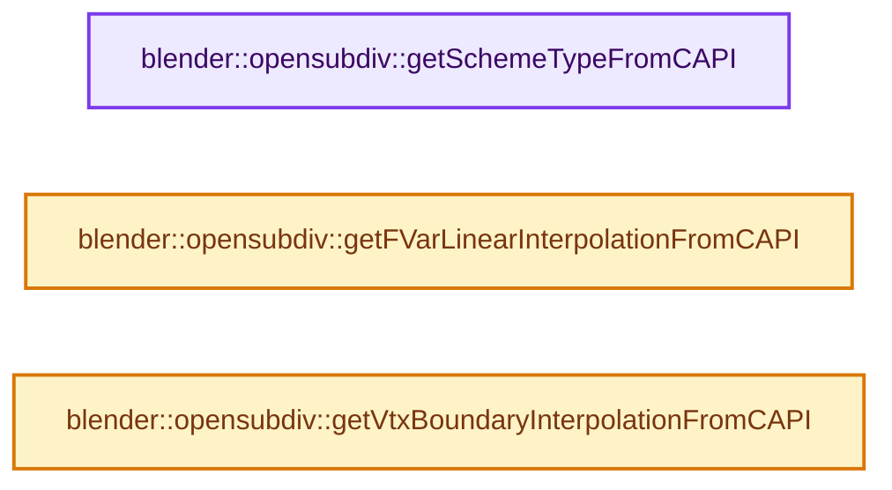
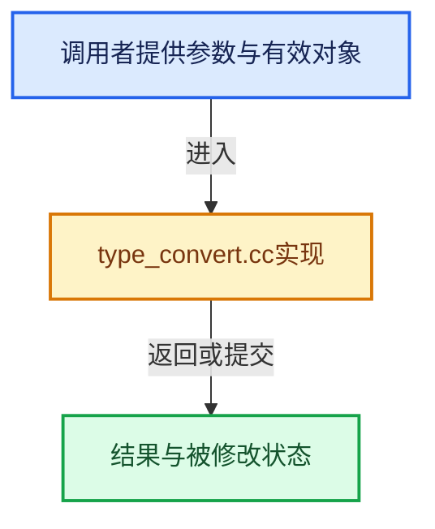

# 实现依赖专题：intern/opensubdiv/internal/base/type_convert.cc

[实现依赖导航](../../../../README.md) · [符号索引](../../../../../00-课程指南/02-源码与提交索引/符号依赖与实现索引.md)

本专题从正文实际调用进入，集中保存共享实现。函数有稳定锚点，可从调用处直接跳到对应完整函数；递归与互相调用通过回链组织。

## 本文件的实现关系






## 完整成员与函数实现

<a id="f-28f96f0a4bfaabac"></a>

### `blender::opensubdiv::getSchemeTypeFromCAPI`

实现位置：[intern/opensubdiv/internal/base/type_convert.cc](../../../../../../../../../intern/opensubdiv/internal/base/type_convert.cc) · L18—L30。

接口参数：

- `OpenSubdiv_SchemeType type`

**教学注释版**

<!-- annotated:1827bbdb8d6916 -->

```cpp
OpenSubdiv::Sdc::SchemeType getSchemeTypeFromCAPI(OpenSubdiv_SchemeType type)
{
  switch (type) {
    case OSD_SCHEME_BILINEAR:
      return OpenSubdiv::Sdc::SCHEME_BILINEAR;
    case OSD_SCHEME_CATMARK:
      return OpenSubdiv::Sdc::SCHEME_CATMARK;
    case OSD_SCHEME_LOOP:
      return OpenSubdiv::Sdc::SCHEME_LOOP;
  }
  // [讲解] assert：检查开发者预期条件，配置可能关闭；不承担完整输入处理或自动修复。
  assert(!"Unknown scheme type passed via C-API");
  return OpenSubdiv::Sdc::SCHEME_CATMARK;
}
```

<details>
<summary>核对原始源码：intern/opensubdiv/internal/base/type_convert.cc · L18—L30</summary>

<!-- original:1827bbdb8d6916:intern/opensubdiv/internal/base/type_convert.cc:18:30 -->

```cpp
OpenSubdiv::Sdc::SchemeType getSchemeTypeFromCAPI(OpenSubdiv_SchemeType type)
{
  switch (type) {
    case OSD_SCHEME_BILINEAR:
      return OpenSubdiv::Sdc::SCHEME_BILINEAR;
    case OSD_SCHEME_CATMARK:
      return OpenSubdiv::Sdc::SCHEME_CATMARK;
    case OSD_SCHEME_LOOP:
      return OpenSubdiv::Sdc::SCHEME_LOOP;
  }
  assert(!"Unknown scheme type passed via C-API");
  return OpenSubdiv::Sdc::SCHEME_CATMARK;
}
```

</details>

**结果出口**

- `return OpenSubdiv::Sdc::SCHEME_BILINEAR;`
- `return OpenSubdiv::Sdc::SCHEME_CATMARK;`
- `return OpenSubdiv::Sdc::SCHEME_LOOP;`

**继续追踪实现**

- `assert` → [外部契约](https://eel.is/c++draft/assertions)：检查开发者预期条件，配置可能关闭；不承担完整输入处理或自动修复。

<a id="f-12b06acfaee7c8fd"></a>

### `blender::opensubdiv::getFVarLinearInterpolationFromCAPI`

实现位置：[intern/opensubdiv/internal/base/type_convert.cc](../../../../../../../../../intern/opensubdiv/internal/base/type_convert.cc) · L32—L52。

接口参数：

- `OpenSubdiv_FVarLinearInterpolation linear_interpolation`

**教学注释版**

<!-- annotated:c1edbd1b821a26 -->

```cpp
OpenSubdiv::Sdc::Options::FVarLinearInterpolation getFVarLinearInterpolationFromCAPI(
    OpenSubdiv_FVarLinearInterpolation linear_interpolation)
{
  using Options = OpenSubdiv::Sdc::Options;
  switch (linear_interpolation) {
    case OSD_FVAR_LINEAR_INTERPOLATION_NONE:
      return Options::FVAR_LINEAR_NONE;
    case OSD_FVAR_LINEAR_INTERPOLATION_CORNERS_ONLY:
      return Options::FVAR_LINEAR_CORNERS_ONLY;
    case OSD_FVAR_LINEAR_INTERPOLATION_CORNERS_PLUS1:
      return Options::FVAR_LINEAR_CORNERS_PLUS1;
    case OSD_FVAR_LINEAR_INTERPOLATION_CORNERS_PLUS2:
      return Options::FVAR_LINEAR_CORNERS_PLUS2;
    case OSD_FVAR_LINEAR_INTERPOLATION_BOUNDARIES:
      return Options::FVAR_LINEAR_BOUNDARIES;
    case OSD_FVAR_LINEAR_INTERPOLATION_ALL:
      return Options::FVAR_LINEAR_ALL;
  }
  // [讲解] assert：检查开发者预期条件，配置可能关闭；不承担完整输入处理或自动修复。
  assert(!"Unknown fvar linear interpolation passed via C-API");
  return Options::FVAR_LINEAR_NONE;
}
```

<details>
<summary>核对原始源码：intern/opensubdiv/internal/base/type_convert.cc · L32—L52</summary>

<!-- original:c1edbd1b821a26:intern/opensubdiv/internal/base/type_convert.cc:32:52 -->

```cpp
OpenSubdiv::Sdc::Options::FVarLinearInterpolation getFVarLinearInterpolationFromCAPI(
    OpenSubdiv_FVarLinearInterpolation linear_interpolation)
{
  using Options = OpenSubdiv::Sdc::Options;
  switch (linear_interpolation) {
    case OSD_FVAR_LINEAR_INTERPOLATION_NONE:
      return Options::FVAR_LINEAR_NONE;
    case OSD_FVAR_LINEAR_INTERPOLATION_CORNERS_ONLY:
      return Options::FVAR_LINEAR_CORNERS_ONLY;
    case OSD_FVAR_LINEAR_INTERPOLATION_CORNERS_PLUS1:
      return Options::FVAR_LINEAR_CORNERS_PLUS1;
    case OSD_FVAR_LINEAR_INTERPOLATION_CORNERS_PLUS2:
      return Options::FVAR_LINEAR_CORNERS_PLUS2;
    case OSD_FVAR_LINEAR_INTERPOLATION_BOUNDARIES:
      return Options::FVAR_LINEAR_BOUNDARIES;
    case OSD_FVAR_LINEAR_INTERPOLATION_ALL:
      return Options::FVAR_LINEAR_ALL;
  }
  assert(!"Unknown fvar linear interpolation passed via C-API");
  return Options::FVAR_LINEAR_NONE;
}
```

</details>

**结果出口**

- `return Options::FVAR_LINEAR_NONE;`
- `return Options::FVAR_LINEAR_CORNERS_ONLY;`
- `return Options::FVAR_LINEAR_CORNERS_PLUS1;`
- `return Options::FVAR_LINEAR_CORNERS_PLUS2;`
- `return Options::FVAR_LINEAR_BOUNDARIES;`
- `return Options::FVAR_LINEAR_ALL;`

**继续追踪实现**

- `assert` → [外部契约](https://eel.is/c++draft/assertions)：检查开发者预期条件，配置可能关闭；不承担完整输入处理或自动修复。

<a id="f-f7660925d2b7a9c4"></a>

### `blender::opensubdiv::getVtxBoundaryInterpolationFromCAPI`

实现位置：[intern/opensubdiv/internal/base/type_convert.cc](../../../../../../../../../intern/opensubdiv/internal/base/type_convert.cc) · L76—L91。

接口参数：

- `OpenSubdiv_VtxBoundaryInterpolation boundary_interpolation`

**教学注释版**

<!-- annotated:1839cdf71a8d6f -->

```cpp
OpenSubdiv::Sdc::Options::VtxBoundaryInterpolation getVtxBoundaryInterpolationFromCAPI(
    OpenSubdiv_VtxBoundaryInterpolation boundary_interpolation)
{
  using OpenSubdiv::Sdc::Options;

  switch (boundary_interpolation) {
    case OSD_VTX_BOUNDARY_NONE:
      return Options::VTX_BOUNDARY_NONE;
    case OSD_VTX_BOUNDARY_EDGE_ONLY:
      return Options::VTX_BOUNDARY_EDGE_ONLY;
    case OSD_VTX_BOUNDARY_EDGE_AND_CORNER:
      return Options::VTX_BOUNDARY_EDGE_AND_CORNER;
  }
  // [讲解] assert：检查开发者预期条件，配置可能关闭；不承担完整输入处理或自动修复。
  assert(!"Unknown veretx boundary interpolation.");
  return Options::VTX_BOUNDARY_EDGE_ONLY;
}
```

<details>
<summary>核对原始源码：intern/opensubdiv/internal/base/type_convert.cc · L76—L91</summary>

<!-- original:1839cdf71a8d6f:intern/opensubdiv/internal/base/type_convert.cc:76:91 -->

```cpp
OpenSubdiv::Sdc::Options::VtxBoundaryInterpolation getVtxBoundaryInterpolationFromCAPI(
    OpenSubdiv_VtxBoundaryInterpolation boundary_interpolation)
{
  using OpenSubdiv::Sdc::Options;

  switch (boundary_interpolation) {
    case OSD_VTX_BOUNDARY_NONE:
      return Options::VTX_BOUNDARY_NONE;
    case OSD_VTX_BOUNDARY_EDGE_ONLY:
      return Options::VTX_BOUNDARY_EDGE_ONLY;
    case OSD_VTX_BOUNDARY_EDGE_AND_CORNER:
      return Options::VTX_BOUNDARY_EDGE_AND_CORNER;
  }
  assert(!"Unknown veretx boundary interpolation.");
  return Options::VTX_BOUNDARY_EDGE_ONLY;
}
```

</details>

**结果出口**

- `return Options::VTX_BOUNDARY_NONE;`
- `return Options::VTX_BOUNDARY_EDGE_ONLY;`
- `return Options::VTX_BOUNDARY_EDGE_AND_CORNER;`

**继续追踪实现**

- `assert` → [外部契约](https://eel.is/c++draft/assertions)：检查开发者预期条件，配置可能关闭；不承担完整输入处理或自动修复。
