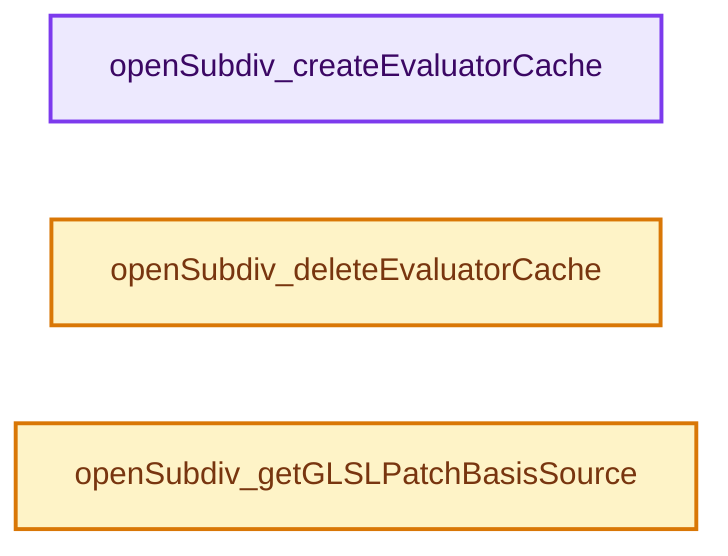
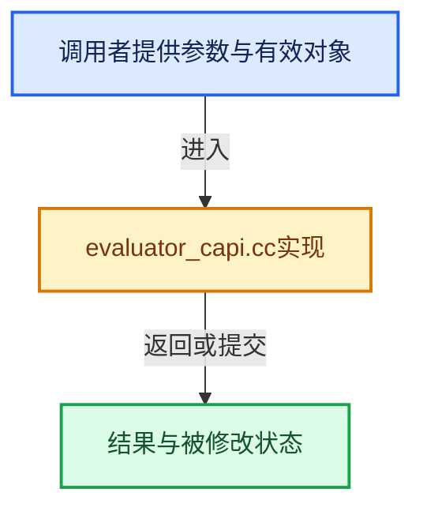

# 实现依赖专题：intern/opensubdiv/internal/evaluator/evaluator_capi.cc

[实现依赖导航](../../../../README.md) · [符号索引](../../../../../00-课程指南/02-源码与提交索引/符号依赖与实现索引.md)

本专题从正文实际调用进入，集中保存共享实现。函数有稳定锚点，可从调用处直接跳到对应完整函数；递归与互相调用通过回链组织。

## 本文件的实现关系






## 完整成员与函数实现

<a id="f-9a2015f2cb071b37"></a>

### `openSubdiv_createEvaluatorCache`

实现位置：[intern/opensubdiv/internal/evaluator/evaluator_capi.cc](../../../../../../../../../intern/opensubdiv/internal/evaluator/evaluator_capi.cc) · L22—L27。

接口参数：

- `eOpenSubdivEvaluator evaluator_type`

**教学注释版**

<!-- annotated:2faf9d290e2601 -->

```cpp
OpenSubdiv_EvaluatorCache *openSubdiv_createEvaluatorCache(eOpenSubdivEvaluator evaluator_type)
{
  OpenSubdiv_EvaluatorCache *evaluator_cache = MEM_new<OpenSubdiv_EvaluatorCache>(__func__);
  evaluator_cache->impl = openSubdiv_createEvaluatorCacheInternal(evaluator_type);
  return evaluator_cache;
}
```

<details>
<summary>核对原始源码：intern/opensubdiv/internal/evaluator/evaluator_capi.cc · L22—L27</summary>

<!-- original:2faf9d290e2601:intern/opensubdiv/internal/evaluator/evaluator_capi.cc:22:27 -->

```cpp
OpenSubdiv_EvaluatorCache *openSubdiv_createEvaluatorCache(eOpenSubdivEvaluator evaluator_type)
{
  OpenSubdiv_EvaluatorCache *evaluator_cache = MEM_new<OpenSubdiv_EvaluatorCache>(__func__);
  evaluator_cache->impl = openSubdiv_createEvaluatorCacheInternal(evaluator_type);
  return evaluator_cache;
}
```

</details>

**沿实际写入检查状态**

- `evaluator_cache->impl = openSubdiv_createEvaluatorCacheInternal(evaluator_type);`

**结果出口**

- `return evaluator_cache;`

**继续追踪实现**

- `MEM_new<OpenSubdiv_EvaluatorCache>` → [MEM_new · L351](../../../guardedalloc/MEM_guardedalloc.h.md#f-115f9b6784f89912)。
- `openSubdiv_createEvaluatorCacheInternal` → [openSubdiv_createEvaluatorCacheInternal · L16](evaluator_cache_impl.cc.md#f-96433579f6d1658b)。

<a id="f-20a13d56cbba52c3"></a>

### `openSubdiv_deleteEvaluatorCache`

实现位置：[intern/opensubdiv/internal/evaluator/evaluator_capi.cc](../../../../../../../../../intern/opensubdiv/internal/evaluator/evaluator_capi.cc) · L29—L37。

接口参数：

- `OpenSubdiv_EvaluatorCache *evaluator_cache`

**教学注释版**

<!-- annotated:24fc48dda8f55b -->

```cpp
void openSubdiv_deleteEvaluatorCache(OpenSubdiv_EvaluatorCache *evaluator_cache)
{
  if (!evaluator_cache) {
    return;
  }

  openSubdiv_deleteEvaluatorCacheInternal(evaluator_cache->impl);
  MEM_delete(evaluator_cache);
}
```

<details>
<summary>核对原始源码：intern/opensubdiv/internal/evaluator/evaluator_capi.cc · L29—L37</summary>

<!-- original:24fc48dda8f55b:intern/opensubdiv/internal/evaluator/evaluator_capi.cc:29:37 -->

```cpp
void openSubdiv_deleteEvaluatorCache(OpenSubdiv_EvaluatorCache *evaluator_cache)
{
  if (!evaluator_cache) {
    return;
  }

  openSubdiv_deleteEvaluatorCacheInternal(evaluator_cache->impl);
  MEM_delete(evaluator_cache);
}
```

</details>

**继续追踪实现**

- `openSubdiv_deleteEvaluatorCacheInternal` → [openSubdiv_deleteEvaluatorCacheInternal · L30](evaluator_cache_impl.cc.md#f-f16a68a049e91562)。
- `MEM_delete` → [MEM_delete · L400](../../../guardedalloc/MEM_guardedalloc.h.md#f-9049ffdd1682887c)。

<a id="f-a34f195ef3ae305c"></a>

### `openSubdiv_getGLSLPatchBasisSource`

实现位置：[intern/opensubdiv/internal/evaluator/evaluator_capi.cc](../../../../../../../../../intern/opensubdiv/internal/evaluator/evaluator_capi.cc) · L39—L57。

**教学注释版**

<!-- annotated:ba27f256e7b9a8 -->

```cpp
const char *openSubdiv_getGLSLPatchBasisSource()
{
  /* Using a global string to avoid dealing with memory allocation/ownership. */
  static std::string patch_basis_source;
  if (patch_basis_source.empty()) {
    patch_basis_source =
        "#define OsdPatchParam_host_shared_ OsdPatchParam\n"
        "#define OsdPatchArray_host_shared_ OsdPatchArray\n"
        "#define OsdPatchCoord_host_shared_ OsdPatchCoord\n";

#ifdef WITH_METAL_BACKEND
    patch_basis_source += OpenSubdiv::Osd::MTLPatchShaderSource::GetPatchBasisShaderSource();
#endif
#if defined(WITH_OPENGL_BACKEND) || defined(WITH_VULKAN_BACKEND)
    patch_basis_source += OpenSubdiv::Osd::GLSLPatchShaderSource::GetPatchBasisShaderSource();
#endif
  }
  return patch_basis_source.c_str();
}
```

<details>
<summary>核对原始源码：intern/opensubdiv/internal/evaluator/evaluator_capi.cc · L39—L57</summary>

<!-- original:ba27f256e7b9a8:intern/opensubdiv/internal/evaluator/evaluator_capi.cc:39:57 -->

```cpp
const char *openSubdiv_getGLSLPatchBasisSource()
{
  /* Using a global string to avoid dealing with memory allocation/ownership. */
  static std::string patch_basis_source;
  if (patch_basis_source.empty()) {
    patch_basis_source =
        "#define OsdPatchParam_host_shared_ OsdPatchParam\n"
        "#define OsdPatchArray_host_shared_ OsdPatchArray\n"
        "#define OsdPatchCoord_host_shared_ OsdPatchCoord\n";

#ifdef WITH_METAL_BACKEND
    patch_basis_source += OpenSubdiv::Osd::MTLPatchShaderSource::GetPatchBasisShaderSource();
#endif
#if defined(WITH_OPENGL_BACKEND) || defined(WITH_VULKAN_BACKEND)
    patch_basis_source += OpenSubdiv::Osd::GLSLPatchShaderSource::GetPatchBasisShaderSource();
#endif
  }
  return patch_basis_source.c_str();
}
```

</details>

**沿实际写入检查状态**

- `patch_basis_source =`
- `patch_basis_source += OpenSubdiv::Osd::MTLPatchShaderSource::GetPatchBasisShaderSource();`
- `patch_basis_source += OpenSubdiv::Osd::GLSLPatchShaderSource::GetPatchBasisShaderSource();`

**结果出口**

- `return patch_basis_source.c_str();`

**继续追踪实现**

- `patch_basis_source.empty` → [外部契约](https://eel.is/c++draft/)：这个边界按实际表达式及所属类型核对参数、返回值、寿命与失败行为。这里提供接口入口，不声称已解释该第三方版本的内部实现。
- `OpenSubdiv::Osd::MTLPatchShaderSource::GetPatchBasisShaderSource` → [调用协议](../../../../../00-课程指南/01-路线与规范/模板宏与动态分派协议.md)：函数指针、局部可调用对象或未展开的宏；必须结合调用者环境。调用位置L50。
- `OpenSubdiv::Osd::GLSLPatchShaderSource::GetPatchBasisShaderSource` → [调用协议](../../../../../00-课程指南/01-路线与规范/模板宏与动态分派协议.md)：函数指针、局部可调用对象或未展开的宏；必须结合调用者环境。调用位置L53。
- `patch_basis_source.c_str` → [外部契约](https://eel.is/c++draft/)：这个边界按实际表达式及所属类型核对参数、返回值、寿命与失败行为。这里提供接口入口，不声称已解释该第三方版本的内部实现。
