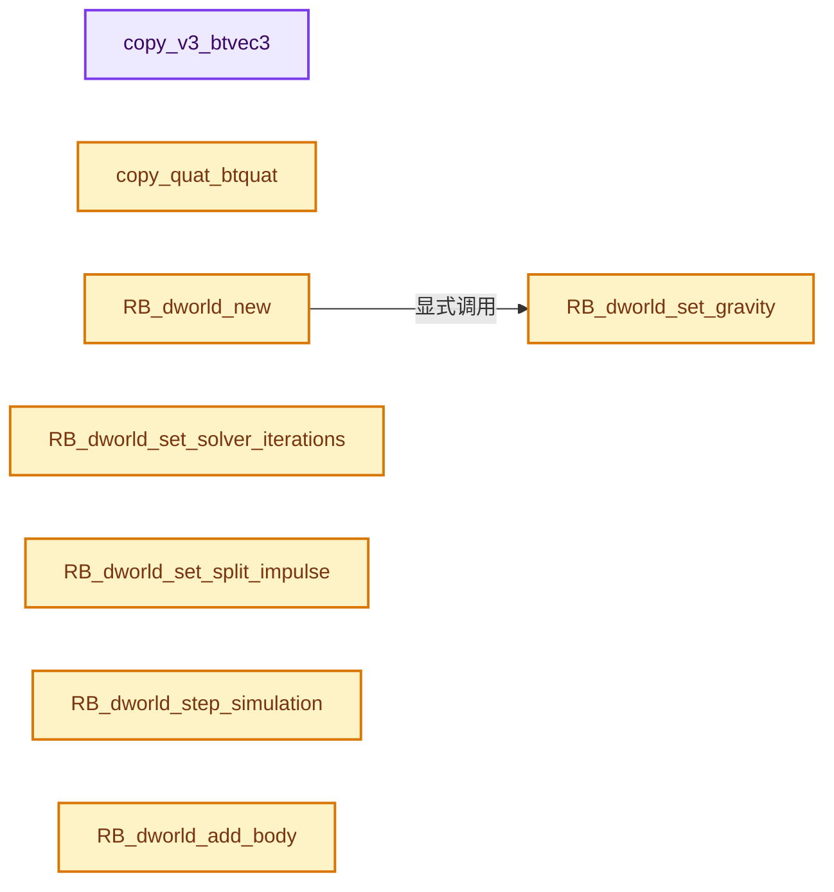
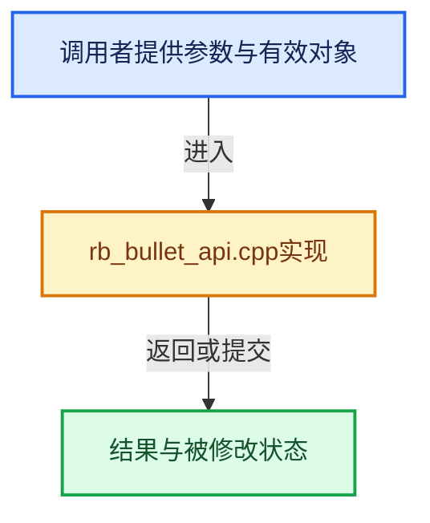

# 实现依赖专题：intern/rigidbody/rb_bullet_api.cpp

[实现依赖导航](../../README.md) · [符号索引](../../../00-课程指南/02-源码与提交索引/符号依赖与实现索引.md)

本专题从正文实际调用进入，集中保存共享实现。函数有稳定锚点，可从调用处直接跳到对应完整函数；递归与互相调用通过回链组织。

## 本文件的实现关系






## 完整成员与函数实现

<a id="f-0ff3b111e42c6e59"></a>

### `copy_v3_btvec3`

实现位置：[intern/rigidbody/rb_bullet_api.cpp](../../../../../../../intern/rigidbody/rb_bullet_api.cpp) · L105—L110。

接口参数：

- `float vec[3]`
- `const btVector3 &btvec`

**教学注释版**

<!-- annotated:b2f7aef7bf2c60 -->

```cpp
static inline void copy_v3_btvec3(float vec[3], const btVector3 &btvec)
{
  vec[0] = (float)btvec[0];
  vec[1] = (float)btvec[1];
  vec[2] = (float)btvec[2];
}
```

<details>
<summary>核对原始源码：intern/rigidbody/rb_bullet_api.cpp · L105—L110</summary>

<!-- original:b2f7aef7bf2c60:intern/rigidbody/rb_bullet_api.cpp:105:110 -->

```cpp
static inline void copy_v3_btvec3(float vec[3], const btVector3 &btvec)
{
  vec[0] = (float)btvec[0];
  vec[1] = (float)btvec[1];
  vec[2] = (float)btvec[2];
}
```

</details>

**沿实际写入检查状态**

- `vec[0] = (float)btvec[0];`
- `vec[1] = (float)btvec[1];`
- `vec[2] = (float)btvec[2];`

**继续追踪实现**

本实现没有需要继续展开的显式调用；检查返回表达式、对象转换和调用者前置条件。

<a id="f-471fc6becc0d1116"></a>

### `copy_quat_btquat`

实现位置：[intern/rigidbody/rb_bullet_api.cpp](../../../../../../../intern/rigidbody/rb_bullet_api.cpp) · L111—L117。

接口参数：

- `float quat[4]`
- `const btQuaternion &btquat`

**教学注释版**

<!-- annotated:7d27e6604e09a4 -->

```cpp
static inline void copy_quat_btquat(float quat[4], const btQuaternion &btquat)
{
  quat[0] = btquat.getW();
  quat[1] = btquat.getX();
  quat[2] = btquat.getY();
  quat[3] = btquat.getZ();
}
```

<details>
<summary>核对原始源码：intern/rigidbody/rb_bullet_api.cpp · L111—L117</summary>

<!-- original:7d27e6604e09a4:intern/rigidbody/rb_bullet_api.cpp:111:117 -->

```cpp
static inline void copy_quat_btquat(float quat[4], const btQuaternion &btquat)
{
  quat[0] = btquat.getW();
  quat[1] = btquat.getX();
  quat[2] = btquat.getY();
  quat[3] = btquat.getZ();
}
```

</details>

**沿实际写入检查状态**

- `quat[0] = btquat.getW();`
- `quat[1] = btquat.getX();`
- `quat[2] = btquat.getY();`
- `quat[3] = btquat.getZ();`

**继续追踪实现**

- `btquat.getW` → [调用协议](../../../00-课程指南/01-路线与规范/模板宏与动态分派协议.md)：由接收对象具体类型或运行时策略提供实现。调用位置L113。
- `btquat.getX` → [调用协议](../../../00-课程指南/01-路线与规范/模板宏与动态分派协议.md)：由接收对象具体类型或运行时策略提供实现。调用位置L114。
- `btquat.getY` → [调用协议](../../../00-课程指南/01-路线与规范/模板宏与动态分派协议.md)：由接收对象具体类型或运行时策略提供实现。调用位置L115。
- `btquat.getZ` → [调用协议](../../../00-课程指南/01-路线与规范/模板宏与动态分派协议.md)：由接收对象具体类型或运行时策略提供实现。调用位置L116。

<a id="f-80a251f052a0b5c5"></a>

### `RB_dworld_new`

实现位置：[intern/rigidbody/rb_bullet_api.cpp](../../../../../../../intern/rigidbody/rb_bullet_api.cpp) · L124—L149。

接口参数：

- `const float gravity[3]`

**教学注释版**

<!-- annotated:319c1469a8842f -->

```cpp
rbDynamicsWorld *RB_dworld_new(const float gravity[3])
{
  rbDynamicsWorld *world = new rbDynamicsWorld;

  /* collision detection/handling */
  world->collisionConfiguration = new btDefaultCollisionConfiguration();

  world->dispatcher = new btCollisionDispatcher(world->collisionConfiguration);
  btGImpactCollisionAlgorithm::registerAlgorithm((btCollisionDispatcher *)world->dispatcher);

  world->pairCache = new btDbvtBroadphase();

  world->filterCallback = new rbFilterCallback();
  world->pairCache->getOverlappingPairCache()->setOverlapFilterCallback(world->filterCallback);

  /* constraint solving */
  world->constraintSolver = new btSequentialImpulseConstraintSolver();

  /* world */
  world->dynamicsWorld = new btDiscreteDynamicsWorld(
      world->dispatcher, world->pairCache, world->constraintSolver, world->collisionConfiguration);

  RB_dworld_set_gravity(world, gravity);

  return world;
}
```

<details>
<summary>核对原始源码：intern/rigidbody/rb_bullet_api.cpp · L124—L149</summary>

<!-- original:319c1469a8842f:intern/rigidbody/rb_bullet_api.cpp:124:149 -->

```cpp
rbDynamicsWorld *RB_dworld_new(const float gravity[3])
{
  rbDynamicsWorld *world = new rbDynamicsWorld;

  /* collision detection/handling */
  world->collisionConfiguration = new btDefaultCollisionConfiguration();

  world->dispatcher = new btCollisionDispatcher(world->collisionConfiguration);
  btGImpactCollisionAlgorithm::registerAlgorithm((btCollisionDispatcher *)world->dispatcher);

  world->pairCache = new btDbvtBroadphase();

  world->filterCallback = new rbFilterCallback();
  world->pairCache->getOverlappingPairCache()->setOverlapFilterCallback(world->filterCallback);

  /* constraint solving */
  world->constraintSolver = new btSequentialImpulseConstraintSolver();

  /* world */
  world->dynamicsWorld = new btDiscreteDynamicsWorld(
      world->dispatcher, world->pairCache, world->constraintSolver, world->collisionConfiguration);

  RB_dworld_set_gravity(world, gravity);

  return world;
}
```

</details>

**沿实际写入检查状态**

- `world->collisionConfiguration = new btDefaultCollisionConfiguration();`
- `world->dispatcher = new btCollisionDispatcher(world->collisionConfiguration);`
- `world->pairCache = new btDbvtBroadphase();`
- `world->filterCallback = new rbFilterCallback();`
- `world->constraintSolver = new btSequentialImpulseConstraintSolver();`
- `world->dynamicsWorld = new btDiscreteDynamicsWorld(`

**结果出口**

- `return world;`

**继续追踪实现**

- `btGImpactCollisionAlgorithm::registerAlgorithm` → [调用协议](../../../00-课程指南/01-路线与规范/模板宏与动态分派协议.md)：函数指针、局部可调用对象或未展开的宏；必须结合调用者环境。调用位置L132。
- `world->pairCache->getOverlappingPairCache()->setOverlapFilterCallback` → [调用协议](../../../00-课程指南/01-路线与规范/模板宏与动态分派协议.md)：接收对象类型依赖auto、返回值或模板实例；不按同名猜测目标。调用位置L137。
- `world->pairCache->getOverlappingPairCache` → [调用协议](../../../00-课程指南/01-路线与规范/模板宏与动态分派协议.md)：接收对象类型依赖auto、返回值或模板实例；不按同名猜测目标。调用位置L137。
- `RB_dworld_set_gravity` → [RB_dworld_set_gravity · L172](rb_bullet_api.cpp.md#f-f160afb1899a8921)。

<a id="f-f160afb1899a8921"></a>

### `RB_dworld_set_gravity`

实现位置：[intern/rigidbody/rb_bullet_api.cpp](../../../../../../../intern/rigidbody/rb_bullet_api.cpp) · L172—L175。

接口参数：

- `rbDynamicsWorld *world`
- `const float g_in[3]`

**教学注释版**

<!-- annotated:c0b800c9a31152 -->

```cpp
void RB_dworld_set_gravity(rbDynamicsWorld *world, const float g_in[3])
{
  world->dynamicsWorld->setGravity(btVector3(g_in[0], g_in[1], g_in[2]));
}
```

<details>
<summary>核对原始源码：intern/rigidbody/rb_bullet_api.cpp · L172—L175</summary>

<!-- original:c0b800c9a31152:intern/rigidbody/rb_bullet_api.cpp:172:175 -->

```cpp
void RB_dworld_set_gravity(rbDynamicsWorld *world, const float g_in[3])
{
  world->dynamicsWorld->setGravity(btVector3(g_in[0], g_in[1], g_in[2]));
}
```

</details>

**继续追踪实现**

- `world->dynamicsWorld->setGravity` → [调用协议](../../../00-课程指南/01-路线与规范/模板宏与动态分派协议.md)：接收对象类型依赖auto、返回值或模板实例；不按同名猜测目标。调用位置L174。
- `btVector3` → [调用协议](../../../00-课程指南/01-路线与规范/模板宏与动态分派协议.md)：函数指针、局部可调用对象或未展开的宏；必须结合调用者环境。调用位置L174。

<a id="f-8f8674cb22dcb8ca"></a>

### `RB_dworld_set_solver_iterations`

实现位置：[intern/rigidbody/rb_bullet_api.cpp](../../../../../../../intern/rigidbody/rb_bullet_api.cpp) · L179—L184。

接口参数：

- `rbDynamicsWorld *world`
- `int num_solver_iterations`

**教学注释版**

<!-- annotated:39c5ba23fbc07c -->

```cpp
void RB_dworld_set_solver_iterations(rbDynamicsWorld *world, int num_solver_iterations)
{
  btContactSolverInfo &info = world->dynamicsWorld->getSolverInfo();

  info.m_numIterations = num_solver_iterations;
}
```

<details>
<summary>核对原始源码：intern/rigidbody/rb_bullet_api.cpp · L179—L184</summary>

<!-- original:39c5ba23fbc07c:intern/rigidbody/rb_bullet_api.cpp:179:184 -->

```cpp
void RB_dworld_set_solver_iterations(rbDynamicsWorld *world, int num_solver_iterations)
{
  btContactSolverInfo &info = world->dynamicsWorld->getSolverInfo();

  info.m_numIterations = num_solver_iterations;
}
```

</details>

**沿实际写入检查状态**

- `info.m_numIterations = num_solver_iterations;`

**继续追踪实现**

- `world->dynamicsWorld->getSolverInfo` → [调用协议](../../../00-课程指南/01-路线与规范/模板宏与动态分派协议.md)：接收对象类型依赖auto、返回值或模板实例；不按同名猜测目标。调用位置L181。

<a id="f-6b79f2c31e3022bb"></a>

### `RB_dworld_set_split_impulse`

实现位置：[intern/rigidbody/rb_bullet_api.cpp](../../../../../../../intern/rigidbody/rb_bullet_api.cpp) · L188—L193。

接口参数：

- `rbDynamicsWorld *world`
- `int split_impulse`

**教学注释版**

<!-- annotated:5830a7e219f94c -->

```cpp
void RB_dworld_set_split_impulse(rbDynamicsWorld *world, int split_impulse)
{
  btContactSolverInfo &info = world->dynamicsWorld->getSolverInfo();

  info.m_splitImpulse = split_impulse;
}
```

<details>
<summary>核对原始源码：intern/rigidbody/rb_bullet_api.cpp · L188—L193</summary>

<!-- original:5830a7e219f94c:intern/rigidbody/rb_bullet_api.cpp:188:193 -->

```cpp
void RB_dworld_set_split_impulse(rbDynamicsWorld *world, int split_impulse)
{
  btContactSolverInfo &info = world->dynamicsWorld->getSolverInfo();

  info.m_splitImpulse = split_impulse;
}
```

</details>

**沿实际写入检查状态**

- `info.m_splitImpulse = split_impulse;`

**继续追踪实现**

- `world->dynamicsWorld->getSolverInfo` → [调用协议](../../../00-课程指南/01-路线与规范/模板宏与动态分派协议.md)：接收对象类型依赖auto、返回值或模板实例；不按同名猜测目标。调用位置L190。

<a id="f-63423877c9c19a81"></a>

### `RB_dworld_step_simulation`

实现位置：[intern/rigidbody/rb_bullet_api.cpp](../../../../../../../intern/rigidbody/rb_bullet_api.cpp) · L197—L203。

接口参数：

- `rbDynamicsWorld *world`
- `float timeStep`
- `int maxSubSteps`
- `float timeSubStep`

**教学注释版**

<!-- annotated:7e31f8724783d5 -->

```cpp
void RB_dworld_step_simulation(rbDynamicsWorld *world,
                               float timeStep,
                               int maxSubSteps,
                               float timeSubStep)
{
  world->dynamicsWorld->stepSimulation(timeStep, maxSubSteps, timeSubStep);
}
```

<details>
<summary>核对原始源码：intern/rigidbody/rb_bullet_api.cpp · L197—L203</summary>

<!-- original:7e31f8724783d5:intern/rigidbody/rb_bullet_api.cpp:197:203 -->

```cpp
void RB_dworld_step_simulation(rbDynamicsWorld *world,
                               float timeStep,
                               int maxSubSteps,
                               float timeSubStep)
{
  world->dynamicsWorld->stepSimulation(timeStep, maxSubSteps, timeSubStep);
}
```

</details>

**继续追踪实现**

- `world->dynamicsWorld->stepSimulation` → [调用协议](../../../00-课程指南/01-路线与规范/模板宏与动态分派协议.md)：接收对象类型依赖auto、返回值或模板实例；不按同名猜测目标。调用位置L202。

<a id="f-ee3b1dd014fdc8db"></a>

### `RB_dworld_add_body`

实现位置：[intern/rigidbody/rb_bullet_api.cpp](../../../../../../../intern/rigidbody/rb_bullet_api.cpp) · L230—L236。

接口参数：

- `rbDynamicsWorld *world`
- `rbRigidBody *object`
- `int col_groups`

**教学注释版**

<!-- annotated:3ae9c186c248d2 -->

```cpp
void RB_dworld_add_body(rbDynamicsWorld *world, rbRigidBody *object, int col_groups)
{
  btRigidBody *body = object->body;
  object->col_groups = col_groups;

  world->dynamicsWorld->addRigidBody(body);
}
```

<details>
<summary>核对原始源码：intern/rigidbody/rb_bullet_api.cpp · L230—L236</summary>

<!-- original:3ae9c186c248d2:intern/rigidbody/rb_bullet_api.cpp:230:236 -->

```cpp
void RB_dworld_add_body(rbDynamicsWorld *world, rbRigidBody *object, int col_groups)
{
  btRigidBody *body = object->body;
  object->col_groups = col_groups;

  world->dynamicsWorld->addRigidBody(body);
}
```

</details>

**沿实际写入检查状态**

- `object->col_groups = col_groups;`

**继续追踪实现**

- `world->dynamicsWorld->addRigidBody` → [调用协议](../../../00-课程指南/01-路线与规范/模板宏与动态分派协议.md)：接收对象类型依赖auto、返回值或模板实例；不按同名猜测目标。调用位置L235。

<a id="f-3f7d318178c47350"></a>

### `RB_body_new`

实现位置：[intern/rigidbody/rb_bullet_api.cpp](../../../../../../../intern/rigidbody/rb_bullet_api.cpp) · L312—L332。

接口参数：

- `rbCollisionShape *shape`
- `const float loc[3]`
- `const float rot[4]`

**教学注释版**

<!-- annotated:de0c29989a92d9 -->

```cpp
rbRigidBody *RB_body_new(rbCollisionShape *shape, const float loc[3], const float rot[4])
{
  rbRigidBody *object = new rbRigidBody;
  /* current transform */
  btTransform trans;
  trans.setIdentity();
  trans.setOrigin(btVector3(loc[0], loc[1], loc[2]));
  trans.setRotation(btQuaternion(rot[1], rot[2], rot[3], rot[0]));

  /* create motionstate, which is necessary for interpolation (includes reverse playback) */
  btDefaultMotionState *motionState = new btDefaultMotionState(trans);

  /* make rigidbody */
  btRigidBody::btRigidBodyConstructionInfo rbInfo(1.0f, motionState, shape->cshape);

  object->body = new btRigidBody(rbInfo);

  object->body->setUserPointer(object);

  return object;
}
```

<details>
<summary>核对原始源码：intern/rigidbody/rb_bullet_api.cpp · L312—L332</summary>

<!-- original:de0c29989a92d9:intern/rigidbody/rb_bullet_api.cpp:312:332 -->

```cpp
rbRigidBody *RB_body_new(rbCollisionShape *shape, const float loc[3], const float rot[4])
{
  rbRigidBody *object = new rbRigidBody;
  /* current transform */
  btTransform trans;
  trans.setIdentity();
  trans.setOrigin(btVector3(loc[0], loc[1], loc[2]));
  trans.setRotation(btQuaternion(rot[1], rot[2], rot[3], rot[0]));

  /* create motionstate, which is necessary for interpolation (includes reverse playback) */
  btDefaultMotionState *motionState = new btDefaultMotionState(trans);

  /* make rigidbody */
  btRigidBody::btRigidBodyConstructionInfo rbInfo(1.0f, motionState, shape->cshape);

  object->body = new btRigidBody(rbInfo);

  object->body->setUserPointer(object);

  return object;
}
```

</details>

**沿实际写入检查状态**

- `object->body = new btRigidBody(rbInfo);`

**结果出口**

- `return object;`

**继续追踪实现**

- `trans.setIdentity` → [调用协议](../../../00-课程指南/01-路线与规范/模板宏与动态分派协议.md)：由接收对象具体类型或运行时策略提供实现。调用位置L317。
- `trans.setOrigin` → [调用协议](../../../00-课程指南/01-路线与规范/模板宏与动态分派协议.md)：由接收对象具体类型或运行时策略提供实现。调用位置L318。
- `btVector3` → [调用协议](../../../00-课程指南/01-路线与规范/模板宏与动态分派协议.md)：函数指针、局部可调用对象或未展开的宏；必须结合调用者环境。调用位置L318。
- `trans.setRotation` → [调用协议](../../../00-课程指南/01-路线与规范/模板宏与动态分派协议.md)：由接收对象具体类型或运行时策略提供实现。调用位置L319。
- `btQuaternion` → [调用协议](../../../00-课程指南/01-路线与规范/模板宏与动态分派协议.md)：函数指针、局部可调用对象或未展开的宏；必须结合调用者环境。调用位置L319。
- `object->body->setUserPointer` → [调用协议](../../../00-课程指南/01-路线与规范/模板宏与动态分派协议.md)：接收对象类型依赖auto、返回值或模板实例；不按同名猜测目标。调用位置L329。

<a id="f-87454ac28ab4946b"></a>

### `RB_body_set_collision_shape`

实现位置：[intern/rigidbody/rb_bullet_api.cpp](../../../../../../../intern/rigidbody/rb_bullet_api.cpp) · L361—L370。

接口参数：

- `rbRigidBody *object`
- `rbCollisionShape *shape`

**教学注释版**

<!-- annotated:104b60d096a2c0 -->

```cpp
void RB_body_set_collision_shape(rbRigidBody *object, rbCollisionShape *shape)
{
  btRigidBody *body = object->body;

  /* set new collision shape */
  body->setCollisionShape(shape->cshape);

  /* recalculate inertia, since that depends on the collision shape... */
  RB_body_set_mass(object, RB_body_get_mass(object));
}
```

<details>
<summary>核对原始源码：intern/rigidbody/rb_bullet_api.cpp · L361—L370</summary>

<!-- original:104b60d096a2c0:intern/rigidbody/rb_bullet_api.cpp:361:370 -->

```cpp
void RB_body_set_collision_shape(rbRigidBody *object, rbCollisionShape *shape)
{
  btRigidBody *body = object->body;

  /* set new collision shape */
  body->setCollisionShape(shape->cshape);

  /* recalculate inertia, since that depends on the collision shape... */
  RB_body_set_mass(object, RB_body_get_mass(object));
}
```

</details>

**继续追踪实现**

- `body->setCollisionShape` → [调用协议](../../../00-课程指南/01-路线与规范/模板宏与动态分派协议.md)：由接收对象具体类型或运行时策略提供实现。调用位置L366。
- `RB_body_set_mass` → [RB_body_set_mass · L390](rb_bullet_api.cpp.md#f-80f79ecb46a09442)。
- `RB_body_get_mass` → [RB_body_get_mass · L374](rb_bullet_api.cpp.md#f-beddda39d3c00c2c)。

<a id="f-beddda39d3c00c2c"></a>

### `RB_body_get_mass`

实现位置：[intern/rigidbody/rb_bullet_api.cpp](../../../../../../../intern/rigidbody/rb_bullet_api.cpp) · L374—L388。

接口参数：

- `rbRigidBody *object`

**教学注释版**

<!-- annotated:064502031adb87 -->

```cpp
float RB_body_get_mass(rbRigidBody *object)
{
  btRigidBody *body = object->body;

  /* there isn't really a mass setting, but rather 'inverse mass'
   * which we convert back to mass by taking the reciprocal again
   */
  float value = (float)body->getInvMass();

  if (value) {
    value = 1.0f / value;
  }

  return value;
}
```

<details>
<summary>核对原始源码：intern/rigidbody/rb_bullet_api.cpp · L374—L388</summary>

<!-- original:064502031adb87:intern/rigidbody/rb_bullet_api.cpp:374:388 -->

```cpp
float RB_body_get_mass(rbRigidBody *object)
{
  btRigidBody *body = object->body;

  /* there isn't really a mass setting, but rather 'inverse mass'
   * which we convert back to mass by taking the reciprocal again
   */
  float value = (float)body->getInvMass();

  if (value) {
    value = 1.0f / value;
  }

  return value;
}
```

</details>

**沿实际写入检查状态**

- `value = 1.0f / value;`

**结果出口**

- `return value;`

**继续追踪实现**

- `body->getInvMass` → [调用协议](../../../00-课程指南/01-路线与规范/模板宏与动态分派协议.md)：由接收对象具体类型或运行时策略提供实现。调用位置L381。

<a id="f-80f79ecb46a09442"></a>

### `RB_body_set_mass`

实现位置：[intern/rigidbody/rb_bullet_api.cpp](../../../../../../../intern/rigidbody/rb_bullet_api.cpp) · L390—L407。

接口参数：

- `rbRigidBody *object`
- `float value`

**教学注释版**

<!-- annotated:b6c06f21a5032c -->

```cpp
void RB_body_set_mass(rbRigidBody *object, float value)
{
  btRigidBody *body = object->body;
  btVector3 localInertia(0, 0, 0);

  /* calculate new inertia if non-zero mass */
  if (value) {
    btCollisionShape *shape = body->getCollisionShape();
    shape->calculateLocalInertia(value, localInertia);
  }

  btVector3 minAabb, maxAabb;
  btTransform ident;
  ident.setIdentity();
  body->getCollisionShape()->getAabb(ident, minAabb, maxAabb);
  body->setMassProps(value, localInertia);
  body->updateInertiaTensor();
}
```

<details>
<summary>核对原始源码：intern/rigidbody/rb_bullet_api.cpp · L390—L407</summary>

<!-- original:b6c06f21a5032c:intern/rigidbody/rb_bullet_api.cpp:390:407 -->

```cpp
void RB_body_set_mass(rbRigidBody *object, float value)
{
  btRigidBody *body = object->body;
  btVector3 localInertia(0, 0, 0);

  /* calculate new inertia if non-zero mass */
  if (value) {
    btCollisionShape *shape = body->getCollisionShape();
    shape->calculateLocalInertia(value, localInertia);
  }

  btVector3 minAabb, maxAabb;
  btTransform ident;
  ident.setIdentity();
  body->getCollisionShape()->getAabb(ident, minAabb, maxAabb);
  body->setMassProps(value, localInertia);
  body->updateInertiaTensor();
}
```

</details>

**继续追踪实现**

- `body->getCollisionShape` → [调用协议](../../../00-课程指南/01-路线与规范/模板宏与动态分派协议.md)：由接收对象具体类型或运行时策略提供实现。调用位置L397。
- `shape->calculateLocalInertia` → [调用协议](../../../00-课程指南/01-路线与规范/模板宏与动态分派协议.md)：由接收对象具体类型或运行时策略提供实现。调用位置L398。
- `ident.setIdentity` → [调用协议](../../../00-课程指南/01-路线与规范/模板宏与动态分派协议.md)：由接收对象具体类型或运行时策略提供实现。调用位置L403。
- `body->getCollisionShape()->getAabb` → [调用协议](../../../00-课程指南/01-路线与规范/模板宏与动态分派协议.md)：接收对象类型依赖auto、返回值或模板实例；不按同名猜测目标。调用位置L404。
- `body->setMassProps` → [调用协议](../../../00-课程指南/01-路线与规范/模板宏与动态分派协议.md)：由接收对象具体类型或运行时策略提供实现。调用位置L405。
- `body->updateInertiaTensor` → [调用协议](../../../00-课程指南/01-路线与规范/模板宏与动态分派协议.md)：由接收对象具体类型或运行时策略提供实现。调用位置L406。

<a id="f-1f774d7d7ac5321a"></a>

### `RB_body_set_friction`

实现位置：[intern/rigidbody/rb_bullet_api.cpp](../../../../../../../intern/rigidbody/rb_bullet_api.cpp) · L415—L419。

接口参数：

- `rbRigidBody *object`
- `float value`

**教学注释版**

<!-- annotated:ca63bc25aa5068 -->

```cpp
void RB_body_set_friction(rbRigidBody *object, float value)
{
  btRigidBody *body = object->body;
  body->setFriction(value);
}
```

<details>
<summary>核对原始源码：intern/rigidbody/rb_bullet_api.cpp · L415—L419</summary>

<!-- original:ca63bc25aa5068:intern/rigidbody/rb_bullet_api.cpp:415:419 -->

```cpp
void RB_body_set_friction(rbRigidBody *object, float value)
{
  btRigidBody *body = object->body;
  body->setFriction(value);
}
```

</details>

**继续追踪实现**

- `body->setFriction` → [调用协议](../../../00-课程指南/01-路线与规范/模板宏与动态分派协议.md)：由接收对象具体类型或运行时策略提供实现。调用位置L418。

<a id="f-91b2c6a509bc00c2"></a>

### `RB_body_set_restitution`

实现位置：[intern/rigidbody/rb_bullet_api.cpp](../../../../../../../intern/rigidbody/rb_bullet_api.cpp) · L427—L431。

接口参数：

- `rbRigidBody *object`
- `float value`

**教学注释版**

<!-- annotated:201368dad92a02 -->

```cpp
void RB_body_set_restitution(rbRigidBody *object, float value)
{
  btRigidBody *body = object->body;
  body->setRestitution(value);
}
```

<details>
<summary>核对原始源码：intern/rigidbody/rb_bullet_api.cpp · L427—L431</summary>

<!-- original:201368dad92a02:intern/rigidbody/rb_bullet_api.cpp:427:431 -->

```cpp
void RB_body_set_restitution(rbRigidBody *object, float value)
{
  btRigidBody *body = object->body;
  body->setRestitution(value);
}
```

</details>

**继续追踪实现**

- `body->setRestitution` → [调用协议](../../../00-课程指南/01-路线与规范/模板宏与动态分派协议.md)：由接收对象具体类型或运行时策略提供实现。调用位置L430。

<a id="f-c0168b57f8cad1e8"></a>

### `RB_body_set_damping`

实现位置：[intern/rigidbody/rb_bullet_api.cpp](../../../../../../../intern/rigidbody/rb_bullet_api.cpp) · L455—L459。

接口参数：

- `rbRigidBody *object`
- `float linear`
- `float angular`

**教学注释版**

<!-- annotated:01f521ecb4eb80 -->

```cpp
void RB_body_set_damping(rbRigidBody *object, float linear, float angular)
{
  btRigidBody *body = object->body;
  body->setDamping(linear, angular);
}
```

<details>
<summary>核对原始源码：intern/rigidbody/rb_bullet_api.cpp · L455—L459</summary>

<!-- original:01f521ecb4eb80:intern/rigidbody/rb_bullet_api.cpp:455:459 -->

```cpp
void RB_body_set_damping(rbRigidBody *object, float linear, float angular)
{
  btRigidBody *body = object->body;
  body->setDamping(linear, angular);
}
```

</details>

**继续追踪实现**

- `body->setDamping` → [调用协议](../../../00-课程指南/01-路线与规范/模板宏与动态分派协议.md)：由接收对象具体类型或运行时策略提供实现。调用位置L458。

<a id="f-e3f1254bc23686d9"></a>

### `RB_body_set_sleep_thresh`

实现位置：[intern/rigidbody/rb_bullet_api.cpp](../../../../../../../intern/rigidbody/rb_bullet_api.cpp) · L483—L487。

接口参数：

- `rbRigidBody *object`
- `float linear`
- `float angular`

**教学注释版**

<!-- annotated:71bbeb20caaf83 -->

```cpp
void RB_body_set_sleep_thresh(rbRigidBody *object, float linear, float angular)
{
  btRigidBody *body = object->body;
  body->setSleepingThresholds(linear, angular);
}
```

<details>
<summary>核对原始源码：intern/rigidbody/rb_bullet_api.cpp · L483—L487</summary>

<!-- original:71bbeb20caaf83:intern/rigidbody/rb_bullet_api.cpp:483:487 -->

```cpp
void RB_body_set_sleep_thresh(rbRigidBody *object, float linear, float angular)
{
  btRigidBody *body = object->body;
  body->setSleepingThresholds(linear, angular);
}
```

</details>

**继续追踪实现**

- `body->setSleepingThresholds` → [调用协议](../../../00-课程指南/01-路线与规范/模板宏与动态分派协议.md)：由接收对象具体类型或运行时策略提供实现。调用位置L486。

<a id="f-eb8220428c78553d"></a>

### `RB_body_get_linear_velocity`

实现位置：[intern/rigidbody/rb_bullet_api.cpp](../../../../../../../intern/rigidbody/rb_bullet_api.cpp) · L491—L496。

接口参数：

- `rbRigidBody *object`
- `float v_out[3]`

**教学注释版**

<!-- annotated:7388e71a2bea6d -->

```cpp
void RB_body_get_linear_velocity(rbRigidBody *object, float v_out[3])
{
  btRigidBody *body = object->body;

  copy_v3_btvec3(v_out, body->getLinearVelocity());
}
```

<details>
<summary>核对原始源码：intern/rigidbody/rb_bullet_api.cpp · L491—L496</summary>

<!-- original:7388e71a2bea6d:intern/rigidbody/rb_bullet_api.cpp:491:496 -->

```cpp
void RB_body_get_linear_velocity(rbRigidBody *object, float v_out[3])
{
  btRigidBody *body = object->body;

  copy_v3_btvec3(v_out, body->getLinearVelocity());
}
```

</details>

**继续追踪实现**

- `copy_v3_btvec3` → [copy_v3_btvec3 · L105](rb_bullet_api.cpp.md#f-0ff3b111e42c6e59)。
- `body->getLinearVelocity` → [调用协议](../../../00-课程指南/01-路线与规范/模板宏与动态分派协议.md)：由接收对象具体类型或运行时策略提供实现。调用位置L495。

<a id="f-47167dc429109907"></a>

### `RB_body_set_linear_factor`

实现位置：[intern/rigidbody/rb_bullet_api.cpp](../../../../../../../intern/rigidbody/rb_bullet_api.cpp) · L519—L523。

接口参数：

- `rbRigidBody *object`
- `float x`
- `float y`
- `float z`

**教学注释版**

<!-- annotated:53f3816b9e717e -->

```cpp
void RB_body_set_linear_factor(rbRigidBody *object, float x, float y, float z)
{
  btRigidBody *body = object->body;
  body->setLinearFactor(btVector3(x, y, z));
}
```

<details>
<summary>核对原始源码：intern/rigidbody/rb_bullet_api.cpp · L519—L523</summary>

<!-- original:53f3816b9e717e:intern/rigidbody/rb_bullet_api.cpp:519:523 -->

```cpp
void RB_body_set_linear_factor(rbRigidBody *object, float x, float y, float z)
{
  btRigidBody *body = object->body;
  body->setLinearFactor(btVector3(x, y, z));
}
```

</details>

**继续追踪实现**

- `body->setLinearFactor` → [调用协议](../../../00-课程指南/01-路线与规范/模板宏与动态分派协议.md)：由接收对象具体类型或运行时策略提供实现。调用位置L522。
- `btVector3` → [调用协议](../../../00-课程指南/01-路线与规范/模板宏与动态分派协议.md)：函数指针、局部可调用对象或未展开的宏；必须结合调用者环境。调用位置L522。

<a id="f-1224e71f3b2b7345"></a>

### `RB_body_set_angular_factor`

实现位置：[intern/rigidbody/rb_bullet_api.cpp](../../../../../../../intern/rigidbody/rb_bullet_api.cpp) · L525—L529。

接口参数：

- `rbRigidBody *object`
- `float x`
- `float y`
- `float z`

**教学注释版**

<!-- annotated:e1ef3462fc1562 -->

```cpp
void RB_body_set_angular_factor(rbRigidBody *object, float x, float y, float z)
{
  btRigidBody *body = object->body;
  body->setAngularFactor(btVector3(x, y, z));
}
```

<details>
<summary>核对原始源码：intern/rigidbody/rb_bullet_api.cpp · L525—L529</summary>

<!-- original:e1ef3462fc1562:intern/rigidbody/rb_bullet_api.cpp:525:529 -->

```cpp
void RB_body_set_angular_factor(rbRigidBody *object, float x, float y, float z)
{
  btRigidBody *body = object->body;
  body->setAngularFactor(btVector3(x, y, z));
}
```

</details>

**继续追踪实现**

- `body->setAngularFactor` → [调用协议](../../../00-课程指南/01-路线与规范/模板宏与动态分派协议.md)：由接收对象具体类型或运行时策略提供实现。调用位置L528。
- `btVector3` → [调用协议](../../../00-课程指南/01-路线与规范/模板宏与动态分派协议.md)：函数指针、局部可调用对象或未展开的宏；必须结合调用者环境。调用位置L528。

<a id="f-e44dc5d8ab1454f3"></a>

### `RB_body_set_kinematic_state`

实现位置：[intern/rigidbody/rb_bullet_api.cpp](../../../../../../../intern/rigidbody/rb_bullet_api.cpp) · L533—L542。

接口参数：

- `rbRigidBody *object`
- `int kinematic`

**教学注释版**

<!-- annotated:e5c732a9654f94 -->

```cpp
void RB_body_set_kinematic_state(rbRigidBody *object, int kinematic)
{
  btRigidBody *body = object->body;
  if (kinematic) {
    body->setCollisionFlags(body->getCollisionFlags() | btCollisionObject::CF_KINEMATIC_OBJECT);
  }
  else {
    body->setCollisionFlags(body->getCollisionFlags() & ~btCollisionObject::CF_KINEMATIC_OBJECT);
  }
}
```

<details>
<summary>核对原始源码：intern/rigidbody/rb_bullet_api.cpp · L533—L542</summary>

<!-- original:e5c732a9654f94:intern/rigidbody/rb_bullet_api.cpp:533:542 -->

```cpp
void RB_body_set_kinematic_state(rbRigidBody *object, int kinematic)
{
  btRigidBody *body = object->body;
  if (kinematic) {
    body->setCollisionFlags(body->getCollisionFlags() | btCollisionObject::CF_KINEMATIC_OBJECT);
  }
  else {
    body->setCollisionFlags(body->getCollisionFlags() & ~btCollisionObject::CF_KINEMATIC_OBJECT);
  }
}
```

</details>

**继续追踪实现**

- `body->setCollisionFlags` → [调用协议](../../../00-课程指南/01-路线与规范/模板宏与动态分派协议.md)：由接收对象具体类型或运行时策略提供实现。调用位置L537。
- `body->getCollisionFlags` → [调用协议](../../../00-课程指南/01-路线与规范/模板宏与动态分派协议.md)：由接收对象具体类型或运行时策略提供实现。调用位置L537。

<a id="f-3bf6431f6dbd89bd"></a>

### `RB_body_set_activation_state`

实现位置：[intern/rigidbody/rb_bullet_api.cpp](../../../../../../../intern/rigidbody/rb_bullet_api.cpp) · L546—L555。

接口参数：

- `rbRigidBody *object`
- `int use_deactivation`

**教学注释版**

<!-- annotated:a5c6b7ad8bbd93 -->

```cpp
void RB_body_set_activation_state(rbRigidBody *object, int use_deactivation)
{
  btRigidBody *body = object->body;
  if (use_deactivation) {
    body->forceActivationState(ACTIVE_TAG);
  }
  else {
    body->setActivationState(DISABLE_DEACTIVATION);
  }
}
```

<details>
<summary>核对原始源码：intern/rigidbody/rb_bullet_api.cpp · L546—L555</summary>

<!-- original:a5c6b7ad8bbd93:intern/rigidbody/rb_bullet_api.cpp:546:555 -->

```cpp
void RB_body_set_activation_state(rbRigidBody *object, int use_deactivation)
{
  btRigidBody *body = object->body;
  if (use_deactivation) {
    body->forceActivationState(ACTIVE_TAG);
  }
  else {
    body->setActivationState(DISABLE_DEACTIVATION);
  }
}
```

</details>

**继续追踪实现**

- `body->forceActivationState` → [调用协议](../../../00-课程指南/01-路线与规范/模板宏与动态分派协议.md)：由接收对象具体类型或运行时策略提供实现。调用位置L550。
- `body->setActivationState` → [调用协议](../../../00-课程指南/01-路线与规范/模板宏与动态分派协议.md)：由接收对象具体类型或运行时策略提供实现。调用位置L553。

<a id="f-975cf6acfd2af66f"></a>

### `RB_body_activate`

实现位置：[intern/rigidbody/rb_bullet_api.cpp](../../../../../../../intern/rigidbody/rb_bullet_api.cpp) · L556—L560。

接口参数：

- `rbRigidBody *object`

**教学注释版**

<!-- annotated:515e2d0d679d55 -->

```cpp
void RB_body_activate(rbRigidBody *object)
{
  btRigidBody *body = object->body;
  body->setActivationState(ACTIVE_TAG);
}
```

<details>
<summary>核对原始源码：intern/rigidbody/rb_bullet_api.cpp · L556—L560</summary>

<!-- original:515e2d0d679d55:intern/rigidbody/rb_bullet_api.cpp:556:560 -->

```cpp
void RB_body_activate(rbRigidBody *object)
{
  btRigidBody *body = object->body;
  body->setActivationState(ACTIVE_TAG);
}
```

</details>

**继续追踪实现**

- `body->setActivationState` → [调用协议](../../../00-课程指南/01-路线与规范/模板宏与动态分派协议.md)：由接收对象具体类型或运行时策略提供实现。调用位置L559。

<a id="f-64e15418008d254c"></a>

### `RB_body_deactivate`

实现位置：[intern/rigidbody/rb_bullet_api.cpp](../../../../../../../intern/rigidbody/rb_bullet_api.cpp) · L561—L565。

接口参数：

- `rbRigidBody *object`

**教学注释版**

<!-- annotated:0d4b32bcb6f375 -->

```cpp
void RB_body_deactivate(rbRigidBody *object)
{
  btRigidBody *body = object->body;
  body->setActivationState(ISLAND_SLEEPING);
}
```

<details>
<summary>核对原始源码：intern/rigidbody/rb_bullet_api.cpp · L561—L565</summary>

<!-- original:0d4b32bcb6f375:intern/rigidbody/rb_bullet_api.cpp:561:565 -->

```cpp
void RB_body_deactivate(rbRigidBody *object)
{
  btRigidBody *body = object->body;
  body->setActivationState(ISLAND_SLEEPING);
}
```

</details>

**继续追踪实现**

- `body->setActivationState` → [调用协议](../../../00-课程指南/01-路线与规范/模板宏与动态分派协议.md)：由接收对象具体类型或运行时策略提供实现。调用位置L564。

<a id="f-c985024508a275d4"></a>

### `RB_body_set_loc_rot`

实现位置：[intern/rigidbody/rb_bullet_api.cpp](../../../../../../../intern/rigidbody/rb_bullet_api.cpp) · L586—L598。

接口参数：

- `rbRigidBody *object`
- `const float loc[3]`
- `const float rot[4]`

**教学注释版**

<!-- annotated:2b26cc8a143b97 -->

```cpp
void RB_body_set_loc_rot(rbRigidBody *object, const float loc[3], const float rot[4])
{
  btRigidBody *body = object->body;
  btMotionState *ms = body->getMotionState();

  /* set transform matrix */
  btTransform trans;
  trans.setIdentity();
  trans.setOrigin(btVector3(loc[0], loc[1], loc[2]));
  trans.setRotation(btQuaternion(rot[1], rot[2], rot[3], rot[0]));

  ms->setWorldTransform(trans);
}
```

<details>
<summary>核对原始源码：intern/rigidbody/rb_bullet_api.cpp · L586—L598</summary>

<!-- original:2b26cc8a143b97:intern/rigidbody/rb_bullet_api.cpp:586:598 -->

```cpp
void RB_body_set_loc_rot(rbRigidBody *object, const float loc[3], const float rot[4])
{
  btRigidBody *body = object->body;
  btMotionState *ms = body->getMotionState();

  /* set transform matrix */
  btTransform trans;
  trans.setIdentity();
  trans.setOrigin(btVector3(loc[0], loc[1], loc[2]));
  trans.setRotation(btQuaternion(rot[1], rot[2], rot[3], rot[0]));

  ms->setWorldTransform(trans);
}
```

</details>

**继续追踪实现**

- `body->getMotionState` → [调用协议](../../../00-课程指南/01-路线与规范/模板宏与动态分派协议.md)：由接收对象具体类型或运行时策略提供实现。调用位置L589。
- `trans.setIdentity` → [调用协议](../../../00-课程指南/01-路线与规范/模板宏与动态分派协议.md)：由接收对象具体类型或运行时策略提供实现。调用位置L593。
- `trans.setOrigin` → [调用协议](../../../00-课程指南/01-路线与规范/模板宏与动态分派协议.md)：由接收对象具体类型或运行时策略提供实现。调用位置L594。
- `btVector3` → [调用协议](../../../00-课程指南/01-路线与规范/模板宏与动态分派协议.md)：函数指针、局部可调用对象或未展开的宏；必须结合调用者环境。调用位置L594。
- `trans.setRotation` → [调用协议](../../../00-课程指南/01-路线与规范/模板宏与动态分派协议.md)：由接收对象具体类型或运行时策略提供实现。调用位置L595。
- `btQuaternion` → [调用协议](../../../00-课程指南/01-路线与规范/模板宏与动态分派协议.md)：函数指针、局部可调用对象或未展开的宏；必须结合调用者环境。调用位置L595。
- `ms->setWorldTransform` → [调用协议](../../../00-课程指南/01-路线与规范/模板宏与动态分派协议.md)：由接收对象具体类型或运行时策略提供实现。调用位置L597。

<a id="f-1b6875645c0e26b9"></a>

### `RB_body_set_scale`

实现位置：[intern/rigidbody/rb_bullet_api.cpp](../../../../../../../intern/rigidbody/rb_bullet_api.cpp) · L600—L614。

接口参数：

- `rbRigidBody *object`
- `const float scale[3]`

**教学注释版**

<!-- annotated:54b98990387eea -->

```cpp
void RB_body_set_scale(rbRigidBody *object, const float scale[3])
{
  btRigidBody *body = object->body;

  /* apply scaling factor from matrix above to the collision shape */
  btCollisionShape *cshape = body->getCollisionShape();
  if (cshape) {
    cshape->setLocalScaling(btVector3(scale[0], scale[1], scale[2]));

    /* GIimpact shapes have to be updated to take scaling into account */
    if (cshape->getShapeType() == GIMPACT_SHAPE_PROXYTYPE) {
      ((btGImpactMeshShape *)cshape)->updateBound();
    }
  }
}
```

<details>
<summary>核对原始源码：intern/rigidbody/rb_bullet_api.cpp · L600—L614</summary>

<!-- original:54b98990387eea:intern/rigidbody/rb_bullet_api.cpp:600:614 -->

```cpp
void RB_body_set_scale(rbRigidBody *object, const float scale[3])
{
  btRigidBody *body = object->body;

  /* apply scaling factor from matrix above to the collision shape */
  btCollisionShape *cshape = body->getCollisionShape();
  if (cshape) {
    cshape->setLocalScaling(btVector3(scale[0], scale[1], scale[2]));

    /* GIimpact shapes have to be updated to take scaling into account */
    if (cshape->getShapeType() == GIMPACT_SHAPE_PROXYTYPE) {
      ((btGImpactMeshShape *)cshape)->updateBound();
    }
  }
}
```

</details>

**继续追踪实现**

- `body->getCollisionShape` → [调用协议](../../../00-课程指南/01-路线与规范/模板宏与动态分派协议.md)：由接收对象具体类型或运行时策略提供实现。调用位置L605。
- `cshape->setLocalScaling` → [调用协议](../../../00-课程指南/01-路线与规范/模板宏与动态分派协议.md)：由接收对象具体类型或运行时策略提供实现。调用位置L607。
- `btVector3` → [调用协议](../../../00-课程指南/01-路线与规范/模板宏与动态分派协议.md)：函数指针、局部可调用对象或未展开的宏；必须结合调用者环境。调用位置L607。
- `cshape->getShapeType` → [调用协议](../../../00-课程指南/01-路线与规范/模板宏与动态分派协议.md)：由接收对象具体类型或运行时策略提供实现。调用位置L610。
- `((btGImpactMeshShape *)cshape)->updateBound` → [调用协议](../../../00-课程指南/01-路线与规范/模板宏与动态分派协议.md)：接收对象类型依赖auto、返回值或模板实例；不按同名猜测目标。调用位置L611。

<a id="f-de949074811a1789"></a>

### `RB_body_get_position`

实现位置：[intern/rigidbody/rb_bullet_api.cpp](../../../../../../../intern/rigidbody/rb_bullet_api.cpp) · L619—L624。

接口参数：

- `rbRigidBody *object`
- `float v_out[3]`

**教学注释版**

<!-- annotated:2942564294d7b0 -->

```cpp
void RB_body_get_position(rbRigidBody *object, float v_out[3])
{
  btRigidBody *body = object->body;

  copy_v3_btvec3(v_out, body->getWorldTransform().getOrigin());
}
```

<details>
<summary>核对原始源码：intern/rigidbody/rb_bullet_api.cpp · L619—L624</summary>

<!-- original:2942564294d7b0:intern/rigidbody/rb_bullet_api.cpp:619:624 -->

```cpp
void RB_body_get_position(rbRigidBody *object, float v_out[3])
{
  btRigidBody *body = object->body;

  copy_v3_btvec3(v_out, body->getWorldTransform().getOrigin());
}
```

</details>

**继续追踪实现**

- `copy_v3_btvec3` → [copy_v3_btvec3 · L105](rb_bullet_api.cpp.md#f-0ff3b111e42c6e59)。
- `body->getWorldTransform().getOrigin` → [调用协议](../../../00-课程指南/01-路线与规范/模板宏与动态分派协议.md)：接收对象类型依赖auto、返回值或模板实例；不按同名猜测目标。调用位置L623。
- `body->getWorldTransform` → [调用协议](../../../00-课程指南/01-路线与规范/模板宏与动态分派协议.md)：由接收对象具体类型或运行时策略提供实现。调用位置L623。

<a id="f-04dd24ba1537cc65"></a>

### `RB_body_get_orientation`

实现位置：[intern/rigidbody/rb_bullet_api.cpp](../../../../../../../intern/rigidbody/rb_bullet_api.cpp) · L626—L631。

接口参数：

- `rbRigidBody *object`
- `float v_out[4]`

**教学注释版**

<!-- annotated:5cba789932a394 -->

```cpp
void RB_body_get_orientation(rbRigidBody *object, float v_out[4])
{
  btRigidBody *body = object->body;

  copy_quat_btquat(v_out, body->getWorldTransform().getRotation());
}
```

<details>
<summary>核对原始源码：intern/rigidbody/rb_bullet_api.cpp · L626—L631</summary>

<!-- original:5cba789932a394:intern/rigidbody/rb_bullet_api.cpp:626:631 -->

```cpp
void RB_body_get_orientation(rbRigidBody *object, float v_out[4])
{
  btRigidBody *body = object->body;

  copy_quat_btquat(v_out, body->getWorldTransform().getRotation());
}
```

</details>

**继续追踪实现**

- `copy_quat_btquat` → [copy_quat_btquat · L111](rb_bullet_api.cpp.md#f-471fc6becc0d1116)。
- `body->getWorldTransform().getRotation` → [调用协议](../../../00-课程指南/01-路线与规范/模板宏与动态分派协议.md)：接收对象类型依赖auto、返回值或模板实例；不按同名猜测目标。调用位置L630。
- `body->getWorldTransform` → [调用协议](../../../00-课程指南/01-路线与规范/模板宏与动态分派协议.md)：由接收对象具体类型或运行时策略提供实现。调用位置L630。

<a id="f-b2d106006060c20b"></a>

### `RB_body_get_scale`

实现位置：[intern/rigidbody/rb_bullet_api.cpp](../../../../../../../intern/rigidbody/rb_bullet_api.cpp) · L633—L641。

接口参数：

- `rbRigidBody *object`
- `float v_out[3]`

**教学注释版**

<!-- annotated:20f72e58f50289 -->

```cpp
void RB_body_get_scale(rbRigidBody *object, float v_out[3])
{
  btRigidBody *body = object->body;

  btCollisionShape *cshape = body->getCollisionShape();
  /* The body should have a collision shape when we try to set the scale. */
  btAssert(cshape);
  copy_v3_btvec3(v_out, cshape->getLocalScaling());
}
```

<details>
<summary>核对原始源码：intern/rigidbody/rb_bullet_api.cpp · L633—L641</summary>

<!-- original:20f72e58f50289:intern/rigidbody/rb_bullet_api.cpp:633:641 -->

```cpp
void RB_body_get_scale(rbRigidBody *object, float v_out[3])
{
  btRigidBody *body = object->body;

  btCollisionShape *cshape = body->getCollisionShape();
  /* The body should have a collision shape when we try to set the scale. */
  btAssert(cshape);
  copy_v3_btvec3(v_out, cshape->getLocalScaling());
}
```

</details>

**继续追踪实现**

- `body->getCollisionShape` → [调用协议](../../../00-课程指南/01-路线与规范/模板宏与动态分派协议.md)：由接收对象具体类型或运行时策略提供实现。调用位置L637。
- `btAssert` → [调用协议](../../../00-课程指南/01-路线与规范/模板宏与动态分派协议.md)：函数指针、局部可调用对象或未展开的宏；必须结合调用者环境。调用位置L639。
- `copy_v3_btvec3` → [copy_v3_btvec3 · L105](rb_bullet_api.cpp.md#f-0ff3b111e42c6e59)。
- `cshape->getLocalScaling` → [调用协议](../../../00-课程指南/01-路线与规范/模板宏与动态分派协议.md)：由接收对象具体类型或运行时策略提供实现。调用位置L640。

<a id="f-6e41222a94d354f8"></a>

### `RB_body_apply_central_force`

实现位置：[intern/rigidbody/rb_bullet_api.cpp](../../../../../../../intern/rigidbody/rb_bullet_api.cpp) · L646—L651。

接口参数：

- `rbRigidBody *object`
- `const float v_in[3]`

**教学注释版**

<!-- annotated:ab7ad8d15e4314 -->

```cpp
void RB_body_apply_central_force(rbRigidBody *object, const float v_in[3])
{
  btRigidBody *body = object->body;

  body->applyCentralForce(btVector3(v_in[0], v_in[1], v_in[2]));
}
```

<details>
<summary>核对原始源码：intern/rigidbody/rb_bullet_api.cpp · L646—L651</summary>

<!-- original:ab7ad8d15e4314:intern/rigidbody/rb_bullet_api.cpp:646:651 -->

```cpp
void RB_body_apply_central_force(rbRigidBody *object, const float v_in[3])
{
  btRigidBody *body = object->body;

  body->applyCentralForce(btVector3(v_in[0], v_in[1], v_in[2]));
}
```

</details>

**继续追踪实现**

- `body->applyCentralForce` → [调用协议](../../../00-课程指南/01-路线与规范/模板宏与动态分派协议.md)：由接收对象具体类型或运行时策略提供实现。调用位置L650。
- `btVector3` → [调用协议](../../../00-课程指南/01-路线与规范/模板宏与动态分派协议.md)：函数指针、局部可调用对象或未展开的宏；必须结合调用者环境。调用位置L650。

<a id="f-a3b317f27b8590d8"></a>

### `RB_shape_new_box`

实现位置：[intern/rigidbody/rb_bullet_api.cpp](../../../../../../../intern/rigidbody/rb_bullet_api.cpp) · L658—L666。

接口参数：

- `float x`
- `float y`
- `float z`

**教学注释版**

<!-- annotated:6066c9d04c05fd -->

```cpp
rbCollisionShape *RB_shape_new_box(float x, float y, float z)
{
  rbCollisionShape *shape = new rbCollisionShape;
  shape->cshape = new btBoxShape(btVector3(x, y, z));
  shape->mesh = nullptr;
  shape->compoundChilds = 0;
  shape->compoundChildShapes = nullptr;
  return shape;
}
```

<details>
<summary>核对原始源码：intern/rigidbody/rb_bullet_api.cpp · L658—L666</summary>

<!-- original:6066c9d04c05fd:intern/rigidbody/rb_bullet_api.cpp:658:666 -->

```cpp
rbCollisionShape *RB_shape_new_box(float x, float y, float z)
{
  rbCollisionShape *shape = new rbCollisionShape;
  shape->cshape = new btBoxShape(btVector3(x, y, z));
  shape->mesh = nullptr;
  shape->compoundChilds = 0;
  shape->compoundChildShapes = nullptr;
  return shape;
}
```

</details>

**沿实际写入检查状态**

- `shape->cshape = new btBoxShape(btVector3(x, y, z));`
- `shape->mesh = nullptr;`
- `shape->compoundChilds = 0;`
- `shape->compoundChildShapes = nullptr;`

**结果出口**

- `return shape;`

**继续追踪实现**

- `btVector3` → [调用协议](../../../00-课程指南/01-路线与规范/模板宏与动态分派协议.md)：函数指针、局部可调用对象或未展开的宏；必须结合调用者环境。调用位置L661。

<a id="f-c3f8b504f9fd15a0"></a>

### `RB_shape_new_sphere`

实现位置：[intern/rigidbody/rb_bullet_api.cpp](../../../../../../../intern/rigidbody/rb_bullet_api.cpp) · L668—L676。

接口参数：

- `float radius`

**教学注释版**

<!-- annotated:765b9506e5e942 -->

```cpp
rbCollisionShape *RB_shape_new_sphere(float radius)
{
  rbCollisionShape *shape = new rbCollisionShape;
  shape->cshape = new btSphereShape(radius);
  shape->mesh = nullptr;
  shape->compoundChilds = 0;
  shape->compoundChildShapes = nullptr;
  return shape;
}
```

<details>
<summary>核对原始源码：intern/rigidbody/rb_bullet_api.cpp · L668—L676</summary>

<!-- original:765b9506e5e942:intern/rigidbody/rb_bullet_api.cpp:668:676 -->

```cpp
rbCollisionShape *RB_shape_new_sphere(float radius)
{
  rbCollisionShape *shape = new rbCollisionShape;
  shape->cshape = new btSphereShape(radius);
  shape->mesh = nullptr;
  shape->compoundChilds = 0;
  shape->compoundChildShapes = nullptr;
  return shape;
}
```

</details>

**沿实际写入检查状态**

- `shape->cshape = new btSphereShape(radius);`
- `shape->mesh = nullptr;`
- `shape->compoundChilds = 0;`
- `shape->compoundChildShapes = nullptr;`

**结果出口**

- `return shape;`

**继续追踪实现**

本实现没有需要继续展开的显式调用；检查返回表达式、对象转换和调用者前置条件。

<a id="f-313e121aac4daca1"></a>

### `RB_shape_new_capsule`

实现位置：[intern/rigidbody/rb_bullet_api.cpp](../../../../../../../intern/rigidbody/rb_bullet_api.cpp) · L678—L686。

接口参数：

- `float radius`
- `float height`

**教学注释版**

<!-- annotated:79acb74a60191c -->

```cpp
rbCollisionShape *RB_shape_new_capsule(float radius, float height)
{
  rbCollisionShape *shape = new rbCollisionShape;
  shape->cshape = new btCapsuleShapeZ(radius, height);
  shape->mesh = nullptr;
  shape->compoundChilds = 0;
  shape->compoundChildShapes = nullptr;
  return shape;
}
```

<details>
<summary>核对原始源码：intern/rigidbody/rb_bullet_api.cpp · L678—L686</summary>

<!-- original:79acb74a60191c:intern/rigidbody/rb_bullet_api.cpp:678:686 -->

```cpp
rbCollisionShape *RB_shape_new_capsule(float radius, float height)
{
  rbCollisionShape *shape = new rbCollisionShape;
  shape->cshape = new btCapsuleShapeZ(radius, height);
  shape->mesh = nullptr;
  shape->compoundChilds = 0;
  shape->compoundChildShapes = nullptr;
  return shape;
}
```

</details>

**沿实际写入检查状态**

- `shape->cshape = new btCapsuleShapeZ(radius, height);`
- `shape->mesh = nullptr;`
- `shape->compoundChilds = 0;`
- `shape->compoundChildShapes = nullptr;`

**结果出口**

- `return shape;`

**继续追踪实现**

本实现没有需要继续展开的显式调用；检查返回表达式、对象转换和调用者前置条件。

<a id="f-584d20a2a3247165"></a>

### `RB_shape_new_cone`

实现位置：[intern/rigidbody/rb_bullet_api.cpp](../../../../../../../intern/rigidbody/rb_bullet_api.cpp) · L688—L696。

接口参数：

- `float radius`
- `float height`

**教学注释版**

<!-- annotated:1c9fc0deb46213 -->

```cpp
rbCollisionShape *RB_shape_new_cone(float radius, float height)
{
  rbCollisionShape *shape = new rbCollisionShape;
  shape->cshape = new btConeShapeZ(radius, height);
  shape->mesh = nullptr;
  shape->compoundChilds = 0;
  shape->compoundChildShapes = nullptr;
  return shape;
}
```

<details>
<summary>核对原始源码：intern/rigidbody/rb_bullet_api.cpp · L688—L696</summary>

<!-- original:1c9fc0deb46213:intern/rigidbody/rb_bullet_api.cpp:688:696 -->

```cpp
rbCollisionShape *RB_shape_new_cone(float radius, float height)
{
  rbCollisionShape *shape = new rbCollisionShape;
  shape->cshape = new btConeShapeZ(radius, height);
  shape->mesh = nullptr;
  shape->compoundChilds = 0;
  shape->compoundChildShapes = nullptr;
  return shape;
}
```

</details>

**沿实际写入检查状态**

- `shape->cshape = new btConeShapeZ(radius, height);`
- `shape->mesh = nullptr;`
- `shape->compoundChilds = 0;`
- `shape->compoundChildShapes = nullptr;`

**结果出口**

- `return shape;`

**继续追踪实现**

本实现没有需要继续展开的显式调用；检查返回表达式、对象转换和调用者前置条件。

<a id="f-cb0fb1331d4a215c"></a>

### `RB_shape_new_cylinder`

实现位置：[intern/rigidbody/rb_bullet_api.cpp](../../../../../../../intern/rigidbody/rb_bullet_api.cpp) · L698—L706。

接口参数：

- `float radius`
- `float height`

**教学注释版**

<!-- annotated:a585734647febd -->

```cpp
rbCollisionShape *RB_shape_new_cylinder(float radius, float height)
{
  rbCollisionShape *shape = new rbCollisionShape;
  shape->cshape = new btCylinderShapeZ(btVector3(radius, radius, height));
  shape->mesh = nullptr;
  shape->compoundChilds = 0;
  shape->compoundChildShapes = nullptr;
  return shape;
}
```

<details>
<summary>核对原始源码：intern/rigidbody/rb_bullet_api.cpp · L698—L706</summary>

<!-- original:a585734647febd:intern/rigidbody/rb_bullet_api.cpp:698:706 -->

```cpp
rbCollisionShape *RB_shape_new_cylinder(float radius, float height)
{
  rbCollisionShape *shape = new rbCollisionShape;
  shape->cshape = new btCylinderShapeZ(btVector3(radius, radius, height));
  shape->mesh = nullptr;
  shape->compoundChilds = 0;
  shape->compoundChildShapes = nullptr;
  return shape;
}
```

</details>

**沿实际写入检查状态**

- `shape->cshape = new btCylinderShapeZ(btVector3(radius, radius, height));`
- `shape->mesh = nullptr;`
- `shape->compoundChilds = 0;`
- `shape->compoundChildShapes = nullptr;`

**结果出口**

- `return shape;`

**继续追踪实现**

- `btVector3` → [调用协议](../../../00-课程指南/01-路线与规范/模板宏与动态分派协议.md)：函数指针、局部可调用对象或未展开的宏；必须结合调用者环境。调用位置L701。

<a id="f-a029a3ecacaa908b"></a>

### `RB_shape_new_convex_hull`

实现位置：[intern/rigidbody/rb_bullet_api.cpp](../../../../../../../intern/rigidbody/rb_bullet_api.cpp) · L710—L730。

接口参数：

- `const float *verts`
- `int stride`
- `int count`
- `float margin`
- `bool *can_embed`

**教学注释版**

<!-- annotated:104943ccffc9dd -->

```cpp
rbCollisionShape *RB_shape_new_convex_hull(
    const float *verts, int stride, int count, float margin, bool *can_embed)
{
  btConvexHullComputer hull_computer = btConvexHullComputer();

  // try to embed the margin, if that fails don't shrink the hull
  if (hull_computer.compute(verts, stride, count, margin, 0.0f) < 0.0f) {
    hull_computer.compute(verts, stride, count, 0.0f, 0.0f);
    *can_embed = false;
  }

  rbCollisionShape *shape = new rbCollisionShape;
  btConvexHullShape *hull_shape = new btConvexHullShape(&(hull_computer.vertices[0].getX()),
                                                        hull_computer.vertices.size());

  shape->cshape = hull_shape;
  shape->mesh = nullptr;
  shape->compoundChilds = 0;
  shape->compoundChildShapes = nullptr;
  return shape;
}
```

<details>
<summary>核对原始源码：intern/rigidbody/rb_bullet_api.cpp · L710—L730</summary>

<!-- original:104943ccffc9dd:intern/rigidbody/rb_bullet_api.cpp:710:730 -->

```cpp
rbCollisionShape *RB_shape_new_convex_hull(
    const float *verts, int stride, int count, float margin, bool *can_embed)
{
  btConvexHullComputer hull_computer = btConvexHullComputer();

  // try to embed the margin, if that fails don't shrink the hull
  if (hull_computer.compute(verts, stride, count, margin, 0.0f) < 0.0f) {
    hull_computer.compute(verts, stride, count, 0.0f, 0.0f);
    *can_embed = false;
  }

  rbCollisionShape *shape = new rbCollisionShape;
  btConvexHullShape *hull_shape = new btConvexHullShape(&(hull_computer.vertices[0].getX()),
                                                        hull_computer.vertices.size());

  shape->cshape = hull_shape;
  shape->mesh = nullptr;
  shape->compoundChilds = 0;
  shape->compoundChildShapes = nullptr;
  return shape;
}
```

</details>

**沿实际写入检查状态**

- `shape->cshape = hull_shape;`
- `shape->mesh = nullptr;`
- `shape->compoundChilds = 0;`
- `shape->compoundChildShapes = nullptr;`

**结果出口**

- `return shape;`

**继续追踪实现**

- `btConvexHullComputer` → [调用协议](../../../00-课程指南/01-路线与规范/模板宏与动态分派协议.md)：函数指针、局部可调用对象或未展开的宏；必须结合调用者环境。调用位置L713。
- `hull_computer.compute` → [compute · L22](../../08-其他Blender模块/gpu/shaders/compat/gpu_shader_cxx_attribute.hh.md#m-ea80b54273b2)。宏定义由构建条件选择。
- `hull_computer.vertices[0].getX` → [调用协议](../../../00-课程指南/01-路线与规范/模板宏与动态分派协议.md)：接收对象类型依赖auto、返回值或模板实例；不按同名猜测目标。调用位置L722。
- `hull_computer.vertices.size` → [调用协议](../../../00-课程指南/01-路线与规范/模板宏与动态分派协议.md)：接收对象类型依赖auto、返回值或模板实例；不按同名猜测目标。调用位置L723。

<a id="f-285639986bbaf259"></a>

### `RB_trimesh_data_new`

实现位置：[intern/rigidbody/rb_bullet_api.cpp](../../../../../../../intern/rigidbody/rb_bullet_api.cpp) · L737—L746。

接口参数：

- `int num_tris`
- `int num_verts`

**教学注释版**

<!-- annotated:d497836ab8547a -->

```cpp
rbMeshData *RB_trimesh_data_new(int num_tris, int num_verts)
{
  rbMeshData *mesh = new rbMeshData;
  mesh->vertices = new rbVert[num_verts];
  mesh->triangles = new rbTri[num_tris];
  mesh->num_vertices = num_verts;
  mesh->num_triangles = num_tris;

  return mesh;
}
```

<details>
<summary>核对原始源码：intern/rigidbody/rb_bullet_api.cpp · L737—L746</summary>

<!-- original:d497836ab8547a:intern/rigidbody/rb_bullet_api.cpp:737:746 -->

```cpp
rbMeshData *RB_trimesh_data_new(int num_tris, int num_verts)
{
  rbMeshData *mesh = new rbMeshData;
  mesh->vertices = new rbVert[num_verts];
  mesh->triangles = new rbTri[num_tris];
  mesh->num_vertices = num_verts;
  mesh->num_triangles = num_tris;

  return mesh;
}
```

</details>

**沿实际写入检查状态**

- `mesh->vertices = new rbVert[num_verts];`
- `mesh->triangles = new rbTri[num_tris];`
- `mesh->num_vertices = num_verts;`
- `mesh->num_triangles = num_tris;`

**结果出口**

- `return mesh;`

**继续追踪实现**

本实现没有需要继续展开的显式调用；检查返回表达式、对象转换和调用者前置条件。

<a id="f-da3d8ba1ca990c7b"></a>

### `RB_trimesh_add_vertices`

实现位置：[intern/rigidbody/rb_bullet_api.cpp](../../../../../../../intern/rigidbody/rb_bullet_api.cpp) · L756—L764。

接口参数：

- `rbMeshData *mesh`
- `float *vertices`
- `int num_verts`
- `int vert_stride`

**教学注释版**

<!-- annotated:58491570409e91 -->

```cpp
void RB_trimesh_add_vertices(rbMeshData *mesh, float *vertices, int num_verts, int vert_stride)
{
  for (int i = 0; i < num_verts; i++) {
    float *vert = (float *)(((char *)vertices + i * vert_stride));
    mesh->vertices[i].x = vert[0];
    mesh->vertices[i].y = vert[1];
    mesh->vertices[i].z = vert[2];
  }
}
```

<details>
<summary>核对原始源码：intern/rigidbody/rb_bullet_api.cpp · L756—L764</summary>

<!-- original:58491570409e91:intern/rigidbody/rb_bullet_api.cpp:756:764 -->

```cpp
void RB_trimesh_add_vertices(rbMeshData *mesh, float *vertices, int num_verts, int vert_stride)
{
  for (int i = 0; i < num_verts; i++) {
    float *vert = (float *)(((char *)vertices + i * vert_stride));
    mesh->vertices[i].x = vert[0];
    mesh->vertices[i].y = vert[1];
    mesh->vertices[i].z = vert[2];
  }
}
```

</details>

**沿实际写入检查状态**

- `mesh->vertices[i].x = vert[0];`
- `mesh->vertices[i].y = vert[1];`
- `mesh->vertices[i].z = vert[2];`

**继续追踪实现**

本实现没有需要继续展开的显式调用；检查返回表达式、对象转换和调用者前置条件。

<a id="f-55e7963ac578f768"></a>

### `RB_trimesh_add_triangle_indices`

实现位置：[intern/rigidbody/rb_bullet_api.cpp](../../../../../../../intern/rigidbody/rb_bullet_api.cpp) · L765—L770。

接口参数：

- `rbMeshData *mesh`
- `int num`
- `int index0`
- `int index1`
- `int index2`

**教学注释版**

<!-- annotated:42ae36784b0a9e -->

```cpp
void RB_trimesh_add_triangle_indices(rbMeshData *mesh, int num, int index0, int index1, int index2)
{
  mesh->triangles[num].v0 = index0;
  mesh->triangles[num].v1 = index1;
  mesh->triangles[num].v2 = index2;
}
```

<details>
<summary>核对原始源码：intern/rigidbody/rb_bullet_api.cpp · L765—L770</summary>

<!-- original:42ae36784b0a9e:intern/rigidbody/rb_bullet_api.cpp:765:770 -->

```cpp
void RB_trimesh_add_triangle_indices(rbMeshData *mesh, int num, int index0, int index1, int index2)
{
  mesh->triangles[num].v0 = index0;
  mesh->triangles[num].v1 = index1;
  mesh->triangles[num].v2 = index2;
}
```

</details>

**沿实际写入检查状态**

- `mesh->triangles[num].v0 = index0;`
- `mesh->triangles[num].v1 = index1;`
- `mesh->triangles[num].v2 = index2;`

**继续追踪实现**

本实现没有需要继续展开的显式调用；检查返回表达式、对象转换和调用者前置条件。

<a id="f-e375ecef8cdcb887"></a>

### `RB_trimesh_finish`

实现位置：[intern/rigidbody/rb_bullet_api.cpp](../../../../../../../intern/rigidbody/rb_bullet_api.cpp) · L772—L780。

接口参数：

- `rbMeshData *mesh`

**教学注释版**

<!-- annotated:468e499e1c857b -->

```cpp
void RB_trimesh_finish(rbMeshData *mesh)
{
  mesh->index_array = new btTriangleIndexVertexArray(mesh->num_triangles,
                                                     (int *)mesh->triangles,
                                                     sizeof(rbTri),
                                                     mesh->num_vertices,
                                                     (btScalar *)mesh->vertices,
                                                     sizeof(rbVert));
}
```

<details>
<summary>核对原始源码：intern/rigidbody/rb_bullet_api.cpp · L772—L780</summary>

<!-- original:468e499e1c857b:intern/rigidbody/rb_bullet_api.cpp:772:780 -->

```cpp
void RB_trimesh_finish(rbMeshData *mesh)
{
  mesh->index_array = new btTriangleIndexVertexArray(mesh->num_triangles,
                                                     (int *)mesh->triangles,
                                                     sizeof(rbTri),
                                                     mesh->num_vertices,
                                                     (btScalar *)mesh->vertices,
                                                     sizeof(rbVert));
}
```

</details>

**沿实际写入检查状态**

- `mesh->index_array = new btTriangleIndexVertexArray(mesh->num_triangles,`

**继续追踪实现**

本实现没有需要继续展开的显式调用；检查返回表达式、对象转换和调用者前置条件。

<a id="f-3707ebb08a7f87eb"></a>

### `RB_shape_new_trimesh`

实现位置：[intern/rigidbody/rb_bullet_api.cpp](../../../../../../../intern/rigidbody/rb_bullet_api.cpp) · L782—L796。

接口参数：

- `rbMeshData *mesh`

**教学注释版**

<!-- annotated:65906c840478e9 -->

```cpp
rbCollisionShape *RB_shape_new_trimesh(rbMeshData *mesh)
{
  rbCollisionShape *shape = new rbCollisionShape;

  /* triangle-mesh we create is a BVH wrapper for triangle mesh data (for faster lookups) */
  // RB_TODO perhaps we need to allow saving out this for performance when rebuilding?
  btBvhTriangleMeshShape *unscaledShape = new btBvhTriangleMeshShape(
      mesh->index_array, true, true);

  shape->cshape = new btScaledBvhTriangleMeshShape(unscaledShape, btVector3(1.0f, 1.0f, 1.0f));
  shape->mesh = mesh;
  shape->compoundChilds = 0;
  shape->compoundChildShapes = nullptr;
  return shape;
}
```

<details>
<summary>核对原始源码：intern/rigidbody/rb_bullet_api.cpp · L782—L796</summary>

<!-- original:65906c840478e9:intern/rigidbody/rb_bullet_api.cpp:782:796 -->

```cpp
rbCollisionShape *RB_shape_new_trimesh(rbMeshData *mesh)
{
  rbCollisionShape *shape = new rbCollisionShape;

  /* triangle-mesh we create is a BVH wrapper for triangle mesh data (for faster lookups) */
  // RB_TODO perhaps we need to allow saving out this for performance when rebuilding?
  btBvhTriangleMeshShape *unscaledShape = new btBvhTriangleMeshShape(
      mesh->index_array, true, true);

  shape->cshape = new btScaledBvhTriangleMeshShape(unscaledShape, btVector3(1.0f, 1.0f, 1.0f));
  shape->mesh = mesh;
  shape->compoundChilds = 0;
  shape->compoundChildShapes = nullptr;
  return shape;
}
```

</details>

**沿实际写入检查状态**

- `shape->cshape = new btScaledBvhTriangleMeshShape(unscaledShape, btVector3(1.0f, 1.0f, 1.0f));`
- `shape->mesh = mesh;`
- `shape->compoundChilds = 0;`
- `shape->compoundChildShapes = nullptr;`

**结果出口**

- `return shape;`

**继续追踪实现**

- `btVector3` → [调用协议](../../../00-课程指南/01-路线与规范/模板宏与动态分派协议.md)：函数指针、局部可调用对象或未展开的宏；必须结合调用者环境。调用位置L791。

<a id="f-443364a3480913ba"></a>

### `RB_shape_trimesh_update`

实现位置：[intern/rigidbody/rb_bullet_api.cpp](../../../../../../../intern/rigidbody/rb_bullet_api.cpp) · L798—L825。

接口参数：

- `rbCollisionShape *shape`
- `const float *vertices`
- `int num_verts`
- `int vert_stride`
- `const float min[3]`
- `const float max[3]`

**教学注释版**

<!-- annotated:3bec116ee5593d -->

```cpp
void RB_shape_trimesh_update(rbCollisionShape *shape,
                             const float *vertices,
                             int num_verts,
                             int vert_stride,
                             const float min[3],
                             const float max[3])
{
  if (shape->mesh == nullptr || num_verts != shape->mesh->num_vertices) {
    return;
  }

  for (int i = 0; i < num_verts; i++) {
    float *vert = (float *)(((char *)vertices + i * vert_stride));
    shape->mesh->vertices[i].x = vert[0];
    shape->mesh->vertices[i].y = vert[1];
    shape->mesh->vertices[i].z = vert[2];
  }

  if (shape->cshape->getShapeType() == SCALED_TRIANGLE_MESH_SHAPE_PROXYTYPE) {
    btScaledBvhTriangleMeshShape *scaled_shape = (btScaledBvhTriangleMeshShape *)shape->cshape;
    btBvhTriangleMeshShape *mesh_shape = scaled_shape->getChildShape();
    mesh_shape->refitTree(btVector3(min[0], min[1], min[2]), btVector3(max[0], max[1], max[2]));
  }
  else if (shape->cshape->getShapeType() == GIMPACT_SHAPE_PROXYTYPE) {
    btGImpactMeshShape *mesh_shape = (btGImpactMeshShape *)shape->cshape;
    mesh_shape->updateBound();
  }
}
```

<details>
<summary>核对原始源码：intern/rigidbody/rb_bullet_api.cpp · L798—L825</summary>

<!-- original:3bec116ee5593d:intern/rigidbody/rb_bullet_api.cpp:798:825 -->

```cpp
void RB_shape_trimesh_update(rbCollisionShape *shape,
                             const float *vertices,
                             int num_verts,
                             int vert_stride,
                             const float min[3],
                             const float max[3])
{
  if (shape->mesh == nullptr || num_verts != shape->mesh->num_vertices) {
    return;
  }

  for (int i = 0; i < num_verts; i++) {
    float *vert = (float *)(((char *)vertices + i * vert_stride));
    shape->mesh->vertices[i].x = vert[0];
    shape->mesh->vertices[i].y = vert[1];
    shape->mesh->vertices[i].z = vert[2];
  }

  if (shape->cshape->getShapeType() == SCALED_TRIANGLE_MESH_SHAPE_PROXYTYPE) {
    btScaledBvhTriangleMeshShape *scaled_shape = (btScaledBvhTriangleMeshShape *)shape->cshape;
    btBvhTriangleMeshShape *mesh_shape = scaled_shape->getChildShape();
    mesh_shape->refitTree(btVector3(min[0], min[1], min[2]), btVector3(max[0], max[1], max[2]));
  }
  else if (shape->cshape->getShapeType() == GIMPACT_SHAPE_PROXYTYPE) {
    btGImpactMeshShape *mesh_shape = (btGImpactMeshShape *)shape->cshape;
    mesh_shape->updateBound();
  }
}
```

</details>

**沿实际写入检查状态**

- `shape->mesh->vertices[i].x = vert[0];`
- `shape->mesh->vertices[i].y = vert[1];`
- `shape->mesh->vertices[i].z = vert[2];`

**继续追踪实现**

- `shape->cshape->getShapeType` → [调用协议](../../../00-课程指南/01-路线与规范/模板宏与动态分派协议.md)：接收对象类型依赖auto、返回值或模板实例；不按同名猜测目标。调用位置L816。
- `scaled_shape->getChildShape` → [调用协议](../../../00-课程指南/01-路线与规范/模板宏与动态分派协议.md)：由接收对象具体类型或运行时策略提供实现。调用位置L818。
- `mesh_shape->refitTree` → [调用协议](../../../00-课程指南/01-路线与规范/模板宏与动态分派协议.md)：由接收对象具体类型或运行时策略提供实现。调用位置L819。
- `btVector3` → [调用协议](../../../00-课程指南/01-路线与规范/模板宏与动态分派协议.md)：函数指针、局部可调用对象或未展开的宏；必须结合调用者环境。调用位置L819。
- `mesh_shape->updateBound` → [调用协议](../../../00-课程指南/01-路线与规范/模板宏与动态分派协议.md)：由接收对象具体类型或运行时策略提供实现。调用位置L823。

<a id="f-21e936918babb162"></a>

### `RB_shape_new_gimpact_mesh`

实现位置：[intern/rigidbody/rb_bullet_api.cpp](../../../../../../../intern/rigidbody/rb_bullet_api.cpp) · L827—L839。

接口参数：

- `rbMeshData *mesh`

**教学注释版**

<!-- annotated:eb5f58d45fba2f -->

```cpp
rbCollisionShape *RB_shape_new_gimpact_mesh(rbMeshData *mesh)
{
  rbCollisionShape *shape = new rbCollisionShape;

  btGImpactMeshShape *gimpactShape = new btGImpactMeshShape(mesh->index_array);
  gimpactShape->updateBound();

  shape->cshape = gimpactShape;
  shape->mesh = mesh;
  shape->compoundChilds = 0;
  shape->compoundChildShapes = nullptr;
  return shape;
}
```

<details>
<summary>核对原始源码：intern/rigidbody/rb_bullet_api.cpp · L827—L839</summary>

<!-- original:eb5f58d45fba2f:intern/rigidbody/rb_bullet_api.cpp:827:839 -->

```cpp
rbCollisionShape *RB_shape_new_gimpact_mesh(rbMeshData *mesh)
{
  rbCollisionShape *shape = new rbCollisionShape;

  btGImpactMeshShape *gimpactShape = new btGImpactMeshShape(mesh->index_array);
  gimpactShape->updateBound();

  shape->cshape = gimpactShape;
  shape->mesh = mesh;
  shape->compoundChilds = 0;
  shape->compoundChildShapes = nullptr;
  return shape;
}
```

</details>

**沿实际写入检查状态**

- `shape->cshape = gimpactShape;`
- `shape->mesh = mesh;`
- `shape->compoundChilds = 0;`
- `shape->compoundChildShapes = nullptr;`

**结果出口**

- `return shape;`

**继续追踪实现**

- `gimpactShape->updateBound` → [调用协议](../../../00-课程指南/01-路线与规范/模板宏与动态分派协议.md)：由接收对象具体类型或运行时策略提供实现。调用位置L832。

<a id="f-0cbe554b0e363199"></a>

### `RB_shape_new_compound`

实现位置：[intern/rigidbody/rb_bullet_api.cpp](../../../../../../../intern/rigidbody/rb_bullet_api.cpp) · L843—L853。

**教学注释版**

<!-- annotated:a2b6d33d26b122 -->

```cpp
rbCollisionShape *RB_shape_new_compound()
{
  rbCollisionShape *shape = new rbCollisionShape;
  btCompoundShape *compoundShape = new btCompoundShape();

  shape->cshape = compoundShape;
  shape->mesh = nullptr;
  shape->compoundChilds = 0;
  shape->compoundChildShapes = nullptr;
  return shape;
}
```

<details>
<summary>核对原始源码：intern/rigidbody/rb_bullet_api.cpp · L843—L853</summary>

<!-- original:a2b6d33d26b122:intern/rigidbody/rb_bullet_api.cpp:843:853 -->

```cpp
rbCollisionShape *RB_shape_new_compound()
{
  rbCollisionShape *shape = new rbCollisionShape;
  btCompoundShape *compoundShape = new btCompoundShape();

  shape->cshape = compoundShape;
  shape->mesh = nullptr;
  shape->compoundChilds = 0;
  shape->compoundChildShapes = nullptr;
  return shape;
}
```

</details>

**沿实际写入检查状态**

- `shape->cshape = compoundShape;`
- `shape->mesh = nullptr;`
- `shape->compoundChilds = 0;`
- `shape->compoundChildShapes = nullptr;`

**结果出口**

- `return shape;`

**继续追踪实现**

本实现没有需要继续展开的显式调用；检查返回表达式、对象转换和调用者前置条件。

<a id="f-7dc6acb629fddfd3"></a>

### `RB_compound_add_child_shape`

实现位置：[intern/rigidbody/rb_bullet_api.cpp](../../../../../../../intern/rigidbody/rb_bullet_api.cpp) · L855—L874。

接口参数：

- `rbCollisionShape *parentShape`
- `rbCollisionShape *shape`
- `const float loc[3]`
- `const float rot[4]`

**教学注释版**

<!-- annotated:6d6b4c84577d87 -->

```cpp
void RB_compound_add_child_shape(rbCollisionShape *parentShape,
                                 rbCollisionShape *shape,
                                 const float loc[3],
                                 const float rot[4])
{
  /* set transform matrix */
  btTransform trans;
  trans.setIdentity();
  trans.setOrigin(btVector3(loc[0], loc[1], loc[2]));
  trans.setRotation(btQuaternion(rot[1], rot[2], rot[3], rot[0]));

  btCompoundShape *compoundShape = (btCompoundShape *)(parentShape->cshape);
  compoundShape->addChildShape(trans, shape->cshape);

  /* Store shapes for deletion later */
  // [讲解] realloc：可能取得新地址并释放旧分配；成功后旧地址失效，失败行为与C++对象迁移不同，不可直接替代非平凡对象迁移。
  parentShape->compoundChildShapes = (rbCollisionShape **)(realloc(
      parentShape->compoundChildShapes,
      sizeof(rbCollisionShape *) * (++parentShape->compoundChilds)));
  parentShape->compoundChildShapes[parentShape->compoundChilds - 1] = shape;
}
```

<details>
<summary>核对原始源码：intern/rigidbody/rb_bullet_api.cpp · L855—L874</summary>

<!-- original:6d6b4c84577d87:intern/rigidbody/rb_bullet_api.cpp:855:874 -->

```cpp
void RB_compound_add_child_shape(rbCollisionShape *parentShape,
                                 rbCollisionShape *shape,
                                 const float loc[3],
                                 const float rot[4])
{
  /* set transform matrix */
  btTransform trans;
  trans.setIdentity();
  trans.setOrigin(btVector3(loc[0], loc[1], loc[2]));
  trans.setRotation(btQuaternion(rot[1], rot[2], rot[3], rot[0]));

  btCompoundShape *compoundShape = (btCompoundShape *)(parentShape->cshape);
  compoundShape->addChildShape(trans, shape->cshape);

  /* Store shapes for deletion later */
  parentShape->compoundChildShapes = (rbCollisionShape **)(realloc(
      parentShape->compoundChildShapes,
      sizeof(rbCollisionShape *) * (++parentShape->compoundChilds)));
  parentShape->compoundChildShapes[parentShape->compoundChilds - 1] = shape;
}
```

</details>

**沿实际写入检查状态**

- `parentShape->compoundChildShapes = (rbCollisionShape **)(realloc(`

**继续追踪实现**

- `trans.setIdentity` → [调用协议](../../../00-课程指南/01-路线与规范/模板宏与动态分派协议.md)：由接收对象具体类型或运行时策略提供实现。调用位置L862。
- `trans.setOrigin` → [调用协议](../../../00-课程指南/01-路线与规范/模板宏与动态分派协议.md)：由接收对象具体类型或运行时策略提供实现。调用位置L863。
- `btVector3` → [调用协议](../../../00-课程指南/01-路线与规范/模板宏与动态分派协议.md)：函数指针、局部可调用对象或未展开的宏；必须结合调用者环境。调用位置L863。
- `trans.setRotation` → [调用协议](../../../00-课程指南/01-路线与规范/模板宏与动态分派协议.md)：由接收对象具体类型或运行时策略提供实现。调用位置L864。
- `btQuaternion` → [调用协议](../../../00-课程指南/01-路线与规范/模板宏与动态分派协议.md)：函数指针、局部可调用对象或未展开的宏；必须结合调用者环境。调用位置L864。
- `compoundShape->addChildShape` → [调用协议](../../../00-课程指南/01-路线与规范/模板宏与动态分派协议.md)：由接收对象具体类型或运行时策略提供实现。调用位置L867。
- `realloc` → [外部契约](https://eel.is/c++draft/c.malloc)：可能取得新地址并释放旧分配；成功后旧地址失效，失败行为与C++对象迁移不同，不可直接替代非平凡对象迁移。

<a id="f-d2161ad2dc898ab6"></a>

### `RB_shape_set_margin`

实现位置：[intern/rigidbody/rb_bullet_api.cpp](../../../../../../../intern/rigidbody/rb_bullet_api.cpp) · L909—L916。

接口参数：

- `rbCollisionShape *shape`
- `float value`

**教学注释版**

<!-- annotated:f6963fb35b8baa -->

```cpp
void RB_shape_set_margin(rbCollisionShape *shape, float value)
{
  shape->cshape->setMargin(value);

  if (shape->cshape->getShapeType() == GIMPACT_SHAPE_PROXYTYPE) {
    ((btGImpactMeshShape *)shape->cshape)->updateBound();
  }
}
```

<details>
<summary>核对原始源码：intern/rigidbody/rb_bullet_api.cpp · L909—L916</summary>

<!-- original:f6963fb35b8baa:intern/rigidbody/rb_bullet_api.cpp:909:916 -->

```cpp
void RB_shape_set_margin(rbCollisionShape *shape, float value)
{
  shape->cshape->setMargin(value);

  if (shape->cshape->getShapeType() == GIMPACT_SHAPE_PROXYTYPE) {
    ((btGImpactMeshShape *)shape->cshape)->updateBound();
  }
}
```

</details>

**继续追踪实现**

- `shape->cshape->setMargin` → [调用协议](../../../00-课程指南/01-路线与规范/模板宏与动态分派协议.md)：接收对象类型依赖auto、返回值或模板实例；不按同名猜测目标。调用位置L911。
- `shape->cshape->getShapeType` → [调用协议](../../../00-课程指南/01-路线与规范/模板宏与动态分派协议.md)：接收对象类型依赖auto、返回值或模板实例；不按同名猜测目标。调用位置L913。
- `((btGImpactMeshShape *)shape->cshape)->updateBound` → [调用协议](../../../00-课程指南/01-路线与规范/模板宏与动态分派协议.md)：接收对象类型依赖auto、返回值或模板实例；不按同名猜测目标。调用位置L914。

<a id="f-66a2709a352aecea"></a>

### `RB_dworld_add_constraint`

实现位置：[intern/rigidbody/rb_bullet_api.cpp](../../../../../../../intern/rigidbody/rb_bullet_api.cpp) · L923—L928。

接口参数：

- `rbDynamicsWorld *world`
- `rbConstraint *con`
- `int disable_collisions`

**教学注释版**

<!-- annotated:1bdde493b6db7f -->

```cpp
void RB_dworld_add_constraint(rbDynamicsWorld *world, rbConstraint *con, int disable_collisions)
{
  btTypedConstraint *constraint = reinterpret_cast<btTypedConstraint *>(con);

  world->dynamicsWorld->addConstraint(constraint, disable_collisions);
}
```

<details>
<summary>核对原始源码：intern/rigidbody/rb_bullet_api.cpp · L923—L928</summary>

<!-- original:1bdde493b6db7f:intern/rigidbody/rb_bullet_api.cpp:923:928 -->

```cpp
void RB_dworld_add_constraint(rbDynamicsWorld *world, rbConstraint *con, int disable_collisions)
{
  btTypedConstraint *constraint = reinterpret_cast<btTypedConstraint *>(con);

  world->dynamicsWorld->addConstraint(constraint, disable_collisions);
}
```

</details>

**继续追踪实现**

- `world->dynamicsWorld->addConstraint` → [调用协议](../../../00-课程指南/01-路线与规范/模板宏与动态分派协议.md)：接收对象类型依赖auto、返回值或模板实例；不按同名猜测目标。调用位置L927。

<a id="f-637a75dd1d8e74c9"></a>

### `make_constraint_transforms`

实现位置：[intern/rigidbody/rb_bullet_api.cpp](../../../../../../../intern/rigidbody/rb_bullet_api.cpp) · L939—L953。

接口参数：

- `btTransform &transform1`
- `btTransform &transform2`
- `btRigidBody *body1`
- `btRigidBody *body2`
- `const float pivot[3]`
- `const float orn[4]`

**教学注释版**

<!-- annotated:ef437617721c6e -->

```cpp
static void make_constraint_transforms(btTransform &transform1,
                                       btTransform &transform2,
                                       btRigidBody *body1,
                                       btRigidBody *body2,
                                       const float pivot[3],
                                       const float orn[4])
{
  btTransform pivot_transform = btTransform();
  pivot_transform.setIdentity();
  pivot_transform.setOrigin(btVector3(pivot[0], pivot[1], pivot[2]));
  pivot_transform.setRotation(btQuaternion(orn[1], orn[2], orn[3], orn[0]));

  transform1 = body1->getWorldTransform().inverse() * pivot_transform;
  transform2 = body2->getWorldTransform().inverse() * pivot_transform;
}
```

<details>
<summary>核对原始源码：intern/rigidbody/rb_bullet_api.cpp · L939—L953</summary>

<!-- original:ef437617721c6e:intern/rigidbody/rb_bullet_api.cpp:939:953 -->

```cpp
static void make_constraint_transforms(btTransform &transform1,
                                       btTransform &transform2,
                                       btRigidBody *body1,
                                       btRigidBody *body2,
                                       const float pivot[3],
                                       const float orn[4])
{
  btTransform pivot_transform = btTransform();
  pivot_transform.setIdentity();
  pivot_transform.setOrigin(btVector3(pivot[0], pivot[1], pivot[2]));
  pivot_transform.setRotation(btQuaternion(orn[1], orn[2], orn[3], orn[0]));

  transform1 = body1->getWorldTransform().inverse() * pivot_transform;
  transform2 = body2->getWorldTransform().inverse() * pivot_transform;
}
```

</details>

**沿实际写入检查状态**

- `transform1 = body1->getWorldTransform().inverse() * pivot_transform;`
- `transform2 = body2->getWorldTransform().inverse() * pivot_transform;`

**继续追踪实现**

- `btTransform` → [调用协议](../../../00-课程指南/01-路线与规范/模板宏与动态分派协议.md)：函数指针、局部可调用对象或未展开的宏；必须结合调用者环境。调用位置L946。
- `pivot_transform.setIdentity` → [调用协议](../../../00-课程指南/01-路线与规范/模板宏与动态分派协议.md)：由接收对象具体类型或运行时策略提供实现。调用位置L947。
- `pivot_transform.setOrigin` → [调用协议](../../../00-课程指南/01-路线与规范/模板宏与动态分派协议.md)：由接收对象具体类型或运行时策略提供实现。调用位置L948。
- `btVector3` → [调用协议](../../../00-课程指南/01-路线与规范/模板宏与动态分派协议.md)：函数指针、局部可调用对象或未展开的宏；必须结合调用者环境。调用位置L948。
- `pivot_transform.setRotation` → [调用协议](../../../00-课程指南/01-路线与规范/模板宏与动态分派协议.md)：由接收对象具体类型或运行时策略提供实现。调用位置L949。
- `btQuaternion` → [调用协议](../../../00-课程指南/01-路线与规范/模板宏与动态分派协议.md)：函数指针、局部可调用对象或未展开的宏；必须结合调用者环境。调用位置L949。
- `body1->getWorldTransform().inverse` → [调用协议](../../../00-课程指南/01-路线与规范/模板宏与动态分派协议.md)：接收对象类型依赖auto、返回值或模板实例；不按同名猜测目标。调用位置L951。
- `body1->getWorldTransform` → [调用协议](../../../00-课程指南/01-路线与规范/模板宏与动态分派协议.md)：由接收对象具体类型或运行时策略提供实现。调用位置L951。
- `body2->getWorldTransform().inverse` → [调用协议](../../../00-课程指南/01-路线与规范/模板宏与动态分派协议.md)：接收对象类型依赖auto、返回值或模板实例；不按同名猜测目标。调用位置L952。
- `body2->getWorldTransform` → [调用协议](../../../00-课程指南/01-路线与规范/模板宏与动态分派协议.md)：由接收对象具体类型或运行时策略提供实现。调用位置L952。

<a id="f-9bab7860744c3805"></a>

### `RB_constraint_new_point`

实现位置：[intern/rigidbody/rb_bullet_api.cpp](../../../../../../../intern/rigidbody/rb_bullet_api.cpp) · L955—L968。

接口参数：

- `const float pivot[3]`
- `rbRigidBody *rb1`
- `rbRigidBody *rb2`

**教学注释版**

<!-- annotated:8831096719a492 -->

```cpp
rbConstraint *RB_constraint_new_point(const float pivot[3], rbRigidBody *rb1, rbRigidBody *rb2)
{
  btRigidBody *body1 = rb1->body;
  btRigidBody *body2 = rb2->body;

  btVector3 pivot1 = body1->getWorldTransform().inverse() *
                     btVector3(pivot[0], pivot[1], pivot[2]);
  btVector3 pivot2 = body2->getWorldTransform().inverse() *
                     btVector3(pivot[0], pivot[1], pivot[2]);

  btTypedConstraint *con = new btPoint2PointConstraint(*body1, *body2, pivot1, pivot2);

  return (rbConstraint *)con;
}
```

<details>
<summary>核对原始源码：intern/rigidbody/rb_bullet_api.cpp · L955—L968</summary>

<!-- original:8831096719a492:intern/rigidbody/rb_bullet_api.cpp:955:968 -->

```cpp
rbConstraint *RB_constraint_new_point(const float pivot[3], rbRigidBody *rb1, rbRigidBody *rb2)
{
  btRigidBody *body1 = rb1->body;
  btRigidBody *body2 = rb2->body;

  btVector3 pivot1 = body1->getWorldTransform().inverse() *
                     btVector3(pivot[0], pivot[1], pivot[2]);
  btVector3 pivot2 = body2->getWorldTransform().inverse() *
                     btVector3(pivot[0], pivot[1], pivot[2]);

  btTypedConstraint *con = new btPoint2PointConstraint(*body1, *body2, pivot1, pivot2);

  return (rbConstraint *)con;
}
```

</details>

**结果出口**

- `return (rbConstraint *)con;`

**继续追踪实现**

- `body1->getWorldTransform().inverse` → [调用协议](../../../00-课程指南/01-路线与规范/模板宏与动态分派协议.md)：接收对象类型依赖auto、返回值或模板实例；不按同名猜测目标。调用位置L960。
- `body1->getWorldTransform` → [调用协议](../../../00-课程指南/01-路线与规范/模板宏与动态分派协议.md)：由接收对象具体类型或运行时策略提供实现。调用位置L960。
- `btVector3` → [调用协议](../../../00-课程指南/01-路线与规范/模板宏与动态分派协议.md)：函数指针、局部可调用对象或未展开的宏；必须结合调用者环境。调用位置L961。
- `body2->getWorldTransform().inverse` → [调用协议](../../../00-课程指南/01-路线与规范/模板宏与动态分派协议.md)：接收对象类型依赖auto、返回值或模板实例；不按同名猜测目标。调用位置L962。
- `body2->getWorldTransform` → [调用协议](../../../00-课程指南/01-路线与规范/模板宏与动态分派协议.md)：由接收对象具体类型或运行时策略提供实现。调用位置L962。

<a id="f-36850f5dd7beb961"></a>

### `RB_constraint_new_fixed`

实现位置：[intern/rigidbody/rb_bullet_api.cpp](../../../../../../../intern/rigidbody/rb_bullet_api.cpp) · L970—L985。

接口参数：

- `float pivot[3]`
- `float orn[4]`
- `rbRigidBody *rb1`
- `rbRigidBody *rb2`

**教学注释版**

<!-- annotated:8a049a69eb77fc -->

```cpp
rbConstraint *RB_constraint_new_fixed(float pivot[3],
                                      float orn[4],
                                      rbRigidBody *rb1,
                                      rbRigidBody *rb2)
{
  btRigidBody *body1 = rb1->body;
  btRigidBody *body2 = rb2->body;
  btTransform transform1;
  btTransform transform2;

  make_constraint_transforms(transform1, transform2, body1, body2, pivot, orn);

  btFixedConstraint *con = new btFixedConstraint(*body1, *body2, transform1, transform2);

  return (rbConstraint *)con;
}
```

<details>
<summary>核对原始源码：intern/rigidbody/rb_bullet_api.cpp · L970—L985</summary>

<!-- original:8a049a69eb77fc:intern/rigidbody/rb_bullet_api.cpp:970:985 -->

```cpp
rbConstraint *RB_constraint_new_fixed(float pivot[3],
                                      float orn[4],
                                      rbRigidBody *rb1,
                                      rbRigidBody *rb2)
{
  btRigidBody *body1 = rb1->body;
  btRigidBody *body2 = rb2->body;
  btTransform transform1;
  btTransform transform2;

  make_constraint_transforms(transform1, transform2, body1, body2, pivot, orn);

  btFixedConstraint *con = new btFixedConstraint(*body1, *body2, transform1, transform2);

  return (rbConstraint *)con;
}
```

</details>

**结果出口**

- `return (rbConstraint *)con;`

**继续追踪实现**

- `make_constraint_transforms` → [make_constraint_transforms · L939](rb_bullet_api.cpp.md#f-637a75dd1d8e74c9)。

<a id="f-68db0f510cf5efe3"></a>

### `RB_constraint_new_hinge`

实现位置：[intern/rigidbody/rb_bullet_api.cpp](../../../../../../../intern/rigidbody/rb_bullet_api.cpp) · L987—L1002。

接口参数：

- `float pivot[3]`
- `float orn[4]`
- `rbRigidBody *rb1`
- `rbRigidBody *rb2`

**教学注释版**

<!-- annotated:7f893081d0c560 -->

```cpp
rbConstraint *RB_constraint_new_hinge(float pivot[3],
                                      float orn[4],
                                      rbRigidBody *rb1,
                                      rbRigidBody *rb2)
{
  btRigidBody *body1 = rb1->body;
  btRigidBody *body2 = rb2->body;
  btTransform transform1;
  btTransform transform2;

  make_constraint_transforms(transform1, transform2, body1, body2, pivot, orn);

  btHingeConstraint *con = new btHingeConstraint(*body1, *body2, transform1, transform2);

  return (rbConstraint *)con;
}
```

<details>
<summary>核对原始源码：intern/rigidbody/rb_bullet_api.cpp · L987—L1002</summary>

<!-- original:7f893081d0c560:intern/rigidbody/rb_bullet_api.cpp:987:1002 -->

```cpp
rbConstraint *RB_constraint_new_hinge(float pivot[3],
                                      float orn[4],
                                      rbRigidBody *rb1,
                                      rbRigidBody *rb2)
{
  btRigidBody *body1 = rb1->body;
  btRigidBody *body2 = rb2->body;
  btTransform transform1;
  btTransform transform2;

  make_constraint_transforms(transform1, transform2, body1, body2, pivot, orn);

  btHingeConstraint *con = new btHingeConstraint(*body1, *body2, transform1, transform2);

  return (rbConstraint *)con;
}
```

</details>

**结果出口**

- `return (rbConstraint *)con;`

**继续追踪实现**

- `make_constraint_transforms` → [make_constraint_transforms · L939](rb_bullet_api.cpp.md#f-637a75dd1d8e74c9)。

<a id="f-3728dcfde8a8d89f"></a>

### `RB_constraint_new_slider`

实现位置：[intern/rigidbody/rb_bullet_api.cpp](../../../../../../../intern/rigidbody/rb_bullet_api.cpp) · L1004—L1019。

接口参数：

- `float pivot[3]`
- `float orn[4]`
- `rbRigidBody *rb1`
- `rbRigidBody *rb2`

**教学注释版**

<!-- annotated:e329dcca806167 -->

```cpp
rbConstraint *RB_constraint_new_slider(float pivot[3],
                                       float orn[4],
                                       rbRigidBody *rb1,
                                       rbRigidBody *rb2)
{
  btRigidBody *body1 = rb1->body;
  btRigidBody *body2 = rb2->body;
  btTransform transform1;
  btTransform transform2;

  make_constraint_transforms(transform1, transform2, body1, body2, pivot, orn);

  btSliderConstraint *con = new btSliderConstraint(*body1, *body2, transform1, transform2, true);

  return (rbConstraint *)con;
}
```

<details>
<summary>核对原始源码：intern/rigidbody/rb_bullet_api.cpp · L1004—L1019</summary>

<!-- original:e329dcca806167:intern/rigidbody/rb_bullet_api.cpp:1004:1019 -->

```cpp
rbConstraint *RB_constraint_new_slider(float pivot[3],
                                       float orn[4],
                                       rbRigidBody *rb1,
                                       rbRigidBody *rb2)
{
  btRigidBody *body1 = rb1->body;
  btRigidBody *body2 = rb2->body;
  btTransform transform1;
  btTransform transform2;

  make_constraint_transforms(transform1, transform2, body1, body2, pivot, orn);

  btSliderConstraint *con = new btSliderConstraint(*body1, *body2, transform1, transform2, true);

  return (rbConstraint *)con;
}
```

</details>

**结果出口**

- `return (rbConstraint *)con;`

**继续追踪实现**

- `make_constraint_transforms` → [make_constraint_transforms · L939](rb_bullet_api.cpp.md#f-637a75dd1d8e74c9)。

<a id="f-57615f02e793e5da"></a>

### `RB_constraint_new_piston`

实现位置：[intern/rigidbody/rb_bullet_api.cpp](../../../../../../../intern/rigidbody/rb_bullet_api.cpp) · L1021—L1037。

接口参数：

- `float pivot[3]`
- `float orn[4]`
- `rbRigidBody *rb1`
- `rbRigidBody *rb2`

**教学注释版**

<!-- annotated:a7b693e8994be0 -->

```cpp
rbConstraint *RB_constraint_new_piston(float pivot[3],
                                       float orn[4],
                                       rbRigidBody *rb1,
                                       rbRigidBody *rb2)
{
  btRigidBody *body1 = rb1->body;
  btRigidBody *body2 = rb2->body;
  btTransform transform1;
  btTransform transform2;

  make_constraint_transforms(transform1, transform2, body1, body2, pivot, orn);

  btSliderConstraint *con = new btSliderConstraint(*body1, *body2, transform1, transform2, true);
  con->setUpperAngLimit(-1.0f);  // unlock rotation axis

  return (rbConstraint *)con;
}
```

<details>
<summary>核对原始源码：intern/rigidbody/rb_bullet_api.cpp · L1021—L1037</summary>

<!-- original:a7b693e8994be0:intern/rigidbody/rb_bullet_api.cpp:1021:1037 -->

```cpp
rbConstraint *RB_constraint_new_piston(float pivot[3],
                                       float orn[4],
                                       rbRigidBody *rb1,
                                       rbRigidBody *rb2)
{
  btRigidBody *body1 = rb1->body;
  btRigidBody *body2 = rb2->body;
  btTransform transform1;
  btTransform transform2;

  make_constraint_transforms(transform1, transform2, body1, body2, pivot, orn);

  btSliderConstraint *con = new btSliderConstraint(*body1, *body2, transform1, transform2, true);
  con->setUpperAngLimit(-1.0f);  // unlock rotation axis

  return (rbConstraint *)con;
}
```

</details>

**结果出口**

- `return (rbConstraint *)con;`

**继续追踪实现**

- `make_constraint_transforms` → [make_constraint_transforms · L939](rb_bullet_api.cpp.md#f-637a75dd1d8e74c9)。
- `con->setUpperAngLimit` → [调用协议](../../../00-课程指南/01-路线与规范/模板宏与动态分派协议.md)：由接收对象具体类型或运行时策略提供实现。调用位置L1034。

<a id="f-362f5c8a61733f87"></a>

### `RB_constraint_new_6dof`

实现位置：[intern/rigidbody/rb_bullet_api.cpp](../../../../../../../intern/rigidbody/rb_bullet_api.cpp) · L1039—L1055。

接口参数：

- `float pivot[3]`
- `float orn[4]`
- `rbRigidBody *rb1`
- `rbRigidBody *rb2`

**教学注释版**

<!-- annotated:cd16ac0b38c815 -->

```cpp
rbConstraint *RB_constraint_new_6dof(float pivot[3],
                                     float orn[4],
                                     rbRigidBody *rb1,
                                     rbRigidBody *rb2)
{
  btRigidBody *body1 = rb1->body;
  btRigidBody *body2 = rb2->body;
  btTransform transform1;
  btTransform transform2;

  make_constraint_transforms(transform1, transform2, body1, body2, pivot, orn);

  btTypedConstraint *con = new btGeneric6DofConstraint(
      *body1, *body2, transform1, transform2, true);

  return (rbConstraint *)con;
}
```

<details>
<summary>核对原始源码：intern/rigidbody/rb_bullet_api.cpp · L1039—L1055</summary>

<!-- original:cd16ac0b38c815:intern/rigidbody/rb_bullet_api.cpp:1039:1055 -->

```cpp
rbConstraint *RB_constraint_new_6dof(float pivot[3],
                                     float orn[4],
                                     rbRigidBody *rb1,
                                     rbRigidBody *rb2)
{
  btRigidBody *body1 = rb1->body;
  btRigidBody *body2 = rb2->body;
  btTransform transform1;
  btTransform transform2;

  make_constraint_transforms(transform1, transform2, body1, body2, pivot, orn);

  btTypedConstraint *con = new btGeneric6DofConstraint(
      *body1, *body2, transform1, transform2, true);

  return (rbConstraint *)con;
}
```

</details>

**结果出口**

- `return (rbConstraint *)con;`

**继续追踪实现**

- `make_constraint_transforms` → [make_constraint_transforms · L939](rb_bullet_api.cpp.md#f-637a75dd1d8e74c9)。

<a id="f-e1f06be3d469453f"></a>

### `RB_constraint_new_6dof_spring`

实现位置：[intern/rigidbody/rb_bullet_api.cpp](../../../../../../../intern/rigidbody/rb_bullet_api.cpp) · L1057—L1073。

接口参数：

- `float pivot[3]`
- `float orn[4]`
- `rbRigidBody *rb1`
- `rbRigidBody *rb2`

**教学注释版**

<!-- annotated:5f2c2402cf4e82 -->

```cpp
rbConstraint *RB_constraint_new_6dof_spring(float pivot[3],
                                            float orn[4],
                                            rbRigidBody *rb1,
                                            rbRigidBody *rb2)
{
  btRigidBody *body1 = rb1->body;
  btRigidBody *body2 = rb2->body;
  btTransform transform1;
  btTransform transform2;

  make_constraint_transforms(transform1, transform2, body1, body2, pivot, orn);

  btTypedConstraint *con = new btGeneric6DofSpringConstraint(
      *body1, *body2, transform1, transform2, true);

  return (rbConstraint *)con;
}
```

<details>
<summary>核对原始源码：intern/rigidbody/rb_bullet_api.cpp · L1057—L1073</summary>

<!-- original:5f2c2402cf4e82:intern/rigidbody/rb_bullet_api.cpp:1057:1073 -->

```cpp
rbConstraint *RB_constraint_new_6dof_spring(float pivot[3],
                                            float orn[4],
                                            rbRigidBody *rb1,
                                            rbRigidBody *rb2)
{
  btRigidBody *body1 = rb1->body;
  btRigidBody *body2 = rb2->body;
  btTransform transform1;
  btTransform transform2;

  make_constraint_transforms(transform1, transform2, body1, body2, pivot, orn);

  btTypedConstraint *con = new btGeneric6DofSpringConstraint(
      *body1, *body2, transform1, transform2, true);

  return (rbConstraint *)con;
}
```

</details>

**结果出口**

- `return (rbConstraint *)con;`

**继续追踪实现**

- `make_constraint_transforms` → [make_constraint_transforms · L939](rb_bullet_api.cpp.md#f-637a75dd1d8e74c9)。

<a id="f-431564fd06011265"></a>

### `RB_constraint_new_6dof_spring2`

实现位置：[intern/rigidbody/rb_bullet_api.cpp](../../../../../../../intern/rigidbody/rb_bullet_api.cpp) · L1075—L1091。

接口参数：

- `float pivot[3]`
- `float orn[4]`
- `rbRigidBody *rb1`
- `rbRigidBody *rb2`

**教学注释版**

<!-- annotated:1be7ab37533ea2 -->

```cpp
rbConstraint *RB_constraint_new_6dof_spring2(float pivot[3],
                                             float orn[4],
                                             rbRigidBody *rb1,
                                             rbRigidBody *rb2)
{
  btRigidBody *body1 = rb1->body;
  btRigidBody *body2 = rb2->body;
  btTransform transform1;
  btTransform transform2;

  make_constraint_transforms(transform1, transform2, body1, body2, pivot, orn);

  btTypedConstraint *con = new btGeneric6DofSpring2Constraint(
      *body1, *body2, transform1, transform2);

  return (rbConstraint *)con;
}
```

<details>
<summary>核对原始源码：intern/rigidbody/rb_bullet_api.cpp · L1075—L1091</summary>

<!-- original:1be7ab37533ea2:intern/rigidbody/rb_bullet_api.cpp:1075:1091 -->

```cpp
rbConstraint *RB_constraint_new_6dof_spring2(float pivot[3],
                                             float orn[4],
                                             rbRigidBody *rb1,
                                             rbRigidBody *rb2)
{
  btRigidBody *body1 = rb1->body;
  btRigidBody *body2 = rb2->body;
  btTransform transform1;
  btTransform transform2;

  make_constraint_transforms(transform1, transform2, body1, body2, pivot, orn);

  btTypedConstraint *con = new btGeneric6DofSpring2Constraint(
      *body1, *body2, transform1, transform2);

  return (rbConstraint *)con;
}
```

</details>

**结果出口**

- `return (rbConstraint *)con;`

**继续追踪实现**

- `make_constraint_transforms` → [make_constraint_transforms · L939](rb_bullet_api.cpp.md#f-637a75dd1d8e74c9)。

<a id="f-56a9a2b1f1331325"></a>

### `RB_constraint_new_motor`

实现位置：[intern/rigidbody/rb_bullet_api.cpp](../../../../../../../intern/rigidbody/rb_bullet_api.cpp) · L1093—L1116。

接口参数：

- `float pivot[3]`
- `float orn[4]`
- `rbRigidBody *rb1`
- `rbRigidBody *rb2`

**教学注释版**

<!-- annotated:f03dbc57b67c76 -->

```cpp
rbConstraint *RB_constraint_new_motor(float pivot[3],
                                      float orn[4],
                                      rbRigidBody *rb1,
                                      rbRigidBody *rb2)
{
  btRigidBody *body1 = rb1->body;
  btRigidBody *body2 = rb2->body;
  btTransform transform1;
  btTransform transform2;

  make_constraint_transforms(transform1, transform2, body1, body2, pivot, orn);

  btGeneric6DofConstraint *con = new btGeneric6DofConstraint(
      *body1, *body2, transform1, transform2, true);

  /* unlock constraint axes */
  for (int i = 0; i < 6; i++) {
    con->setLimit(i, 0.0f, -1.0f);
  }
  /* unlock motor axes */
  con->getTranslationalLimitMotor()->m_upperLimit.setValue(-1.0f, -1.0f, -1.0f);

  return (rbConstraint *)con;
}
```

<details>
<summary>核对原始源码：intern/rigidbody/rb_bullet_api.cpp · L1093—L1116</summary>

<!-- original:f03dbc57b67c76:intern/rigidbody/rb_bullet_api.cpp:1093:1116 -->

```cpp
rbConstraint *RB_constraint_new_motor(float pivot[3],
                                      float orn[4],
                                      rbRigidBody *rb1,
                                      rbRigidBody *rb2)
{
  btRigidBody *body1 = rb1->body;
  btRigidBody *body2 = rb2->body;
  btTransform transform1;
  btTransform transform2;

  make_constraint_transforms(transform1, transform2, body1, body2, pivot, orn);

  btGeneric6DofConstraint *con = new btGeneric6DofConstraint(
      *body1, *body2, transform1, transform2, true);

  /* unlock constraint axes */
  for (int i = 0; i < 6; i++) {
    con->setLimit(i, 0.0f, -1.0f);
  }
  /* unlock motor axes */
  con->getTranslationalLimitMotor()->m_upperLimit.setValue(-1.0f, -1.0f, -1.0f);

  return (rbConstraint *)con;
}
```

</details>

**结果出口**

- `return (rbConstraint *)con;`

**继续追踪实现**

- `make_constraint_transforms` → [make_constraint_transforms · L939](rb_bullet_api.cpp.md#f-637a75dd1d8e74c9)。
- `con->setLimit` → [调用协议](../../../00-课程指南/01-路线与规范/模板宏与动态分派协议.md)：由接收对象具体类型或运行时策略提供实现。调用位置L1110。
- `con->getTranslationalLimitMotor()->m_upperLimit.setValue` → [调用协议](../../../00-课程指南/01-路线与规范/模板宏与动态分派协议.md)：接收对象类型依赖auto、返回值或模板实例；不按同名猜测目标。调用位置L1113。
- `con->getTranslationalLimitMotor` → [调用协议](../../../00-课程指南/01-路线与规范/模板宏与动态分派协议.md)：由接收对象具体类型或运行时策略提供实现。调用位置L1113。

<a id="f-6bc9f4d29218d27d"></a>

### `RB_constraint_set_enabled`

实现位置：[intern/rigidbody/rb_bullet_api.cpp](../../../../../../../intern/rigidbody/rb_bullet_api.cpp) · L1135—L1140。

接口参数：

- `rbConstraint *con`
- `int enabled`

**教学注释版**

<!-- annotated:1e314df247b504 -->

```cpp
void RB_constraint_set_enabled(rbConstraint *con, int enabled)
{
  btTypedConstraint *constraint = reinterpret_cast<btTypedConstraint *>(con);

  constraint->setEnabled(enabled);
}
```

<details>
<summary>核对原始源码：intern/rigidbody/rb_bullet_api.cpp · L1135—L1140</summary>

<!-- original:1e314df247b504:intern/rigidbody/rb_bullet_api.cpp:1135:1140 -->

```cpp
void RB_constraint_set_enabled(rbConstraint *con, int enabled)
{
  btTypedConstraint *constraint = reinterpret_cast<btTypedConstraint *>(con);

  constraint->setEnabled(enabled);
}
```

</details>

**继续追踪实现**

- `constraint->setEnabled` → [调用协议](../../../00-课程指南/01-路线与规范/模板宏与动态分派协议.md)：由接收对象具体类型或运行时策略提供实现。调用位置L1139。

<a id="f-d0060c2fea2f09ae"></a>

### `RB_constraint_set_limits_hinge`

实现位置：[intern/rigidbody/rb_bullet_api.cpp](../../../../../../../intern/rigidbody/rb_bullet_api.cpp) · L1142—L1152。

接口参数：

- `rbConstraint *con`
- `float lower`
- `float upper`

**教学注释版**

<!-- annotated:cbc186ac4715ec -->

```cpp
void RB_constraint_set_limits_hinge(rbConstraint *con, float lower, float upper)
{
  btHingeConstraint *constraint = reinterpret_cast<btHingeConstraint *>(con);

  // RB_TODO expose these
  float softness = 0.9f;
  float bias_factor = 0.3f;
  float relaxation_factor = 1.0f;

  constraint->setLimit(lower, upper, softness, bias_factor, relaxation_factor);
}
```

<details>
<summary>核对原始源码：intern/rigidbody/rb_bullet_api.cpp · L1142—L1152</summary>

<!-- original:cbc186ac4715ec:intern/rigidbody/rb_bullet_api.cpp:1142:1152 -->

```cpp
void RB_constraint_set_limits_hinge(rbConstraint *con, float lower, float upper)
{
  btHingeConstraint *constraint = reinterpret_cast<btHingeConstraint *>(con);

  // RB_TODO expose these
  float softness = 0.9f;
  float bias_factor = 0.3f;
  float relaxation_factor = 1.0f;

  constraint->setLimit(lower, upper, softness, bias_factor, relaxation_factor);
}
```

</details>

**继续追踪实现**

- `constraint->setLimit` → [调用协议](../../../00-课程指南/01-路线与规范/模板宏与动态分派协议.md)：由接收对象具体类型或运行时策略提供实现。调用位置L1151。

<a id="f-d471ff56f501c13e"></a>

### `RB_constraint_set_limits_slider`

实现位置：[intern/rigidbody/rb_bullet_api.cpp](../../../../../../../intern/rigidbody/rb_bullet_api.cpp) · L1154—L1160。

接口参数：

- `rbConstraint *con`
- `float lower`
- `float upper`

**教学注释版**

<!-- annotated:0b3ad952632394 -->

```cpp
void RB_constraint_set_limits_slider(rbConstraint *con, float lower, float upper)
{
  btSliderConstraint *constraint = reinterpret_cast<btSliderConstraint *>(con);

  constraint->setLowerLinLimit(lower);
  constraint->setUpperLinLimit(upper);
}
```

<details>
<summary>核对原始源码：intern/rigidbody/rb_bullet_api.cpp · L1154—L1160</summary>

<!-- original:0b3ad952632394:intern/rigidbody/rb_bullet_api.cpp:1154:1160 -->

```cpp
void RB_constraint_set_limits_slider(rbConstraint *con, float lower, float upper)
{
  btSliderConstraint *constraint = reinterpret_cast<btSliderConstraint *>(con);

  constraint->setLowerLinLimit(lower);
  constraint->setUpperLinLimit(upper);
}
```

</details>

**继续追踪实现**

- `constraint->setLowerLinLimit` → [调用协议](../../../00-课程指南/01-路线与规范/模板宏与动态分派协议.md)：由接收对象具体类型或运行时策略提供实现。调用位置L1158。
- `constraint->setUpperLinLimit` → [调用协议](../../../00-课程指南/01-路线与规范/模板宏与动态分派协议.md)：由接收对象具体类型或运行时策略提供实现。调用位置L1159。

<a id="f-164669ed142d8970"></a>

### `RB_constraint_set_limits_piston`

实现位置：[intern/rigidbody/rb_bullet_api.cpp](../../../../../../../intern/rigidbody/rb_bullet_api.cpp) · L1162—L1171。

接口参数：

- `rbConstraint *con`
- `float lin_lower`
- `float lin_upper`
- `float ang_lower`
- `float ang_upper`

**教学注释版**

<!-- annotated:115539bc227dcd -->

```cpp
void RB_constraint_set_limits_piston(
    rbConstraint *con, float lin_lower, float lin_upper, float ang_lower, float ang_upper)
{
  btSliderConstraint *constraint = reinterpret_cast<btSliderConstraint *>(con);

  constraint->setLowerLinLimit(lin_lower);
  constraint->setUpperLinLimit(lin_upper);
  constraint->setLowerAngLimit(ang_lower);
  constraint->setUpperAngLimit(ang_upper);
}
```

<details>
<summary>核对原始源码：intern/rigidbody/rb_bullet_api.cpp · L1162—L1171</summary>

<!-- original:115539bc227dcd:intern/rigidbody/rb_bullet_api.cpp:1162:1171 -->

```cpp
void RB_constraint_set_limits_piston(
    rbConstraint *con, float lin_lower, float lin_upper, float ang_lower, float ang_upper)
{
  btSliderConstraint *constraint = reinterpret_cast<btSliderConstraint *>(con);

  constraint->setLowerLinLimit(lin_lower);
  constraint->setUpperLinLimit(lin_upper);
  constraint->setLowerAngLimit(ang_lower);
  constraint->setUpperAngLimit(ang_upper);
}
```

</details>

**继续追踪实现**

- `constraint->setLowerLinLimit` → [调用协议](../../../00-课程指南/01-路线与规范/模板宏与动态分派协议.md)：由接收对象具体类型或运行时策略提供实现。调用位置L1167。
- `constraint->setUpperLinLimit` → [调用协议](../../../00-课程指南/01-路线与规范/模板宏与动态分派协议.md)：由接收对象具体类型或运行时策略提供实现。调用位置L1168。
- `constraint->setLowerAngLimit` → [调用协议](../../../00-课程指南/01-路线与规范/模板宏与动态分派协议.md)：由接收对象具体类型或运行时策略提供实现。调用位置L1169。
- `constraint->setUpperAngLimit` → [调用协议](../../../00-课程指南/01-路线与规范/模板宏与动态分派协议.md)：由接收对象具体类型或运行时策略提供实现。调用位置L1170。

<a id="f-90e034e62c3d82e0"></a>

### `RB_constraint_set_equilibrium_6dof_spring`

实现位置：[intern/rigidbody/rb_bullet_api.cpp](../../../../../../../intern/rigidbody/rb_bullet_api.cpp) · L1215—L1221。

接口参数：

- `rbConstraint *con`

**教学注释版**

<!-- annotated:14b549ba3e8423 -->

```cpp
void RB_constraint_set_equilibrium_6dof_spring(rbConstraint *con)
{
  btGeneric6DofSpringConstraint *constraint = reinterpret_cast<btGeneric6DofSpringConstraint *>(
      con);

  constraint->setEquilibriumPoint();
}
```

<details>
<summary>核对原始源码：intern/rigidbody/rb_bullet_api.cpp · L1215—L1221</summary>

<!-- original:14b549ba3e8423:intern/rigidbody/rb_bullet_api.cpp:1215:1221 -->

```cpp
void RB_constraint_set_equilibrium_6dof_spring(rbConstraint *con)
{
  btGeneric6DofSpringConstraint *constraint = reinterpret_cast<btGeneric6DofSpringConstraint *>(
      con);

  constraint->setEquilibriumPoint();
}
```

</details>

**继续追踪实现**

- `constraint->setEquilibriumPoint` → [调用协议](../../../00-课程指南/01-路线与规范/模板宏与动态分派协议.md)：由接收对象具体类型或运行时策略提供实现。调用位置L1220。

<a id="f-61774c6f7f08036b"></a>

### `RB_constraint_set_equilibrium_6dof_spring2`

实现位置：[intern/rigidbody/rb_bullet_api.cpp](../../../../../../../intern/rigidbody/rb_bullet_api.cpp) · L1247—L1253。

接口参数：

- `rbConstraint *con`

**教学注释版**

<!-- annotated:9d4a5b3471ddbb -->

```cpp
void RB_constraint_set_equilibrium_6dof_spring2(rbConstraint *con)
{
  btGeneric6DofSpring2Constraint *constraint = reinterpret_cast<btGeneric6DofSpring2Constraint *>(
      con);

  constraint->setEquilibriumPoint();
}
```

<details>
<summary>核对原始源码：intern/rigidbody/rb_bullet_api.cpp · L1247—L1253</summary>

<!-- original:9d4a5b3471ddbb:intern/rigidbody/rb_bullet_api.cpp:1247:1253 -->

```cpp
void RB_constraint_set_equilibrium_6dof_spring2(rbConstraint *con)
{
  btGeneric6DofSpring2Constraint *constraint = reinterpret_cast<btGeneric6DofSpring2Constraint *>(
      con);

  constraint->setEquilibriumPoint();
}
```

</details>

**继续追踪实现**

- `constraint->setEquilibriumPoint` → [调用协议](../../../00-课程指南/01-路线与规范/模板宏与动态分派协议.md)：由接收对象具体类型或运行时策略提供实现。调用位置L1252。

<a id="f-4c78587272d8596d"></a>

### `RB_constraint_set_solver_iterations`

实现位置：[intern/rigidbody/rb_bullet_api.cpp](../../../../../../../intern/rigidbody/rb_bullet_api.cpp) · L1255—L1260。

接口参数：

- `rbConstraint *con`
- `int num_solver_iterations`

**教学注释版**

<!-- annotated:b5dc1b30e2e836 -->

```cpp
void RB_constraint_set_solver_iterations(rbConstraint *con, int num_solver_iterations)
{
  btTypedConstraint *constraint = reinterpret_cast<btTypedConstraint *>(con);

  constraint->setOverrideNumSolverIterations(num_solver_iterations);
}
```

<details>
<summary>核对原始源码：intern/rigidbody/rb_bullet_api.cpp · L1255—L1260</summary>

<!-- original:b5dc1b30e2e836:intern/rigidbody/rb_bullet_api.cpp:1255:1260 -->

```cpp
void RB_constraint_set_solver_iterations(rbConstraint *con, int num_solver_iterations)
{
  btTypedConstraint *constraint = reinterpret_cast<btTypedConstraint *>(con);

  constraint->setOverrideNumSolverIterations(num_solver_iterations);
}
```

</details>

**继续追踪实现**

- `constraint->setOverrideNumSolverIterations` → [调用协议](../../../00-课程指南/01-路线与规范/模板宏与动态分派协议.md)：由接收对象具体类型或运行时策略提供实现。调用位置L1259。

<a id="f-a1b5f59cdaf72a93"></a>

### `RB_constraint_set_breaking_threshold`

实现位置：[intern/rigidbody/rb_bullet_api.cpp](../../../../../../../intern/rigidbody/rb_bullet_api.cpp) · L1262—L1267。

接口参数：

- `rbConstraint *con`
- `float threshold`

**教学注释版**

<!-- annotated:bdd1692c74d4bb -->

```cpp
void RB_constraint_set_breaking_threshold(rbConstraint *con, float threshold)
{
  btTypedConstraint *constraint = reinterpret_cast<btTypedConstraint *>(con);

  constraint->setBreakingImpulseThreshold(threshold);
}
```

<details>
<summary>核对原始源码：intern/rigidbody/rb_bullet_api.cpp · L1262—L1267</summary>

<!-- original:bdd1692c74d4bb:intern/rigidbody/rb_bullet_api.cpp:1262:1267 -->

```cpp
void RB_constraint_set_breaking_threshold(rbConstraint *con, float threshold)
{
  btTypedConstraint *constraint = reinterpret_cast<btTypedConstraint *>(con);

  constraint->setBreakingImpulseThreshold(threshold);
}
```

</details>

**继续追踪实现**

- `constraint->setBreakingImpulseThreshold` → [调用协议](../../../00-课程指南/01-路线与规范/模板宏与动态分派协议.md)：由接收对象具体类型或运行时策略提供实现。调用位置L1266。

<a id="f-a9f3b23c42a1814a"></a>

### `RB_constraint_set_enable_motor`

实现位置：[intern/rigidbody/rb_bullet_api.cpp](../../../../../../../intern/rigidbody/rb_bullet_api.cpp) · L1269—L1275。

接口参数：

- `rbConstraint *con`
- `int enable_lin`
- `int enable_ang`

**教学注释版**

<!-- annotated:7eed7d679a1397 -->

```cpp
void RB_constraint_set_enable_motor(rbConstraint *con, int enable_lin, int enable_ang)
{
  btGeneric6DofConstraint *constraint = reinterpret_cast<btGeneric6DofConstraint *>(con);

  constraint->getTranslationalLimitMotor()->m_enableMotor[0] = enable_lin;
  constraint->getRotationalLimitMotor(0)->m_enableMotor = enable_ang;
}
```

<details>
<summary>核对原始源码：intern/rigidbody/rb_bullet_api.cpp · L1269—L1275</summary>

<!-- original:7eed7d679a1397:intern/rigidbody/rb_bullet_api.cpp:1269:1275 -->

```cpp
void RB_constraint_set_enable_motor(rbConstraint *con, int enable_lin, int enable_ang)
{
  btGeneric6DofConstraint *constraint = reinterpret_cast<btGeneric6DofConstraint *>(con);

  constraint->getTranslationalLimitMotor()->m_enableMotor[0] = enable_lin;
  constraint->getRotationalLimitMotor(0)->m_enableMotor = enable_ang;
}
```

</details>

**继续追踪实现**

- `constraint->getTranslationalLimitMotor` → [调用协议](../../../00-课程指南/01-路线与规范/模板宏与动态分派协议.md)：由接收对象具体类型或运行时策略提供实现。调用位置L1273。
- `constraint->getRotationalLimitMotor` → [调用协议](../../../00-课程指南/01-路线与规范/模板宏与动态分派协议.md)：由接收对象具体类型或运行时策略提供实现。调用位置L1274。

<a id="f-5ca08611dc997066"></a>

### `RB_constraint_set_max_impulse_motor`

实现位置：[intern/rigidbody/rb_bullet_api.cpp](../../../../../../../intern/rigidbody/rb_bullet_api.cpp) · L1277—L1285。

接口参数：

- `rbConstraint *con`
- `float max_impulse_lin`
- `float max_impulse_ang`

**教学注释版**

<!-- annotated:175ec7b68a6150 -->

```cpp
void RB_constraint_set_max_impulse_motor(rbConstraint *con,
                                         float max_impulse_lin,
                                         float max_impulse_ang)
{
  btGeneric6DofConstraint *constraint = reinterpret_cast<btGeneric6DofConstraint *>(con);

  constraint->getTranslationalLimitMotor()->m_maxMotorForce.setX(max_impulse_lin);
  constraint->getRotationalLimitMotor(0)->m_maxMotorForce = max_impulse_ang;
}
```

<details>
<summary>核对原始源码：intern/rigidbody/rb_bullet_api.cpp · L1277—L1285</summary>

<!-- original:175ec7b68a6150:intern/rigidbody/rb_bullet_api.cpp:1277:1285 -->

```cpp
void RB_constraint_set_max_impulse_motor(rbConstraint *con,
                                         float max_impulse_lin,
                                         float max_impulse_ang)
{
  btGeneric6DofConstraint *constraint = reinterpret_cast<btGeneric6DofConstraint *>(con);

  constraint->getTranslationalLimitMotor()->m_maxMotorForce.setX(max_impulse_lin);
  constraint->getRotationalLimitMotor(0)->m_maxMotorForce = max_impulse_ang;
}
```

</details>

**继续追踪实现**

- `constraint->getTranslationalLimitMotor()->m_maxMotorForce.setX` → [调用协议](../../../00-课程指南/01-路线与规范/模板宏与动态分派协议.md)：接收对象类型依赖auto、返回值或模板实例；不按同名猜测目标。调用位置L1283。
- `constraint->getTranslationalLimitMotor` → [调用协议](../../../00-课程指南/01-路线与规范/模板宏与动态分派协议.md)：由接收对象具体类型或运行时策略提供实现。调用位置L1283。
- `constraint->getRotationalLimitMotor` → [调用协议](../../../00-课程指南/01-路线与规范/模板宏与动态分派协议.md)：由接收对象具体类型或运行时策略提供实现。调用位置L1284。

<a id="f-453c20a535abd14e"></a>

### `RB_constraint_set_target_velocity_motor`

实现位置：[intern/rigidbody/rb_bullet_api.cpp](../../../../../../../intern/rigidbody/rb_bullet_api.cpp) · L1287—L1295。

接口参数：

- `rbConstraint *con`
- `float velocity_lin`
- `float velocity_ang`

**教学注释版**

<!-- annotated:fd86e1f8a73a16 -->

```cpp
void RB_constraint_set_target_velocity_motor(rbConstraint *con,
                                             float velocity_lin,
                                             float velocity_ang)
{
  btGeneric6DofConstraint *constraint = reinterpret_cast<btGeneric6DofConstraint *>(con);

  constraint->getTranslationalLimitMotor()->m_targetVelocity.setX(velocity_lin);
  constraint->getRotationalLimitMotor(0)->m_targetVelocity = velocity_ang;
}
```

<details>
<summary>核对原始源码：intern/rigidbody/rb_bullet_api.cpp · L1287—L1295</summary>

<!-- original:fd86e1f8a73a16:intern/rigidbody/rb_bullet_api.cpp:1287:1295 -->

```cpp
void RB_constraint_set_target_velocity_motor(rbConstraint *con,
                                             float velocity_lin,
                                             float velocity_ang)
{
  btGeneric6DofConstraint *constraint = reinterpret_cast<btGeneric6DofConstraint *>(con);

  constraint->getTranslationalLimitMotor()->m_targetVelocity.setX(velocity_lin);
  constraint->getRotationalLimitMotor(0)->m_targetVelocity = velocity_ang;
}
```

</details>

**继续追踪实现**

- `constraint->getTranslationalLimitMotor()->m_targetVelocity.setX` → [调用协议](../../../00-课程指南/01-路线与规范/模板宏与动态分派协议.md)：接收对象类型依赖auto、返回值或模板实例；不按同名猜测目标。调用位置L1293。
- `constraint->getTranslationalLimitMotor` → [调用协议](../../../00-课程指南/01-路线与规范/模板宏与动态分派协议.md)：由接收对象具体类型或运行时策略提供实现。调用位置L1293。
- `constraint->getRotationalLimitMotor` → [调用协议](../../../00-课程指南/01-路线与规范/模板宏与动态分派协议.md)：由接收对象具体类型或运行时策略提供实现。调用位置L1294。
