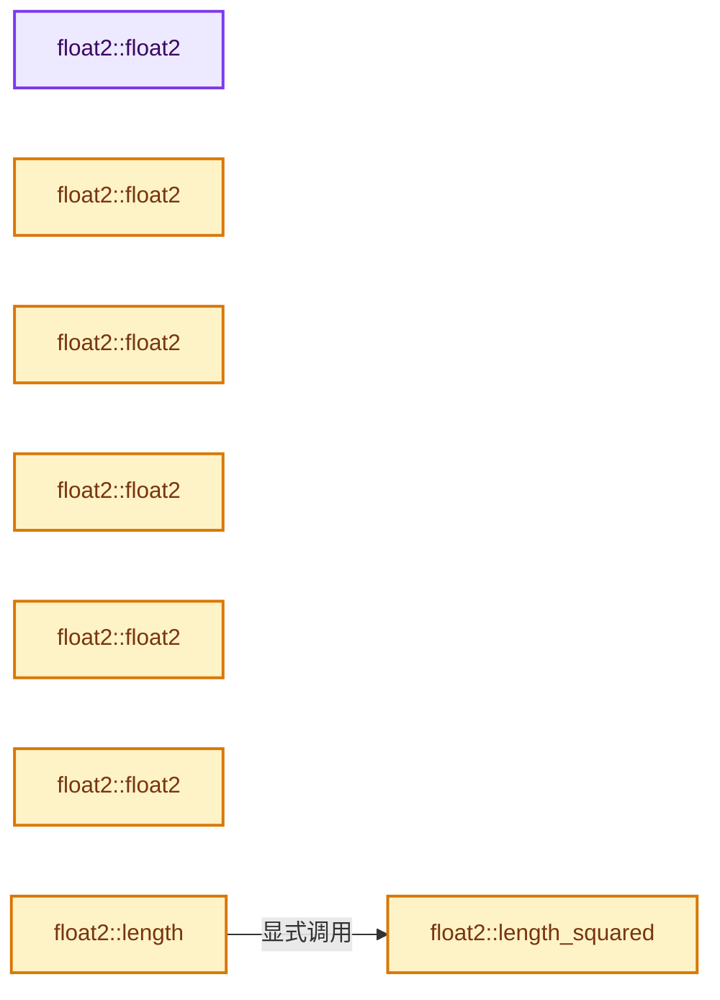
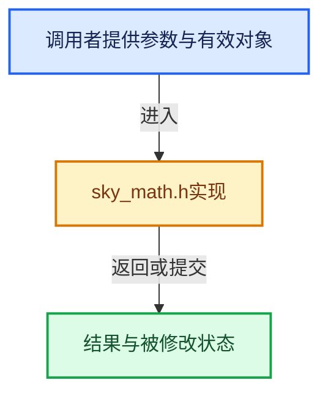

# 实现依赖专题：intern/sky/source/sky_math.h

[实现依赖导航](../../../README.md) · [符号索引](../../../../00-课程指南/02-源码与提交索引/符号依赖与实现索引.md)

本专题从正文实际调用进入，集中保存共享实现。函数有稳定锚点，可从调用处直接跳到对应完整函数；递归与互相调用通过回链组织。

## 本文件的实现关系






## 完整成员与函数实现

<a id="f-04c2783f21f996aa"></a>

### `float2::float2`

实现位置：[intern/sky/source/sky_math.h](../../../../../../../../intern/sky/source/sky_math.h) · L45—L45。

**教学注释版**

<!-- annotated:0842792f427c7d -->

```cpp
  float2() = default;
```

<details>
<summary>核对原始源码：intern/sky/source/sky_math.h · L45—L45</summary>

<!-- original:0842792f427c7d:intern/sky/source/sky_math.h:45:45 -->

```cpp
  float2() = default;
```

</details>

**继续追踪实现**

本实现没有需要继续展开的显式调用；检查返回表达式、对象转换和调用者前置条件。

<a id="f-dba79c4c10e5ea46"></a>

### `float2::float2`

实现位置：[intern/sky/source/sky_math.h](../../../../../../../../intern/sky/source/sky_math.h) · L47—L47。

接口参数：

- `const float *ptr`

**教学注释版**

<!-- annotated:df18ae5633e8be -->

```cpp
  float2(const float *ptr) : x{ptr[0]}, y{ptr[1]} {}
```

<details>
<summary>核对原始源码：intern/sky/source/sky_math.h · L47—L47</summary>

<!-- original:df18ae5633e8be:intern/sky/source/sky_math.h:47:47 -->

```cpp
  float2(const float *ptr) : x{ptr[0]}, y{ptr[1]} {}
```

</details>

**继续追踪实现**

本实现没有需要继续展开的显式调用；检查返回表达式、对象转换和调用者前置条件。

<a id="f-920ca90efa37bf0b"></a>

### `float2::float2`

实现位置：[intern/sky/source/sky_math.h](../../../../../../../../intern/sky/source/sky_math.h) · L49—L49。

接口参数：

- `const float (*ptr)[2]`

**教学注释版**

<!-- annotated:f8adc1fd576484 -->

```cpp
  float2(const float (*ptr)[2]) : float2((const float *)ptr) {}
```

<details>
<summary>核对原始源码：intern/sky/source/sky_math.h · L49—L49</summary>

<!-- original:f8adc1fd576484:intern/sky/source/sky_math.h:49:49 -->

```cpp
  float2(const float (*ptr)[2]) : float2((const float *)ptr) {}
```

</details>

**继续追踪实现**

本实现没有需要继续展开的显式调用；检查返回表达式、对象转换和调用者前置条件。

<a id="f-4b3fbf848d719a63"></a>

### `float2::float2`

实现位置：[intern/sky/source/sky_math.h](../../../../../../../../intern/sky/source/sky_math.h) · L51—L51。

接口参数：

- `float value`

**教学注释版**

<!-- annotated:750e6120e67469 -->

```cpp
  explicit float2(float value) : x(value), y(value) {}
```

<details>
<summary>核对原始源码：intern/sky/source/sky_math.h · L51—L51</summary>

<!-- original:750e6120e67469:intern/sky/source/sky_math.h:51:51 -->

```cpp
  explicit float2(float value) : x(value), y(value) {}
```

</details>

**继续追踪实现**

本实现没有需要继续展开的显式调用；检查返回表达式、对象转换和调用者前置条件。

<a id="f-9b2acd8475cc2843"></a>

### `float2::float2`

实现位置：[intern/sky/source/sky_math.h](../../../../../../../../intern/sky/source/sky_math.h) · L53—L53。

接口参数：

- `int value`

**教学注释版**

<!-- annotated:9b27cb0b28b21b -->

```cpp
  explicit float2(int value) : x(value), y(value) {}
```

<details>
<summary>核对原始源码：intern/sky/source/sky_math.h · L53—L53</summary>

<!-- original:9b27cb0b28b21b:intern/sky/source/sky_math.h:53:53 -->

```cpp
  explicit float2(int value) : x(value), y(value) {}
```

</details>

**继续追踪实现**

本实现没有需要继续展开的显式调用；检查返回表达式、对象转换和调用者前置条件。

<a id="f-1e9233a9a231be51"></a>

### `float2::float2`

实现位置：[intern/sky/source/sky_math.h](../../../../../../../../intern/sky/source/sky_math.h) · L55—L55。

接口参数：

- `float x`
- `float y`

**教学注释版**

<!-- annotated:65db841845aa86 -->

```cpp
  float2(float x, float y) : x{x}, y{y} {}
```

<details>
<summary>核对原始源码：intern/sky/source/sky_math.h · L55—L55</summary>

<!-- original:65db841845aa86:intern/sky/source/sky_math.h:55:55 -->

```cpp
  float2(float x, float y) : x{x}, y{y} {}
```

</details>

**继续追踪实现**

本实现没有需要继续展开的显式调用；检查返回表达式、对象转换和调用者前置条件。

<a id="f-adac3eafaa9f7cda"></a>

### `float2::length_squared`

实现位置：[intern/sky/source/sky_math.h](../../../../../../../../intern/sky/source/sky_math.h) · L102—L105。

**教学注释版**

<!-- annotated:18304857b6e6c5 -->

```cpp
  float length_squared() const
  {
    return x * x + y * y;
  }
```

<details>
<summary>核对原始源码：intern/sky/source/sky_math.h · L102—L105</summary>

<!-- original:18304857b6e6c5:intern/sky/source/sky_math.h:102:105 -->

```cpp
  float length_squared() const
  {
    return x * x + y * y;
  }
```

</details>

**结果出口**

- `return x * x + y * y;`

**继续追踪实现**

本实现没有需要继续展开的显式调用；检查返回表达式、对象转换和调用者前置条件。

<a id="f-09311549b865596f"></a>

### `float2::length`

实现位置：[intern/sky/source/sky_math.h](../../../../../../../../intern/sky/source/sky_math.h) · L107—L110。

**教学注释版**

<!-- annotated:2deb33e4adfd97 -->

```cpp
  float length() const
  {
    return sqrt(length_squared());
  }
```

<details>
<summary>核对原始源码：intern/sky/source/sky_math.h · L107—L110</summary>

<!-- original:2deb33e4adfd97:intern/sky/source/sky_math.h:107:110 -->

```cpp
  float length() const
  {
    return sqrt(length_squared());
  }
```

</details>

**结果出口**

- `return sqrt(length_squared());`

**继续追踪实现**

- `sqrt` → [外部契约](https://eel.is/c++draft/)：这个边界按实际表达式及所属类型核对参数、返回值、寿命与失败行为。这里提供接口入口，不声称已解释该第三方版本的内部实现。
- `length_squared` → [float2::length_squared · L102](sky_math.h.md#f-adac3eafaa9f7cda)。

<a id="f-dd3e3ffeb7627e3b"></a>

### `float3::float3`

实现位置：[intern/sky/source/sky_math.h](../../../../../../../../intern/sky/source/sky_math.h) · L138—L138。

**教学注释版**

<!-- annotated:370fc5f5aaf168 -->

```cpp
  float3() = default;
```

<details>
<summary>核对原始源码：intern/sky/source/sky_math.h · L138—L138</summary>

<!-- original:370fc5f5aaf168:intern/sky/source/sky_math.h:138:138 -->

```cpp
  float3() = default;
```

</details>

**继续追踪实现**

本实现没有需要继续展开的显式调用；检查返回表达式、对象转换和调用者前置条件。

<a id="f-2814a738b262ba97"></a>

### `float3::float3`

实现位置：[intern/sky/source/sky_math.h](../../../../../../../../intern/sky/source/sky_math.h) · L140—L140。

接口参数：

- `const float *ptr`

**教学注释版**

<!-- annotated:bb5f53c083dd5a -->

```cpp
  float3(const float *ptr) : x{ptr[0]}, y{ptr[1]}, z{ptr[2]} {}
```

<details>
<summary>核对原始源码：intern/sky/source/sky_math.h · L140—L140</summary>

<!-- original:bb5f53c083dd5a:intern/sky/source/sky_math.h:140:140 -->

```cpp
  float3(const float *ptr) : x{ptr[0]}, y{ptr[1]}, z{ptr[2]} {}
```

</details>

**继续追踪实现**

本实现没有需要继续展开的显式调用；检查返回表达式、对象转换和调用者前置条件。

<a id="f-40bd914d0bd561b9"></a>

### `float3::float3`

实现位置：[intern/sky/source/sky_math.h](../../../../../../../../intern/sky/source/sky_math.h) · L142—L142。

接口参数：

- `const float (*ptr)[3]`

**教学注释版**

<!-- annotated:6dc9f406e39a46 -->

```cpp
  float3(const float (*ptr)[3]) : float3((const float *)ptr) {}
```

<details>
<summary>核对原始源码：intern/sky/source/sky_math.h · L142—L142</summary>

<!-- original:6dc9f406e39a46:intern/sky/source/sky_math.h:142:142 -->

```cpp
  float3(const float (*ptr)[3]) : float3((const float *)ptr) {}
```

</details>

**继续追踪实现**

本实现没有需要继续展开的显式调用；检查返回表达式、对象转换和调用者前置条件。

<a id="f-3de539c27edca197"></a>

### `float3::float3`

实现位置：[intern/sky/source/sky_math.h](../../../../../../../../intern/sky/source/sky_math.h) · L144—L144。

接口参数：

- `float value`

**教学注释版**

<!-- annotated:fe8642e73217a5 -->

```cpp
  explicit float3(float value) : x(value), y(value), z(value) {}
```

<details>
<summary>核对原始源码：intern/sky/source/sky_math.h · L144—L144</summary>

<!-- original:fe8642e73217a5:intern/sky/source/sky_math.h:144:144 -->

```cpp
  explicit float3(float value) : x(value), y(value), z(value) {}
```

</details>

**继续追踪实现**

本实现没有需要继续展开的显式调用；检查返回表达式、对象转换和调用者前置条件。

<a id="f-44c0f3eace6174b4"></a>

### `float3::float3`

实现位置：[intern/sky/source/sky_math.h](../../../../../../../../intern/sky/source/sky_math.h) · L146—L146。

接口参数：

- `int value`

**教学注释版**

<!-- annotated:4d06a1525f04c0 -->

```cpp
  explicit float3(int value) : x(value), y(value), z(value) {}
```

<details>
<summary>核对原始源码：intern/sky/source/sky_math.h · L146—L146</summary>

<!-- original:4d06a1525f04c0:intern/sky/source/sky_math.h:146:146 -->

```cpp
  explicit float3(int value) : x(value), y(value), z(value) {}
```

</details>

**继续追踪实现**

本实现没有需要继续展开的显式调用；检查返回表达式、对象转换和调用者前置条件。

<a id="f-c6797786a85c7ef8"></a>

### `float3::float3`

实现位置：[intern/sky/source/sky_math.h](../../../../../../../../intern/sky/source/sky_math.h) · L148—L148。

接口参数：

- `float x`
- `float y`
- `float z`

**教学注释版**

<!-- annotated:d3419e590e7301 -->

```cpp
  float3(float x, float y, float z) : x{x}, y{y}, z{z} {}
```

<details>
<summary>核对原始源码：intern/sky/source/sky_math.h · L148—L148</summary>

<!-- original:d3419e590e7301:intern/sky/source/sky_math.h:148:148 -->

```cpp
  float3(float x, float y, float z) : x{x}, y{y}, z{z} {}
```

</details>

**继续追踪实现**

本实现没有需要继续展开的显式调用；检查返回表达式、对象转换和调用者前置条件。

<a id="f-9b43356572b138e9"></a>

### `float3::length_squared`

实现位置：[intern/sky/source/sky_math.h](../../../../../../../../intern/sky/source/sky_math.h) · L190—L193。

**教学注释版**

<!-- annotated:5d08b944511637 -->

```cpp
  float length_squared() const
  {
    return x * x + y * y + z * z;
  }
```

<details>
<summary>核对原始源码：intern/sky/source/sky_math.h · L190—L193</summary>

<!-- original:5d08b944511637:intern/sky/source/sky_math.h:190:193 -->

```cpp
  float length_squared() const
  {
    return x * x + y * y + z * z;
  }
```

</details>

**结果出口**

- `return x * x + y * y + z * z;`

**继续追踪实现**

本实现没有需要继续展开的显式调用；检查返回表达式、对象转换和调用者前置条件。

<a id="f-2869e624d3eaaff2"></a>

### `float3::length`

实现位置：[intern/sky/source/sky_math.h](../../../../../../../../intern/sky/source/sky_math.h) · L195—L198。

**教学注释版**

<!-- annotated:3c14011bb72183 -->

```cpp
  float length() const
  {
    return sqrt(length_squared());
  }
```

<details>
<summary>核对原始源码：intern/sky/source/sky_math.h · L195—L198</summary>

<!-- original:3c14011bb72183:intern/sky/source/sky_math.h:195:198 -->

```cpp
  float length() const
  {
    return sqrt(length_squared());
  }
```

</details>

**结果出口**

- `return sqrt(length_squared());`

**继续追踪实现**

- `sqrt` → [外部契约](https://eel.is/c++draft/)：这个边界按实际表达式及所属类型核对参数、返回值、寿命与失败行为。这里提供接口入口，不声称已解释该第三方版本的内部实现。
- `length_squared` → [float3::length_squared · L190](sky_math.h.md#f-9b43356572b138e9)。

<a id="f-df4d45ca6a2009d1"></a>

### `float4::float4`

实现位置：[intern/sky/source/sky_math.h](../../../../../../../../intern/sky/source/sky_math.h) · L227—L227。

**教学注释版**

<!-- annotated:a09bbc5f4d20dc -->

```cpp
  float4() = default;
```

<details>
<summary>核对原始源码：intern/sky/source/sky_math.h · L227—L227</summary>

<!-- original:a09bbc5f4d20dc:intern/sky/source/sky_math.h:227:227 -->

```cpp
  float4() = default;
```

</details>

**继续追踪实现**

本实现没有需要继续展开的显式调用；检查返回表达式、对象转换和调用者前置条件。

<a id="f-86579b45e4ce1fbc"></a>

### `float4::float4`

实现位置：[intern/sky/source/sky_math.h](../../../../../../../../intern/sky/source/sky_math.h) · L229—L229。

接口参数：

- `const float *ptr`

**教学注释版**

<!-- annotated:74142830a3b029 -->

```cpp
  float4(const float *ptr) : x{ptr[0]}, y{ptr[1]}, z{ptr[2]}, w{ptr[3]} {}
```

<details>
<summary>核对原始源码：intern/sky/source/sky_math.h · L229—L229</summary>

<!-- original:74142830a3b029:intern/sky/source/sky_math.h:229:229 -->

```cpp
  float4(const float *ptr) : x{ptr[0]}, y{ptr[1]}, z{ptr[2]}, w{ptr[3]} {}
```

</details>

**继续追踪实现**

本实现没有需要继续展开的显式调用；检查返回表达式、对象转换和调用者前置条件。

<a id="f-4487b39e145251b2"></a>

### `float4::float4`

实现位置：[intern/sky/source/sky_math.h](../../../../../../../../intern/sky/source/sky_math.h) · L231—L231。

接口参数：

- `const float (*ptr)[4]`

**教学注释版**

<!-- annotated:a02f1dfa8a0ceb -->

```cpp
  float4(const float (*ptr)[4]) : float4((const float *)ptr) {}
```

<details>
<summary>核对原始源码：intern/sky/source/sky_math.h · L231—L231</summary>

<!-- original:a02f1dfa8a0ceb:intern/sky/source/sky_math.h:231:231 -->

```cpp
  float4(const float (*ptr)[4]) : float4((const float *)ptr) {}
```

</details>

**继续追踪实现**

本实现没有需要继续展开的显式调用；检查返回表达式、对象转换和调用者前置条件。

<a id="f-25197921aca540f7"></a>

### `float4::float4`

实现位置：[intern/sky/source/sky_math.h](../../../../../../../../intern/sky/source/sky_math.h) · L233—L233。

接口参数：

- `float value`

**教学注释版**

<!-- annotated:e5901061d0c08a -->

```cpp
  explicit float4(float value) : x(value), y(value), z(value), w(value) {}
```

<details>
<summary>核对原始源码：intern/sky/source/sky_math.h · L233—L233</summary>

<!-- original:e5901061d0c08a:intern/sky/source/sky_math.h:233:233 -->

```cpp
  explicit float4(float value) : x(value), y(value), z(value), w(value) {}
```

</details>

**继续追踪实现**

本实现没有需要继续展开的显式调用；检查返回表达式、对象转换和调用者前置条件。

<a id="f-4debb9c87a553c14"></a>

### `float4::float4`

实现位置：[intern/sky/source/sky_math.h](../../../../../../../../intern/sky/source/sky_math.h) · L235—L235。

接口参数：

- `int value`

**教学注释版**

<!-- annotated:00b7279d750798 -->

```cpp
  explicit float4(int value) : x(value), y(value), z(value), w(value) {}
```

<details>
<summary>核对原始源码：intern/sky/source/sky_math.h · L235—L235</summary>

<!-- original:00b7279d750798:intern/sky/source/sky_math.h:235:235 -->

```cpp
  explicit float4(int value) : x(value), y(value), z(value), w(value) {}
```

</details>

**继续追踪实现**

本实现没有需要继续展开的显式调用；检查返回表达式、对象转换和调用者前置条件。

<a id="f-e2dedafc7a9bd709"></a>

### `float4::float4`

实现位置：[intern/sky/source/sky_math.h](../../../../../../../../intern/sky/source/sky_math.h) · L237—L237。

接口参数：

- `float x`
- `float y`
- `float z`
- `float w`

**教学注释版**

<!-- annotated:1fd59801814552 -->

```cpp
  float4(float x, float y, float z, float w) : x{x}, y{y}, z{z}, w{w} {}
```

<details>
<summary>核对原始源码：intern/sky/source/sky_math.h · L237—L237</summary>

<!-- original:1fd59801814552:intern/sky/source/sky_math.h:237:237 -->

```cpp
  float4(float x, float y, float z, float w) : x{x}, y{y}, z{z}, w{w} {}
```

</details>

**继续追踪实现**

本实现没有需要继续展开的显式调用；检查返回表达式、对象转换和调用者前置条件。

<a id="f-7280c16cbb67d0e7"></a>

### `float4::length_squared`

实现位置：[intern/sky/source/sky_math.h](../../../../../../../../intern/sky/source/sky_math.h) · L289—L292。

**教学注释版**

<!-- annotated:633752e81f287e -->

```cpp
  float length_squared() const
  {
    return x * x + y * y + z * z + w * w;
  }
```

<details>
<summary>核对原始源码：intern/sky/source/sky_math.h · L289—L292</summary>

<!-- original:633752e81f287e:intern/sky/source/sky_math.h:289:292 -->

```cpp
  float length_squared() const
  {
    return x * x + y * y + z * z + w * w;
  }
```

</details>

**结果出口**

- `return x * x + y * y + z * z + w * w;`

**继续追踪实现**

本实现没有需要继续展开的显式调用；检查返回表达式、对象转换和调用者前置条件。

<a id="f-aaefe615cdb73776"></a>

### `float4::length`

实现位置：[intern/sky/source/sky_math.h](../../../../../../../../intern/sky/source/sky_math.h) · L294—L297。

**教学注释版**

<!-- annotated:d3f54060413445 -->

```cpp
  float length() const
  {
    return sqrt(length_squared());
  }
```

<details>
<summary>核对原始源码：intern/sky/source/sky_math.h · L294—L297</summary>

<!-- original:d3f54060413445:intern/sky/source/sky_math.h:294:297 -->

```cpp
  float length() const
  {
    return sqrt(length_squared());
  }
```

</details>

**结果出口**

- `return sqrt(length_squared());`

**继续追踪实现**

- `sqrt` → [外部契约](https://eel.is/c++draft/)：这个边界按实际表达式及所属类型核对参数、返回值、寿命与失败行为。这里提供接口入口，不声称已解释该第三方版本的内部实现。
- `length_squared` → [float4::length_squared · L289](sky_math.h.md#f-7280c16cbb67d0e7)。

<a id="f-1d1835d5ece907c2"></a>

### `dot`

实现位置：[intern/sky/source/sky_math.h](../../../../../../../../intern/sky/source/sky_math.h) · L341—L344。

接口参数：

- `const float2 &a`
- `const float2 &b`

**教学注释版**

<!-- annotated:331ea37eab99ad -->

```cpp
inline float dot(const float2 &a, const float2 &b)
{
  return a.x * b.x + a.y * b.y;
}
```

<details>
<summary>核对原始源码：intern/sky/source/sky_math.h · L341—L344</summary>

<!-- original:331ea37eab99ad:intern/sky/source/sky_math.h:341:344 -->

```cpp
inline float dot(const float2 &a, const float2 &b)
{
  return a.x * b.x + a.y * b.y;
}
```

</details>

**结果出口**

- `return a.x * b.x + a.y * b.y;`

**继续追踪实现**

本实现没有需要继续展开的显式调用；检查返回表达式、对象转换和调用者前置条件。

<a id="f-183f8b9a7fc82fb1"></a>

### `len`

实现位置：[intern/sky/source/sky_math.h](../../../../../../../../intern/sky/source/sky_math.h) · L356—L359。

接口参数：

- `float2 f`

**教学注释版**

<!-- annotated:9634c96f28625e -->

```cpp
inline float len(float2 f)
{
  return f.length();
}
```

<details>
<summary>核对原始源码：intern/sky/source/sky_math.h · L356—L359</summary>

<!-- original:9634c96f28625e:intern/sky/source/sky_math.h:356:359 -->

```cpp
inline float len(float2 f)
{
  return f.length();
}
```

</details>

**结果出口**

- `return f.length();`

**继续追踪实现**

- `f.length` → [float2::length · L107](sky_math.h.md#f-09311549b865596f)。

<a id="f-3f851295afb2572d"></a>

### `make_float3`

实现位置：[intern/sky/source/sky_math.h](../../../../../../../../intern/sky/source/sky_math.h) · L366—L369。

接口参数：

- `float x`
- `float y`
- `float z`

**教学注释版**

<!-- annotated:9cea1bc4ad6b48 -->

```cpp
inline float3 make_float3(float x, float y, float z)
{
  return float3(x, y, z);
}
```

<details>
<summary>核对原始源码：intern/sky/source/sky_math.h · L366—L369</summary>

<!-- original:9cea1bc4ad6b48:intern/sky/source/sky_math.h:366:369 -->

```cpp
inline float3 make_float3(float x, float y, float z)
{
  return float3(x, y, z);
}
```

</details>

**结果出口**

- `return float3(x, y, z);`

**继续追踪实现**

- `float3` → [float3::float3 · L138](sky_math.h.md#f-dd3e3ffeb7627e3b)；[float3::float3 · L140](sky_math.h.md#f-2814a738b262ba97)；[float3::float3 · L142](sky_math.h.md#f-40bd914d0bd561b9)；[float3::float3 · L144](sky_math.h.md#f-3de539c27edca197)；[float3::float3 · L146](sky_math.h.md#f-44c0f3eace6174b4)；[float3::float3 · L148](sky_math.h.md#f-c6797786a85c7ef8)。同名重载需按实参类型选择。

<a id="f-f86883f9f73a3d45"></a>

### `dot`

实现位置：[intern/sky/source/sky_math.h](../../../../../../../../intern/sky/source/sky_math.h) · L371—L374。

接口参数：

- `const float3 &a`
- `const float3 &b`

**教学注释版**

<!-- annotated:3d474846331166 -->

```cpp
inline float dot(const float3 &a, const float3 &b)
{
  return a.x * b.x + a.y * b.y + a.z * b.z;
}
```

<details>
<summary>核对原始源码：intern/sky/source/sky_math.h · L371—L374</summary>

<!-- original:3d474846331166:intern/sky/source/sky_math.h:371:374 -->

```cpp
inline float dot(const float3 &a, const float3 &b)
{
  return a.x * b.x + a.y * b.y + a.z * b.z;
}
```

</details>

**结果出口**

- `return a.x * b.x + a.y * b.y + a.z * b.z;`

**继续追踪实现**

本实现没有需要继续展开的显式调用；检查返回表达式、对象转换和调用者前置条件。

<a id="f-6c84346f8bb3abe8"></a>

### `len`

实现位置：[intern/sky/source/sky_math.h](../../../../../../../../intern/sky/source/sky_math.h) · L386—L389。

接口参数：

- `float3 f`

**教学注释版**

<!-- annotated:cc87975c17082b -->

```cpp
inline float len(float3 f)
{
  return f.length();
}
```

<details>
<summary>核对原始源码：intern/sky/source/sky_math.h · L386—L389</summary>

<!-- original:cc87975c17082b:intern/sky/source/sky_math.h:386:389 -->

```cpp
inline float len(float3 f)
{
  return f.length();
}
```

</details>

**结果出口**

- `return f.length();`

**继续追踪实现**

- `f.length` → [float3::length · L195](sky_math.h.md#f-2869e624d3eaaff2)。

<a id="f-9a8e2ed9e4a8bf85"></a>

### `make_float4`

实现位置：[intern/sky/source/sky_math.h](../../../../../../../../intern/sky/source/sky_math.h) · L396—L399。

接口参数：

- `float x`
- `float y`
- `float z`
- `float w`

**教学注释版**

<!-- annotated:f7adf0c6d50e91 -->

```cpp
inline float4 make_float4(float x, float y, float z, float w)
{
  return float4(x, y, z, w);
}
```

<details>
<summary>核对原始源码：intern/sky/source/sky_math.h · L396—L399</summary>

<!-- original:f7adf0c6d50e91:intern/sky/source/sky_math.h:396:399 -->

```cpp
inline float4 make_float4(float x, float y, float z, float w)
{
  return float4(x, y, z, w);
}
```

</details>

**结果出口**

- `return float4(x, y, z, w);`

**继续追踪实现**

- `float4` → [float4::float4 · L227](sky_math.h.md#f-df4d45ca6a2009d1)；[float4::float4 · L229](sky_math.h.md#f-86579b45e4ce1fbc)；[float4::float4 · L231](sky_math.h.md#f-4487b39e145251b2)；[float4::float4 · L233](sky_math.h.md#f-25197921aca540f7)；[float4::float4 · L235](sky_math.h.md#f-4debb9c87a553c14)；[float4::float4 · L237](sky_math.h.md#f-e2dedafc7a9bd709)。同名重载需按实参类型选择。

<a id="f-7ea1a37447b2c515"></a>

### `dot`

实现位置：[intern/sky/source/sky_math.h](../../../../../../../../intern/sky/source/sky_math.h) · L401—L404。

接口参数：

- `const float4 a`
- `const float4 b`

**教学注释版**

<!-- annotated:2d0c40e4caf3a1 -->

```cpp
inline float dot(const float4 a, const float4 b)
{
  return a.x * b.x + a.y * b.y + a.z * b.z + a.w * b.w;
}
```

<details>
<summary>核对原始源码：intern/sky/source/sky_math.h · L401—L404</summary>

<!-- original:2d0c40e4caf3a1:intern/sky/source/sky_math.h:401:404 -->

```cpp
inline float dot(const float4 a, const float4 b)
{
  return a.x * b.x + a.y * b.y + a.z * b.z + a.w * b.w;
}
```

</details>

**结果出口**

- `return a.x * b.x + a.y * b.y + a.z * b.z + a.w * b.w;`

**继续追踪实现**

本实现没有需要继续展开的显式调用；检查返回表达式、对象转换和调用者前置条件。

<a id="f-1b53820d64eb218d"></a>

### `len`

实现位置：[intern/sky/source/sky_math.h](../../../../../../../../intern/sky/source/sky_math.h) · L416—L419。

接口参数：

- `float4 f`

**教学注释版**

<!-- annotated:2987d6d98feeb3 -->

```cpp
inline float len(float4 f)
{
  return f.length();
}
```

<details>
<summary>核对原始源码：intern/sky/source/sky_math.h · L416—L419</summary>

<!-- original:2987d6d98feeb3:intern/sky/source/sky_math.h:416:419 -->

```cpp
inline float len(float4 f)
{
  return f.length();
}
```

</details>

**结果出口**

- `return f.length();`

**继续追踪实现**

- `f.length` → [float4::length · L294](sky_math.h.md#f-aaefe615cdb73776)。

<a id="f-856cfe34a635fe26"></a>

### `max`

实现位置：[intern/sky/source/sky_math.h](../../../../../../../../intern/sky/source/sky_math.h) · L431—L434。

接口参数：

- `float4 a`
- `float b`

**教学注释版**

<!-- annotated:6a3f829ef14506 -->

```cpp
inline float4 max(float4 a, float b)
{
  return make_float4(fmax(a.x, b), fmax(a.y, b), fmax(a.z, b), fmax(a.w, b));
}
```

<details>
<summary>核对原始源码：intern/sky/source/sky_math.h · L431—L434</summary>

<!-- original:6a3f829ef14506:intern/sky/source/sky_math.h:431:434 -->

```cpp
inline float4 max(float4 a, float b)
{
  return make_float4(fmax(a.x, b), fmax(a.y, b), fmax(a.z, b), fmax(a.w, b));
}
```

</details>

**结果出口**

- `return make_float4(fmax(a.x, b), fmax(a.y, b), fmax(a.z, b), fmax(a.w, b));`

**继续追踪实现**

- `make_float4` → [make_float4 · L396](sky_math.h.md#f-9a8e2ed9e4a8bf85)。
- `fmax` → [调用协议](../../../../00-课程指南/01-路线与规范/模板宏与动态分派协议.md)：函数指针、局部可调用对象或未展开的宏；必须结合调用者环境。调用位置L433。
