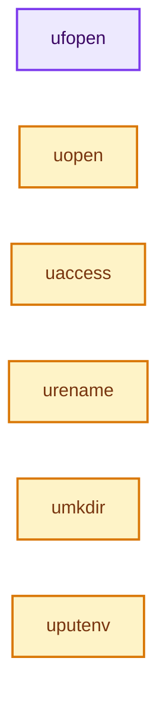
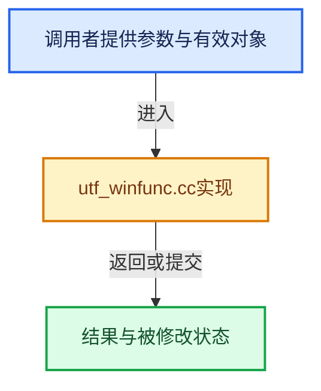

# 实现依赖专题：intern/utfconv/utf_winfunc.cc

[实现依赖导航](../../README.md) · [符号索引](../../../00-课程指南/02-源码与提交索引/符号依赖与实现索引.md)

本专题从正文实际调用进入，集中保存共享实现。函数有稳定锚点，可从调用处直接跳到对应完整函数；递归与互相调用通过回链组织。

## 本文件的实现关系






## 完整成员与函数实现

<a id="f-e9a6cb27a0d23a44"></a>

### `ufopen`

实现位置：[intern/utfconv/utf_winfunc.cc](../../../../../../../intern/utfconv/utf_winfunc.cc) · L19—L39。

接口参数：

- `const char *filename`
- `const char *mode`

**教学注释版**

<!-- annotated:1a435a60f88ce2 -->

```cpp
FILE *ufopen(const char *filename, const char *mode)
{
  FILE *f = nullptr;
  UTF16_ENCODE(filename);
  UTF16_ENCODE(mode);

  if (filename_16 && mode_16) {
    f = _wfopen(filename_16, mode_16);
  }

  UTF16_UN_ENCODE(mode);
  UTF16_UN_ENCODE(filename);

  if (!f) {
    if ((f = fopen(filename, mode))) {
      printf("WARNING: %s is not utf path. Please update it.\n", filename);
    }
  }

  return f;
}
```

<details>
<summary>核对原始源码：intern/utfconv/utf_winfunc.cc · L19—L39</summary>

<!-- original:1a435a60f88ce2:intern/utfconv/utf_winfunc.cc:19:39 -->

```cpp
FILE *ufopen(const char *filename, const char *mode)
{
  FILE *f = nullptr;
  UTF16_ENCODE(filename);
  UTF16_ENCODE(mode);

  if (filename_16 && mode_16) {
    f = _wfopen(filename_16, mode_16);
  }

  UTF16_UN_ENCODE(mode);
  UTF16_UN_ENCODE(filename);

  if (!f) {
    if ((f = fopen(filename, mode))) {
      printf("WARNING: %s is not utf path. Please update it.\n", filename);
    }
  }

  return f;
}
```

</details>

**沿实际写入检查状态**

- `f = _wfopen(filename_16, mode_16);`

**结果出口**

- `return f;`

**继续追踪实现**

- `UTF16_ENCODE` → [UTF16_ENCODE · L80](utfconv.hh.md#m-525fa4c6da9a)。宏定义由构建条件选择。
- `_wfopen` → [调用协议](../../../00-课程指南/01-路线与规范/模板宏与动态分派协议.md)：函数指针、局部可调用对象或未展开的宏；必须结合调用者环境。调用位置L26。
- `UTF16_UN_ENCODE` → [UTF16_UN_ENCODE · L84](utfconv.hh.md#m-0b666190cfed)。宏定义由构建条件选择。
- `fopen` → [调用协议](../../../00-课程指南/01-路线与规范/模板宏与动态分派协议.md)：函数指针、局部可调用对象或未展开的宏；必须结合调用者环境。调用位置L33。
- `printf` → [外部契约](https://eel.is/c++draft/)：这个边界按实际表达式及所属类型核对参数、返回值、寿命与失败行为。这里提供接口入口，不声称已解释该第三方版本的内部实现。

<a id="f-2adf8254be5dbf1c"></a>

### `uopen`

实现位置：[intern/utfconv/utf_winfunc.cc](../../../../../../../intern/utfconv/utf_winfunc.cc) · L41—L59。

接口参数：

- `const char *filename`
- `int oflag`
- `int pmode`

**教学注释版**

<!-- annotated:572e16d05d8988 -->

```cpp
int uopen(const char *filename, int oflag, int pmode)
{
  int f = -1;
  UTF16_ENCODE(filename);

  if (filename_16) {
    f = _wopen(filename_16, oflag, pmode);
  }

  UTF16_UN_ENCODE(filename);

  if (f == -1) {
    if ((f = open(filename, oflag, pmode)) != -1) {
      printf("WARNING: %s is not utf path. Please update it.\n", filename);
    }
  }

  return f;
}
```

<details>
<summary>核对原始源码：intern/utfconv/utf_winfunc.cc · L41—L59</summary>

<!-- original:572e16d05d8988:intern/utfconv/utf_winfunc.cc:41:59 -->

```cpp
int uopen(const char *filename, int oflag, int pmode)
{
  int f = -1;
  UTF16_ENCODE(filename);

  if (filename_16) {
    f = _wopen(filename_16, oflag, pmode);
  }

  UTF16_UN_ENCODE(filename);

  if (f == -1) {
    if ((f = open(filename, oflag, pmode)) != -1) {
      printf("WARNING: %s is not utf path. Please update it.\n", filename);
    }
  }

  return f;
}
```

</details>

**沿实际写入检查状态**

- `f = _wopen(filename_16, oflag, pmode);`

**结果出口**

- `return f;`

**继续追踪实现**

- `UTF16_ENCODE` → [UTF16_ENCODE · L80](utfconv.hh.md#m-525fa4c6da9a)。宏定义由构建条件选择。
- `_wopen` → [调用协议](../../../00-课程指南/01-路线与规范/模板宏与动态分派协议.md)：函数指针、局部可调用对象或未展开的宏；必须结合调用者环境。调用位置L47。
- `UTF16_UN_ENCODE` → [UTF16_UN_ENCODE · L84](utfconv.hh.md#m-0b666190cfed)。宏定义由构建条件选择。
- `open` → [调用协议](../../../00-课程指南/01-路线与规范/模板宏与动态分派协议.md)：函数指针、局部可调用对象或未展开的宏；必须结合调用者环境。调用位置L53。
- `printf` → [外部契约](https://eel.is/c++draft/)：这个边界按实际表达式及所属类型核对参数、返回值、寿命与失败行为。这里提供接口入口，不声称已解释该第三方版本的内部实现。

<a id="f-1221c4c0f3617d8b"></a>

### `uaccess`

实现位置：[intern/utfconv/utf_winfunc.cc](../../../../../../../intern/utfconv/utf_winfunc.cc) · L61—L73。

接口参数：

- `const char *filename`
- `int mode`

**教学注释版**

<!-- annotated:ef0896277ae12f -->

```cpp
int uaccess(const char *filename, int mode)
{
  int r = -1;
  UTF16_ENCODE(filename);

  if (filename_16) {
    r = _waccess(filename_16, mode);
  }

  UTF16_UN_ENCODE(filename);

  return r;
}
```

<details>
<summary>核对原始源码：intern/utfconv/utf_winfunc.cc · L61—L73</summary>

<!-- original:ef0896277ae12f:intern/utfconv/utf_winfunc.cc:61:73 -->

```cpp
int uaccess(const char *filename, int mode)
{
  int r = -1;
  UTF16_ENCODE(filename);

  if (filename_16) {
    r = _waccess(filename_16, mode);
  }

  UTF16_UN_ENCODE(filename);

  return r;
}
```

</details>

**沿实际写入检查状态**

- `r = _waccess(filename_16, mode);`

**结果出口**

- `return r;`

**继续追踪实现**

- `UTF16_ENCODE` → [UTF16_ENCODE · L80](utfconv.hh.md#m-525fa4c6da9a)。宏定义由构建条件选择。
- `_waccess` → [调用协议](../../../00-课程指南/01-路线与规范/模板宏与动态分派协议.md)：函数指针、局部可调用对象或未展开的宏；必须结合调用者环境。调用位置L67。
- `UTF16_UN_ENCODE` → [UTF16_UN_ENCODE · L84](utfconv.hh.md#m-0b666190cfed)。宏定义由构建条件选择。

<a id="f-4831fd3a5c036305"></a>

### `urename`

实现位置：[intern/utfconv/utf_winfunc.cc](../../../../../../../intern/utfconv/utf_winfunc.cc) · L75—L92。

接口参数：

- `const char *oldname`
- `const char *newname`
- `const bool do_replace`

**教学注释版**

<!-- annotated:8c730855f778ea -->

```cpp
int urename(const char *oldname, const char *newname, const bool do_replace)
{
  int r = -1;
  UTF16_ENCODE(oldname);
  UTF16_ENCODE(newname);

  if (oldname_16 && newname_16) {
    /* Closer to UNIX `rename` behavior, as it at least allows to replace an existing file.
     * Return value logic is inverted however (returns non-zero on success, 0 on failure).
     * Note that the operation will still fail if the 'newname' existing file is opened anywhere.
     */
    r = (MoveFileExW(oldname_16, newname_16, do_replace ? MOVEFILE_REPLACE_EXISTING : 0) == 0);
  }

  UTF16_UN_ENCODE(newname);
  UTF16_UN_ENCODE(oldname);
  return r;
}
```

<details>
<summary>核对原始源码：intern/utfconv/utf_winfunc.cc · L75—L92</summary>

<!-- original:8c730855f778ea:intern/utfconv/utf_winfunc.cc:75:92 -->

```cpp
int urename(const char *oldname, const char *newname, const bool do_replace)
{
  int r = -1;
  UTF16_ENCODE(oldname);
  UTF16_ENCODE(newname);

  if (oldname_16 && newname_16) {
    /* Closer to UNIX `rename` behavior, as it at least allows to replace an existing file.
     * Return value logic is inverted however (returns non-zero on success, 0 on failure).
     * Note that the operation will still fail if the 'newname' existing file is opened anywhere.
     */
    r = (MoveFileExW(oldname_16, newname_16, do_replace ? MOVEFILE_REPLACE_EXISTING : 0) == 0);
  }

  UTF16_UN_ENCODE(newname);
  UTF16_UN_ENCODE(oldname);
  return r;
}
```

</details>

**沿实际写入检查状态**

- `r = (MoveFileExW(oldname_16, newname_16, do_replace ? MOVEFILE_REPLACE_EXISTING : 0) == 0);`

**结果出口**

- `return r;`

**继续追踪实现**

- `UTF16_ENCODE` → [UTF16_ENCODE · L80](utfconv.hh.md#m-525fa4c6da9a)。宏定义由构建条件选择。
- `MoveFileExW` → [调用协议](../../../00-课程指南/01-路线与规范/模板宏与动态分派协议.md)：函数指针、局部可调用对象或未展开的宏；必须结合调用者环境。调用位置L86。
- `UTF16_UN_ENCODE` → [UTF16_UN_ENCODE · L84](utfconv.hh.md#m-0b666190cfed)。宏定义由构建条件选择。

<a id="f-295a9e438a24c42f"></a>

### `umkdir`

实现位置：[intern/utfconv/utf_winfunc.cc](../../../../../../../intern/utfconv/utf_winfunc.cc) · L94—L107。

接口参数：

- `const char *pathname`

**教学注释版**

<!-- annotated:657560406afbbc -->

```cpp
int umkdir(const char *pathname)
{

  BOOL r = 0;
  UTF16_ENCODE(pathname);

  if (pathname_16) {
    r = CreateDirectoryW(pathname_16, NULL);
  }

  UTF16_UN_ENCODE(pathname);

  return r ? 0 : -1;
}
```

<details>
<summary>核对原始源码：intern/utfconv/utf_winfunc.cc · L94—L107</summary>

<!-- original:657560406afbbc:intern/utfconv/utf_winfunc.cc:94:107 -->

```cpp
int umkdir(const char *pathname)
{

  BOOL r = 0;
  UTF16_ENCODE(pathname);

  if (pathname_16) {
    r = CreateDirectoryW(pathname_16, NULL);
  }

  UTF16_UN_ENCODE(pathname);

  return r ? 0 : -1;
}
```

</details>

**沿实际写入检查状态**

- `r = CreateDirectoryW(pathname_16, NULL);`

**结果出口**

- `return r ? 0 : -1;`

**继续追踪实现**

- `UTF16_ENCODE` → [UTF16_ENCODE · L80](utfconv.hh.md#m-525fa4c6da9a)。宏定义由构建条件选择。
- `CreateDirectoryW` → [调用协议](../../../00-课程指南/01-路线与规范/模板宏与动态分派协议.md)：函数指针、局部可调用对象或未展开的宏；必须结合调用者环境。调用位置L101。
- `UTF16_UN_ENCODE` → [UTF16_UN_ENCODE · L84](utfconv.hh.md#m-0b666190cfed)。宏定义由构建条件选择。

<a id="f-e745c84e95153d17"></a>

### `uputenv`

实现位置：[intern/utfconv/utf_winfunc.cc](../../../../../../../intern/utfconv/utf_winfunc.cc) · L151—L174。

接口参数：

- `const char *name`
- `const char *value`

**教学注释版**

<!-- annotated:15d18d9227c8e2 -->

```cpp
int uputenv(const char *name, const char *value)
{
  int r = -1;
  /* `_wputenv_s` doesn't support a null value, an empty value removes the variable. */
  if (value == nullptr) {
    value = "";
  }

  UTF16_ENCODE(name);

  if (name_16) {
    UTF16_ENCODE(value);
    if (value_16) {
      /* Not `SetEnvironmentVariableW` as it doesn't update the environment `getenv` reads,
       * `_wputenv_s` updates that as well as the block child processes inherit. */
      r = (_wputenv_s(name_16, value_16) == 0) ? 0 : -1;
    }
    UTF16_UN_ENCODE(value);
  }

  UTF16_UN_ENCODE(name);

  return r;
}
```

<details>
<summary>核对原始源码：intern/utfconv/utf_winfunc.cc · L151—L174</summary>

<!-- original:15d18d9227c8e2:intern/utfconv/utf_winfunc.cc:151:174 -->

```cpp
int uputenv(const char *name, const char *value)
{
  int r = -1;
  /* `_wputenv_s` doesn't support a null value, an empty value removes the variable. */
  if (value == nullptr) {
    value = "";
  }

  UTF16_ENCODE(name);

  if (name_16) {
    UTF16_ENCODE(value);
    if (value_16) {
      /* Not `SetEnvironmentVariableW` as it doesn't update the environment `getenv` reads,
       * `_wputenv_s` updates that as well as the block child processes inherit. */
      r = (_wputenv_s(name_16, value_16) == 0) ? 0 : -1;
    }
    UTF16_UN_ENCODE(value);
  }

  UTF16_UN_ENCODE(name);

  return r;
}
```

</details>

**沿实际写入检查状态**

- `value = "";`
- `r = (_wputenv_s(name_16, value_16) == 0) ? 0 : -1;`

**结果出口**

- `return r;`

**继续追踪实现**

- `UTF16_ENCODE` → [UTF16_ENCODE · L80](utfconv.hh.md#m-525fa4c6da9a)。宏定义由构建条件选择。
- `_wputenv_s` → [调用协议](../../../00-课程指南/01-路线与规范/模板宏与动态分派协议.md)：函数指针、局部可调用对象或未展开的宏；必须结合调用者环境。调用位置L166。
- `UTF16_UN_ENCODE` → [UTF16_UN_ENCODE · L84](utfconv.hh.md#m-0b666190cfed)。宏定义由构建条件选择。
