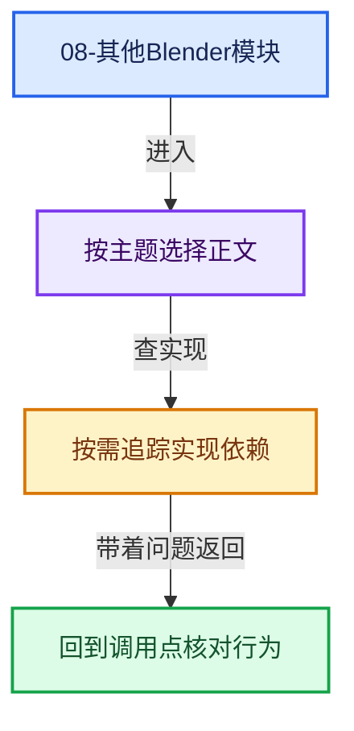
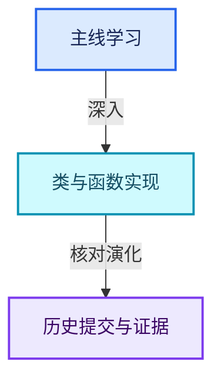

# 08-其他Blender模块

[实现依赖总导航](../README.md)

## animrig

- [ANIM_action.hh](animrig/ANIM_action.hh.md)
- [ANIM_armature.hh](animrig/ANIM_armature.hh.md)
- [ANIM_armature_iter.hh](animrig/ANIM_armature_iter.hh.md)
- [ANIM_bone_collections.hh](animrig/ANIM_bone_collections.hh.md)
- [ANIM_evaluation.hh](animrig/ANIM_evaluation.hh.md)
- [ANIM_keyingsets.hh](animrig/ANIM_keyingsets.hh.md)

## animrig/intern

- [action.cc](animrig/intern/action.cc.md)
- [action_iterators.cc](animrig/intern/action_iterators.cc.md)
- [action_legacy.cc](animrig/intern/action_legacy.cc.md)
- [action_runtime.cc](animrig/intern/action_runtime.cc.md)
- [anim_rna.cc](animrig/intern/anim_rna.cc.md)
- [animdata.cc](animrig/intern/animdata.cc.md)
- [bone_collections.cc](animrig/intern/bone_collections.cc.md)
- [evaluation.cc](animrig/intern/evaluation.cc.md)
- [fcurve.cc](animrig/intern/fcurve.cc.md)
- [keyframing.cc](animrig/intern/keyframing.cc.md)
- [keyframing_auto.cc](animrig/intern/keyframing_auto.cc.md)
- [nla.cc](animrig/intern/nla.cc.md)
- [pose.cc](animrig/intern/pose.cc.md)
- [versioning.cc](animrig/intern/versioning.cc.md)
- [visualkey.cc](animrig/intern/visualkey.cc.md)

## asset_system

- [AS_remote_library.hh](asset_system/AS_remote_library.hh.md)

## asset_system/intern

- [asset_library.cc](asset_system/intern/asset_library.cc.md)
- [asset_library_service.cc](asset_system/intern/asset_library_service.cc.md)
- [asset_library_service.hh](asset_system/intern/asset_library_service.hh.md)
- [asset_representation.cc](asset_system/intern/asset_representation.cc.md)
- [utils.cc](asset_system/intern/utils.cc.md)

## asset_system/intern/library_types

- [essentials_library.cc](asset_system/intern/library_types/essentials_library.cc.md)
- [remote_library.cc](asset_system/intern/library_types/remote_library.cc.md)

## blenfont/intern

- [blf.cc](blenfont/intern/blf.cc.md)
- [blf_default.cc](blenfont/intern/blf_default.cc.md)
- [blf_dir.cc](blenfont/intern/blf_dir.cc.md)
- [blf_font.cc](blenfont/intern/blf_font.cc.md)
- [blf_glyph.cc](blenfont/intern/blf_glyph.cc.md)
- [blf_glyph_curves.cc](blenfont/intern/blf_glyph_curves.cc.md)
- [blf_internal_types.hh](blenfont/intern/blf_internal_types.hh.md)
- [blf_thumbs.cc](blenfont/intern/blf_thumbs.cc.md)

## blenloader

- [BLO_read_write.hh](blenloader/BLO_read_write.hh.md)
- [BLO_readfile.hh](blenloader/BLO_readfile.hh.md)
- [versioning_common.hh](blenloader/versioning_common.hh.md)

## blenloader/intern

- [blend_validate.cc](blenloader/intern/blend_validate.cc.md)
- [readblenentry.cc](blenloader/intern/readblenentry.cc.md)
- [readfile.cc](blenloader/intern/readfile.cc.md)
- [readfile.hh](blenloader/intern/readfile.hh.md)
- [undofile.cc](blenloader/intern/undofile.cc.md)
- [versioning_250.cc](blenloader/intern/versioning_250.cc.md)
- [versioning_260.cc](blenloader/intern/versioning_260.cc.md)
- [versioning_270.cc](blenloader/intern/versioning_270.cc.md)
- [versioning_280.cc](blenloader/intern/versioning_280.cc.md)
- [versioning_290.cc](blenloader/intern/versioning_290.cc.md)
- [versioning_300.cc](blenloader/intern/versioning_300.cc.md)
- [versioning_400.cc](blenloader/intern/versioning_400.cc.md)
- [versioning_401.cc](blenloader/intern/versioning_401.cc.md)
- [versioning_402.cc](blenloader/intern/versioning_402.cc.md)
- [versioning_403.cc](blenloader/intern/versioning_403.cc.md)
- [versioning_404.cc](blenloader/intern/versioning_404.cc.md)
- [versioning_405.cc](blenloader/intern/versioning_405.cc.md)
- [versioning_500.cc](blenloader/intern/versioning_500.cc.md)
- [versioning_501.cc](blenloader/intern/versioning_501.cc.md)
- [versioning_502.cc](blenloader/intern/versioning_502.cc.md)
- [versioning_503.cc](blenloader/intern/versioning_503.cc.md)
- [versioning_504.cc](blenloader/intern/versioning_504.cc.md)
- [versioning_common.cc](blenloader/intern/versioning_common.cc.md)
- [versioning_dna.cc](blenloader/intern/versioning_dna.cc.md)
- [versioning_legacy.cc](blenloader/intern/versioning_legacy.cc.md)
- [versioning_userdef.cc](blenloader/intern/versioning_userdef.cc.md)
- [writefile.cc](blenloader/intern/writefile.cc.md)

## blenloader_core

- [BLO_core_bhead.hh](blenloader_core/BLO_core_bhead.hh.md)

## blenloader_core/intern

- [blo_core_bhead.cc](blenloader_core/intern/blo_core_bhead.cc.md)
- [blo_core_blend_header.cc](blenloader_core/intern/blo_core_blend_header.cc.md)
- [blo_core_file_reader.cc](blenloader_core/intern/blo_core_file_reader.cc.md)

## blentranslation

- [BLT_translation.hh](blentranslation/BLT_translation.hh.md)

## blentranslation/intern

- [blt_lang.cc](blentranslation/intern/blt_lang.cc.md)
- [blt_translation.cc](blentranslation/intern/blt_translation.cc.md)
- [messages.cc](blentranslation/intern/messages.cc.md)

## blentranslation/msgfmt

- [msgfmt.cc](blentranslation/msgfmt/msgfmt.cc.md)

## bmesh

- [bmesh_class.hh](bmesh/bmesh_class.hh.md)

## bmesh/intern

- [bmesh_construct.cc](bmesh/intern/bmesh_construct.cc.md)
- [bmesh_core.cc](bmesh/intern/bmesh_core.cc.md)
- [bmesh_core.hh](bmesh/intern/bmesh_core.hh.md)
- [bmesh_delete.cc](bmesh/intern/bmesh_delete.cc.md)
- [bmesh_error.hh](bmesh/intern/bmesh_error.hh.md)
- [bmesh_inline.hh](bmesh/intern/bmesh_inline.hh.md)
- [bmesh_interp.cc](bmesh/intern/bmesh_interp.cc.md)
- [bmesh_interp.hh](bmesh/intern/bmesh_interp.hh.md)
- [bmesh_iterators.cc](bmesh/intern/bmesh_iterators.cc.md)
- [bmesh_iterators.hh](bmesh/intern/bmesh_iterators.hh.md)
- [bmesh_iterators_inline.hh](bmesh/intern/bmesh_iterators_inline.hh.md)
- [bmesh_marking.cc](bmesh/intern/bmesh_marking.cc.md)
- [bmesh_marking.hh](bmesh/intern/bmesh_marking.hh.md)
- [bmesh_mesh.cc](bmesh/intern/bmesh_mesh.cc.md)
- [bmesh_mesh.hh](bmesh/intern/bmesh_mesh.hh.md)
- [bmesh_mesh_convert.cc](bmesh/intern/bmesh_mesh_convert.cc.md)
- [bmesh_mesh_normals.cc](bmesh/intern/bmesh_mesh_normals.cc.md)
- [bmesh_mesh_tessellate.cc](bmesh/intern/bmesh_mesh_tessellate.cc.md)
- [bmesh_mods.cc](bmesh/intern/bmesh_mods.cc.md)
- [bmesh_operator_api.hh](bmesh/intern/bmesh_operator_api.hh.md)
- [bmesh_operator_api_inline.hh](bmesh/intern/bmesh_operator_api_inline.hh.md)
- [bmesh_operators.cc](bmesh/intern/bmesh_operators.cc.md)
- [bmesh_polygon.cc](bmesh/intern/bmesh_polygon.cc.md)
- [bmesh_polygon_edgenet.cc](bmesh/intern/bmesh_polygon_edgenet.cc.md)
- [bmesh_private.hh](bmesh/intern/bmesh_private.hh.md)
- [bmesh_query.cc](bmesh/intern/bmesh_query.cc.md)
- [bmesh_query.hh](bmesh/intern/bmesh_query.hh.md)
- [bmesh_query_inline.hh](bmesh/intern/bmesh_query_inline.hh.md)
- [bmesh_query_uv.cc](bmesh/intern/bmesh_query_uv.cc.md)
- [bmesh_structure.cc](bmesh/intern/bmesh_structure.cc.md)
- [bmesh_structure_inline.hh](bmesh/intern/bmesh_structure_inline.hh.md)

## bmesh/operators

- [bmo_offset_edgeloops.cc](bmesh/operators/bmo_offset_edgeloops.cc.md)

## bmesh/tools

- [bmesh_beautify.cc](bmesh/tools/bmesh_beautify.cc.md)
- [bmesh_bevel.cc](bmesh/tools/bmesh_bevel.cc.md)
- [bmesh_bisect_plane.cc](bmesh/tools/bmesh_bisect_plane.cc.md)
- [bmesh_decimate_collapse.cc](bmesh/tools/bmesh_decimate_collapse.cc.md)
- [bmesh_decimate_dissolve.cc](bmesh/tools/bmesh_decimate_dissolve.cc.md)
- [bmesh_decimate_unsubdivide.cc](bmesh/tools/bmesh_decimate_unsubdivide.cc.md)
- [bmesh_edgesplit.cc](bmesh/tools/bmesh_edgesplit.cc.md)
- [bmesh_intersect.cc](bmesh/tools/bmesh_intersect.cc.md)
- [bmesh_triangulate.cc](bmesh/tools/bmesh_triangulate.cc.md)
- [bmesh_wireframe.cc](bmesh/tools/bmesh_wireframe.cc.md)

## compositor

- [COM_render_context.hh](compositor/COM_render_context.hh.md)
- [COM_result.hh](compositor/COM_result.hh.md)

## compositor/algorithms/intern

- [smaa.cc](compositor/algorithms/intern/smaa.cc.md)

## compositor/cached_resources/intern

- [ocio_color_space_conversion_shader.cc](compositor/cached_resources/intern/ocio_color_space_conversion_shader.cc.md)

## compositor/intern

- [domain.cc](compositor/intern/domain.cc.md)
- [operation.cc](compositor/intern/operation.cc.md)
- [result.cc](compositor/intern/result.cc.md)
- [utilities.cc](compositor/intern/utilities.cc.md)

## datatoc

- [datatoc.cc](datatoc/datatoc.cc.md)

## draw

- [DRW_pbvh.hh](draw/DRW_pbvh.hh.md)

## draw/engines/external

- [external_engine.cc](draw/engines/external/external_engine.cc.md)

## draw/engines/gpencil

- [gpencil_antialiasing.cc](draw/engines/gpencil/gpencil_antialiasing.cc.md)
- [gpencil_cache_utils.cc](draw/engines/gpencil/gpencil_cache_utils.cc.md)
- [gpencil_draw_data.cc](draw/engines/gpencil/gpencil_draw_data.cc.md)
- [gpencil_engine_c.cc](draw/engines/gpencil/gpencil_engine_c.cc.md)
- [gpencil_engine_private.hh](draw/engines/gpencil/gpencil_engine_private.hh.md)
- [gpencil_render.cc](draw/engines/gpencil/gpencil_render.cc.md)
- [gpencil_shader.hh](draw/engines/gpencil/gpencil_shader.hh.md)
- [gpencil_shader_fx.cc](draw/engines/gpencil/gpencil_shader_fx.cc.md)

## draw/engines/overlay

- [overlay_bounds.hh](draw/engines/overlay/overlay_bounds.hh.md)

## draw/intern

- [attribute_convert.cc](draw/intern/attribute_convert.cc.md)
- [draw_attributes.cc](draw/intern/draw_attributes.cc.md)
- [draw_attributes.hh](draw/intern/draw_attributes.hh.md)
- [draw_cache.cc](draw/intern/draw_cache.cc.md)
- [draw_cache_extract.hh](draw/intern/draw_cache_extract.hh.md)
- [draw_cache_extract_mesh.cc](draw/intern/draw_cache_extract_mesh.cc.md)
- [draw_cache_extract_mesh_render_data.cc](draw/intern/draw_cache_extract_mesh_render_data.cc.md)
- [draw_cache_impl_curve.cc](draw/intern/draw_cache_impl_curve.cc.md)
- [draw_cache_impl_curves.cc](draw/intern/draw_cache_impl_curves.cc.md)
- [draw_cache_impl_grease_pencil.cc](draw/intern/draw_cache_impl_grease_pencil.cc.md)
- [draw_cache_impl_gsplat.cc](draw/intern/draw_cache_impl_gsplat.cc.md)
- [draw_cache_impl_lattice.cc](draw/intern/draw_cache_impl_lattice.cc.md)
- [draw_cache_impl_mesh.cc](draw/intern/draw_cache_impl_mesh.cc.md)
- [draw_cache_impl_pointcloud.cc](draw/intern/draw_cache_impl_pointcloud.cc.md)
- [draw_cache_impl_subdivision.cc](draw/intern/draw_cache_impl_subdivision.cc.md)
- [draw_cache_impl_volume.cc](draw/intern/draw_cache_impl_volume.cc.md)
- [draw_cache_inline.hh](draw/intern/draw_cache_inline.hh.md)
- [draw_command.cc](draw/intern/draw_command.cc.md)
- [draw_command.hh](draw/intern/draw_command.hh.md)
- [draw_context.cc](draw/intern/draw_context.cc.md)
- [draw_context_private.hh](draw/intern/draw_context_private.hh.md)
- [draw_curves.cc](draw/intern/draw_curves.cc.md)
- [draw_debug.cc](draw/intern/draw_debug.cc.md)
- [draw_debug.hh](draw/intern/draw_debug.hh.md)
- [draw_debug_shared.hh](draw/intern/draw_debug_shared.hh.md)
- [draw_gpu_context.cc](draw/intern/draw_gpu_context.cc.md)
- [draw_gsplat.cc](draw/intern/draw_gsplat.cc.md)
- [draw_handle.hh](draw/intern/draw_handle.hh.md)
- [draw_manager.cc](draw/intern/draw_manager.cc.md)
- [draw_manager.hh](draw/intern/draw_manager.hh.md)
- [draw_pass.hh](draw/intern/draw_pass.hh.md)
- [draw_pointcloud.cc](draw/intern/draw_pointcloud.cc.md)
- [draw_resource.hh](draw/intern/draw_resource.hh.md)
- [draw_shader.cc](draw/intern/draw_shader.cc.md)
- [draw_subdivision.hh](draw/intern/draw_subdivision.hh.md)
- [draw_view.cc](draw/intern/draw_view.cc.md)
- [draw_view.hh](draw/intern/draw_view.hh.md)
- [draw_view_c.cc](draw/intern/draw_view_c.cc.md)
- [draw_view_data.cc](draw/intern/draw_view_data.cc.md)
- [draw_view_data.hh](draw/intern/draw_view_data.hh.md)
- [draw_volume.cc](draw/intern/draw_volume.cc.md)
- [DRW_gpu_wrapper.hh](draw/intern/DRW_gpu_wrapper.hh.md)
- [DRW_render.hh](draw/intern/DRW_render.hh.md)

## draw/intern/mesh_extractors

- [extract_mesh.cc](draw/intern/mesh_extractors/extract_mesh.cc.md)
- [extract_mesh.hh](draw/intern/mesh_extractors/extract_mesh.hh.md)
- [extract_mesh_corner_gpu.cc](draw/intern/mesh_extractors/extract_mesh_corner_gpu.cc.md)
- [extract_mesh_ibo_edituv.cc](draw/intern/mesh_extractors/extract_mesh_ibo_edituv.cc.md)
- [extract_mesh_ibo_fdots.cc](draw/intern/mesh_extractors/extract_mesh_ibo_fdots.cc.md)
- [extract_mesh_ibo_lines.cc](draw/intern/mesh_extractors/extract_mesh_ibo_lines.cc.md)
- [extract_mesh_ibo_lines_adjacency.cc](draw/intern/mesh_extractors/extract_mesh_ibo_lines_adjacency.cc.md)
- [extract_mesh_ibo_lines_paint_mask.cc](draw/intern/mesh_extractors/extract_mesh_ibo_lines_paint_mask.cc.md)
- [extract_mesh_ibo_points.cc](draw/intern/mesh_extractors/extract_mesh_ibo_points.cc.md)
- [extract_mesh_ibo_tris.cc](draw/intern/mesh_extractors/extract_mesh_ibo_tris.cc.md)
- [extract_mesh_vbo_attributes.cc](draw/intern/mesh_extractors/extract_mesh_vbo_attributes.cc.md)
- [extract_mesh_vbo_edge_fac.cc](draw/intern/mesh_extractors/extract_mesh_vbo_edge_fac.cc.md)
- [extract_mesh_vbo_edit_data.cc](draw/intern/mesh_extractors/extract_mesh_vbo_edit_data.cc.md)
- [extract_mesh_vbo_edituv_data.cc](draw/intern/mesh_extractors/extract_mesh_vbo_edituv_data.cc.md)
- [extract_mesh_vbo_edituv_stretch_angle.cc](draw/intern/mesh_extractors/extract_mesh_vbo_edituv_stretch_angle.cc.md)
- [extract_mesh_vbo_edituv_stretch_area.cc](draw/intern/mesh_extractors/extract_mesh_vbo_edituv_stretch_area.cc.md)
- [extract_mesh_vbo_fdots_edituv_data.cc](draw/intern/mesh_extractors/extract_mesh_vbo_fdots_edituv_data.cc.md)
- [extract_mesh_vbo_fdots_nor.cc](draw/intern/mesh_extractors/extract_mesh_vbo_fdots_nor.cc.md)
- [extract_mesh_vbo_fdots_pos.cc](draw/intern/mesh_extractors/extract_mesh_vbo_fdots_pos.cc.md)
- [extract_mesh_vbo_fdots_uv.cc](draw/intern/mesh_extractors/extract_mesh_vbo_fdots_uv.cc.md)
- [extract_mesh_vbo_lnor.cc](draw/intern/mesh_extractors/extract_mesh_vbo_lnor.cc.md)
- [extract_mesh_vbo_mesh_analysis.cc](draw/intern/mesh_extractors/extract_mesh_vbo_mesh_analysis.cc.md)
- [extract_mesh_vbo_orco.cc](draw/intern/mesh_extractors/extract_mesh_vbo_orco.cc.md)
- [extract_mesh_vbo_paint_overlay_flag.cc](draw/intern/mesh_extractors/extract_mesh_vbo_paint_overlay_flag.cc.md)
- [extract_mesh_vbo_pos.cc](draw/intern/mesh_extractors/extract_mesh_vbo_pos.cc.md)
- [extract_mesh_vbo_sculpt_data.cc](draw/intern/mesh_extractors/extract_mesh_vbo_sculpt_data.cc.md)
- [extract_mesh_vbo_select_idx.cc](draw/intern/mesh_extractors/extract_mesh_vbo_select_idx.cc.md)
- [extract_mesh_vbo_skin_roots.cc](draw/intern/mesh_extractors/extract_mesh_vbo_skin_roots.cc.md)
- [extract_mesh_vbo_tan.cc](draw/intern/mesh_extractors/extract_mesh_vbo_tan.cc.md)
- [extract_mesh_vbo_uv.cc](draw/intern/mesh_extractors/extract_mesh_vbo_uv.cc.md)
- [extract_mesh_vbo_vnor.cc](draw/intern/mesh_extractors/extract_mesh_vbo_vnor.cc.md)
- [extract_mesh_vbo_weights.cc](draw/intern/mesh_extractors/extract_mesh_vbo_weights.cc.md)

## editors/animation

- [anim_channels_defines.cc](editors/animation/anim_channels_defines.cc.md)
- [anim_convert.cc](editors/animation/anim_convert.cc.md)
- [anim_deps.cc](editors/animation/anim_deps.cc.md)
- [anim_filter.cc](editors/animation/anim_filter.cc.md)
- [drivers.cc](editors/animation/drivers.cc.md)
- [keyframing.cc](editors/animation/keyframing.cc.md)

## editors/armature

- [armature_select.cc](editors/armature/armature_select.cc.md)
- [armature_utils.cc](editors/armature/armature_utils.cc.md)
- [meshlaplacian.cc](editors/armature/meshlaplacian.cc.md)
- [pose_select.cc](editors/armature/pose_select.cc.md)

## editors/asset

- [ED_asset_filter.hh](editors/asset/ED_asset_filter.hh.md)
- [ED_asset_library.hh](editors/asset/ED_asset_library.hh.md)
- [ED_asset_list.hh](editors/asset/ED_asset_list.hh.md)

## editors/asset/intern

- [asset_index.hh](editors/asset/intern/asset_index.hh.md)
- [asset_list.cc](editors/asset/intern/asset_list.cc.md)
- [asset_mark_clear.cc](editors/asset/intern/asset_mark_clear.cc.md)
- [asset_menu_utils.cc](editors/asset/intern/asset_menu_utils.cc.md)
- [asset_shelf.cc](editors/asset/intern/asset_shelf.cc.md)
- [asset_shelf.hh](editors/asset/intern/asset_shelf.hh.md)
- [asset_shelf_regiondata.cc](editors/asset/intern/asset_shelf_regiondata.cc.md)
- [asset_shelf_settings.cc](editors/asset/intern/asset_shelf_settings.cc.md)
- [asset_type.cc](editors/asset/intern/asset_type.cc.md)
- [custom_asset_library_list_ui.cc](editors/asset/intern/custom_asset_library_list_ui.cc.md)

## editors/gpencil_legacy

- [annotate_draw.cc](editors/gpencil_legacy/annotate_draw.cc.md)

## editors/grease_pencil/intern

- [grease_pencil_geom.cc](editors/grease_pencil/intern/grease_pencil_geom.cc.md)
- [grease_pencil_lineart.cc](editors/grease_pencil/intern/grease_pencil_lineart.cc.md)
- [grease_pencil_utils.cc](editors/grease_pencil/intern/grease_pencil_utils.cc.md)

## editors/id_management

- [ed_id_management.cc](editors/id_management/ed_id_management.cc.md)

## editors/include

- [ED_anim_api.hh](editors/include/ED_anim_api.hh.md)
- [ED_anim_transformable.hh](editors/include/ED_anim_transformable.hh.md)
- [ED_armature.hh](editors/include/ED_armature.hh.md)
- [ED_curves.hh](editors/include/ED_curves.hh.md)
- [ED_geometry.hh](editors/include/ED_geometry.hh.md)
- [ED_gpencil_legacy.hh](editors/include/ED_gpencil_legacy.hh.md)
- [ED_grease_pencil.hh](editors/include/ED_grease_pencil.hh.md)
- [ED_object.hh](editors/include/ED_object.hh.md)
- [ED_render.hh](editors/include/ED_render.hh.md)
- [ED_screen.hh](editors/include/ED_screen.hh.md)
- [ED_select_utils.hh](editors/include/ED_select_utils.hh.md)
- [ED_uvedit.hh](editors/include/ED_uvedit.hh.md)
- [ED_view3d.hh](editors/include/ED_view3d.hh.md)
- [ED_view3d_offscreen.hh](editors/include/ED_view3d_offscreen.hh.md)
- [UI_interface_c.hh](editors/include/UI_interface_c.hh.md)
- [UI_interface_icons.hh](editors/include/UI_interface_icons.hh.md)
- [UI_interface_layout.hh](editors/include/UI_interface_layout.hh.md)
- [UI_view2d.hh](editors/include/UI_view2d.hh.md)

## editors/interface

- [interface.cc](editors/interface/interface.cc.md)
- [interface_align.cc](editors/interface/interface_align.cc.md)
- [interface_anim.cc](editors/interface/interface_anim.cc.md)
- [interface_button_group.cc](editors/interface/interface_button_group.cc.md)
- [interface_button_sections.cc](editors/interface/interface_button_sections.cc.md)
- [interface_context_menu.cc](editors/interface/interface_context_menu.cc.md)
- [interface_drag.cc](editors/interface/interface_drag.cc.md)
- [interface_draw.cc](editors/interface/interface_draw.cc.md)
- [interface_handlers.cc](editors/interface/interface_handlers.cc.md)
- [interface_icons.cc](editors/interface/interface_icons.cc.md)
- [interface_intern.hh](editors/interface/interface_intern.hh.md)
- [interface_layout.cc](editors/interface/interface_layout.cc.md)
- [interface_ops.cc](editors/interface/interface_ops.cc.md)
- [interface_panel.cc](editors/interface/interface_panel.cc.md)
- [interface_query.cc](editors/interface/interface_query.cc.md)
- [interface_string_search.cc](editors/interface/interface_string_search.cc.md)
- [interface_style.cc](editors/interface/interface_style.cc.md)
- [interface_undo.cc](editors/interface/interface_undo.cc.md)
- [interface_utils.cc](editors/interface/interface_utils.cc.md)
- [interface_widgets.cc](editors/interface/interface_widgets.cc.md)
- [resources.cc](editors/interface/resources.cc.md)

## editors/interface/buttons

- [interface_label.cc](editors/interface/buttons/interface_label.cc.md)
- [interface_label_markdown.cc](editors/interface/buttons/interface_label_markdown.cc.md)
- [interface_textbox.cc](editors/interface/buttons/interface_textbox.cc.md)

## editors/interface/regions

- [interface_region_color_picker.cc](editors/interface/regions/interface_region_color_picker.cc.md)
- [interface_region_hud.cc](editors/interface/regions/interface_region_hud.cc.md)
- [interface_region_menu_popup.cc](editors/interface/regions/interface_region_menu_popup.cc.md)
- [interface_region_popover.cc](editors/interface/regions/interface_region_popover.cc.md)
- [interface_region_popup.cc](editors/interface/regions/interface_region_popup.cc.md)
- [interface_region_search.cc](editors/interface/regions/interface_region_search.cc.md)
- [interface_region_tooltip.cc](editors/interface/regions/interface_region_tooltip.cc.md)
- [interface_regions.cc](editors/interface/regions/interface_regions.cc.md)

## editors/interface/templates

- [interface_template_asset_shelf_popover.cc](editors/interface/templates/interface_template_asset_shelf_popover.cc.md)
- [interface_template_list.cc](editors/interface/templates/interface_template_list.cc.md)

## editors/interface/view2d

- [view2d.cc](editors/interface/view2d/view2d.cc.md)

## editors/interface/views

- [abstract_view.cc](editors/interface/views/abstract_view.cc.md)
- [abstract_view_item.cc](editors/interface/views/abstract_view_item.cc.md)
- [interface_view.cc](editors/interface/views/interface_view.cc.md)

## editors/mesh

- [editmesh_utils.cc](editors/mesh/editmesh_utils.cc.md)

## editors/object

- [object_modes.cc](editors/object/object_modes.cc.md)
- [object_select.cc](editors/object/object_select.cc.md)

## editors/physics

- [particle_edit.cc](editors/physics/particle_edit.cc.md)

## editors/render

- [render_internal.cc](editors/render/render_internal.cc.md)
- [render_preview.cc](editors/render/render_preview.cc.md)
- [render_update.cc](editors/render/render_update.cc.md)

## editors/scene

- [scene_fps.cc](editors/scene/scene_fps.cc.md)

## editors/screen

- [area.cc](editors/screen/area.cc.md)
- [glutil.cc](editors/screen/glutil.cc.md)
- [screen_edit.cc](editors/screen/screen_edit.cc.md)
- [screen_ops.cc](editors/screen/screen_ops.cc.md)
- [screen_user_menu.cc](editors/screen/screen_user_menu.cc.md)

## editors/sculpt_paint

- [paint_intern.hh](editors/sculpt_paint/paint_intern.hh.md)

## editors/sculpt_paint/grease_pencil

- [grease_pencil_intern.hh](editors/sculpt_paint/grease_pencil/grease_pencil_intern.hh.md)

## editors/sculpt_paint/mesh

- [sculpt_color.hh](editors/sculpt_paint/mesh/sculpt_color.hh.md)
- [sculpt_filter.hh](editors/sculpt_paint/mesh/sculpt_filter.hh.md)
- [sculpt_intern.hh](editors/sculpt_paint/mesh/sculpt_intern.hh.md)
- [sculpt_smooth.hh](editors/sculpt_paint/mesh/sculpt_smooth.hh.md)
- [sculpt_undo.hh](editors/sculpt_paint/mesh/sculpt_undo.hh.md)

## editors/space_api

- [spacetypes.cc](editors/space_api/spacetypes.cc.md)

## editors/space_buttons

- [space_buttons.cc](editors/space_buttons/space_buttons.cc.md)

## editors/space_file

- [filelist.hh](editors/space_file/filelist.hh.md)
- [filesel.cc](editors/space_file/filesel.cc.md)

## editors/space_file/filelist

- [filelist.cc](editors/space_file/filelist/filelist.cc.md)
- [filelist_filter.cc](editors/space_file/filelist/filelist_filter.cc.md)
- [filelist_intern.hh](editors/space_file/filelist/filelist_intern.hh.md)
- [filelist_sort.cc](editors/space_file/filelist/filelist_sort.cc.md)

## editors/space_graph

- [graph_slider_ops.cc](editors/space_graph/graph_slider_ops.cc.md)

## editors/space_image

- [image_edit.cc](editors/space_image/image_edit.cc.md)
- [space_image.cc](editors/space_image/space_image.cc.md)

## editors/space_info

- [info_stats.cc](editors/space_info/info_stats.cc.md)

## editors/space_node

- [node_draw.cc](editors/space_node/node_draw.cc.md)
- [node_edit.cc](editors/space_node/node_edit.cc.md)
- [node_sync_sockets.cc](editors/space_node/node_sync_sockets.cc.md)
- [space_node.cc](editors/space_node/space_node.cc.md)

## editors/space_outliner

- [outliner_collections.cc](editors/space_outliner/outliner_collections.cc.md)
- [outliner_intern.hh](editors/space_outliner/outliner_intern.hh.md)
- [outliner_sync.cc](editors/space_outliner/outliner_sync.cc.md)
- [outliner_utils.cc](editors/space_outliner/outliner_utils.cc.md)

## editors/space_sequencer

- [sequencer_quads_batch.cc](editors/space_sequencer/sequencer_quads_batch.cc.md)
- [sequencer_quads_batch.hh](editors/space_sequencer/sequencer_quads_batch.hh.md)

## editors/space_userpref

- [space_userpref.cc](editors/space_userpref/space_userpref.cc.md)

## editors/space_view3d

- [space_view3d.cc](editors/space_view3d/space_view3d.cc.md)
- [view3d_draw.cc](editors/space_view3d/view3d_draw.cc.md)
- [view3d_project.cc](editors/space_view3d/view3d_project.cc.md)
- [view3d_utils.cc](editors/space_view3d/view3d_utils.cc.md)
- [view3d_view.cc](editors/space_view3d/view3d_view.cc.md)

## editors/transform

- [transform_convert.hh](editors/transform/transform_convert.hh.md)
- [transform_snap.hh](editors/transform/transform_snap.hh.md)

## editors/undo

- [ed_undo.cc](editors/undo/ed_undo.cc.md)

## editors/util

- [ed_draw.cc](editors/util/ed_draw.cc.md)
- [ed_viewer_path.cc](editors/util/ed_viewer_path.cc.md)
- [numinput.cc](editors/util/numinput.cc.md)

## editors/uvedit

- [uvedit_clipboard.cc](editors/uvedit/uvedit_clipboard.cc.md)
- [uvedit_clipboard_graph_iso.cc](editors/uvedit/uvedit_clipboard_graph_iso.cc.md)
- [uvedit_intern.hh](editors/uvedit/uvedit_intern.hh.md)
- [uvedit_select.cc](editors/uvedit/uvedit_select.cc.md)

## freestyle/intern/blender_interface

- [FRS_freestyle.cpp](freestyle/intern/blender_interface/FRS_freestyle.cpp.md)

## freestyle/intern/geometry

- [VecMat.h](freestyle/intern/geometry/VecMat.h.md)

## freestyle/intern/scene_graph

- [NodeLight.h](freestyle/intern/scene_graph/NodeLight.h.md)

## freestyle/intern/stroke

- [BasicStrokeShaders.h](freestyle/intern/stroke/BasicStrokeShaders.h.md)
- [Stroke.h](freestyle/intern/stroke/Stroke.h.md)
- [StrokeRep.h](freestyle/intern/stroke/StrokeRep.h.md)

## freestyle/intern/system

- [TimeStamp.h](freestyle/intern/system/TimeStamp.h.md)

## gpu

- [GPU_attribute_convert.hh](gpu/GPU_attribute_convert.hh.md)
- [GPU_batch.hh](gpu/GPU_batch.hh.md)
- [GPU_common_types.hh](gpu/GPU_common_types.hh.md)
- [GPU_debug.hh](gpu/GPU_debug.hh.md)
- [GPU_format.hh](gpu/GPU_format.hh.md)
- [GPU_framebuffer.hh](gpu/GPU_framebuffer.hh.md)
- [GPU_index_buffer.hh](gpu/GPU_index_buffer.hh.md)
- [GPU_primitive.hh](gpu/GPU_primitive.hh.md)
- [GPU_shader.hh](gpu/GPU_shader.hh.md)
- [GPU_shader_shared_utils.hh](gpu/GPU_shader_shared_utils.hh.md)
- [GPU_state.hh](gpu/GPU_state.hh.md)
- [GPU_storage_buffer.hh](gpu/GPU_storage_buffer.hh.md)
- [GPU_texture.hh](gpu/GPU_texture.hh.md)
- [GPU_uniform_buffer.hh](gpu/GPU_uniform_buffer.hh.md)
- [GPU_vertex_buffer.hh](gpu/GPU_vertex_buffer.hh.md)
- [GPU_vertex_format.hh](gpu/GPU_vertex_format.hh.md)

## gpu/intern

- [gpu_batch.cc](gpu/intern/gpu_batch.cc.md)
- [gpu_batch_presets.cc](gpu/intern/gpu_batch_presets.cc.md)
- [gpu_capabilities.cc](gpu/intern/gpu_capabilities.cc.md)
- [gpu_compute.cc](gpu/intern/gpu_compute.cc.md)
- [gpu_context.cc](gpu/intern/gpu_context.cc.md)
- [gpu_context_private.hh](gpu/intern/gpu_context_private.hh.md)
- [gpu_debug.cc](gpu/intern/gpu_debug.cc.md)
- [gpu_framebuffer.cc](gpu/intern/gpu_framebuffer.cc.md)
- [gpu_framebuffer_private.hh](gpu/intern/gpu_framebuffer_private.hh.md)
- [gpu_immediate.cc](gpu/intern/gpu_immediate.cc.md)
- [gpu_immediate_util.cc](gpu/intern/gpu_immediate_util.cc.md)
- [gpu_index_buffer.cc](gpu/intern/gpu_index_buffer.cc.md)
- [gpu_init_exit.cc](gpu/intern/gpu_init_exit.cc.md)
- [gpu_material.cc](gpu/intern/gpu_material.cc.md)
- [gpu_matrix.cc](gpu/intern/gpu_matrix.cc.md)
- [gpu_pass.cc](gpu/intern/gpu_pass.cc.md)
- [gpu_platform.cc](gpu/intern/gpu_platform.cc.md)
- [gpu_ray_tracing.cc](gpu/intern/gpu_ray_tracing.cc.md)
- [gpu_shader.cc](gpu/intern/gpu_shader.cc.md)
- [gpu_shader_builtin.cc](gpu/intern/gpu_shader_builtin.cc.md)
- [gpu_shader_create_info.cc](gpu/intern/gpu_shader_create_info.cc.md)
- [gpu_shader_dead_code_elimination.hh](gpu/intern/gpu_shader_dead_code_elimination.hh.md)
- [gpu_shader_dependency.cc](gpu/intern/gpu_shader_dependency.cc.md)
- [gpu_shader_interface.hh](gpu/intern/gpu_shader_interface.hh.md)
- [gpu_shader_log.cc](gpu/intern/gpu_shader_log.cc.md)
- [gpu_shader_preprocessor.cc](gpu/intern/gpu_shader_preprocessor.cc.md)
- [gpu_state.cc](gpu/intern/gpu_state.cc.md)
- [gpu_state_private.hh](gpu/intern/gpu_state_private.hh.md)
- [gpu_storage_buffer.cc](gpu/intern/gpu_storage_buffer.cc.md)
- [gpu_texture.cc](gpu/intern/gpu_texture.cc.md)
- [gpu_texture_mipmap.cc](gpu/intern/gpu_texture_mipmap.cc.md)
- [gpu_texture_pool.cc](gpu/intern/gpu_texture_pool.cc.md)
- [gpu_texture_pool_private.hh](gpu/intern/gpu_texture_pool_private.hh.md)
- [gpu_texture_private.hh](gpu/intern/gpu_texture_private.hh.md)
- [gpu_uniform_buffer.cc](gpu/intern/gpu_uniform_buffer.cc.md)
- [gpu_vertex_buffer.cc](gpu/intern/gpu_vertex_buffer.cc.md)
- [gpu_vertex_format.cc](gpu/intern/gpu_vertex_format.cc.md)
- [gpu_vertex_format_normals.cc](gpu/intern/gpu_vertex_format_normals.cc.md)
- [gpu_viewport.cc](gpu/intern/gpu_viewport.cc.md)
- [gpu_worker.cc](gpu/intern/gpu_worker.cc.md)

## gpu/opengl

- [gl_backend.hh](gpu/opengl/gl_backend.hh.md)
- [gl_batch.cc](gpu/opengl/gl_batch.cc.md)
- [gl_batch.hh](gpu/opengl/gl_batch.hh.md)
- [gl_compilation_subprocess.hh](gpu/opengl/gl_compilation_subprocess.hh.md)
- [gl_context.cc](gpu/opengl/gl_context.cc.md)
- [gl_context.hh](gpu/opengl/gl_context.hh.md)
- [gl_debug.cc](gpu/opengl/gl_debug.cc.md)
- [gl_debug.hh](gpu/opengl/gl_debug.hh.md)
- [gl_framebuffer.hh](gpu/opengl/gl_framebuffer.hh.md)
- [gl_immediate.cc](gpu/opengl/gl_immediate.cc.md)
- [gl_immediate.hh](gpu/opengl/gl_immediate.hh.md)
- [gl_index_buffer.cc](gpu/opengl/gl_index_buffer.cc.md)
- [gl_index_buffer.hh](gpu/opengl/gl_index_buffer.hh.md)
- [gl_primitive.hh](gpu/opengl/gl_primitive.hh.md)
- [gl_query.hh](gpu/opengl/gl_query.hh.md)
- [gl_shader.cc](gpu/opengl/gl_shader.cc.md)
- [gl_shader.hh](gpu/opengl/gl_shader.hh.md)
- [gl_shader_log.cc](gpu/opengl/gl_shader_log.cc.md)
- [gl_state.hh](gpu/opengl/gl_state.hh.md)
- [gl_texture.cc](gpu/opengl/gl_texture.cc.md)
- [gl_texture.hh](gpu/opengl/gl_texture.hh.md)
- [gl_vertex_array.cc](gpu/opengl/gl_vertex_array.cc.md)
- [gl_vertex_buffer.cc](gpu/opengl/gl_vertex_buffer.cc.md)
- [gl_vertex_buffer.hh](gpu/opengl/gl_vertex_buffer.hh.md)

## gpu/shader_tool

- [ast.hh](gpu/shader_tool/ast.hh.md)
- [expression.hh](gpu/shader_tool/expression.hh.md)
- [metadata.hh](gpu/shader_tool/metadata.hh.md)
- [pratt_parser.hh](gpu/shader_tool/pratt_parser.hh.md)
- [processor.hh](gpu/shader_tool/processor.hh.md)
- [token.hh](gpu/shader_tool/token.hh.md)
- [token_stream.hh](gpu/shader_tool/token_stream.hh.md)
- [utils.hh](gpu/shader_tool/utils.hh.md)

## gpu/shader_tool/bsl

- [constexpr.hh](gpu/shader_tool/bsl/constexpr.hh.md)
- [diagnostic.hh](gpu/shader_tool/bsl/diagnostic.hh.md)
- [grammar.cc](gpu/shader_tool/bsl/grammar.cc.md)
- [symbol_function.hh](gpu/shader_tool/bsl/symbol_function.hh.md)
- [symbol_scope.hh](gpu/shader_tool/bsl/symbol_scope.hh.md)

## gpu/shader_tool/lexit

- [identifier.hh](gpu/shader_tool/lexit/identifier.hh.md)
- [lexit.cc](gpu/shader_tool/lexit/lexit.cc.md)
- [lexit.hh](gpu/shader_tool/lexit/lexit.hh.md)
- [simd.hh](gpu/shader_tool/lexit/simd.hh.md)
- [types.hh](gpu/shader_tool/lexit/types.hh.md)

## gpu/shaders/common

- [gpu_shader_math_angle.bsl.hh](gpu/shaders/common/gpu_shader_math_angle.bsl.hh.md)
- [gpu_shader_math_base.bsl.hh](gpu/shaders/common/gpu_shader_math_base.bsl.hh.md)
- [gpu_shader_math_euler.bsl.hh](gpu/shaders/common/gpu_shader_math_euler.bsl.hh.md)
- [gpu_shader_math_matrix_normalize.bsl.hh](gpu/shaders/common/gpu_shader_math_matrix_normalize.bsl.hh.md)
- [gpu_shader_math_matrix_transform.bsl.hh](gpu/shaders/common/gpu_shader_math_matrix_transform.bsl.hh.md)
- [gpu_shader_math_vector.bsl.hh](gpu/shaders/common/gpu_shader_math_vector.bsl.hh.md)
- [gpu_shader_test_lib.bsl.hh](gpu/shaders/common/gpu_shader_test_lib.bsl.hh.md)
- [gpu_shader_utildefines.bsl.hh](gpu/shaders/common/gpu_shader_utildefines.bsl.hh.md)

## gpu/shaders/compat

- [gpu_shader_compat_cxx.hh](gpu/shaders/compat/gpu_shader_compat_cxx.hh.md)
- [gpu_shader_cxx_attribute.hh](gpu/shaders/compat/gpu_shader_cxx_attribute.hh.md)
- [gpu_shader_cxx_builtin.hh](gpu/shaders/compat/gpu_shader_cxx_builtin.hh.md)
- [gpu_shader_cxx_matrix.hh](gpu/shaders/compat/gpu_shader_cxx_matrix.hh.md)
- [gpu_shader_cxx_vector.hh](gpu/shaders/compat/gpu_shader_cxx_vector.hh.md)

## gpu/tests

- [push_constants_test.cc](gpu/tests/push_constants_test.cc.md)

## gpu/vulkan

- [vk_backend.cc](gpu/vulkan/vk_backend.cc.md)
- [vk_backend.hh](gpu/vulkan/vk_backend.hh.md)
- [vk_batch.hh](gpu/vulkan/vk_batch.hh.md)
- [vk_buffer.cc](gpu/vulkan/vk_buffer.cc.md)
- [vk_buffer.hh](gpu/vulkan/vk_buffer.hh.md)
- [vk_common.cc](gpu/vulkan/vk_common.cc.md)
- [vk_common.hh](gpu/vulkan/vk_common.hh.md)
- [vk_context.cc](gpu/vulkan/vk_context.cc.md)
- [vk_context.hh](gpu/vulkan/vk_context.hh.md)
- [vk_data_conversion.cc](gpu/vulkan/vk_data_conversion.cc.md)
- [vk_data_conversion.hh](gpu/vulkan/vk_data_conversion.hh.md)
- [vk_debug.cc](gpu/vulkan/vk_debug.cc.md)
- [vk_debug.hh](gpu/vulkan/vk_debug.hh.md)
- [vk_descriptor_set.cc](gpu/vulkan/vk_descriptor_set.cc.md)
- [vk_device.hh](gpu/vulkan/vk_device.hh.md)
- [vk_framebuffer.cc](gpu/vulkan/vk_framebuffer.cc.md)
- [vk_framebuffer.hh](gpu/vulkan/vk_framebuffer.hh.md)
- [vk_image_view.cc](gpu/vulkan/vk_image_view.cc.md)
- [vk_image_view.hh](gpu/vulkan/vk_image_view.hh.md)
- [vk_immediate.cc](gpu/vulkan/vk_immediate.cc.md)
- [vk_index_buffer.cc](gpu/vulkan/vk_index_buffer.cc.md)
- [vk_index_buffer.hh](gpu/vulkan/vk_index_buffer.hh.md)
- [vk_memory_pool.hh](gpu/vulkan/vk_memory_pool.hh.md)
- [vk_pipeline_pool.cc](gpu/vulkan/vk_pipeline_pool.cc.md)
- [vk_pixel_buffer.hh](gpu/vulkan/vk_pixel_buffer.hh.md)
- [vk_push_constants.cc](gpu/vulkan/vk_push_constants.cc.md)
- [vk_push_constants.hh](gpu/vulkan/vk_push_constants.hh.md)
- [vk_ray_tracing.hh](gpu/vulkan/vk_ray_tracing.hh.md)
- [vk_resource_pool.cc](gpu/vulkan/vk_resource_pool.cc.md)
- [vk_shader.cc](gpu/vulkan/vk_shader.cc.md)
- [vk_shader.hh](gpu/vulkan/vk_shader.hh.md)
- [vk_shader_interface.hh](gpu/vulkan/vk_shader_interface.hh.md)
- [vk_shader_log.cc](gpu/vulkan/vk_shader_log.cc.md)
- [vk_staging_buffer.cc](gpu/vulkan/vk_staging_buffer.cc.md)
- [vk_staging_buffer.hh](gpu/vulkan/vk_staging_buffer.hh.md)
- [vk_state_manager.cc](gpu/vulkan/vk_state_manager.cc.md)
- [vk_state_manager.hh](gpu/vulkan/vk_state_manager.hh.md)
- [vk_storage_buffer.cc](gpu/vulkan/vk_storage_buffer.cc.md)
- [vk_storage_buffer.hh](gpu/vulkan/vk_storage_buffer.hh.md)
- [vk_texture.cc](gpu/vulkan/vk_texture.cc.md)
- [vk_texture.hh](gpu/vulkan/vk_texture.hh.md)
- [vk_uniform_buffer.cc](gpu/vulkan/vk_uniform_buffer.cc.md)
- [vk_uniform_buffer.hh](gpu/vulkan/vk_uniform_buffer.hh.md)
- [vk_vertex_buffer.cc](gpu/vulkan/vk_vertex_buffer.cc.md)
- [vk_vertex_buffer.hh](gpu/vulkan/vk_vertex_buffer.hh.md)

## gpu/vulkan/render_graph

- [vk_render_graph.hh](gpu/vulkan/render_graph/vk_render_graph.hh.md)
- [vk_render_graph_node.hh](gpu/vulkan/render_graph/vk_render_graph_node.hh.md)

## ikplugin/intern

- [ikplugin_api.cc](ikplugin/intern/ikplugin_api.cc.md)

## imbuf

- [IMB_colormanagement.hh](imbuf/IMB_colormanagement.hh.md)
- [IMB_imbuf.hh](imbuf/IMB_imbuf.hh.md)
- [IMB_imbuf_enums.h](imbuf/IMB_imbuf_enums.h.md)
- [IMB_imbuf_types.hh](imbuf/IMB_imbuf_types.hh.md)
- [IMB_interp.hh](imbuf/IMB_interp.hh.md)
- [IMB_thumbs.hh](imbuf/IMB_thumbs.hh.md)

## imbuf/intern

- [allocimbuf.cc](imbuf/intern/allocimbuf.cc.md)
- [cache.cc](imbuf/intern/cache.cc.md)
- [colormanagement.cc](imbuf/intern/colormanagement.cc.md)
- [colormanagement_inline.h](imbuf/intern/colormanagement_inline.h.md)
- [conversion.cc](imbuf/intern/conversion.cc.md)
- [filetype.cc](imbuf/intern/filetype.cc.md)
- [filter.cc](imbuf/intern/filter.cc.md)
- [format_dds.cc](imbuf/intern/format_dds.cc.md)
- [format_jp2.cc](imbuf/intern/format_jp2.cc.md)
- [metadata.cc](imbuf/intern/metadata.cc.md)
- [module.cc](imbuf/intern/module.cc.md)
- [partial_update.cc](imbuf/intern/partial_update.cc.md)
- [readimage.cc](imbuf/intern/readimage.cc.md)
- [rectop.cc](imbuf/intern/rectop.cc.md)
- [scaling.cc](imbuf/intern/scaling.cc.md)
- [stereoimbuf.cc](imbuf/intern/stereoimbuf.cc.md)
- [thumbs.cc](imbuf/intern/thumbs.cc.md)
- [thumbs_blend.cc](imbuf/intern/thumbs_blend.cc.md)
- [thumbs_font.cc](imbuf/intern/thumbs_font.cc.md)
- [util.cc](imbuf/intern/util.cc.md)
- [util_gpu.cc](imbuf/intern/util_gpu.cc.md)
- [writeimage.cc](imbuf/intern/writeimage.cc.md)

## imbuf/intern/openexr

- [openexr_api.cpp](imbuf/intern/openexr/openexr_api.cpp.md)

## imbuf/movie

- [MOV_util.hh](imbuf/movie/MOV_util.hh.md)
- [MOV_write.hh](imbuf/movie/MOV_write.hh.md)

## imbuf/movie/intern

- [movie_proxy_indexer.cc](imbuf/movie/intern/movie_proxy_indexer.cc.md)
- [movie_read.cc](imbuf/movie/intern/movie_read.cc.md)
- [movie_util.cc](imbuf/movie/intern/movie_util.cc.md)

## imbuf/opencolorio

- [OCIO_packed_image.hh](imbuf/opencolorio/OCIO_packed_image.hh.md)

## imbuf/opencolorio/intern/libocio

- [error_handling.cc](imbuf/opencolorio/intern/libocio/error_handling.cc.md)
- [libocio_colorspace.cc](imbuf/opencolorio/intern/libocio/libocio_colorspace.cc.md)
- [libocio_colorspace.hh](imbuf/opencolorio/intern/libocio/libocio_colorspace.hh.md)
- [libocio_cpu_processor.cc](imbuf/opencolorio/intern/libocio/libocio_cpu_processor.cc.md)
- [libocio_display.cc](imbuf/opencolorio/intern/libocio/libocio_display.cc.md)
- [libocio_display.hh](imbuf/opencolorio/intern/libocio/libocio_display.hh.md)
- [libocio_processor.cc](imbuf/opencolorio/intern/libocio/libocio_processor.cc.md)
- [libocio_view.hh](imbuf/opencolorio/intern/libocio/libocio_view.hh.md)

## io/alembic

- [ABC_alembic.h](io/alembic/ABC_alembic.h.md)

## io/alembic/intern

- [abc_reader_archive.cc](io/alembic/intern/abc_reader_archive.cc.md)
- [abc_reader_camera.cc](io/alembic/intern/abc_reader_camera.cc.md)
- [abc_reader_curves.cc](io/alembic/intern/abc_reader_curves.cc.md)
- [abc_reader_mesh.cc](io/alembic/intern/abc_reader_mesh.cc.md)
- [abc_reader_nurbs.cc](io/alembic/intern/abc_reader_nurbs.cc.md)
- [abc_reader_object.cc](io/alembic/intern/abc_reader_object.cc.md)
- [abc_reader_points.cc](io/alembic/intern/abc_reader_points.cc.md)
- [abc_reader_transform.cc](io/alembic/intern/abc_reader_transform.cc.md)
- [abc_util.cc](io/alembic/intern/abc_util.cc.md)
- [alembic_capi.cc](io/alembic/intern/alembic_capi.cc.md)

## io/common

- [IO_abstract_hierarchy_iterator.h](io/common/IO_abstract_hierarchy_iterator.h.md)
- [IO_validate.hh](io/common/IO_validate.hh.md)

## io/common/intern

- [gsplat.cc](io/common/intern/gsplat.cc.md)

## io/fbx/importer

- [fbx_import_util.hh](io/fbx/importer/fbx_import_util.hh.md)

## io/usd

- [usd.hh](io/usd/usd.hh.md)

## io/usd/intern

- [usd_attribute_utils.cc](io/usd/intern/usd_attribute_utils.cc.md)
- [usd_attribute_utils.hh](io/usd/intern/usd_attribute_utils.hh.md)
- [usd_blend_shape_utils.hh](io/usd/intern/usd_blend_shape_utils.hh.md)
- [usd_capi_import.cc](io/usd/intern/usd_capi_import.cc.md)
- [usd_colorspace_utils.cc](io/usd/intern/usd_colorspace_utils.cc.md)
- [usd_mesh_utils.cc](io/usd/intern/usd_mesh_utils.cc.md)
- [usd_reader_curve.cc](io/usd/intern/usd_reader_curve.cc.md)
- [usd_reader_geom.hh](io/usd/intern/usd_reader_geom.hh.md)
- [usd_reader_material.cc](io/usd/intern/usd_reader_material.cc.md)
- [usd_reader_mesh.cc](io/usd/intern/usd_reader_mesh.cc.md)
- [usd_reader_mesh.hh](io/usd/intern/usd_reader_mesh.hh.md)
- [usd_reader_particlefield.cc](io/usd/intern/usd_reader_particlefield.cc.md)
- [usd_reader_pointinstancer.cc](io/usd/intern/usd_reader_pointinstancer.cc.md)
- [usd_reader_points.cc](io/usd/intern/usd_reader_points.cc.md)
- [usd_reader_prim.cc](io/usd/intern/usd_reader_prim.cc.md)
- [usd_reader_prim.hh](io/usd/intern/usd_reader_prim.hh.md)
- [usd_reader_shape.cc](io/usd/intern/usd_reader_shape.cc.md)
- [usd_reader_stage.cc](io/usd/intern/usd_reader_stage.cc.md)
- [usd_reader_stage.hh](io/usd/intern/usd_reader_stage.hh.md)
- [usd_writer_abstract.cc](io/usd/intern/usd_writer_abstract.cc.md)
- [usd_writer_abstract.hh](io/usd/intern/usd_writer_abstract.hh.md)

## makesdna

- [DNA_action_types.h](makesdna/DNA_action_types.h.md)
- [DNA_anim_enums.h](makesdna/DNA_anim_enums.h.md)
- [DNA_anim_types.h](makesdna/DNA_anim_types.h.md)
- [DNA_armature_types.h](makesdna/DNA_armature_types.h.md)
- [DNA_array_utils.hh](makesdna/DNA_array_utils.hh.md)
- [DNA_asset_types.h](makesdna/DNA_asset_types.h.md)
- [DNA_brush_enums.h](makesdna/DNA_brush_enums.h.md)
- [DNA_brush_types.h](makesdna/DNA_brush_types.h.md)
- [DNA_camera_types.h](makesdna/DNA_camera_types.h.md)
- [DNA_constraint_types.h](makesdna/DNA_constraint_types.h.md)
- [DNA_curve_enums.h](makesdna/DNA_curve_enums.h.md)
- [DNA_curve_types.h](makesdna/DNA_curve_types.h.md)
- [DNA_curveprofile_types.h](makesdna/DNA_curveprofile_types.h.md)
- [DNA_curves_types.h](makesdna/DNA_curves_types.h.md)
- [DNA_customdata_types.h](makesdna/DNA_customdata_types.h.md)
- [DNA_defs.h](makesdna/DNA_defs.h.md)
- [DNA_fluid_types.h](makesdna/DNA_fluid_types.h.md)
- [DNA_genfile.h](makesdna/DNA_genfile.h.md)
- [DNA_gpencil_legacy_types.h](makesdna/DNA_gpencil_legacy_types.h.md)
- [DNA_grease_pencil_modifier_types.h](makesdna/DNA_grease_pencil_modifier_types.h.md)
- [DNA_grease_pencil_types.h](makesdna/DNA_grease_pencil_types.h.md)
- [DNA_ID.h](makesdna/DNA_ID.h.md)
- [DNA_ID_enums.h](makesdna/DNA_ID_enums.h.md)
- [DNA_image_enums.h](makesdna/DNA_image_enums.h.md)
- [DNA_image_types.h](makesdna/DNA_image_types.h.md)
- [DNA_key_types.h](makesdna/DNA_key_types.h.md)
- [DNA_lattice_types.h](makesdna/DNA_lattice_types.h.md)
- [DNA_light_types.h](makesdna/DNA_light_types.h.md)
- [DNA_linestyle_types.h](makesdna/DNA_linestyle_types.h.md)
- [DNA_listBase.h](makesdna/DNA_listBase.h.md)
- [DNA_mask_types.h](makesdna/DNA_mask_types.h.md)
- [DNA_material_types.h](makesdna/DNA_material_types.h.md)
- [DNA_mesh_types.h](makesdna/DNA_mesh_types.h.md)
- [DNA_meshdata_types.h](makesdna/DNA_meshdata_types.h.md)
- [DNA_modifier_enums.h](makesdna/DNA_modifier_enums.h.md)
- [DNA_modifier_types.h](makesdna/DNA_modifier_types.h.md)
- [DNA_movieclip_types.h](makesdna/DNA_movieclip_types.h.md)
- [DNA_node_tree_interface_types.h](makesdna/DNA_node_tree_interface_types.h.md)
- [DNA_node_types.h](makesdna/DNA_node_types.h.md)
- [DNA_object_enums.h](makesdna/DNA_object_enums.h.md)
- [DNA_object_types.h](makesdna/DNA_object_types.h.md)
- [DNA_particle_types.h](makesdna/DNA_particle_types.h.md)
- [DNA_pointcache_types.h](makesdna/DNA_pointcache_types.h.md)
- [DNA_pointcloud_types.h](makesdna/DNA_pointcloud_types.h.md)
- [DNA_scene_enums.h](makesdna/DNA_scene_enums.h.md)
- [DNA_scene_types.h](makesdna/DNA_scene_types.h.md)
- [DNA_screen_types.h](makesdna/DNA_screen_types.h.md)
- [DNA_sequence_types.h](makesdna/DNA_sequence_types.h.md)
- [DNA_session_uid_types.h](makesdna/DNA_session_uid_types.h.md)
- [DNA_shader_fx_types.h](makesdna/DNA_shader_fx_types.h.md)
- [DNA_space_enums.h](makesdna/DNA_space_enums.h.md)
- [DNA_texture_types.h](makesdna/DNA_texture_types.h.md)
- [DNA_userdef_types.h](makesdna/DNA_userdef_types.h.md)
- [DNA_view2d_types.h](makesdna/DNA_view2d_types.h.md)
- [DNA_view3d_enums.h](makesdna/DNA_view3d_enums.h.md)
- [DNA_view3d_types.h](makesdna/DNA_view3d_types.h.md)
- [DNA_viewer_path_types.h](makesdna/DNA_viewer_path_types.h.md)
- [DNA_volume_types.h](makesdna/DNA_volume_types.h.md)
- [DNA_windowmanager_enums.h](makesdna/DNA_windowmanager_enums.h.md)
- [DNA_world_types.h](makesdna/DNA_world_types.h.md)
- [DNA_xr_types.h](makesdna/DNA_xr_types.h.md)

## makesdna/intern

- [dna_genfile.cc](makesdna/intern/dna_genfile.cc.md)
- [dna_parse.cc](makesdna/intern/dna_parse.cc.md)
- [dna_utils.cc](makesdna/intern/dna_utils.cc.md)
- [makesdna.cc](makesdna/intern/makesdna.cc.md)

## makesrna

- [RNA_access.hh](makesrna/RNA_access.hh.md)
- [RNA_path.hh](makesrna/RNA_path.hh.md)
- [RNA_path_fwd.hh](makesrna/RNA_path_fwd.hh.md)
- [RNA_types.hh](makesrna/RNA_types.hh.md)

## makesrna/intern

- [makesrna.cc](makesrna/intern/makesrna.cc.md)
- [rna_access.cc](makesrna/intern/rna_access.cc.md)
- [rna_access_compare_override.cc](makesrna/intern/rna_access_compare_override.cc.md)
- [rna_define.cc](makesrna/intern/rna_define.cc.md)
- [rna_ID.cc](makesrna/intern/rna_ID.cc.md)
- [rna_internal.hh](makesrna/intern/rna_internal.hh.md)
- [rna_internal_types.hh](makesrna/intern/rna_internal_types.hh.md)
- [rna_path.cc](makesrna/intern/rna_path.cc.md)
- [rna_test.cc](makesrna/intern/rna_test.cc.md)

## modifiers/intern

- [MOD_armature.cc](modifiers/intern/MOD_armature.cc.md)
- [MOD_array.cc](modifiers/intern/MOD_array.cc.md)
- [MOD_bevel.cc](modifiers/intern/MOD_bevel.cc.md)
- [MOD_boolean.cc](modifiers/intern/MOD_boolean.cc.md)
- [MOD_build.cc](modifiers/intern/MOD_build.cc.md)
- [MOD_cast.cc](modifiers/intern/MOD_cast.cc.md)
- [MOD_cloth.cc](modifiers/intern/MOD_cloth.cc.md)
- [MOD_collision.cc](modifiers/intern/MOD_collision.cc.md)
- [MOD_correctivesmooth.cc](modifiers/intern/MOD_correctivesmooth.cc.md)
- [MOD_curve.cc](modifiers/intern/MOD_curve.cc.md)
- [MOD_datatransfer.cc](modifiers/intern/MOD_datatransfer.cc.md)
- [MOD_decimate.cc](modifiers/intern/MOD_decimate.cc.md)
- [MOD_displace.cc](modifiers/intern/MOD_displace.cc.md)
- [MOD_dynamicpaint.cc](modifiers/intern/MOD_dynamicpaint.cc.md)
- [MOD_edgesplit.cc](modifiers/intern/MOD_edgesplit.cc.md)
- [MOD_explode.cc](modifiers/intern/MOD_explode.cc.md)
- [MOD_fluid.cc](modifiers/intern/MOD_fluid.cc.md)
- [MOD_grease_pencil_armature.cc](modifiers/intern/MOD_grease_pencil_armature.cc.md)
- [MOD_grease_pencil_array.cc](modifiers/intern/MOD_grease_pencil_array.cc.md)
- [MOD_grease_pencil_build.cc](modifiers/intern/MOD_grease_pencil_build.cc.md)
- [MOD_grease_pencil_color.cc](modifiers/intern/MOD_grease_pencil_color.cc.md)
- [MOD_grease_pencil_dash.cc](modifiers/intern/MOD_grease_pencil_dash.cc.md)
- [MOD_grease_pencil_envelope.cc](modifiers/intern/MOD_grease_pencil_envelope.cc.md)
- [MOD_grease_pencil_hook.cc](modifiers/intern/MOD_grease_pencil_hook.cc.md)
- [MOD_grease_pencil_lattice.cc](modifiers/intern/MOD_grease_pencil_lattice.cc.md)
- [MOD_grease_pencil_length.cc](modifiers/intern/MOD_grease_pencil_length.cc.md)
- [MOD_grease_pencil_mirror.cc](modifiers/intern/MOD_grease_pencil_mirror.cc.md)
- [MOD_grease_pencil_multiply.cc](modifiers/intern/MOD_grease_pencil_multiply.cc.md)
- [MOD_grease_pencil_noise.cc](modifiers/intern/MOD_grease_pencil_noise.cc.md)
- [MOD_grease_pencil_offset.cc](modifiers/intern/MOD_grease_pencil_offset.cc.md)
- [MOD_grease_pencil_opacity.cc](modifiers/intern/MOD_grease_pencil_opacity.cc.md)
- [MOD_grease_pencil_outline.cc](modifiers/intern/MOD_grease_pencil_outline.cc.md)
- [MOD_grease_pencil_shrinkwrap.cc](modifiers/intern/MOD_grease_pencil_shrinkwrap.cc.md)
- [MOD_grease_pencil_simplify.cc](modifiers/intern/MOD_grease_pencil_simplify.cc.md)
- [MOD_grease_pencil_smooth.cc](modifiers/intern/MOD_grease_pencil_smooth.cc.md)
- [MOD_grease_pencil_subdiv.cc](modifiers/intern/MOD_grease_pencil_subdiv.cc.md)
- [MOD_grease_pencil_texture.cc](modifiers/intern/MOD_grease_pencil_texture.cc.md)
- [MOD_grease_pencil_thickness.cc](modifiers/intern/MOD_grease_pencil_thickness.cc.md)
- [MOD_grease_pencil_time.cc](modifiers/intern/MOD_grease_pencil_time.cc.md)
- [MOD_grease_pencil_tint.cc](modifiers/intern/MOD_grease_pencil_tint.cc.md)
- [MOD_grease_pencil_util.cc](modifiers/intern/MOD_grease_pencil_util.cc.md)
- [MOD_grease_pencil_weight_angle.cc](modifiers/intern/MOD_grease_pencil_weight_angle.cc.md)
- [MOD_grease_pencil_weight_proximity.cc](modifiers/intern/MOD_grease_pencil_weight_proximity.cc.md)
- [MOD_hook.cc](modifiers/intern/MOD_hook.cc.md)
- [MOD_laplaciandeform.cc](modifiers/intern/MOD_laplaciandeform.cc.md)
- [MOD_laplaciansmooth.cc](modifiers/intern/MOD_laplaciansmooth.cc.md)
- [MOD_lattice.cc](modifiers/intern/MOD_lattice.cc.md)
- [MOD_lineart.cc](modifiers/intern/MOD_lineart.cc.md)
- [MOD_mask.cc](modifiers/intern/MOD_mask.cc.md)
- [MOD_mesh_to_volume.cc](modifiers/intern/MOD_mesh_to_volume.cc.md)
- [MOD_meshcache.cc](modifiers/intern/MOD_meshcache.cc.md)
- [MOD_meshcache_mdd.cc](modifiers/intern/MOD_meshcache_mdd.cc.md)
- [MOD_meshcache_pc2.cc](modifiers/intern/MOD_meshcache_pc2.cc.md)
- [MOD_meshcache_util.cc](modifiers/intern/MOD_meshcache_util.cc.md)
- [MOD_meshdeform.cc](modifiers/intern/MOD_meshdeform.cc.md)
- [MOD_meshsequencecache.cc](modifiers/intern/MOD_meshsequencecache.cc.md)
- [MOD_mirror.cc](modifiers/intern/MOD_mirror.cc.md)
- [MOD_multires.cc](modifiers/intern/MOD_multires.cc.md)
- [MOD_nodes.cc](modifiers/intern/MOD_nodes.cc.md)
- [MOD_none.cc](modifiers/intern/MOD_none.cc.md)
- [MOD_normal_edit.cc](modifiers/intern/MOD_normal_edit.cc.md)
- [MOD_ocean.cc](modifiers/intern/MOD_ocean.cc.md)
- [MOD_particleinstance.cc](modifiers/intern/MOD_particleinstance.cc.md)
- [MOD_particlesystem.cc](modifiers/intern/MOD_particlesystem.cc.md)
- [MOD_remesh.cc](modifiers/intern/MOD_remesh.cc.md)
- [MOD_screw.cc](modifiers/intern/MOD_screw.cc.md)
- [MOD_shapekey.cc](modifiers/intern/MOD_shapekey.cc.md)
- [MOD_shrinkwrap.cc](modifiers/intern/MOD_shrinkwrap.cc.md)
- [MOD_simpledeform.cc](modifiers/intern/MOD_simpledeform.cc.md)
- [MOD_skin.cc](modifiers/intern/MOD_skin.cc.md)
- [MOD_smooth.cc](modifiers/intern/MOD_smooth.cc.md)
- [MOD_softbody.cc](modifiers/intern/MOD_softbody.cc.md)
- [MOD_solidify.cc](modifiers/intern/MOD_solidify.cc.md)
- [MOD_solidify_extrude.cc](modifiers/intern/MOD_solidify_extrude.cc.md)
- [MOD_solidify_nonmanifold.cc](modifiers/intern/MOD_solidify_nonmanifold.cc.md)
- [MOD_subsurf.cc](modifiers/intern/MOD_subsurf.cc.md)
- [MOD_surface.cc](modifiers/intern/MOD_surface.cc.md)
- [MOD_surfacedeform.cc](modifiers/intern/MOD_surfacedeform.cc.md)
- [MOD_triangulate.cc](modifiers/intern/MOD_triangulate.cc.md)
- [MOD_util.cc](modifiers/intern/MOD_util.cc.md)
- [MOD_uvproject.cc](modifiers/intern/MOD_uvproject.cc.md)
- [MOD_uvwarp.cc](modifiers/intern/MOD_uvwarp.cc.md)
- [MOD_volume_displace.cc](modifiers/intern/MOD_volume_displace.cc.md)
- [MOD_volume_to_mesh.cc](modifiers/intern/MOD_volume_to_mesh.cc.md)
- [MOD_warp.cc](modifiers/intern/MOD_warp.cc.md)
- [MOD_wave.cc](modifiers/intern/MOD_wave.cc.md)
- [MOD_weighted_normal.cc](modifiers/intern/MOD_weighted_normal.cc.md)
- [MOD_weightvg_util.cc](modifiers/intern/MOD_weightvg_util.cc.md)
- [MOD_weightvgedit.cc](modifiers/intern/MOD_weightvgedit.cc.md)
- [MOD_weightvgmix.cc](modifiers/intern/MOD_weightvgmix.cc.md)
- [MOD_weightvgproximity.cc](modifiers/intern/MOD_weightvgproximity.cc.md)
- [MOD_weld.cc](modifiers/intern/MOD_weld.cc.md)
- [MOD_wireframe.cc](modifiers/intern/MOD_wireframe.cc.md)

## modifiers/intern/lineart

- [lineart_chain.cc](modifiers/intern/lineart/lineart_chain.cc.md)
- [lineart_cpu.cc](modifiers/intern/lineart/lineart_cpu.cc.md)
- [lineart_intern.hh](modifiers/intern/lineart/lineart_intern.hh.md)
- [lineart_shadow.cc](modifiers/intern/lineart/lineart_shadow.cc.md)
- [lineart_util.cc](modifiers/intern/lineart/lineart_util.cc.md)
- [MOD_lineart.hh](modifiers/intern/lineart/MOD_lineart.hh.md)

## python/generic

- [py_capi_utils.cc](python/generic/py_capi_utils.cc.md)

## python/intern

- [bpy_app_translations.cc](python/intern/bpy_app_translations.cc.md)
- [bpy_driver.cc](python/intern/bpy_driver.cc.md)
- [bpy_driver_bytecode.cc](python/intern/bpy_driver_bytecode.cc.md)
- [bpy_interface.cc](python/intern/bpy_interface.cc.md)
- [bpy_interface_run.cc](python/intern/bpy_interface_run.cc.md)
- [bpy_rna.cc](python/intern/bpy_rna.cc.md)
- [bpy_rna.hh](python/intern/bpy_rna.hh.md)
- [bpy_rna_array.cc](python/intern/bpy_rna_array.cc.md)
- [bpy_rna_driver.cc](python/intern/bpy_rna_driver.cc.md)

## python/mathutils

- [mathutils.hh](python/mathutils/mathutils.hh.md)
- [mathutils_Color.cc](python/mathutils/mathutils_Color.cc.md)
- [mathutils_Euler.cc](python/mathutils/mathutils_Euler.cc.md)
- [mathutils_Matrix.cc](python/mathutils/mathutils_Matrix.cc.md)
- [mathutils_Quaternion.cc](python/mathutils/mathutils_Quaternion.cc.md)
- [mathutils_Vector.cc](python/mathutils/mathutils_Vector.cc.md)

## render

- [RE_engine.h](render/RE_engine.h.md)
- [RE_pipeline.h](render/RE_pipeline.h.md)
- [RE_texture.h](render/RE_texture.h.md)

## render/intern

- [engine.cc](render/intern/engine.cc.md)
- [initrender.cc](render/intern/initrender.cc.md)
- [pipeline.cc](render/intern/pipeline.cc.md)
- [pipeline.hh](render/intern/pipeline.hh.md)
- [render_result.cc](render/intern/render_result.cc.md)
- [render_result.h](render/intern/render_result.h.md)
- [render_types.cc](render/intern/render_types.cc.md)
- [texture_image.cc](render/intern/texture_image.cc.md)
- [texture_procedural.cc](render/intern/texture_procedural.cc.md)
- [tile_highlight.h](render/intern/tile_highlight.h.md)

## sequencer

- [SEQ_offscreen.hh](sequencer/SEQ_offscreen.hh.md)

## sequencer/intern

- [channels.cc](sequencer/intern/channels.cc.md)
- [compositor.hh](sequencer/intern/compositor.hh.md)
- [iterator.cc](sequencer/intern/iterator.cc.md)
- [prefetch.cc](sequencer/intern/prefetch.cc.md)
- [proxy.cc](sequencer/intern/proxy.cc.md)
- [render.cc](sequencer/intern/render.cc.md)
- [sequencer.cc](sequencer/intern/sequencer.cc.md)
- [sound.cc](sequencer/intern/sound.cc.md)
- [strip_edit.cc](sequencer/intern/strip_edit.cc.md)
- [strip_lookup.cc](sequencer/intern/strip_lookup.cc.md)
- [strip_relations.cc](sequencer/intern/strip_relations.cc.md)
- [strip_retiming.cc](sequencer/intern/strip_retiming.cc.md)
- [strip_time.cc](sequencer/intern/strip_time.cc.md)
- [utils.cc](sequencer/intern/utils.cc.md)

## sequencer/intern/cache

- [final_image_cache.cc](sequencer/intern/cache/final_image_cache.cc.md)
- [source_image_cache.cc](sequencer/intern/cache/source_image_cache.cc.md)

## sequencer/intern/effects

- [effect_add_sub_mul.cc](sequencer/intern/effects/effect_add_sub_mul.cc.md)
- [effect_adjustment.cc](sequencer/intern/effects/effect_adjustment.cc.md)
- [effect_blend.cc](sequencer/intern/effects/effect_blend.cc.md)
- [effect_compositor.cc](sequencer/intern/effects/effect_compositor.cc.md)
- [effect_cross.cc](sequencer/intern/effects/effect_cross.cc.md)
- [effect_gaussian_blur.cc](sequencer/intern/effects/effect_gaussian_blur.cc.md)
- [effect_glow.cc](sequencer/intern/effects/effect_glow.cc.md)
- [effect_multi_camera.cc](sequencer/intern/effects/effect_multi_camera.cc.md)
- [effect_solid_color.cc](sequencer/intern/effects/effect_solid_color.cc.md)
- [effect_speed.cc](sequencer/intern/effects/effect_speed.cc.md)
- [effect_text.cc](sequencer/intern/effects/effect_text.cc.md)
- [effect_wipe.cc](sequencer/intern/effects/effect_wipe.cc.md)
- [effects.cc](sequencer/intern/effects/effects.cc.md)

## sequencer/intern/modifiers

- [MOD_compositor.cc](sequencer/intern/modifiers/MOD_compositor.cc.md)
- [modifier.cc](sequencer/intern/modifiers/modifier.cc.md)

## shader_fx/intern

- [FX_shader_colorize.cc](shader_fx/intern/FX_shader_colorize.cc.md)
- [FX_shader_glow.cc](shader_fx/intern/FX_shader_glow.cc.md)
- [FX_shader_rim.cc](shader_fx/intern/FX_shader_rim.cc.md)
- [FX_shader_shadow.cc](shader_fx/intern/FX_shader_shadow.cc.md)
- [FX_shader_swirl.cc](shader_fx/intern/FX_shader_swirl.cc.md)

## simulation/intern

- [eigen_utils.h](simulation/intern/eigen_utils.h.md)
- [hair_volume.cc](simulation/intern/hair_volume.cc.md)
- [implicit.h](simulation/intern/implicit.h.md)
- [implicit_blender.cc](simulation/intern/implicit_blender.cc.md)
- [SIM_mass_spring.cc](simulation/intern/SIM_mass_spring.cc.md)

## windowmanager

- [WM_api.hh](windowmanager/WM_api.hh.md)
- [wm_cursors.hh](windowmanager/wm_cursors.hh.md)
- [wm_event_system.hh](windowmanager/wm_event_system.hh.md)
- [wm_event_types.hh](windowmanager/wm_event_types.hh.md)
- [WM_types.hh](windowmanager/WM_types.hh.md)

## windowmanager/gizmo/intern

- [wm_gizmo.cc](windowmanager/gizmo/intern/wm_gizmo.cc.md)
- [wm_gizmo_group.cc](windowmanager/gizmo/intern/wm_gizmo_group.cc.md)
- [wm_gizmo_group_type.cc](windowmanager/gizmo/intern/wm_gizmo_group_type.cc.md)
- [wm_gizmo_map.cc](windowmanager/gizmo/intern/wm_gizmo_map.cc.md)
- [wm_gizmo_target_props.cc](windowmanager/gizmo/intern/wm_gizmo_target_props.cc.md)

## windowmanager/intern

- [wm.cc](windowmanager/intern/wm.cc.md)
- [wm_cursors.cc](windowmanager/intern/wm_cursors.cc.md)
- [wm_dragdrop.cc](windowmanager/intern/wm_dragdrop.cc.md)
- [wm_draw.cc](windowmanager/intern/wm_draw.cc.md)
- [wm_event_query.cc](windowmanager/intern/wm_event_query.cc.md)
- [wm_event_system.cc](windowmanager/intern/wm_event_system.cc.md)
- [wm_files.cc](windowmanager/intern/wm_files.cc.md)
- [wm_gesture.cc](windowmanager/intern/wm_gesture.cc.md)
- [wm_init_exit.cc](windowmanager/intern/wm_init_exit.cc.md)
- [wm_jobs.cc](windowmanager/intern/wm_jobs.cc.md)
- [wm_keymap.cc](windowmanager/intern/wm_keymap.cc.md)
- [wm_keymap_utils.cc](windowmanager/intern/wm_keymap_utils.cc.md)
- [wm_menu_type.cc](windowmanager/intern/wm_menu_type.cc.md)
- [wm_operator_type.cc](windowmanager/intern/wm_operator_type.cc.md)
- [wm_operators.cc](windowmanager/intern/wm_operators.cc.md)
- [wm_panel_type.cc](windowmanager/intern/wm_panel_type.cc.md)
- [wm_stereo.cc](windowmanager/intern/wm_stereo.cc.md)
- [wm_subwindow.cc](windowmanager/intern/wm_subwindow.cc.md)
- [wm_toolsystem.cc](windowmanager/intern/wm_toolsystem.cc.md)
- [wm_tooltip.cc](windowmanager/intern/wm_tooltip.cc.md)
- [wm_uilist_type.cc](windowmanager/intern/wm_uilist_type.cc.md)
- [wm_utils.cc](windowmanager/intern/wm_utils.cc.md)
- [wm_window.cc](windowmanager/intern/wm_window.cc.md)
- [wm_window_csd_layout.cc](windowmanager/intern/wm_window_csd_layout.cc.md)

## windowmanager/message_bus

- [wm_message_bus.hh](windowmanager/message_bus/wm_message_bus.hh.md)

## windowmanager/message_bus/intern

- [wm_message_bus.cc](windowmanager/message_bus/intern/wm_message_bus.cc.md)
- [wm_message_bus_intern.hh](windowmanager/message_bus/intern/wm_message_bus_intern.hh.md)
- [wm_message_bus_rna.cc](windowmanager/message_bus/intern/wm_message_bus_rna.cc.md)

## windowmanager/xr/intern

- [wm_xr_session.cc](windowmanager/xr/intern/wm_xr_session.cc.md)

