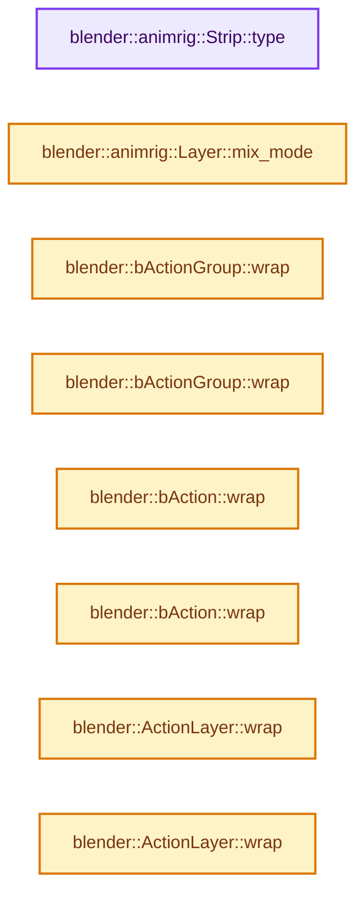
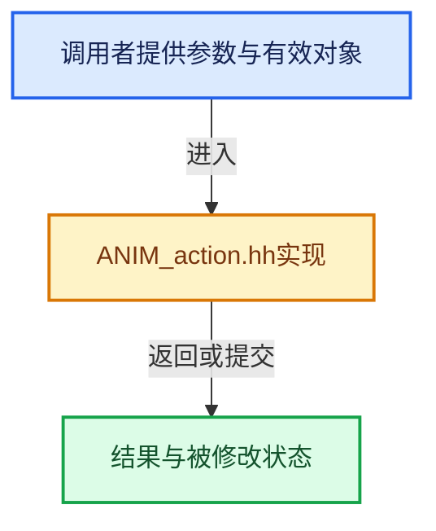

# 实现依赖专题：source/blender/animrig/ANIM_action.hh

[实现依赖导航](../../README.md) · [符号索引](../../../00-课程指南/02-源码与提交索引/符号依赖与实现索引.md)

本专题从正文实际调用进入，集中保存共享实现。函数有稳定锚点，可从调用处直接跳到对应完整函数；递归与互相调用通过回链组织。

## 本文件的实现关系






## 相关类型布局与成员入口

<a id="t-29906b03c516"></a>

### `blender::animrig::Strip::Type`

原始声明：[source/blender/animrig/ANIM_action.hh](../../../../../../../source/blender/animrig/ANIM_action.hh) · L511—L511。

以下保留类的数据声明与编译条件，成员函数实现通过后面的精确链接阅读。

<!-- annotated:034f3282e92dd3 -->

```cpp
  enum class Type : int8_t { Keyframe = 0 };
```

<details>
<summary>核对原始源码：source/blender/animrig/ANIM_action.hh · L511—L511</summary>

<!-- original:034f3282e92dd3:source/blender/animrig/ANIM_action.hh:511:511 -->

```cpp
  enum class Type : int8_t { Keyframe = 0 };
```

</details>


## 完整成员与函数实现

<a id="f-594f232522f646b5"></a>

### `blender::animrig::Strip::type`

实现位置：[source/blender/animrig/ANIM_action.hh](../../../../../../../source/blender/animrig/ANIM_action.hh) · L552—L555。

**教学注释版**

<!-- annotated:4389be0e6a9e39 -->

```cpp
  Type type() const
  {
    return Type(this->strip_type);
  }
```

<details>
<summary>核对原始源码：source/blender/animrig/ANIM_action.hh · L552—L555</summary>

<!-- original:4389be0e6a9e39:source/blender/animrig/ANIM_action.hh:552:555 -->

```cpp
  Type type() const
  {
    return Type(this->strip_type);
  }
```

</details>

**结果出口**

- `return Type(this->strip_type);`

**继续追踪实现**

- `Type` → [blender::animrig::Strip::Type](ANIM_action.hh.md#t-29906b03c516)。

<a id="f-ab1f047e6a5a245b"></a>

### `blender::animrig::Layer::mix_mode`

实现位置：[source/blender/animrig/ANIM_action.hh](../../../../../../../source/blender/animrig/ANIM_action.hh) · L664—L667。

**教学注释版**

<!-- annotated:a43dc6dc040316 -->

```cpp
  MixMode mix_mode() const
  {
    return static_cast<MixMode>(this->layer_mix_mode);
  }
```

<details>
<summary>核对原始源码：source/blender/animrig/ANIM_action.hh · L664—L667</summary>

<!-- original:a43dc6dc040316:source/blender/animrig/ANIM_action.hh:664:667 -->

```cpp
  MixMode mix_mode() const
  {
    return static_cast<MixMode>(this->layer_mix_mode);
  }
```

</details>

**结果出口**

- `return static_cast<MixMode>(this->layer_mix_mode);`

**继续追踪实现**

本实现没有需要继续展开的显式调用；检查返回表达式、对象转换和调用者前置条件。

<a id="f-9a08743218798134"></a>

### `blender::bActionGroup::wrap`

实现位置：[source/blender/animrig/ANIM_action.hh](../../../../../../../source/blender/animrig/ANIM_action.hh) · L1920—L1923。

**教学注释版**

<!-- annotated:c078036447fb5d -->

```cpp
inline animrig::ChannelGroup &bActionGroup::wrap()
{
  return *reinterpret_cast<animrig::ChannelGroup *>(this);
}
```

<details>
<summary>核对原始源码：source/blender/animrig/ANIM_action.hh · L1920—L1923</summary>

<!-- original:c078036447fb5d:source/blender/animrig/ANIM_action.hh:1920:1923 -->

```cpp
inline animrig::ChannelGroup &bActionGroup::wrap()
{
  return *reinterpret_cast<animrig::ChannelGroup *>(this);
}
```

</details>

**结果出口**

- `return *reinterpret_cast<animrig::ChannelGroup *>(this);`

**继续追踪实现**

本实现没有需要继续展开的显式调用；检查返回表达式、对象转换和调用者前置条件。

<a id="f-8c9475f8d3f02347"></a>

### `blender::bActionGroup::wrap`

实现位置：[source/blender/animrig/ANIM_action.hh](../../../../../../../source/blender/animrig/ANIM_action.hh) · L1924—L1927。

**教学注释版**

<!-- annotated:a39ade3ef1a582 -->

```cpp
inline const animrig::ChannelGroup &bActionGroup::wrap() const
{
  return *reinterpret_cast<const animrig::ChannelGroup *>(this);
}
```

<details>
<summary>核对原始源码：source/blender/animrig/ANIM_action.hh · L1924—L1927</summary>

<!-- original:a39ade3ef1a582:source/blender/animrig/ANIM_action.hh:1924:1927 -->

```cpp
inline const animrig::ChannelGroup &bActionGroup::wrap() const
{
  return *reinterpret_cast<const animrig::ChannelGroup *>(this);
}
```

</details>

**结果出口**

- `return *reinterpret_cast<const animrig::ChannelGroup *>(this);`

**继续追踪实现**

本实现没有需要继续展开的显式调用；检查返回表达式、对象转换和调用者前置条件。

<a id="f-f049614274fd7a45"></a>

### `blender::bAction::wrap`

实现位置：[source/blender/animrig/ANIM_action.hh](../../../../../../../source/blender/animrig/ANIM_action.hh) · L1929—L1932。

**教学注释版**

<!-- annotated:9f5d3456136db2 -->

```cpp
inline animrig::Action &bAction::wrap()
{
  return *reinterpret_cast<animrig::Action *>(this);
}
```

<details>
<summary>核对原始源码：source/blender/animrig/ANIM_action.hh · L1929—L1932</summary>

<!-- original:9f5d3456136db2:source/blender/animrig/ANIM_action.hh:1929:1932 -->

```cpp
inline animrig::Action &bAction::wrap()
{
  return *reinterpret_cast<animrig::Action *>(this);
}
```

</details>

**结果出口**

- `return *reinterpret_cast<animrig::Action *>(this);`

**继续追踪实现**

本实现没有需要继续展开的显式调用；检查返回表达式、对象转换和调用者前置条件。

<a id="f-2d697d1983fd282f"></a>

### `blender::bAction::wrap`

实现位置：[source/blender/animrig/ANIM_action.hh](../../../../../../../source/blender/animrig/ANIM_action.hh) · L1933—L1936。

**教学注释版**

<!-- annotated:09fb8c58ba5d3c -->

```cpp
inline const animrig::Action &bAction::wrap() const
{
  return *reinterpret_cast<const animrig::Action *>(this);
}
```

<details>
<summary>核对原始源码：source/blender/animrig/ANIM_action.hh · L1933—L1936</summary>

<!-- original:09fb8c58ba5d3c:source/blender/animrig/ANIM_action.hh:1933:1936 -->

```cpp
inline const animrig::Action &bAction::wrap() const
{
  return *reinterpret_cast<const animrig::Action *>(this);
}
```

</details>

**结果出口**

- `return *reinterpret_cast<const animrig::Action *>(this);`

**继续追踪实现**

本实现没有需要继续展开的显式调用；检查返回表达式、对象转换和调用者前置条件。

<a id="f-29caef4c2f0f968e"></a>

### `blender::ActionLayer::wrap`

实现位置：[source/blender/animrig/ANIM_action.hh](../../../../../../../source/blender/animrig/ANIM_action.hh) · L1938—L1941。

**教学注释版**

<!-- annotated:d14b4f70756031 -->

```cpp
inline animrig::Layer &ActionLayer::wrap()
{
  return *reinterpret_cast<animrig::Layer *>(this);
}
```

<details>
<summary>核对原始源码：source/blender/animrig/ANIM_action.hh · L1938—L1941</summary>

<!-- original:d14b4f70756031:source/blender/animrig/ANIM_action.hh:1938:1941 -->

```cpp
inline animrig::Layer &ActionLayer::wrap()
{
  return *reinterpret_cast<animrig::Layer *>(this);
}
```

</details>

**结果出口**

- `return *reinterpret_cast<animrig::Layer *>(this);`

**继续追踪实现**

本实现没有需要继续展开的显式调用；检查返回表达式、对象转换和调用者前置条件。

<a id="f-c2a34899dde2a503"></a>

### `blender::ActionLayer::wrap`

实现位置：[source/blender/animrig/ANIM_action.hh](../../../../../../../source/blender/animrig/ANIM_action.hh) · L1942—L1945。

**教学注释版**

<!-- annotated:1d75d65f733a28 -->

```cpp
inline const animrig::Layer &ActionLayer::wrap() const
{
  return *reinterpret_cast<const animrig::Layer *>(this);
}
```

<details>
<summary>核对原始源码：source/blender/animrig/ANIM_action.hh · L1942—L1945</summary>

<!-- original:1d75d65f733a28:source/blender/animrig/ANIM_action.hh:1942:1945 -->

```cpp
inline const animrig::Layer &ActionLayer::wrap() const
{
  return *reinterpret_cast<const animrig::Layer *>(this);
}
```

</details>

**结果出口**

- `return *reinterpret_cast<const animrig::Layer *>(this);`

**继续追踪实现**

本实现没有需要继续展开的显式调用；检查返回表达式、对象转换和调用者前置条件。

<a id="f-37d3bb556e72b85a"></a>

### `blender::ActionSlot::wrap`

实现位置：[source/blender/animrig/ANIM_action.hh](../../../../../../../source/blender/animrig/ANIM_action.hh) · L1947—L1950。

**教学注释版**

<!-- annotated:cdd144e5ba38b2 -->

```cpp
inline animrig::Slot &ActionSlot::wrap()
{
  return *reinterpret_cast<animrig::Slot *>(this);
}
```

<details>
<summary>核对原始源码：source/blender/animrig/ANIM_action.hh · L1947—L1950</summary>

<!-- original:cdd144e5ba38b2:source/blender/animrig/ANIM_action.hh:1947:1950 -->

```cpp
inline animrig::Slot &ActionSlot::wrap()
{
  return *reinterpret_cast<animrig::Slot *>(this);
}
```

</details>

**结果出口**

- `return *reinterpret_cast<animrig::Slot *>(this);`

**继续追踪实现**

本实现没有需要继续展开的显式调用；检查返回表达式、对象转换和调用者前置条件。

<a id="f-2b5d71bb53ce3f94"></a>

### `blender::ActionSlot::wrap`

实现位置：[source/blender/animrig/ANIM_action.hh](../../../../../../../source/blender/animrig/ANIM_action.hh) · L1951—L1954。

**教学注释版**

<!-- annotated:355c12069ec196 -->

```cpp
inline const animrig::Slot &ActionSlot::wrap() const
{
  return *reinterpret_cast<const animrig::Slot *>(this);
}
```

<details>
<summary>核对原始源码：source/blender/animrig/ANIM_action.hh · L1951—L1954</summary>

<!-- original:355c12069ec196:source/blender/animrig/ANIM_action.hh:1951:1954 -->

```cpp
inline const animrig::Slot &ActionSlot::wrap() const
{
  return *reinterpret_cast<const animrig::Slot *>(this);
}
```

</details>

**结果出口**

- `return *reinterpret_cast<const animrig::Slot *>(this);`

**继续追踪实现**

本实现没有需要继续展开的显式调用；检查返回表达式、对象转换和调用者前置条件。

<a id="f-8ab5476ff9994c92"></a>

### `blender::ActionStrip::wrap`

实现位置：[source/blender/animrig/ANIM_action.hh](../../../../../../../source/blender/animrig/ANIM_action.hh) · L1956—L1959。

**教学注释版**

<!-- annotated:483bdcd7226f0a -->

```cpp
inline animrig::Strip &ActionStrip::wrap()
{
  return *reinterpret_cast<animrig::Strip *>(this);
}
```

<details>
<summary>核对原始源码：source/blender/animrig/ANIM_action.hh · L1956—L1959</summary>

<!-- original:483bdcd7226f0a:source/blender/animrig/ANIM_action.hh:1956:1959 -->

```cpp
inline animrig::Strip &ActionStrip::wrap()
{
  return *reinterpret_cast<animrig::Strip *>(this);
}
```

</details>

**结果出口**

- `return *reinterpret_cast<animrig::Strip *>(this);`

**继续追踪实现**

本实现没有需要继续展开的显式调用；检查返回表达式、对象转换和调用者前置条件。

<a id="f-3b3377bf36559cb9"></a>

### `blender::ActionStrip::wrap`

实现位置：[source/blender/animrig/ANIM_action.hh](../../../../../../../source/blender/animrig/ANIM_action.hh) · L1960—L1963。

**教学注释版**

<!-- annotated:9b1541bb1480aa -->

```cpp
inline const animrig::Strip &ActionStrip::wrap() const
{
  return *reinterpret_cast<const animrig::Strip *>(this);
}
```

<details>
<summary>核对原始源码：source/blender/animrig/ANIM_action.hh · L1960—L1963</summary>

<!-- original:9b1541bb1480aa:source/blender/animrig/ANIM_action.hh:1960:1963 -->

```cpp
inline const animrig::Strip &ActionStrip::wrap() const
{
  return *reinterpret_cast<const animrig::Strip *>(this);
}
```

</details>

**结果出口**

- `return *reinterpret_cast<const animrig::Strip *>(this);`

**继续追踪实现**

本实现没有需要继续展开的显式调用；检查返回表达式、对象转换和调用者前置条件。

<a id="f-5146ed493695bae6"></a>

### `blender::ActionStripKeyframeData::wrap`

实现位置：[source/blender/animrig/ANIM_action.hh](../../../../../../../source/blender/animrig/ANIM_action.hh) · L1965—L1968。

**教学注释版**

<!-- annotated:cbbef12db2acbc -->

```cpp
inline animrig::StripKeyframeData &ActionStripKeyframeData::wrap()
{
  return *reinterpret_cast<animrig::StripKeyframeData *>(this);
}
```

<details>
<summary>核对原始源码：source/blender/animrig/ANIM_action.hh · L1965—L1968</summary>

<!-- original:cbbef12db2acbc:source/blender/animrig/ANIM_action.hh:1965:1968 -->

```cpp
inline animrig::StripKeyframeData &ActionStripKeyframeData::wrap()
{
  return *reinterpret_cast<animrig::StripKeyframeData *>(this);
}
```

</details>

**结果出口**

- `return *reinterpret_cast<animrig::StripKeyframeData *>(this);`

**继续追踪实现**

本实现没有需要继续展开的显式调用；检查返回表达式、对象转换和调用者前置条件。

<a id="f-9ef7a2672fa9e473"></a>

### `blender::ActionStripKeyframeData::wrap`

实现位置：[source/blender/animrig/ANIM_action.hh](../../../../../../../source/blender/animrig/ANIM_action.hh) · L1969—L1972。

**教学注释版**

<!-- annotated:db70bf97373488 -->

```cpp
inline const animrig::StripKeyframeData &ActionStripKeyframeData::wrap() const
{
  return *reinterpret_cast<const animrig::StripKeyframeData *>(this);
}
```

<details>
<summary>核对原始源码：source/blender/animrig/ANIM_action.hh · L1969—L1972</summary>

<!-- original:db70bf97373488:source/blender/animrig/ANIM_action.hh:1969:1972 -->

```cpp
inline const animrig::StripKeyframeData &ActionStripKeyframeData::wrap() const
{
  return *reinterpret_cast<const animrig::StripKeyframeData *>(this);
}
```

</details>

**结果出口**

- `return *reinterpret_cast<const animrig::StripKeyframeData *>(this);`

**继续追踪实现**

本实现没有需要继续展开的显式调用；检查返回表达式、对象转换和调用者前置条件。

<a id="f-58a68748e6602695"></a>

### `blender::ActionChannelbag::wrap`

实现位置：[source/blender/animrig/ANIM_action.hh](../../../../../../../source/blender/animrig/ANIM_action.hh) · L1974—L1977。

**教学注释版**

<!-- annotated:70ac5b04cc2214 -->

```cpp
inline animrig::Channelbag &ActionChannelbag::wrap()
{
  return *reinterpret_cast<animrig::Channelbag *>(this);
}
```

<details>
<summary>核对原始源码：source/blender/animrig/ANIM_action.hh · L1974—L1977</summary>

<!-- original:70ac5b04cc2214:source/blender/animrig/ANIM_action.hh:1974:1977 -->

```cpp
inline animrig::Channelbag &ActionChannelbag::wrap()
{
  return *reinterpret_cast<animrig::Channelbag *>(this);
}
```

</details>

**结果出口**

- `return *reinterpret_cast<animrig::Channelbag *>(this);`

**继续追踪实现**

本实现没有需要继续展开的显式调用；检查返回表达式、对象转换和调用者前置条件。

<a id="f-7cec1324025e7802"></a>

### `blender::ActionChannelbag::wrap`

实现位置：[source/blender/animrig/ANIM_action.hh](../../../../../../../source/blender/animrig/ANIM_action.hh) · L1978—L1981。

**教学注释版**

<!-- annotated:da5fb145bb3f0f -->

```cpp
inline const animrig::Channelbag &ActionChannelbag::wrap() const
{
  return *reinterpret_cast<const animrig::Channelbag *>(this);
}
```

<details>
<summary>核对原始源码：source/blender/animrig/ANIM_action.hh · L1978—L1981</summary>

<!-- original:da5fb145bb3f0f:source/blender/animrig/ANIM_action.hh:1978:1981 -->

```cpp
inline const animrig::Channelbag &ActionChannelbag::wrap() const
{
  return *reinterpret_cast<const animrig::Channelbag *>(this);
}
```

</details>

**结果出口**

- `return *reinterpret_cast<const animrig::Channelbag *>(this);`

**继续追踪实现**

本实现没有需要继续展开的显式调用；检查返回表达式、对象转换和调用者前置条件。
