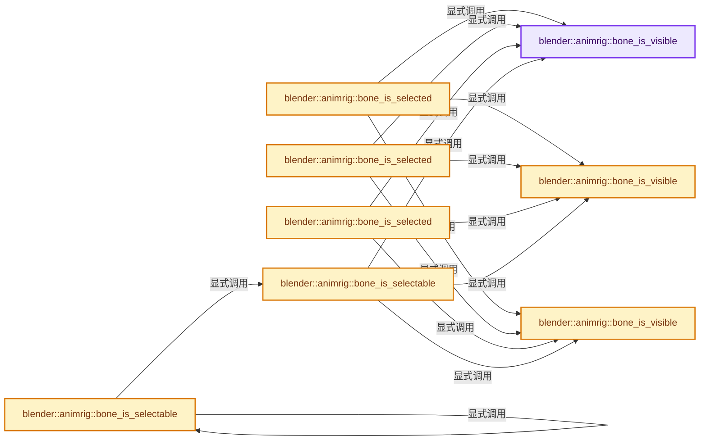

# 实现依赖专题：source/blender/animrig/ANIM_armature.hh

[实现依赖导航](../../README.md) · [符号索引](../../../00-课程指南/02-源码与提交索引/符号依赖与实现索引.md)

本专题从正文实际调用进入，集中保存共享实现。函数有稳定锚点，可从调用处直接跳到对应完整函数；递归与互相调用通过回链组织。

## 本文件的实现关系




## 完整成员与函数实现

<a id="f-e926c36821dc8b61"></a>

### `blender::animrig::bone_is_visible`

实现位置：[source/blender/animrig/ANIM_armature.hh](../../../../../../../source/blender/animrig/ANIM_armature.hh) · L25—L29。

接口参数：

- `const bArmature *armature`
- `const Bone *bone`

**教学注释版**

<!-- annotated:d64ec099e4e83e -->

```cpp
inline bool bone_is_visible(const bArmature *armature, const Bone *bone)
{
  const bool bone_itself_visible = (bone->flag & BONE_HIDDEN_P) == 0;
  return bone_itself_visible && ANIM_bone_in_visible_collection(armature, bone);
}
```

<details>
<summary>核对原始源码：source/blender/animrig/ANIM_armature.hh · L25—L29</summary>

<!-- original:d64ec099e4e83e:source/blender/animrig/ANIM_armature.hh:25:29 -->

```cpp
inline bool bone_is_visible(const bArmature *armature, const Bone *bone)
{
  const bool bone_itself_visible = (bone->flag & BONE_HIDDEN_P) == 0;
  return bone_itself_visible && ANIM_bone_in_visible_collection(armature, bone);
}
```

</details>

**结果出口**

- `return bone_itself_visible && ANIM_bone_in_visible_collection(armature, bone);`

**继续追踪实现**

- `ANIM_bone_in_visible_collection` → [blender::ANIM_bone_in_visible_collection · L1047](intern/bone_collections.cc.md#f-a89f8336d38ceade)。

<a id="f-5e82ccf415aba741"></a>

### `blender::animrig::bone_is_visible`

实现位置：[source/blender/animrig/ANIM_armature.hh](../../../../../../../source/blender/animrig/ANIM_armature.hh) · L31—L35。

接口参数：

- `const bArmature *armature`
- `const bke::PChanBoneConst pchanbone`

**教学注释版**

<!-- annotated:759c112ae35ea8 -->

```cpp
inline bool bone_is_visible(const bArmature *armature, const bke::PChanBoneConst pchanbone)
{
  const bool bone_itself_visible = (pchanbone.pchan->drawflag & PCHAN_DRAW_HIDDEN) == 0;
  return bone_itself_visible && ANIM_bone_in_visible_collection(armature, pchanbone.bone);
}
```

<details>
<summary>核对原始源码：source/blender/animrig/ANIM_armature.hh · L31—L35</summary>

<!-- original:759c112ae35ea8:source/blender/animrig/ANIM_armature.hh:31:35 -->

```cpp
inline bool bone_is_visible(const bArmature *armature, const bke::PChanBoneConst pchanbone)
{
  const bool bone_itself_visible = (pchanbone.pchan->drawflag & PCHAN_DRAW_HIDDEN) == 0;
  return bone_itself_visible && ANIM_bone_in_visible_collection(armature, pchanbone.bone);
}
```

</details>

**结果出口**

- `return bone_itself_visible && ANIM_bone_in_visible_collection(armature, pchanbone.bone);`

**继续追踪实现**

- `ANIM_bone_in_visible_collection` → [blender::ANIM_bone_in_visible_collection · L1047](intern/bone_collections.cc.md#f-a89f8336d38ceade)。

<a id="f-9466cbf3f6488b5f"></a>

### `blender::animrig::bone_is_visible`

实现位置：[source/blender/animrig/ANIM_armature.hh](../../../../../../../source/blender/animrig/ANIM_armature.hh) · L37—L41。

接口参数：

- `const bArmature *armature`
- `const EditBone *ebone`

**教学注释版**

<!-- annotated:b7dea9df479176 -->

```cpp
inline bool bone_is_visible(const bArmature *armature, const EditBone *ebone)
{
  const bool bone_itself_visible = (ebone->flag & BONE_HIDDEN_A) == 0;
  return bone_itself_visible && ANIM_bonecoll_is_visible_editbone(armature, ebone);
}
```

<details>
<summary>核对原始源码：source/blender/animrig/ANIM_armature.hh · L37—L41</summary>

<!-- original:b7dea9df479176:source/blender/animrig/ANIM_armature.hh:37:41 -->

```cpp
inline bool bone_is_visible(const bArmature *armature, const EditBone *ebone)
{
  const bool bone_itself_visible = (ebone->flag & BONE_HIDDEN_A) == 0;
  return bone_itself_visible && ANIM_bonecoll_is_visible_editbone(armature, ebone);
}
```

</details>

**结果出口**

- `return bone_itself_visible && ANIM_bonecoll_is_visible_editbone(armature, ebone);`

**继续追踪实现**

- `ANIM_bonecoll_is_visible_editbone` → [blender::ANIM_bonecoll_is_visible_editbone · L1051](intern/bone_collections.cc.md#f-5cefea8575e26d80)。

<a id="f-375954378cfed5e9"></a>

### `blender::animrig::bone_is_selected`

实现位置：[source/blender/animrig/ANIM_armature.hh](../../../../../../../source/blender/animrig/ANIM_armature.hh) · L47—L50。

接口参数：

- `const bArmature *armature`
- `const Bone *bone`

**教学注释版**

<!-- annotated:20a83f5203339c -->

```cpp
inline bool bone_is_selected(const bArmature *armature, const Bone *bone)
{
  return (bone->flag & BONE_SELECTED) && bone_is_visible(armature, bone);
}
```

<details>
<summary>核对原始源码：source/blender/animrig/ANIM_armature.hh · L47—L50</summary>

<!-- original:20a83f5203339c:source/blender/animrig/ANIM_armature.hh:47:50 -->

```cpp
inline bool bone_is_selected(const bArmature *armature, const Bone *bone)
{
  return (bone->flag & BONE_SELECTED) && bone_is_visible(armature, bone);
}
```

</details>

**结果出口**

- `return (bone->flag & BONE_SELECTED) && bone_is_visible(armature, bone);`

**继续追踪实现**

- `bone_is_visible` → [blender::animrig::bone_is_visible · L25](ANIM_armature.hh.md#f-e926c36821dc8b61)；[blender::animrig::bone_is_visible · L31](ANIM_armature.hh.md#f-5e82ccf415aba741)；[blender::animrig::bone_is_visible · L37](ANIM_armature.hh.md#f-9466cbf3f6488b5f)。同名重载需按实参类型选择。

<a id="f-ef465aafcd7d10f9"></a>

### `blender::animrig::bone_is_selected`

实现位置：[source/blender/animrig/ANIM_armature.hh](../../../../../../../source/blender/animrig/ANIM_armature.hh) · L52—L55。

接口参数：

- `const bArmature *armature`
- `const bke::PChanBoneConst pchanbone`

**教学注释版**

<!-- annotated:2f7d49cfc200ca -->

```cpp
inline bool bone_is_selected(const bArmature *armature, const bke::PChanBoneConst pchanbone)
{
  return (pchanbone.pchan->flag & POSE_SELECTED) && bone_is_visible(armature, pchanbone);
}
```

<details>
<summary>核对原始源码：source/blender/animrig/ANIM_armature.hh · L52—L55</summary>

<!-- original:2f7d49cfc200ca:source/blender/animrig/ANIM_armature.hh:52:55 -->

```cpp
inline bool bone_is_selected(const bArmature *armature, const bke::PChanBoneConst pchanbone)
{
  return (pchanbone.pchan->flag & POSE_SELECTED) && bone_is_visible(armature, pchanbone);
}
```

</details>

**结果出口**

- `return (pchanbone.pchan->flag & POSE_SELECTED) && bone_is_visible(armature, pchanbone);`

**继续追踪实现**

- `bone_is_visible` → [blender::animrig::bone_is_visible · L25](ANIM_armature.hh.md#f-e926c36821dc8b61)；[blender::animrig::bone_is_visible · L31](ANIM_armature.hh.md#f-5e82ccf415aba741)；[blender::animrig::bone_is_visible · L37](ANIM_armature.hh.md#f-9466cbf3f6488b5f)。同名重载需按实参类型选择。

<a id="f-e0128fd4f41bff4e"></a>

### `blender::animrig::bone_is_selected`

实现位置：[source/blender/animrig/ANIM_armature.hh](../../../../../../../source/blender/animrig/ANIM_armature.hh) · L57—L60。

接口参数：

- `const bArmature *armature`
- `const EditBone *ebone`

**教学注释版**

<!-- annotated:5a3d5f43371870 -->

```cpp
inline bool bone_is_selected(const bArmature *armature, const EditBone *ebone)
{
  return (ebone->flag & BONE_SELECTED) && bone_is_visible(armature, ebone);
}
```

<details>
<summary>核对原始源码：source/blender/animrig/ANIM_armature.hh · L57—L60</summary>

<!-- original:5a3d5f43371870:source/blender/animrig/ANIM_armature.hh:57:60 -->

```cpp
inline bool bone_is_selected(const bArmature *armature, const EditBone *ebone)
{
  return (ebone->flag & BONE_SELECTED) && bone_is_visible(armature, ebone);
}
```

</details>

**结果出口**

- `return (ebone->flag & BONE_SELECTED) && bone_is_visible(armature, ebone);`

**继续追踪实现**

- `bone_is_visible` → [blender::animrig::bone_is_visible · L25](ANIM_armature.hh.md#f-e926c36821dc8b61)；[blender::animrig::bone_is_visible · L31](ANIM_armature.hh.md#f-5e82ccf415aba741)；[blender::animrig::bone_is_visible · L37](ANIM_armature.hh.md#f-9466cbf3f6488b5f)。同名重载需按实参类型选择。

<a id="f-0e443662254c089c"></a>

### `blender::animrig::bone_is_selectable`

实现位置：[source/blender/animrig/ANIM_armature.hh](../../../../../../../source/blender/animrig/ANIM_armature.hh) · L62—L65。

接口参数：

- `const bArmature *armature`
- `const bke::PChanBoneConst pchanbone`

**教学注释版**

<!-- annotated:e7c5e78f2deeb1 -->

```cpp
inline bool bone_is_selectable(const bArmature *armature, const bke::PChanBoneConst pchanbone)
{
  return bone_is_visible(armature, pchanbone) && !(pchanbone.bone->flag & BONE_UNSELECTABLE);
}
```

<details>
<summary>核对原始源码：source/blender/animrig/ANIM_armature.hh · L62—L65</summary>

<!-- original:e7c5e78f2deeb1:source/blender/animrig/ANIM_armature.hh:62:65 -->

```cpp
inline bool bone_is_selectable(const bArmature *armature, const bke::PChanBoneConst pchanbone)
{
  return bone_is_visible(armature, pchanbone) && !(pchanbone.bone->flag & BONE_UNSELECTABLE);
}
```

</details>

**结果出口**

- `return bone_is_visible(armature, pchanbone) && !(pchanbone.bone->flag & BONE_UNSELECTABLE);`

**继续追踪实现**

- `bone_is_visible` → [blender::animrig::bone_is_visible · L25](ANIM_armature.hh.md#f-e926c36821dc8b61)；[blender::animrig::bone_is_visible · L31](ANIM_armature.hh.md#f-5e82ccf415aba741)；[blender::animrig::bone_is_visible · L37](ANIM_armature.hh.md#f-9466cbf3f6488b5f)。同名重载需按实参类型选择。

<a id="f-906339b476abc3ca"></a>

### `blender::animrig::bone_is_selectable`

实现位置：[source/blender/animrig/ANIM_armature.hh](../../../../../../../source/blender/animrig/ANIM_armature.hh) · L66—L69。

接口参数：

- `const bArmature *armature`
- `const bPoseChannel *pchan`

**教学注释版**

<!-- annotated:3c3a7e7f8fd9cb -->

```cpp
inline bool bone_is_selectable(const bArmature *armature, const bPoseChannel *pchan)
{
  return bone_is_selectable(armature, {pchan, pchan->bone_get(*armature)});
}
```

<details>
<summary>核对原始源码：source/blender/animrig/ANIM_armature.hh · L66—L69</summary>

<!-- original:3c3a7e7f8fd9cb:source/blender/animrig/ANIM_armature.hh:66:69 -->

```cpp
inline bool bone_is_selectable(const bArmature *armature, const bPoseChannel *pchan)
{
  return bone_is_selectable(armature, {pchan, pchan->bone_get(*armature)});
}
```

</details>

**结果出口**

- `return bone_is_selectable(armature, {pchan, pchan->bone_get(*armature)});`

**继续追踪实现**

- `bone_is_selectable` → [blender::animrig::bone_is_selectable · L62](ANIM_armature.hh.md#f-0e443662254c089c)；[blender::animrig::bone_is_selectable · L66](ANIM_armature.hh.md#f-906339b476abc3ca)；[blender::animrig::bone_is_selectable · L71](ANIM_armature.hh.md#f-6687b50da52e7f05)。同名重载需按实参类型选择。
- `pchan->bone_get` → [blender::bPoseChannel::bone_get · L847](../../02-BKE几何与数据/intern/action.cc.md#f-0eb8bfcf060715cf)；[blender::bPoseChannel::bone_get · L862](../../02-BKE几何与数据/intern/action.cc.md#f-ccec81f60dc65040)；[blender::bPoseChannel::bone_get · L875](../../02-BKE几何与数据/intern/action.cc.md#f-b7d34ff46210a1f3)；[blender::bPoseChannel::bone_get · L881](../../02-BKE几何与数据/intern/action.cc.md#f-0bf83e1e4d68c624)。同名重载需按实参类型选择。

<a id="f-6687b50da52e7f05"></a>

### `blender::animrig::bone_is_selectable`

实现位置：[source/blender/animrig/ANIM_armature.hh](../../../../../../../source/blender/animrig/ANIM_armature.hh) · L71—L74。

接口参数：

- `const bArmature *armature`
- `const Bone *bone`

**教学注释版**

<!-- annotated:3e24a8018035c7 -->

```cpp
inline bool bone_is_selectable(const bArmature *armature, const Bone *bone)
{
  return bone_is_visible(armature, bone) && !(bone->flag & BONE_UNSELECTABLE);
}
```

<details>
<summary>核对原始源码：source/blender/animrig/ANIM_armature.hh · L71—L74</summary>

<!-- original:3e24a8018035c7:source/blender/animrig/ANIM_armature.hh:71:74 -->

```cpp
inline bool bone_is_selectable(const bArmature *armature, const Bone *bone)
{
  return bone_is_visible(armature, bone) && !(bone->flag & BONE_UNSELECTABLE);
}
```

</details>

**结果出口**

- `return bone_is_visible(armature, bone) && !(bone->flag & BONE_UNSELECTABLE);`

**继续追踪实现**

- `bone_is_visible` → [blender::animrig::bone_is_visible · L25](ANIM_armature.hh.md#f-e926c36821dc8b61)；[blender::animrig::bone_is_visible · L31](ANIM_armature.hh.md#f-5e82ccf415aba741)；[blender::animrig::bone_is_visible · L37](ANIM_armature.hh.md#f-9466cbf3f6488b5f)。同名重载需按实参类型选择。

<a id="f-c3dedeb8be9ac022"></a>

### `blender::animrig::bone_select`

实现位置：[source/blender/animrig/ANIM_armature.hh](../../../../../../../source/blender/animrig/ANIM_armature.hh) · L81—L84。

接口参数：

- `bPoseChannel *pchan`

**教学注释版**

<!-- annotated:3591a201f16465 -->

```cpp
inline void bone_select(bPoseChannel *pchan)
{
  pchan->flag |= POSE_SELECTED_ALL;
}
```

<details>
<summary>核对原始源码：source/blender/animrig/ANIM_armature.hh · L81—L84</summary>

<!-- original:3591a201f16465:source/blender/animrig/ANIM_armature.hh:81:84 -->

```cpp
inline void bone_select(bPoseChannel *pchan)
{
  pchan->flag |= POSE_SELECTED_ALL;
}
```

</details>

**沿实际写入检查状态**

- `pchan->flag |= POSE_SELECTED_ALL;`

**继续追踪实现**

本实现没有需要继续展开的显式调用；检查返回表达式、对象转换和调用者前置条件。

<a id="f-7975cc4a6a16e450"></a>

### `blender::animrig::bone_deselect`

实现位置：[source/blender/animrig/ANIM_armature.hh](../../../../../../../source/blender/animrig/ANIM_armature.hh) · L86—L89。

接口参数：

- `bPoseChannel *pchan`

**教学注释版**

<!-- annotated:0c996ade7213d9 -->

```cpp
inline void bone_deselect(bPoseChannel *pchan)
{
  pchan->flag &= ~POSE_SELECTED_ALL;
}
```

<details>
<summary>核对原始源码：source/blender/animrig/ANIM_armature.hh · L86—L89</summary>

<!-- original:0c996ade7213d9:source/blender/animrig/ANIM_armature.hh:86:89 -->

```cpp
inline void bone_deselect(bPoseChannel *pchan)
{
  pchan->flag &= ~POSE_SELECTED_ALL;
}
```

</details>

**沿实际写入检查状态**

- `pchan->flag &= ~POSE_SELECTED_ALL;`

**继续追踪实现**

本实现没有需要继续展开的显式调用；检查返回表达式、对象转换和调用者前置条件。
