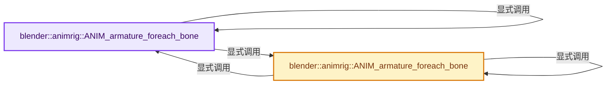
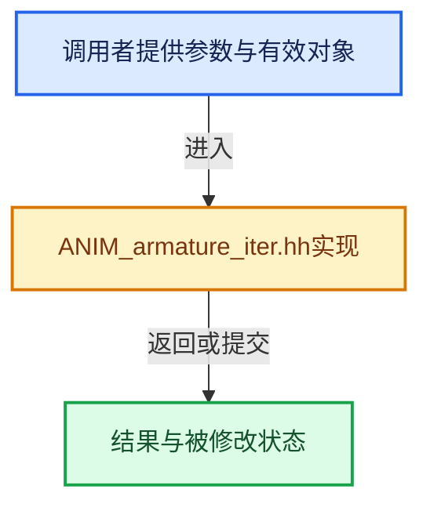

# 实现依赖专题：source/blender/animrig/ANIM_armature_iter.hh

[实现依赖导航](../../README.md) · [符号索引](../../../00-课程指南/02-源码与提交索引/符号依赖与实现索引.md)

本专题从正文实际调用进入，集中保存共享实现。函数有稳定锚点，可从调用处直接跳到对应完整函数；递归与互相调用通过回链组织。

## 本文件的实现关系






## 完整成员与函数实现

<a id="f-b270fb54491eb0dc"></a>

### `blender::animrig::ANIM_armature_foreach_bone`

实现位置：[source/blender/animrig/ANIM_armature_iter.hh](../../../../../../../source/blender/animrig/ANIM_armature_iter.hh) · L26—L32。

接口参数：

- `ListBaseT<Bone> *bones`
- `CB callback`

**教学注释版**

<!-- annotated:9d98d14726d5e1 -->

```cpp
template<typename CB> static void ANIM_armature_foreach_bone(ListBaseT<Bone> *bones, CB callback)
{
  for (Bone *bone : ListBaseWrapper<Bone>(bones)) {
    callback(bone);
    ANIM_armature_foreach_bone(&bone->childbase, callback);
  }
}
```

<details>
<summary>核对原始源码：source/blender/animrig/ANIM_armature_iter.hh · L26—L32</summary>

<!-- original:9d98d14726d5e1:source/blender/animrig/ANIM_armature_iter.hh:26:32 -->

```cpp
template<typename CB> static void ANIM_armature_foreach_bone(ListBaseT<Bone> *bones, CB callback)
{
  for (Bone *bone : ListBaseWrapper<Bone>(bones)) {
    callback(bone);
    ANIM_armature_foreach_bone(&bone->childbase, callback);
  }
}
```

</details>

**继续追踪实现**

- `ListBaseWrapper<Bone>` → [调用协议](../../../00-课程指南/01-路线与规范/模板宏与动态分派协议.md)：函数指针、局部可调用对象或未展开的宏；必须结合调用者环境。调用位置L28。
- `callback` → [调用协议](../../../00-课程指南/01-路线与规范/模板宏与动态分派协议.md)：局部可调用对象，须结合其初始化与捕获环境。调用位置L29。
- `ANIM_armature_foreach_bone` → [blender::animrig::ANIM_armature_foreach_bone · L26](ANIM_armature_iter.hh.md#f-b270fb54491eb0dc)；[blender::animrig::ANIM_armature_foreach_bone · L42](ANIM_armature_iter.hh.md#f-3e30d073899df5cc)。同名重载需按实参类型选择。

<a id="f-3e30d073899df5cc"></a>

### `blender::animrig::ANIM_armature_foreach_bone`

实现位置：[source/blender/animrig/ANIM_armature_iter.hh](../../../../../../../source/blender/animrig/ANIM_armature_iter.hh) · L42—L49。

接口参数：

- `const ListBaseT<Bone> *bones`
- `CB callback`

**教学注释版**

<!-- annotated:1f2133c5b6825d -->

```cpp
template<typename CB>
static void ANIM_armature_foreach_bone(const ListBaseT<Bone> *bones, CB callback)
{
  for (const Bone *bone : ConstListBaseWrapper<Bone>(bones)) {
    callback(bone);
    ANIM_armature_foreach_bone(&bone->childbase, callback);
  }
}
```

<details>
<summary>核对原始源码：source/blender/animrig/ANIM_armature_iter.hh · L42—L49</summary>

<!-- original:1f2133c5b6825d:source/blender/animrig/ANIM_armature_iter.hh:42:49 -->

```cpp
template<typename CB>
static void ANIM_armature_foreach_bone(const ListBaseT<Bone> *bones, CB callback)
{
  for (const Bone *bone : ConstListBaseWrapper<Bone>(bones)) {
    callback(bone);
    ANIM_armature_foreach_bone(&bone->childbase, callback);
  }
}
```

</details>

**继续追踪实现**

- `ConstListBaseWrapper<Bone>` → [调用协议](../../../00-课程指南/01-路线与规范/模板宏与动态分派协议.md)：函数指针、局部可调用对象或未展开的宏；必须结合调用者环境。调用位置L45。
- `callback` → [调用协议](../../../00-课程指南/01-路线与规范/模板宏与动态分派协议.md)：局部可调用对象，须结合其初始化与捕获环境。调用位置L46。
- `ANIM_armature_foreach_bone` → [blender::animrig::ANIM_armature_foreach_bone · L26](ANIM_armature_iter.hh.md#f-b270fb54491eb0dc)；[blender::animrig::ANIM_armature_foreach_bone · L42](ANIM_armature_iter.hh.md#f-3e30d073899df5cc)。同名重载需按实参类型选择。
