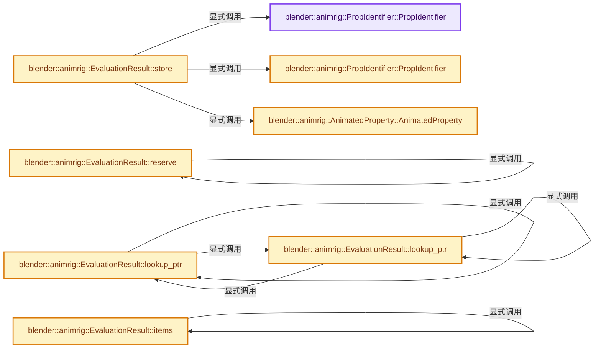

# 实现依赖专题：source/blender/animrig/ANIM_evaluation.hh

[实现依赖导航](../../README.md) · [符号索引](../../../00-课程指南/02-源码与提交索引/符号依赖与实现索引.md)

本专题从正文实际调用进入，集中保存共享实现。函数有稳定锚点，可从调用处直接跳到对应完整函数；递归与互相调用通过回链组织。

## 本文件的实现关系




## 完整成员与函数实现

<a id="f-1f01b0d68abb2efe"></a>

### `blender::animrig::PropIdentifier::PropIdentifier`

实现位置：[source/blender/animrig/ANIM_evaluation.hh](../../../../../../../source/blender/animrig/ANIM_evaluation.hh) · L29—L29。

**教学注释版**

<!-- annotated:2fe88f955b0645 -->

```cpp
  PropIdentifier() = default;
```

<details>
<summary>核对原始源码：source/blender/animrig/ANIM_evaluation.hh · L29—L29</summary>

<!-- original:2fe88f955b0645:source/blender/animrig/ANIM_evaluation.hh:29:29 -->

```cpp
  PropIdentifier() = default;
```

</details>

**继续追踪实现**

本实现没有需要继续展开的显式调用；检查返回表达式、对象转换和调用者前置条件。

<a id="f-843b0908cdd4e6d4"></a>

### `blender::animrig::PropIdentifier::PropIdentifier`

实现位置：[source/blender/animrig/ANIM_evaluation.hh](../../../../../../../source/blender/animrig/ANIM_evaluation.hh) · L31—L34。

接口参数：

- `const ParsedRNAPathRef rna_path`
- `const int array_index`

**教学注释版**

<!-- annotated:4aa89065be0f1e -->

```cpp
  PropIdentifier(const ParsedRNAPathRef rna_path, const int array_index)
      : rna_path(rna_path), array_index(array_index)
  {
  }
```

<details>
<summary>核对原始源码：source/blender/animrig/ANIM_evaluation.hh · L31—L34</summary>

<!-- original:4aa89065be0f1e:source/blender/animrig/ANIM_evaluation.hh:31:34 -->

```cpp
  PropIdentifier(const ParsedRNAPathRef rna_path, const int array_index)
      : rna_path(rna_path), array_index(array_index)
  {
  }
```

</details>

**继续追踪实现**

本实现没有需要继续展开的显式调用；检查返回表达式、对象转换和调用者前置条件。

<a id="f-2ebef5784250b86f"></a>

### `blender::animrig::AnimatedProperty::AnimatedProperty`

实现位置：[source/blender/animrig/ANIM_evaluation.hh](../../../../../../../source/blender/animrig/ANIM_evaluation.hh) · L55—L58。

接口参数：

- `const float value`
- `PathResolvedRNA &&prop_rna`

**教学注释版**

<!-- annotated:d762561df42d69 -->

```cpp
  AnimatedProperty(const float value, PathResolvedRNA &&prop_rna)
      : value(value), prop_rna(std::move(prop_rna))
  {
  }
```

<details>
<summary>核对原始源码：source/blender/animrig/ANIM_evaluation.hh · L55—L58</summary>

<!-- original:d762561df42d69:source/blender/animrig/ANIM_evaluation.hh:55:58 -->

```cpp
  AnimatedProperty(const float value, PathResolvedRNA &&prop_rna)
      : value(value), prop_rna(std::move(prop_rna))
  {
  }
```

</details>

**继续追踪实现**

本实现没有需要继续展开的显式调用；检查返回表达式、对象转换和调用者前置条件。

<a id="f-f23bdac7bc0ff1d8"></a>

### `blender::animrig::EvaluationResult::reserve`

实现位置：[source/blender/animrig/ANIM_evaluation.hh](../../../../../../../source/blender/animrig/ANIM_evaluation.hh) · L92—L95。

接口参数：

- `const int64_t size`

**教学注释版**

<!-- annotated:cd68852f0eac3a -->

```cpp
  void reserve(const int64_t size)
  {
    result_.reserve(size);
  };
```

<details>
<summary>核对原始源码：source/blender/animrig/ANIM_evaluation.hh · L92—L95</summary>

<!-- original:cd68852f0eac3a:source/blender/animrig/ANIM_evaluation.hh:92:95 -->

```cpp
  void reserve(const int64_t size)
  {
    result_.reserve(size);
  };
```

</details>

**继续追踪实现**

- `result_.reserve` → [blender::animrig::EvaluationResult::reserve · L92](ANIM_evaluation.hh.md#f-f23bdac7bc0ff1d8)。

<a id="f-b5557ea0276e2021"></a>

### `blender::animrig::EvaluationResult::store`

实现位置：[source/blender/animrig/ANIM_evaluation.hh](../../../../../../../source/blender/animrig/ANIM_evaluation.hh) · L97—L104。

接口参数：

- `const ParsedRNAPathRef rna_path`
- `const int array_index`
- `const float value`
- `PathResolvedRNA prop_rna`

**教学注释版**

<!-- annotated:d12fcbbc88b04f -->

```cpp
  void store(const ParsedRNAPathRef rna_path,
             const int array_index,
             const float value,
             PathResolvedRNA prop_rna)
  {
    result_.add_overwrite(PropIdentifier(rna_path, array_index),
                          // [讲解] std::move：把表达式转换成可供移动重载选择的值类别；不保证真的移动，不结束源对象寿命，对const值可能选择复制。
                          AnimatedProperty(value, std::move(prop_rna)));
  }
```

<details>
<summary>核对原始源码：source/blender/animrig/ANIM_evaluation.hh · L97—L104</summary>

<!-- original:d12fcbbc88b04f:source/blender/animrig/ANIM_evaluation.hh:97:104 -->

```cpp
  void store(const ParsedRNAPathRef rna_path,
             const int array_index,
             const float value,
             PathResolvedRNA prop_rna)
  {
    result_.add_overwrite(PropIdentifier(rna_path, array_index),
                          AnimatedProperty(value, std::move(prop_rna)));
  }
```

</details>

**继续追踪实现**

- `result_.add_overwrite` → [调用协议](../../../00-课程指南/01-路线与规范/模板宏与动态分派协议.md)：由接收对象具体类型或运行时策略提供实现。调用位置L102。
- `PropIdentifier` → [blender::animrig::PropIdentifier::PropIdentifier · L29](ANIM_evaluation.hh.md#f-1f01b0d68abb2efe)；[blender::animrig::PropIdentifier::PropIdentifier · L31](ANIM_evaluation.hh.md#f-843b0908cdd4e6d4)。同名重载需按实参类型选择。
- `AnimatedProperty` → [blender::animrig::AnimatedProperty::AnimatedProperty · L55](ANIM_evaluation.hh.md#f-2ebef5784250b86f)。
- `std::move` → [外部契约](https://eel.is/c++draft/utility.forward)：把表达式转换成可供移动重载选择的值类别；不保证真的移动，不结束源对象寿命，对const值可能选择复制。

<a id="f-71713d4a2caa2e6f"></a>

### `blender::animrig::EvaluationResult::lookup_ptr`

实现位置：[source/blender/animrig/ANIM_evaluation.hh](../../../../../../../source/blender/animrig/ANIM_evaluation.hh) · L106—L109。

接口参数：

- `const PropIdentifier &key`

**教学注释版**

<!-- annotated:67220f9e80a362 -->

```cpp
  const AnimatedProperty *lookup_ptr(const PropIdentifier &key) const
  {
    return result_.lookup_ptr(key);
  }
```

<details>
<summary>核对原始源码：source/blender/animrig/ANIM_evaluation.hh · L106—L109</summary>

<!-- original:67220f9e80a362:source/blender/animrig/ANIM_evaluation.hh:106:109 -->

```cpp
  const AnimatedProperty *lookup_ptr(const PropIdentifier &key) const
  {
    return result_.lookup_ptr(key);
  }
```

</details>

**结果出口**

- `return result_.lookup_ptr(key);`

**继续追踪实现**

- `result_.lookup_ptr` → [blender::animrig::EvaluationResult::lookup_ptr · L106](ANIM_evaluation.hh.md#f-71713d4a2caa2e6f)；[blender::animrig::EvaluationResult::lookup_ptr · L110](ANIM_evaluation.hh.md#f-3251f07b512827bd)。同名重载需按实参类型选择。

<a id="f-3251f07b512827bd"></a>

### `blender::animrig::EvaluationResult::lookup_ptr`

实现位置：[source/blender/animrig/ANIM_evaluation.hh](../../../../../../../source/blender/animrig/ANIM_evaluation.hh) · L110—L113。

接口参数：

- `const PropIdentifier &key`

**教学注释版**

<!-- annotated:4513a981590a41 -->

```cpp
  AnimatedProperty *lookup_ptr(const PropIdentifier &key)
  {
    return result_.lookup_ptr(key);
  }
```

<details>
<summary>核对原始源码：source/blender/animrig/ANIM_evaluation.hh · L110—L113</summary>

<!-- original:4513a981590a41:source/blender/animrig/ANIM_evaluation.hh:110:113 -->

```cpp
  AnimatedProperty *lookup_ptr(const PropIdentifier &key)
  {
    return result_.lookup_ptr(key);
  }
```

</details>

**结果出口**

- `return result_.lookup_ptr(key);`

**继续追踪实现**

- `result_.lookup_ptr` → [blender::animrig::EvaluationResult::lookup_ptr · L106](ANIM_evaluation.hh.md#f-71713d4a2caa2e6f)；[blender::animrig::EvaluationResult::lookup_ptr · L110](ANIM_evaluation.hh.md#f-3251f07b512827bd)。同名重载需按实参类型选择。

<a id="f-679ea21e7e0129a6"></a>

### `blender::animrig::EvaluationResult::items`

实现位置：[source/blender/animrig/ANIM_evaluation.hh](../../../../../../../source/blender/animrig/ANIM_evaluation.hh) · L115—L118。

**教学注释版**

<!-- annotated:a54905c1656651 -->

```cpp
  EvaluationMap::ItemIterator items() const
  {
    return result_.items();
  }
```

<details>
<summary>核对原始源码：source/blender/animrig/ANIM_evaluation.hh · L115—L118</summary>

<!-- original:a54905c1656651:source/blender/animrig/ANIM_evaluation.hh:115:118 -->

```cpp
  EvaluationMap::ItemIterator items() const
  {
    return result_.items();
  }
```

</details>

**结果出口**

- `return result_.items();`

**继续追踪实现**

- `result_.items` → [blender::animrig::EvaluationResult::items · L115](ANIM_evaluation.hh.md#f-679ea21e7e0129a6)。
