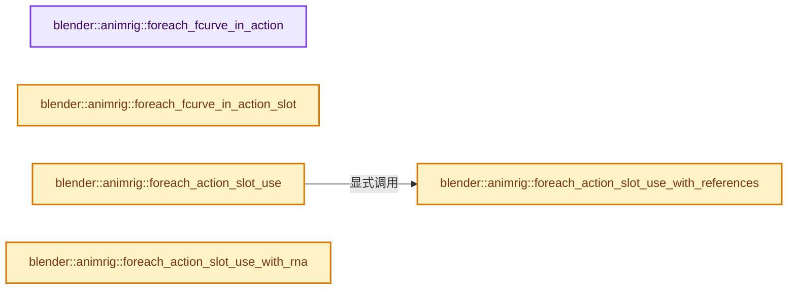

# 实现依赖专题：source/blender/animrig/intern/action_iterators.cc

[实现依赖导航](../../../README.md) · [符号索引](../../../../00-课程指南/02-源码与提交索引/符号依赖与实现索引.md)

本专题从正文实际调用进入，集中保存共享实现。函数有稳定锚点，可从调用处直接跳到对应完整函数；递归与互相调用通过回链组织。

## 本文件的实现关系




## 完整成员与函数实现

<a id="f-c8bc900e55b3d458"></a>

### `blender::animrig::foreach_fcurve_in_action`

实现位置：[source/blender/animrig/intern/action_iterators.cc](../../../../../../../../source/blender/animrig/intern/action_iterators.cc) · L29—L43。

接口参数：

- `Action &action`
- `FunctionRef<void(FCurve &fcurve)> callback`
- `FCurve &fcurve`

**教学注释版**

<!-- annotated:3fca5b1926cea2 -->

```cpp
void foreach_fcurve_in_action(Action &action, FunctionRef<void(FCurve &fcurve)> callback)
{
  for (Layer *layer : action.layers()) {
    for (Strip *strip : layer->strips()) {
      if (strip->type() != Strip::Type::Keyframe) {
        continue;
      }
      for (Channelbag *bag : strip->data<StripKeyframeData>(action).channelbags()) {
        for (FCurve *fcu : bag->fcurves()) {
          callback(*fcu);
        }
      }
    }
  }
}
```

<details>
<summary>核对原始源码：source/blender/animrig/intern/action_iterators.cc · L29—L43</summary>

<!-- original:3fca5b1926cea2:source/blender/animrig/intern/action_iterators.cc:29:43 -->

```cpp
void foreach_fcurve_in_action(Action &action, FunctionRef<void(FCurve &fcurve)> callback)
{
  for (Layer *layer : action.layers()) {
    for (Strip *strip : layer->strips()) {
      if (strip->type() != Strip::Type::Keyframe) {
        continue;
      }
      for (Channelbag *bag : strip->data<StripKeyframeData>(action).channelbags()) {
        for (FCurve *fcu : bag->fcurves()) {
          callback(*fcu);
        }
      }
    }
  }
}
```

</details>

**继续追踪实现**

- `action.layers` → [blender::animrig::Action::layers · L228](action.cc.md#f-acb1b8fd444e908c)；[blender::animrig::Action::layers · L232](action.cc.md#f-dbffb3af38ca8b15)。同名重载需按实参类型选择。
- `layer->strips` → [调用协议](../../../../00-课程指南/01-路线与规范/模板宏与动态分派协议.md)：接收对象类型依赖auto、返回值或模板实例；不按同名猜测目标。调用位置L32。
- `strip->type` → [调用协议](../../../../00-课程指南/01-路线与规范/模板宏与动态分派协议.md)：接收对象类型依赖auto、返回值或模板实例；不按同名猜测目标。调用位置L33。
- `strip->data<StripKeyframeData>(action).channelbags` → [调用协议](../../../../00-课程指南/01-路线与规范/模板宏与动态分派协议.md)：接收对象类型依赖auto、返回值或模板实例；不按同名猜测目标。调用位置L36。
- `strip->data<StripKeyframeData>` → [调用协议](../../../../00-课程指南/01-路线与规范/模板宏与动态分派协议.md)：接收对象类型依赖auto、返回值或模板实例；不按同名猜测目标。调用位置L36。
- `bag->fcurves` → [调用协议](../../../../00-课程指南/01-路线与规范/模板宏与动态分派协议.md)：接收对象类型依赖auto、返回值或模板实例；不按同名猜测目标。调用位置L37。
- `callback` → [调用协议](../../../../00-课程指南/01-路线与规范/模板宏与动态分派协议.md)：局部可调用对象，须结合其初始化与捕获环境。调用位置L38。

<a id="f-c45e539a16fc380d"></a>

### `blender::animrig::foreach_fcurve_in_action_slot`

实现位置：[source/blender/animrig/intern/action_iterators.cc](../../../../../../../../source/blender/animrig/intern/action_iterators.cc) · L72—L92。

接口参数：

- `Action &action`
- `slot_handle_t handle`
- `FunctionRef<void(FCurve &fcurve)> callback`
- `FCurve &fcurve`

**教学注释版**

<!-- annotated:e69ab45a43b82c -->

```cpp
void foreach_fcurve_in_action_slot(Action &action,
                                   slot_handle_t handle,
                                   FunctionRef<void(FCurve &fcurve)> callback)
{
  for (Layer *layer : action.layers()) {
    for (Strip *strip : layer->strips()) {
      if (strip->type() != Strip::Type::Keyframe) {
        continue;
      }
      for (Channelbag *bag : strip->data<StripKeyframeData>(action).channelbags()) {
        if (bag->slot_handle != handle) {
          continue;
        }
        for (FCurve *fcu : bag->fcurves()) {
          BLI_assert(fcu != nullptr);
          callback(*fcu);
        }
      }
    }
  }
}
```

<details>
<summary>核对原始源码：source/blender/animrig/intern/action_iterators.cc · L72—L92</summary>

<!-- original:e69ab45a43b82c:source/blender/animrig/intern/action_iterators.cc:72:92 -->

```cpp
void foreach_fcurve_in_action_slot(Action &action,
                                   slot_handle_t handle,
                                   FunctionRef<void(FCurve &fcurve)> callback)
{
  for (Layer *layer : action.layers()) {
    for (Strip *strip : layer->strips()) {
      if (strip->type() != Strip::Type::Keyframe) {
        continue;
      }
      for (Channelbag *bag : strip->data<StripKeyframeData>(action).channelbags()) {
        if (bag->slot_handle != handle) {
          continue;
        }
        for (FCurve *fcu : bag->fcurves()) {
          BLI_assert(fcu != nullptr);
          callback(*fcu);
        }
      }
    }
  }
}
```

</details>

**继续追踪实现**

- `action.layers` → [blender::animrig::Action::layers · L228](action.cc.md#f-acb1b8fd444e908c)；[blender::animrig::Action::layers · L232](action.cc.md#f-dbffb3af38ca8b15)。同名重载需按实参类型选择。
- `layer->strips` → [调用协议](../../../../00-课程指南/01-路线与规范/模板宏与动态分派协议.md)：接收对象类型依赖auto、返回值或模板实例；不按同名猜测目标。调用位置L77。
- `strip->type` → [调用协议](../../../../00-课程指南/01-路线与规范/模板宏与动态分派协议.md)：接收对象类型依赖auto、返回值或模板实例；不按同名猜测目标。调用位置L78。
- `strip->data<StripKeyframeData>(action).channelbags` → [调用协议](../../../../00-课程指南/01-路线与规范/模板宏与动态分派协议.md)：接收对象类型依赖auto、返回值或模板实例；不按同名猜测目标。调用位置L81。
- `strip->data<StripKeyframeData>` → [调用协议](../../../../00-课程指南/01-路线与规范/模板宏与动态分派协议.md)：接收对象类型依赖auto、返回值或模板实例；不按同名猜测目标。调用位置L81。
- `bag->fcurves` → [调用协议](../../../../00-课程指南/01-路线与规范/模板宏与动态分派协议.md)：接收对象类型依赖auto、返回值或模板实例；不按同名猜测目标。调用位置L85。
- `BLI_assert` → [BLI_assert · L48](../../../01-BLI基础库/BLI_assert.hh.md#m-57a88495704d)；[BLI_assert · L63](../../../01-BLI基础库/BLI_assert.hh.md#m-d07050020cb5)。宏定义由构建条件选择。
- `callback` → [调用协议](../../../../00-课程指南/01-路线与规范/模板宏与动态分派协议.md)：局部可调用对象，须结合其初始化与捕获环境。调用位置L87。

<a id="f-93353453550f639a"></a>

### `blender::animrig::foreach_action_slot_use`

实现位置：[source/blender/animrig/intern/action_iterators.cc](../../../../../../../../source/blender/animrig/intern/action_iterators.cc) · L94—L110。

接口参数：

- `const ID &animated_id`
- `FunctionRef<bool(Action &action, slot_handle_t slot_handle)> callback`
- `Action &action`
- `slot_handle_t slot_handle`

**教学注释版**

<!-- annotated:9818154fda8416 -->

```cpp
bool foreach_action_slot_use(const ID &animated_id,
                             FunctionRef<bool(Action &action, slot_handle_t slot_handle)> callback)
{

  const auto forward_to_callback = [&](ID & /* animated_id */,
                                       bAction *&action_ptr_ref,
                                       const slot_handle_t &slot_handle_ref,
                                       char * /*last_slot_identifier*/) -> bool {
    if (!action_ptr_ref) {
      return true;
    }
    return callback(action_ptr_ref->wrap(), slot_handle_ref);
  };

  return foreach_action_slot_use_with_references(const_cast<ID &>(animated_id),
                                                 forward_to_callback);
}
```

<details>
<summary>核对原始源码：source/blender/animrig/intern/action_iterators.cc · L94—L110</summary>

<!-- original:9818154fda8416:source/blender/animrig/intern/action_iterators.cc:94:110 -->

```cpp
bool foreach_action_slot_use(const ID &animated_id,
                             FunctionRef<bool(Action &action, slot_handle_t slot_handle)> callback)
{

  const auto forward_to_callback = [&](ID & /* animated_id */,
                                       bAction *&action_ptr_ref,
                                       const slot_handle_t &slot_handle_ref,
                                       char * /*last_slot_identifier*/) -> bool {
    if (!action_ptr_ref) {
      return true;
    }
    return callback(action_ptr_ref->wrap(), slot_handle_ref);
  };

  return foreach_action_slot_use_with_references(const_cast<ID &>(animated_id),
                                                 forward_to_callback);
}
```

</details>

**结果出口**

- `return true;`
- `return callback(action_ptr_ref->wrap(), slot_handle_ref);`
- `return foreach_action_slot_use_with_references(const_cast<ID &>(animated_id),`

**继续追踪实现**

- `callback` → [调用协议](../../../../00-课程指南/01-路线与规范/模板宏与动态分派协议.md)：局部可调用对象，须结合其初始化与捕获环境。调用位置L105。
- `action_ptr_ref->wrap` → [blender::bAction::wrap · L1929](../ANIM_action.hh.md#f-f049614274fd7a45)；[blender::bAction::wrap · L1933](../ANIM_action.hh.md#f-2d697d1983fd282f)。同名重载需按实参类型选择。
- `foreach_action_slot_use_with_references` → [blender::animrig::foreach_action_slot_use_with_references · L112](action_iterators.cc.md#f-e703132eca642ba1)。

<a id="f-e703132eca642ba1"></a>

### `blender::animrig::foreach_action_slot_use_with_references`

实现位置：[source/blender/animrig/intern/action_iterators.cc](../../../../../../../../source/blender/animrig/intern/action_iterators.cc) · L112—L194。

接口参数：

- `ID &animated_id`
- `FunctionRef<bool(ID &animated_id,
                      bAction *&action_ptr_ref,
                      slot_handle_t &slot_handle_ref,
                      char *last_slot_identifier)> callback`
- `ID &animated_id`
- `bAction *&action_ptr_ref`
- `slot_handle_t &slot_handle_ref`
- `char *last_slot_identifier`

**教学注释版**

<!-- annotated:1d1a7e7eba92ae -->

```cpp
bool foreach_action_slot_use_with_references(
    ID &animated_id,
    FunctionRef<bool(ID &animated_id,
                     bAction *&action_ptr_ref,
                     slot_handle_t &slot_handle_ref,
                     char *last_slot_identifier)> callback)
{
  AnimData *adt = BKE_animdata_from_id(&animated_id);

  if (adt) {
    if (adt->action) {
      /* Direct assignment. */
      if (!callback(animated_id, adt->action, adt->slot_handle, adt->last_slot_identifier)) {
        return false;
      }
    }

    /* NLA strips. */
    const bool looped_until_last_strip = bke::nla::foreach_strip_adt(*adt, [&](NlaStrip *strip) {
      if (strip->act) {
        if (!callback(
                animated_id, strip->act, strip->action_slot_handle, strip->last_slot_identifier))
        {
          return false;
        }
      }
      return true;
    });
    if (!looped_until_last_strip) {
      return false;
    }
  }

  /* The rest of the code deals with constraints, so only relevant when this is an Object. */
  if (GS(animated_id.name) != ID_OB) {
    return true;
  }

  /* Cannot be `const` because of the BKE_pose_ensure() call below. */
  Object &object = reinterpret_cast<Object &>(animated_id);

  /**
   * Visit a constraint, and call the callback if it's an Action constraint.
   *
   * \returns whether to continue looping over possible uses of Actions, i.e.
   * the return value of the callback.
   */
  auto visit_constraint = [&](const bConstraint &constraint) -> bool {
    if (constraint.type != CONSTRAINT_TYPE_ACTION) {
      return true;
    }
    bActionConstraint *constraint_data = static_cast<bActionConstraint *>(constraint.data);
    if (!constraint_data->act) {
      return true;
    }
    return callback(animated_id,
                    constraint_data->act,
                    constraint_data->action_slot_handle,
                    constraint_data->last_slot_identifier);
  };

  /* Visit Object constraints. */
  for (bConstraint &con : object.constraints) {
    if (!visit_constraint(con)) {
      return false;
    }
  }

  /* Visit Pose Bone constraints. */
  if (object.type == OB_ARMATURE) {
    bArmature *arm = id_cast<bArmature *>(object.data);
    BKE_pose_ensure(nullptr, &object, arm, /*do_id_user=*/DEG_is_original(&object));
    for (bPoseChannel &pchan : object.pose->chanbase) {
      for (bConstraint &con : pchan.constraints) {
        if (!visit_constraint(con)) {
          return false;
        }
      }
    }
  }

  return true;
}
```

<details>
<summary>核对原始源码：source/blender/animrig/intern/action_iterators.cc · L112—L194</summary>

<!-- original:1d1a7e7eba92ae:source/blender/animrig/intern/action_iterators.cc:112:194 -->

```cpp
bool foreach_action_slot_use_with_references(
    ID &animated_id,
    FunctionRef<bool(ID &animated_id,
                     bAction *&action_ptr_ref,
                     slot_handle_t &slot_handle_ref,
                     char *last_slot_identifier)> callback)
{
  AnimData *adt = BKE_animdata_from_id(&animated_id);

  if (adt) {
    if (adt->action) {
      /* Direct assignment. */
      if (!callback(animated_id, adt->action, adt->slot_handle, adt->last_slot_identifier)) {
        return false;
      }
    }

    /* NLA strips. */
    const bool looped_until_last_strip = bke::nla::foreach_strip_adt(*adt, [&](NlaStrip *strip) {
      if (strip->act) {
        if (!callback(
                animated_id, strip->act, strip->action_slot_handle, strip->last_slot_identifier))
        {
          return false;
        }
      }
      return true;
    });
    if (!looped_until_last_strip) {
      return false;
    }
  }

  /* The rest of the code deals with constraints, so only relevant when this is an Object. */
  if (GS(animated_id.name) != ID_OB) {
    return true;
  }

  /* Cannot be `const` because of the BKE_pose_ensure() call below. */
  Object &object = reinterpret_cast<Object &>(animated_id);

  /**
   * Visit a constraint, and call the callback if it's an Action constraint.
   *
   * \returns whether to continue looping over possible uses of Actions, i.e.
   * the return value of the callback.
   */
  auto visit_constraint = [&](const bConstraint &constraint) -> bool {
    if (constraint.type != CONSTRAINT_TYPE_ACTION) {
      return true;
    }
    bActionConstraint *constraint_data = static_cast<bActionConstraint *>(constraint.data);
    if (!constraint_data->act) {
      return true;
    }
    return callback(animated_id,
                    constraint_data->act,
                    constraint_data->action_slot_handle,
                    constraint_data->last_slot_identifier);
  };

  /* Visit Object constraints. */
  for (bConstraint &con : object.constraints) {
    if (!visit_constraint(con)) {
      return false;
    }
  }

  /* Visit Pose Bone constraints. */
  if (object.type == OB_ARMATURE) {
    bArmature *arm = id_cast<bArmature *>(object.data);
    BKE_pose_ensure(nullptr, &object, arm, /*do_id_user=*/DEG_is_original(&object));
    for (bPoseChannel &pchan : object.pose->chanbase) {
      for (bConstraint &con : pchan.constraints) {
        if (!visit_constraint(con)) {
          return false;
        }
      }
    }
  }

  return true;
}
```

</details>

**结果出口**

- `return false;`
- `return true;`
- `return callback(animated_id,`

**继续追踪实现**

- `BKE_animdata_from_id` → [blender::BKE_animdata_from_id · L93](../../../02-BKE几何与数据/intern/anim_data.cc.md#f-354e5421ff0a6c96)。
- `callback` → [调用协议](../../../../00-课程指南/01-路线与规范/模板宏与动态分派协议.md)：局部可调用对象，须结合其初始化与捕获环境。调用位置L124。
- `bke::nla::foreach_strip_adt` → [blender::bke::nla::foreach_strip_adt · L2824](../../../02-BKE几何与数据/intern/nla.cc.md#f-1fed4174dab3e3dc)。
- `GS` → [blender::GS · L410](../../makesdna/DNA_ID.h.md#f-c3ff509f79f21b05)。
- `visit_constraint` → [调用协议](../../../../00-课程指南/01-路线与规范/模板宏与动态分派协议.md)：局部可调用对象，须结合其初始化与捕获环境。调用位置L175。
- `id_cast<bArmature *>` → [blender::id_cast · L1417](../../makesdna/DNA_ID.h.md#f-6c8ac6412850ac5a)。
- `BKE_pose_ensure` → [blender::BKE_pose_ensure · L3061](../../../02-BKE几何与数据/intern/armature.cc.md#f-22c1bff7ca18e20e)。
- `DEG_is_original` → [blender::DEG_is_original · L158](../../../06-Depsgraph依赖图/DEG_depsgraph_query.hh.md#f-729ea058ec76a2a8)。

<a id="f-f28bec678321dfa8"></a>

### `blender::animrig::foreach_action_slot_use_with_rna`

实现位置：[source/blender/animrig/intern/action_iterators.cc](../../../../../../../../source/blender/animrig/intern/action_iterators.cc) · L196—L287。

接口参数：

- `ID &animated_id`
- `FunctionRef<bool(ID &animated_id,
                                                        bAction *action,
                                                        PointerRNA &action_slot_ptr,
                                                        PropertyRNA &action_slot_prop,
                                                        char *last_slot_identifier)> callback`
- `ID &animated_id`
- `bAction *action`
- `PointerRNA &action_slot_ptr`
- `PropertyRNA &action_slot_prop`
- `char *last_slot_identifier`

**教学注释版**

<!-- annotated:f8e66af9c556c6 -->

```cpp
bool foreach_action_slot_use_with_rna(ID &animated_id,
                                      FunctionRef<bool(ID &animated_id,
                                                       bAction *action,
                                                       PointerRNA &action_slot_ptr,
                                                       PropertyRNA &action_slot_prop,
                                                       char *last_slot_identifier)> callback)
{
  /* This function has to copy the logic of #foreach_action_slot_use_with_references(),
   * as it needs to know where exactly those pointers came from. */

  AnimData *adt = BKE_animdata_from_id(&animated_id);

  if (adt) {
    if (adt->action) {
      /* Direct assignment. */
      PointerRNA ptr = RNA_pointer_create_discrete(&animated_id, RNA_AnimData, adt);
      PropertyRNA *prop = RNA_struct_find_property(&ptr, "action_slot");
      if (!callback(animated_id, adt->action, ptr, *prop, adt->last_slot_identifier)) {
        return false;
      }
    }

    /* NLA strips. */
    const bool looped_until_last_strip = bke::nla::foreach_strip_adt(*adt, [&](NlaStrip *strip) {
      if (strip->act) {
        PointerRNA ptr = RNA_pointer_create_discrete(&animated_id, RNA_NlaStrip, strip);
        PropertyRNA *prop = RNA_struct_find_property(&ptr, "action_slot");

        if (!callback(animated_id, strip->act, ptr, *prop, strip->last_slot_identifier)) {
          return false;
        }
      }
      return true;
    });
    if (!looped_until_last_strip) {
      return false;
    }
  }

  /* The rest of the code deals with constraints, so only relevant when this is an Object. */
  if (GS(animated_id.name) != ID_OB) {
    return true;
  }

  /* Cannot be `const` because of the BKE_pose_ensure() call below. */
  Object &object = reinterpret_cast<Object &>(animated_id);

  /**
   * Visit a constraint, and call the callback if it's an Action constraint.
   *
   * \returns whether to continue looping over possible uses of Actions, i.e.
   * the return value of the callback.
   */
  auto visit_constraint = [&](bConstraint &constraint) -> bool {
    if (constraint.type != CONSTRAINT_TYPE_ACTION) {
      return true;
    }
    bActionConstraint *constraint_data = static_cast<bActionConstraint *>(constraint.data);
    if (!constraint_data->act) {
      return true;
    }

    PointerRNA ptr = RNA_pointer_create_discrete(&animated_id, RNA_ActionConstraint, &constraint);
    PropertyRNA *prop = RNA_struct_find_property(&ptr, "action_slot");

    return callback(
        animated_id, constraint_data->act, ptr, *prop, constraint_data->last_slot_identifier);
  };

  /* Visit Object constraints. */
  for (bConstraint &con : object.constraints) {
    if (!visit_constraint(con)) {
      return false;
    }
  }

  /* Visit Pose Bone constraints. */
  if (object.type == OB_ARMATURE) {
    bArmature *arm = id_cast<bArmature *>(object.data);
    BKE_pose_ensure(nullptr, &object, arm, /*do_id_user=*/DEG_is_original(&object));

    for (bPoseChannel &pchan : object.pose->chanbase) {
      for (bConstraint &con : pchan.constraints) {
        if (!visit_constraint(con)) {
          return false;
        }
      }
    }
  }

  return true;
}
```

<details>
<summary>核对原始源码：source/blender/animrig/intern/action_iterators.cc · L196—L287</summary>

<!-- original:f8e66af9c556c6:source/blender/animrig/intern/action_iterators.cc:196:287 -->

```cpp
bool foreach_action_slot_use_with_rna(ID &animated_id,
                                      FunctionRef<bool(ID &animated_id,
                                                       bAction *action,
                                                       PointerRNA &action_slot_ptr,
                                                       PropertyRNA &action_slot_prop,
                                                       char *last_slot_identifier)> callback)
{
  /* This function has to copy the logic of #foreach_action_slot_use_with_references(),
   * as it needs to know where exactly those pointers came from. */

  AnimData *adt = BKE_animdata_from_id(&animated_id);

  if (adt) {
    if (adt->action) {
      /* Direct assignment. */
      PointerRNA ptr = RNA_pointer_create_discrete(&animated_id, RNA_AnimData, adt);
      PropertyRNA *prop = RNA_struct_find_property(&ptr, "action_slot");
      if (!callback(animated_id, adt->action, ptr, *prop, adt->last_slot_identifier)) {
        return false;
      }
    }

    /* NLA strips. */
    const bool looped_until_last_strip = bke::nla::foreach_strip_adt(*adt, [&](NlaStrip *strip) {
      if (strip->act) {
        PointerRNA ptr = RNA_pointer_create_discrete(&animated_id, RNA_NlaStrip, strip);
        PropertyRNA *prop = RNA_struct_find_property(&ptr, "action_slot");

        if (!callback(animated_id, strip->act, ptr, *prop, strip->last_slot_identifier)) {
          return false;
        }
      }
      return true;
    });
    if (!looped_until_last_strip) {
      return false;
    }
  }

  /* The rest of the code deals with constraints, so only relevant when this is an Object. */
  if (GS(animated_id.name) != ID_OB) {
    return true;
  }

  /* Cannot be `const` because of the BKE_pose_ensure() call below. */
  Object &object = reinterpret_cast<Object &>(animated_id);

  /**
   * Visit a constraint, and call the callback if it's an Action constraint.
   *
   * \returns whether to continue looping over possible uses of Actions, i.e.
   * the return value of the callback.
   */
  auto visit_constraint = [&](bConstraint &constraint) -> bool {
    if (constraint.type != CONSTRAINT_TYPE_ACTION) {
      return true;
    }
    bActionConstraint *constraint_data = static_cast<bActionConstraint *>(constraint.data);
    if (!constraint_data->act) {
      return true;
    }

    PointerRNA ptr = RNA_pointer_create_discrete(&animated_id, RNA_ActionConstraint, &constraint);
    PropertyRNA *prop = RNA_struct_find_property(&ptr, "action_slot");

    return callback(
        animated_id, constraint_data->act, ptr, *prop, constraint_data->last_slot_identifier);
  };

  /* Visit Object constraints. */
  for (bConstraint &con : object.constraints) {
    if (!visit_constraint(con)) {
      return false;
    }
  }

  /* Visit Pose Bone constraints. */
  if (object.type == OB_ARMATURE) {
    bArmature *arm = id_cast<bArmature *>(object.data);
    BKE_pose_ensure(nullptr, &object, arm, /*do_id_user=*/DEG_is_original(&object));

    for (bPoseChannel &pchan : object.pose->chanbase) {
      for (bConstraint &con : pchan.constraints) {
        if (!visit_constraint(con)) {
          return false;
        }
      }
    }
  }

  return true;
}
```

</details>

**结果出口**

- `return false;`
- `return true;`
- `return callback(`

**继续追踪实现**

- `BKE_animdata_from_id` → [blender::BKE_animdata_from_id · L93](../../../02-BKE几何与数据/intern/anim_data.cc.md#f-354e5421ff0a6c96)。
- `RNA_pointer_create_discrete` → [blender::RNA_pointer_create_discrete · L181](../../makesrna/intern/rna_access.cc.md#f-592a276e869c6d94)。
- `RNA_struct_find_property` → [blender::RNA_struct_find_property · L855](../../makesrna/intern/rna_access.cc.md#f-75b0f3b3cc89dd4c)；[blender::RNA_struct_find_property · L874](../../makesrna/intern/rna_access.cc.md#f-7fb7ab238d64680f)。同名重载需按实参类型选择。
- `callback` → [调用协议](../../../../00-课程指南/01-路线与规范/模板宏与动态分派协议.md)：局部可调用对象，须结合其初始化与捕获环境。调用位置L213。
- `bke::nla::foreach_strip_adt` → [blender::bke::nla::foreach_strip_adt · L2824](../../../02-BKE几何与数据/intern/nla.cc.md#f-1fed4174dab3e3dc)。
- `GS` → [blender::GS · L410](../../makesdna/DNA_ID.h.md#f-c3ff509f79f21b05)。
- `visit_constraint` → [调用协议](../../../../00-课程指南/01-路线与规范/模板宏与动态分派协议.md)：局部可调用对象，须结合其初始化与捕获环境。调用位置L267。
- `id_cast<bArmature *>` → [blender::id_cast · L1417](../../makesdna/DNA_ID.h.md#f-6c8ac6412850ac5a)。
- `BKE_pose_ensure` → [blender::BKE_pose_ensure · L3061](../../../02-BKE几何与数据/intern/armature.cc.md#f-22c1bff7ca18e20e)。
- `DEG_is_original` → [blender::DEG_is_original · L158](../../../06-Depsgraph依赖图/DEG_depsgraph_query.hh.md#f-729ea058ec76a2a8)。
