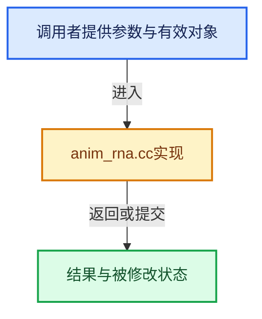

# 实现依赖专题：source/blender/animrig/intern/anim_rna.cc

[实现依赖导航](../../../README.md) · [符号索引](../../../../00-课程指南/02-源码与提交索引/符号依赖与实现索引.md)

本专题从正文实际调用进入，集中保存共享实现。函数有稳定锚点，可从调用处直接跳到对应完整函数；递归与互相调用通过回链组织。

## 本文件的实现关系





## 完整成员与函数实现

<a id="f-7122c6bd8e5e53c0"></a>

### `blender::animrig::get_rna_values`

实现位置：[source/blender/animrig/intern/anim_rna.cc](../../../../../../../../source/blender/animrig/intern/anim_rna.cc) · L26—L81。

接口参数：

- `PointerRNA *ptr`
- `PropertyRNA *prop`

**教学注释版**

<!-- annotated:2b21144468ad60 -->

```cpp
Vector<float> get_rna_values(PointerRNA *ptr, PropertyRNA *prop)
{
  Vector<float> values;
  if (RNA_property_array_check(prop)) {
    const int length = RNA_property_array_length(ptr, prop);

    switch (RNA_property_type(prop)) {
      case PROP_BOOLEAN: {
        bool *tmp_bool = MEM_new_array_uninitialized<bool>(length, __func__);
        RNA_property_boolean_get_array(ptr, prop, tmp_bool);
        for (int i = 0; i < length; i++) {
          // [讲解] values.append：在尾部建立新元素，必要时先扩大存储。
          values.append(float(tmp_bool[i]));
        }
        MEM_delete(tmp_bool);
        break;
      }
      case PROP_INT: {
        int *tmp_int = MEM_new_array_uninitialized<int>(length, __func__);
        RNA_property_int_get_array(ptr, prop, tmp_int);
        for (int i = 0; i < length; i++) {
          values.append(float(tmp_int[i]));
        }
        MEM_delete(tmp_int);
        break;
      }
      case PROP_FLOAT: {
        // [讲解] values.reinitialize：先销毁全部旧元素，再按新长度重新构造；旧元素不参与扩容迁移。
        values.reinitialize(length);
        // [讲解] values.data：提供当前存储或有效范围的地址。
        RNA_property_float_get_array(ptr, prop, values.data());
        break;
      }
      default:
        values.reinitialize(length);
        break;
    }
  }
  else {
    switch (RNA_property_type(prop)) {
      case PROP_BOOLEAN:
        values.append(float(RNA_property_boolean_get(ptr, prop)));
        break;
      case PROP_INT:
        values.append(float(RNA_property_int_get(ptr, prop)));
        break;
      case PROP_FLOAT:
        values.append(RNA_property_float_get(ptr, prop));
        break;
      case PROP_ENUM:
        values.append(float(RNA_property_enum_get(ptr, prop)));
        break;
      default:
        values.append(0.0f);
    }
  }

  return values;
}
```

<details>
<summary>核对原始源码：source/blender/animrig/intern/anim_rna.cc · L26—L81</summary>

<!-- original:2b21144468ad60:source/blender/animrig/intern/anim_rna.cc:26:81 -->

```cpp
Vector<float> get_rna_values(PointerRNA *ptr, PropertyRNA *prop)
{
  Vector<float> values;
  if (RNA_property_array_check(prop)) {
    const int length = RNA_property_array_length(ptr, prop);

    switch (RNA_property_type(prop)) {
      case PROP_BOOLEAN: {
        bool *tmp_bool = MEM_new_array_uninitialized<bool>(length, __func__);
        RNA_property_boolean_get_array(ptr, prop, tmp_bool);
        for (int i = 0; i < length; i++) {
          values.append(float(tmp_bool[i]));
        }
        MEM_delete(tmp_bool);
        break;
      }
      case PROP_INT: {
        int *tmp_int = MEM_new_array_uninitialized<int>(length, __func__);
        RNA_property_int_get_array(ptr, prop, tmp_int);
        for (int i = 0; i < length; i++) {
          values.append(float(tmp_int[i]));
        }
        MEM_delete(tmp_int);
        break;
      }
      case PROP_FLOAT: {
        values.reinitialize(length);
        RNA_property_float_get_array(ptr, prop, values.data());
        break;
      }
      default:
        values.reinitialize(length);
        break;
    }
  }
  else {
    switch (RNA_property_type(prop)) {
      case PROP_BOOLEAN:
        values.append(float(RNA_property_boolean_get(ptr, prop)));
        break;
      case PROP_INT:
        values.append(float(RNA_property_int_get(ptr, prop)));
        break;
      case PROP_FLOAT:
        values.append(RNA_property_float_get(ptr, prop));
        break;
      case PROP_ENUM:
        values.append(float(RNA_property_enum_get(ptr, prop)));
        break;
      default:
        values.append(0.0f);
    }
  }

  return values;
}
```

</details>

**结果出口**

- `return values;`

**继续追踪实现**

- `RNA_property_array_check` → [blender::RNA_property_array_check · L1376](../../makesrna/intern/rna_access.cc.md#f-efbdada33e42c28c)。
- `RNA_property_array_length` → [blender::RNA_property_array_length · L1371](../../makesrna/intern/rna_access.cc.md#f-2258ce063a075147)。
- `RNA_property_type` → [blender::RNA_property_type · L1293](../../makesrna/intern/rna_access.cc.md#f-4465a90d55f022df)。
- `MEM_new_array_uninitialized<bool>` → [MEM_new_array_uninitialized · L608](../../../07-Intern运行时与平台/guardedalloc/MEM_guardedalloc.h.md#f-b7103eae8eb57b05)；[MEM_new_array_uninitialized · L129](../../../07-Intern运行时与平台/guardedalloc/intern/mallocn.cc.md#f-bf6ef4ddcfb6e5df)。同名重载需按实参类型选择。
- `RNA_property_boolean_get_array` → [blender::RNA_property_boolean_get_array · L2844](../../makesrna/intern/rna_access.cc.md#f-3643cfa3ec19b142)。
- `values.append` → [blender::Vector::append · L498](../../../../01-基础容器与现代CPP/11-Vector插入删除与重排.md#f-5bde268a69e443ec)；[blender::Vector::append · L502](../../../../01-基础容器与现代CPP/11-Vector插入删除与重排.md#f-591e0b15e6308532)。同名重载需按实参类型选择。
- `MEM_delete` → [MEM_delete · L400](../../../07-Intern运行时与平台/guardedalloc/MEM_guardedalloc.h.md#f-9049ffdd1682887c)。
- `MEM_new_array_uninitialized<int>` → [MEM_new_array_uninitialized · L608](../../../07-Intern运行时与平台/guardedalloc/MEM_guardedalloc.h.md#f-b7103eae8eb57b05)；[MEM_new_array_uninitialized · L129](../../../07-Intern运行时与平台/guardedalloc/intern/mallocn.cc.md#f-bf6ef4ddcfb6e5df)。同名重载需按实参类型选择。
- `RNA_property_int_get_array` → [blender::RNA_property_int_get_array · L3324](../../makesrna/intern/rna_access.cc.md#f-2ebac95fe0b03ee3)。
- `values.reinitialize` → [blender::Vector::reinitialize · L458](../../../../01-基础容器与现代CPP/10-Vector扩容与增长.md#f-9249cd61747c1405)。
- `RNA_property_float_get_array` → [blender::RNA_property_float_get_array · L3813](../../makesrna/intern/rna_access.cc.md#f-c757b16ab20791de)。
- `values.data` → [blender::Vector::data · L954](../../../../01-基础容器与现代CPP/12-Vector异常安全与边界.md#f-6e441591404715bc)；[blender::Vector::data · L962](../../../../01-基础容器与现代CPP/12-Vector异常安全与边界.md#f-4bc78d4954c1021a)。同名重载需按实参类型选择。
- `RNA_property_boolean_get` → [blender::RNA_property_boolean_get · L2682](../../makesrna/intern/rna_access.cc.md#f-16ebc777a7f8eb66)。
- `RNA_property_int_get` → [blender::RNA_property_int_get · L3198](../../makesrna/intern/rna_access.cc.md#f-09c89e28122fa344)。
- `RNA_property_float_get` → [blender::RNA_property_float_get · L3656](../../makesrna/intern/rna_access.cc.md#f-715b911efa49b6ab)。
- `RNA_property_enum_get` → [blender::RNA_property_enum_get · L4499](../../makesrna/intern/rna_access.cc.md#f-7921c83822683274)。
