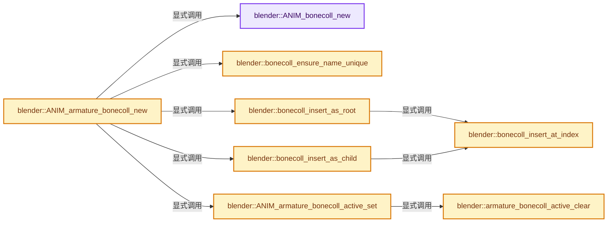

# 实现依赖专题：source/blender/animrig/intern/bone_collections.cc

[实现依赖导航](../../../README.md) · [符号索引](../../../../00-课程指南/02-源码与提交索引/符号依赖与实现索引.md)

本专题从正文实际调用进入，集中保存共享实现。函数有稳定锚点，可从调用处直接跳到对应完整函数；递归与互相调用通过回链组织。

## 本文件的实现关系




## 完整成员与函数实现

<a id="f-d193366fda84ad22"></a>

### `blender::ANIM_bonecoll_new`

实现位置：[source/blender/animrig/intern/bone_collections.cc](../../../../../../../../source/blender/animrig/intern/bone_collections.cc) · L58—L73。

接口参数：

- `const char *name`

**教学注释版**

<!-- annotated:bb2725294f6e49 -->

```cpp
BoneCollection *ANIM_bonecoll_new(const char *name)
{
  if (name == nullptr || name[0] == '\0') {
    /* Use a default name if no name was given. */
    name = DATA_(bonecoll_default_name);
  }

  /* NOTE: the collection name may change after the collection is added to an
   * armature, to ensure it is unique within the armature. */
  BoneCollection *bcoll = MEM_new<BoneCollection>(__func__);

  STRNCPY_UTF8(bcoll->name, name);
  bcoll->flags = default_flags;

  return bcoll;
}
```

<details>
<summary>核对原始源码：source/blender/animrig/intern/bone_collections.cc · L58—L73</summary>

<!-- original:bb2725294f6e49:source/blender/animrig/intern/bone_collections.cc:58:73 -->

```cpp
BoneCollection *ANIM_bonecoll_new(const char *name)
{
  if (name == nullptr || name[0] == '\0') {
    /* Use a default name if no name was given. */
    name = DATA_(bonecoll_default_name);
  }

  /* NOTE: the collection name may change after the collection is added to an
   * armature, to ensure it is unique within the armature. */
  BoneCollection *bcoll = MEM_new<BoneCollection>(__func__);

  STRNCPY_UTF8(bcoll->name, name);
  bcoll->flags = default_flags;

  return bcoll;
}
```

</details>

**沿实际写入检查状态**

- `name = DATA_(bonecoll_default_name);`
- `bcoll->flags = default_flags;`

**结果出口**

- `return bcoll;`

**继续追踪实现**

- `DATA_` → [DATA_ · L52](../../blentranslation/BLT_translation.hh.md#m-178736083f83)。宏定义由构建条件选择。
- `MEM_new<BoneCollection>` → [MEM_new · L351](../../../07-Intern运行时与平台/guardedalloc/MEM_guardedalloc.h.md#f-115f9b6784f89912)。
- `STRNCPY_UTF8` → [STRNCPY_UTF8 · L335](../../../01-BLI基础库/BLI_string_utf8.hh.md#m-222967f0ab6a)。宏定义由构建条件选择。

<a id="f-8e33dba68e937036"></a>

### `blender::bonecoll_ensure_name_unique`

实现位置：[source/blender/animrig/intern/bone_collections.cc](../../../../../../../../source/blender/animrig/intern/bone_collections.cc) · L132—L150。

接口参数：

- `bArmature *armature`
- `BoneCollection *bcoll`

**教学注释版**

<!-- annotated:452b558fbfd726 -->

```cpp
static void bonecoll_ensure_name_unique(bArmature *armature, BoneCollection *bcoll)
{
  /* Cannot capture armature & bcoll by reference in the lambda, as that would change its signature
   * and no longer be compatible with BLI_uniquename_cb(). */
  auto bonecoll_name_is_duplicate = [&](const StringRef name) -> bool {
    for (BoneCollection *bcoll_iter : armature->collections_span()) {
      if (bcoll_iter != bcoll && bcoll_iter->name == name) {
        return true;
      }
    }
    return false;
  };

  BLI_uniquename_cb(bonecoll_name_is_duplicate,
                    DATA_(bonecoll_default_name),
                    '.',
                    bcoll->name,
                    sizeof(bcoll->name));
}
```

<details>
<summary>核对原始源码：source/blender/animrig/intern/bone_collections.cc · L132—L150</summary>

<!-- original:452b558fbfd726:source/blender/animrig/intern/bone_collections.cc:132:150 -->

```cpp
static void bonecoll_ensure_name_unique(bArmature *armature, BoneCollection *bcoll)
{
  /* Cannot capture armature & bcoll by reference in the lambda, as that would change its signature
   * and no longer be compatible with BLI_uniquename_cb(). */
  auto bonecoll_name_is_duplicate = [&](const StringRef name) -> bool {
    for (BoneCollection *bcoll_iter : armature->collections_span()) {
      if (bcoll_iter != bcoll && bcoll_iter->name == name) {
        return true;
      }
    }
    return false;
  };

  BLI_uniquename_cb(bonecoll_name_is_duplicate,
                    DATA_(bonecoll_default_name),
                    '.',
                    bcoll->name,
                    sizeof(bcoll->name));
}
```

</details>

**结果出口**

- `return true;`
- `return false;`

**继续追踪实现**

- `armature->collections_span` → [blender::bArmature::collections_span · L3467](../../../02-BKE几何与数据/intern/armature.cc.md#f-f6eaa0848c5c882f)；[blender::bArmature::collections_span · L3472](../../../02-BKE几何与数据/intern/armature.cc.md#f-725f491e0502fef3)。同名重载需按实参类型选择。
- `BLI_uniquename_cb` → [blender::BLI_uniquename_cb · L421](../../../01-BLI基础库/intern/string_utils.cc.md#f-651b82b9010ddef4)；[blender::BLI_uniquename_cb · L459](../../../01-BLI基础库/intern/string_utils.cc.md#f-0e0b6725b5b90a92)。同名重载需按实参类型选择。
- `DATA_` → [DATA_ · L52](../../blentranslation/BLT_translation.hh.md#m-178736083f83)。宏定义由构建条件选择。

<a id="f-b9fbeffba84807d2"></a>

### `blender::bonecoll_insert_at_index`

实现位置：[source/blender/animrig/intern/bone_collections.cc](../../../../../../../../source/blender/animrig/intern/bone_collections.cc) · L159—L180。

接口参数：

- `bArmature *armature`
- `BoneCollection *bcoll`
- `const int index`

**教学注释版**

<!-- annotated:041a0fe92ea747 -->

```cpp
static void bonecoll_insert_at_index(bArmature *armature, BoneCollection *bcoll, const int index)
{
  BLI_assert(index <= armature->collection_array_num);

  armature->collection_array = reinterpret_cast<BoneCollection **>(
      MEM_realloc_uninitialized_id(armature->collection_array,
                                   sizeof(BoneCollection *) * (armature->collection_array_num + 1),
                                   __func__));

  /* To keep the memory consistent, insert the new element at the end of the
   * now-grown array, then rotate it into place. */
  armature->collection_array[armature->collection_array_num] = bcoll;
  armature->collection_array_num++;

  const int rotate_count = armature->collection_array_num - index - 1;
  animrig::internal::bonecolls_rotate_block(armature, index, rotate_count, +1);

  if (armature->runtime->active_collection_index >= index) {
    ANIM_armature_bonecoll_active_index_set(armature,
                                            armature->runtime->active_collection_index + 1);
  }
}
```

<details>
<summary>核对原始源码：source/blender/animrig/intern/bone_collections.cc · L159—L180</summary>

<!-- original:041a0fe92ea747:source/blender/animrig/intern/bone_collections.cc:159:180 -->

```cpp
static void bonecoll_insert_at_index(bArmature *armature, BoneCollection *bcoll, const int index)
{
  BLI_assert(index <= armature->collection_array_num);

  armature->collection_array = reinterpret_cast<BoneCollection **>(
      MEM_realloc_uninitialized_id(armature->collection_array,
                                   sizeof(BoneCollection *) * (armature->collection_array_num + 1),
                                   __func__));

  /* To keep the memory consistent, insert the new element at the end of the
   * now-grown array, then rotate it into place. */
  armature->collection_array[armature->collection_array_num] = bcoll;
  armature->collection_array_num++;

  const int rotate_count = armature->collection_array_num - index - 1;
  animrig::internal::bonecolls_rotate_block(armature, index, rotate_count, +1);

  if (armature->runtime->active_collection_index >= index) {
    ANIM_armature_bonecoll_active_index_set(armature,
                                            armature->runtime->active_collection_index + 1);
  }
}
```

</details>

**沿实际写入检查状态**

- `armature->collection_array = reinterpret_cast<BoneCollection **>(`
- `armature->collection_array[armature->collection_array_num] = bcoll;`

**继续追踪实现**

- `BLI_assert` → [BLI_assert · L48](../../../01-BLI基础库/BLI_assert.hh.md#m-57a88495704d)；[BLI_assert · L63](../../../01-BLI基础库/BLI_assert.hh.md#m-d07050020cb5)。宏定义由构建条件选择。
- `MEM_realloc_uninitialized_id` → [调用协议](../../../../00-课程指南/01-路线与规范/模板宏与动态分派协议.md)：函数指针、局部可调用对象或未展开的宏；必须结合调用者环境。调用位置L164。
- `animrig::internal::bonecolls_rotate_block` → [blender::animrig::internal::bonecolls_rotate_block · L1491](bone_collections.cc.md#f-8fe79ffc3d99f1d1)。
- `ANIM_armature_bonecoll_active_index_set` → [blender::ANIM_armature_bonecoll_active_index_set · L422](bone_collections.cc.md#f-539ffeaedf022f51)。

<a id="f-54bb363479d445a4"></a>

### `blender::bonecoll_insert_as_root`

实现位置：[source/blender/animrig/intern/bone_collections.cc](../../../../../../../../source/blender/animrig/intern/bone_collections.cc) · L182—L194。

接口参数：

- `bArmature *armature`
- `BoneCollection *bcoll`
- `int at_index`

**教学注释版**

<!-- annotated:245cc11dcc0386 -->

```cpp
static void bonecoll_insert_as_root(bArmature *armature, BoneCollection *bcoll, int at_index)
{
  BLI_assert(at_index >= -1);
  BLI_assert(at_index <= armature->collection_root_count);
  if (at_index < 0) {
    at_index = armature->collection_root_count;
  }

  bonecoll_insert_at_index(armature, bcoll, at_index);
  armature->collection_root_count++;

  ancestors_visible_update(armature, nullptr, bcoll);
}
```

<details>
<summary>核对原始源码：source/blender/animrig/intern/bone_collections.cc · L182—L194</summary>

<!-- original:245cc11dcc0386:source/blender/animrig/intern/bone_collections.cc:182:194 -->

```cpp
static void bonecoll_insert_as_root(bArmature *armature, BoneCollection *bcoll, int at_index)
{
  BLI_assert(at_index >= -1);
  BLI_assert(at_index <= armature->collection_root_count);
  if (at_index < 0) {
    at_index = armature->collection_root_count;
  }

  bonecoll_insert_at_index(armature, bcoll, at_index);
  armature->collection_root_count++;

  ancestors_visible_update(armature, nullptr, bcoll);
}
```

</details>

**沿实际写入检查状态**

- `at_index = armature->collection_root_count;`

**继续追踪实现**

- `BLI_assert` → [BLI_assert · L48](../../../01-BLI基础库/BLI_assert.hh.md#m-57a88495704d)；[BLI_assert · L63](../../../01-BLI基础库/BLI_assert.hh.md#m-d07050020cb5)。宏定义由构建条件选择。
- `bonecoll_insert_at_index` → [blender::bonecoll_insert_at_index · L159](bone_collections.cc.md#f-b9fbeffba84807d2)。
- `ancestors_visible_update` → [blender::ancestors_visible_update · L794](bone_collections.cc.md#f-cbc0ef61e3105f2e)。

<a id="f-33da42c1c81fdfc4"></a>

### `blender::bonecoll_insert_as_child`

实现位置：[source/blender/animrig/intern/bone_collections.cc](../../../../../../../../source/blender/animrig/intern/bone_collections.cc) · L196—L216。

接口参数：

- `bArmature *armature`
- `BoneCollection *bcoll`
- `const int parent_index`

**教学注释版**

<!-- annotated:ecde2f4eb9495f -->

```cpp
static int bonecoll_insert_as_child(bArmature *armature,
                                    BoneCollection *bcoll,
                                    const int parent_index)
{
  BLI_assert_msg(parent_index >= 0, "Armature bone collection index should be 0 or larger");
  BLI_assert_msg(parent_index < armature->collection_array_num,
                 "Parent bone collection index should not point beyond the end of the array");

  BoneCollection *parent = armature->collection_array[parent_index];
  if (parent->child_index == 0) {
    /* This parent doesn't have any children yet, so place them at the end of the array. */
    parent->child_index = armature->collection_array_num;
  }
  const int insert_at_index = parent->child_index + parent->child_count;
  bonecoll_insert_at_index(armature, bcoll, insert_at_index);
  parent->child_count++;

  ancestors_visible_update(armature, parent, bcoll);

  return insert_at_index;
}
```

<details>
<summary>核对原始源码：source/blender/animrig/intern/bone_collections.cc · L196—L216</summary>

<!-- original:ecde2f4eb9495f:source/blender/animrig/intern/bone_collections.cc:196:216 -->

```cpp
static int bonecoll_insert_as_child(bArmature *armature,
                                    BoneCollection *bcoll,
                                    const int parent_index)
{
  BLI_assert_msg(parent_index >= 0, "Armature bone collection index should be 0 or larger");
  BLI_assert_msg(parent_index < armature->collection_array_num,
                 "Parent bone collection index should not point beyond the end of the array");

  BoneCollection *parent = armature->collection_array[parent_index];
  if (parent->child_index == 0) {
    /* This parent doesn't have any children yet, so place them at the end of the array. */
    parent->child_index = armature->collection_array_num;
  }
  const int insert_at_index = parent->child_index + parent->child_count;
  bonecoll_insert_at_index(armature, bcoll, insert_at_index);
  parent->child_count++;

  ancestors_visible_update(armature, parent, bcoll);

  return insert_at_index;
}
```

</details>

**沿实际写入检查状态**

- `parent->child_index = armature->collection_array_num;`

**结果出口**

- `return insert_at_index;`

**继续追踪实现**

- `BLI_assert_msg` → [BLI_assert_msg · L55](../../../01-BLI基础库/BLI_assert.hh.md#m-695eed20dceb)；[BLI_assert_msg · L64](../../../01-BLI基础库/BLI_assert.hh.md#m-7de5563de4db)。宏定义由构建条件选择。
- `bonecoll_insert_at_index` → [blender::bonecoll_insert_at_index · L159](bone_collections.cc.md#f-b9fbeffba84807d2)。
- `ancestors_visible_update` → [blender::ancestors_visible_update · L794](bone_collections.cc.md#f-cbc0ef61e3105f2e)。

<a id="f-76c624d18358b0ac"></a>

### `blender::ANIM_armature_bonecoll_new`

实现位置：[source/blender/animrig/intern/bone_collections.cc](../../../../../../../../source/blender/animrig/intern/bone_collections.cc) · L218—L242。

接口参数：

- `bArmature *armature`
- `const char *name`
- `const int parent_index`

**教学注释版**

<!-- annotated:224343aedf4aab -->

```cpp
BoneCollection *ANIM_armature_bonecoll_new(bArmature *armature,
                                           const char *name,
                                           const int parent_index)
{
  BoneCollection *bcoll = ANIM_bonecoll_new(name);

  if (!ID_IS_LINKED(&armature->id) && ID_IS_OVERRIDE_LIBRARY(&armature->id)) {
    /* Mark this bone collection as local override, so that certain operations can be allowed. */
    bcoll->flags |= BONE_COLLECTION_OVERRIDE_LIBRARY_LOCAL;
  }

  bonecoll_ensure_name_unique(armature, bcoll);

  if (parent_index < 0) {
    bonecoll_insert_as_root(armature, bcoll, -1);
  }
  else {
    bonecoll_insert_as_child(armature, bcoll, parent_index);
  }

  /* Restore the active bone collection pointer, as its index might have changed. */
  ANIM_armature_bonecoll_active_set(armature, armature->runtime->active_collection);

  return bcoll;
}
```

<details>
<summary>核对原始源码：source/blender/animrig/intern/bone_collections.cc · L218—L242</summary>

<!-- original:224343aedf4aab:source/blender/animrig/intern/bone_collections.cc:218:242 -->

```cpp
BoneCollection *ANIM_armature_bonecoll_new(bArmature *armature,
                                           const char *name,
                                           const int parent_index)
{
  BoneCollection *bcoll = ANIM_bonecoll_new(name);

  if (!ID_IS_LINKED(&armature->id) && ID_IS_OVERRIDE_LIBRARY(&armature->id)) {
    /* Mark this bone collection as local override, so that certain operations can be allowed. */
    bcoll->flags |= BONE_COLLECTION_OVERRIDE_LIBRARY_LOCAL;
  }

  bonecoll_ensure_name_unique(armature, bcoll);

  if (parent_index < 0) {
    bonecoll_insert_as_root(armature, bcoll, -1);
  }
  else {
    bonecoll_insert_as_child(armature, bcoll, parent_index);
  }

  /* Restore the active bone collection pointer, as its index might have changed. */
  ANIM_armature_bonecoll_active_set(armature, armature->runtime->active_collection);

  return bcoll;
}
```

</details>

**沿实际写入检查状态**

- `bcoll->flags |= BONE_COLLECTION_OVERRIDE_LIBRARY_LOCAL;`

**结果出口**

- `return bcoll;`

**继续追踪实现**

- `ANIM_bonecoll_new` → [blender::ANIM_bonecoll_new · L58](bone_collections.cc.md#f-d193366fda84ad22)。
- `ID_IS_LINKED` → [ID_IS_LINKED · L697](../../makesdna/DNA_ID.h.md#m-7e1e1e9b20e6)。宏定义由构建条件选择。
- `ID_IS_OVERRIDE_LIBRARY` → [ID_IS_OVERRIDE_LIBRARY · L736](../../makesdna/DNA_ID.h.md#m-c84b86cfb14f)。宏定义由构建条件选择。
- `bonecoll_ensure_name_unique` → [blender::bonecoll_ensure_name_unique · L132](bone_collections.cc.md#f-8e33dba68e937036)。
- `bonecoll_insert_as_root` → [blender::bonecoll_insert_as_root · L182](bone_collections.cc.md#f-54bb363479d445a4)。
- `bonecoll_insert_as_child` → [blender::bonecoll_insert_as_child · L196](bone_collections.cc.md#f-33da42c1c81fdfc4)。
- `ANIM_armature_bonecoll_active_set` → [blender::ANIM_armature_bonecoll_active_set · L403](bone_collections.cc.md#f-9a350c43f2f18fd6)。

<a id="f-28a8794f4677f385"></a>

### `blender::armature_bonecoll_active_clear`

实现位置：[source/blender/animrig/intern/bone_collections.cc](../../../../../../../../source/blender/animrig/intern/bone_collections.cc) · L396—L401。

接口参数：

- `bArmature *armature`

**教学注释版**

<!-- annotated:95c8d5aadbad97 -->

```cpp
static void armature_bonecoll_active_clear(bArmature *armature)
{
  armature->runtime->active_collection_index = -1;
  armature->runtime->active_collection = nullptr;
  armature->active_collection_name[0] = '\0';
}
```

<details>
<summary>核对原始源码：source/blender/animrig/intern/bone_collections.cc · L396—L401</summary>

<!-- original:95c8d5aadbad97:source/blender/animrig/intern/bone_collections.cc:396:401 -->

```cpp
static void armature_bonecoll_active_clear(bArmature *armature)
{
  armature->runtime->active_collection_index = -1;
  armature->runtime->active_collection = nullptr;
  armature->active_collection_name[0] = '\0';
}
```

</details>

**沿实际写入检查状态**

- `armature->runtime->active_collection_index = -1;`
- `armature->runtime->active_collection = nullptr;`
- `armature->active_collection_name[0] = '\0';`

**继续追踪实现**

本实现没有需要继续展开的显式调用；检查返回表达式、对象转换和调用者前置条件。

<a id="f-9a350c43f2f18fd6"></a>

### `blender::ANIM_armature_bonecoll_active_set`

实现位置：[source/blender/animrig/intern/bone_collections.cc](../../../../../../../../source/blender/animrig/intern/bone_collections.cc) · L403—L420。

接口参数：

- `bArmature *armature`
- `BoneCollection *bcoll`

**教学注释版**

<!-- annotated:b30b5492b21d24 -->

```cpp
void ANIM_armature_bonecoll_active_set(bArmature *armature, BoneCollection *bcoll)
{
  if (bcoll == nullptr) {
    armature_bonecoll_active_clear(armature);
    return;
  }

  const int index = armature_bonecoll_find_index(armature, bcoll);
  if (index == -1) {
    /* TODO: print warning? Or just ignore this case? */
    armature_bonecoll_active_clear(armature);
    return;
  }

  STRNCPY(armature->active_collection_name, bcoll->name);
  armature->runtime->active_collection_index = index;
  armature->runtime->active_collection = bcoll;
}
```

<details>
<summary>核对原始源码：source/blender/animrig/intern/bone_collections.cc · L403—L420</summary>

<!-- original:b30b5492b21d24:source/blender/animrig/intern/bone_collections.cc:403:420 -->

```cpp
void ANIM_armature_bonecoll_active_set(bArmature *armature, BoneCollection *bcoll)
{
  if (bcoll == nullptr) {
    armature_bonecoll_active_clear(armature);
    return;
  }

  const int index = armature_bonecoll_find_index(armature, bcoll);
  if (index == -1) {
    /* TODO: print warning? Or just ignore this case? */
    armature_bonecoll_active_clear(armature);
    return;
  }

  STRNCPY(armature->active_collection_name, bcoll->name);
  armature->runtime->active_collection_index = index;
  armature->runtime->active_collection = bcoll;
}
```

</details>

**沿实际写入检查状态**

- `armature->runtime->active_collection_index = index;`
- `armature->runtime->active_collection = bcoll;`

**继续追踪实现**

- `armature_bonecoll_active_clear` → [blender::armature_bonecoll_active_clear · L396](bone_collections.cc.md#f-28a8794f4677f385)。
- `armature_bonecoll_find_index` → [blender::animrig::armature_bonecoll_find_index · L1147](bone_collections.cc.md#f-afe7068fd3fcd998)。
- `STRNCPY` → [blender::STRNCPY · L690](../../../01-BLI基础库/BLI_string.hh.md#f-6b2d861724026be6)。

<a id="f-539ffeaedf022f51"></a>

### `blender::ANIM_armature_bonecoll_active_index_set`

实现位置：[source/blender/animrig/intern/bone_collections.cc](../../../../../../../../source/blender/animrig/intern/bone_collections.cc) · L422—L434。

接口参数：

- `bArmature *armature`
- `const int bone_collection_index`

**教学注释版**

<!-- annotated:abfcc259f76c7e -->

```cpp
void ANIM_armature_bonecoll_active_index_set(bArmature *armature, const int bone_collection_index)
{
  if (bone_collection_index < 0 || bone_collection_index >= armature->collection_array_num) {
    armature_bonecoll_active_clear(armature);
    return;
  }

  BoneCollection *bcoll = armature->collection_array[bone_collection_index];

  STRNCPY(armature->active_collection_name, bcoll->name);
  armature->runtime->active_collection_index = bone_collection_index;
  armature->runtime->active_collection = bcoll;
}
```

<details>
<summary>核对原始源码：source/blender/animrig/intern/bone_collections.cc · L422—L434</summary>

<!-- original:abfcc259f76c7e:source/blender/animrig/intern/bone_collections.cc:422:434 -->

```cpp
void ANIM_armature_bonecoll_active_index_set(bArmature *armature, const int bone_collection_index)
{
  if (bone_collection_index < 0 || bone_collection_index >= armature->collection_array_num) {
    armature_bonecoll_active_clear(armature);
    return;
  }

  BoneCollection *bcoll = armature->collection_array[bone_collection_index];

  STRNCPY(armature->active_collection_name, bcoll->name);
  armature->runtime->active_collection_index = bone_collection_index;
  armature->runtime->active_collection = bcoll;
}
```

</details>

**沿实际写入检查状态**

- `armature->runtime->active_collection_index = bone_collection_index;`
- `armature->runtime->active_collection = bcoll;`

**继续追踪实现**

- `armature_bonecoll_active_clear` → [blender::armature_bonecoll_active_clear · L396](bone_collections.cc.md#f-28a8794f4677f385)。
- `STRNCPY` → [blender::STRNCPY · L690](../../../01-BLI基础库/BLI_string.hh.md#f-6b2d861724026be6)。

<a id="f-cef388bf6389dbb5"></a>

### `blender::ancestors_visible_descendants_clear`

实现位置：[source/blender/animrig/intern/bone_collections.cc](../../../../../../../../source/blender/animrig/intern/bone_collections.cc) · L766—L772。

接口参数：

- `bArmature *armature`
- `BoneCollection *parent_bcoll`

**教学注释版**

<!-- annotated:5514c12ec679eb -->

```cpp
static void ancestors_visible_descendants_clear(bArmature *armature, BoneCollection *parent_bcoll)
{
  for (BoneCollection *bcoll : armature->collection_children(parent_bcoll)) {
    bcoll->flags &= ~BONE_COLLECTION_ANCESTORS_VISIBLE;
    ancestors_visible_descendants_clear(armature, bcoll);
  }
}
```

<details>
<summary>核对原始源码：source/blender/animrig/intern/bone_collections.cc · L766—L772</summary>

<!-- original:5514c12ec679eb:source/blender/animrig/intern/bone_collections.cc:766:772 -->

```cpp
static void ancestors_visible_descendants_clear(bArmature *armature, BoneCollection *parent_bcoll)
{
  for (BoneCollection *bcoll : armature->collection_children(parent_bcoll)) {
    bcoll->flags &= ~BONE_COLLECTION_ANCESTORS_VISIBLE;
    ancestors_visible_descendants_clear(armature, bcoll);
  }
}
```

</details>

**沿实际写入检查状态**

- `bcoll->flags &= ~BONE_COLLECTION_ANCESTORS_VISIBLE;`

**继续追踪实现**

- `armature->collection_children` → [blender::bArmature::collection_children · L3486](../../../02-BKE几何与数据/intern/armature.cc.md#f-425a87272319a0a3)；[blender::bArmature::collection_children · L3491](../../../02-BKE几何与数据/intern/armature.cc.md#f-08e9b6e5144da5cf)。同名重载需按实参类型选择。
- `ancestors_visible_descendants_clear` → [blender::ancestors_visible_descendants_clear · L766](bone_collections.cc.md#f-cef388bf6389dbb5)。

<a id="f-f7a86bc6ae0fb713"></a>

### `blender::ancestors_visible_descendants_update`

实现位置：[source/blender/animrig/intern/bone_collections.cc](../../../../../../../../source/blender/animrig/intern/bone_collections.cc) · L775—L791。

接口参数：

- `bArmature *armature`
- `BoneCollection *parent_bcoll`

**教学注释版**

<!-- annotated:2873f36f078a75 -->

```cpp
static void ancestors_visible_descendants_update(bArmature *armature, BoneCollection *parent_bcoll)
{
  if (!parent_bcoll->is_visible_with_ancestors()) {
    /* If this bone collection is not visible itself, or any of its ancestors are
     * invisible, all descendants have an invisible ancestor. */
    ancestors_visible_descendants_clear(armature, parent_bcoll);
    return;
  }

  /* parent_bcoll is visible, and so are its ancestors. This means that all direct children have
   * visible ancestors. The grandchildren depend on the children's visibility as well, hence the
   * recursion. */
  for (BoneCollection *bcoll : armature->collection_children(parent_bcoll)) {
    bcoll->flags |= BONE_COLLECTION_ANCESTORS_VISIBLE;
    ancestors_visible_descendants_update(armature, bcoll);
  }
}
```

<details>
<summary>核对原始源码：source/blender/animrig/intern/bone_collections.cc · L775—L791</summary>

<!-- original:2873f36f078a75:source/blender/animrig/intern/bone_collections.cc:775:791 -->

```cpp
static void ancestors_visible_descendants_update(bArmature *armature, BoneCollection *parent_bcoll)
{
  if (!parent_bcoll->is_visible_with_ancestors()) {
    /* If this bone collection is not visible itself, or any of its ancestors are
     * invisible, all descendants have an invisible ancestor. */
    ancestors_visible_descendants_clear(armature, parent_bcoll);
    return;
  }

  /* parent_bcoll is visible, and so are its ancestors. This means that all direct children have
   * visible ancestors. The grandchildren depend on the children's visibility as well, hence the
   * recursion. */
  for (BoneCollection *bcoll : armature->collection_children(parent_bcoll)) {
    bcoll->flags |= BONE_COLLECTION_ANCESTORS_VISIBLE;
    ancestors_visible_descendants_update(armature, bcoll);
  }
}
```

</details>

**沿实际写入检查状态**

- `bcoll->flags |= BONE_COLLECTION_ANCESTORS_VISIBLE;`

**继续追踪实现**

- `parent_bcoll->is_visible_with_ancestors` → [blender::BoneCollection::is_visible_with_ancestors · L3504](../../../02-BKE几何与数据/intern/armature.cc.md#f-7deb78dcef2f6ea0)。
- `ancestors_visible_descendants_clear` → [blender::ancestors_visible_descendants_clear · L766](bone_collections.cc.md#f-cef388bf6389dbb5)。
- `armature->collection_children` → [blender::bArmature::collection_children · L3486](../../../02-BKE几何与数据/intern/armature.cc.md#f-425a87272319a0a3)；[blender::bArmature::collection_children · L3491](../../../02-BKE几何与数据/intern/armature.cc.md#f-08e9b6e5144da5cf)。同名重载需按实参类型选择。
- `ancestors_visible_descendants_update` → [blender::ancestors_visible_descendants_update · L775](bone_collections.cc.md#f-f7a86bc6ae0fb713)。

<a id="f-cbc0ef61e3105f2e"></a>

### `blender::ancestors_visible_update`

实现位置：[source/blender/animrig/intern/bone_collections.cc](../../../../../../../../source/blender/animrig/intern/bone_collections.cc) · L794—L805。

接口参数：

- `bArmature *armature`
- `const BoneCollection *parent_bcoll`
- `BoneCollection *bcoll`

**教学注释版**

<!-- annotated:56ccfdc3b2be8e -->

```cpp
static void ancestors_visible_update(bArmature *armature,
                                     const BoneCollection *parent_bcoll,
                                     BoneCollection *bcoll)
{
  if (parent_bcoll == nullptr || parent_bcoll->is_visible_with_ancestors()) {
    bcoll->flags |= BONE_COLLECTION_ANCESTORS_VISIBLE;
  }
  else {
    bcoll->flags &= ~BONE_COLLECTION_ANCESTORS_VISIBLE;
  }
  ancestors_visible_descendants_update(armature, bcoll);
}
```

<details>
<summary>核对原始源码：source/blender/animrig/intern/bone_collections.cc · L794—L805</summary>

<!-- original:56ccfdc3b2be8e:source/blender/animrig/intern/bone_collections.cc:794:805 -->

```cpp
static void ancestors_visible_update(bArmature *armature,
                                     const BoneCollection *parent_bcoll,
                                     BoneCollection *bcoll)
{
  if (parent_bcoll == nullptr || parent_bcoll->is_visible_with_ancestors()) {
    bcoll->flags |= BONE_COLLECTION_ANCESTORS_VISIBLE;
  }
  else {
    bcoll->flags &= ~BONE_COLLECTION_ANCESTORS_VISIBLE;
  }
  ancestors_visible_descendants_update(armature, bcoll);
}
```

</details>

**沿实际写入检查状态**

- `bcoll->flags |= BONE_COLLECTION_ANCESTORS_VISIBLE;`
- `bcoll->flags &= ~BONE_COLLECTION_ANCESTORS_VISIBLE;`

**继续追踪实现**

- `parent_bcoll->is_visible_with_ancestors` → [blender::BoneCollection::is_visible_with_ancestors · L3504](../../../02-BKE几何与数据/intern/armature.cc.md#f-7deb78dcef2f6ea0)。
- `ancestors_visible_descendants_update` → [blender::ancestors_visible_descendants_update · L775](bone_collections.cc.md#f-f7a86bc6ae0fb713)。

<a id="f-3d0b45161787c921"></a>

### `blender::ANIM_bonecoll_hide`

实现位置：[source/blender/animrig/intern/bone_collections.cc](../../../../../../../../source/blender/animrig/intern/bone_collections.cc) · L813—L817。

接口参数：

- `bArmature *armature`
- `BoneCollection *bcoll`

**教学注释版**

<!-- annotated:76e292bcf1b8ba -->

```cpp
void ANIM_bonecoll_hide(bArmature *armature, BoneCollection *bcoll)
{
  bcoll->flags &= ~BONE_COLLECTION_VISIBLE;
  ancestors_visible_descendants_update(armature, bcoll);
}
```

<details>
<summary>核对原始源码：source/blender/animrig/intern/bone_collections.cc · L813—L817</summary>

<!-- original:76e292bcf1b8ba:source/blender/animrig/intern/bone_collections.cc:813:817 -->

```cpp
void ANIM_bonecoll_hide(bArmature *armature, BoneCollection *bcoll)
{
  bcoll->flags &= ~BONE_COLLECTION_VISIBLE;
  ancestors_visible_descendants_update(armature, bcoll);
}
```

</details>

**沿实际写入检查状态**

- `bcoll->flags &= ~BONE_COLLECTION_VISIBLE;`

**继续追踪实现**

- `ancestors_visible_descendants_update` → [blender::ancestors_visible_descendants_update · L775](bone_collections.cc.md#f-f7a86bc6ae0fb713)。

<a id="f-00fedee1b619a4be"></a>

### `blender::ANIM_armature_bonecoll_is_visible_effectively`

实现位置：[source/blender/animrig/intern/bone_collections.cc](../../../../../../../../source/blender/animrig/intern/bone_collections.cc) · L866—L877。

接口参数：

- `const bArmature *armature`
- `const BoneCollection *bcoll`

**教学注释版**

<!-- annotated:ac00453e7eb4e2 -->

```cpp
bool ANIM_armature_bonecoll_is_visible_effectively(const bArmature *armature,
                                                   const BoneCollection *bcoll)
{
  const bool is_solo_active = armature->flag & ARM_BCOLL_SOLO_ACTIVE;

  if (is_solo_active) {
    /* If soloing is active, nothing in the hierarchy matters except the solo flag. */
    return bcoll->is_solo();
  }

  return bcoll->is_visible_with_ancestors();
}
```

<details>
<summary>核对原始源码：source/blender/animrig/intern/bone_collections.cc · L866—L877</summary>

<!-- original:ac00453e7eb4e2:source/blender/animrig/intern/bone_collections.cc:866:877 -->

```cpp
bool ANIM_armature_bonecoll_is_visible_effectively(const bArmature *armature,
                                                   const BoneCollection *bcoll)
{
  const bool is_solo_active = armature->flag & ARM_BCOLL_SOLO_ACTIVE;

  if (is_solo_active) {
    /* If soloing is active, nothing in the hierarchy matters except the solo flag. */
    return bcoll->is_solo();
  }

  return bcoll->is_visible_with_ancestors();
}
```

</details>

**结果出口**

- `return bcoll->is_solo();`
- `return bcoll->is_visible_with_ancestors();`

**继续追踪实现**

- `bcoll->is_solo` → [blender::BoneCollection::is_solo · L3508](../../../02-BKE几何与数据/intern/armature.cc.md#f-e639d131a8f3c7ee)。
- `bcoll->is_visible_with_ancestors` → [blender::BoneCollection::is_visible_with_ancestors · L3504](../../../02-BKE几何与数据/intern/armature.cc.md#f-7deb78dcef2f6ea0)。

<a id="f-8a5379865ea097b1"></a>

### `blender::add_membership`

实现位置：[source/blender/animrig/intern/bone_collections.cc](../../../../../../../../source/blender/animrig/intern/bone_collections.cc) · L890—L895。

接口参数：

- `BoneCollection *bcoll`
- `Bone *bone`

**教学注释版**

<!-- annotated:3b7c06ea379b5f -->

```cpp
static void add_membership(BoneCollection *bcoll, Bone *bone)
{
  BoneCollectionMember *member = MEM_new<BoneCollectionMember>(__func__);
  member->bone = bone;
  BLI_addtail(&bcoll->bones, member);
}
```

<details>
<summary>核对原始源码：source/blender/animrig/intern/bone_collections.cc · L890—L895</summary>

<!-- original:3b7c06ea379b5f:source/blender/animrig/intern/bone_collections.cc:890:895 -->

```cpp
static void add_membership(BoneCollection *bcoll, Bone *bone)
{
  BoneCollectionMember *member = MEM_new<BoneCollectionMember>(__func__);
  member->bone = bone;
  BLI_addtail(&bcoll->bones, member);
}
```

</details>

**沿实际写入检查状态**

- `member->bone = bone;`

**继续追踪实现**

- `MEM_new<BoneCollectionMember>` → [MEM_new · L351](../../../07-Intern运行时与平台/guardedalloc/MEM_guardedalloc.h.md#f-115f9b6784f89912)。
- `BLI_addtail` → [blender::BLI_addtail · L118](../../../01-BLI基础库/intern/listbase.cc.md#f-4fb027713fa3115b)。

<a id="f-0d92bce7cc39a0d3"></a>

### `blender::add_reference`

实现位置：[source/blender/animrig/intern/bone_collections.cc](../../../../../../../../source/blender/animrig/intern/bone_collections.cc) · L897—L902。

接口参数：

- `Bone *bone`
- `BoneCollection *bcoll`

**教学注释版**

<!-- annotated:dc66c9d33ed598 -->

```cpp
static void add_reference(Bone *bone, BoneCollection *bcoll)
{
  BoneCollectionReference *ref = MEM_new<BoneCollectionReference>(__func__);
  ref->bcoll = bcoll;
  BLI_addtail(&bone->runtime.collections, ref);
}
```

<details>
<summary>核对原始源码：source/blender/animrig/intern/bone_collections.cc · L897—L902</summary>

<!-- original:dc66c9d33ed598:source/blender/animrig/intern/bone_collections.cc:897:902 -->

```cpp
static void add_reference(Bone *bone, BoneCollection *bcoll)
{
  BoneCollectionReference *ref = MEM_new<BoneCollectionReference>(__func__);
  ref->bcoll = bcoll;
  BLI_addtail(&bone->runtime.collections, ref);
}
```

</details>

**沿实际写入检查状态**

- `ref->bcoll = bcoll;`

**继续追踪实现**

- `MEM_new<BoneCollectionReference>` → [MEM_new · L351](../../../07-Intern运行时与平台/guardedalloc/MEM_guardedalloc.h.md#f-115f9b6784f89912)。
- `BLI_addtail` → [blender::BLI_addtail · L118](../../../01-BLI基础库/intern/listbase.cc.md#f-4fb027713fa3115b)。

<a id="f-9e9cc035424ef7a2"></a>

### `blender::ANIM_armature_bonecoll_assign`

实现位置：[source/blender/animrig/intern/bone_collections.cc](../../../../../../../../source/blender/animrig/intern/bone_collections.cc) · L904—L917。

接口参数：

- `BoneCollection *bcoll`
- `Bone *bone`

**教学注释版**

<!-- annotated:3793bd707dc252 -->

```cpp
bool ANIM_armature_bonecoll_assign(BoneCollection *bcoll, Bone *bone)
{
  /* Precondition check: bail out if already a member. */
  for (BoneCollectionMember &member : bcoll->bones) {
    if (member.bone == bone) {
      return false;
    }
  }

  add_membership(bcoll, bone);
  add_reference(bone, bcoll);

  return true;
}
```

<details>
<summary>核对原始源码：source/blender/animrig/intern/bone_collections.cc · L904—L917</summary>

<!-- original:3793bd707dc252:source/blender/animrig/intern/bone_collections.cc:904:917 -->

```cpp
bool ANIM_armature_bonecoll_assign(BoneCollection *bcoll, Bone *bone)
{
  /* Precondition check: bail out if already a member. */
  for (BoneCollectionMember &member : bcoll->bones) {
    if (member.bone == bone) {
      return false;
    }
  }

  add_membership(bcoll, bone);
  add_reference(bone, bcoll);

  return true;
}
```

</details>

**结果出口**

- `return false;`
- `return true;`

**继续追踪实现**

- `add_membership` → [blender::add_membership · L890](bone_collections.cc.md#f-8a5379865ea097b1)。
- `add_reference` → [blender::add_reference · L897](bone_collections.cc.md#f-0d92bce7cc39a0d3)。

<a id="f-85e6bf5b8fb2b1aa"></a>

### `blender::any_bone_collection_visible`

实现位置：[source/blender/animrig/intern/bone_collections.cc](../../../../../../../../source/blender/animrig/intern/bone_collections.cc) · L1029—L1045。

接口参数：

- `const bArmature *armature`
- `const ListBaseT<BoneCollectionReference> *collection_refs`

**教学注释版**

<!-- annotated:ebf2be689d4c71 -->

```cpp
static bool any_bone_collection_visible(const bArmature *armature,
                                        const ListBaseT<BoneCollectionReference> *collection_refs)
{
  /* Special case: Hide bone when solo is active and it doesn't belong to any collection, see:
   * #137090. */
  if (collection_refs->is_empty() && !(armature->flag & ARM_BCOLL_SOLO_ACTIVE)) {
    return true;
  }

  for (const BoneCollectionReference &bcoll_ref : *collection_refs) {
    const BoneCollection *bcoll = bcoll_ref.bcoll;
    if (ANIM_armature_bonecoll_is_visible_effectively(armature, bcoll)) {
      return true;
    }
  }
  return false;
}
```

<details>
<summary>核对原始源码：source/blender/animrig/intern/bone_collections.cc · L1029—L1045</summary>

<!-- original:ebf2be689d4c71:source/blender/animrig/intern/bone_collections.cc:1029:1045 -->

```cpp
static bool any_bone_collection_visible(const bArmature *armature,
                                        const ListBaseT<BoneCollectionReference> *collection_refs)
{
  /* Special case: Hide bone when solo is active and it doesn't belong to any collection, see:
   * #137090. */
  if (collection_refs->is_empty() && !(armature->flag & ARM_BCOLL_SOLO_ACTIVE)) {
    return true;
  }

  for (const BoneCollectionReference &bcoll_ref : *collection_refs) {
    const BoneCollection *bcoll = bcoll_ref.bcoll;
    if (ANIM_armature_bonecoll_is_visible_effectively(armature, bcoll)) {
      return true;
    }
  }
  return false;
}
```

</details>

**结果出口**

- `return true;`
- `return false;`

**继续追踪实现**

- `collection_refs->is_empty` → [blender::ListBaseT::is_empty · L54](../../makesdna/DNA_listBase.h.md#f-189938e5bf0f989b)。
- `ANIM_armature_bonecoll_is_visible_effectively` → [blender::ANIM_armature_bonecoll_is_visible_effectively · L866](bone_collections.cc.md#f-00fedee1b619a4be)。

<a id="f-a89f8336d38ceade"></a>

### `blender::ANIM_bone_in_visible_collection`

实现位置：[source/blender/animrig/intern/bone_collections.cc](../../../../../../../../source/blender/animrig/intern/bone_collections.cc) · L1047—L1050。

接口参数：

- `const bArmature *armature`
- `const Bone *bone`

**教学注释版**

<!-- annotated:05c0ccbf4c9605 -->

```cpp
bool ANIM_bone_in_visible_collection(const bArmature *armature, const Bone *bone)
{
  return any_bone_collection_visible(armature, &bone->runtime.collections);
}
```

<details>
<summary>核对原始源码：source/blender/animrig/intern/bone_collections.cc · L1047—L1050</summary>

<!-- original:05c0ccbf4c9605:source/blender/animrig/intern/bone_collections.cc:1047:1050 -->

```cpp
bool ANIM_bone_in_visible_collection(const bArmature *armature, const Bone *bone)
{
  return any_bone_collection_visible(armature, &bone->runtime.collections);
}
```

</details>

**结果出口**

- `return any_bone_collection_visible(armature, &bone->runtime.collections);`

**继续追踪实现**

- `any_bone_collection_visible` → [blender::any_bone_collection_visible · L1029](bone_collections.cc.md#f-85e6bf5b8fb2b1aa)。

<a id="f-5cefea8575e26d80"></a>

### `blender::ANIM_bonecoll_is_visible_editbone`

实现位置：[source/blender/animrig/intern/bone_collections.cc](../../../../../../../../source/blender/animrig/intern/bone_collections.cc) · L1051—L1054。

接口参数：

- `const bArmature *armature`
- `const EditBone *ebone`

**教学注释版**

<!-- annotated:855f986380707e -->

```cpp
bool ANIM_bonecoll_is_visible_editbone(const bArmature *armature, const EditBone *ebone)
{
  return any_bone_collection_visible(armature, &ebone->bone_collections);
}
```

<details>
<summary>核对原始源码：source/blender/animrig/intern/bone_collections.cc · L1051—L1054</summary>

<!-- original:855f986380707e:source/blender/animrig/intern/bone_collections.cc:1051:1054 -->

```cpp
bool ANIM_bonecoll_is_visible_editbone(const bArmature *armature, const EditBone *ebone)
{
  return any_bone_collection_visible(armature, &ebone->bone_collections);
}
```

</details>

**结果出口**

- `return any_bone_collection_visible(armature, &ebone->bone_collections);`

**继续追踪实现**

- `any_bone_collection_visible` → [blender::any_bone_collection_visible · L1029](bone_collections.cc.md#f-85e6bf5b8fb2b1aa)。

<a id="f-cce077302c0aac18"></a>

### `blender::ANIM_armature_bonecoll_show_from_bone`

实现位置：[source/blender/animrig/intern/bone_collections.cc](../../../../../../../../source/blender/animrig/intern/bone_collections.cc) · L1110—L1122。

接口参数：

- `bArmature *armature`
- `const Bone *bone`

**教学注释版**

<!-- annotated:48a30fe7a9e7f5 -->

```cpp
void ANIM_armature_bonecoll_show_from_bone(bArmature *armature, const Bone *bone)
{
  if (ANIM_bone_in_visible_collection(armature, bone)) {
    return;
  }

  /* Making the first collection visible is enough to make the bone visible.
   *
   * Since bones without collection are considered visible,
   * bone->runtime.collections.first is certainly a valid pointer. */
  BoneCollectionReference *ref = bone->runtime.collections.first();
  ref->bcoll->flags |= BONE_COLLECTION_VISIBLE;
}
```

<details>
<summary>核对原始源码：source/blender/animrig/intern/bone_collections.cc · L1110—L1122</summary>

<!-- original:48a30fe7a9e7f5:source/blender/animrig/intern/bone_collections.cc:1110:1122 -->

```cpp
void ANIM_armature_bonecoll_show_from_bone(bArmature *armature, const Bone *bone)
{
  if (ANIM_bone_in_visible_collection(armature, bone)) {
    return;
  }

  /* Making the first collection visible is enough to make the bone visible.
   *
   * Since bones without collection are considered visible,
   * bone->runtime.collections.first is certainly a valid pointer. */
  BoneCollectionReference *ref = bone->runtime.collections.first();
  ref->bcoll->flags |= BONE_COLLECTION_VISIBLE;
}
```

</details>

**沿实际写入检查状态**

- `ref->bcoll->flags |= BONE_COLLECTION_VISIBLE;`

**继续追踪实现**

- `ANIM_bone_in_visible_collection` → [blender::ANIM_bone_in_visible_collection · L1047](bone_collections.cc.md#f-a89f8336d38ceade)。
- `bone->runtime.collections.first` → [调用协议](../../../../00-课程指南/01-路线与规范/模板宏与动态分派协议.md)：接收对象类型依赖auto、返回值或模板实例；不按同名猜测目标。调用位置L1120。

<a id="f-affa33d2aae2fa61"></a>

### `blender::ANIM_armature_bonecoll_show_from_ebone`

实现位置：[source/blender/animrig/intern/bone_collections.cc](../../../../../../../../source/blender/animrig/intern/bone_collections.cc) · L1124—L1136。

接口参数：

- `bArmature *armature`
- `const EditBone *ebone`

**教学注释版**

<!-- annotated:68e6ea7ab9f7ec -->

```cpp
void ANIM_armature_bonecoll_show_from_ebone(bArmature *armature, const EditBone *ebone)
{
  if (ANIM_bonecoll_is_visible_editbone(armature, ebone)) {
    return;
  }

  /* Making the first collection visible is enough to make the bone visible.
   *
   * Since bones without collection are considered visible,
   * ebone->bone_collections.first is certainly a valid pointer. */
  BoneCollectionReference *ref = ebone->bone_collections.first();
  ref->bcoll->flags |= BONE_COLLECTION_VISIBLE;
}
```

<details>
<summary>核对原始源码：source/blender/animrig/intern/bone_collections.cc · L1124—L1136</summary>

<!-- original:68e6ea7ab9f7ec:source/blender/animrig/intern/bone_collections.cc:1124:1136 -->

```cpp
void ANIM_armature_bonecoll_show_from_ebone(bArmature *armature, const EditBone *ebone)
{
  if (ANIM_bonecoll_is_visible_editbone(armature, ebone)) {
    return;
  }

  /* Making the first collection visible is enough to make the bone visible.
   *
   * Since bones without collection are considered visible,
   * ebone->bone_collections.first is certainly a valid pointer. */
  BoneCollectionReference *ref = ebone->bone_collections.first();
  ref->bcoll->flags |= BONE_COLLECTION_VISIBLE;
}
```

</details>

**沿实际写入检查状态**

- `ref->bcoll->flags |= BONE_COLLECTION_VISIBLE;`

**继续追踪实现**

- `ANIM_bonecoll_is_visible_editbone` → [blender::ANIM_bonecoll_is_visible_editbone · L1051](bone_collections.cc.md#f-5cefea8575e26d80)。
- `ebone->bone_collections.first` → [调用协议](../../../../00-课程指南/01-路线与规范/模板宏与动态分派协议.md)：接收对象类型依赖auto、返回值或模板实例；不按同名猜测目标。调用位置L1134。

<a id="f-95ecd810ba5fda68"></a>

### `blender::ANIM_armature_bonecoll_show_from_pchan`

实现位置：[source/blender/animrig/intern/bone_collections.cc](../../../../../../../../source/blender/animrig/intern/bone_collections.cc) · L1138—L1141。

接口参数：

- `bArmature *armature`
- `const bPoseChannel *pchan`

**教学注释版**

<!-- annotated:ef9dfb8597c3d1 -->

```cpp
void ANIM_armature_bonecoll_show_from_pchan(bArmature *armature, const bPoseChannel *pchan)
{
  ANIM_armature_bonecoll_show_from_bone(armature, pchan->bone_get(*armature));
}
```

<details>
<summary>核对原始源码：source/blender/animrig/intern/bone_collections.cc · L1138—L1141</summary>

<!-- original:ef9dfb8597c3d1:source/blender/animrig/intern/bone_collections.cc:1138:1141 -->

```cpp
void ANIM_armature_bonecoll_show_from_pchan(bArmature *armature, const bPoseChannel *pchan)
{
  ANIM_armature_bonecoll_show_from_bone(armature, pchan->bone_get(*armature));
}
```

</details>

**继续追踪实现**

- `ANIM_armature_bonecoll_show_from_bone` → [blender::ANIM_armature_bonecoll_show_from_bone · L1110](bone_collections.cc.md#f-cce077302c0aac18)。
- `pchan->bone_get` → [blender::bPoseChannel::bone_get · L847](../../../02-BKE几何与数据/intern/action.cc.md#f-0eb8bfcf060715cf)；[blender::bPoseChannel::bone_get · L862](../../../02-BKE几何与数据/intern/action.cc.md#f-ccec81f60dc65040)；[blender::bPoseChannel::bone_get · L875](../../../02-BKE几何与数据/intern/action.cc.md#f-b7d34ff46210a1f3)；[blender::bPoseChannel::bone_get · L881](../../../02-BKE几何与数据/intern/action.cc.md#f-0bf83e1e4d68c624)。同名重载需按实参类型选择。

<a id="f-afe7068fd3fcd998"></a>

### `blender::animrig::armature_bonecoll_find_index`

实现位置：[source/blender/animrig/intern/bone_collections.cc](../../../../../../../../source/blender/animrig/intern/bone_collections.cc) · L1147—L1158。

接口参数：

- `const bArmature *armature`
- `const BoneCollection *bcoll`

**教学注释版**

<!-- annotated:f5fae1c43fc40d -->

```cpp
int armature_bonecoll_find_index(const bArmature *armature, const BoneCollection *bcoll)
{
  int index = 0;
  for (const BoneCollection *arm_bcoll : armature->collections_span()) {
    if (arm_bcoll == bcoll) {
      return index;
    }
    index++;
  }

  return -1;
}
```

<details>
<summary>核对原始源码：source/blender/animrig/intern/bone_collections.cc · L1147—L1158</summary>

<!-- original:f5fae1c43fc40d:source/blender/animrig/intern/bone_collections.cc:1147:1158 -->

```cpp
int armature_bonecoll_find_index(const bArmature *armature, const BoneCollection *bcoll)
{
  int index = 0;
  for (const BoneCollection *arm_bcoll : armature->collections_span()) {
    if (arm_bcoll == bcoll) {
      return index;
    }
    index++;
  }

  return -1;
}
```

</details>

**结果出口**

- `return index;`
- `return -1;`

**继续追踪实现**

- `armature->collections_span` → [blender::bArmature::collections_span · L3467](../../../02-BKE几何与数据/intern/armature.cc.md#f-f6eaa0848c5c882f)；[blender::bArmature::collections_span · L3472](../../../02-BKE几何与数据/intern/armature.cc.md#f-725f491e0502fef3)。同名重载需按实参类型选择。

<a id="f-8fe79ffc3d99f1d1"></a>

### `blender::animrig::internal::bonecolls_rotate_block`

实现位置：[source/blender/animrig/intern/bone_collections.cc](../../../../../../../../source/blender/animrig/intern/bone_collections.cc) · L1491—L1546。

接口参数：

- `bArmature *armature`
- `const int start_index`
- `const int count`
- `const int direction`

**教学注释版**

<!-- annotated:72095fd8562009 -->

```cpp
void bonecolls_rotate_block(bArmature *armature,
                            const int start_index,
                            const int count,
                            const int direction)
{
  BLI_assert_msg(ELEM(direction, 1, -1), "`direction` must be either -1 or +1");

  if (count == 0) {
    return;
  }

  /* When the block [start_index:start_index+count] is moved, it causes a duplication of one
   * element and overwrites another element. For example: given an array [0, 1, 2, 3, 4], moving
   * indices [1, 2] by +1 would result in one double element (1) and one missing element (3): [0,
   * 1, 1, 2, 4].
   *
   * This is resolved by moving that element to the other side of the block, so the result will be
   * [0, 3, 1, 2, 4]. This breaks the hierarchical information, so it's up to the caller to update
   * this one moved element.
   */

  const int move_from_index = (direction > 0 ? start_index + count : start_index - 1);
  const int move_to_index = (direction > 0 ? start_index : start_index + count - 1);
  BoneCollection *bcoll_to_move = armature->collection_array[move_from_index];

  BoneCollection **start = armature->collection_array + start_index;
  // [讲解] memmove：复制可能重叠的字节区间；允许字节重叠不代表自动满足任意C++对象的移动构造契约。
  memmove(static_cast<void *>(start + direction),
          static_cast<void *>(start),
          count * sizeof(BoneCollection *));

  armature->collection_array[move_to_index] = bcoll_to_move;

  /* Update all child indices that reference something in the moved block. */
  for (BoneCollection *bcoll : armature->collections_span()) {
    /* Having both child_index and child_count zeroed out just means "no children"; these shouldn't
     * be updated at all, as here child_index is not really referencing the element at index 0. */
    if (bcoll->child_index == 0 && bcoll->child_count == 0) {
      continue;
    }

    /* Compare to the original start & end of the block (i.e. pre-move). If a
     * child_index is within this range, it'll need updating. */
    if (start_index <= bcoll->child_index && bcoll->child_index < start_index + count) {
      bcoll->child_index += direction;
    }
  }

  /* Make sure the active bone collection index is moved as well. */
  const int active_index = armature->runtime->active_collection_index;
  if (active_index == move_from_index) {
    armature->runtime->active_collection_index = move_to_index;
  }
  else if (start_index <= active_index && active_index < start_index + count) {
    armature->runtime->active_collection_index += direction;
  }
}
```

<details>
<summary>核对原始源码：source/blender/animrig/intern/bone_collections.cc · L1491—L1546</summary>

<!-- original:72095fd8562009:source/blender/animrig/intern/bone_collections.cc:1491:1546 -->

```cpp
void bonecolls_rotate_block(bArmature *armature,
                            const int start_index,
                            const int count,
                            const int direction)
{
  BLI_assert_msg(ELEM(direction, 1, -1), "`direction` must be either -1 or +1");

  if (count == 0) {
    return;
  }

  /* When the block [start_index:start_index+count] is moved, it causes a duplication of one
   * element and overwrites another element. For example: given an array [0, 1, 2, 3, 4], moving
   * indices [1, 2] by +1 would result in one double element (1) and one missing element (3): [0,
   * 1, 1, 2, 4].
   *
   * This is resolved by moving that element to the other side of the block, so the result will be
   * [0, 3, 1, 2, 4]. This breaks the hierarchical information, so it's up to the caller to update
   * this one moved element.
   */

  const int move_from_index = (direction > 0 ? start_index + count : start_index - 1);
  const int move_to_index = (direction > 0 ? start_index : start_index + count - 1);
  BoneCollection *bcoll_to_move = armature->collection_array[move_from_index];

  BoneCollection **start = armature->collection_array + start_index;
  memmove(static_cast<void *>(start + direction),
          static_cast<void *>(start),
          count * sizeof(BoneCollection *));

  armature->collection_array[move_to_index] = bcoll_to_move;

  /* Update all child indices that reference something in the moved block. */
  for (BoneCollection *bcoll : armature->collections_span()) {
    /* Having both child_index and child_count zeroed out just means "no children"; these shouldn't
     * be updated at all, as here child_index is not really referencing the element at index 0. */
    if (bcoll->child_index == 0 && bcoll->child_count == 0) {
      continue;
    }

    /* Compare to the original start & end of the block (i.e. pre-move). If a
     * child_index is within this range, it'll need updating. */
    if (start_index <= bcoll->child_index && bcoll->child_index < start_index + count) {
      bcoll->child_index += direction;
    }
  }

  /* Make sure the active bone collection index is moved as well. */
  const int active_index = armature->runtime->active_collection_index;
  if (active_index == move_from_index) {
    armature->runtime->active_collection_index = move_to_index;
  }
  else if (start_index <= active_index && active_index < start_index + count) {
    armature->runtime->active_collection_index += direction;
  }
}
```

</details>

**沿实际写入检查状态**

- `armature->collection_array[move_to_index] = bcoll_to_move;`
- `bcoll->child_index += direction;`
- `armature->runtime->active_collection_index = move_to_index;`
- `armature->runtime->active_collection_index += direction;`

**继续追踪实现**

- `BLI_assert_msg` → [BLI_assert_msg · L55](../../../01-BLI基础库/BLI_assert.hh.md#m-695eed20dceb)；[BLI_assert_msg · L64](../../../01-BLI基础库/BLI_assert.hh.md#m-7de5563de4db)。宏定义由构建条件选择。
- `ELEM` → [ELEM · L88](../../../07-Intern运行时与平台/ghost/intern/GHOST_utildefines.hh.md#m-d28724a15928)；[ELEM · L135](../../../01-BLI基础库/BLI_utildefines.hh.md#m-d6572de7cae0)。宏定义由构建条件选择。
- `memmove` → [外部契约](https://eel.is/c++draft/cstring.syn)：复制可能重叠的字节区间；允许字节重叠不代表自动满足任意C++对象的移动构造契约。
- `armature->collections_span` → [blender::bArmature::collections_span · L3467](../../../02-BKE几何与数据/intern/armature.cc.md#f-f6eaa0848c5c882f)；[blender::bArmature::collections_span · L3472](../../../02-BKE几何与数据/intern/armature.cc.md#f-725f491e0502fef3)。同名重载需按实参类型选择。
