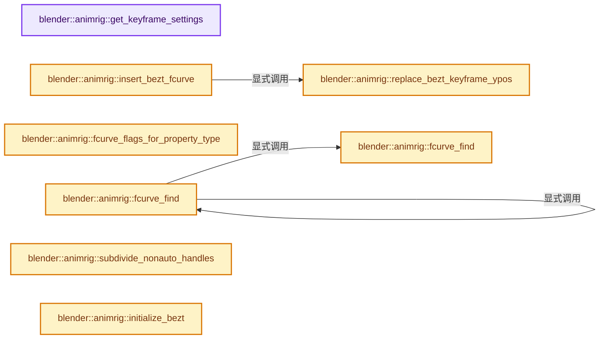
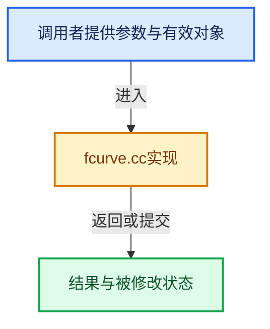

# 实现依赖专题：source/blender/animrig/intern/fcurve.cc

[实现依赖导航](../../../README.md) · [符号索引](../../../../00-课程指南/02-源码与提交索引/符号依赖与实现索引.md)

本专题从正文实际调用进入，集中保存共享实现。函数有稳定锚点，可从调用处直接跳到对应完整函数；递归与互相调用通过回链组织。

## 本文件的实现关系






## 完整成员与函数实现

<a id="f-cbe59150ac9bda40"></a>

### `blender::animrig::get_keyframe_settings`

实现位置：[source/blender/animrig/intern/fcurve.cc](../../../../../../../../source/blender/animrig/intern/fcurve.cc) · L24—L36。

接口参数：

- `const bool from_userprefs`

**教学注释版**

<!-- annotated:81014d9ab1b027 -->

```cpp
KeyframeSettings get_keyframe_settings(const bool from_userprefs)
{
  KeyframeSettings settings = {};
  settings.keyframe_type = BEZT_KEYTYPE_KEYFRAME;
  settings.handle = HD_AUTO_ANIM;
  settings.interpolation = BEZT_IPO_BEZ;

  if (from_userprefs) {
    settings.interpolation = eBezTriple_Interpolation(U.ipo_new);
    settings.handle = eBezTriple_Handle(U.keyhandles_new);
  }
  return settings;
}
```

<details>
<summary>核对原始源码：source/blender/animrig/intern/fcurve.cc · L24—L36</summary>

<!-- original:81014d9ab1b027:source/blender/animrig/intern/fcurve.cc:24:36 -->

```cpp
KeyframeSettings get_keyframe_settings(const bool from_userprefs)
{
  KeyframeSettings settings = {};
  settings.keyframe_type = BEZT_KEYTYPE_KEYFRAME;
  settings.handle = HD_AUTO_ANIM;
  settings.interpolation = BEZT_IPO_BEZ;

  if (from_userprefs) {
    settings.interpolation = eBezTriple_Interpolation(U.ipo_new);
    settings.handle = eBezTriple_Handle(U.keyhandles_new);
  }
  return settings;
}
```

</details>

**沿实际写入检查状态**

- `settings.keyframe_type = BEZT_KEYTYPE_KEYFRAME;`
- `settings.handle = HD_AUTO_ANIM;`
- `settings.interpolation = BEZT_IPO_BEZ;`
- `settings.interpolation = eBezTriple_Interpolation(U.ipo_new);`
- `settings.handle = eBezTriple_Handle(U.keyhandles_new);`

**结果出口**

- `return settings;`

**继续追踪实现**

- `eBezTriple_Interpolation` → [blender::eBezTriple_Interpolation](../../makesdna/DNA_curve_enums.h.md#t-a5e4f38dc92b)。
- `eBezTriple_Handle` → [blender::eBezTriple_Handle](../../../02-BKE几何与数据/BKE_colortools.hh.md#t-4e63e898afb2)；[blender::eBezTriple_Handle](../../makesdna/DNA_curve_enums.h.md#t-8f0057ec722c)。

<a id="f-ecabe596a1be309f"></a>

### `blender::animrig::fcurve_find`

实现位置：[source/blender/animrig/intern/fcurve.cc](../../../../../../../../source/blender/animrig/intern/fcurve.cc) · L38—L49。

接口参数：

- `Span<const FCurve *> fcurves`
- `const FCurveDescriptor &fcurve_descriptor`

**教学注释版**

<!-- annotated:2e39f7af6f729a -->

```cpp
const FCurve *fcurve_find(Span<const FCurve *> fcurves, const FCurveDescriptor &fcurve_descriptor)
{
  for (const FCurve *fcurve : fcurves) {
    /* Check indices first, much cheaper than a string comparison. */
    if (fcurve->array_index == fcurve_descriptor.array_index &&
        fcurve->rna_path() == fcurve_descriptor.rna_path)
    {
      return fcurve;
    }
  }
  return nullptr;
}
```

<details>
<summary>核对原始源码：source/blender/animrig/intern/fcurve.cc · L38—L49</summary>

<!-- original:2e39f7af6f729a:source/blender/animrig/intern/fcurve.cc:38:49 -->

```cpp
const FCurve *fcurve_find(Span<const FCurve *> fcurves, const FCurveDescriptor &fcurve_descriptor)
{
  for (const FCurve *fcurve : fcurves) {
    /* Check indices first, much cheaper than a string comparison. */
    if (fcurve->array_index == fcurve_descriptor.array_index &&
        fcurve->rna_path() == fcurve_descriptor.rna_path)
    {
      return fcurve;
    }
  }
  return nullptr;
}
```

</details>

**结果出口**

- `return fcurve;`
- `return nullptr;`

**继续追踪实现**

- `fcurve->rna_path` → [调用协议](../../../../00-课程指南/01-路线与规范/模板宏与动态分派协议.md)：接收对象类型依赖auto、返回值或模板实例；不按同名猜测目标。调用位置L43。

<a id="f-e5138e0d2254858c"></a>

### `blender::animrig::fcurve_find`

实现位置：[source/blender/animrig/intern/fcurve.cc](../../../../../../../../source/blender/animrig/intern/fcurve.cc) · L50—L54。

接口参数：

- `Span<FCurve *> fcurves`
- `const FCurveDescriptor &fcurve_descriptor`

**教学注释版**

<!-- annotated:2452fffd18c220 -->

```cpp
FCurve *fcurve_find(Span<FCurve *> fcurves, const FCurveDescriptor &fcurve_descriptor)
{
  // [讲解] fcurves.cast<const FCurve *>：按类型与布局约束重新解释视图。
  const FCurve *fcurve = fcurve_find(fcurves.cast<const FCurve *>(), fcurve_descriptor);
  return const_cast<FCurve *>(fcurve);
}
```

<details>
<summary>核对原始源码：source/blender/animrig/intern/fcurve.cc · L50—L54</summary>

<!-- original:2452fffd18c220:source/blender/animrig/intern/fcurve.cc:50:54 -->

```cpp
FCurve *fcurve_find(Span<FCurve *> fcurves, const FCurveDescriptor &fcurve_descriptor)
{
  const FCurve *fcurve = fcurve_find(fcurves.cast<const FCurve *>(), fcurve_descriptor);
  return const_cast<FCurve *>(fcurve);
}
```

</details>

**结果出口**

- `return const_cast<FCurve *>(fcurve);`

**继续追踪实现**

- `fcurve_find` → [blender::animrig::fcurve_find · L38](fcurve.cc.md#f-ecabe596a1be309f)；[blender::animrig::fcurve_find · L50](fcurve.cc.md#f-e5138e0d2254858c)。同名重载需按实参类型选择。
- `fcurves.cast<const FCurve *>` → [blender::Span::cast · L422](../../../../01-基础容器与现代CPP/05-Span只读连续视图.md#f-e082d823028af8f6)。

<a id="f-b6ae2339c7061802"></a>

### `blender::animrig::fcurve_flags_for_property_type`

实现位置：[source/blender/animrig/intern/fcurve.cc](../../../../../../../../source/blender/animrig/intern/fcurve.cc) · L92—L107。

接口参数：

- `const PropertyType prop_type`

**教学注释版**

<!-- annotated:8fb9ce8b87e717 -->

```cpp
eFCurve_Flags fcurve_flags_for_property_type(const PropertyType prop_type)
{
  switch (prop_type) {
    case PROP_FLOAT:
      return eFCurve_Flags{};
    case PROP_INT:
      /* Do integer (only 'whole' numbers) interpolation between all points. */
      return FCURVE_INT_VALUES;
    default:
      /* Do 'discrete' (i.e. enum, boolean values which cannot take any intermediate
       * values at all) interpolation between all points.
       *    - however, we must also ensure that evaluated values are only integers still.
       */
      return FCURVE_DISCRETE_VALUES | FCURVE_INT_VALUES;
  }
}
```

<details>
<summary>核对原始源码：source/blender/animrig/intern/fcurve.cc · L92—L107</summary>

<!-- original:8fb9ce8b87e717:source/blender/animrig/intern/fcurve.cc:92:107 -->

```cpp
eFCurve_Flags fcurve_flags_for_property_type(const PropertyType prop_type)
{
  switch (prop_type) {
    case PROP_FLOAT:
      return eFCurve_Flags{};
    case PROP_INT:
      /* Do integer (only 'whole' numbers) interpolation between all points. */
      return FCURVE_INT_VALUES;
    default:
      /* Do 'discrete' (i.e. enum, boolean values which cannot take any intermediate
       * values at all) interpolation between all points.
       *    - however, we must also ensure that evaluated values are only integers still.
       */
      return FCURVE_DISCRETE_VALUES | FCURVE_INT_VALUES;
  }
}
```

</details>

**结果出口**

- `return eFCurve_Flags{};`
- `return FCURVE_INT_VALUES;`
- `return FCURVE_DISCRETE_VALUES | FCURVE_INT_VALUES;`

**继续追踪实现**

本实现没有需要继续展开的显式调用；检查返回表达式、对象转换和调用者前置条件。

<a id="f-9b1fcbc9165f03f7"></a>

### `blender::animrig::replace_bezt_keyframe_ypos`

实现位置：[source/blender/animrig/intern/fcurve.cc](../../../../../../../../source/blender/animrig/intern/fcurve.cc) · L148—L163。

接口参数：

- `BezTriple *dst`
- `const BezTriple *bezt`

**教学注释版**

<!-- annotated:193a4f83310458 -->

```cpp
static void replace_bezt_keyframe_ypos(BezTriple *dst, const BezTriple *bezt)
{
  /* Just change the values when replacing, so as to not overwrite handles. */
  float dy = bezt->vec[1][1] - dst->vec[1][1];

  /* Just apply delta value change to the handle values. */
  dst->vec[0][1] += dy;
  dst->vec[1][1] += dy;
  dst->vec[2][1] += dy;

  dst->f1 = bezt->f1;
  dst->f2 = bezt->f2;
  dst->f3 = bezt->f3;

  /* TODO: perform some other operations? */
}
```

<details>
<summary>核对原始源码：source/blender/animrig/intern/fcurve.cc · L148—L163</summary>

<!-- original:193a4f83310458:source/blender/animrig/intern/fcurve.cc:148:163 -->

```cpp
static void replace_bezt_keyframe_ypos(BezTriple *dst, const BezTriple *bezt)
{
  /* Just change the values when replacing, so as to not overwrite handles. */
  float dy = bezt->vec[1][1] - dst->vec[1][1];

  /* Just apply delta value change to the handle values. */
  dst->vec[0][1] += dy;
  dst->vec[1][1] += dy;
  dst->vec[2][1] += dy;

  dst->f1 = bezt->f1;
  dst->f2 = bezt->f2;
  dst->f3 = bezt->f3;

  /* TODO: perform some other operations? */
}
```

</details>

**沿实际写入检查状态**

- `dst->vec[0][1] += dy;`
- `dst->vec[1][1] += dy;`
- `dst->vec[2][1] += dy;`
- `dst->f1 = bezt->f1;`
- `dst->f2 = bezt->f2;`
- `dst->f3 = bezt->f3;`

**继续追踪实现**

本实现没有需要继续展开的显式调用；检查返回表达式、对象转换和调用者前置条件。

<a id="f-f6dfd673b1166a0e"></a>

### `blender::animrig::insert_bezt_fcurve`

实现位置：[source/blender/animrig/intern/fcurve.cc](../../../../../../../../source/blender/animrig/intern/fcurve.cc) · L165—L246。

接口参数：

- `FCurve *fcu`
- `const BezTriple *bezt`
- `eInsertKeyFlags flag`

**教学注释版**

<!-- annotated:1d9bea1658c900 -->

```cpp
int insert_bezt_fcurve(FCurve *fcu, const BezTriple *bezt, eInsertKeyFlags flag)
{
  int i = 0;

  /* Are there already keyframes? */
  if (fcu->bezt) {
    bool replace;
    i = BKE_fcurve_bezt_binarysearch_index(fcu->bezt, bezt->vec[1][0], fcu->totvert, &replace);

    /* Replace an existing keyframe? */
    if (replace) {
      /* `i` may in rare cases exceed array bounds. */
      if ((i >= 0) && (i < fcu->totvert)) {
        if (flag & INSERTKEY_OVERWRITE_FULL) {
          fcu->bezt[i] = *bezt;
        }
        else {
          replace_bezt_keyframe_ypos(&fcu->bezt[i], bezt);
        }

        if (flag & INSERTKEY_CYCLE_AWARE) {
          /* If replacing an end point of a cyclic curve without offset,
           * modify the other end too. */
          if (ELEM(i, 0, fcu->totvert - 1) && BKE_fcurve_get_cycle_type(*fcu) == FCU_CYCLE_PERFECT)
          {
            replace_bezt_keyframe_ypos(&fcu->bezt[i == 0 ? fcu->totvert - 1 : 0], bezt);
          }
        }
      }
    }
    /* Keyframing modes allow not replacing the keyframe. */
    else if ((flag & INSERTKEY_REPLACE) == 0) {
      /* Insert new - if we're not restricted to replacing keyframes only. */
      BezTriple *newb = MEM_new_array_zeroed<BezTriple>(fcu->totvert + 1, "beztriple");

      /* Add the beztriples that should occur before the beztriple to be pasted
       * (originally in fcu). */
      if (i > 0) {
        // [讲解] memcpy：复制字节，源与目标不应重叠。类型生命周期、对齐和可复制表示须由调用者证明，不是任意对象的复制构造。
        memcpy(newb, fcu->bezt, i * sizeof(BezTriple));
      }

      /* Add beztriple to paste at index i. */
      *(newb + i) = *bezt;

      /* Add the beztriples that occur after the beztriple to be pasted (originally in fcu). */
      if (i < fcu->totvert) {
        memcpy(newb + i + 1, fcu->bezt + i, (fcu->totvert - i) * sizeof(BezTriple));
      }

      /* Replace (+ free) old with new, only if necessary to do so. */
      MEM_delete(fcu->bezt);
      fcu->bezt = newb;

      fcu->totvert++;
    }
    else {
      return -1;
    }
  }
  /* No keyframes yet, but can only add if...
   * 1) keyframing modes say that keyframes can only be replaced, so adding new ones won't know
   * 2) there are no samples on the curve
   *    NOTE: maybe we may want to allow this later when doing samples -> bezt conversions,
   *    but for now, having both is asking for trouble
   */
  else if ((flag & INSERTKEY_REPLACE) == 0 && (fcu->fpt == nullptr)) {
    /* Create new keyframes array. */
    fcu->bezt = MEM_new_zeroed<BezTriple>("beztriple");
    *(fcu->bezt) = *bezt;
    fcu->totvert = 1;
  }
  /* Cannot add anything. */
  else {
    /* Return error code -1 to prevent any misunderstandings. */
    return -1;
  }

  /* We need to return the index, so that some tools which do post-processing can
   * detect where we added the BezTriple in the array.
   */
  return i;
}
```

<details>
<summary>核对原始源码：source/blender/animrig/intern/fcurve.cc · L165—L246</summary>

<!-- original:1d9bea1658c900:source/blender/animrig/intern/fcurve.cc:165:246 -->

```cpp
int insert_bezt_fcurve(FCurve *fcu, const BezTriple *bezt, eInsertKeyFlags flag)
{
  int i = 0;

  /* Are there already keyframes? */
  if (fcu->bezt) {
    bool replace;
    i = BKE_fcurve_bezt_binarysearch_index(fcu->bezt, bezt->vec[1][0], fcu->totvert, &replace);

    /* Replace an existing keyframe? */
    if (replace) {
      /* `i` may in rare cases exceed array bounds. */
      if ((i >= 0) && (i < fcu->totvert)) {
        if (flag & INSERTKEY_OVERWRITE_FULL) {
          fcu->bezt[i] = *bezt;
        }
        else {
          replace_bezt_keyframe_ypos(&fcu->bezt[i], bezt);
        }

        if (flag & INSERTKEY_CYCLE_AWARE) {
          /* If replacing an end point of a cyclic curve without offset,
           * modify the other end too. */
          if (ELEM(i, 0, fcu->totvert - 1) && BKE_fcurve_get_cycle_type(*fcu) == FCU_CYCLE_PERFECT)
          {
            replace_bezt_keyframe_ypos(&fcu->bezt[i == 0 ? fcu->totvert - 1 : 0], bezt);
          }
        }
      }
    }
    /* Keyframing modes allow not replacing the keyframe. */
    else if ((flag & INSERTKEY_REPLACE) == 0) {
      /* Insert new - if we're not restricted to replacing keyframes only. */
      BezTriple *newb = MEM_new_array_zeroed<BezTriple>(fcu->totvert + 1, "beztriple");

      /* Add the beztriples that should occur before the beztriple to be pasted
       * (originally in fcu). */
      if (i > 0) {
        memcpy(newb, fcu->bezt, i * sizeof(BezTriple));
      }

      /* Add beztriple to paste at index i. */
      *(newb + i) = *bezt;

      /* Add the beztriples that occur after the beztriple to be pasted (originally in fcu). */
      if (i < fcu->totvert) {
        memcpy(newb + i + 1, fcu->bezt + i, (fcu->totvert - i) * sizeof(BezTriple));
      }

      /* Replace (+ free) old with new, only if necessary to do so. */
      MEM_delete(fcu->bezt);
      fcu->bezt = newb;

      fcu->totvert++;
    }
    else {
      return -1;
    }
  }
  /* No keyframes yet, but can only add if...
   * 1) keyframing modes say that keyframes can only be replaced, so adding new ones won't know
   * 2) there are no samples on the curve
   *    NOTE: maybe we may want to allow this later when doing samples -> bezt conversions,
   *    but for now, having both is asking for trouble
   */
  else if ((flag & INSERTKEY_REPLACE) == 0 && (fcu->fpt == nullptr)) {
    /* Create new keyframes array. */
    fcu->bezt = MEM_new_zeroed<BezTriple>("beztriple");
    *(fcu->bezt) = *bezt;
    fcu->totvert = 1;
  }
  /* Cannot add anything. */
  else {
    /* Return error code -1 to prevent any misunderstandings. */
    return -1;
  }

  /* We need to return the index, so that some tools which do post-processing can
   * detect where we added the BezTriple in the array.
   */
  return i;
}
```

</details>

**沿实际写入检查状态**

- `i = BKE_fcurve_bezt_binarysearch_index(fcu->bezt, bezt->vec[1][0], fcu->totvert, &replace);`
- `fcu->bezt[i] = *bezt;`
- `fcu->bezt = newb;`
- `fcu->bezt = MEM_new_zeroed<BezTriple>("beztriple");`
- `fcu->totvert = 1;`

**结果出口**

- `return -1;`
- `return i;`

**继续追踪实现**

- `BKE_fcurve_bezt_binarysearch_index` → [blender::BKE_fcurve_bezt_binarysearch_index · L534](../../../02-BKE几何与数据/intern/fcurve.cc.md#f-27878b888b41addc)。
- `replace_bezt_keyframe_ypos` → [blender::animrig::replace_bezt_keyframe_ypos · L148](fcurve.cc.md#f-9b1fcbc9165f03f7)。
- `ELEM` → [ELEM · L88](../../../07-Intern运行时与平台/ghost/intern/GHOST_utildefines.hh.md#m-d28724a15928)；[ELEM · L135](../../../01-BLI基础库/BLI_utildefines.hh.md#m-d6572de7cae0)。宏定义由构建条件选择。
- `BKE_fcurve_get_cycle_type` → [blender::BKE_fcurve_get_cycle_type · L1116](../../../02-BKE几何与数据/intern/fcurve.cc.md#f-e343e77a8f3f8b44)。
- `MEM_new_array_zeroed<BezTriple>` → [MEM_new_array_zeroed · L566](../../../07-Intern运行时与平台/guardedalloc/MEM_guardedalloc.h.md#f-3a0cf63fb5216500)；[MEM_new_array_zeroed · L119](../../../07-Intern运行时与平台/guardedalloc/intern/mallocn.cc.md#f-6825557da566fdbe)。同名重载需按实参类型选择。
- `memcpy` → [外部契约](https://eel.is/c++draft/cstring.syn)：复制字节，源与目标不应重叠。类型生命周期、对齐和可复制表示须由调用者证明，不是任意对象的复制构造。
- `MEM_delete` → [MEM_delete · L400](../../../07-Intern运行时与平台/guardedalloc/MEM_guardedalloc.h.md#f-9049ffdd1682887c)。
- `MEM_new_zeroed<BezTriple>` → [MEM_new_zeroed · L550](../../../07-Intern运行时与平台/guardedalloc/MEM_guardedalloc.h.md#f-eeb1e2a7f57dd231)；[MEM_new_zeroed · L114](../../../07-Intern运行时与平台/guardedalloc/intern/mallocn.cc.md#f-e04cf01c64c8b180)。同名重载需按实参类型选择。

<a id="f-23ac9971bc879359"></a>

### `blender::animrig::subdivide_nonauto_handles`

实现位置：[source/blender/animrig/intern/fcurve.cc](../../../../../../../../source/blender/animrig/intern/fcurve.cc) · L258—L298。

接口参数：

- `const FCurve *fcu`
- `BezTriple *bezt`
- `BezTriple *prev`
- `BezTriple *next`

**教学注释版**

<!-- annotated:0de97b10653c0f -->

```cpp
static void subdivide_nonauto_handles(const FCurve *fcu,
                                      BezTriple *bezt,
                                      BezTriple *prev,
                                      BezTriple *next)
{
  if (prev->ipo != BEZT_IPO_BEZ || bezt->ipo != BEZT_IPO_BEZ) {
    return;
  }

  /* Don't change Vector handles, or completely auto regions. */
  const bool bezt_auto = BEZT_IS_AUTOH(bezt) || (bezt->h1 == HD_VECT && bezt->h2 == HD_VECT);
  const bool prev_auto = BEZT_IS_AUTOH(prev) || (prev->h2 == HD_VECT);
  const bool next_auto = BEZT_IS_AUTOH(next) || (next->h1 == HD_VECT);
  if (bezt_auto && prev_auto && next_auto) {
    return;
  }

  /* Subdivide the curve. */
  float delta;
  if (!BKE_fcurve_bezt_subdivide_handles(bezt, prev, next, &delta)) {
    return;
  }

  /* Decide when to force auto to manual. */
  if (!BEZT_IS_AUTOH(bezt)) {
    return;
  }
  if ((prev_auto || next_auto) && fcu->auto_smoothing == FCURVE_SMOOTH_CONT_ACCEL) {
    const float hx = bezt->vec[1][0] - bezt->vec[0][0];
    const float dx = bezt->vec[1][0] - prev->vec[1][0];

    /* This mode always uses 1/3 of key distance for handle x size. */
    const bool auto_works_well = fabsf(hx - dx / 3.0f) < 0.001f;
    if (auto_works_well) {
      return;
    }
  }

  /* Turn off auto mode. */
  bezt->h1 = bezt->h2 = HD_ALIGN;
}
```

<details>
<summary>核对原始源码：source/blender/animrig/intern/fcurve.cc · L258—L298</summary>

<!-- original:0de97b10653c0f:source/blender/animrig/intern/fcurve.cc:258:298 -->

```cpp
static void subdivide_nonauto_handles(const FCurve *fcu,
                                      BezTriple *bezt,
                                      BezTriple *prev,
                                      BezTriple *next)
{
  if (prev->ipo != BEZT_IPO_BEZ || bezt->ipo != BEZT_IPO_BEZ) {
    return;
  }

  /* Don't change Vector handles, or completely auto regions. */
  const bool bezt_auto = BEZT_IS_AUTOH(bezt) || (bezt->h1 == HD_VECT && bezt->h2 == HD_VECT);
  const bool prev_auto = BEZT_IS_AUTOH(prev) || (prev->h2 == HD_VECT);
  const bool next_auto = BEZT_IS_AUTOH(next) || (next->h1 == HD_VECT);
  if (bezt_auto && prev_auto && next_auto) {
    return;
  }

  /* Subdivide the curve. */
  float delta;
  if (!BKE_fcurve_bezt_subdivide_handles(bezt, prev, next, &delta)) {
    return;
  }

  /* Decide when to force auto to manual. */
  if (!BEZT_IS_AUTOH(bezt)) {
    return;
  }
  if ((prev_auto || next_auto) && fcu->auto_smoothing == FCURVE_SMOOTH_CONT_ACCEL) {
    const float hx = bezt->vec[1][0] - bezt->vec[0][0];
    const float dx = bezt->vec[1][0] - prev->vec[1][0];

    /* This mode always uses 1/3 of key distance for handle x size. */
    const bool auto_works_well = fabsf(hx - dx / 3.0f) < 0.001f;
    if (auto_works_well) {
      return;
    }
  }

  /* Turn off auto mode. */
  bezt->h1 = bezt->h2 = HD_ALIGN;
}
```

</details>

**沿实际写入检查状态**

- `bezt->h1 = bezt->h2 = HD_ALIGN;`

**继续追踪实现**

- `BEZT_IS_AUTOH` → [BEZT_IS_AUTOH · L427](../../makesdna/DNA_curve_types.h.md#m-49d7b808c90b)。宏定义由构建条件选择。
- `BKE_fcurve_bezt_subdivide_handles` → [blender::BKE_fcurve_bezt_subdivide_handles · L1596](../../../02-BKE几何与数据/intern/fcurve.cc.md#f-eb3a64d7e9e3bec0)。
- `fabsf` → [fabsf · L21](../../../07-Intern运行时与平台/cycles/kernel/svm/radial_tiling_shared.h.md#m-02cc4c69cfb3)；[fabsf · L43](../../../07-Intern运行时与平台/cycles/kernel/svm/radial_tiling_shared.h.md#m-04effe61803b)；[fabsf · L74](../../../07-Intern运行时与平台/cycles/kernel/svm/radial_tiling_shared.h.md#m-927dd4eba7dc)；[fabsf · L25](../../../01-BLI基础库/intern/radial_tiling_shared.hh.md#m-8348d6b3d08f)；[fabsf · L47](../../../01-BLI基础库/intern/radial_tiling_shared.hh.md#m-13b7e0b6d84f)；[fabsf · L78](../../../01-BLI基础库/intern/radial_tiling_shared.hh.md#m-326c83464a0d)；[fabsf · L21](../../../07-Intern运行时与平台/cycles/kernel/osl/shaders/node_radial_tiling_shared.h.md#m-7c3ee12fc119)；[fabsf · L43](../../../07-Intern运行时与平台/cycles/kernel/osl/shaders/node_radial_tiling_shared.h.md#m-9112db0e2dd1)；[fabsf · L74](../../../07-Intern运行时与平台/cycles/kernel/osl/shaders/node_radial_tiling_shared.h.md#m-ee4e61908a6f)；[fabsf · L167](../../../07-Intern运行时与平台/cycles/kernel/device/oneapi/compat.h.md#m-b039ee6c1601)；[fabsf · L265](../../../07-Intern运行时与平台/cycles/kernel/device/metal/compat.h.md#m-6b21869e9f3f)。宏定义由构建条件选择。

<a id="f-148d7fe89f5e41a8"></a>

### `blender::animrig::initialize_bezt`

实现位置：[source/blender/animrig/intern/fcurve.cc](../../../../../../../../source/blender/animrig/intern/fcurve.cc) · L300—L345。

接口参数：

- `BezTriple *beztr`
- `const float2 position`
- `const KeyframeSettings &settings`
- `const eFCurve_Flags fcu_flags`

**教学注释版**

<!-- annotated:61fd6c2dcfca7a -->

```cpp
void initialize_bezt(BezTriple *beztr,
                     const float2 position,
                     const KeyframeSettings &settings,
                     const eFCurve_Flags fcu_flags)
{
  /* Set all three points, for nicer start position.
   * NOTE: +/- 1 on vec.x for left and right handles is so that 'free' handles work ok...
   */
  beztr->vec[0][0] = position.x - 1.0f;
  beztr->vec[0][1] = position.y;
  beztr->vec[1][0] = position.x;
  beztr->vec[1][1] = position.y;
  beztr->vec[2][0] = position.x + 1.0f;
  beztr->vec[2][1] = position.y;
  beztr->f1 = beztr->f2 = beztr->f3 = BEZT_FLAG_SELECT;

  beztr->h1 = beztr->h2 = settings.handle;
  beztr->ipo = settings.interpolation;

  /* Interpolation type used is constrained by the type of values the curve can take. */
  if (fcu_flags & FCURVE_DISCRETE_VALUES) {
    beztr->ipo = BEZT_IPO_CONST;
  }
  else if ((beztr->ipo == BEZT_IPO_BEZ) && (fcu_flags & FCURVE_INT_VALUES)) {
    beztr->ipo = BEZT_IPO_LIN;
  }

  /* Set keyframe type value (supplied),
   * which should come from the scene settings in most cases. */
  BEZKEYTYPE_LVALUE(beztr) = settings.keyframe_type;

  /* Set default values for "easing" interpolation mode settings.
   * NOTE: Even if these modes aren't currently used, if users switch
   *       to these later, we want these to work in a sane way out of
   *       the box.
   */

  /* "back" easing - This value used to be used when overshoot=0, but that
   *                 introduced discontinuities in how the param worked. */
  beztr->back = 1.70158f;

  /* "elastic" easing - Values here were hand-optimized for a default duration of
   *                    ~10 frames (typical motion-graph motion length). */
  beztr->amplitude = 0.8f;
  beztr->period = 4.1f;
}
```

<details>
<summary>核对原始源码：source/blender/animrig/intern/fcurve.cc · L300—L345</summary>

<!-- original:61fd6c2dcfca7a:source/blender/animrig/intern/fcurve.cc:300:345 -->

```cpp
void initialize_bezt(BezTriple *beztr,
                     const float2 position,
                     const KeyframeSettings &settings,
                     const eFCurve_Flags fcu_flags)
{
  /* Set all three points, for nicer start position.
   * NOTE: +/- 1 on vec.x for left and right handles is so that 'free' handles work ok...
   */
  beztr->vec[0][0] = position.x - 1.0f;
  beztr->vec[0][1] = position.y;
  beztr->vec[1][0] = position.x;
  beztr->vec[1][1] = position.y;
  beztr->vec[2][0] = position.x + 1.0f;
  beztr->vec[2][1] = position.y;
  beztr->f1 = beztr->f2 = beztr->f3 = BEZT_FLAG_SELECT;

  beztr->h1 = beztr->h2 = settings.handle;
  beztr->ipo = settings.interpolation;

  /* Interpolation type used is constrained by the type of values the curve can take. */
  if (fcu_flags & FCURVE_DISCRETE_VALUES) {
    beztr->ipo = BEZT_IPO_CONST;
  }
  else if ((beztr->ipo == BEZT_IPO_BEZ) && (fcu_flags & FCURVE_INT_VALUES)) {
    beztr->ipo = BEZT_IPO_LIN;
  }

  /* Set keyframe type value (supplied),
   * which should come from the scene settings in most cases. */
  BEZKEYTYPE_LVALUE(beztr) = settings.keyframe_type;

  /* Set default values for "easing" interpolation mode settings.
   * NOTE: Even if these modes aren't currently used, if users switch
   *       to these later, we want these to work in a sane way out of
   *       the box.
   */

  /* "back" easing - This value used to be used when overshoot=0, but that
   *                 introduced discontinuities in how the param worked. */
  beztr->back = 1.70158f;

  /* "elastic" easing - Values here were hand-optimized for a default duration of
   *                    ~10 frames (typical motion-graph motion length). */
  beztr->amplitude = 0.8f;
  beztr->period = 4.1f;
}
```

</details>

**沿实际写入检查状态**

- `beztr->vec[0][0] = position.x - 1.0f;`
- `beztr->vec[0][1] = position.y;`
- `beztr->vec[1][0] = position.x;`
- `beztr->vec[1][1] = position.y;`
- `beztr->vec[2][0] = position.x + 1.0f;`
- `beztr->vec[2][1] = position.y;`
- `beztr->f1 = beztr->f2 = beztr->f3 = BEZT_FLAG_SELECT;`
- `beztr->h1 = beztr->h2 = settings.handle;`
- `beztr->ipo = settings.interpolation;`
- `beztr->ipo = BEZT_IPO_CONST;`
- `beztr->ipo = BEZT_IPO_LIN;`
- `beztr->back = 1.70158f;`
- `beztr->amplitude = 0.8f;`
- `beztr->period = 4.1f;`

**继续追踪实现**

- `BEZKEYTYPE_LVALUE` → [BEZKEYTYPE_LVALUE · L124](../../makesdna/DNA_curve_types.h.md#m-bbbfde5b4afa)。宏定义由构建条件选择。

<a id="f-7cd875d3f84aa8e2"></a>

### `blender::animrig::new_key_needed`

实现位置：[source/blender/animrig/intern/fcurve.cc](../../../../../../../../source/blender/animrig/intern/fcurve.cc) · L362—L385。

接口参数：

- `const FCurve &fcu`
- `const float frame`
- `const float value`

**教学注释版**

<!-- annotated:bba288ad31e8a5 -->

```cpp
static bool new_key_needed(const FCurve &fcu, const float frame, const float value)
{
  if (fcu.totvert == 0) {
    return true;
  }

  bool replace;
  const int bezt_index = BKE_fcurve_bezt_binarysearch_index(
      fcu.bezt, frame, fcu.totvert, &replace);

  if (replace) {
    /* If there is already a key, we only need to modify it if the proposed value is different. */
    return fcu.bezt[bezt_index].vec[1][1] != value;
  }

  const int diff_ulp = 32;
  const float fcu_eval = evaluate_fcurve(&fcu, frame);
  /* No need to insert a key if the same value is already the value of the FCurve at that point. */
  if (compare_ff_relative(fcu_eval, value, FLT_EPSILON, diff_ulp)) {
    return false;
  }

  return true;
}
```

<details>
<summary>核对原始源码：source/blender/animrig/intern/fcurve.cc · L362—L385</summary>

<!-- original:bba288ad31e8a5:source/blender/animrig/intern/fcurve.cc:362:385 -->

```cpp
static bool new_key_needed(const FCurve &fcu, const float frame, const float value)
{
  if (fcu.totvert == 0) {
    return true;
  }

  bool replace;
  const int bezt_index = BKE_fcurve_bezt_binarysearch_index(
      fcu.bezt, frame, fcu.totvert, &replace);

  if (replace) {
    /* If there is already a key, we only need to modify it if the proposed value is different. */
    return fcu.bezt[bezt_index].vec[1][1] != value;
  }

  const int diff_ulp = 32;
  const float fcu_eval = evaluate_fcurve(&fcu, frame);
  /* No need to insert a key if the same value is already the value of the FCurve at that point. */
  if (compare_ff_relative(fcu_eval, value, FLT_EPSILON, diff_ulp)) {
    return false;
  }

  return true;
}
```

</details>

**结果出口**

- `return true;`
- `return fcu.bezt[bezt_index].vec[1][1] != value;`
- `return false;`

**继续追踪实现**

- `BKE_fcurve_bezt_binarysearch_index` → [blender::BKE_fcurve_bezt_binarysearch_index · L534](../../../02-BKE几何与数据/intern/fcurve.cc.md#f-27878b888b41addc)。
- `evaluate_fcurve` → [blender::evaluate_fcurve · L2416](../../../02-BKE几何与数据/intern/fcurve.cc.md#f-83388654bf008ed3)。
- `compare_ff_relative` → [blender::compare_ff_relative · L452](../../../01-BLI基础库/intern/math_base_inline.cc.md#f-5b29e5b24e8dd45d)。

<a id="f-4cdf92c06e19701e"></a>

### `blender::animrig::remap_cyclic_keyframe_location`

实现位置：[source/blender/animrig/intern/fcurve.cc](../../../../../../../../source/blender/animrig/intern/fcurve.cc) · L391—L427。

接口参数：

- `const FCurve &fcu`
- `const eFCU_Cycle_Type type`
- `float2 position`

**教学注释版**

<!-- annotated:55ad607def4c3b -->

```cpp
static float2 remap_cyclic_keyframe_location(const FCurve &fcu,
                                             const eFCU_Cycle_Type type,
                                             float2 position)
{
  if (fcu.totvert < 2 || !fcu.bezt) {
    return position;
  }

  if (type == FCU_CYCLE_NONE) {
    return position;
  }

  BezTriple *first = &fcu.bezt[0], *last = &fcu.bezt[fcu.totvert - 1];
  const float start = first->vec[1][0], end = last->vec[1][0];

  if (start >= end) {
    return position;
  }

  if (position.x < start || position.x > end) {
    const float period = end - start;
    const float step = floorf((position.x - start) / period);
    position.x -= step * period;

    if (type == FCU_CYCLE_OFFSET) {
      /* Nasty check to handle the case when the modes are different better. */
      FMod_Cycles *data = static_cast<FMod_Cycles *>(fcu.modifiers.first()->data);
      short mode = (step >= 0) ? data->after_mode : data->before_mode;

      if (mode == FCM_EXTRAPOLATE_CYCLIC_OFFSET) {
        position.y -= step * (last->vec[1][1] - first->vec[1][1]);
      }
    }
  }

  return position;
}
```

<details>
<summary>核对原始源码：source/blender/animrig/intern/fcurve.cc · L391—L427</summary>

<!-- original:55ad607def4c3b:source/blender/animrig/intern/fcurve.cc:391:427 -->

```cpp
static float2 remap_cyclic_keyframe_location(const FCurve &fcu,
                                             const eFCU_Cycle_Type type,
                                             float2 position)
{
  if (fcu.totvert < 2 || !fcu.bezt) {
    return position;
  }

  if (type == FCU_CYCLE_NONE) {
    return position;
  }

  BezTriple *first = &fcu.bezt[0], *last = &fcu.bezt[fcu.totvert - 1];
  const float start = first->vec[1][0], end = last->vec[1][0];

  if (start >= end) {
    return position;
  }

  if (position.x < start || position.x > end) {
    const float period = end - start;
    const float step = floorf((position.x - start) / period);
    position.x -= step * period;

    if (type == FCU_CYCLE_OFFSET) {
      /* Nasty check to handle the case when the modes are different better. */
      FMod_Cycles *data = static_cast<FMod_Cycles *>(fcu.modifiers.first()->data);
      short mode = (step >= 0) ? data->after_mode : data->before_mode;

      if (mode == FCM_EXTRAPOLATE_CYCLIC_OFFSET) {
        position.y -= step * (last->vec[1][1] - first->vec[1][1]);
      }
    }
  }

  return position;
}
```

</details>

**沿实际写入检查状态**

- `position.x -= step * period;`
- `position.y -= step * (last->vec[1][1] - first->vec[1][1]);`

**结果出口**

- `return position;`

**继续追踪实现**

- `floorf` → [floorf · L22](../../../07-Intern运行时与平台/cycles/kernel/svm/radial_tiling_shared.h.md#m-fb64dda1b0f0)；[floorf · L44](../../../07-Intern运行时与平台/cycles/kernel/svm/radial_tiling_shared.h.md#m-25e4a157b53d)；[floorf · L75](../../../07-Intern运行时与平台/cycles/kernel/svm/radial_tiling_shared.h.md#m-e128f662cbe8)；[floorf · L26](../../../01-BLI基础库/intern/radial_tiling_shared.hh.md#m-ebadf845d492)；[floorf · L48](../../../01-BLI基础库/intern/radial_tiling_shared.hh.md#m-efe0b148573a)；[floorf · L79](../../../01-BLI基础库/intern/radial_tiling_shared.hh.md#m-9df2f26758e8)；[floorf · L22](../../../07-Intern运行时与平台/cycles/kernel/osl/shaders/node_radial_tiling_shared.h.md#m-6b2e29ad4b19)；[floorf · L44](../../../07-Intern运行时与平台/cycles/kernel/osl/shaders/node_radial_tiling_shared.h.md#m-f90222d9b445)；[floorf · L75](../../../07-Intern运行时与平台/cycles/kernel/osl/shaders/node_radial_tiling_shared.h.md#m-938380992bb5)；[floorf · L172](../../../07-Intern运行时与平台/cycles/kernel/device/oneapi/compat.h.md#m-176475a253a6)；[floorf · L270](../../../07-Intern运行时与平台/cycles/kernel/device/metal/compat.h.md#m-fb37dbc77698)；[floorf · L49](../../gpu/GPU_shader_shared_utils.hh.md#m-e7115fdd7560)；[floorf · L70](../../gpu/GPU_shader_shared_utils.hh.md#m-aee5f6a438e4)。宏定义由构建条件选择。
- `fcu.modifiers.first` → [调用协议](../../../../00-课程指南/01-路线与规范/模板宏与动态分派协议.md)：接收对象类型依赖auto、返回值或模板实例；不按同名猜测目标。调用位置L417。

<a id="f-a351350fc31f7517"></a>

### `blender::animrig::insert_vert_fcurve`

实现位置：[source/blender/animrig/intern/fcurve.cc](../../../../../../../../source/blender/animrig/intern/fcurve.cc) · L429—L502。

接口参数：

- `FCurve *fcu`
- `const float2 position`
- `const KeyframeSettings &settings`
- `eInsertKeyFlags flag`

**教学注释版**

<!-- annotated:f0df0189a8e717 -->

```cpp
SingleKeyingResult insert_vert_fcurve(FCurve *fcu,
                                      const float2 position,
                                      const KeyframeSettings &settings,
                                      eInsertKeyFlags flag)
{
  BLI_assert(fcu != nullptr);

  float2 remapped_position = position;
  /* Adjust coordinates for cycle aware insertion. */
  if (flag & INSERTKEY_CYCLE_AWARE) {
    eFCU_Cycle_Type type = BKE_fcurve_get_cycle_type(*fcu);
    remapped_position = remap_cyclic_keyframe_location(*fcu, type, position);
    if (type != FCU_CYCLE_PERFECT) {
      /* Inhibit action from insert_bezt_fcurve unless it's a perfect cycle. */
      flag &= ~INSERTKEY_CYCLE_AWARE;
    }
  }

  if ((flag & INSERTKEY_NEEDED) && !new_key_needed(*fcu, remapped_position.x, remapped_position.y))
  {
    return SingleKeyingResult::NO_KEY_NEEDED;
  }

  BezTriple beztr = {{{0}}};
  initialize_bezt(&beztr, remapped_position, settings, eFCurve_Flags(fcu->flag));

  uint oldTot = fcu->totvert;
  int a;

  /* Add temp beztriple to keyframes. */
  a = insert_bezt_fcurve(fcu, &beztr, flag);
  BKE_fcurve_active_keyframe_set(fcu, &fcu->bezt[a]);

  /* Key insertion failed. */
  if (a < 0) {
    /* TODO: we need more info from `insert_bezt_fcurve()` called above to
     * return a more specific failure. */
    return SingleKeyingResult::UNKNOWN_FAILURE;
  }

  /* Set handle-type and interpolation. */
  if ((fcu->totvert > 2) && (flag & INSERTKEY_REPLACE) == 0) {
    BezTriple *bezt = (fcu->bezt + a);

    /* Set interpolation from previous (if available),
     * but only if we didn't just replace some keyframe:
     * - Replacement is indicated by no-change in number of verts.
     * - When replacing, the user may have specified some interpolation that should be kept.
     */
    if (fcu->totvert > oldTot) {
      if (a > 0) {
        bezt->ipo = (bezt - 1)->ipo;
      }
      else if (a < fcu->totvert - 1) {
        bezt->ipo = (bezt + 1)->ipo;
      }

      if (0 < a && a < (fcu->totvert - 1) && (flag & INSERTKEY_OVERWRITE_FULL) == 0) {
        subdivide_nonauto_handles(fcu, bezt, bezt - 1, bezt + 1);
      }
    }
  }

  /* Don't recalculate handles if fast is set.
   * - this is a hack to make importers faster
   * - we may calculate twice (due to auto-handle needing to be calculated twice)
   */
  if ((flag & INSERTKEY_FAST) == 0) {
    BKE_fcurve_handles_recalc(*fcu);
  }

  /* Return the index at which the keyframe was added. */
  return SingleKeyingResult::SUCCESS;
}
```

<details>
<summary>核对原始源码：source/blender/animrig/intern/fcurve.cc · L429—L502</summary>

<!-- original:f0df0189a8e717:source/blender/animrig/intern/fcurve.cc:429:502 -->

```cpp
SingleKeyingResult insert_vert_fcurve(FCurve *fcu,
                                      const float2 position,
                                      const KeyframeSettings &settings,
                                      eInsertKeyFlags flag)
{
  BLI_assert(fcu != nullptr);

  float2 remapped_position = position;
  /* Adjust coordinates for cycle aware insertion. */
  if (flag & INSERTKEY_CYCLE_AWARE) {
    eFCU_Cycle_Type type = BKE_fcurve_get_cycle_type(*fcu);
    remapped_position = remap_cyclic_keyframe_location(*fcu, type, position);
    if (type != FCU_CYCLE_PERFECT) {
      /* Inhibit action from insert_bezt_fcurve unless it's a perfect cycle. */
      flag &= ~INSERTKEY_CYCLE_AWARE;
    }
  }

  if ((flag & INSERTKEY_NEEDED) && !new_key_needed(*fcu, remapped_position.x, remapped_position.y))
  {
    return SingleKeyingResult::NO_KEY_NEEDED;
  }

  BezTriple beztr = {{{0}}};
  initialize_bezt(&beztr, remapped_position, settings, eFCurve_Flags(fcu->flag));

  uint oldTot = fcu->totvert;
  int a;

  /* Add temp beztriple to keyframes. */
  a = insert_bezt_fcurve(fcu, &beztr, flag);
  BKE_fcurve_active_keyframe_set(fcu, &fcu->bezt[a]);

  /* Key insertion failed. */
  if (a < 0) {
    /* TODO: we need more info from `insert_bezt_fcurve()` called above to
     * return a more specific failure. */
    return SingleKeyingResult::UNKNOWN_FAILURE;
  }

  /* Set handle-type and interpolation. */
  if ((fcu->totvert > 2) && (flag & INSERTKEY_REPLACE) == 0) {
    BezTriple *bezt = (fcu->bezt + a);

    /* Set interpolation from previous (if available),
     * but only if we didn't just replace some keyframe:
     * - Replacement is indicated by no-change in number of verts.
     * - When replacing, the user may have specified some interpolation that should be kept.
     */
    if (fcu->totvert > oldTot) {
      if (a > 0) {
        bezt->ipo = (bezt - 1)->ipo;
      }
      else if (a < fcu->totvert - 1) {
        bezt->ipo = (bezt + 1)->ipo;
      }

      if (0 < a && a < (fcu->totvert - 1) && (flag & INSERTKEY_OVERWRITE_FULL) == 0) {
        subdivide_nonauto_handles(fcu, bezt, bezt - 1, bezt + 1);
      }
    }
  }

  /* Don't recalculate handles if fast is set.
   * - this is a hack to make importers faster
   * - we may calculate twice (due to auto-handle needing to be calculated twice)
   */
  if ((flag & INSERTKEY_FAST) == 0) {
    BKE_fcurve_handles_recalc(*fcu);
  }

  /* Return the index at which the keyframe was added. */
  return SingleKeyingResult::SUCCESS;
}
```

</details>

**沿实际写入检查状态**

- `remapped_position = remap_cyclic_keyframe_location(*fcu, type, position);`
- `flag &= ~INSERTKEY_CYCLE_AWARE;`
- `a = insert_bezt_fcurve(fcu, &beztr, flag);`
- `bezt->ipo = (bezt - 1)->ipo;`
- `bezt->ipo = (bezt + 1)->ipo;`

**结果出口**

- `return SingleKeyingResult::NO_KEY_NEEDED;`
- `return SingleKeyingResult::UNKNOWN_FAILURE;`
- `return SingleKeyingResult::SUCCESS;`

**继续追踪实现**

- `BLI_assert` → [BLI_assert · L48](../../../01-BLI基础库/BLI_assert.hh.md#m-57a88495704d)；[BLI_assert · L63](../../../01-BLI基础库/BLI_assert.hh.md#m-d07050020cb5)。宏定义由构建条件选择。
- `BKE_fcurve_get_cycle_type` → [blender::BKE_fcurve_get_cycle_type · L1116](../../../02-BKE几何与数据/intern/fcurve.cc.md#f-e343e77a8f3f8b44)。
- `remap_cyclic_keyframe_location` → [blender::animrig::remap_cyclic_keyframe_location · L391](fcurve.cc.md#f-4cdf92c06e19701e)。
- `new_key_needed` → [blender::animrig::new_key_needed · L362](fcurve.cc.md#f-7cd875d3f84aa8e2)。
- `initialize_bezt` → [blender::animrig::initialize_bezt · L300](fcurve.cc.md#f-148d7fe89f5e41a8)。
- `eFCurve_Flags` → [blender::eFCurve_Flags](../../makesdna/DNA_anim_enums.h.md#t-86ae0c63cf3b)。
- `insert_bezt_fcurve` → [blender::animrig::insert_bezt_fcurve · L165](fcurve.cc.md#f-f6dfd673b1166a0e)。
- `BKE_fcurve_active_keyframe_set` → [blender::BKE_fcurve_active_keyframe_set · L823](../../../02-BKE几何与数据/intern/fcurve.cc.md#f-6391b1039972570b)。
- `subdivide_nonauto_handles` → [blender::animrig::subdivide_nonauto_handles · L258](fcurve.cc.md#f-23ac9971bc879359)。
- `BKE_fcurve_handles_recalc` → [blender::BKE_fcurve_handles_recalc · L1298](../../../02-BKE几何与数据/intern/fcurve.cc.md#f-0673929c9eae7450)。

<a id="f-a95ea42ae89eb5ac"></a>

### `blender::animrig::fcurve_frame_has_keyframe`

实现位置：[source/blender/animrig/intern/fcurve.cc](../../../../../../../../source/blender/animrig/intern/fcurve.cc) · L695—L717。

接口参数：

- `const FCurve *fcu`
- `const float frame`

**教学注释版**

<!-- annotated:bef8b3cb2c8e2e -->

```cpp
bool fcurve_frame_has_keyframe(const FCurve *fcu, const float frame)
{
  if (ELEM(nullptr, fcu, fcu->bezt)) {
    return false;
  }

  if ((fcu->flag & FCURVE_MUTED) == 0) {
    bool replace;
    const int i = BKE_fcurve_bezt_binarysearch_index(fcu->bezt, frame, fcu->totvert, &replace);

    /* #BKE_fcurve_bezt_binarysearch_index will set replace to be 0 or 1
     * - obviously, 1 represents a match
     */
    if (replace) {
      /* `i` may in rare cases exceed array bounds. */
      if ((i >= 0) && (i < fcu->totvert)) {
        return true;
      }
    }
  }

  return false;
}
```

<details>
<summary>核对原始源码：source/blender/animrig/intern/fcurve.cc · L695—L717</summary>

<!-- original:bef8b3cb2c8e2e:source/blender/animrig/intern/fcurve.cc:695:717 -->

```cpp
bool fcurve_frame_has_keyframe(const FCurve *fcu, const float frame)
{
  if (ELEM(nullptr, fcu, fcu->bezt)) {
    return false;
  }

  if ((fcu->flag & FCURVE_MUTED) == 0) {
    bool replace;
    const int i = BKE_fcurve_bezt_binarysearch_index(fcu->bezt, frame, fcu->totvert, &replace);

    /* #BKE_fcurve_bezt_binarysearch_index will set replace to be 0 or 1
     * - obviously, 1 represents a match
     */
    if (replace) {
      /* `i` may in rare cases exceed array bounds. */
      if ((i >= 0) && (i < fcu->totvert)) {
        return true;
      }
    }
  }

  return false;
}
```

</details>

**结果出口**

- `return false;`
- `return true;`

**继续追踪实现**

- `ELEM` → [ELEM · L88](../../../07-Intern运行时与平台/ghost/intern/GHOST_utildefines.hh.md#m-d28724a15928)；[ELEM · L135](../../../01-BLI基础库/BLI_utildefines.hh.md#m-d6572de7cae0)。宏定义由构建条件选择。
- `BKE_fcurve_bezt_binarysearch_index` → [blender::BKE_fcurve_bezt_binarysearch_index · L534](../../../02-BKE几何与数据/intern/fcurve.cc.md#f-27878b888b41addc)。
