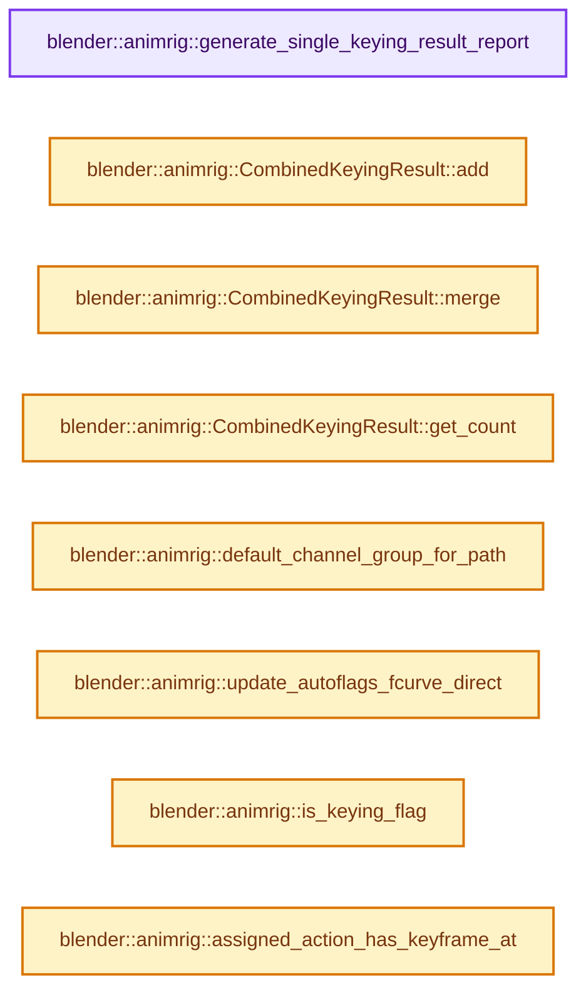
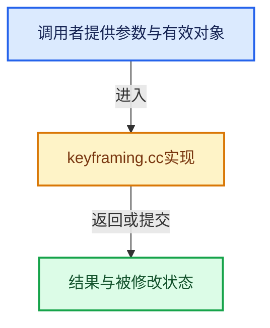

# 实现依赖专题：source/blender/animrig/intern/keyframing.cc

[实现依赖导航](../../../README.md) · [符号索引](../../../../00-课程指南/02-源码与提交索引/符号依赖与实现索引.md)

本专题从正文实际调用进入，集中保存共享实现。函数有稳定锚点，可从调用处直接跳到对应完整函数；递归与互相调用通过回链组织。

## 本文件的实现关系






## 完整成员与函数实现

<a id="f-79a958d707c50aae"></a>

### `blender::animrig::generate_single_keying_result_report`

实现位置：[source/blender/animrig/intern/keyframing.cc](../../../../../../../../source/blender/animrig/intern/keyframing.cc) · L50—L95。

接口参数：

- `const SingleKeyingResult result`
- `ReportList *reports`

**教学注释版**

<!-- annotated:07e480d093f281 -->

```cpp
void generate_single_keying_result_report(const SingleKeyingResult result, ReportList *reports)
{
  switch (result) {
    case SingleKeyingResult::SUCCESS:
      BKE_reportf(reports, RPT_INFO, "Successfully inserted a key.");
      break;
    case SingleKeyingResult::UNKNOWN_FAILURE:
      BKE_reportf(reports, RPT_ERROR, "Keyframe insertion failed for an unknown reason.");
      break;
    case SingleKeyingResult::CANNOT_CREATE_FCURVE:
      BKE_reportf(reports, RPT_ERROR, "Failed to create the F-Curve.");
      break;
    case SingleKeyingResult::FCURVE_NOT_KEYFRAMEABLE:
      BKE_reportf(reports, RPT_ERROR, "The F-Curve is not keyable. It may be locked or sampled.");
      break;
    case SingleKeyingResult::NO_KEY_NEEDED:
      BKE_reportf(
          reports, RPT_ERROR, "Due to the setting 'Only Insert Needed' no keyframe was inserted.");
      break;
    case SingleKeyingResult::UNABLE_TO_INSERT_TO_NLA_STACK:
      BKE_reportf(reports, RPT_ERROR, "Due to the NLA stack setup, no key was inserted.");
      break;
    case SingleKeyingResult::ID_NOT_EDITABLE:
      BKE_reportf(
          reports, RPT_ERROR, "Inserting key has been skipped because the ID cannot be edited.");
      break;
    case SingleKeyingResult::ID_NOT_ANIMATABLE:
      BKE_reportf(
          reports, RPT_ERROR, "Inserting key has been skipped because the ID cannot be keyed.");
      break;
    case SingleKeyingResult::NO_VALID_LAYER:
      BKE_reportf(reports, RPT_ERROR, "No valid layer. Cannot insert key.");
      break;
    case SingleKeyingResult::NO_VALID_STRIP:
      BKE_reportf(reports, RPT_ERROR, "No valid strip. Cannot insert key.");
      break;
    case SingleKeyingResult::NO_VALID_SLOT:
      BKE_reportf(reports, RPT_ERROR, "No valid slot. Cannot insert key.");
      break;
    case SingleKeyingResult::CANNOT_RESOLVE_PATH:
      BKE_reportf(reports, RPT_ERROR, "Invalid RNA path. Cannot insert key.");
      break;
    case SingleKeyingResult::_KEYING_RESULT_MAX:
      break;
  }
}
```

<details>
<summary>核对原始源码：source/blender/animrig/intern/keyframing.cc · L50—L95</summary>

<!-- original:07e480d093f281:source/blender/animrig/intern/keyframing.cc:50:95 -->

```cpp
void generate_single_keying_result_report(const SingleKeyingResult result, ReportList *reports)
{
  switch (result) {
    case SingleKeyingResult::SUCCESS:
      BKE_reportf(reports, RPT_INFO, "Successfully inserted a key.");
      break;
    case SingleKeyingResult::UNKNOWN_FAILURE:
      BKE_reportf(reports, RPT_ERROR, "Keyframe insertion failed for an unknown reason.");
      break;
    case SingleKeyingResult::CANNOT_CREATE_FCURVE:
      BKE_reportf(reports, RPT_ERROR, "Failed to create the F-Curve.");
      break;
    case SingleKeyingResult::FCURVE_NOT_KEYFRAMEABLE:
      BKE_reportf(reports, RPT_ERROR, "The F-Curve is not keyable. It may be locked or sampled.");
      break;
    case SingleKeyingResult::NO_KEY_NEEDED:
      BKE_reportf(
          reports, RPT_ERROR, "Due to the setting 'Only Insert Needed' no keyframe was inserted.");
      break;
    case SingleKeyingResult::UNABLE_TO_INSERT_TO_NLA_STACK:
      BKE_reportf(reports, RPT_ERROR, "Due to the NLA stack setup, no key was inserted.");
      break;
    case SingleKeyingResult::ID_NOT_EDITABLE:
      BKE_reportf(
          reports, RPT_ERROR, "Inserting key has been skipped because the ID cannot be edited.");
      break;
    case SingleKeyingResult::ID_NOT_ANIMATABLE:
      BKE_reportf(
          reports, RPT_ERROR, "Inserting key has been skipped because the ID cannot be keyed.");
      break;
    case SingleKeyingResult::NO_VALID_LAYER:
      BKE_reportf(reports, RPT_ERROR, "No valid layer. Cannot insert key.");
      break;
    case SingleKeyingResult::NO_VALID_STRIP:
      BKE_reportf(reports, RPT_ERROR, "No valid strip. Cannot insert key.");
      break;
    case SingleKeyingResult::NO_VALID_SLOT:
      BKE_reportf(reports, RPT_ERROR, "No valid slot. Cannot insert key.");
      break;
    case SingleKeyingResult::CANNOT_RESOLVE_PATH:
      BKE_reportf(reports, RPT_ERROR, "Invalid RNA path. Cannot insert key.");
      break;
    case SingleKeyingResult::_KEYING_RESULT_MAX:
      break;
  }
}
```

</details>

**继续追踪实现**

- `BKE_reportf` → [blender::BKE_reportf · L191](../../../02-BKE几何与数据/intern/report.cc.md#f-e776fc632ffb42b3)。

<a id="f-1f8cbe44d92de95e"></a>

### `blender::animrig::CombinedKeyingResult::add`

实现位置：[source/blender/animrig/intern/keyframing.cc](../../../../../../../../source/blender/animrig/intern/keyframing.cc) · L102—L105。

接口参数：

- `const SingleKeyingResult result`
- `const int count`

**教学注释版**

<!-- annotated:0bb04799d443d4 -->

```cpp
void CombinedKeyingResult::add(const SingleKeyingResult result, const int count)
{
  result_counter[int(result)] += count;
}
```

<details>
<summary>核对原始源码：source/blender/animrig/intern/keyframing.cc · L102—L105</summary>

<!-- original:0bb04799d443d4:source/blender/animrig/intern/keyframing.cc:102:105 -->

```cpp
void CombinedKeyingResult::add(const SingleKeyingResult result, const int count)
{
  result_counter[int(result)] += count;
}
```

</details>

**继续追踪实现**

本实现没有需要继续展开的显式调用；检查返回表达式、对象转换和调用者前置条件。

<a id="f-0cf9cf0deb85666e"></a>

### `blender::animrig::CombinedKeyingResult::merge`

实现位置：[source/blender/animrig/intern/keyframing.cc](../../../../../../../../source/blender/animrig/intern/keyframing.cc) · L107—L112。

接口参数：

- `const CombinedKeyingResult &other`

**教学注释版**

<!-- annotated:a67ce1d0084c90 -->

```cpp
void CombinedKeyingResult::merge(const CombinedKeyingResult &other)
{
  for (int i = 0; i < result_counter.size(); i++) {
    result_counter[i] += other.result_counter[i];
  }
}
```

<details>
<summary>核对原始源码：source/blender/animrig/intern/keyframing.cc · L107—L112</summary>

<!-- original:a67ce1d0084c90:source/blender/animrig/intern/keyframing.cc:107:112 -->

```cpp
void CombinedKeyingResult::merge(const CombinedKeyingResult &other)
{
  for (int i = 0; i < result_counter.size(); i++) {
    result_counter[i] += other.result_counter[i];
  }
}
```

</details>

**沿实际写入检查状态**

- `result_counter[i] += other.result_counter[i];`

**继续追踪实现**

- `result_counter.size` → [调用协议](../../../../00-课程指南/01-路线与规范/模板宏与动态分派协议.md)：接收对象类型依赖auto、返回值或模板实例；不按同名猜测目标。调用位置L109。

<a id="f-73cf19d0c88f72bf"></a>

### `blender::animrig::CombinedKeyingResult::get_count`

实现位置：[source/blender/animrig/intern/keyframing.cc](../../../../../../../../source/blender/animrig/intern/keyframing.cc) · L114—L117。

接口参数：

- `const SingleKeyingResult result`

**教学注释版**

<!-- annotated:a64d900ad2c05b -->

```cpp
int CombinedKeyingResult::get_count(const SingleKeyingResult result) const
{
  return result_counter[int(result)];
}
```

<details>
<summary>核对原始源码：source/blender/animrig/intern/keyframing.cc · L114—L117</summary>

<!-- original:a64d900ad2c05b:source/blender/animrig/intern/keyframing.cc:114:117 -->

```cpp
int CombinedKeyingResult::get_count(const SingleKeyingResult result) const
{
  return result_counter[int(result)];
}
```

</details>

**结果出口**

- `return result_counter[int(result)];`

**继续追踪实现**

本实现没有需要继续展开的显式调用；检查返回表达式、对象转换和调用者前置条件。

<a id="f-d42bc1343539789e"></a>

### `blender::animrig::default_channel_group_for_path`

实现位置：[source/blender/animrig/intern/keyframing.cc](../../../../../../../../source/blender/animrig/intern/keyframing.cc) · L243—L264。

接口参数：

- `const PointerRNA *animated_struct`
- `const StringRef prop_rna_path`

**教学注释版**

<!-- annotated:91a3b9f3cec7c9 -->

```cpp
std::optional<StringRefNull> default_channel_group_for_path(const PointerRNA *animated_struct,
                                                            const StringRef prop_rna_path)
{
  if (animated_struct->type == RNA_PoseBone) {
    bPoseChannel *pose_channel = static_cast<bPoseChannel *>(animated_struct->data);
    return pose_channel->name;
  }

  if (animated_struct->type == RNA_Object) {
    if (prop_rna_path.find("location") != StringRef::not_found ||
        prop_rna_path.find("rotation") != StringRef::not_found ||
        prop_rna_path.find("scale") != StringRef::not_found)
    {
      /* NOTE: Keep this label in sync with the "ID" case in
       * _keyingsets_utils.py :: get_transform_generators_base_info()
       */
      return "Object Transforms";
    }
  }

  return std::nullopt;
}
```

<details>
<summary>核对原始源码：source/blender/animrig/intern/keyframing.cc · L243—L264</summary>

<!-- original:91a3b9f3cec7c9:source/blender/animrig/intern/keyframing.cc:243:264 -->

```cpp
std::optional<StringRefNull> default_channel_group_for_path(const PointerRNA *animated_struct,
                                                            const StringRef prop_rna_path)
{
  if (animated_struct->type == RNA_PoseBone) {
    bPoseChannel *pose_channel = static_cast<bPoseChannel *>(animated_struct->data);
    return pose_channel->name;
  }

  if (animated_struct->type == RNA_Object) {
    if (prop_rna_path.find("location") != StringRef::not_found ||
        prop_rna_path.find("rotation") != StringRef::not_found ||
        prop_rna_path.find("scale") != StringRef::not_found)
    {
      /* NOTE: Keep this label in sync with the "ID" case in
       * _keyingsets_utils.py :: get_transform_generators_base_info()
       */
      return "Object Transforms";
    }
  }

  return std::nullopt;
}
```

</details>

**结果出口**

- `return pose_channel->name;`
- `return "Object Transforms";`
- `return std::nullopt;`

**继续追踪实现**

- `prop_rna_path.find` → [调用协议](../../../../00-课程指南/01-路线与规范/模板宏与动态分派协议.md)：由接收对象具体类型或运行时策略提供实现。调用位置L252。

<a id="f-921b4b08f236ad5f"></a>

### `blender::animrig::update_autoflags_fcurve_direct`

实现位置：[source/blender/animrig/intern/keyframing.cc](../../../../../../../../source/blender/animrig/intern/keyframing.cc) · L266—L272。

接口参数：

- `FCurve *fcu`
- `const PropertyType prop_type`

**教学注释版**

<!-- annotated:a661464abd78dc -->

```cpp
void update_autoflags_fcurve_direct(FCurve *fcu, const PropertyType prop_type)
{
  /* First clear out all the flags that should be updated by this function, before setting just the
   * ones suitable for this property type. */
  fcu->flag &= ~(FCURVE_INT_VALUES | FCURVE_DISCRETE_VALUES);
  fcu->flag |= fcurve_flags_for_property_type(prop_type);
}
```

<details>
<summary>核对原始源码：source/blender/animrig/intern/keyframing.cc · L266—L272</summary>

<!-- original:a661464abd78dc:source/blender/animrig/intern/keyframing.cc:266:272 -->

```cpp
void update_autoflags_fcurve_direct(FCurve *fcu, const PropertyType prop_type)
{
  /* First clear out all the flags that should be updated by this function, before setting just the
   * ones suitable for this property type. */
  fcu->flag &= ~(FCURVE_INT_VALUES | FCURVE_DISCRETE_VALUES);
  fcu->flag |= fcurve_flags_for_property_type(prop_type);
}
```

</details>

**沿实际写入检查状态**

- `fcu->flag &= ~(FCURVE_INT_VALUES | FCURVE_DISCRETE_VALUES);`
- `fcu->flag |= fcurve_flags_for_property_type(prop_type);`

**继续追踪实现**

- `fcurve_flags_for_property_type` → [blender::animrig::fcurve_flags_for_property_type · L92](fcurve.cc.md#f-b6ae2339c7061802)。

<a id="f-c8c75cf01bdc78fe"></a>

### `blender::animrig::is_keying_flag`

实现位置：[source/blender/animrig/intern/keyframing.cc](../../../../../../../../source/blender/animrig/intern/keyframing.cc) · L274—L280。

接口参数：

- `const Scene *scene`
- `const eKeying_Flag flag`

**教学注释版**

<!-- annotated:0060712b9dc2ca -->

```cpp
bool is_keying_flag(const Scene *scene, const eKeying_Flag flag)
{
  if (scene) {
    return (scene->toolsettings->keying_flag & flag) || (U.keying_flag & flag);
  }
  return U.keying_flag & flag;
}
```

<details>
<summary>核对原始源码：source/blender/animrig/intern/keyframing.cc · L274—L280</summary>

<!-- original:0060712b9dc2ca:source/blender/animrig/intern/keyframing.cc:274:280 -->

```cpp
bool is_keying_flag(const Scene *scene, const eKeying_Flag flag)
{
  if (scene) {
    return (scene->toolsettings->keying_flag & flag) || (U.keying_flag & flag);
  }
  return U.keying_flag & flag;
}
```

</details>

**结果出口**

- `return (scene->toolsettings->keying_flag & flag) || (U.keying_flag & flag);`
- `return U.keying_flag & flag;`

**继续追踪实现**

本实现没有需要继续展开的显式调用；检查返回表达式、对象转换和调用者前置条件。

<a id="f-85dce0ebed4cd095"></a>

### `blender::animrig::assigned_action_has_keyframe_at`

实现位置：[source/blender/animrig/intern/keyframing.cc](../../../../../../../../source/blender/animrig/intern/keyframing.cc) · L310—L339。

接口参数：

- `AnimData &adt`
- `const float frame`

**教学注释版**

<!-- annotated:c20680693e0a10 -->

```cpp
static bool assigned_action_has_keyframe_at(AnimData &adt, const float frame)
{
  if (adt.action == nullptr) {
    return false;
  }

  if (adt.action->flag & ACT_MUTED) {
    return false;
  }

  const Span<FCurve *> fcurves = animrig::fcurves_for_assigned_action(&adt);
  /* 1024 is a common value for memory bandwidth limited tasks. The number isn't critical: 512
   * works fine here, but 128 and 4096 seem to work equally well in testing. */
  return threading::parallel_reduce<bool>(
      // [讲解] fcurves.index_range：查询视图长度或生成对应有效索引区间。
      fcurves.index_range(),
      512,
      false,
      [&](const IndexRange range, const bool is_found) {
        if (is_found) {
          return true;
        }
        // [讲解] fcurves.slice：建立原连续范围的子视图。
        for (FCurve *fcu : fcurves.slice(range)) {
          if (fcurve_frame_has_keyframe(fcu, frame)) {
            return true;
          }
        }
        return false;
      },
      std::logical_or<bool>());
}
```

<details>
<summary>核对原始源码：source/blender/animrig/intern/keyframing.cc · L310—L339</summary>

<!-- original:c20680693e0a10:source/blender/animrig/intern/keyframing.cc:310:339 -->

```cpp
static bool assigned_action_has_keyframe_at(AnimData &adt, const float frame)
{
  if (adt.action == nullptr) {
    return false;
  }

  if (adt.action->flag & ACT_MUTED) {
    return false;
  }

  const Span<FCurve *> fcurves = animrig::fcurves_for_assigned_action(&adt);
  /* 1024 is a common value for memory bandwidth limited tasks. The number isn't critical: 512
   * works fine here, but 128 and 4096 seem to work equally well in testing. */
  return threading::parallel_reduce<bool>(
      fcurves.index_range(),
      512,
      false,
      [&](const IndexRange range, const bool is_found) {
        if (is_found) {
          return true;
        }
        for (FCurve *fcu : fcurves.slice(range)) {
          if (fcurve_frame_has_keyframe(fcu, frame)) {
            return true;
          }
        }
        return false;
      },
      std::logical_or<bool>());
}
```

</details>

**结果出口**

- `return false;`
- `return threading::parallel_reduce<bool>(`
- `return true;`

**继续追踪实现**

- `animrig::fcurves_for_assigned_action` → [blender::animrig::fcurves_for_assigned_action · L349](animdata.cc.md#f-256dde45890976be)；[blender::animrig::fcurves_for_assigned_action · L357](animdata.cc.md#f-b79bdf0f70d5ff6f)。同名重载需按实参类型选择。
- `threading::parallel_reduce<bool>` → [blender::threading::parallel_reduce · L126](../../../../11-Depsgraph与并行任务系统/07-任务池与TBB接入.md#f-9225ddb5efb97fcc)。
- `fcurves.index_range` → [blender::Span::index_range · L405](../../../../01-基础容器与现代CPP/05-Span只读连续视图.md#f-caaa9b06e13e53e0)。
- `fcurves.slice` → [blender::Span::slice · L141](../../../../01-基础容器与现代CPP/05-Span只读连续视图.md#f-380a0e8fdcbd53cc)；[blender::Span::slice · L149](../../../../01-基础容器与现代CPP/05-Span只读连续视图.md#f-9b9c15e78dd54eec)。同名重载需按实参类型选择。
- `fcurve_frame_has_keyframe` → [blender::animrig::fcurve_frame_has_keyframe · L695](fcurve.cc.md#f-a95ea42ae89eb5ac)。
- `std::logical_or<bool>` → [外部契约](https://eel.is/c++draft/)：这个边界按实际表达式及所属类型核对参数、返回值、寿命与失败行为。这里提供接口入口，不声称已解释该第三方版本的内部实现。

<a id="f-473c575419cf3888"></a>

### `blender::animrig::object_frame_has_keyframe`

实现位置：[source/blender/animrig/intern/keyframing.cc](../../../../../../../../source/blender/animrig/intern/keyframing.cc) · L342—L363。

接口参数：

- `Object *ob`
- `const float frame`

**教学注释版**

<!-- annotated:e32664d6f48262 -->

```cpp
static bool object_frame_has_keyframe(Object *ob, const float frame)
{
  if (ob == nullptr) {
    return false;
  }

  /* Check its own animation data - specifically, the action it contains. */
  if ((ob->adt) && (ob->adt->action)) {
    /* #41525 - When the active action is a NLA strip being edited,
     * we need to correct the frame number to "look inside" the
     * remapped action
     */
    const float ob_frame = BKE_nla_tweakedit_remap(ob->adt, frame, NLATIME_CONVERT_UNMAP);

    if (assigned_action_has_keyframe_at(*ob->adt, ob_frame)) {
      return true;
    }
  }

  /* nothing found */
  return false;
}
```

<details>
<summary>核对原始源码：source/blender/animrig/intern/keyframing.cc · L342—L363</summary>

<!-- original:e32664d6f48262:source/blender/animrig/intern/keyframing.cc:342:363 -->

```cpp
static bool object_frame_has_keyframe(Object *ob, const float frame)
{
  if (ob == nullptr) {
    return false;
  }

  /* Check its own animation data - specifically, the action it contains. */
  if ((ob->adt) && (ob->adt->action)) {
    /* #41525 - When the active action is a NLA strip being edited,
     * we need to correct the frame number to "look inside" the
     * remapped action
     */
    const float ob_frame = BKE_nla_tweakedit_remap(ob->adt, frame, NLATIME_CONVERT_UNMAP);

    if (assigned_action_has_keyframe_at(*ob->adt, ob_frame)) {
      return true;
    }
  }

  /* nothing found */
  return false;
}
```

</details>

**结果出口**

- `return false;`
- `return true;`

**继续追踪实现**

- `BKE_nla_tweakedit_remap` → [blender::BKE_nla_tweakedit_remap · L807](../../../02-BKE几何与数据/intern/nla.cc.md#f-9074bdbe8cd2f2c6)。
- `assigned_action_has_keyframe_at` → [blender::animrig::assigned_action_has_keyframe_at · L310](keyframing.cc.md#f-85dce0ebed4cd095)。

<a id="f-0ed6fdcacb3f3c3f"></a>

### `blender::animrig::id_frame_has_keyframe`

实现位置：[source/blender/animrig/intern/keyframing.cc](../../../../../../../../source/blender/animrig/intern/keyframing.cc) · L365—L388。

接口参数：

- `ID *id`
- `float frame`

**教学注释版**

<!-- annotated:2d79b2f7f862ff -->

```cpp
bool id_frame_has_keyframe(ID *id, float frame)
{
  if (id == nullptr) {
    return false;
  }

  /* Perform special checks for 'macro' types. */
  switch (GS(id->name)) {
    case ID_OB:
      return object_frame_has_keyframe(id_cast<Object *>(id), frame);

    default: {
      AnimData *adt = BKE_animdata_from_id(id);

      /* only check keyframes in active action */
      if (adt) {
        return assigned_action_has_keyframe_at(*adt, frame);
      }
      break;
    }
  }

  return false;
}
```

<details>
<summary>核对原始源码：source/blender/animrig/intern/keyframing.cc · L365—L388</summary>

<!-- original:2d79b2f7f862ff:source/blender/animrig/intern/keyframing.cc:365:388 -->

```cpp
bool id_frame_has_keyframe(ID *id, float frame)
{
  if (id == nullptr) {
    return false;
  }

  /* Perform special checks for 'macro' types. */
  switch (GS(id->name)) {
    case ID_OB:
      return object_frame_has_keyframe(id_cast<Object *>(id), frame);

    default: {
      AnimData *adt = BKE_animdata_from_id(id);

      /* only check keyframes in active action */
      if (adt) {
        return assigned_action_has_keyframe_at(*adt, frame);
      }
      break;
    }
  }

  return false;
}
```

</details>

**结果出口**

- `return false;`
- `return object_frame_has_keyframe(id_cast<Object *>(id), frame);`
- `return assigned_action_has_keyframe_at(*adt, frame);`

**继续追踪实现**

- `GS` → [blender::GS · L410](../../makesdna/DNA_ID.h.md#f-c3ff509f79f21b05)。
- `object_frame_has_keyframe` → [blender::animrig::object_frame_has_keyframe · L342](keyframing.cc.md#f-473c575419cf3888)。
- `id_cast<Object *>` → [blender::id_cast · L1417](../../makesdna/DNA_ID.h.md#f-6c8ac6412850ac5a)。
- `BKE_animdata_from_id` → [blender::BKE_animdata_from_id · L93](../../../02-BKE几何与数据/intern/anim_data.cc.md#f-354e5421ff0a6c96)。
- `assigned_action_has_keyframe_at` → [blender::animrig::assigned_action_has_keyframe_at · L310](keyframing.cc.md#f-85dce0ebed4cd095)。

<a id="f-ec0c5c8ccc93d2f0"></a>

### `blender::animrig::get_property_values`

实现位置：[source/blender/animrig/intern/keyframing.cc](../../../../../../../../source/blender/animrig/intern/keyframing.cc) · L395—L409。

接口参数：

- `PointerRNA *ptr`
- `PropertyRNA *prop`
- `const bool visual_key`

**教学注释版**

<!-- annotated:d7025a5d754285 -->

```cpp
Vector<float> get_property_values(PointerRNA *ptr, PropertyRNA *prop, const bool visual_key)
{
  Vector<float> values;

  if (visual_key && visualkey_can_use(ptr, prop)) {
    /* Visual-keying is only available for object data-blocks and pose-channels,
     * as it works by key-framing using a value extracted from the final matrix
     * instead of using the kt system to extract a value. */
    values = visualkey_get_values(ptr, prop);
  }
  else {
    values = get_rna_values(ptr, prop);
  }
  return values;
}
```

<details>
<summary>核对原始源码：source/blender/animrig/intern/keyframing.cc · L395—L409</summary>

<!-- original:d7025a5d754285:source/blender/animrig/intern/keyframing.cc:395:409 -->

```cpp
Vector<float> get_property_values(PointerRNA *ptr, PropertyRNA *prop, const bool visual_key)
{
  Vector<float> values;

  if (visual_key && visualkey_can_use(ptr, prop)) {
    /* Visual-keying is only available for object data-blocks and pose-channels,
     * as it works by key-framing using a value extracted from the final matrix
     * instead of using the kt system to extract a value. */
    values = visualkey_get_values(ptr, prop);
  }
  else {
    values = get_rna_values(ptr, prop);
  }
  return values;
}
```

</details>

**沿实际写入检查状态**

- `values = visualkey_get_values(ptr, prop);`
- `values = get_rna_values(ptr, prop);`

**结果出口**

- `return values;`

**继续追踪实现**

- `visualkey_can_use` → [blender::animrig::visualkey_can_use · L37](visualkey.cc.md#f-16ea42d0d8ef8cd8)。
- `visualkey_get_values` → [blender::animrig::visualkey_get_values · L197](visualkey.cc.md#f-b044c26a462fe6fa)。
- `get_rna_values` → [blender::animrig::get_rna_values · L26](anim_rna.cc.md#f-7122c6bd8e5e53c0)。

<a id="f-89abff6275831171"></a>

### `blender::animrig::nla_time_remap`

实现位置：[source/blender/animrig/intern/keyframing.cc](../../../../../../../../source/blender/animrig/intern/keyframing.cc) · L411—L429。

接口参数：

- `float time`
- `const AnimationEvalContext *anim_eval_context`
- `PointerRNA *id_ptr`
- `AnimData *adt`
- `bAction *act`
- `ListBaseT<NlaKeyframingContext> *nla_cache`
- `NlaKeyframingContext **r_nla_context`

**教学注释版**

<!-- annotated:f13024f92b3200 -->

```cpp
static float nla_time_remap(float time,
                            const AnimationEvalContext *anim_eval_context,
                            PointerRNA *id_ptr,
                            AnimData *adt,
                            bAction *act,
                            ListBaseT<NlaKeyframingContext> *nla_cache,
                            NlaKeyframingContext **r_nla_context)
{
  if (adt && adt->action == act) {
    *r_nla_context = BKE_animsys_get_nla_keyframing_context(
        nla_cache, id_ptr, adt, anim_eval_context);

    const float remapped_frame = BKE_nla_tweakedit_remap(adt, time, NLATIME_CONVERT_UNMAP);
    return remapped_frame;
  }

  *r_nla_context = nullptr;
  return time;
}
```

<details>
<summary>核对原始源码：source/blender/animrig/intern/keyframing.cc · L411—L429</summary>

<!-- original:f13024f92b3200:source/blender/animrig/intern/keyframing.cc:411:429 -->

```cpp
static float nla_time_remap(float time,
                            const AnimationEvalContext *anim_eval_context,
                            PointerRNA *id_ptr,
                            AnimData *adt,
                            bAction *act,
                            ListBaseT<NlaKeyframingContext> *nla_cache,
                            NlaKeyframingContext **r_nla_context)
{
  if (adt && adt->action == act) {
    *r_nla_context = BKE_animsys_get_nla_keyframing_context(
        nla_cache, id_ptr, adt, anim_eval_context);

    const float remapped_frame = BKE_nla_tweakedit_remap(adt, time, NLATIME_CONVERT_UNMAP);
    return remapped_frame;
  }

  *r_nla_context = nullptr;
  return time;
}
```

</details>

**结果出口**

- `return remapped_frame;`
- `return time;`

**继续追踪实现**

- `BKE_animsys_get_nla_keyframing_context` → [blender::BKE_animsys_get_nla_keyframing_context · L3478](../../../02-BKE几何与数据/intern/anim_sys.cc.md#f-f3997fe0bdb8f40f)。
- `BKE_nla_tweakedit_remap` → [blender::BKE_nla_tweakedit_remap · L807](../../../02-BKE几何与数据/intern/nla.cc.md#f-9074bdbe8cd2f2c6)。

<a id="f-ca1660da3309bde1"></a>

### `blender::animrig::insert_keyframe_direct`

实现位置：[source/blender/animrig/intern/keyframing.cc](../../../../../../../../source/blender/animrig/intern/keyframing.cc) · L431—L465。

接口参数：

- `PointerRNA &ptr`
- `PropertyRNA &prop`
- `FCurve &fcu`
- `const float fcurve_frame`
- `const eBezTriple_KeyframeType keytype`
- `const eInsertKeyFlags flag`

**教学注释版**

<!-- annotated:53312224712497 -->

```cpp
SingleKeyingResult insert_keyframe_direct(PointerRNA &ptr,
                                          PropertyRNA &prop,
                                          FCurve &fcu,
                                          const float fcurve_frame,
                                          const eBezTriple_KeyframeType keytype,
                                          const eInsertKeyFlags flag)
{
  if (!ptr) {
    BLI_assert_unreachable();
    return SingleKeyingResult::UNKNOWN_FAILURE;
  }

  if (!BKE_fcurve_is_keyframable(fcu)) {
    return SingleKeyingResult::FCURVE_NOT_KEYFRAMEABLE;
  }

  /* Update F-Curve flags to ensure proper behavior for property type. */
  update_autoflags_fcurve_direct(&fcu, RNA_property_type(&prop));

  const bool visual_keyframing = flag & INSERTKEY_MATRIX;
  Vector<float> values = get_property_values(&ptr, &prop, visual_keyframing);

  const int index = fcu.array_index;
  // [讲解] values.size：用end_减begin_得到活元素数量。
  if (index < 0 || index >= values.size()) {
    /* Can only happen if the FCurve and PropertyRNA do not match which
     * should never be the case. */
    BLI_assert_unreachable();
    return SingleKeyingResult::UNKNOWN_FAILURE;
  }

  KeyframeSettings settings = get_keyframe_settings((flag & INSERTKEY_NO_USERPREF) == 0);
  settings.keyframe_type = keytype;

  return insert_vert_fcurve(&fcu, {fcurve_frame, values[index]}, settings, flag);
}
```

<details>
<summary>核对原始源码：source/blender/animrig/intern/keyframing.cc · L431—L465</summary>

<!-- original:53312224712497:source/blender/animrig/intern/keyframing.cc:431:465 -->

```cpp
SingleKeyingResult insert_keyframe_direct(PointerRNA &ptr,
                                          PropertyRNA &prop,
                                          FCurve &fcu,
                                          const float fcurve_frame,
                                          const eBezTriple_KeyframeType keytype,
                                          const eInsertKeyFlags flag)
{
  if (!ptr) {
    BLI_assert_unreachable();
    return SingleKeyingResult::UNKNOWN_FAILURE;
  }

  if (!BKE_fcurve_is_keyframable(fcu)) {
    return SingleKeyingResult::FCURVE_NOT_KEYFRAMEABLE;
  }

  /* Update F-Curve flags to ensure proper behavior for property type. */
  update_autoflags_fcurve_direct(&fcu, RNA_property_type(&prop));

  const bool visual_keyframing = flag & INSERTKEY_MATRIX;
  Vector<float> values = get_property_values(&ptr, &prop, visual_keyframing);

  const int index = fcu.array_index;
  if (index < 0 || index >= values.size()) {
    /* Can only happen if the FCurve and PropertyRNA do not match which
     * should never be the case. */
    BLI_assert_unreachable();
    return SingleKeyingResult::UNKNOWN_FAILURE;
  }

  KeyframeSettings settings = get_keyframe_settings((flag & INSERTKEY_NO_USERPREF) == 0);
  settings.keyframe_type = keytype;

  return insert_vert_fcurve(&fcu, {fcurve_frame, values[index]}, settings, flag);
}
```

</details>

**沿实际写入检查状态**

- `settings.keyframe_type = keytype;`

**结果出口**

- `return SingleKeyingResult::UNKNOWN_FAILURE;`
- `return SingleKeyingResult::FCURVE_NOT_KEYFRAMEABLE;`
- `return insert_vert_fcurve(&fcu, {fcurve_frame, values[index]}, settings, flag);`

**继续追踪实现**

- `BLI_assert_unreachable` → [BLI_assert_unreachable · L77](../../../01-BLI基础库/BLI_assert.hh.md#m-7a2d91a67d8e)。宏定义由构建条件选择。
- `BKE_fcurve_is_keyframable` → [blender::BKE_fcurve_is_keyframable · L964](../../../02-BKE几何与数据/intern/fcurve.cc.md#f-81d26fb8b5861dc9)。
- `update_autoflags_fcurve_direct` → [blender::animrig::update_autoflags_fcurve_direct · L266](keyframing.cc.md#f-921b4b08f236ad5f)。
- `RNA_property_type` → [blender::RNA_property_type · L1293](../../makesrna/intern/rna_access.cc.md#f-4465a90d55f022df)。
- `get_property_values` → [blender::animrig::get_property_values · L395](keyframing.cc.md#f-ec0c5c8ccc93d2f0)。
- `values.size` → [blender::Vector::size · L780](../../../../01-基础容器与现代CPP/11-Vector插入删除与重排.md#f-714773731767349c)。
- `get_keyframe_settings` → [blender::animrig::get_keyframe_settings · L24](fcurve.cc.md#f-cbe59150ac9bda40)。
- `insert_vert_fcurve` → [blender::animrig::insert_vert_fcurve · L429](fcurve.cc.md#f-a351350fc31f7517)。

<a id="f-86f8cfb8471e713c"></a>

### `blender::animrig::insert_key_layer`

实现位置：[source/blender/animrig/intern/keyframing.cc](../../../../../../../../source/blender/animrig/intern/keyframing.cc) · L632—L660。

接口参数：

- `Main *bmain`
- `Action &action`
- `Layer &layer`
- `const Slot &slot`
- `const std::string &rna_path`
- `PropertyRNA *prop`
- `const std::optional<StringRefNull> channel_group`
- `const KeyInsertData &key_data`
- `const KeyframeSettings &key_settings`
- `const eInsertKeyFlags insert_key_flags`

**教学注释版**

<!-- annotated:f9cbbead8d5de9 -->

```cpp
static SingleKeyingResult insert_key_layer(Main *bmain,
                                           Action &action,
                                           Layer &layer,
                                           const Slot &slot,
                                           const std::string &rna_path,
                                           PropertyRNA *prop,
                                           const std::optional<StringRefNull> channel_group,
                                           const KeyInsertData &key_data,
                                           const KeyframeSettings &key_settings,
                                           const eInsertKeyFlags insert_key_flags)
{
  assert_baklava_phase_1_invariants(layer);
  BLI_assert(layer.strips().size() == 1);

  const bool do_cyclic = (insert_key_flags & INSERTKEY_CYCLE_AWARE) && action.is_cyclic();

  const PropertyType prop_type = RNA_property_type(prop);
  const PropertySubType prop_subtype = RNA_property_subtype(prop);

  Strip *strip = layer.strip(0);
  return strip->data<StripKeyframeData>(action).keyframe_insert(
      bmain,
      slot,
      {rna_path, key_data.array_index, prop_type, prop_subtype, channel_group},
      key_data.position,
      key_settings,
      insert_key_flags,
      do_cyclic ? std::optional(action.get_frame_range()) : std::nullopt);
}
```

<details>
<summary>核对原始源码：source/blender/animrig/intern/keyframing.cc · L632—L660</summary>

<!-- original:f9cbbead8d5de9:source/blender/animrig/intern/keyframing.cc:632:660 -->

```cpp
static SingleKeyingResult insert_key_layer(Main *bmain,
                                           Action &action,
                                           Layer &layer,
                                           const Slot &slot,
                                           const std::string &rna_path,
                                           PropertyRNA *prop,
                                           const std::optional<StringRefNull> channel_group,
                                           const KeyInsertData &key_data,
                                           const KeyframeSettings &key_settings,
                                           const eInsertKeyFlags insert_key_flags)
{
  assert_baklava_phase_1_invariants(layer);
  BLI_assert(layer.strips().size() == 1);

  const bool do_cyclic = (insert_key_flags & INSERTKEY_CYCLE_AWARE) && action.is_cyclic();

  const PropertyType prop_type = RNA_property_type(prop);
  const PropertySubType prop_subtype = RNA_property_subtype(prop);

  Strip *strip = layer.strip(0);
  return strip->data<StripKeyframeData>(action).keyframe_insert(
      bmain,
      slot,
      {rna_path, key_data.array_index, prop_type, prop_subtype, channel_group},
      key_data.position,
      key_settings,
      insert_key_flags,
      do_cyclic ? std::optional(action.get_frame_range()) : std::nullopt);
}
```

</details>

**结果出口**

- `return strip->data<StripKeyframeData>(action).keyframe_insert(`

**继续追踪实现**

- `assert_baklava_phase_1_invariants` → [blender::animrig::assert_baklava_phase_1_invariants · L2961](action.cc.md#f-812bb12e1e3da08c)；[blender::animrig::assert_baklava_phase_1_invariants · L2971](action.cc.md#f-6948412b3e455778)；[blender::animrig::assert_baklava_phase_1_invariants · L2981](action.cc.md#f-34e4c11bbae41eda)。同名重载需按实参类型选择。
- `BLI_assert` → [BLI_assert · L48](../../../01-BLI基础库/BLI_assert.hh.md#m-57a88495704d)；[BLI_assert · L63](../../../01-BLI基础库/BLI_assert.hh.md#m-d07050020cb5)。宏定义由构建条件选择。
- `layer.strips().size` → [调用协议](../../../../00-课程指南/01-路线与规范/模板宏与动态分派协议.md)：接收对象类型依赖auto、返回值或模板实例；不按同名猜测目标。调用位置L644。
- `layer.strips` → [blender::animrig::Layer::strips · L909](action.cc.md#f-ae881f7558851e99)；[blender::animrig::Layer::strips · L913](action.cc.md#f-54e4e722533eee5d)。同名重载需按实参类型选择。
- `action.is_cyclic` → [blender::animrig::Action::is_cyclic · L772](action.cc.md#f-16cbf7a3a139aa9d)。
- `RNA_property_type` → [blender::RNA_property_type · L1293](../../makesrna/intern/rna_access.cc.md#f-4465a90d55f022df)。
- `RNA_property_subtype` → [blender::RNA_property_subtype · L1298](../../makesrna/intern/rna_access.cc.md#f-993b1583bfe2d18a)。
- `layer.strip` → [blender::animrig::Layer::strip · L917](action.cc.md#f-68aa97e5d957b538)；[blender::animrig::Layer::strip · L921](action.cc.md#f-48b7c0e0d61a3473)。同名重载需按实参类型选择。
- `strip->data<StripKeyframeData>(action).keyframe_insert` → [调用协议](../../../../00-课程指南/01-路线与规范/模板宏与动态分派协议.md)：接收对象类型依赖auto、返回值或模板实例；不按同名猜测目标。调用位置L652。
- `strip->data<StripKeyframeData>` → [blender::animrig::data · L1610](action.cc.md#f-260cc8a2a2e0ad69)；[blender::animrig::data · L1617](action.cc.md#f-f499f257eaf57d0c)。同名重载需按实参类型选择。
- `std::optional` → [外部契约](https://eel.is/c++draft/)：这个边界按实际表达式及所属类型核对参数、返回值、寿命与失败行为。这里提供接口入口，不声称已解释该第三方版本的内部实现。
- `action.get_frame_range` → [blender::animrig::Action::get_frame_range · L780](action.cc.md#f-12069d42d418ffa5)。

<a id="f-62ad8068b4dda065"></a>

### `blender::animrig::prep_action_layer_for_keying`

实现位置：[source/blender/animrig/intern/keyframing.cc](../../../../../../../../source/blender/animrig/intern/keyframing.cc) · L662—L685。

接口参数：

- `Action &action`
- `ID &animated_id`

**教学注释版**

<!-- annotated:97207ae9fc483e -->

```cpp
static std::pair<Layer *, Slot *> prep_action_layer_for_keying(Action &action, ID &animated_id)
{
  BLI_assert_msg(
      ELEM(get_action(animated_id), &action, nullptr),
      "The animated ID should not be using another Action than the one passed to this function");

  Slot *slot = assign_action_ensure_slot_for_keying(action, animated_id);
  BLI_assert_msg(
      slot,
      "The conditions that would cause this Slot assignment to fail (such as the ID not being "
      "animatible) should have been caught and handled by higher-level functions.");

  action.layer_keystrip_ensure();

  /* TODO: we currently assume this will always successfully find a layer.
   * However, that may not be true in the future when we implement features like
   * layer locking: if layers already exist, but they are all locked, then the
   * default layer won't be added by the line above, but there also won't be any
   * layers we can insert keys into. */
  Layer *layer = action.get_layer_for_keyframing();
  BLI_assert(layer != nullptr);

  return std::make_pair(layer, slot);
}
```

<details>
<summary>核对原始源码：source/blender/animrig/intern/keyframing.cc · L662—L685</summary>

<!-- original:97207ae9fc483e:source/blender/animrig/intern/keyframing.cc:662:685 -->

```cpp
static std::pair<Layer *, Slot *> prep_action_layer_for_keying(Action &action, ID &animated_id)
{
  BLI_assert_msg(
      ELEM(get_action(animated_id), &action, nullptr),
      "The animated ID should not be using another Action than the one passed to this function");

  Slot *slot = assign_action_ensure_slot_for_keying(action, animated_id);
  BLI_assert_msg(
      slot,
      "The conditions that would cause this Slot assignment to fail (such as the ID not being "
      "animatible) should have been caught and handled by higher-level functions.");

  action.layer_keystrip_ensure();

  /* TODO: we currently assume this will always successfully find a layer.
   * However, that may not be true in the future when we implement features like
   * layer locking: if layers already exist, but they are all locked, then the
   * default layer won't be added by the line above, but there also won't be any
   * layers we can insert keys into. */
  Layer *layer = action.get_layer_for_keyframing();
  BLI_assert(layer != nullptr);

  return std::make_pair(layer, slot);
}
```

</details>

**结果出口**

- `return std::make_pair(layer, slot);`

**继续追踪实现**

- `BLI_assert_msg` → [BLI_assert_msg · L55](../../../01-BLI基础库/BLI_assert.hh.md#m-695eed20dceb)；[BLI_assert_msg · L64](../../../01-BLI基础库/BLI_assert.hh.md#m-7de5563de4db)。宏定义由构建条件选择。
- `ELEM` → [ELEM · L88](../../../07-Intern运行时与平台/ghost/intern/GHOST_utildefines.hh.md#m-d28724a15928)；[ELEM · L135](../../../01-BLI基础库/BLI_utildefines.hh.md#m-d6572de7cae0)。宏定义由构建条件选择。
- `get_action` → [blender::animrig::get_action · L1526](action.cc.md#f-4ed1c609c1ece074)。
- `assign_action_ensure_slot_for_keying` → [blender::animrig::assign_action_ensure_slot_for_keying · L1209](action.cc.md#f-16bedb6f2b84e993)。
- `action.layer_keystrip_ensure` → [blender::animrig::Action::layer_keystrip_ensure · L291](action.cc.md#f-5e5dfe22aaa75ef2)。
- `action.get_layer_for_keyframing` → [blender::animrig::Action::get_layer_for_keyframing · L689](action.cc.md#f-7efa01ebfa4b88c0)。
- `BLI_assert` → [BLI_assert · L48](../../../01-BLI基础库/BLI_assert.hh.md#m-57a88495704d)；[BLI_assert · L63](../../../01-BLI基础库/BLI_assert.hh.md#m-d07050020cb5)。宏定义由构建条件选择。
- `std::make_pair` → [外部契约](https://eel.is/c++draft/)：这个边界按实际表达式及所属类型核对参数、返回值、寿命与失败行为。这里提供接口入口，不声称已解释该第三方版本的内部实现。

<a id="f-82c301ee5f808146"></a>

### `blender::animrig::insert_key_layered_action`

实现位置：[source/blender/animrig/intern/keyframing.cc](../../../../../../../../source/blender/animrig/intern/keyframing.cc) · L687—L727。

接口参数：

- `Main *bmain`
- `Action &action`
- `Layer &layer`
- `const Slot &slot`
- `PropertyRNA *prop`
- `const std::optional<StringRefNull> channel_group`
- `const std::string &rna_path`
- `const float frame`
- `const Span<float> values`
- `const eInsertKeyFlags insert_key_flags`
- `const KeyframeSettings &key_settings`
- `const BitSpan keying_mask`

**教学注释版**

<!-- annotated:1e7e9483cfcc4e -->

```cpp
static CombinedKeyingResult insert_key_layered_action(
    Main *bmain,
    Action &action,
    Layer &layer,
    const Slot &slot,
    PropertyRNA *prop,
    const std::optional<StringRefNull> channel_group,
    const std::string &rna_path,
    const float frame,
    const Span<float> values,
    const eInsertKeyFlags insert_key_flags,
    const KeyframeSettings &key_settings,
    const BitSpan keying_mask)
{
  BLI_assert(bmain != nullptr);

  int property_array_index = 0;
  CombinedKeyingResult combined_result;
  for (float value : values) {
    if (!keying_mask[property_array_index]) {
      combined_result.add(SingleKeyingResult::UNABLE_TO_INSERT_TO_NLA_STACK);
      property_array_index++;
      continue;
    }
    const KeyInsertData key_data = {{frame, value}, property_array_index};
    const SingleKeyingResult result = insert_key_layer(bmain,
                                                       action,
                                                       layer,
                                                       slot,
                                                       rna_path,
                                                       prop,
                                                       channel_group,
                                                       key_data,
                                                       key_settings,
                                                       insert_key_flags);

    combined_result.add(result);
    property_array_index++;
  }
  return combined_result;
}
```

<details>
<summary>核对原始源码：source/blender/animrig/intern/keyframing.cc · L687—L727</summary>

<!-- original:1e7e9483cfcc4e:source/blender/animrig/intern/keyframing.cc:687:727 -->

```cpp
static CombinedKeyingResult insert_key_layered_action(
    Main *bmain,
    Action &action,
    Layer &layer,
    const Slot &slot,
    PropertyRNA *prop,
    const std::optional<StringRefNull> channel_group,
    const std::string &rna_path,
    const float frame,
    const Span<float> values,
    const eInsertKeyFlags insert_key_flags,
    const KeyframeSettings &key_settings,
    const BitSpan keying_mask)
{
  BLI_assert(bmain != nullptr);

  int property_array_index = 0;
  CombinedKeyingResult combined_result;
  for (float value : values) {
    if (!keying_mask[property_array_index]) {
      combined_result.add(SingleKeyingResult::UNABLE_TO_INSERT_TO_NLA_STACK);
      property_array_index++;
      continue;
    }
    const KeyInsertData key_data = {{frame, value}, property_array_index};
    const SingleKeyingResult result = insert_key_layer(bmain,
                                                       action,
                                                       layer,
                                                       slot,
                                                       rna_path,
                                                       prop,
                                                       channel_group,
                                                       key_data,
                                                       key_settings,
                                                       insert_key_flags);

    combined_result.add(result);
    property_array_index++;
  }
  return combined_result;
}
```

</details>

**结果出口**

- `return combined_result;`

**继续追踪实现**

- `BLI_assert` → [BLI_assert · L48](../../../01-BLI基础库/BLI_assert.hh.md#m-57a88495704d)；[BLI_assert · L63](../../../01-BLI基础库/BLI_assert.hh.md#m-d07050020cb5)。宏定义由构建条件选择。
- `combined_result.add` → [blender::animrig::CombinedKeyingResult::add · L102](keyframing.cc.md#f-1f8cbe44d92de95e)。
- `insert_key_layer` → [blender::animrig::insert_key_layer · L632](keyframing.cc.md#f-86f8cfb8471e713c)。

<a id="f-20cf2cb4f58620b7"></a>

### `blender::animrig::insert_keyframes`

实现位置：[source/blender/animrig/intern/keyframing.cc](../../../../../../../../source/blender/animrig/intern/keyframing.cc) · L729—L913。

接口参数：

- `Main *bmain`
- `PointerRNA *struct_pointer`
- `const std::optional<StringRefNull> channel_group`
- `const Span<RNAPath> rna_paths`
- `const std::optional<float> scene_frame`
- `const AnimationEvalContext &anim_eval_context`
- `const eBezTriple_KeyframeType key_type`
- `const eInsertKeyFlags insert_key_flags`

**教学注释版**

<!-- annotated:74ec8cb22784a8 -->

```cpp
CombinedKeyingResult insert_keyframes(Main *bmain,
                                      PointerRNA *struct_pointer,
                                      const std::optional<StringRefNull> channel_group,
                                      const Span<RNAPath> rna_paths,
                                      const std::optional<float> scene_frame,
                                      const AnimationEvalContext &anim_eval_context,
                                      const eBezTriple_KeyframeType key_type,
                                      const eInsertKeyFlags insert_key_flags)

{
  ID *id = struct_pointer->owner_id;
  PointerRNA id_pointer = RNA_id_pointer_create(id);
  CombinedKeyingResult combined_result;

  /* Init animdata if none available yet. */
  AnimData *adt = BKE_animdata_ensure_id(id);
  if (adt == nullptr) {
    combined_result.add(SingleKeyingResult::ID_NOT_ANIMATABLE);
    return combined_result;
  }

  if ((adt->action == nullptr) && (insert_key_flags & INSERTKEY_AVAILABLE)) {
    // [讲解] rna_paths.size：查询视图长度或生成对应有效索引区间。
    combined_result.add(SingleKeyingResult::CANNOT_CREATE_FCURVE, rna_paths.size());
    return combined_result;
  }

  if (const bAction *action = adt->action) {
    if (ID_IS_LINKED(action) || ID_IS_OVERRIDE_LIBRARY(action)) {
      combined_result.add(SingleKeyingResult::ID_NOT_EDITABLE, rna_paths.size());
      return combined_result;
    }
  }

  bAction *dna_action = id_action_ensure(bmain, id);
  BLI_assert(dna_action != nullptr);
  Action &action = dna_action->wrap();

  KeyframeSettings key_settings = get_keyframe_settings(
      (insert_key_flags & INSERTKEY_NO_USERPREF) == 0);
  key_settings.keyframe_type = key_type;

  /* NOTE: keyframing functions can deal with the nla_context being a nullptr. */
  ListBaseT<NlaKeyframingContext> nla_cache = {nullptr, nullptr};
  NlaKeyframingContext *nla_context = nullptr;
  const float nla_frame = nla_time_remap(scene_frame.value_or(anim_eval_context.eval_time),
                                         &anim_eval_context,
                                         &id_pointer,
                                         adt,
                                         dna_action,
                                         &nla_cache,
                                         &nla_context);
  const bool visual_keyframing = insert_key_flags & INSERTKEY_MATRIX;

  auto [layer, slot] = prep_action_layer_for_keying(action, *struct_pointer->owner_id);
  for (const RNAPath &rna_path : rna_paths) {
    PointerRNA ptr;
    PropertyRNA *prop = nullptr;
    const bool path_resolved = RNA_path_resolve_property(
        struct_pointer, rna_path.path.c_str(), &ptr, &prop);
    if (!path_resolved) {
      combined_result.add(SingleKeyingResult::CANNOT_RESOLVE_PATH);
      continue;
    }

    Vector<float> rna_values = get_property_values(&ptr, prop, visual_keyframing);
    BitVector<> rna_values_mask(rna_values.size(), false);
    bool force_all;

    /* NOTE: this function call is complex with interesting/non-obvious effects.
     * Please see its documentation for details. */
    BKE_animsys_nla_remap_keyframe_values(nla_context,
                                          &ptr,
                                          prop,
                                          // [讲解] rna_values.as_mutable_span：构造对当前有效元素区间的借用视图。
                                          rna_values.as_mutable_span(),
                                          rna_path.index.value_or(-1),
                                          &anim_eval_context,
                                          &force_all,
                                          rna_values_mask);

    std::optional<std::string> rna_path_id_to_prop = RNA_path_from_ID_to_property(&ptr, prop);
    if (!rna_path_id_to_prop.has_value()) {
      /* In the case of nested RNA properties the path cannot be reconstructed in all cases. There
       * may be a system in place in the future, see #122427. */
      if (struct_pointer->data != id) {
        continue;
      }
      /* However if the struct pointer happens to be an ID pointer we can use the path that was
       * passed in. This fixes issues like #132195. */
      rna_path_id_to_prop = rna_path.path;
    }

    /* Handle the `force_all` condition mentioned above, ensuring the
     * "all-or-nothing" behavior if needed.
     *
     * TODO: this currently doesn't account for the "Only Insert Available"
     * flag, which also needs to be accounted for to actually ensure
     * all-or-nothing behavior. This is because the function this part of the
     * code originally came from (see #122053) also didn't account for it.
     * Presumably that was an oversight, and should be addressed. But for now
     * we're faithfully reproducing the original behavior.
     */
    eInsertKeyFlags insert_key_flags_adjusted = insert_key_flags;
    if (force_all && (insert_key_flags & (INSERTKEY_REPLACE | INSERTKEY_AVAILABLE))) {
      /* Determine if at least one element would succeed getting keyed. */
      bool at_least_one_would_succeed = false;
      for (int i = 0; i < rna_values.size(); i++) {
        const FCurve *fcu = fcurve_find_in_action(dna_action, {*rna_path_id_to_prop, i});
        if (!fcu) {
          continue;
        }

        /* We found an fcurve, and "Only Replace" is not on, so a key insertion
         * would succeed according to the two flags we're accounting for. */
        if (!(insert_key_flags & INSERTKEY_REPLACE)) {
          at_least_one_would_succeed = true;
          break;
        }

        /* "Only Replace" *is* on, so a key insertion would succeed only if we
         * actually replace an existing keyframe. */
        bool replace;
        BKE_fcurve_bezt_binarysearch_index(fcu->bezt, nla_frame, fcu->totvert, &replace);
        if (replace) {
          at_least_one_would_succeed = true;
          break;
        }
      }

      /* If at least one would succeed, then we disable all keying flags that
       * would prevent the other elements from getting keyed as well. */
      if (at_least_one_would_succeed) {
        insert_key_flags_adjusted &= ~(INSERTKEY_REPLACE | INSERTKEY_AVAILABLE);
      }
    }

    CombinedKeyingResult result;

    const std::optional<StringRefNull> this_rna_path_channel_group =
        channel_group.has_value() ? channel_group :
                                    default_channel_group_for_path(&ptr, *rna_path_id_to_prop);

    result = insert_key_layered_action(bmain,
                                       action,
                                       *layer,
                                       *slot,
                                       prop,
                                       this_rna_path_channel_group,
                                       *rna_path_id_to_prop,
                                       nla_frame,
                                       rna_values,
                                       insert_key_flags,
                                       key_settings,
                                       rna_values_mask);

    combined_result.merge(result);
  }

  BKE_animsys_free_nla_keyframing_context_cache(&nla_cache);

  if (combined_result.get_count(SingleKeyingResult::SUCCESS) > 0) {
    /* NOTE: this is NOT using ID_RECALC_ANIMATION on purpose, because that would be quite annoying
     * in the following case:
     *
     * - Key Cube's loc/rot/scale.
     * - Go to another frame.
     * - Translate, rotate, and scale the cube.
     * - Hover over the loc/rot/scale properties and one by one press 'I' to
     *   insert a key there.
     *
     * If ID_RECALC_ANIMATION were used, keying the location would immediately cause a flush of the
     * animation data, popping the rotation and scale back to their animated values. */
    DEG_id_tag_update(&dna_action->id, ID_RECALC_ANIMATION_NO_FLUSH);

    /* TODO: it's not entirely clear why the action we got wouldn't be the same
     * as the action in AnimData. Further, it's not clear why it would need to
     * be tagged for a depsgraph update regardless. This code is here because it
     * was part of the function this one was refactored from, but at some point
     * this should be investigated and either documented or removed. */
    if (!ELEM(adt->action, nullptr, dna_action)) {
      DEG_id_tag_update(&adt->action->id, ID_RECALC_ANIMATION_NO_FLUSH);
    }
  }

  return combined_result;
}
```

<details>
<summary>核对原始源码：source/blender/animrig/intern/keyframing.cc · L729—L913</summary>

<!-- original:74ec8cb22784a8:source/blender/animrig/intern/keyframing.cc:729:913 -->

```cpp
CombinedKeyingResult insert_keyframes(Main *bmain,
                                      PointerRNA *struct_pointer,
                                      const std::optional<StringRefNull> channel_group,
                                      const Span<RNAPath> rna_paths,
                                      const std::optional<float> scene_frame,
                                      const AnimationEvalContext &anim_eval_context,
                                      const eBezTriple_KeyframeType key_type,
                                      const eInsertKeyFlags insert_key_flags)

{
  ID *id = struct_pointer->owner_id;
  PointerRNA id_pointer = RNA_id_pointer_create(id);
  CombinedKeyingResult combined_result;

  /* Init animdata if none available yet. */
  AnimData *adt = BKE_animdata_ensure_id(id);
  if (adt == nullptr) {
    combined_result.add(SingleKeyingResult::ID_NOT_ANIMATABLE);
    return combined_result;
  }

  if ((adt->action == nullptr) && (insert_key_flags & INSERTKEY_AVAILABLE)) {
    combined_result.add(SingleKeyingResult::CANNOT_CREATE_FCURVE, rna_paths.size());
    return combined_result;
  }

  if (const bAction *action = adt->action) {
    if (ID_IS_LINKED(action) || ID_IS_OVERRIDE_LIBRARY(action)) {
      combined_result.add(SingleKeyingResult::ID_NOT_EDITABLE, rna_paths.size());
      return combined_result;
    }
  }

  bAction *dna_action = id_action_ensure(bmain, id);
  BLI_assert(dna_action != nullptr);
  Action &action = dna_action->wrap();

  KeyframeSettings key_settings = get_keyframe_settings(
      (insert_key_flags & INSERTKEY_NO_USERPREF) == 0);
  key_settings.keyframe_type = key_type;

  /* NOTE: keyframing functions can deal with the nla_context being a nullptr. */
  ListBaseT<NlaKeyframingContext> nla_cache = {nullptr, nullptr};
  NlaKeyframingContext *nla_context = nullptr;
  const float nla_frame = nla_time_remap(scene_frame.value_or(anim_eval_context.eval_time),
                                         &anim_eval_context,
                                         &id_pointer,
                                         adt,
                                         dna_action,
                                         &nla_cache,
                                         &nla_context);
  const bool visual_keyframing = insert_key_flags & INSERTKEY_MATRIX;

  auto [layer, slot] = prep_action_layer_for_keying(action, *struct_pointer->owner_id);
  for (const RNAPath &rna_path : rna_paths) {
    PointerRNA ptr;
    PropertyRNA *prop = nullptr;
    const bool path_resolved = RNA_path_resolve_property(
        struct_pointer, rna_path.path.c_str(), &ptr, &prop);
    if (!path_resolved) {
      combined_result.add(SingleKeyingResult::CANNOT_RESOLVE_PATH);
      continue;
    }

    Vector<float> rna_values = get_property_values(&ptr, prop, visual_keyframing);
    BitVector<> rna_values_mask(rna_values.size(), false);
    bool force_all;

    /* NOTE: this function call is complex with interesting/non-obvious effects.
     * Please see its documentation for details. */
    BKE_animsys_nla_remap_keyframe_values(nla_context,
                                          &ptr,
                                          prop,
                                          rna_values.as_mutable_span(),
                                          rna_path.index.value_or(-1),
                                          &anim_eval_context,
                                          &force_all,
                                          rna_values_mask);

    std::optional<std::string> rna_path_id_to_prop = RNA_path_from_ID_to_property(&ptr, prop);
    if (!rna_path_id_to_prop.has_value()) {
      /* In the case of nested RNA properties the path cannot be reconstructed in all cases. There
       * may be a system in place in the future, see #122427. */
      if (struct_pointer->data != id) {
        continue;
      }
      /* However if the struct pointer happens to be an ID pointer we can use the path that was
       * passed in. This fixes issues like #132195. */
      rna_path_id_to_prop = rna_path.path;
    }

    /* Handle the `force_all` condition mentioned above, ensuring the
     * "all-or-nothing" behavior if needed.
     *
     * TODO: this currently doesn't account for the "Only Insert Available"
     * flag, which also needs to be accounted for to actually ensure
     * all-or-nothing behavior. This is because the function this part of the
     * code originally came from (see #122053) also didn't account for it.
     * Presumably that was an oversight, and should be addressed. But for now
     * we're faithfully reproducing the original behavior.
     */
    eInsertKeyFlags insert_key_flags_adjusted = insert_key_flags;
    if (force_all && (insert_key_flags & (INSERTKEY_REPLACE | INSERTKEY_AVAILABLE))) {
      /* Determine if at least one element would succeed getting keyed. */
      bool at_least_one_would_succeed = false;
      for (int i = 0; i < rna_values.size(); i++) {
        const FCurve *fcu = fcurve_find_in_action(dna_action, {*rna_path_id_to_prop, i});
        if (!fcu) {
          continue;
        }

        /* We found an fcurve, and "Only Replace" is not on, so a key insertion
         * would succeed according to the two flags we're accounting for. */
        if (!(insert_key_flags & INSERTKEY_REPLACE)) {
          at_least_one_would_succeed = true;
          break;
        }

        /* "Only Replace" *is* on, so a key insertion would succeed only if we
         * actually replace an existing keyframe. */
        bool replace;
        BKE_fcurve_bezt_binarysearch_index(fcu->bezt, nla_frame, fcu->totvert, &replace);
        if (replace) {
          at_least_one_would_succeed = true;
          break;
        }
      }

      /* If at least one would succeed, then we disable all keying flags that
       * would prevent the other elements from getting keyed as well. */
      if (at_least_one_would_succeed) {
        insert_key_flags_adjusted &= ~(INSERTKEY_REPLACE | INSERTKEY_AVAILABLE);
      }
    }

    CombinedKeyingResult result;

    const std::optional<StringRefNull> this_rna_path_channel_group =
        channel_group.has_value() ? channel_group :
                                    default_channel_group_for_path(&ptr, *rna_path_id_to_prop);

    result = insert_key_layered_action(bmain,
                                       action,
                                       *layer,
                                       *slot,
                                       prop,
                                       this_rna_path_channel_group,
                                       *rna_path_id_to_prop,
                                       nla_frame,
                                       rna_values,
                                       insert_key_flags,
                                       key_settings,
                                       rna_values_mask);

    combined_result.merge(result);
  }

  BKE_animsys_free_nla_keyframing_context_cache(&nla_cache);

  if (combined_result.get_count(SingleKeyingResult::SUCCESS) > 0) {
    /* NOTE: this is NOT using ID_RECALC_ANIMATION on purpose, because that would be quite annoying
     * in the following case:
     *
     * - Key Cube's loc/rot/scale.
     * - Go to another frame.
     * - Translate, rotate, and scale the cube.
     * - Hover over the loc/rot/scale properties and one by one press 'I' to
     *   insert a key there.
     *
     * If ID_RECALC_ANIMATION were used, keying the location would immediately cause a flush of the
     * animation data, popping the rotation and scale back to their animated values. */
    DEG_id_tag_update(&dna_action->id, ID_RECALC_ANIMATION_NO_FLUSH);

    /* TODO: it's not entirely clear why the action we got wouldn't be the same
     * as the action in AnimData. Further, it's not clear why it would need to
     * be tagged for a depsgraph update regardless. This code is here because it
     * was part of the function this one was refactored from, but at some point
     * this should be investigated and either documented or removed. */
    if (!ELEM(adt->action, nullptr, dna_action)) {
      DEG_id_tag_update(&adt->action->id, ID_RECALC_ANIMATION_NO_FLUSH);
    }
  }

  return combined_result;
}
```

</details>

**沿实际写入检查状态**

- `key_settings.keyframe_type = key_type;`
- `rna_path_id_to_prop = rna_path.path;`
- `at_least_one_would_succeed = true;`
- `insert_key_flags_adjusted &= ~(INSERTKEY_REPLACE | INSERTKEY_AVAILABLE);`
- `result = insert_key_layered_action(bmain,`

**结果出口**

- `return combined_result;`

**继续追踪实现**

- `RNA_id_pointer_create` → [blender::RNA_id_pointer_create · L170](../../makesrna/intern/rna_access.cc.md#f-d41a2d612ae3a7b6)。
- `BKE_animdata_ensure_id` → [blender::BKE_animdata_ensure_id · L107](../../../02-BKE几何与数据/intern/anim_data.cc.md#f-03c23566cd3e0251)。
- `combined_result.add` → [blender::animrig::CombinedKeyingResult::add · L102](keyframing.cc.md#f-1f8cbe44d92de95e)。
- `rna_paths.size` → [blender::Span::size · L256](../../../../01-基础容器与现代CPP/05-Span只读连续视图.md#f-5f80fa006089c998)。
- `ID_IS_LINKED` → [ID_IS_LINKED · L697](../../makesdna/DNA_ID.h.md#m-7e1e1e9b20e6)。宏定义由构建条件选择。
- `ID_IS_OVERRIDE_LIBRARY` → [ID_IS_OVERRIDE_LIBRARY · L736](../../makesdna/DNA_ID.h.md#m-c84b86cfb14f)。宏定义由构建条件选择。
- `id_action_ensure` → [blender::animrig::id_action_ensure · L195](animdata.cc.md#f-7ba333f33425f774)。
- `BLI_assert` → [BLI_assert · L48](../../../01-BLI基础库/BLI_assert.hh.md#m-57a88495704d)；[BLI_assert · L63](../../../01-BLI基础库/BLI_assert.hh.md#m-d07050020cb5)。宏定义由构建条件选择。
- `dna_action->wrap` → [blender::bAction::wrap · L1929](../ANIM_action.hh.md#f-f049614274fd7a45)；[blender::bAction::wrap · L1933](../ANIM_action.hh.md#f-2d697d1983fd282f)。同名重载需按实参类型选择。
- `get_keyframe_settings` → [blender::animrig::get_keyframe_settings · L24](fcurve.cc.md#f-cbe59150ac9bda40)。
- `nla_time_remap` → [blender::animrig::nla_time_remap · L411](keyframing.cc.md#f-89abff6275831171)。
- `scene_frame.value_or` → [外部契约](https://eel.is/c++draft/)：这个边界按实际表达式及所属类型核对参数、返回值、寿命与失败行为。这里提供接口入口，不声称已解释该第三方版本的内部实现。
- `prep_action_layer_for_keying` → [blender::animrig::prep_action_layer_for_keying · L662](keyframing.cc.md#f-62ad8068b4dda065)。
- `RNA_path_resolve_property` → [blender::RNA_path_resolve_property · L575](../../makesrna/intern/rna_path.cc.md#f-9ccab9d4f53550b5)；[blender::RNA_path_resolve_property · L594](../../makesrna/intern/rna_path.cc.md#f-ea2ad4371e6f4b35)。同名重载需按实参类型选择。
- `rna_path.path.c_str` → [调用协议](../../../../00-课程指南/01-路线与规范/模板宏与动态分派协议.md)：接收对象类型依赖auto、返回值或模板实例；不按同名猜测目标。调用位置L787。
- `get_property_values` → [blender::animrig::get_property_values · L395](keyframing.cc.md#f-ec0c5c8ccc93d2f0)。
- `rna_values.size` → [blender::Vector::size · L780](../../../../01-基础容器与现代CPP/11-Vector插入删除与重排.md#f-714773731767349c)。
- `BKE_animsys_nla_remap_keyframe_values` → [blender::BKE_animsys_nla_remap_keyframe_values · L3524](../../../02-BKE几何与数据/intern/anim_sys.cc.md#f-345b28399ad0b4be)。
- `rna_values.as_mutable_span` → [blender::Vector::as_mutable_span · L395](../../../../01-基础容器与现代CPP/10-Vector扩容与增长.md#f-98b7994c0b2e3bae)。
- `rna_path.index.value_or` → [调用协议](../../../../00-课程指南/01-路线与规范/模板宏与动态分派协议.md)：接收对象类型依赖auto、返回值或模板实例；不按同名猜测目标。调用位置L803。
- `RNA_path_from_ID_to_property` → [blender::RNA_path_from_ID_to_property · L1234](../../makesrna/intern/rna_path.cc.md#f-ef329046496e4c69)。
- `rna_path_id_to_prop.has_value` → [外部契约](https://eel.is/c++draft/)：这个边界按实际表达式及所属类型核对参数、返回值、寿命与失败行为。这里提供接口入口，不声称已解释该第三方版本的内部实现。
- `fcurve_find_in_action` → [blender::animrig::fcurve_find_in_action · L2564](action.cc.md#f-f539fb34f7689630)。
- `BKE_fcurve_bezt_binarysearch_index` → [blender::BKE_fcurve_bezt_binarysearch_index · L534](../../../02-BKE几何与数据/intern/fcurve.cc.md#f-27878b888b41addc)。
- `channel_group.has_value` → [外部契约](https://eel.is/c++draft/)：这个边界按实际表达式及所属类型核对参数、返回值、寿命与失败行为。这里提供接口入口，不声称已解释该第三方版本的内部实现。
- `default_channel_group_for_path` → [blender::animrig::default_channel_group_for_path · L243](keyframing.cc.md#f-d42bc1343539789e)。
- `insert_key_layered_action` → [blender::animrig::insert_key_layered_action · L687](keyframing.cc.md#f-82c301ee5f808146)。
- `combined_result.merge` → [blender::animrig::CombinedKeyingResult::merge · L107](keyframing.cc.md#f-0cf9cf0deb85666e)。
- `BKE_animsys_free_nla_keyframing_context_cache` → [blender::BKE_animsys_free_nla_keyframing_context_cache · L3648](../../../02-BKE几何与数据/intern/anim_sys.cc.md#f-61fc9bccc1d81176)。
- `combined_result.get_count` → [blender::animrig::CombinedKeyingResult::get_count · L114](keyframing.cc.md#f-73cf19d0c88f72bf)。
- `DEG_id_tag_update` → [blender::DEG_id_tag_update · L844](../../../06-Depsgraph依赖图/intern/depsgraph_tag.cc.md#f-62d2949dd168bb81)。
- `ELEM` → [ELEM · L88](../../../07-Intern运行时与平台/ghost/intern/GHOST_utildefines.hh.md#m-d28724a15928)；[ELEM · L135](../../../01-BLI基础库/BLI_utildefines.hh.md#m-d6572de7cae0)。宏定义由构建条件选择。
