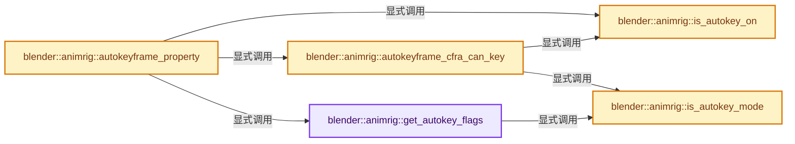

# 实现依赖专题：source/blender/animrig/intern/keyframing_auto.cc

[实现依赖导航](../../../README.md) · [符号索引](../../../../00-课程指南/02-源码与提交索引/符号依赖与实现索引.md)

本专题从正文实际调用进入，集中保存共享实现。函数有稳定锚点，可从调用处直接跳到对应完整函数；递归与互相调用通过回链组织。

## 本文件的实现关系




## 完整成员与函数实现

<a id="f-62fddfdcf07a065d"></a>

### `blender::animrig::get_autokey_flags`

实现位置：[source/blender/animrig/intern/keyframing_auto.cc](../../../../../../../../source/blender/animrig/intern/keyframing_auto.cc) · L28—L58。

接口参数：

- `const Scene *scene`

**教学注释版**

<!-- annotated:5b6f93b19515c9 -->

```cpp
static eInsertKeyFlags get_autokey_flags(const Scene *scene)
{
  eInsertKeyFlags flag = INSERTKEY_NOFLAGS;

  /* Visual keying. */
  if (is_keying_flag(scene, KEYING_FLAG_VISUALKEY)) {
    flag |= INSERTKEY_MATRIX;
  }

  /* Only needed. */
  if (is_keying_flag(scene, AUTOKEY_FLAG_INSERTNEEDED)) {
    flag |= INSERTKEY_NEEDED;
  }

  /* Only insert available. */
  if (is_keying_flag(scene, AUTOKEY_FLAG_INSERTAVAILABLE)) {
    flag |= INSERTKEY_AVAILABLE;
  }

  /* Keyframing mode - only replace existing keyframes. */
  if (is_autokey_mode(scene, AUTOKEY_MODE_EDITKEYS)) {
    flag |= INSERTKEY_REPLACE;
  }

  /* Cycle-aware keyframe insertion - preserve cycle period and flow. */
  if (is_keying_flag(scene, KEYING_FLAG_CYCLEAWARE)) {
    flag |= INSERTKEY_CYCLE_AWARE;
  }

  return flag;
}
```

<details>
<summary>核对原始源码：source/blender/animrig/intern/keyframing_auto.cc · L28—L58</summary>

<!-- original:5b6f93b19515c9:source/blender/animrig/intern/keyframing_auto.cc:28:58 -->

```cpp
static eInsertKeyFlags get_autokey_flags(const Scene *scene)
{
  eInsertKeyFlags flag = INSERTKEY_NOFLAGS;

  /* Visual keying. */
  if (is_keying_flag(scene, KEYING_FLAG_VISUALKEY)) {
    flag |= INSERTKEY_MATRIX;
  }

  /* Only needed. */
  if (is_keying_flag(scene, AUTOKEY_FLAG_INSERTNEEDED)) {
    flag |= INSERTKEY_NEEDED;
  }

  /* Only insert available. */
  if (is_keying_flag(scene, AUTOKEY_FLAG_INSERTAVAILABLE)) {
    flag |= INSERTKEY_AVAILABLE;
  }

  /* Keyframing mode - only replace existing keyframes. */
  if (is_autokey_mode(scene, AUTOKEY_MODE_EDITKEYS)) {
    flag |= INSERTKEY_REPLACE;
  }

  /* Cycle-aware keyframe insertion - preserve cycle period and flow. */
  if (is_keying_flag(scene, KEYING_FLAG_CYCLEAWARE)) {
    flag |= INSERTKEY_CYCLE_AWARE;
  }

  return flag;
}
```

</details>

**沿实际写入检查状态**

- `flag |= INSERTKEY_MATRIX;`
- `flag |= INSERTKEY_NEEDED;`
- `flag |= INSERTKEY_AVAILABLE;`
- `flag |= INSERTKEY_REPLACE;`
- `flag |= INSERTKEY_CYCLE_AWARE;`

**结果出口**

- `return flag;`

**继续追踪实现**

- `is_keying_flag` → [blender::animrig::is_keying_flag · L274](keyframing.cc.md#f-c8c75cf01bdc78fe)。
- `is_autokey_mode` → [blender::animrig::is_autokey_mode · L68](keyframing_auto.cc.md#f-125f9bb3a06567f1)。

<a id="f-ea402a040833548f"></a>

### `blender::animrig::is_autokey_on`

实现位置：[source/blender/animrig/intern/keyframing_auto.cc](../../../../../../../../source/blender/animrig/intern/keyframing_auto.cc) · L60—L66。

接口参数：

- `const Scene *scene`

**教学注释版**

<!-- annotated:71e71c670821a9 -->

```cpp
bool is_autokey_on(const Scene *scene)
{
  if (scene) {
    return scene->toolsettings->autokey_mode & AUTOKEY_ON;
  }
  return U.autokey_mode & AUTOKEY_ON;
}
```

<details>
<summary>核对原始源码：source/blender/animrig/intern/keyframing_auto.cc · L60—L66</summary>

<!-- original:71e71c670821a9:source/blender/animrig/intern/keyframing_auto.cc:60:66 -->

```cpp
bool is_autokey_on(const Scene *scene)
{
  if (scene) {
    return scene->toolsettings->autokey_mode & AUTOKEY_ON;
  }
  return U.autokey_mode & AUTOKEY_ON;
}
```

</details>

**结果出口**

- `return scene->toolsettings->autokey_mode & AUTOKEY_ON;`
- `return U.autokey_mode & AUTOKEY_ON;`

**继续追踪实现**

本实现没有需要继续展开的显式调用；检查返回表达式、对象转换和调用者前置条件。

<a id="f-125f9bb3a06567f1"></a>

### `blender::animrig::is_autokey_mode`

实现位置：[source/blender/animrig/intern/keyframing_auto.cc](../../../../../../../../source/blender/animrig/intern/keyframing_auto.cc) · L68—L74。

接口参数：

- `const Scene *scene`
- `const eAutokey_Mode mode`

**教学注释版**

<!-- annotated:3535b88be64042 -->

```cpp
bool is_autokey_mode(const Scene *scene, const eAutokey_Mode mode)
{
  if (scene) {
    return scene->toolsettings->autokey_mode == mode;
  }
  return U.autokey_mode == mode;
}
```

<details>
<summary>核对原始源码：source/blender/animrig/intern/keyframing_auto.cc · L68—L74</summary>

<!-- original:3535b88be64042:source/blender/animrig/intern/keyframing_auto.cc:68:74 -->

```cpp
bool is_autokey_mode(const Scene *scene, const eAutokey_Mode mode)
{
  if (scene) {
    return scene->toolsettings->autokey_mode == mode;
  }
  return U.autokey_mode == mode;
}
```

</details>

**结果出口**

- `return scene->toolsettings->autokey_mode == mode;`
- `return U.autokey_mode == mode;`

**继续追踪实现**

本实现没有需要继续展开的显式调用；检查返回表达式、对象转换和调用者前置条件。

<a id="f-2e95f5fb091b40e2"></a>

### `blender::animrig::autokeyframe_cfra_can_key`

实现位置：[source/blender/animrig/intern/keyframing_auto.cc](../../../../../../../../source/blender/animrig/intern/keyframing_auto.cc) · L76—L100。

接口参数：

- `const Scene *scene`
- `ID *id`

**教学注释版**

<!-- annotated:e03ce4f2f15dc7 -->

```cpp
bool autokeyframe_cfra_can_key(const Scene *scene, ID *id)
{
  /* Only filter if auto-key mode requires this. */
  if (!is_autokey_on(scene)) {
    return false;
  }

  if (is_autokey_mode(scene, AUTOKEY_MODE_EDITKEYS)) {
    /* Replace Mode:
     * For whole block, only key if there's a keyframe on that frame already
     * This is a valid assumption when we're blocking + tweaking
     */
    const float cfra = BKE_scene_frame_get(scene);
    return id_frame_has_keyframe(id, cfra);
  }

  /* Normal Mode (or treat as being normal mode):
   *
   * Just in case the flags aren't set properly (i.e. only on/off is set, without a mode)
   * let's set the "normal" flag too, so that it will all be sane everywhere...
   */
  scene->toolsettings->autokey_mode = AUTOKEY_MODE_NORMAL;

  return true;
}
```

<details>
<summary>核对原始源码：source/blender/animrig/intern/keyframing_auto.cc · L76—L100</summary>

<!-- original:e03ce4f2f15dc7:source/blender/animrig/intern/keyframing_auto.cc:76:100 -->

```cpp
bool autokeyframe_cfra_can_key(const Scene *scene, ID *id)
{
  /* Only filter if auto-key mode requires this. */
  if (!is_autokey_on(scene)) {
    return false;
  }

  if (is_autokey_mode(scene, AUTOKEY_MODE_EDITKEYS)) {
    /* Replace Mode:
     * For whole block, only key if there's a keyframe on that frame already
     * This is a valid assumption when we're blocking + tweaking
     */
    const float cfra = BKE_scene_frame_get(scene);
    return id_frame_has_keyframe(id, cfra);
  }

  /* Normal Mode (or treat as being normal mode):
   *
   * Just in case the flags aren't set properly (i.e. only on/off is set, without a mode)
   * let's set the "normal" flag too, so that it will all be sane everywhere...
   */
  scene->toolsettings->autokey_mode = AUTOKEY_MODE_NORMAL;

  return true;
}
```

</details>

**沿实际写入检查状态**

- `scene->toolsettings->autokey_mode = AUTOKEY_MODE_NORMAL;`

**结果出口**

- `return false;`
- `return id_frame_has_keyframe(id, cfra);`
- `return true;`

**继续追踪实现**

- `is_autokey_on` → [blender::animrig::is_autokey_on · L60](keyframing_auto.cc.md#f-ea402a040833548f)。
- `is_autokey_mode` → [blender::animrig::is_autokey_mode · L68](keyframing_auto.cc.md#f-125f9bb3a06567f1)。
- `BKE_scene_frame_get` → [blender::BKE_scene_frame_get · L2605](../../../02-BKE几何与数据/intern/scene.cc.md#f-f5a9b57ad7195b79)。
- `id_frame_has_keyframe` → [blender::animrig::id_frame_has_keyframe · L365](keyframing.cc.md#f-0ed6fdcacb3f3c3f)。

<a id="f-cb6b378c1c479685"></a>

### `blender::animrig::autokeyframe_property`

实现位置：[source/blender/animrig/intern/keyframing_auto.cc](../../../../../../../../source/blender/animrig/intern/keyframing_auto.cc) · L260—L351。

接口参数：

- `bContext *C`
- `Scene *scene`
- `PointerRNA *ptr`
- `PropertyRNA *prop`
- `const int rnaindex`
- `const float cfra`
- `const bool only_if_property_keyed`

**教学注释版**

<!-- annotated:07c66b7fa3e52e -->

```cpp
bool autokeyframe_property(bContext *C,
                           Scene *scene,
                           PointerRNA *ptr,
                           PropertyRNA *prop,
                           const int rnaindex,
                           const float cfra,
                           const bool only_if_property_keyed)
{

  Depsgraph *depsgraph = CTX_data_depsgraph_pointer(C);
  const AnimationEvalContext anim_eval_context = BKE_animsys_eval_context_construct(depsgraph,
                                                                                    cfra);
  bAction *action;
  bool driven;
  bool special;

  /* For entire array buttons we check the first component, it's not perfect
   * but works well enough in typical cases. */
  const int rnaindex_check = (rnaindex == -1) ? 0 : rnaindex;
  FCurve *fcu = BKE_fcurve_find_by_rna_context_ui(
      C, ptr, prop, rnaindex_check, nullptr, &action, &driven, &special);

  /* Only early out when we actually want an existing F-curve already
   * (e.g. auto-keyframing from buttons). */
  if (fcu == nullptr && (driven || special || only_if_property_keyed)) {
    return false;
  }

  if (driven) {
    return false;
  }

  bool changed = false;
  if (special) {
    /* NLA Strip property. */
    if (is_autokey_on(scene)) {
      ReportList *reports = CTX_wm_reports(C);
      ToolSettings *ts = scene->toolsettings;

      const SingleKeyingResult result = insert_keyframe_direct(
          *ptr,
          *prop,
          *fcu,
          anim_eval_context.eval_time,
          eBezTriple_KeyframeType(ts->keyframe_type),
          eInsertKeyFlags(0));
      changed = result == SingleKeyingResult::SUCCESS;
      if (result != SingleKeyingResult::SUCCESS) {
        generate_single_keying_result_report(result, reports);
      }
      WM_event_add_notifier(C, NC_ANIMATION | ND_KEYFRAME | NA_EDITED, nullptr);
    }
  }
  else {
    ID *id = ptr->owner_id;
    Main *bmain = CTX_data_main(C);

    /* TODO: this should probably respect the keyingset only option for anim */
    if (autokeyframe_cfra_can_key(scene, id)) {
      ToolSettings *ts = scene->toolsettings;
      const eInsertKeyFlags flag = get_autokey_flags(scene);

      if (only_if_property_keyed) {
        /* NOTE: We use rnaindex instead of fcu->array_index,
         *       because a button may control all items of an array at once.
         *       E.g., color wheels (see #42567). */
        BLI_assert((fcu->array_index == rnaindex) || (rnaindex == -1));
      }

      const std::optional<std::string> group = (fcu && fcu->grp) ? std::optional(fcu->grp->name) :
                                                                   std::nullopt;
      const std::string path = fcu ? std::string(fcu->rna_path()) :
                                     RNA_path_from_ID_to_property(ptr, prop).value_or("");
      /* NOTE: `rnaindex == -1` is a magic number, meaning either "operate on
       * all elements" or "not an array property". */
      const std::optional<int> array_index = rnaindex < 0 ? std::nullopt : std::optional(rnaindex);

      PointerRNA id_pointer = RNA_id_pointer_create(ptr->owner_id);
      CombinedKeyingResult result = insert_keyframes(bmain,
                                                     &id_pointer,
                                                     group,
                                                     {{path, {}, array_index}},
                                                     std::nullopt,
                                                     anim_eval_context,
                                                     eBezTriple_KeyframeType(ts->keyframe_type),
                                                     flag);
      changed = result.get_count(SingleKeyingResult::SUCCESS) != 0;
      WM_event_add_notifier(C, NC_ANIMATION | ND_KEYFRAME | NA_EDITED, nullptr);
    }
  }
  return changed;
}
```

<details>
<summary>核对原始源码：source/blender/animrig/intern/keyframing_auto.cc · L260—L351</summary>

<!-- original:07c66b7fa3e52e:source/blender/animrig/intern/keyframing_auto.cc:260:351 -->

```cpp
bool autokeyframe_property(bContext *C,
                           Scene *scene,
                           PointerRNA *ptr,
                           PropertyRNA *prop,
                           const int rnaindex,
                           const float cfra,
                           const bool only_if_property_keyed)
{

  Depsgraph *depsgraph = CTX_data_depsgraph_pointer(C);
  const AnimationEvalContext anim_eval_context = BKE_animsys_eval_context_construct(depsgraph,
                                                                                    cfra);
  bAction *action;
  bool driven;
  bool special;

  /* For entire array buttons we check the first component, it's not perfect
   * but works well enough in typical cases. */
  const int rnaindex_check = (rnaindex == -1) ? 0 : rnaindex;
  FCurve *fcu = BKE_fcurve_find_by_rna_context_ui(
      C, ptr, prop, rnaindex_check, nullptr, &action, &driven, &special);

  /* Only early out when we actually want an existing F-curve already
   * (e.g. auto-keyframing from buttons). */
  if (fcu == nullptr && (driven || special || only_if_property_keyed)) {
    return false;
  }

  if (driven) {
    return false;
  }

  bool changed = false;
  if (special) {
    /* NLA Strip property. */
    if (is_autokey_on(scene)) {
      ReportList *reports = CTX_wm_reports(C);
      ToolSettings *ts = scene->toolsettings;

      const SingleKeyingResult result = insert_keyframe_direct(
          *ptr,
          *prop,
          *fcu,
          anim_eval_context.eval_time,
          eBezTriple_KeyframeType(ts->keyframe_type),
          eInsertKeyFlags(0));
      changed = result == SingleKeyingResult::SUCCESS;
      if (result != SingleKeyingResult::SUCCESS) {
        generate_single_keying_result_report(result, reports);
      }
      WM_event_add_notifier(C, NC_ANIMATION | ND_KEYFRAME | NA_EDITED, nullptr);
    }
  }
  else {
    ID *id = ptr->owner_id;
    Main *bmain = CTX_data_main(C);

    /* TODO: this should probably respect the keyingset only option for anim */
    if (autokeyframe_cfra_can_key(scene, id)) {
      ToolSettings *ts = scene->toolsettings;
      const eInsertKeyFlags flag = get_autokey_flags(scene);

      if (only_if_property_keyed) {
        /* NOTE: We use rnaindex instead of fcu->array_index,
         *       because a button may control all items of an array at once.
         *       E.g., color wheels (see #42567). */
        BLI_assert((fcu->array_index == rnaindex) || (rnaindex == -1));
      }

      const std::optional<std::string> group = (fcu && fcu->grp) ? std::optional(fcu->grp->name) :
                                                                   std::nullopt;
      const std::string path = fcu ? std::string(fcu->rna_path()) :
                                     RNA_path_from_ID_to_property(ptr, prop).value_or("");
      /* NOTE: `rnaindex == -1` is a magic number, meaning either "operate on
       * all elements" or "not an array property". */
      const std::optional<int> array_index = rnaindex < 0 ? std::nullopt : std::optional(rnaindex);

      PointerRNA id_pointer = RNA_id_pointer_create(ptr->owner_id);
      CombinedKeyingResult result = insert_keyframes(bmain,
                                                     &id_pointer,
                                                     group,
                                                     {{path, {}, array_index}},
                                                     std::nullopt,
                                                     anim_eval_context,
                                                     eBezTriple_KeyframeType(ts->keyframe_type),
                                                     flag);
      changed = result.get_count(SingleKeyingResult::SUCCESS) != 0;
      WM_event_add_notifier(C, NC_ANIMATION | ND_KEYFRAME | NA_EDITED, nullptr);
    }
  }
  return changed;
}
```

</details>

**沿实际写入检查状态**

- `changed = result == SingleKeyingResult::SUCCESS;`
- `changed = result.get_count(SingleKeyingResult::SUCCESS) != 0;`

**结果出口**

- `return false;`
- `return changed;`

**继续追踪实现**

- `CTX_data_depsgraph_pointer` → [blender::CTX_data_depsgraph_pointer · L1746](../../../02-BKE几何与数据/intern/context.cc.md#f-461ab8150c5d4d18)。
- `BKE_animsys_eval_context_construct` → [blender::BKE_animsys_eval_context_construct · L602](../../../02-BKE几何与数据/intern/anim_sys.cc.md#f-af44793c19c0ddcc)。
- `BKE_fcurve_find_by_rna_context_ui` → [blender::BKE_fcurve_find_by_rna_context_ui · L383](../../../02-BKE几何与数据/intern/fcurve.cc.md#f-ac8daff42475301f)。
- `is_autokey_on` → [blender::animrig::is_autokey_on · L60](keyframing_auto.cc.md#f-ea402a040833548f)。
- `CTX_wm_reports` → [blender::CTX_wm_reports · L991](../../../02-BKE几何与数据/intern/context.cc.md#f-ada8e83c6b09fb3a)。
- `insert_keyframe_direct` → [blender::animrig::insert_keyframe_direct · L431](keyframing.cc.md#f-ca1660da3309bde1)。
- `eBezTriple_KeyframeType` → [blender::eBezTriple_KeyframeType](../../makesdna/DNA_curve_enums.h.md#t-cc9e594b0d3e)。
- `eInsertKeyFlags` → [blender::eInsertKeyFlags](../ANIM_keyingsets.hh.md#t-b8445b6e2731)；[blender::eInsertKeyFlags](../../../02-BKE几何与数据/BKE_animsys.hh.md#t-d49cd8bc8194)；[blender::eInsertKeyFlags](../../makesdna/DNA_anim_enums.h.md#t-1f2167ad3a7d)。
- `generate_single_keying_result_report` → [blender::animrig::generate_single_keying_result_report · L50](keyframing.cc.md#f-79a958d707c50aae)。
- `WM_event_add_notifier` → [blender::WM_event_add_notifier · L396](../../windowmanager/intern/wm_event_system.cc.md#f-a1b32e7f4a69b28f)。
- `CTX_data_main` → [blender::CTX_data_main · L1313](../../../02-BKE几何与数据/intern/context.cc.md#f-6d4ba24a62a80b94)。
- `autokeyframe_cfra_can_key` → [blender::animrig::autokeyframe_cfra_can_key · L76](keyframing_auto.cc.md#f-2e95f5fb091b40e2)。
- `get_autokey_flags` → [blender::animrig::get_autokey_flags · L28](keyframing_auto.cc.md#f-62fddfdcf07a065d)。
- `BLI_assert` → [BLI_assert · L48](../../../01-BLI基础库/BLI_assert.hh.md#m-57a88495704d)；[BLI_assert · L63](../../../01-BLI基础库/BLI_assert.hh.md#m-d07050020cb5)。宏定义由构建条件选择。
- `std::optional` → [外部契约](https://eel.is/c++draft/)：这个边界按实际表达式及所属类型核对参数、返回值、寿命与失败行为。这里提供接口入口，不声称已解释该第三方版本的内部实现。
- `std::string` → [外部契约](https://eel.is/c++draft/)：这个边界按实际表达式及所属类型核对参数、返回值、寿命与失败行为。这里提供接口入口，不声称已解释该第三方版本的内部实现。
- `fcu->rna_path` → [blender::FCurve::rna_path · L189](../../../02-BKE几何与数据/intern/fcurve.cc.md#f-b3be61588d36ab9c)。
- `RNA_path_from_ID_to_property(ptr, prop).value_or` → [调用协议](../../../../00-课程指南/01-路线与规范/模板宏与动态分派协议.md)：接收对象类型依赖auto、返回值或模板实例；不按同名猜测目标。调用位置L332。
- `RNA_path_from_ID_to_property` → [blender::RNA_path_from_ID_to_property · L1234](../../makesrna/intern/rna_path.cc.md#f-ef329046496e4c69)。
- `RNA_id_pointer_create` → [blender::RNA_id_pointer_create · L170](../../makesrna/intern/rna_access.cc.md#f-d41a2d612ae3a7b6)。
- `insert_keyframes` → [blender::animrig::insert_keyframes · L729](keyframing.cc.md#f-20cf2cb4f58620b7)。
- `result.get_count` → [blender::animrig::CombinedKeyingResult::get_count · L114](keyframing.cc.md#f-73cf19d0c88f72bf)。
