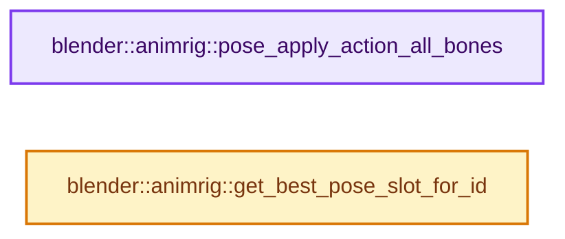
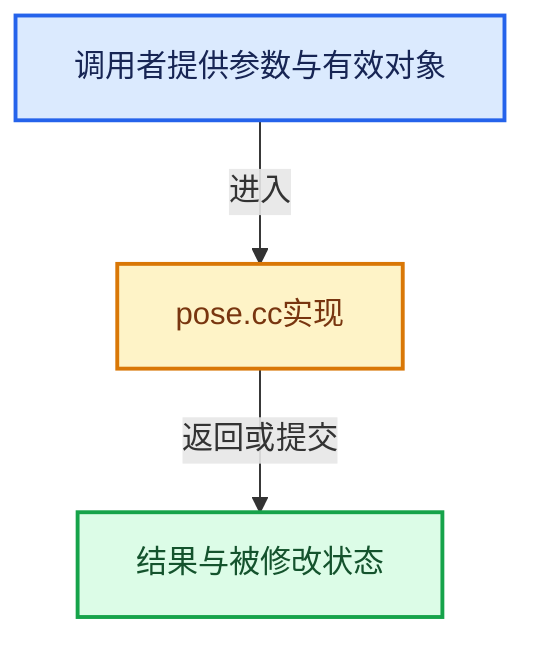

# 实现依赖专题：source/blender/animrig/intern/pose.cc

[实现依赖导航](../../../README.md) · [符号索引](../../../../00-课程指南/02-源码与提交索引/符号依赖与实现索引.md)

本专题从正文实际调用进入，集中保存共享实现。函数有稳定锚点，可从调用处直接跳到对应完整函数；递归与互相调用通过回链组织。

## 本文件的实现关系






## 完整成员与函数实现

<a id="f-7ddbe7230373f0be"></a>

### `blender::animrig::pose_apply_action_all_bones`

实现位置：[source/blender/animrig/intern/pose.cc](../../../../../../../../source/blender/animrig/intern/pose.cc) · L399—L406。

接口参数：

- `Object *ob`
- `bAction *action`
- `const int32_t slot_handle`
- `const AnimationEvalContext *anim_eval_context`

**教学注释版**

<!-- annotated:f363f47c8f8d97 -->

```cpp
void pose_apply_action_all_bones(Object *ob,
                                 bAction *action,
                                 const int32_t slot_handle,
                                 const AnimationEvalContext *anim_eval_context)
{
  PointerRNA pose_owner_ptr = RNA_id_pointer_create(&ob->id);
  animsys_evaluate_action(&pose_owner_ptr, action, slot_handle, anim_eval_context, false);
}
```

<details>
<summary>核对原始源码：source/blender/animrig/intern/pose.cc · L399—L406</summary>

<!-- original:f363f47c8f8d97:source/blender/animrig/intern/pose.cc:399:406 -->

```cpp
void pose_apply_action_all_bones(Object *ob,
                                 bAction *action,
                                 const int32_t slot_handle,
                                 const AnimationEvalContext *anim_eval_context)
{
  PointerRNA pose_owner_ptr = RNA_id_pointer_create(&ob->id);
  animsys_evaluate_action(&pose_owner_ptr, action, slot_handle, anim_eval_context, false);
}
```

</details>

**继续追踪实现**

- `RNA_id_pointer_create` → [blender::RNA_id_pointer_create · L170](../../makesrna/intern/rna_access.cc.md#f-d41a2d612ae3a7b6)。
- `animsys_evaluate_action` → [blender::animsys_evaluate_action · L686](../../../02-BKE几何与数据/intern/anim_sys.cc.md#f-71bebbefd7b9ff7f)。

<a id="f-30b0f2d18d49d1d9"></a>

### `blender::animrig::get_best_pose_slot_for_id`

实现位置：[source/blender/animrig/intern/pose.cc](../../../../../../../../source/blender/animrig/intern/pose.cc) · L471—L482。

接口参数：

- `const ID &id`
- `Action &pose_data`

**教学注释版**

<!-- annotated:dd1f50d441a536 -->

```cpp
Slot &get_best_pose_slot_for_id(const ID &id, Action &pose_data)
{
  BLI_assert_msg(pose_data.slot_array_num > 0,
                 "Actions without slots have no data. This should have been caught earlier.");

  Slot *slot = generic_slot_for_autoassign(id, pose_data, "");
  if (slot == nullptr) {
    slot = pose_data.slot(0);
  }

  return *slot;
}
```

<details>
<summary>核对原始源码：source/blender/animrig/intern/pose.cc · L471—L482</summary>

<!-- original:dd1f50d441a536:source/blender/animrig/intern/pose.cc:471:482 -->

```cpp
Slot &get_best_pose_slot_for_id(const ID &id, Action &pose_data)
{
  BLI_assert_msg(pose_data.slot_array_num > 0,
                 "Actions without slots have no data. This should have been caught earlier.");

  Slot *slot = generic_slot_for_autoassign(id, pose_data, "");
  if (slot == nullptr) {
    slot = pose_data.slot(0);
  }

  return *slot;
}
```

</details>

**沿实际写入检查状态**

- `slot = pose_data.slot(0);`

**结果出口**

- `return *slot;`

**继续追踪实现**

- `BLI_assert_msg` → [BLI_assert_msg · L55](../../../01-BLI基础库/BLI_assert.hh.md#m-695eed20dceb)；[BLI_assert_msg · L64](../../../01-BLI基础库/BLI_assert.hh.md#m-7de5563de4db)。宏定义由构建条件选择。
- `generic_slot_for_autoassign` → [blender::animrig::generic_slot_for_autoassign · L1318](action.cc.md#f-864f23e3022f255a)。
- `pose_data.slot` → [blender::animrig::Action::slot · L343](action.cc.md#f-02b0b1c350f019e3)；[blender::animrig::Action::slot · L347](action.cc.md#f-1deb47cf988a4697)。同名重载需按实参类型选择。
