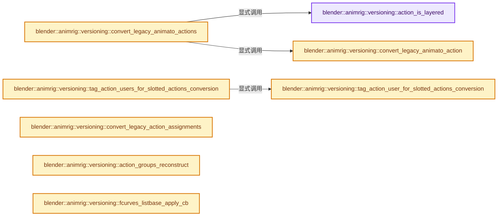
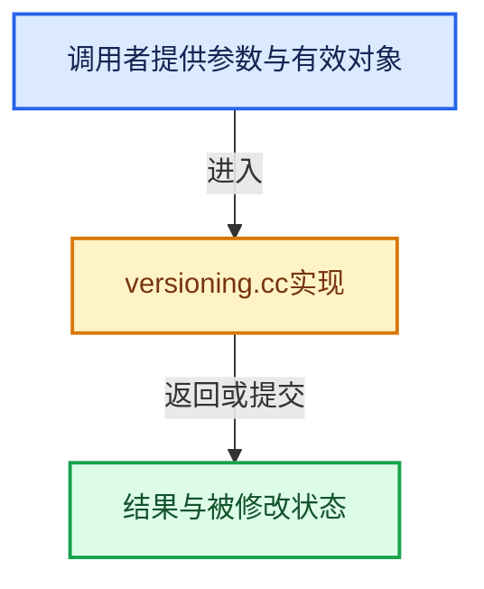

# 实现依赖专题：source/blender/animrig/intern/versioning.cc

[实现依赖导航](../../../README.md) · [符号索引](../../../../00-课程指南/02-源码与提交索引/符号依赖与实现索引.md)

本专题从正文实际调用进入，集中保存共享实现。函数有稳定锚点，可从调用处直接跳到对应完整函数；递归与互相调用通过回链组织。

## 本文件的实现关系






## 完整成员与函数实现

<a id="f-d66eaac2c524592b"></a>

### `blender::animrig::versioning::action_is_layered`

实现位置：[source/blender/animrig/intern/versioning.cc](../../../../../../../../source/blender/animrig/intern/versioning.cc) · L38—L54。

接口参数：

- `const bAction &dna_action`

**教学注释版**

<!-- annotated:8d9b700702af66 -->

```cpp
bool action_is_layered(const bAction &dna_action)
{
  /* NOTE: due to how forward-compatibility is handled when writing Actions to
   * blend files, it is important that this function does NOT check
   * `Action.idroot` as part of its determination of whether this is a layered
   * action or not.
   *
   * See: `action_blend_write()` and `action_blend_read_data()`
   */

  const animrig::Action &action = dna_action.wrap();

  const bool has_layered_data = action.layer_array_num > 0 || action.slot_array_num > 0;
  const bool has_animato_data = !(action.curves.is_empty() && action.groups.is_empty());

  return has_layered_data || !has_animato_data;
}
```

<details>
<summary>核对原始源码：source/blender/animrig/intern/versioning.cc · L38—L54</summary>

<!-- original:8d9b700702af66:source/blender/animrig/intern/versioning.cc:38:54 -->

```cpp
bool action_is_layered(const bAction &dna_action)
{
  /* NOTE: due to how forward-compatibility is handled when writing Actions to
   * blend files, it is important that this function does NOT check
   * `Action.idroot` as part of its determination of whether this is a layered
   * action or not.
   *
   * See: `action_blend_write()` and `action_blend_read_data()`
   */

  const animrig::Action &action = dna_action.wrap();

  const bool has_layered_data = action.layer_array_num > 0 || action.slot_array_num > 0;
  const bool has_animato_data = !(action.curves.is_empty() && action.groups.is_empty());

  return has_layered_data || !has_animato_data;
}
```

</details>

**结果出口**

- `return has_layered_data || !has_animato_data;`

**继续追踪实现**

- `dna_action.wrap` → [blender::bAction::wrap · L1929](../ANIM_action.hh.md#f-f049614274fd7a45)；[blender::bAction::wrap · L1933](../ANIM_action.hh.md#f-2d697d1983fd282f)。同名重载需按实参类型选择。
- `action.curves.is_empty` → [调用协议](../../../../00-课程指南/01-路线与规范/模板宏与动态分派协议.md)：接收对象类型依赖auto、返回值或模板实例；不按同名猜测目标。调用位置L51。
- `action.groups.is_empty` → [调用协议](../../../../00-课程指南/01-路线与规范/模板宏与动态分派协议.md)：接收对象类型依赖auto、返回值或模板实例；不按同名猜测目标。调用位置L51。

<a id="f-6b4307bdcb70f669"></a>

### `blender::animrig::versioning::convert_legacy_animato_actions`

实现位置：[source/blender/animrig/intern/versioning.cc](../../../../../../../../source/blender/animrig/intern/versioning.cc) · L56—L72。

接口参数：

- `Main &bmain`

**教学注释版**

<!-- annotated:1715c051acf489 -->

```cpp
void convert_legacy_animato_actions(Main &bmain)
{
  for (bAction &dna_action : bmain.actions) {
    animrig::Action &action = dna_action.wrap();

    if (action_is_layered(action) && !action.is_empty()) {
      /* This is just a safety net. Blender files that trigger this versioning code are not
       * expected to have any layered/slotted Actions.
       *
       * Empty Actions, even though they are valid "layered" Actions, should still get through
       * versioning, though, to ensure they have the default "Legacy Slot" and a zero idroot. */
      continue;
    }

    convert_legacy_animato_action(action);
  }
}
```

<details>
<summary>核对原始源码：source/blender/animrig/intern/versioning.cc · L56—L72</summary>

<!-- original:1715c051acf489:source/blender/animrig/intern/versioning.cc:56:72 -->

```cpp
void convert_legacy_animato_actions(Main &bmain)
{
  for (bAction &dna_action : bmain.actions) {
    animrig::Action &action = dna_action.wrap();

    if (action_is_layered(action) && !action.is_empty()) {
      /* This is just a safety net. Blender files that trigger this versioning code are not
       * expected to have any layered/slotted Actions.
       *
       * Empty Actions, even though they are valid "layered" Actions, should still get through
       * versioning, though, to ensure they have the default "Legacy Slot" and a zero idroot. */
      continue;
    }

    convert_legacy_animato_action(action);
  }
}
```

</details>

**继续追踪实现**

- `dna_action.wrap` → [调用协议](../../../../00-课程指南/01-路线与规范/模板宏与动态分派协议.md)：接收对象类型依赖auto、返回值或模板实例；不按同名猜测目标。调用位置L59。
- `action_is_layered` → [blender::animrig::versioning::action_is_layered · L38](versioning.cc.md#f-d66eaac2c524592b)。
- `action.is_empty` → [blender::animrig::Action::is_empty · L218](action.cc.md#f-ac5fa5477cb9b770)。
- `convert_legacy_animato_action` → [blender::animrig::versioning::convert_legacy_animato_action · L74](versioning.cc.md#f-5a992f6aa64dcbd8)。

<a id="f-5a992f6aa64dcbd8"></a>

### `blender::animrig::versioning::convert_legacy_animato_action`

实现位置：[source/blender/animrig/intern/versioning.cc](../../../../../../../../source/blender/animrig/intern/versioning.cc) · L74—L138。

接口参数：

- `bAction &dna_action`

**教学注释版**

<!-- annotated:cc8273931ea4ae -->

```cpp
void convert_legacy_animato_action(bAction &dna_action)
{
  Action &action = dna_action.wrap();
  /* Check that this is a legacy action.
   * Cannot use `!action_is_layered` because that would be false on empty actions. */
  BLI_assert(action.layer_array_num == 0 && action.slot_array_num == 0);

  /* Store this ahead of time, because adding the slot sets the action's idroot
   * to 0. We also set the action's idroot to 0 manually, just to be defensive
   * so we don't depend on esoteric behavior in `slot_add()`. */
  const int16_t idtype = action.idroot;
  action.idroot = 0;

  /* Initialize the Action's last_slot_handle field to its default value, before
   * we create a new slot. */
  action.last_slot_handle = DNA_DEFAULT_ACTION_LAST_SLOT_HANDLE;

  Slot &slot = action.slot_add();
  slot.idtype = idtype;

  const std::string slot_identifier{slot.idtype_string() +
                                    DATA_(legacy::DEFAULT_LEGACY_SLOT_NAME)};
  action.slot_identifier_define(slot, slot_identifier);

  Layer &layer = action.layer_add(DATA_(legacy::DEFAULT_LEGACY_LAYER_NAME));
  animrig::Strip &strip = layer.strip_add(action, animrig::Strip::Type::Keyframe);
  Channelbag &bag = strip.data<StripKeyframeData>(action).channelbag_for_slot_ensure(slot);
  const int fcu_count = action.curves.count();
  const int group_count = action.groups.count();
  bag.fcurve_array = MEM_new_array_zeroed<FCurve *>(fcu_count, "Action versioning - fcurves");
  bag.fcurve_array_num = fcu_count;
  bag.group_array = MEM_new_array_zeroed<bActionGroup *>(group_count,
                                                         "Action versioning - groups");
  bag.group_array_num = group_count;

  int fcurve_index = 0;
  for (const auto [group_index, group] : action.groups.enumerate()) {
    bag.group_array[group_index] = &group;

    group.channelbag = &bag;
    group.fcurve_range_start = fcurve_index;

    for (FCurve &fcu : group.channels) {
      if (fcu.grp != &group) {
        break;
      }
      bag.fcurve_array[fcurve_index++] = &fcu;
    }

    group.fcurve_range_length = fcurve_index - group.fcurve_range_start;
  }

  for (FCurve &fcu : action.curves) {
    /* Any fcurves with groups have already been added to the fcurve array. */
    if (fcu.grp) {
      continue;
    }
    bag.fcurve_array[fcurve_index++] = &fcu;
  }

  BLI_assert(fcurve_index == fcu_count);

  action.curves = {nullptr, nullptr};
  action.groups = {nullptr, nullptr};
}
```

<details>
<summary>核对原始源码：source/blender/animrig/intern/versioning.cc · L74—L138</summary>

<!-- original:cc8273931ea4ae:source/blender/animrig/intern/versioning.cc:74:138 -->

```cpp
void convert_legacy_animato_action(bAction &dna_action)
{
  Action &action = dna_action.wrap();
  /* Check that this is a legacy action.
   * Cannot use `!action_is_layered` because that would be false on empty actions. */
  BLI_assert(action.layer_array_num == 0 && action.slot_array_num == 0);

  /* Store this ahead of time, because adding the slot sets the action's idroot
   * to 0. We also set the action's idroot to 0 manually, just to be defensive
   * so we don't depend on esoteric behavior in `slot_add()`. */
  const int16_t idtype = action.idroot;
  action.idroot = 0;

  /* Initialize the Action's last_slot_handle field to its default value, before
   * we create a new slot. */
  action.last_slot_handle = DNA_DEFAULT_ACTION_LAST_SLOT_HANDLE;

  Slot &slot = action.slot_add();
  slot.idtype = idtype;

  const std::string slot_identifier{slot.idtype_string() +
                                    DATA_(legacy::DEFAULT_LEGACY_SLOT_NAME)};
  action.slot_identifier_define(slot, slot_identifier);

  Layer &layer = action.layer_add(DATA_(legacy::DEFAULT_LEGACY_LAYER_NAME));
  animrig::Strip &strip = layer.strip_add(action, animrig::Strip::Type::Keyframe);
  Channelbag &bag = strip.data<StripKeyframeData>(action).channelbag_for_slot_ensure(slot);
  const int fcu_count = action.curves.count();
  const int group_count = action.groups.count();
  bag.fcurve_array = MEM_new_array_zeroed<FCurve *>(fcu_count, "Action versioning - fcurves");
  bag.fcurve_array_num = fcu_count;
  bag.group_array = MEM_new_array_zeroed<bActionGroup *>(group_count,
                                                         "Action versioning - groups");
  bag.group_array_num = group_count;

  int fcurve_index = 0;
  for (const auto [group_index, group] : action.groups.enumerate()) {
    bag.group_array[group_index] = &group;

    group.channelbag = &bag;
    group.fcurve_range_start = fcurve_index;

    for (FCurve &fcu : group.channels) {
      if (fcu.grp != &group) {
        break;
      }
      bag.fcurve_array[fcurve_index++] = &fcu;
    }

    group.fcurve_range_length = fcurve_index - group.fcurve_range_start;
  }

  for (FCurve &fcu : action.curves) {
    /* Any fcurves with groups have already been added to the fcurve array. */
    if (fcu.grp) {
      continue;
    }
    bag.fcurve_array[fcurve_index++] = &fcu;
  }

  BLI_assert(fcurve_index == fcu_count);

  action.curves = {nullptr, nullptr};
  action.groups = {nullptr, nullptr};
}
```

</details>

**沿实际写入检查状态**

- `action.idroot = 0;`
- `action.last_slot_handle = DNA_DEFAULT_ACTION_LAST_SLOT_HANDLE;`
- `slot.idtype = idtype;`
- `bag.fcurve_array = MEM_new_array_zeroed<FCurve *>(fcu_count, "Action versioning - fcurves");`
- `bag.fcurve_array_num = fcu_count;`
- `bag.group_array = MEM_new_array_zeroed<bActionGroup *>(group_count,`
- `bag.group_array_num = group_count;`
- `bag.group_array[group_index] = &group;`
- `group.channelbag = &bag;`
- `group.fcurve_range_start = fcurve_index;`
- `group.fcurve_range_length = fcurve_index - group.fcurve_range_start;`
- `action.curves = {nullptr, nullptr};`
- `action.groups = {nullptr, nullptr};`

**继续追踪实现**

- `dna_action.wrap` → [blender::bAction::wrap · L1929](../ANIM_action.hh.md#f-f049614274fd7a45)；[blender::bAction::wrap · L1933](../ANIM_action.hh.md#f-2d697d1983fd282f)。同名重载需按实参类型选择。
- `BLI_assert` → [BLI_assert · L48](../../../01-BLI基础库/BLI_assert.hh.md#m-57a88495704d)；[BLI_assert · L63](../../../01-BLI基础库/BLI_assert.hh.md#m-d07050020cb5)。宏定义由构建条件选择。
- `action.slot_add` → [blender::animrig::Action::slot_add · L491](action.cc.md#f-ff6b109a91759a3c)。
- `slot.idtype_string` → [blender::animrig::Slot::idtype_string · L1106](action.cc.md#f-7824e9d911c30164)。
- `DATA_` → [DATA_ · L52](../../blentranslation/BLT_translation.hh.md#m-178736083f83)。宏定义由构建条件选择。
- `action.slot_identifier_define` → [blender::animrig::Action::slot_identifier_define · L427](action.cc.md#f-d8642a85c4687e51)。
- `action.layer_add` → [blender::animrig::Action::layer_add · L245](action.cc.md#f-b07f978172b35e86)。
- `layer.strip_add` → [blender::animrig::Layer::strip_add · L926](action.cc.md#f-2fb3f62c5c63c3f2)。
- `strip.data<StripKeyframeData>(action).channelbag_for_slot_ensure` → [调用协议](../../../../00-课程指南/01-路线与规范/模板宏与动态分派协议.md)：接收对象类型依赖auto、返回值或模板实例；不按同名猜测目标。调用位置L100。
- `strip.data<StripKeyframeData>` → [调用协议](../../../../00-课程指南/01-路线与规范/模板宏与动态分派协议.md)：由接收对象具体类型或运行时策略提供实现。调用位置L100。
- `action.curves.count` → [调用协议](../../../../00-课程指南/01-路线与规范/模板宏与动态分派协议.md)：接收对象类型依赖auto、返回值或模板实例；不按同名猜测目标。调用位置L101。
- `action.groups.count` → [调用协议](../../../../00-课程指南/01-路线与规范/模板宏与动态分派协议.md)：接收对象类型依赖auto、返回值或模板实例；不按同名猜测目标。调用位置L102。
- `MEM_new_array_zeroed<FCurve *>` → [MEM_new_array_zeroed · L566](../../../07-Intern运行时与平台/guardedalloc/MEM_guardedalloc.h.md#f-3a0cf63fb5216500)；[MEM_new_array_zeroed · L119](../../../07-Intern运行时与平台/guardedalloc/intern/mallocn.cc.md#f-6825557da566fdbe)。同名重载需按实参类型选择。
- `MEM_new_array_zeroed<bActionGroup *>` → [MEM_new_array_zeroed · L566](../../../07-Intern运行时与平台/guardedalloc/MEM_guardedalloc.h.md#f-3a0cf63fb5216500)；[MEM_new_array_zeroed · L119](../../../07-Intern运行时与平台/guardedalloc/intern/mallocn.cc.md#f-6825557da566fdbe)。同名重载需按实参类型选择。
- `action.groups.enumerate` → [调用协议](../../../../00-课程指南/01-路线与规范/模板宏与动态分派协议.md)：接收对象类型依赖auto、返回值或模板实例；不按同名猜测目标。调用位置L110。

<a id="f-2581c71a04c5bfe5"></a>

### `blender::animrig::versioning::tag_action_user_for_slotted_actions_conversion`

实现位置：[source/blender/animrig/intern/versioning.cc](../../../../../../../../source/blender/animrig/intern/versioning.cc) · L140—L143。

接口参数：

- `ID &animated_id`

**教学注释版**

<!-- annotated:b16c4a08a24f28 -->

```cpp
void tag_action_user_for_slotted_actions_conversion(ID &animated_id)
{
  animated_id.runtime->readfile_data->tags.action_assignment_needs_slot = true;
}
```

<details>
<summary>核对原始源码：source/blender/animrig/intern/versioning.cc · L140—L143</summary>

<!-- original:b16c4a08a24f28:source/blender/animrig/intern/versioning.cc:140:143 -->

```cpp
void tag_action_user_for_slotted_actions_conversion(ID &animated_id)
{
  animated_id.runtime->readfile_data->tags.action_assignment_needs_slot = true;
}
```

</details>

**沿实际写入检查状态**

- `animated_id.runtime->readfile_data->tags.action_assignment_needs_slot = true;`

**继续追踪实现**

本实现没有需要继续展开的显式调用；检查返回表达式、对象转换和调用者前置条件。

<a id="f-5554a8fa76071ed0"></a>

### `blender::animrig::versioning::tag_action_users_for_slotted_actions_conversion`

实现位置：[source/blender/animrig/intern/versioning.cc](../../../../../../../../source/blender/animrig/intern/versioning.cc) · L145—L175。

接口参数：

- `Main &bmain`

**教学注释版**

<!-- annotated:2e1e4ced18e64a -->

```cpp
void tag_action_users_for_slotted_actions_conversion(Main &bmain)
{
  /* This function is only called when the blend-file is old enough to NOT use
   * slotted Actions, so we can safely tag anything that uses an Action. */

  auto flag_adt = [](ID &animated_id,
                     bAction *& /*action_ptr_ref*/,
                     slot_handle_t & /*slot_handle_ref*/,
                     char * /*last_slot_identifier*/) -> bool {
    tag_action_user_for_slotted_actions_conversion(animated_id);

    /* Once tagged, the foreach loop can stop, because more tagging of the same
     * ID doesn't do anything. */
    return false;
  };

  ID *id;
  FOREACH_MAIN_ID_BEGIN (&bmain, id) {
    foreach_action_slot_use_with_references(*id, flag_adt);

    /* Process embedded IDs, as these are not listed in bmain, but still can
     * have their own Action+Slot. Unfortunately there is no generic looper
     * for embedded IDs. At this moment the only animatable embedded ID is a
     * node tree. */
    bNodeTree *node_tree = bke::node_tree_from_id(id);
    if (node_tree) {
      foreach_action_slot_use_with_references(node_tree->id, flag_adt);
    }
  }
  FOREACH_MAIN_ID_END;
}
```

<details>
<summary>核对原始源码：source/blender/animrig/intern/versioning.cc · L145—L175</summary>

<!-- original:2e1e4ced18e64a:source/blender/animrig/intern/versioning.cc:145:175 -->

```cpp
void tag_action_users_for_slotted_actions_conversion(Main &bmain)
{
  /* This function is only called when the blend-file is old enough to NOT use
   * slotted Actions, so we can safely tag anything that uses an Action. */

  auto flag_adt = [](ID &animated_id,
                     bAction *& /*action_ptr_ref*/,
                     slot_handle_t & /*slot_handle_ref*/,
                     char * /*last_slot_identifier*/) -> bool {
    tag_action_user_for_slotted_actions_conversion(animated_id);

    /* Once tagged, the foreach loop can stop, because more tagging of the same
     * ID doesn't do anything. */
    return false;
  };

  ID *id;
  FOREACH_MAIN_ID_BEGIN (&bmain, id) {
    foreach_action_slot_use_with_references(*id, flag_adt);

    /* Process embedded IDs, as these are not listed in bmain, but still can
     * have their own Action+Slot. Unfortunately there is no generic looper
     * for embedded IDs. At this moment the only animatable embedded ID is a
     * node tree. */
    bNodeTree *node_tree = bke::node_tree_from_id(id);
    if (node_tree) {
      foreach_action_slot_use_with_references(node_tree->id, flag_adt);
    }
  }
  FOREACH_MAIN_ID_END;
}
```

</details>

**结果出口**

- `return false;`

**继续追踪实现**

- `tag_action_user_for_slotted_actions_conversion` → [blender::animrig::versioning::tag_action_user_for_slotted_actions_conversion · L140](versioning.cc.md#f-2581c71a04c5bfe5)。
- `FOREACH_MAIN_ID_BEGIN` → [FOREACH_MAIN_ID_BEGIN · L726](../../../02-BKE几何与数据/BKE_main.hh.md#m-66b3928ce408)。宏定义由构建条件选择。
- `foreach_action_slot_use_with_references` → [blender::animrig::foreach_action_slot_use_with_references · L112](action_iterators.cc.md#f-e703132eca642ba1)。
- `bke::node_tree_from_id` → [blender::bke::node_tree_from_id · L5337](../../../02-BKE几何与数据/intern/node.cc.md#f-9bb7511df53d8493)。

<a id="f-17e6682c82478f1b"></a>

### `blender::animrig::versioning::convert_legacy_action_assignments`

实现位置：[source/blender/animrig/intern/versioning.cc](../../../../../../../../source/blender/animrig/intern/versioning.cc) · L177—L267。

接口参数：

- `Main &bmain`
- `ReportList *reports`

**教学注释版**

<!-- annotated:42d1035107c947 -->

```cpp
void convert_legacy_action_assignments(Main &bmain, ReportList *reports)
{
  auto version_slot_assignment = [&](ID &animated_id,
                                     bAction *dna_action,
                                     PointerRNA &action_slot_owner_ptr,
                                     PropertyRNA &action_slot_prop,
                                     char *last_used_slot_identifier) {
    BLI_assert(dna_action); /* Ensured by the foreach loop. */
    Action &action = dna_action->wrap();

    if (action.slot_array_num == 0) {
      /* There's a few reasons why this Action doesn't have a slot. It could simply be a slotted
       * Action without slots, or a legacy-but-not-yet-versioned Action, or it could be it is a
       * _really_ old (pre-2.50) Action. The latter are upgraded in do_versions_after_setup(), but
       * this function can be called earlier than that. So better gracefully skip those. */
      return true;
    }

    /* If there is already a slot assigned, there's nothing to do here. */
    PointerRNA current_slot_ptr = RNA_property_pointer_get(&action_slot_owner_ptr,
                                                           &action_slot_prop);
    if (current_slot_ptr) {
      return true;
    }

    /* Reset the "last used slot identifier" to the default "Legacy Slot". That way
     * generic_slot_for_autoassign() will pick up on legacy slots automatically.
     *
     * Note that this function should only run on legacy users of Actions, i.e. they are not
     * expected to have any last-used slot at all. The field in DNA can still be set, though,
     * because the 4.3 code already has the data model for slotted Actions. */

    /* Ensure that the identifier has the correct ID type prefix. */
    *reinterpret_cast<short *>(last_used_slot_identifier) = GS(animated_id.name);

    static_assert(Slot::identifier_length_max > 2); /* Because of the -2 below. */
    BLI_strncpy_utf8(last_used_slot_identifier + 2,
                     DATA_(legacy::DEFAULT_LEGACY_SLOT_NAME),
                     Slot::identifier_length_max - 2);

    Slot *slot_to_assign = generic_slot_for_autoassign(
        animated_id, action, last_used_slot_identifier);
    if (!slot_to_assign) {
      /* This means that there is no slot that can be found by name, not even the "Legacy Slot"
       * name. Keep the ID unanimated, as this means that the referenced Action has changed
       * significantly since this file was opened. */
      BKE_reportf(reports,
                  RPT_WARNING,
                  "\"%s\" is using Action \"%s\", which does not have a slot with identifier "
                  "\"%s\" or \"%s\". Manually assign the right action slot to \"%s\".\n",
                  animated_id.name,
                  action.id.name + 2,
                  last_used_slot_identifier,
                  animated_id.name,
                  animated_id.name + 2);
      return true;
    }

    PointerRNA slot_to_assign_ptr = RNA_pointer_create_discrete(
        &action.id, RNA_ActionSlot, slot_to_assign);
    RNA_property_pointer_set(
        &action_slot_owner_ptr, &action_slot_prop, slot_to_assign_ptr, reports);
    RNA_property_update_main(&bmain, nullptr, &action_slot_owner_ptr, &action_slot_prop);

    return true;
  };

  /* Note that the code below does not remove the `action_assignment_needs_slot` tag. One ID can
   * use multiple Actions (via NLA, Action constraints, etc.); if one of those Action is a legacy
   * one from a linked datablock, this ID may needs to be re-visited after the library file was
   * versioned. Rather than trying to figure out if re-visiting is necessary, this function is safe
   * to call multiple times, and all that's lost is a little bit of CPU time. */

  ID *id;
  FOREACH_MAIN_ID_BEGIN (&bmain, id) {
    /* Process the ID itself. */
    if (BLO_readfile_id_runtime_tags(*id).action_assignment_needs_slot) {
      foreach_action_slot_use_with_rna(*id, version_slot_assignment);
    }

    /* Process embedded IDs, as these are not listed in bmain, but still can
     * have their own Action+Slot. Unfortunately there is no generic looper
     * for embedded IDs. At this moment the only animatable embedded ID is a
     * node tree. */
    bNodeTree *node_tree = bke::node_tree_from_id(id);
    if (node_tree && BLO_readfile_id_runtime_tags(node_tree->id).action_assignment_needs_slot) {
      foreach_action_slot_use_with_rna(node_tree->id, version_slot_assignment);
    }
  }
  FOREACH_MAIN_ID_END;
}
```

<details>
<summary>核对原始源码：source/blender/animrig/intern/versioning.cc · L177—L267</summary>

<!-- original:42d1035107c947:source/blender/animrig/intern/versioning.cc:177:267 -->

```cpp
void convert_legacy_action_assignments(Main &bmain, ReportList *reports)
{
  auto version_slot_assignment = [&](ID &animated_id,
                                     bAction *dna_action,
                                     PointerRNA &action_slot_owner_ptr,
                                     PropertyRNA &action_slot_prop,
                                     char *last_used_slot_identifier) {
    BLI_assert(dna_action); /* Ensured by the foreach loop. */
    Action &action = dna_action->wrap();

    if (action.slot_array_num == 0) {
      /* There's a few reasons why this Action doesn't have a slot. It could simply be a slotted
       * Action without slots, or a legacy-but-not-yet-versioned Action, or it could be it is a
       * _really_ old (pre-2.50) Action. The latter are upgraded in do_versions_after_setup(), but
       * this function can be called earlier than that. So better gracefully skip those. */
      return true;
    }

    /* If there is already a slot assigned, there's nothing to do here. */
    PointerRNA current_slot_ptr = RNA_property_pointer_get(&action_slot_owner_ptr,
                                                           &action_slot_prop);
    if (current_slot_ptr) {
      return true;
    }

    /* Reset the "last used slot identifier" to the default "Legacy Slot". That way
     * generic_slot_for_autoassign() will pick up on legacy slots automatically.
     *
     * Note that this function should only run on legacy users of Actions, i.e. they are not
     * expected to have any last-used slot at all. The field in DNA can still be set, though,
     * because the 4.3 code already has the data model for slotted Actions. */

    /* Ensure that the identifier has the correct ID type prefix. */
    *reinterpret_cast<short *>(last_used_slot_identifier) = GS(animated_id.name);

    static_assert(Slot::identifier_length_max > 2); /* Because of the -2 below. */
    BLI_strncpy_utf8(last_used_slot_identifier + 2,
                     DATA_(legacy::DEFAULT_LEGACY_SLOT_NAME),
                     Slot::identifier_length_max - 2);

    Slot *slot_to_assign = generic_slot_for_autoassign(
        animated_id, action, last_used_slot_identifier);
    if (!slot_to_assign) {
      /* This means that there is no slot that can be found by name, not even the "Legacy Slot"
       * name. Keep the ID unanimated, as this means that the referenced Action has changed
       * significantly since this file was opened. */
      BKE_reportf(reports,
                  RPT_WARNING,
                  "\"%s\" is using Action \"%s\", which does not have a slot with identifier "
                  "\"%s\" or \"%s\". Manually assign the right action slot to \"%s\".\n",
                  animated_id.name,
                  action.id.name + 2,
                  last_used_slot_identifier,
                  animated_id.name,
                  animated_id.name + 2);
      return true;
    }

    PointerRNA slot_to_assign_ptr = RNA_pointer_create_discrete(
        &action.id, RNA_ActionSlot, slot_to_assign);
    RNA_property_pointer_set(
        &action_slot_owner_ptr, &action_slot_prop, slot_to_assign_ptr, reports);
    RNA_property_update_main(&bmain, nullptr, &action_slot_owner_ptr, &action_slot_prop);

    return true;
  };

  /* Note that the code below does not remove the `action_assignment_needs_slot` tag. One ID can
   * use multiple Actions (via NLA, Action constraints, etc.); if one of those Action is a legacy
   * one from a linked datablock, this ID may needs to be re-visited after the library file was
   * versioned. Rather than trying to figure out if re-visiting is necessary, this function is safe
   * to call multiple times, and all that's lost is a little bit of CPU time. */

  ID *id;
  FOREACH_MAIN_ID_BEGIN (&bmain, id) {
    /* Process the ID itself. */
    if (BLO_readfile_id_runtime_tags(*id).action_assignment_needs_slot) {
      foreach_action_slot_use_with_rna(*id, version_slot_assignment);
    }

    /* Process embedded IDs, as these are not listed in bmain, but still can
     * have their own Action+Slot. Unfortunately there is no generic looper
     * for embedded IDs. At this moment the only animatable embedded ID is a
     * node tree. */
    bNodeTree *node_tree = bke::node_tree_from_id(id);
    if (node_tree && BLO_readfile_id_runtime_tags(node_tree->id).action_assignment_needs_slot) {
      foreach_action_slot_use_with_rna(node_tree->id, version_slot_assignment);
    }
  }
  FOREACH_MAIN_ID_END;
}
```

</details>

**结果出口**

- `return true;`

**继续追踪实现**

- `BLI_assert` → [BLI_assert · L48](../../../01-BLI基础库/BLI_assert.hh.md#m-57a88495704d)；[BLI_assert · L63](../../../01-BLI基础库/BLI_assert.hh.md#m-d07050020cb5)。宏定义由构建条件选择。
- `dna_action->wrap` → [blender::bAction::wrap · L1929](../ANIM_action.hh.md#f-f049614274fd7a45)；[blender::bAction::wrap · L1933](../ANIM_action.hh.md#f-2d697d1983fd282f)。同名重载需按实参类型选择。
- `RNA_property_pointer_get` → [blender::RNA_property_pointer_get · L4660](../../makesrna/intern/rna_access.cc.md#f-bca774eb7a868daa)。
- `GS` → [blender::GS · L410](../../makesdna/DNA_ID.h.md#f-c3ff509f79f21b05)。
- `BLI_strncpy_utf8` → [blender::BLI_strncpy_utf8 · L404](../../../01-BLI基础库/intern/string_utf8.cc.md#f-ff7c5f28742085a0)。
- `DATA_` → [DATA_ · L52](../../blentranslation/BLT_translation.hh.md#m-178736083f83)。宏定义由构建条件选择。
- `generic_slot_for_autoassign` → [blender::animrig::generic_slot_for_autoassign · L1318](action.cc.md#f-864f23e3022f255a)。
- `BKE_reportf` → [blender::BKE_reportf · L191](../../../02-BKE几何与数据/intern/report.cc.md#f-e776fc632ffb42b3)。
- `RNA_pointer_create_discrete` → [blender::RNA_pointer_create_discrete · L181](../../makesrna/intern/rna_access.cc.md#f-592a276e869c6d94)。
- `RNA_property_pointer_set` → [blender::RNA_property_pointer_set · L4670](../../makesrna/intern/rna_access.cc.md#f-95df1517c6bc88ce)。
- `RNA_property_update_main` → [blender::RNA_property_update_main · L2653](../../makesrna/intern/rna_access.cc.md#f-65a724676ca6d494)。
- `FOREACH_MAIN_ID_BEGIN` → [FOREACH_MAIN_ID_BEGIN · L726](../../../02-BKE几何与数据/BKE_main.hh.md#m-66b3928ce408)。宏定义由构建条件选择。
- `BLO_readfile_id_runtime_tags` → [BLO_readfile_id_runtime_tags · L2218](../../blenloader/intern/readfile.cc.md#f-3a41f7f7c43b577e)。
- `foreach_action_slot_use_with_rna` → [blender::animrig::foreach_action_slot_use_with_rna · L196](action_iterators.cc.md#f-f28bec678321dfa8)。
- `bke::node_tree_from_id` → [blender::bke::node_tree_from_id · L5337](../../../02-BKE几何与数据/intern/node.cc.md#f-9bb7511df53d8493)。

<a id="f-21f2457f282b8e81"></a>

### `blender::animrig::versioning::action_groups_reconstruct`

实现位置：[source/blender/animrig/intern/versioning.cc](../../../../../../../../source/blender/animrig/intern/versioning.cc) · L269—L301。

接口参数：

- `bAction *act`

**教学注释版**

<!-- annotated:43ced285109c0f -->

```cpp
void action_groups_reconstruct(bAction *act)
{
  if (!act) {
    return;
  }
  /* Check that this is a legacy action.
   * Cannot use `!action_is_layered` because that would be false on empty actions. */
  BLI_assert(act->layer_array_num == 0 && act->slot_array_num == 0);
  /* Clear out all group channels. Channels that are actually in use are
   * reconstructed below; this step is necessary to clear out unused groups. */
  for (bActionGroup &group : act->groups) {
    group.channels.clear_no_delete();
  }
  /* Sort the channels into the group lists, destroying the act->curves list. */
  ListBaseT<FCurve> ungrouped = {nullptr, nullptr};
  for (FCurve &fcurve : act->curves.items_mutable()) {
    if (fcurve.grp) {
      BLI_assert(BLI_findindex(&act->groups, fcurve.grp) >= 0);
      BLI_addtail(&fcurve.grp->channels, &fcurve);
    }
    else {
      BLI_addtail(&ungrouped, &fcurve);
    }
  }
  /* Recombine into the main list. */
  act->curves.clear_no_delete();
  for (bActionGroup &group : act->groups) {
    /* Copy the list header to preserve the pointers in the group. */
    ListBase tmp = group.channels;
    BLI_movelisttolist(&act->curves, &tmp);
  }
  BLI_movelisttolist(&act->curves, &ungrouped);
}
```

<details>
<summary>核对原始源码：source/blender/animrig/intern/versioning.cc · L269—L301</summary>

<!-- original:43ced285109c0f:source/blender/animrig/intern/versioning.cc:269:301 -->

```cpp
void action_groups_reconstruct(bAction *act)
{
  if (!act) {
    return;
  }
  /* Check that this is a legacy action.
   * Cannot use `!action_is_layered` because that would be false on empty actions. */
  BLI_assert(act->layer_array_num == 0 && act->slot_array_num == 0);
  /* Clear out all group channels. Channels that are actually in use are
   * reconstructed below; this step is necessary to clear out unused groups. */
  for (bActionGroup &group : act->groups) {
    group.channels.clear_no_delete();
  }
  /* Sort the channels into the group lists, destroying the act->curves list. */
  ListBaseT<FCurve> ungrouped = {nullptr, nullptr};
  for (FCurve &fcurve : act->curves.items_mutable()) {
    if (fcurve.grp) {
      BLI_assert(BLI_findindex(&act->groups, fcurve.grp) >= 0);
      BLI_addtail(&fcurve.grp->channels, &fcurve);
    }
    else {
      BLI_addtail(&ungrouped, &fcurve);
    }
  }
  /* Recombine into the main list. */
  act->curves.clear_no_delete();
  for (bActionGroup &group : act->groups) {
    /* Copy the list header to preserve the pointers in the group. */
    ListBase tmp = group.channels;
    BLI_movelisttolist(&act->curves, &tmp);
  }
  BLI_movelisttolist(&act->curves, &ungrouped);
}
```

</details>

**继续追踪实现**

- `BLI_assert` → [BLI_assert · L48](../../../01-BLI基础库/BLI_assert.hh.md#m-57a88495704d)；[BLI_assert · L63](../../../01-BLI基础库/BLI_assert.hh.md#m-d07050020cb5)。宏定义由构建条件选择。
- `group.channels.clear_no_delete` → [调用协议](../../../../00-课程指南/01-路线与规范/模板宏与动态分派协议.md)：接收对象类型依赖auto、返回值或模板实例；不按同名猜测目标。调用位置L280。
- `act->curves.items_mutable` → [调用协议](../../../../00-课程指南/01-路线与规范/模板宏与动态分派协议.md)：接收对象类型依赖auto、返回值或模板实例；不按同名猜测目标。调用位置L284。
- `BLI_findindex` → [blender::BLI_findindex · L593](../../../01-BLI基础库/intern/listbase.cc.md#f-cb9036f12bd486b7)。
- `BLI_addtail` → [blender::BLI_addtail · L118](../../../01-BLI基础库/intern/listbase.cc.md#f-4fb027713fa3115b)。
- `act->curves.clear_no_delete` → [调用协议](../../../../00-课程指南/01-路线与规范/模板宏与动态分派协议.md)：接收对象类型依赖auto、返回值或模板实例；不按同名猜测目标。调用位置L294。
- `BLI_movelisttolist` → [blender::BLI_movelisttolist · L32](../../../01-BLI基础库/intern/listbase.cc.md#f-c7a706073038a4be)。

<a id="f-3828b7f8ec34961a"></a>

### `blender::animrig::versioning::fcurves_listbase_apply_cb`

实现位置：[source/blender/animrig/intern/versioning.cc](../../../../../../../../source/blender/animrig/intern/versioning.cc) · L310—L320。

接口参数：

- `ID *id`
- `ListBaseT<FCurve> *fcurves`
- `const IDFCurveCallback func`

**教学注释版**

<!-- annotated:0ce1b62cba5118 -->

```cpp
static bool fcurves_listbase_apply_cb(ID *id,
                                      ListBaseT<FCurve> *fcurves,
                                      const IDFCurveCallback func)
{
  for (FCurve &fcu : *fcurves) {
    if (!func(id, &fcu)) {
      return false;
    }
  }
  return true;
}
```

<details>
<summary>核对原始源码：source/blender/animrig/intern/versioning.cc · L310—L320</summary>

<!-- original:0ce1b62cba5118:source/blender/animrig/intern/versioning.cc:310:320 -->

```cpp
static bool fcurves_listbase_apply_cb(ID *id,
                                      ListBaseT<FCurve> *fcurves,
                                      const IDFCurveCallback func)
{
  for (FCurve &fcu : *fcurves) {
    if (!func(id, &fcu)) {
      return false;
    }
  }
  return true;
}
```

</details>

**结果出口**

- `return false;`
- `return true;`

**继续追踪实现**

- `func` → [调用协议](../../../../00-课程指南/01-路线与规范/模板宏与动态分派协议.md)：局部可调用对象，须结合其初始化与捕获环境。调用位置L315。

<a id="f-e33f8375f4bfe6ae"></a>

### `blender::animrig::versioning::nlastrips_apply_all_curves_cb`

实现位置：[source/blender/animrig/intern/versioning.cc](../../../../../../../../source/blender/animrig/intern/versioning.cc) · L323—L338。

接口参数：

- `ID *id`
- `ListBaseT<NlaStrip> *strips`
- `const IDFCurveCallback func`

**教学注释版**

<!-- annotated:1757721c5357c8 -->

```cpp
static bool nlastrips_apply_all_curves_cb(ID *id,
                                          ListBaseT<NlaStrip> *strips,
                                          const IDFCurveCallback func)
{
  for (NlaStrip &strip : *strips) {
    if (strip.act) {
      if (!fcurves_listbase_apply_cb(id, &strip.act->curves, func)) {
        return false;
      }
    }
    if (!nlastrips_apply_all_curves_cb(id, &strip.strips, func)) {
      return false;
    }
  }
  return true;
}
```

<details>
<summary>核对原始源码：source/blender/animrig/intern/versioning.cc · L323—L338</summary>

<!-- original:1757721c5357c8:source/blender/animrig/intern/versioning.cc:323:338 -->

```cpp
static bool nlastrips_apply_all_curves_cb(ID *id,
                                          ListBaseT<NlaStrip> *strips,
                                          const IDFCurveCallback func)
{
  for (NlaStrip &strip : *strips) {
    if (strip.act) {
      if (!fcurves_listbase_apply_cb(id, &strip.act->curves, func)) {
        return false;
      }
    }
    if (!nlastrips_apply_all_curves_cb(id, &strip.strips, func)) {
      return false;
    }
  }
  return true;
}
```

</details>

**结果出口**

- `return false;`
- `return true;`

**继续追踪实现**

- `fcurves_listbase_apply_cb` → [blender::animrig::versioning::fcurves_listbase_apply_cb · L310](versioning.cc.md#f-3828b7f8ec34961a)。
- `nlastrips_apply_all_curves_cb` → [blender::animrig::versioning::nlastrips_apply_all_curves_cb · L323](versioning.cc.md#f-e33f8375f4bfe6ae)。

<a id="f-43fcb743eefc8aaa"></a>

### `blender::animrig::versioning::adt_apply_all_fcurves_cb`

实现位置：[source/blender/animrig/intern/versioning.cc](../../../../../../../../source/blender/animrig/intern/versioning.cc) · L340—L366。

接口参数：

- `ID *id`
- `AnimData *adt`
- `const IDFCurveCallback func`

**教学注释版**

<!-- annotated:e29125bb079f79 -->

```cpp
static bool adt_apply_all_fcurves_cb(ID *id, AnimData *adt, const IDFCurveCallback func)
{
  if (adt->action) {
    if (!fcurves_listbase_apply_cb(id, &adt->action->curves, func)) {
      return false;
    }
  }

  if (adt->tmpact) {
    if (!fcurves_listbase_apply_cb(id, &adt->tmpact->curves, func)) {
      return false;
    }
  }

  /* Drivers, stored as a list of F-Curves. */
  if (!fcurves_listbase_apply_cb(id, &adt->drivers, func)) {
    return false;
  }

  /* NLA Data - Animation Data for Strips */
  for (NlaTrack &nlt : adt->nla_tracks) {
    if (!nlastrips_apply_all_curves_cb(id, &nlt.strips, func)) {
      return false;
    }
  }
  return true;
}
```

<details>
<summary>核对原始源码：source/blender/animrig/intern/versioning.cc · L340—L366</summary>

<!-- original:e29125bb079f79:source/blender/animrig/intern/versioning.cc:340:366 -->

```cpp
static bool adt_apply_all_fcurves_cb(ID *id, AnimData *adt, const IDFCurveCallback func)
{
  if (adt->action) {
    if (!fcurves_listbase_apply_cb(id, &adt->action->curves, func)) {
      return false;
    }
  }

  if (adt->tmpact) {
    if (!fcurves_listbase_apply_cb(id, &adt->tmpact->curves, func)) {
      return false;
    }
  }

  /* Drivers, stored as a list of F-Curves. */
  if (!fcurves_listbase_apply_cb(id, &adt->drivers, func)) {
    return false;
  }

  /* NLA Data - Animation Data for Strips */
  for (NlaTrack &nlt : adt->nla_tracks) {
    if (!nlastrips_apply_all_curves_cb(id, &nlt.strips, func)) {
      return false;
    }
  }
  return true;
}
```

</details>

**结果出口**

- `return false;`
- `return true;`

**继续追踪实现**

- `fcurves_listbase_apply_cb` → [blender::animrig::versioning::fcurves_listbase_apply_cb · L310](versioning.cc.md#f-3828b7f8ec34961a)。
- `nlastrips_apply_all_curves_cb` → [blender::animrig::versioning::nlastrips_apply_all_curves_cb · L323](versioning.cc.md#f-e33f8375f4bfe6ae)。

<a id="f-ecc424570bae19e8"></a>

### `blender::animrig::versioning::fcurves_id_cb`

实现位置：[source/blender/animrig/intern/versioning.cc](../../../../../../../../source/blender/animrig/intern/versioning.cc) · L368—L379。

接口参数：

- `ID *id`
- `const FunctionRef<void(ID *, FCurve *)> func`
- `ID *`
- `FCurve *`

**教学注释版**

<!-- annotated:d731d43fbee7cb -->

```cpp
void fcurves_id_cb(ID *id, const FunctionRef<void(ID *, FCurve *)> func)
{
  AnimData *adt = BKE_animdata_from_id(id);
  if (adt != nullptr) {
    /* Use a little wrapper function to always return 'true' and thus keep the loop looping. */
    const auto wrapper = [&func](ID *id, FCurve *fcurve) {
      func(id, fcurve);
      return true;
    };
    adt_apply_all_fcurves_cb(id, adt, wrapper);
  }
}
```

<details>
<summary>核对原始源码：source/blender/animrig/intern/versioning.cc · L368—L379</summary>

<!-- original:d731d43fbee7cb:source/blender/animrig/intern/versioning.cc:368:379 -->

```cpp
void fcurves_id_cb(ID *id, const FunctionRef<void(ID *, FCurve *)> func)
{
  AnimData *adt = BKE_animdata_from_id(id);
  if (adt != nullptr) {
    /* Use a little wrapper function to always return 'true' and thus keep the loop looping. */
    const auto wrapper = [&func](ID *id, FCurve *fcurve) {
      func(id, fcurve);
      return true;
    };
    adt_apply_all_fcurves_cb(id, adt, wrapper);
  }
}
```

</details>

**结果出口**

- `return true;`

**继续追踪实现**

- `BKE_animdata_from_id` → [blender::BKE_animdata_from_id · L93](../../../02-BKE几何与数据/intern/anim_data.cc.md#f-354e5421ff0a6c96)。
- `func` → [调用协议](../../../../00-课程指南/01-路线与规范/模板宏与动态分派协议.md)：局部可调用对象，须结合其初始化与捕获环境。调用位置L374。
- `adt_apply_all_fcurves_cb` → [blender::animrig::versioning::adt_apply_all_fcurves_cb · L340](versioning.cc.md#f-43fcb743eefc8aaa)。

<a id="f-a36457ef6027e07a"></a>

### `blender::animrig::versioning::fcurves_main_cb`

实现位置：[source/blender/animrig/intern/versioning.cc](../../../../../../../../source/blender/animrig/intern/versioning.cc) · L381—L392。

接口参数：

- `Main *bmain`
- `const FunctionRef<void(ID *, FCurve *)> func`
- `ID *`
- `FCurve *`

**教学注释版**

<!-- annotated:1b85ef61e5a36e -->

```cpp
void fcurves_main_cb(Main *bmain, const FunctionRef<void(ID *, FCurve *)> func)
{
  /* Use a little wrapper function to always return 'true' and thus keep the loop looping. */
  const auto wrapper = [&func](ID *id, FCurve *fcurve) {
    func(id, fcurve);
    return true;
  };

  /* Use the AnimData-based function so that we don't have to reimplement all that stuff */
  BKE_animdata_main_cb(bmain,
                       [&](ID *id, AnimData *adt) { adt_apply_all_fcurves_cb(id, adt, wrapper); });
}
```

<details>
<summary>核对原始源码：source/blender/animrig/intern/versioning.cc · L381—L392</summary>

<!-- original:1b85ef61e5a36e:source/blender/animrig/intern/versioning.cc:381:392 -->

```cpp
void fcurves_main_cb(Main *bmain, const FunctionRef<void(ID *, FCurve *)> func)
{
  /* Use a little wrapper function to always return 'true' and thus keep the loop looping. */
  const auto wrapper = [&func](ID *id, FCurve *fcurve) {
    func(id, fcurve);
    return true;
  };

  /* Use the AnimData-based function so that we don't have to reimplement all that stuff */
  BKE_animdata_main_cb(bmain,
                       [&](ID *id, AnimData *adt) { adt_apply_all_fcurves_cb(id, adt, wrapper); });
}
```

</details>

**结果出口**

- `return true;`

**继续追踪实现**

- `func` → [调用协议](../../../../00-课程指南/01-路线与规范/模板宏与动态分派协议.md)：局部可调用对象，须结合其初始化与捕获环境。调用位置L385。
- `BKE_animdata_main_cb` → [blender::BKE_animdata_main_cb · L27](../../../02-BKE几何与数据/intern/anim_data_bmain_utils.cc.md#f-099bef57f1e1e41b)。
- `adt_apply_all_fcurves_cb` → [blender::animrig::versioning::adt_apply_all_fcurves_cb · L340](versioning.cc.md#f-43fcb743eefc8aaa)。

<a id="f-449b8c977bb055a2"></a>

### `blender::animrig::versioning::fcurves_for_legacy_action`

实现位置：[source/blender/animrig/intern/versioning.cc](../../../../../../../../source/blender/animrig/intern/versioning.cc) · L394—L404。

接口参数：

- `bAction *action`

**教学注释版**

<!-- annotated:9639c675f761d0 -->

```cpp
Vector<FCurve *> fcurves_for_legacy_action(bAction *action)
{
  if (!action) {
    return {};
  }
  Vector<FCurve *> fcurves;
  for (FCurve &fcu : action->curves) {
    // [讲解] fcurves.append：在尾部建立新元素，必要时先扩大存储。
    fcurves.append(&fcu);
  }
  return fcurves;
}
```

<details>
<summary>核对原始源码：source/blender/animrig/intern/versioning.cc · L394—L404</summary>

<!-- original:9639c675f761d0:source/blender/animrig/intern/versioning.cc:394:404 -->

```cpp
Vector<FCurve *> fcurves_for_legacy_action(bAction *action)
{
  if (!action) {
    return {};
  }
  Vector<FCurve *> fcurves;
  for (FCurve &fcu : action->curves) {
    fcurves.append(&fcu);
  }
  return fcurves;
}
```

</details>

**结果出口**

- `return {};`
- `return fcurves;`

**继续追踪实现**

- `fcurves.append` → [blender::Vector::append · L498](../../../../01-基础容器与现代CPP/11-Vector插入删除与重排.md#f-5bde268a69e443ec)；[blender::Vector::append · L502](../../../../01-基础容器与现代CPP/11-Vector插入删除与重排.md#f-591e0b15e6308532)。同名重载需按实参类型选择。
