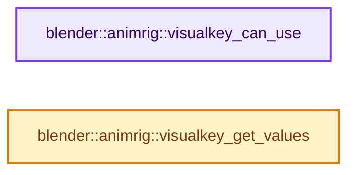
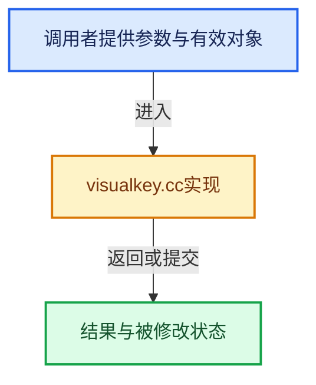

# 实现依赖专题：source/blender/animrig/intern/visualkey.cc

[实现依赖导航](../../../README.md) · [符号索引](../../../../00-课程指南/02-源码与提交索引/符号依赖与实现索引.md)

本专题从正文实际调用进入，集中保存共享实现。函数有稳定锚点，可从调用处直接跳到对应完整函数；递归与互相调用通过回链组织。

## 本文件的实现关系






## 完整成员与函数实现

<a id="f-16ea42d0d8ef8cd8"></a>

### `blender::animrig::visualkey_can_use`

实现位置：[source/blender/animrig/intern/visualkey.cc](../../../../../../../../source/blender/animrig/intern/visualkey.cc) · L37—L195。

接口参数：

- `PointerRNA *ptr`
- `PropertyRNA *prop`

**教学注释版**

<!-- annotated:3f47dc62df717d -->

```cpp
bool visualkey_can_use(PointerRNA *ptr, PropertyRNA *prop)
{
  bConstraint *con = nullptr;
  bool has_rigidbody = false;
  bool has_parent = false;

  if (!ptr || !*ptr || !prop) {
    return false;
  }

  /* Get first constraint and determine type of keyframe constraints to check for
   * - constraints can be on either Objects or PoseChannels, so we only check if the
   *   ptr->type is RNA_Object or RNA_PoseBone, which are the RNA wrapping-info for
   *   those structs, allowing us to identify the owner of the data
   */
  if (ptr->type == RNA_Object) {
    Object *ob = static_cast<Object *>(ptr->data);
    RigidBodyOb *rbo = ob->rigidbody_object;

    con = ob->constraints.first();
    has_parent = (ob->parent != nullptr);

    /* Active rigidbody objects only, as only those are affected by sim. */
    has_rigidbody = ((rbo) && (rbo->type == RBO_TYPE_ACTIVE));
  }
  else if (ptr->type == RNA_PoseBone) {
    bPoseChannel *pchan = static_cast<bPoseChannel *>(ptr->data);

    if (pchan->constflag & (PCHAN_HAS_IK | PCHAN_INFLUENCED_BY_IK)) {
      /* Spline IK cannot generally be keyed visually, because (at least with the default
       * constraint settings) it requires non-uniform scaling that causes shearing in child bones,
       * which cannot be represented by the bone's loc/rot/scale properties. */
      return true;
    }

    con = pchan->constraints.first();
    has_parent = (pchan->parent != nullptr);
  }
  else {
    BLI_assert_msg(false,
                   "visualkey_can_use called for data-block that is not an Object or PoseBone.");
    return false;
  }

  /* Parent or rigidbody are always matching, no need to check further. */
  if (has_parent || has_rigidbody) {
    return true;
  }

  /* Only do visual keying on transforms. */
  const char *identifier = RNA_property_identifier(prop);
  if (identifier == nullptr) {
    printf("%s failed: nullptr identifier\n", __func__);
    return false;
  }

  short searchtype = VISUALKEY_NONE;
  if (strstr(identifier, "location")) {
    searchtype = VISUALKEY_LOC;
  }
  else if (strstr(identifier, "rotation")) {
    searchtype = VISUALKEY_ROT;
  }
  else if (strstr(identifier, "scale")) {
    searchtype = VISUALKEY_SCA;
  }
  else {
    printf("%s failed: identifier - '%s'\n", __func__, identifier);
    return false;
  }

  /* Check constraints. */
  for (; con; con = con->next) {
    /* only consider constraint if it is not disabled, and has influence */
    if (con->flag & CONSTRAINT_DISABLE) {
      continue;
    }
    if (con->enforce == 0.0f) {
      continue;
    }

    /* Some constraints may alter these transforms. */
    switch (con->type) {
      /* Multi-transform constraints. */
      case CONSTRAINT_TYPE_CHILDOF:
      case CONSTRAINT_TYPE_ARMATURE:
        return true;
      case CONSTRAINT_TYPE_TRANSFORM:
      case CONSTRAINT_TYPE_TRANSLIKE:
        return true;
      case CONSTRAINT_TYPE_FOLLOWPATH:
        return true;
      case CONSTRAINT_TYPE_KINEMATIC:
        return true;

      /* Single-transform constraints. */
      case CONSTRAINT_TYPE_TRACKTO:
        if (searchtype == VISUALKEY_ROT) {
          return true;
        }
        break;
      case CONSTRAINT_TYPE_DAMPTRACK:
        if (searchtype == VISUALKEY_ROT) {
          return true;
        }
        break;
      case CONSTRAINT_TYPE_ROTLIMIT:
        if (searchtype == VISUALKEY_ROT) {
          return true;
        }
        break;
      case CONSTRAINT_TYPE_LOCLIMIT:
        if (searchtype == VISUALKEY_LOC) {
          return true;
        }
        break;
      case CONSTRAINT_TYPE_SIZELIMIT:
        if (searchtype == VISUALKEY_SCA) {
          return true;
        }
        break;
      case CONSTRAINT_TYPE_DISTLIMIT:
        if (searchtype == VISUALKEY_LOC) {
          return true;
        }
        break;
      case CONSTRAINT_TYPE_ROTLIKE:
        if (searchtype == VISUALKEY_ROT) {
          return true;
        }
        break;
      case CONSTRAINT_TYPE_LOCLIKE:
        if (searchtype == VISUALKEY_LOC) {
          return true;
        }
        break;
      case CONSTRAINT_TYPE_SIZELIKE:
        if (searchtype == VISUALKEY_SCA) {
          return true;
        }
        break;
      case CONSTRAINT_TYPE_LOCKTRACK:
        if (searchtype == VISUALKEY_ROT) {
          return true;
        }
        break;
      case CONSTRAINT_TYPE_MINMAX:
        if (searchtype == VISUALKEY_LOC) {
          return true;
        }
        break;

      default:
        break;
    }
  }

  return false;
}
```

<details>
<summary>核对原始源码：source/blender/animrig/intern/visualkey.cc · L37—L195</summary>

<!-- original:3f47dc62df717d:source/blender/animrig/intern/visualkey.cc:37:195 -->

```cpp
bool visualkey_can_use(PointerRNA *ptr, PropertyRNA *prop)
{
  bConstraint *con = nullptr;
  bool has_rigidbody = false;
  bool has_parent = false;

  if (!ptr || !*ptr || !prop) {
    return false;
  }

  /* Get first constraint and determine type of keyframe constraints to check for
   * - constraints can be on either Objects or PoseChannels, so we only check if the
   *   ptr->type is RNA_Object or RNA_PoseBone, which are the RNA wrapping-info for
   *   those structs, allowing us to identify the owner of the data
   */
  if (ptr->type == RNA_Object) {
    Object *ob = static_cast<Object *>(ptr->data);
    RigidBodyOb *rbo = ob->rigidbody_object;

    con = ob->constraints.first();
    has_parent = (ob->parent != nullptr);

    /* Active rigidbody objects only, as only those are affected by sim. */
    has_rigidbody = ((rbo) && (rbo->type == RBO_TYPE_ACTIVE));
  }
  else if (ptr->type == RNA_PoseBone) {
    bPoseChannel *pchan = static_cast<bPoseChannel *>(ptr->data);

    if (pchan->constflag & (PCHAN_HAS_IK | PCHAN_INFLUENCED_BY_IK)) {
      /* Spline IK cannot generally be keyed visually, because (at least with the default
       * constraint settings) it requires non-uniform scaling that causes shearing in child bones,
       * which cannot be represented by the bone's loc/rot/scale properties. */
      return true;
    }

    con = pchan->constraints.first();
    has_parent = (pchan->parent != nullptr);
  }
  else {
    BLI_assert_msg(false,
                   "visualkey_can_use called for data-block that is not an Object or PoseBone.");
    return false;
  }

  /* Parent or rigidbody are always matching, no need to check further. */
  if (has_parent || has_rigidbody) {
    return true;
  }

  /* Only do visual keying on transforms. */
  const char *identifier = RNA_property_identifier(prop);
  if (identifier == nullptr) {
    printf("%s failed: nullptr identifier\n", __func__);
    return false;
  }

  short searchtype = VISUALKEY_NONE;
  if (strstr(identifier, "location")) {
    searchtype = VISUALKEY_LOC;
  }
  else if (strstr(identifier, "rotation")) {
    searchtype = VISUALKEY_ROT;
  }
  else if (strstr(identifier, "scale")) {
    searchtype = VISUALKEY_SCA;
  }
  else {
    printf("%s failed: identifier - '%s'\n", __func__, identifier);
    return false;
  }

  /* Check constraints. */
  for (; con; con = con->next) {
    /* only consider constraint if it is not disabled, and has influence */
    if (con->flag & CONSTRAINT_DISABLE) {
      continue;
    }
    if (con->enforce == 0.0f) {
      continue;
    }

    /* Some constraints may alter these transforms. */
    switch (con->type) {
      /* Multi-transform constraints. */
      case CONSTRAINT_TYPE_CHILDOF:
      case CONSTRAINT_TYPE_ARMATURE:
        return true;
      case CONSTRAINT_TYPE_TRANSFORM:
      case CONSTRAINT_TYPE_TRANSLIKE:
        return true;
      case CONSTRAINT_TYPE_FOLLOWPATH:
        return true;
      case CONSTRAINT_TYPE_KINEMATIC:
        return true;

      /* Single-transform constraints. */
      case CONSTRAINT_TYPE_TRACKTO:
        if (searchtype == VISUALKEY_ROT) {
          return true;
        }
        break;
      case CONSTRAINT_TYPE_DAMPTRACK:
        if (searchtype == VISUALKEY_ROT) {
          return true;
        }
        break;
      case CONSTRAINT_TYPE_ROTLIMIT:
        if (searchtype == VISUALKEY_ROT) {
          return true;
        }
        break;
      case CONSTRAINT_TYPE_LOCLIMIT:
        if (searchtype == VISUALKEY_LOC) {
          return true;
        }
        break;
      case CONSTRAINT_TYPE_SIZELIMIT:
        if (searchtype == VISUALKEY_SCA) {
          return true;
        }
        break;
      case CONSTRAINT_TYPE_DISTLIMIT:
        if (searchtype == VISUALKEY_LOC) {
          return true;
        }
        break;
      case CONSTRAINT_TYPE_ROTLIKE:
        if (searchtype == VISUALKEY_ROT) {
          return true;
        }
        break;
      case CONSTRAINT_TYPE_LOCLIKE:
        if (searchtype == VISUALKEY_LOC) {
          return true;
        }
        break;
      case CONSTRAINT_TYPE_SIZELIKE:
        if (searchtype == VISUALKEY_SCA) {
          return true;
        }
        break;
      case CONSTRAINT_TYPE_LOCKTRACK:
        if (searchtype == VISUALKEY_ROT) {
          return true;
        }
        break;
      case CONSTRAINT_TYPE_MINMAX:
        if (searchtype == VISUALKEY_LOC) {
          return true;
        }
        break;

      default:
        break;
    }
  }

  return false;
}
```

</details>

**沿实际写入检查状态**

- `con = ob->constraints.first();`
- `has_parent = (ob->parent != nullptr);`
- `has_rigidbody = ((rbo) && (rbo->type == RBO_TYPE_ACTIVE));`
- `con = pchan->constraints.first();`
- `has_parent = (pchan->parent != nullptr);`
- `searchtype = VISUALKEY_LOC;`
- `searchtype = VISUALKEY_ROT;`
- `searchtype = VISUALKEY_SCA;`

**结果出口**

- `return false;`
- `return true;`

**继续追踪实现**

- `ob->constraints.first` → [调用协议](../../../../00-课程指南/01-路线与规范/模板宏与动态分派协议.md)：接收对象类型依赖auto、返回值或模板实例；不按同名猜测目标。调用位置L56。
- `pchan->constraints.first` → [调用协议](../../../../00-课程指南/01-路线与规范/模板宏与动态分派协议.md)：接收对象类型依赖auto、返回值或模板实例；不按同名猜测目标。调用位置L72。
- `BLI_assert_msg` → [BLI_assert_msg · L55](../../../01-BLI基础库/BLI_assert.hh.md#m-695eed20dceb)；[BLI_assert_msg · L64](../../../01-BLI基础库/BLI_assert.hh.md#m-7de5563de4db)。宏定义由构建条件选择。
- `RNA_property_identifier` → [blender::RNA_property_identifier · L1275](../../makesrna/intern/rna_access.cc.md#f-67de6dc6c76092df)。
- `printf` → [外部契约](https://eel.is/c++draft/)：这个边界按实际表达式及所属类型核对参数、返回值、寿命与失败行为。这里提供接口入口，不声称已解释该第三方版本的内部实现。
- `strstr` → [调用协议](../../../../00-课程指南/01-路线与规范/模板宏与动态分派协议.md)：函数指针、局部可调用对象或未展开的宏；必须结合调用者环境。调用位置L94。

<a id="f-b044c26a462fe6fa"></a>

### `blender::animrig::visualkey_get_values`

实现位置：[source/blender/animrig/intern/visualkey.cc](../../../../../../../../source/blender/animrig/intern/visualkey.cc) · L197—L271。

接口参数：

- `PointerRNA *ptr`
- `PropertyRNA *prop`

**教学注释版**

<!-- annotated:35644fd9bc930d -->

```cpp
Vector<float> visualkey_get_values(PointerRNA *ptr, PropertyRNA *prop)
{
  Vector<float> values;
  const char *identifier = RNA_property_identifier(prop);
  float tmat[4][4];
  int rotmode;

  /* Handle for Objects or PoseChannels only
   * - only Location, Rotation or Scale keyframes are supported currently
   * - constraints can be on either Objects or PoseChannels, so we only check if the
   *   ptr->type is RNA_Object or RNA_PoseBone, which are the RNA wrapping-info for
   *       those structs, allowing us to identify the owner of the data
   * - assume that array_index will be sane
   */
  if (ptr->type == RNA_Object) {
    Object *ob = static_cast<Object *>(ptr->data);
    /* Loc code is specific... */
    if (strstr(identifier, "location")) {
      // [讲解] values.extend：将一段来源元素加入尾部。
      values.extend({ob->object_to_world().location(), 3});
      return values;
    }

    copy_m4_m4(tmat, ob->object_to_world().ptr());
    rotmode = ob->rotmode;
  }
  else if (ptr->type == RNA_PoseBone) {
    Object *ob = id_cast<Object *>(ptr->owner_id);
    bPoseChannel *pchan = static_cast<bPoseChannel *>(ptr->data);
    Bone *bone = pchan->bone_get(*ob);

    BKE_armature_mat_pose_to_bone({pchan, bone}, pchan->pose_mat, tmat);
    rotmode = pchan->rotmode;

    /* Loc code is specific... */
    if (strstr(identifier, "location")) {
      /* Only use for non-connected bones. */
      if ((bone->parent == nullptr) || !(bone->flag & BONE_CONNECTED)) {
        values.extend({tmat[3], 3});
        return values;
      }
    }
  }
  else {
    return get_rna_values(ptr, prop);
  }

  /* Rot/Scale code are common! */
  if (strstr(identifier, "rotation_euler")) {
    // [讲解] values.resize：把有效元素数调整为new_size。增长路径构造新元素，缩小路径销毁尾部对象，最后才提交新的end_。
    values.resize(3);
    // [讲解] values.data：提供当前存储或有效范围的地址。
    mat4_to_eulO(values.data(), rotmode, tmat);
    return values;
  }

  if (strstr(identifier, "rotation_quaternion")) {
    values.resize(4);
    mat4_to_quat(values.data(), tmat);
    return values;
  }

  if (strstr(identifier, "rotation_axis_angle")) {
    /* w = 0, x,y,z = 1,2,3 */
    values.resize(4);
    mat4_to_axis_angle(values.data() + 1, values.data() + 0, tmat);
    return values;
  }

  if (strstr(identifier, "scale")) {
    values.resize(3);
    mat4_to_size(values.data(), tmat);
    return values;
  }

  /* As the function hasn't returned yet, read value from system in the default way. */
  return get_rna_values(ptr, prop);
}
```

<details>
<summary>核对原始源码：source/blender/animrig/intern/visualkey.cc · L197—L271</summary>

<!-- original:35644fd9bc930d:source/blender/animrig/intern/visualkey.cc:197:271 -->

```cpp
Vector<float> visualkey_get_values(PointerRNA *ptr, PropertyRNA *prop)
{
  Vector<float> values;
  const char *identifier = RNA_property_identifier(prop);
  float tmat[4][4];
  int rotmode;

  /* Handle for Objects or PoseChannels only
   * - only Location, Rotation or Scale keyframes are supported currently
   * - constraints can be on either Objects or PoseChannels, so we only check if the
   *   ptr->type is RNA_Object or RNA_PoseBone, which are the RNA wrapping-info for
   *       those structs, allowing us to identify the owner of the data
   * - assume that array_index will be sane
   */
  if (ptr->type == RNA_Object) {
    Object *ob = static_cast<Object *>(ptr->data);
    /* Loc code is specific... */
    if (strstr(identifier, "location")) {
      values.extend({ob->object_to_world().location(), 3});
      return values;
    }

    copy_m4_m4(tmat, ob->object_to_world().ptr());
    rotmode = ob->rotmode;
  }
  else if (ptr->type == RNA_PoseBone) {
    Object *ob = id_cast<Object *>(ptr->owner_id);
    bPoseChannel *pchan = static_cast<bPoseChannel *>(ptr->data);
    Bone *bone = pchan->bone_get(*ob);

    BKE_armature_mat_pose_to_bone({pchan, bone}, pchan->pose_mat, tmat);
    rotmode = pchan->rotmode;

    /* Loc code is specific... */
    if (strstr(identifier, "location")) {
      /* Only use for non-connected bones. */
      if ((bone->parent == nullptr) || !(bone->flag & BONE_CONNECTED)) {
        values.extend({tmat[3], 3});
        return values;
      }
    }
  }
  else {
    return get_rna_values(ptr, prop);
  }

  /* Rot/Scale code are common! */
  if (strstr(identifier, "rotation_euler")) {
    values.resize(3);
    mat4_to_eulO(values.data(), rotmode, tmat);
    return values;
  }

  if (strstr(identifier, "rotation_quaternion")) {
    values.resize(4);
    mat4_to_quat(values.data(), tmat);
    return values;
  }

  if (strstr(identifier, "rotation_axis_angle")) {
    /* w = 0, x,y,z = 1,2,3 */
    values.resize(4);
    mat4_to_axis_angle(values.data() + 1, values.data() + 0, tmat);
    return values;
  }

  if (strstr(identifier, "scale")) {
    values.resize(3);
    mat4_to_size(values.data(), tmat);
    return values;
  }

  /* As the function hasn't returned yet, read value from system in the default way. */
  return get_rna_values(ptr, prop);
}
```

</details>

**沿实际写入检查状态**

- `rotmode = ob->rotmode;`
- `rotmode = pchan->rotmode;`

**结果出口**

- `return values;`
- `return get_rna_values(ptr, prop);`

**继续追踪实现**

- `RNA_property_identifier` → [blender::RNA_property_identifier · L1275](../../makesrna/intern/rna_access.cc.md#f-67de6dc6c76092df)。
- `strstr` → [调用协议](../../../../00-课程指南/01-路线与规范/模板宏与动态分派协议.md)：函数指针、局部可调用对象或未展开的宏；必须结合调用者环境。调用位置L214。
- `values.extend` → [blender::Vector::extend · L595](../../../../01-基础容器与现代CPP/11-Vector插入删除与重排.md#f-fe6fcb7d09beded9)；[blender::Vector::extend · L599](../../../../01-基础容器与现代CPP/11-Vector插入删除与重排.md#f-40095c219019e2f9)；[blender::Vector::extend · L613](../../../../01-基础容器与现代CPP/11-Vector插入删除与重排.md#f-4d2e556cd7412fe4)；[blender::Vector::extend · L650](../../../../01-基础容器与现代CPP/11-Vector插入删除与重排.md#f-ae44ad8b3f05b082)。同名重载需按实参类型选择。
- `ob->object_to_world().location` → [调用协议](../../../../00-课程指南/01-路线与规范/模板宏与动态分派协议.md)：接收对象类型依赖auto、返回值或模板实例；不按同名猜测目标。调用位置L215。
- `ob->object_to_world` → [blender::Object::object_to_world · L5761](../../../02-BKE几何与数据/intern/object.cc.md#f-12fc20026327d50c)。
- `copy_m4_m4` → [blender::copy_m4_m4 · L84](../../../01-BLI基础库/intern/math_matrix_c.cc.md#f-b4390cf8c94710f5)。
- `ob->object_to_world().ptr` → [调用协议](../../../../00-课程指南/01-路线与规范/模板宏与动态分派协议.md)：接收对象类型依赖auto、返回值或模板实例；不按同名猜测目标。调用位置L219。
- `id_cast<Object *>` → [blender::id_cast · L1417](../../makesdna/DNA_ID.h.md#f-6c8ac6412850ac5a)。
- `pchan->bone_get` → [blender::bPoseChannel::bone_get · L847](../../../02-BKE几何与数据/intern/action.cc.md#f-0eb8bfcf060715cf)；[blender::bPoseChannel::bone_get · L862](../../../02-BKE几何与数据/intern/action.cc.md#f-ccec81f60dc65040)；[blender::bPoseChannel::bone_get · L875](../../../02-BKE几何与数据/intern/action.cc.md#f-b7d34ff46210a1f3)；[blender::bPoseChannel::bone_get · L881](../../../02-BKE几何与数据/intern/action.cc.md#f-0bf83e1e4d68c624)。同名重载需按实参类型选择。
- `BKE_armature_mat_pose_to_bone` → [blender::BKE_armature_mat_pose_to_bone · L2371](../../../02-BKE几何与数据/intern/armature.cc.md#f-b1509260a38c49cd)。
- `get_rna_values` → [blender::animrig::get_rna_values · L26](anim_rna.cc.md#f-7122c6bd8e5e53c0)。
- `values.resize` → [blender::Vector::resize · L418](../../../../01-基础容器与现代CPP/10-Vector扩容与增长.md#f-059312cabb8abe3a)；[blender::Vector::resize · L439](../../../../01-基础容器与现代CPP/10-Vector扩容与增长.md#f-ab8f94924ebe2d12)。同名重载需按实参类型选择。
- `mat4_to_eulO` → [blender::mat4_to_eulO · L1830](../../../01-BLI基础库/intern/math_rotation_c.cc.md#f-e19c9e6dac3a0bdb)。
- `values.data` → [blender::Vector::data · L954](../../../../01-基础容器与现代CPP/12-Vector异常安全与边界.md#f-6e441591404715bc)；[blender::Vector::data · L962](../../../../01-基础容器与现代CPP/12-Vector异常安全与边界.md#f-4bc78d4954c1021a)。同名重载需按实参类型选择。
- `mat4_to_quat` → [blender::mat4_to_quat · L417](../../../01-BLI基础库/intern/math_rotation_c.cc.md#f-99ff19524e58cf1b)。
- `mat4_to_axis_angle` → [blender::mat4_to_axis_angle · L1229](../../../01-BLI基础库/intern/math_rotation_c.cc.md#f-9f657756b0675ceb)。
- `mat4_to_size` → [blender::mat4_to_size · L1973](../../../01-BLI基础库/intern/math_matrix_c.cc.md#f-1a66af933c403533)。
