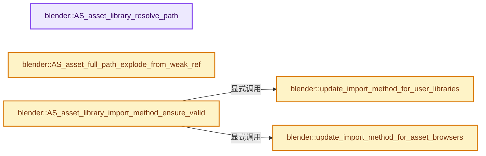
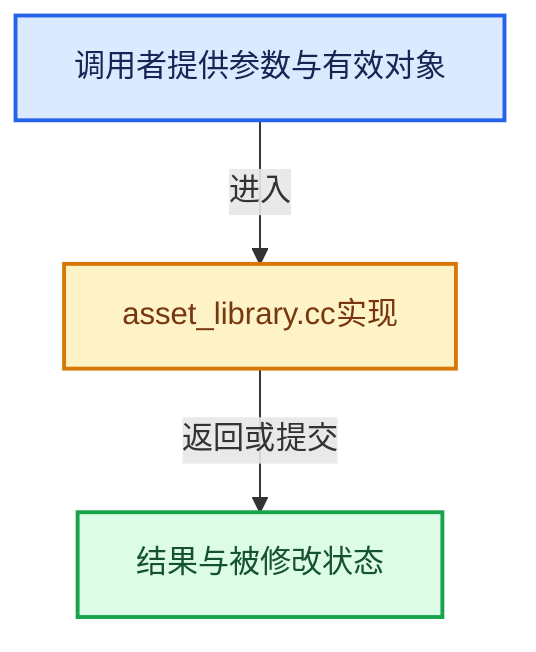

# 实现依赖专题：source/blender/asset_system/intern/asset_library.cc

[实现依赖导航](../../../README.md) · [符号索引](../../../../00-课程指南/02-源码与提交索引/符号依赖与实现索引.md)

本专题从正文实际调用进入，集中保存共享实现。函数有稳定锚点，可从调用处直接跳到对应完整函数；递归与互相调用通过回链组织。

## 本文件的实现关系






## 完整成员与函数实现

<a id="f-a580989b9c9aeb2d"></a>

### `blender::AS_asset_library_resolve_path`

实现位置：[source/blender/asset_system/intern/asset_library.cc](../../../../../../../../source/blender/asset_system/intern/asset_library.cc) · L71—L74。

接口参数：

- `StringRef path`

**教学注释版**

<!-- annotated:65bf16b523bef4 -->

```cpp
std::string AS_asset_library_resolve_path(StringRef path)
{
  return utils::resolve_directory_path(path);
}
```

<details>
<summary>核对原始源码：source/blender/asset_system/intern/asset_library.cc · L71—L74</summary>

<!-- original:65bf16b523bef4:source/blender/asset_system/intern/asset_library.cc:71:74 -->

```cpp
std::string AS_asset_library_resolve_path(StringRef path)
{
  return utils::resolve_directory_path(path);
}
```

</details>

**结果出口**

- `return utils::resolve_directory_path(path);`

**继续追踪实现**

- `utils::resolve_directory_path` → [blender::asset_system::utils::resolve_directory_path · L23](utils.cc.md#f-9b49033f6507e5ee)。

<a id="f-f1e4874a341c4015"></a>

### `blender::AS_asset_full_path_explode_from_weak_ref`

实现位置：[source/blender/asset_system/intern/asset_library.cc](../../../../../../../../source/blender/asset_system/intern/asset_library.cc) · L113—L170。

接口参数：

- `const AssetWeakReference *asset_reference`
- `char r_path_buffer[/*FILE_MAX_LIBEXTRA*/ 1282]`
- `char **r_dir`
- `char **r_group`
- `char **r_name`

**教学注释版**

<!-- annotated:d8dc309c2b5ba6 -->

```cpp
void AS_asset_full_path_explode_from_weak_ref(const AssetWeakReference *asset_reference,
                                              char r_path_buffer[/*FILE_MAX_LIBEXTRA*/ 1282],
                                              char **r_dir,
                                              char **r_group,
                                              char **r_name)
{
  AssetLibraryService *service = AssetLibraryService::get();
  std::optional<AssetLibraryService::ExplodedPath> exploded =
      service->resolve_asset_weak_reference_to_exploded_path(*asset_reference);

  if (!exploded) {
    if (r_dir) {
      *r_dir = nullptr;
    }
    if (r_group) {
      *r_group = nullptr;
    }
    if (r_name) {
      *r_name = nullptr;
    }
    r_path_buffer[0] = '\0';
    return;
  }

  BLI_assert(!exploded->group_component.is_empty());
  BLI_assert(!exploded->name_component.is_empty());

  BLI_strncpy(r_path_buffer, exploded->full_path->c_str(), /*FILE_MAX_LIBEXTRA*/ 1282);

  if (!exploded->dir_component.is_empty()) {
    r_path_buffer[exploded->dir_component.size()] = '\0';
    r_path_buffer[exploded->dir_component.size() + 1 + exploded->group_component.size()] = '\0';

    if (r_dir) {
      *r_dir = r_path_buffer;
    }
    if (r_group) {
      *r_group = r_path_buffer + exploded->dir_component.size() + 1;
    }
    if (r_name) {
      *r_name = r_path_buffer + exploded->dir_component.size() + 1 +
                exploded->group_component.size() + 1;
    }
  }
  else {
    r_path_buffer[exploded->group_component.size()] = '\0';

    if (r_dir) {
      *r_dir = nullptr;
    }
    if (r_group) {
      *r_group = r_path_buffer;
    }
    if (r_name) {
      *r_name = r_path_buffer + exploded->group_component.size() + 1;
    }
  }
}
```

<details>
<summary>核对原始源码：source/blender/asset_system/intern/asset_library.cc · L113—L170</summary>

<!-- original:d8dc309c2b5ba6:source/blender/asset_system/intern/asset_library.cc:113:170 -->

```cpp
void AS_asset_full_path_explode_from_weak_ref(const AssetWeakReference *asset_reference,
                                              char r_path_buffer[/*FILE_MAX_LIBEXTRA*/ 1282],
                                              char **r_dir,
                                              char **r_group,
                                              char **r_name)
{
  AssetLibraryService *service = AssetLibraryService::get();
  std::optional<AssetLibraryService::ExplodedPath> exploded =
      service->resolve_asset_weak_reference_to_exploded_path(*asset_reference);

  if (!exploded) {
    if (r_dir) {
      *r_dir = nullptr;
    }
    if (r_group) {
      *r_group = nullptr;
    }
    if (r_name) {
      *r_name = nullptr;
    }
    r_path_buffer[0] = '\0';
    return;
  }

  BLI_assert(!exploded->group_component.is_empty());
  BLI_assert(!exploded->name_component.is_empty());

  BLI_strncpy(r_path_buffer, exploded->full_path->c_str(), /*FILE_MAX_LIBEXTRA*/ 1282);

  if (!exploded->dir_component.is_empty()) {
    r_path_buffer[exploded->dir_component.size()] = '\0';
    r_path_buffer[exploded->dir_component.size() + 1 + exploded->group_component.size()] = '\0';

    if (r_dir) {
      *r_dir = r_path_buffer;
    }
    if (r_group) {
      *r_group = r_path_buffer + exploded->dir_component.size() + 1;
    }
    if (r_name) {
      *r_name = r_path_buffer + exploded->dir_component.size() + 1 +
                exploded->group_component.size() + 1;
    }
  }
  else {
    r_path_buffer[exploded->group_component.size()] = '\0';

    if (r_dir) {
      *r_dir = nullptr;
    }
    if (r_group) {
      *r_group = r_path_buffer;
    }
    if (r_name) {
      *r_name = r_path_buffer + exploded->group_component.size() + 1;
    }
  }
}
```

</details>

**沿实际写入检查状态**

- `r_path_buffer[0] = '\0';`

**继续追踪实现**

- `AssetLibraryService::get` → [blender::asset_system::AssetLibraryService::get · L57](asset_library_service.cc.md#f-9474b80fa7698d68)。
- `service->resolve_asset_weak_reference_to_exploded_path` → [blender::asset_system::resolve_asset_weak_reference_to_exploded_path · L546](asset_library_service.cc.md#f-614d4548bbf3e211)。
- `BLI_assert` → [BLI_assert · L48](../../../01-BLI基础库/BLI_assert.hh.md#m-57a88495704d)；[BLI_assert · L63](../../../01-BLI基础库/BLI_assert.hh.md#m-d07050020cb5)。宏定义由构建条件选择。
- `exploded->group_component.is_empty` → [调用协议](../../../../00-课程指南/01-路线与规范/模板宏与动态分派协议.md)：接收对象类型依赖auto、返回值或模板实例；不按同名猜测目标。调用位置L137。
- `exploded->name_component.is_empty` → [调用协议](../../../../00-课程指南/01-路线与规范/模板宏与动态分派协议.md)：接收对象类型依赖auto、返回值或模板实例；不按同名猜测目标。调用位置L138。
- `BLI_strncpy` → [blender::BLI_strncpy · L70](../../../01-BLI基础库/intern/string.cc.md#f-6324147b0d116da1)。
- `exploded->full_path->c_str` → [调用协议](../../../../00-课程指南/01-路线与规范/模板宏与动态分派协议.md)：接收对象类型依赖auto、返回值或模板实例；不按同名猜测目标。调用位置L140。
- `exploded->dir_component.is_empty` → [调用协议](../../../../00-课程指南/01-路线与规范/模板宏与动态分派协议.md)：接收对象类型依赖auto、返回值或模板实例；不按同名猜测目标。调用位置L142。
- `exploded->dir_component.size` → [调用协议](../../../../00-课程指南/01-路线与规范/模板宏与动态分派协议.md)：接收对象类型依赖auto、返回值或模板实例；不按同名猜测目标。调用位置L143。
- `exploded->group_component.size` → [调用协议](../../../../00-课程指南/01-路线与规范/模板宏与动态分派协议.md)：接收对象类型依赖auto、返回值或模板实例；不按同名猜测目标。调用位置L144。

<a id="f-ea1475ec86bb6553"></a>

### `blender::update_import_method_for_user_libraries`

实现位置：[source/blender/asset_system/intern/asset_library.cc](../../../../../../../../source/blender/asset_system/intern/asset_library.cc) · L172—L186。

**教学注释版**

<!-- annotated:079b34a209f82c -->

```cpp
static void update_import_method_for_user_libraries()
{
  for (bUserAssetLibrary &library : U.asset_libraries) {
    if (U.experimental.no_data_block_packing) {
      if (library.import_method == ASSET_IMPORT_PACK) {
        library.import_method = ASSET_IMPORT_APPEND_REUSE;
      }
    }
    else {
      if (library.import_method == ASSET_IMPORT_APPEND_REUSE) {
        library.import_method = ASSET_IMPORT_PACK;
      }
    }
  }
}
```

<details>
<summary>核对原始源码：source/blender/asset_system/intern/asset_library.cc · L172—L186</summary>

<!-- original:079b34a209f82c:source/blender/asset_system/intern/asset_library.cc:172:186 -->

```cpp
static void update_import_method_for_user_libraries()
{
  for (bUserAssetLibrary &library : U.asset_libraries) {
    if (U.experimental.no_data_block_packing) {
      if (library.import_method == ASSET_IMPORT_PACK) {
        library.import_method = ASSET_IMPORT_APPEND_REUSE;
      }
    }
    else {
      if (library.import_method == ASSET_IMPORT_APPEND_REUSE) {
        library.import_method = ASSET_IMPORT_PACK;
      }
    }
  }
}
```

</details>

**沿实际写入检查状态**

- `library.import_method = ASSET_IMPORT_APPEND_REUSE;`
- `library.import_method = ASSET_IMPORT_PACK;`

**继续追踪实现**

本实现没有需要继续展开的显式调用；检查返回表达式、对象转换和调用者前置条件。

<a id="f-2c26a5efe104fb08"></a>

### `blender::update_import_method_for_asset_browsers`

实现位置：[source/blender/asset_system/intern/asset_library.cc](../../../../../../../../source/blender/asset_system/intern/asset_library.cc) · L188—L213。

接口参数：

- `Main &bmain`

**教学注释版**

<!-- annotated:6c5ce8b767c7fd -->

```cpp
static void update_import_method_for_asset_browsers(Main &bmain)
{
  for (bScreen &screen : bmain.screens) {
    for (ScrArea &area : screen.areabase) {
      for (SpaceLink &sl : area.spacedata) {
        if (sl.spacetype != SPACE_FILE) {
          continue;
        }
        SpaceFile *sfile = reinterpret_cast<SpaceFile *>(&sl);
        if (!sfile->asset_params) {
          continue;
        }
        if (U.experimental.no_data_block_packing) {
          if (sfile->asset_params->import_method == FILE_ASSET_IMPORT_PACK) {
            sfile->asset_params->import_method = FILE_ASSET_IMPORT_APPEND_REUSE;
          }
        }
        else {
          if (sfile->asset_params->import_method == FILE_ASSET_IMPORT_APPEND_REUSE) {
            sfile->asset_params->import_method = FILE_ASSET_IMPORT_PACK;
          }
        }
      }
    }
  }
}
```

<details>
<summary>核对原始源码：source/blender/asset_system/intern/asset_library.cc · L188—L213</summary>

<!-- original:6c5ce8b767c7fd:source/blender/asset_system/intern/asset_library.cc:188:213 -->

```cpp
static void update_import_method_for_asset_browsers(Main &bmain)
{
  for (bScreen &screen : bmain.screens) {
    for (ScrArea &area : screen.areabase) {
      for (SpaceLink &sl : area.spacedata) {
        if (sl.spacetype != SPACE_FILE) {
          continue;
        }
        SpaceFile *sfile = reinterpret_cast<SpaceFile *>(&sl);
        if (!sfile->asset_params) {
          continue;
        }
        if (U.experimental.no_data_block_packing) {
          if (sfile->asset_params->import_method == FILE_ASSET_IMPORT_PACK) {
            sfile->asset_params->import_method = FILE_ASSET_IMPORT_APPEND_REUSE;
          }
        }
        else {
          if (sfile->asset_params->import_method == FILE_ASSET_IMPORT_APPEND_REUSE) {
            sfile->asset_params->import_method = FILE_ASSET_IMPORT_PACK;
          }
        }
      }
    }
  }
}
```

</details>

**沿实际写入检查状态**

- `sfile->asset_params->import_method = FILE_ASSET_IMPORT_APPEND_REUSE;`
- `sfile->asset_params->import_method = FILE_ASSET_IMPORT_PACK;`

**继续追踪实现**

本实现没有需要继续展开的显式调用；检查返回表达式、对象转换和调用者前置条件。

<a id="f-e7631fc784038cf3"></a>

### `blender::AS_asset_library_import_method_ensure_valid`

实现位置：[source/blender/asset_system/intern/asset_library.cc](../../../../../../../../source/blender/asset_system/intern/asset_library.cc) · L215—L219。

接口参数：

- `Main &bmain`

**教学注释版**

<!-- annotated:41a49e2738f788 -->

```cpp
void AS_asset_library_import_method_ensure_valid(Main &bmain)
{
  update_import_method_for_user_libraries();
  update_import_method_for_asset_browsers(bmain);
}
```

<details>
<summary>核对原始源码：source/blender/asset_system/intern/asset_library.cc · L215—L219</summary>

<!-- original:41a49e2738f788:source/blender/asset_system/intern/asset_library.cc:215:219 -->

```cpp
void AS_asset_library_import_method_ensure_valid(Main &bmain)
{
  update_import_method_for_user_libraries();
  update_import_method_for_asset_browsers(bmain);
}
```

</details>

**继续追踪实现**

- `update_import_method_for_user_libraries` → [blender::update_import_method_for_user_libraries · L172](asset_library.cc.md#f-ea1475ec86bb6553)。
- `update_import_method_for_asset_browsers` → [blender::update_import_method_for_asset_browsers · L188](asset_library.cc.md#f-2c26a5efe104fb08)。
