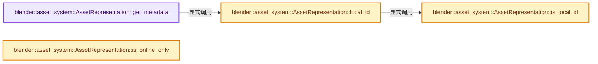
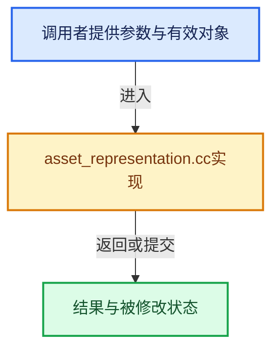

# 实现依赖专题：source/blender/asset_system/intern/asset_representation.cc

[实现依赖导航](../../../README.md) · [符号索引](../../../../00-课程指南/02-源码与提交索引/符号依赖与实现索引.md)

本专题从正文实际调用进入，集中保存共享实现。函数有稳定锚点，可从调用处直接跳到对应完整函数；递归与互相调用通过回链组织。

## 本文件的实现关系






## 完整成员与函数实现

<a id="f-4b8fbe5b18300046"></a>

### `blender::asset_system::AssetRepresentation::get_metadata`

实现位置：[source/blender/asset_system/intern/asset_representation.cc](../../../../../../../../source/blender/asset_system/intern/asset_representation.cc) · L150—L156。

**教学注释版**

<!-- annotated:1054d3b63b47c7 -->

```cpp
AssetMetaData &AssetRepresentation::get_metadata() const
{
  if (const ID *id = this->local_id()) {
    return *id->asset_data;
  }
  return *std::get<ExternalAsset>(asset_).metadata_;
}
```

<details>
<summary>核对原始源码：source/blender/asset_system/intern/asset_representation.cc · L150—L156</summary>

<!-- original:1054d3b63b47c7:source/blender/asset_system/intern/asset_representation.cc:150:156 -->

```cpp
AssetMetaData &AssetRepresentation::get_metadata() const
{
  if (const ID *id = this->local_id()) {
    return *id->asset_data;
  }
  return *std::get<ExternalAsset>(asset_).metadata_;
}
```

</details>

**结果出口**

- `return *id->asset_data;`
- `return *std::get<ExternalAsset>(asset_).metadata_;`

**继续追踪实现**

- `this->local_id` → [blender::asset_system::AssetRepresentation::local_id · L275](asset_representation.cc.md#f-a057728b1eb05244)。
- `std::get<ExternalAsset>` → [外部契约](https://eel.is/c++draft/)：这个边界按实际表达式及所属类型核对参数、返回值、寿命与失败行为。这里提供接口入口，不声称已解释该第三方版本的内部实现。

<a id="f-a057728b1eb05244"></a>

### `blender::asset_system::AssetRepresentation::local_id`

实现位置：[source/blender/asset_system/intern/asset_representation.cc](../../../../../../../../source/blender/asset_system/intern/asset_representation.cc) · L275—L278。

**教学注释版**

<!-- annotated:8e08547ead8c56 -->

```cpp
ID *AssetRepresentation::local_id() const
{
  return this->is_local_id() ? std::get<ID *>(asset_) : nullptr;
}
```

<details>
<summary>核对原始源码：source/blender/asset_system/intern/asset_representation.cc · L275—L278</summary>

<!-- original:8e08547ead8c56:source/blender/asset_system/intern/asset_representation.cc:275:278 -->

```cpp
ID *AssetRepresentation::local_id() const
{
  return this->is_local_id() ? std::get<ID *>(asset_) : nullptr;
}
```

</details>

**结果出口**

- `return this->is_local_id() ? std::get<ID *>(asset_) : nullptr;`

**继续追踪实现**

- `this->is_local_id` → [blender::asset_system::AssetRepresentation::is_local_id · L280](asset_representation.cc.md#f-c834323cf1cfcee6)。
- `std::get<ID *>` → [外部契约](https://eel.is/c++draft/)：这个边界按实际表达式及所属类型核对参数、返回值、寿命与失败行为。这里提供接口入口，不声称已解释该第三方版本的内部实现。

<a id="f-c834323cf1cfcee6"></a>

### `blender::asset_system::AssetRepresentation::is_local_id`

实现位置：[source/blender/asset_system/intern/asset_representation.cc](../../../../../../../../source/blender/asset_system/intern/asset_representation.cc) · L280—L283。

**教学注释版**

<!-- annotated:b9f1257204a8a1 -->

```cpp
bool AssetRepresentation::is_local_id() const
{
  return std::holds_alternative<ID *>(asset_);
}
```

<details>
<summary>核对原始源码：source/blender/asset_system/intern/asset_representation.cc · L280—L283</summary>

<!-- original:b9f1257204a8a1:source/blender/asset_system/intern/asset_representation.cc:280:283 -->

```cpp
bool AssetRepresentation::is_local_id() const
{
  return std::holds_alternative<ID *>(asset_);
}
```

</details>

**结果出口**

- `return std::holds_alternative<ID *>(asset_);`

**继续追踪实现**

- `std::holds_alternative<ID *>` → [外部契约](https://eel.is/c++draft/)：这个边界按实际表达式及所属类型核对参数、返回值、寿命与失败行为。这里提供接口入口，不声称已解释该第三方版本的内部实现。

<a id="f-bbc59b294d16d332"></a>

### `blender::asset_system::AssetRepresentation::is_online_only`

实现位置：[source/blender/asset_system/intern/asset_representation.cc](../../../../../../../../source/blender/asset_system/intern/asset_representation.cc) · L285—L301。

**教学注释版**

<!-- annotated:2a249cfeae6370 -->

```cpp
bool AssetRepresentation::is_online_only() const
{
  const ExternalAsset *extern_asset = std::get_if<ExternalAsset>(&asset_);
  if (!extern_asset || !extern_asset->online_info_) {
    return false;
  }
  /* An asset is considered 'online' if there is no file on disk for it.
   *
   * About also allowing UNSET: This function is (indirectly) called from all kinds of
   * places, like `get_node_tools_type_data()` in `node_group_operators.cc` to figure out which
   * node tools are available. Since that happens on startup, the actual on-disk file status may
   * not have been checked yet. Until that time, just assume that having `online_info_` means "it
   * is online". */
  return ELEM(extern_asset->remote_file_status_,
              RemoteAssetFileStatus::NOT_ON_DISK,
              RemoteAssetFileStatus::UNSET);
}
```

<details>
<summary>核对原始源码：source/blender/asset_system/intern/asset_representation.cc · L285—L301</summary>

<!-- original:2a249cfeae6370:source/blender/asset_system/intern/asset_representation.cc:285:301 -->

```cpp
bool AssetRepresentation::is_online_only() const
{
  const ExternalAsset *extern_asset = std::get_if<ExternalAsset>(&asset_);
  if (!extern_asset || !extern_asset->online_info_) {
    return false;
  }
  /* An asset is considered 'online' if there is no file on disk for it.
   *
   * About also allowing UNSET: This function is (indirectly) called from all kinds of
   * places, like `get_node_tools_type_data()` in `node_group_operators.cc` to figure out which
   * node tools are available. Since that happens on startup, the actual on-disk file status may
   * not have been checked yet. Until that time, just assume that having `online_info_` means "it
   * is online". */
  return ELEM(extern_asset->remote_file_status_,
              RemoteAssetFileStatus::NOT_ON_DISK,
              RemoteAssetFileStatus::UNSET);
}
```

</details>

**结果出口**

- `return false;`
- `return ELEM(extern_asset->remote_file_status_,`

**继续追踪实现**

- `std::get_if<ExternalAsset>` → [外部契约](https://eel.is/c++draft/)：这个边界按实际表达式及所属类型核对参数、返回值、寿命与失败行为。这里提供接口入口，不声称已解释该第三方版本的内部实现。
- `ELEM` → [ELEM · L88](../../../07-Intern运行时与平台/ghost/intern/GHOST_utildefines.hh.md#m-d28724a15928)；[ELEM · L135](../../../01-BLI基础库/BLI_utildefines.hh.md#m-d6572de7cae0)。宏定义由构建条件选择。
