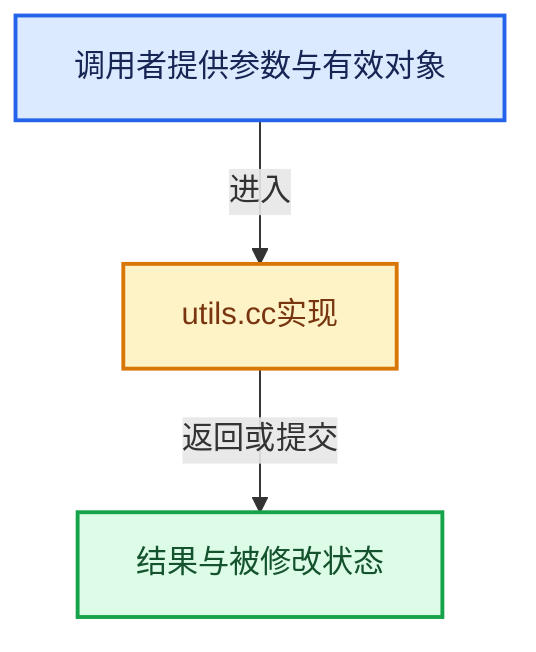

# 实现依赖专题：source/blender/asset_system/intern/utils.cc

[实现依赖导航](../../../README.md) · [符号索引](../../../../00-课程指南/02-源码与提交索引/符号依赖与实现索引.md)

本专题从正文实际调用进入，集中保存共享实现。函数有稳定锚点，可从调用处直接跳到对应完整函数；递归与互相调用通过回链组织。

## 本文件的实现关系





## 完整成员与函数实现

<a id="f-9b49033f6507e5ee"></a>

### `blender::asset_system::utils::resolve_directory_path`

实现位置：[source/blender/asset_system/intern/utils.cc](../../../../../../../../source/blender/asset_system/intern/utils.cc) · L23—L48。

接口参数：

- `StringRef directory`

**教学注释版**

<!-- annotated:133cf81a2baa10 -->

```cpp
std::string resolve_directory_path(StringRef directory)
{
  if (directory.is_empty()) {
    return "";
  }
  char dir_resolved[PATH_MAX];
  BLI_strncpy(dir_resolved,
              directory.data(),
              /* + 1 for null terminator. */
              // [讲解] std::min：按比较关系选取较小值；截断范围时还需先满足非负和可表示范围，min本身不会证明边界安全。
              std::min(directory.size() + 1, int64_t(sizeof(dir_resolved))));

  path_templates::VariableMap template_variables;
  bke::BlenderProject *project = BKE_blender_project_get(G_MAIN);
  BKE_add_template_variables_general(template_variables, nullptr, project);
  const Vector<path_templates::Error> variable_errors = BKE_path_apply_template(
      dir_resolved, sizeof(dir_resolved), template_variables);
  if (!variable_errors.is_empty()) {
    /* Do nothing on errors as the "dir_normalized" variable should still contain the original
     * string. The reset of the code should still gracefully treat this as an invalid path.
     * However it might be nice to bubble up the exact errors in the future.
     */
  }
  BLI_path_slash_native(dir_resolved);
  BLI_path_normalize_dir(dir_resolved, sizeof(dir_resolved));
  return std::string(dir_resolved);
}
```

<details>
<summary>核对原始源码：source/blender/asset_system/intern/utils.cc · L23—L48</summary>

<!-- original:133cf81a2baa10:source/blender/asset_system/intern/utils.cc:23:48 -->

```cpp
std::string resolve_directory_path(StringRef directory)
{
  if (directory.is_empty()) {
    return "";
  }
  char dir_resolved[PATH_MAX];
  BLI_strncpy(dir_resolved,
              directory.data(),
              /* + 1 for null terminator. */
              std::min(directory.size() + 1, int64_t(sizeof(dir_resolved))));

  path_templates::VariableMap template_variables;
  bke::BlenderProject *project = BKE_blender_project_get(G_MAIN);
  BKE_add_template_variables_general(template_variables, nullptr, project);
  const Vector<path_templates::Error> variable_errors = BKE_path_apply_template(
      dir_resolved, sizeof(dir_resolved), template_variables);
  if (!variable_errors.is_empty()) {
    /* Do nothing on errors as the "dir_normalized" variable should still contain the original
     * string. The reset of the code should still gracefully treat this as an invalid path.
     * However it might be nice to bubble up the exact errors in the future.
     */
  }
  BLI_path_slash_native(dir_resolved);
  BLI_path_normalize_dir(dir_resolved, sizeof(dir_resolved));
  return std::string(dir_resolved);
}
```

</details>

**结果出口**

- `return "";`
- `return std::string(dir_resolved);`

**继续追踪实现**

- `directory.is_empty` → [调用协议](../../../../00-课程指南/01-路线与规范/模板宏与动态分派协议.md)：由接收对象具体类型或运行时策略提供实现。调用位置L25。
- `BLI_strncpy` → [blender::BLI_strncpy · L70](../../../01-BLI基础库/intern/string.cc.md#f-6324147b0d116da1)。
- `directory.data` → [调用协议](../../../../00-课程指南/01-路线与规范/模板宏与动态分派协议.md)：由接收对象具体类型或运行时策略提供实现。调用位置L30。
- `std::min` → [外部契约](https://eel.is/c++draft/alg.min.max)：按比较关系选取较小值；截断范围时还需先满足非负和可表示范围，min本身不会证明边界安全。
- `directory.size` → [调用协议](../../../../00-课程指南/01-路线与规范/模板宏与动态分派协议.md)：由接收对象具体类型或运行时策略提供实现。调用位置L32。
- `BKE_blender_project_get` → [blender::BKE_blender_project_get · L392](../../../02-BKE几何与数据/intern/blender_project.cc.md#f-66d938c7a8df448b)。
- `BKE_add_template_variables_general` → [blender::BKE_add_template_variables_general · L323](../../../02-BKE几何与数据/intern/path_templates.cc.md#f-f4e98befdafedf29)。
- `BKE_path_apply_template` → [blender::BKE_path_apply_template · L1055](../../../02-BKE几何与数据/intern/path_templates.cc.md#f-4fce298769f4ae68)。
- `variable_errors.is_empty` → [blender::Vector::is_empty · L792](../../../../01-基础容器与现代CPP/11-Vector插入删除与重排.md#f-937bbd9cb80bdcc8)。
- `BLI_path_slash_native` → [BLI_path_slash_native · L2049](../../../01-BLI基础库/intern/path_utils.cc.md#f-ee5950583691fcc2)。
- `BLI_path_normalize_dir` → [BLI_path_normalize_dir · L387](../../../01-BLI基础库/intern/path_utils.cc.md#f-26b3b7f735aa6270)。
- `std::string` → [外部契约](https://eel.is/c++draft/)：这个边界按实际表达式及所属类型核对参数、返回值、寿命与失败行为。这里提供接口入口，不声称已解释该第三方版本的内部实现。
