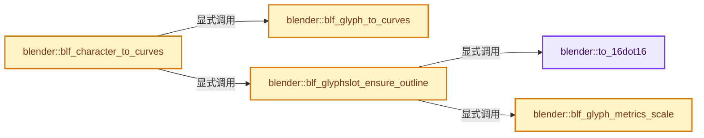

# 实现依赖专题：source/blender/blenfont/intern/blf_glyph_curves.cc

[实现依赖导航](../../../README.md) · [符号索引](../../../../00-课程指南/02-源码与提交索引/符号依赖与实现索引.md)

本专题从正文实际调用进入，集中保存共享实现。函数有稳定锚点，可从调用处直接跳到对应完整函数；递归与互相调用通过回链组织。

## 本文件的实现关系




## 完整成员与函数实现

<a id="f-187a8e57afcf5981"></a>

### `blender::to_16dot16`

实现位置：[source/blender/blenfont/intern/blf_glyph_curves.cc](../../../../../../../../source/blender/blenfont/intern/blf_glyph_curves.cc) · L45—L48。

接口参数：

- `const double val`

**教学注释版**

<!-- annotated:52612ce3f6b38f -->

```cpp
static FT_Fixed to_16dot16(const double val)
{
  return FT_Fixed(lround(val * 65536.0));
}
```

<details>
<summary>核对原始源码：source/blender/blenfont/intern/blf_glyph_curves.cc · L45—L48</summary>

<!-- original:52612ce3f6b38f:source/blender/blenfont/intern/blf_glyph_curves.cc:45:48 -->

```cpp
static FT_Fixed to_16dot16(const double val)
{
  return FT_Fixed(lround(val * 65536.0));
}
```

</details>

**结果出口**

- `return FT_Fixed(lround(val * 65536.0));`

**继续追踪实现**

- `FT_Fixed` → [调用协议](../../../../00-课程指南/01-路线与规范/模板宏与动态分派协议.md)：函数指针、局部可调用对象或未展开的宏；必须结合调用者环境。调用位置L47。
- `lround` → [lround · L49](../../../07-Intern运行时与平台/libmv/libmv/numeric/numeric.h.md#f-c5c613b2e026681d)。

<a id="f-7b7a29ff836ef280"></a>

### `blender::blf_glyph_to_curves`

实现位置：[source/blender/blenfont/intern/blf_glyph_curves.cc](../../../../../../../../source/blender/blenfont/intern/blf_glyph_curves.cc) · L137—L314。

接口参数：

- `const FT_Outline &ftoutline`
- `ListBaseT<Nurb> *nurbsbase`
- `const float scale`

**教学注释版**

<!-- annotated:0d9be555c1b06f -->

```cpp
static void blf_glyph_to_curves(const FT_Outline &ftoutline,
                                ListBaseT<Nurb> *nurbsbase,
                                const float scale)
{
  const float eps = 0.0001f;
  const float eps_sq = eps * eps;
  Nurb *nu;
  BezTriple *bezt;
  float dx, dy;
  int j, k, l, l_first = 0;

  /* initialize as -1 to add 1 on first loop each time */
  int contour_prev;

  /* Start converting the FT data */
  int *onpoints = MEM_new_array_zeroed<int>(size_t(ftoutline.n_contours), "onpoints");

  /* Get number of on-curve points for bezier-triples (including conic virtual on-points). */
  for (j = 0, contour_prev = -1; j < ftoutline.n_contours; j++) {
    const int n = ftoutline.contours[j] - contour_prev;
    contour_prev = ftoutline.contours[j];

    for (k = 0; k < n; k++) {
      l = (j > 0) ? (k + ftoutline.contours[j - 1] + 1) : k;
      if (k == 0) {
        l_first = l;
      }

      if (ftoutline.tags[l] == FT_Curve_Tag_On) {
        onpoints[j]++;
      }

      {
        const int l_next = (k < n - 1) ? (l + 1) : l_first;
        if (ftoutline.tags[l] == FT_Curve_Tag_Conic &&
            ftoutline.tags[l_next] == FT_Curve_Tag_Conic)
        {
          onpoints[j]++;
        }
      }
    }
  }

  /* contour loop, bezier & conic styles merged */
  for (j = 0, contour_prev = -1; j < ftoutline.n_contours; j++) {
    const int n = ftoutline.contours[j] - contour_prev;
    contour_prev = ftoutline.contours[j];

    /* add new curve */
    nu = MEM_new<Nurb>("objfnt_nurb");
    bezt = MEM_new_array_zeroed<BezTriple>(size_t(onpoints[j]), "objfnt_bezt");
    BLI_addtail(nurbsbase, nu);

    nu->type = CU_BEZIER;
    nu->pntsu = onpoints[j];
    nu->resolu = 8;
    nu->flagu = CU_NURB_CYCLIC;
    nu->bezt = bezt;

    /* individual curve loop, start-end */
    for (k = 0; k < n; k++) {
      l = (j > 0) ? (k + ftoutline.contours[j - 1] + 1) : k;
      if (k == 0) {
        l_first = l;
      }

      /* virtual conic on-curve points */
      {
        const int l_next = (k < n - 1) ? (l + 1) : l_first;
        if (ftoutline.tags[l] == FT_Curve_Tag_Conic &&
            ftoutline.tags[l_next] == FT_Curve_Tag_Conic)
        {
          dx = float(ftoutline.points[l].x + ftoutline.points[l_next].x) * scale / 2.0f;
          dy = float(ftoutline.points[l].y + ftoutline.points[l_next].y) * scale / 2.0f;

          /* left handle */
          bezt->vec[0][0] = (dx + (2.0f * float(ftoutline.points[l].x)) * scale) / 3.0f;
          bezt->vec[0][1] = (dy + (2.0f * float(ftoutline.points[l].y)) * scale) / 3.0f;

          /* midpoint (virtual on-curve point) */
          bezt->vec[1][0] = dx;
          bezt->vec[1][1] = dy;

          /* right handle */
          bezt->vec[2][0] = (dx + (2.0f * float(ftoutline.points[l_next].x)) * scale) / 3.0f;
          bezt->vec[2][1] = (dy + (2.0f * float(ftoutline.points[l_next].y)) * scale) / 3.0f;

          bezt->h1 = bezt->h2 = HD_ALIGN;
          bezt->radius = 1.0f;
          bezt++;
        }
      }

      /* on-curve points */
      if (ftoutline.tags[l] == FT_Curve_Tag_On) {
        const int l_prev = (k > 0) ? (l - 1) : ftoutline.contours[j];
        const int l_next = (k < n - 1) ? (l + 1) : l_first;

        /* left handle */
        if (ftoutline.tags[l_prev] == FT_Curve_Tag_Cubic) {
          bezt->vec[0][0] = float(ftoutline.points[l_prev].x) * scale;
          bezt->vec[0][1] = float(ftoutline.points[l_prev].y) * scale;
          bezt->h1 = HD_FREE;
        }
        else if (ftoutline.tags[l_prev] == FT_Curve_Tag_Conic) {
          bezt->vec[0][0] = (float(ftoutline.points[l].x) +
                             (2.0f * float(ftoutline.points[l_prev].x))) *
                            scale / 3.0f;
          bezt->vec[0][1] = (float(ftoutline.points[l].y) +
                             (2.0f * float(ftoutline.points[l_prev].y))) *
                            scale / 3.0f;
          bezt->h1 = HD_FREE;
        }
        else {
          bezt->vec[0][0] = float(ftoutline.points[l].x) * scale -
                            (float(ftoutline.points[l].x) - float(ftoutline.points[l_prev].x)) *
                                scale / 3.0f;
          bezt->vec[0][1] = float(ftoutline.points[l].y) * scale -
                            (float(ftoutline.points[l].y) - float(ftoutline.points[l_prev].y)) *
                                scale / 3.0f;
          bezt->h1 = HD_VECT;
        }

        /* midpoint (on-curve point) */
        bezt->vec[1][0] = float(ftoutline.points[l].x) * scale;
        bezt->vec[1][1] = float(ftoutline.points[l].y) * scale;

        /* right handle */
        if (ftoutline.tags[l_next] == FT_Curve_Tag_Cubic) {
          bezt->vec[2][0] = float(ftoutline.points[l_next].x) * scale;
          bezt->vec[2][1] = float(ftoutline.points[l_next].y) * scale;
          bezt->h2 = HD_FREE;
        }
        else if (ftoutline.tags[l_next] == FT_Curve_Tag_Conic) {
          bezt->vec[2][0] = (float(ftoutline.points[l].x) +
                             (2.0f * float(ftoutline.points[l_next].x))) *
                            scale / 3.0f;
          bezt->vec[2][1] = (float(ftoutline.points[l].y) +
                             (2.0f * float(ftoutline.points[l_next].y))) *
                            scale / 3.0f;
          bezt->h2 = HD_FREE;
        }
        else {
          bezt->vec[2][0] = float(ftoutline.points[l].x) * scale -
                            (float(ftoutline.points[l].x) - float(ftoutline.points[l_next].x)) *
                                scale / 3.0f;
          bezt->vec[2][1] = float(ftoutline.points[l].y) * scale -
                            (float(ftoutline.points[l].y) - float(ftoutline.points[l_next].y)) *
                                scale / 3.0f;
          bezt->h2 = HD_VECT;
        }

        /* get the handles that are aligned, tricky...
         * - check if one of them is a vector handle.
         * - dist_squared_to_line_v2, check if the three beztriple points are on one line
         * - len_squared_v2v2, see if there's a distance between the three points
         * - len_squared_v2v2 again, to check the angle between the handles
         */
        if ((bezt->h1 != HD_VECT && bezt->h2 != HD_VECT) &&
            (dist_squared_to_line_v2(bezt->vec[0], bezt->vec[1], bezt->vec[2]) <
             (0.001f * 0.001f)) &&
            (len_squared_v2v2(bezt->vec[0], bezt->vec[1]) > eps_sq) &&
            (len_squared_v2v2(bezt->vec[1], bezt->vec[2]) > eps_sq) &&
            (len_squared_v2v2(bezt->vec[0], bezt->vec[2]) > eps_sq) &&
            (len_squared_v2v2(bezt->vec[0], bezt->vec[2]) >
             max_ff(len_squared_v2v2(bezt->vec[0], bezt->vec[1]),
                    len_squared_v2v2(bezt->vec[1], bezt->vec[2]))))
        {
          bezt->h1 = bezt->h2 = HD_ALIGN;
        }
        bezt->radius = 1.0f;
        bezt++;
      }
    }
  }

  MEM_delete(onpoints);
}
```

<details>
<summary>核对原始源码：source/blender/blenfont/intern/blf_glyph_curves.cc · L137—L314</summary>

<!-- original:0d9be555c1b06f:source/blender/blenfont/intern/blf_glyph_curves.cc:137:314 -->

```cpp
static void blf_glyph_to_curves(const FT_Outline &ftoutline,
                                ListBaseT<Nurb> *nurbsbase,
                                const float scale)
{
  const float eps = 0.0001f;
  const float eps_sq = eps * eps;
  Nurb *nu;
  BezTriple *bezt;
  float dx, dy;
  int j, k, l, l_first = 0;

  /* initialize as -1 to add 1 on first loop each time */
  int contour_prev;

  /* Start converting the FT data */
  int *onpoints = MEM_new_array_zeroed<int>(size_t(ftoutline.n_contours), "onpoints");

  /* Get number of on-curve points for bezier-triples (including conic virtual on-points). */
  for (j = 0, contour_prev = -1; j < ftoutline.n_contours; j++) {
    const int n = ftoutline.contours[j] - contour_prev;
    contour_prev = ftoutline.contours[j];

    for (k = 0; k < n; k++) {
      l = (j > 0) ? (k + ftoutline.contours[j - 1] + 1) : k;
      if (k == 0) {
        l_first = l;
      }

      if (ftoutline.tags[l] == FT_Curve_Tag_On) {
        onpoints[j]++;
      }

      {
        const int l_next = (k < n - 1) ? (l + 1) : l_first;
        if (ftoutline.tags[l] == FT_Curve_Tag_Conic &&
            ftoutline.tags[l_next] == FT_Curve_Tag_Conic)
        {
          onpoints[j]++;
        }
      }
    }
  }

  /* contour loop, bezier & conic styles merged */
  for (j = 0, contour_prev = -1; j < ftoutline.n_contours; j++) {
    const int n = ftoutline.contours[j] - contour_prev;
    contour_prev = ftoutline.contours[j];

    /* add new curve */
    nu = MEM_new<Nurb>("objfnt_nurb");
    bezt = MEM_new_array_zeroed<BezTriple>(size_t(onpoints[j]), "objfnt_bezt");
    BLI_addtail(nurbsbase, nu);

    nu->type = CU_BEZIER;
    nu->pntsu = onpoints[j];
    nu->resolu = 8;
    nu->flagu = CU_NURB_CYCLIC;
    nu->bezt = bezt;

    /* individual curve loop, start-end */
    for (k = 0; k < n; k++) {
      l = (j > 0) ? (k + ftoutline.contours[j - 1] + 1) : k;
      if (k == 0) {
        l_first = l;
      }

      /* virtual conic on-curve points */
      {
        const int l_next = (k < n - 1) ? (l + 1) : l_first;
        if (ftoutline.tags[l] == FT_Curve_Tag_Conic &&
            ftoutline.tags[l_next] == FT_Curve_Tag_Conic)
        {
          dx = float(ftoutline.points[l].x + ftoutline.points[l_next].x) * scale / 2.0f;
          dy = float(ftoutline.points[l].y + ftoutline.points[l_next].y) * scale / 2.0f;

          /* left handle */
          bezt->vec[0][0] = (dx + (2.0f * float(ftoutline.points[l].x)) * scale) / 3.0f;
          bezt->vec[0][1] = (dy + (2.0f * float(ftoutline.points[l].y)) * scale) / 3.0f;

          /* midpoint (virtual on-curve point) */
          bezt->vec[1][0] = dx;
          bezt->vec[1][1] = dy;

          /* right handle */
          bezt->vec[2][0] = (dx + (2.0f * float(ftoutline.points[l_next].x)) * scale) / 3.0f;
          bezt->vec[2][1] = (dy + (2.0f * float(ftoutline.points[l_next].y)) * scale) / 3.0f;

          bezt->h1 = bezt->h2 = HD_ALIGN;
          bezt->radius = 1.0f;
          bezt++;
        }
      }

      /* on-curve points */
      if (ftoutline.tags[l] == FT_Curve_Tag_On) {
        const int l_prev = (k > 0) ? (l - 1) : ftoutline.contours[j];
        const int l_next = (k < n - 1) ? (l + 1) : l_first;

        /* left handle */
        if (ftoutline.tags[l_prev] == FT_Curve_Tag_Cubic) {
          bezt->vec[0][0] = float(ftoutline.points[l_prev].x) * scale;
          bezt->vec[0][1] = float(ftoutline.points[l_prev].y) * scale;
          bezt->h1 = HD_FREE;
        }
        else if (ftoutline.tags[l_prev] == FT_Curve_Tag_Conic) {
          bezt->vec[0][0] = (float(ftoutline.points[l].x) +
                             (2.0f * float(ftoutline.points[l_prev].x))) *
                            scale / 3.0f;
          bezt->vec[0][1] = (float(ftoutline.points[l].y) +
                             (2.0f * float(ftoutline.points[l_prev].y))) *
                            scale / 3.0f;
          bezt->h1 = HD_FREE;
        }
        else {
          bezt->vec[0][0] = float(ftoutline.points[l].x) * scale -
                            (float(ftoutline.points[l].x) - float(ftoutline.points[l_prev].x)) *
                                scale / 3.0f;
          bezt->vec[0][1] = float(ftoutline.points[l].y) * scale -
                            (float(ftoutline.points[l].y) - float(ftoutline.points[l_prev].y)) *
                                scale / 3.0f;
          bezt->h1 = HD_VECT;
        }

        /* midpoint (on-curve point) */
        bezt->vec[1][0] = float(ftoutline.points[l].x) * scale;
        bezt->vec[1][1] = float(ftoutline.points[l].y) * scale;

        /* right handle */
        if (ftoutline.tags[l_next] == FT_Curve_Tag_Cubic) {
          bezt->vec[2][0] = float(ftoutline.points[l_next].x) * scale;
          bezt->vec[2][1] = float(ftoutline.points[l_next].y) * scale;
          bezt->h2 = HD_FREE;
        }
        else if (ftoutline.tags[l_next] == FT_Curve_Tag_Conic) {
          bezt->vec[2][0] = (float(ftoutline.points[l].x) +
                             (2.0f * float(ftoutline.points[l_next].x))) *
                            scale / 3.0f;
          bezt->vec[2][1] = (float(ftoutline.points[l].y) +
                             (2.0f * float(ftoutline.points[l_next].y))) *
                            scale / 3.0f;
          bezt->h2 = HD_FREE;
        }
        else {
          bezt->vec[2][0] = float(ftoutline.points[l].x) * scale -
                            (float(ftoutline.points[l].x) - float(ftoutline.points[l_next].x)) *
                                scale / 3.0f;
          bezt->vec[2][1] = float(ftoutline.points[l].y) * scale -
                            (float(ftoutline.points[l].y) - float(ftoutline.points[l_next].y)) *
                                scale / 3.0f;
          bezt->h2 = HD_VECT;
        }

        /* get the handles that are aligned, tricky...
         * - check if one of them is a vector handle.
         * - dist_squared_to_line_v2, check if the three beztriple points are on one line
         * - len_squared_v2v2, see if there's a distance between the three points
         * - len_squared_v2v2 again, to check the angle between the handles
         */
        if ((bezt->h1 != HD_VECT && bezt->h2 != HD_VECT) &&
            (dist_squared_to_line_v2(bezt->vec[0], bezt->vec[1], bezt->vec[2]) <
             (0.001f * 0.001f)) &&
            (len_squared_v2v2(bezt->vec[0], bezt->vec[1]) > eps_sq) &&
            (len_squared_v2v2(bezt->vec[1], bezt->vec[2]) > eps_sq) &&
            (len_squared_v2v2(bezt->vec[0], bezt->vec[2]) > eps_sq) &&
            (len_squared_v2v2(bezt->vec[0], bezt->vec[2]) >
             max_ff(len_squared_v2v2(bezt->vec[0], bezt->vec[1]),
                    len_squared_v2v2(bezt->vec[1], bezt->vec[2]))))
        {
          bezt->h1 = bezt->h2 = HD_ALIGN;
        }
        bezt->radius = 1.0f;
        bezt++;
      }
    }
  }

  MEM_delete(onpoints);
}
```

</details>

**沿实际写入检查状态**

- `contour_prev = ftoutline.contours[j];`
- `l = (j > 0) ? (k + ftoutline.contours[j - 1] + 1) : k;`
- `l_first = l;`
- `nu = MEM_new<Nurb>("objfnt_nurb");`
- `bezt = MEM_new_array_zeroed<BezTriple>(size_t(onpoints[j]), "objfnt_bezt");`
- `nu->type = CU_BEZIER;`
- `nu->pntsu = onpoints[j];`
- `nu->resolu = 8;`
- `nu->flagu = CU_NURB_CYCLIC;`
- `nu->bezt = bezt;`
- `dx = float(ftoutline.points[l].x + ftoutline.points[l_next].x) * scale / 2.0f;`
- `dy = float(ftoutline.points[l].y + ftoutline.points[l_next].y) * scale / 2.0f;`
- `bezt->vec[0][0] = (dx + (2.0f * float(ftoutline.points[l].x)) * scale) / 3.0f;`
- `bezt->vec[0][1] = (dy + (2.0f * float(ftoutline.points[l].y)) * scale) / 3.0f;`
- `bezt->vec[1][0] = dx;`
- `bezt->vec[1][1] = dy;`
- `bezt->vec[2][0] = (dx + (2.0f * float(ftoutline.points[l_next].x)) * scale) / 3.0f;`
- `bezt->vec[2][1] = (dy + (2.0f * float(ftoutline.points[l_next].y)) * scale) / 3.0f;`
- `bezt->h1 = bezt->h2 = HD_ALIGN;`
- `bezt->radius = 1.0f;`
- `bezt->vec[0][0] = float(ftoutline.points[l_prev].x) * scale;`
- `bezt->vec[0][1] = float(ftoutline.points[l_prev].y) * scale;`
- `bezt->h1 = HD_FREE;`
- `bezt->vec[0][0] = (float(ftoutline.points[l].x) +`
- `bezt->vec[0][1] = (float(ftoutline.points[l].y) +`
- `bezt->vec[0][0] = float(ftoutline.points[l].x) * scale -`
- `bezt->vec[0][1] = float(ftoutline.points[l].y) * scale -`
- `bezt->h1 = HD_VECT;`
- `bezt->vec[1][0] = float(ftoutline.points[l].x) * scale;`
- `bezt->vec[1][1] = float(ftoutline.points[l].y) * scale;`
- `bezt->vec[2][0] = float(ftoutline.points[l_next].x) * scale;`
- `bezt->vec[2][1] = float(ftoutline.points[l_next].y) * scale;`
- `bezt->h2 = HD_FREE;`
- `bezt->vec[2][0] = (float(ftoutline.points[l].x) +`
- `bezt->vec[2][1] = (float(ftoutline.points[l].y) +`
- `bezt->vec[2][0] = float(ftoutline.points[l].x) * scale -`
- `bezt->vec[2][1] = float(ftoutline.points[l].y) * scale -`
- `bezt->h2 = HD_VECT;`

**继续追踪实现**

- `MEM_new_array_zeroed<int>` → [MEM_new_array_zeroed · L566](../../../07-Intern运行时与平台/guardedalloc/MEM_guardedalloc.h.md#f-3a0cf63fb5216500)；[MEM_new_array_zeroed · L119](../../../07-Intern运行时与平台/guardedalloc/intern/mallocn.cc.md#f-6825557da566fdbe)。同名重载需按实参类型选择。
- `MEM_new<Nurb>` → [MEM_new · L351](../../../07-Intern运行时与平台/guardedalloc/MEM_guardedalloc.h.md#f-115f9b6784f89912)。
- `MEM_new_array_zeroed<BezTriple>` → [MEM_new_array_zeroed · L566](../../../07-Intern运行时与平台/guardedalloc/MEM_guardedalloc.h.md#f-3a0cf63fb5216500)；[MEM_new_array_zeroed · L119](../../../07-Intern运行时与平台/guardedalloc/intern/mallocn.cc.md#f-6825557da566fdbe)。同名重载需按实参类型选择。
- `BLI_addtail` → [blender::BLI_addtail · L118](../../../01-BLI基础库/intern/listbase.cc.md#f-4fb027713fa3115b)。
- `dist_squared_to_line_v2` → [blender::dist_squared_to_line_v2 · L294](../../../01-BLI基础库/intern/math_geom.cc.md#f-541701f1759f08b8)。
- `len_squared_v2v2` → [blender::len_squared_v2v2 · L786](../../../01-BLI基础库/intern/math_vector_inline.cc.md#f-58f946d5a3fd1414)。
- `max_ff` → [blender::max_ff · L325](../../../01-BLI基础库/intern/math_base_inline.cc.md#f-05a351a3afd7dc2a)。
- `MEM_delete` → [MEM_delete · L400](../../../07-Intern运行时与平台/guardedalloc/MEM_guardedalloc.h.md#f-9049ffdd1682887c)。

<a id="f-567c1483be0f8369"></a>

### `blender::blf_glyph_metrics_scale`

实现位置：[source/blender/blenfont/intern/blf_glyph_curves.cc](../../../../../../../../source/blender/blenfont/intern/blf_glyph_curves.cc) · L324—L334。

接口参数：

- `FT_Glyph_Metrics &m`
- `const FT_Long num`
- `const FT_Long den`

**教学注释版**

<!-- annotated:40a2844adf351d -->

```cpp
static void blf_glyph_metrics_scale(FT_Glyph_Metrics &m, const FT_Long num, const FT_Long den)
{
  m.width = FT_MulDiv(m.width, num, den);
  m.height = FT_MulDiv(m.height, num, den);
  m.horiBearingX = FT_MulDiv(m.horiBearingX, num, den);
  m.horiBearingY = FT_MulDiv(m.horiBearingY, num, den);
  m.horiAdvance = FT_MulDiv(m.horiAdvance, num, den);
  m.vertBearingX = FT_MulDiv(m.vertBearingX, num, den);
  m.vertBearingY = FT_MulDiv(m.vertBearingY, num, den);
  m.vertAdvance = FT_MulDiv(m.vertAdvance, num, den);
}
```

<details>
<summary>核对原始源码：source/blender/blenfont/intern/blf_glyph_curves.cc · L324—L334</summary>

<!-- original:40a2844adf351d:source/blender/blenfont/intern/blf_glyph_curves.cc:324:334 -->

```cpp
static void blf_glyph_metrics_scale(FT_Glyph_Metrics &m, const FT_Long num, const FT_Long den)
{
  m.width = FT_MulDiv(m.width, num, den);
  m.height = FT_MulDiv(m.height, num, den);
  m.horiBearingX = FT_MulDiv(m.horiBearingX, num, den);
  m.horiBearingY = FT_MulDiv(m.horiBearingY, num, den);
  m.horiAdvance = FT_MulDiv(m.horiAdvance, num, den);
  m.vertBearingX = FT_MulDiv(m.vertBearingX, num, den);
  m.vertBearingY = FT_MulDiv(m.vertBearingY, num, den);
  m.vertAdvance = FT_MulDiv(m.vertAdvance, num, den);
}
```

</details>

**沿实际写入检查状态**

- `m.width = FT_MulDiv(m.width, num, den);`
- `m.height = FT_MulDiv(m.height, num, den);`
- `m.horiBearingX = FT_MulDiv(m.horiBearingX, num, den);`
- `m.horiBearingY = FT_MulDiv(m.horiBearingY, num, den);`
- `m.horiAdvance = FT_MulDiv(m.horiAdvance, num, den);`
- `m.vertBearingX = FT_MulDiv(m.vertBearingX, num, den);`
- `m.vertBearingY = FT_MulDiv(m.vertBearingY, num, den);`
- `m.vertAdvance = FT_MulDiv(m.vertAdvance, num, den);`

**继续追踪实现**

- `FT_MulDiv` → [调用协议](../../../../00-课程指南/01-路线与规范/模板宏与动态分派协议.md)：函数指针、局部可调用对象或未展开的宏；必须结合调用者环境。调用位置L326。

<a id="f-1fabc3f0199ff50c"></a>

### `blender::blf_glyphslot_ensure_outline`

实现位置：[source/blender/blenfont/intern/blf_glyph_curves.cc](../../../../../../../../source/blender/blenfont/intern/blf_glyph_curves.cc) · L336—L377。

接口参数：

- `FontBLF *font`
- `uint charcode`
- `bool use_fallback`

**教学注释版**

<!-- annotated:be548b0e54bb49 -->

```cpp
static FT_GlyphSlot blf_glyphslot_ensure_outline(FontBLF *font, uint charcode, bool use_fallback)
{
  if (charcode < 32) {
    if (ELEM(charcode, 0x10, 0x13)) {
      /* Do not render line feed or carriage return. #134972. */
      return nullptr;
    }
    /* Other C0 controls (U+0000 - U+001F) can show as space. #135421. */
    /* TODO: Return all but TAB as ".notdef" character when we have our own. */
    charcode = ' ';
  }

  /* Glyph might not come from the initial font. */
  FontBLF *font_with_glyph = font;
  FT_UInt glyph_index = use_fallback ? blf_glyph_index_from_charcode(&font_with_glyph, charcode) :
                                       blf_get_char_index(font_with_glyph, charcode);

  if (!glyph_index) {
    return nullptr;
  }

  if (!blf_ensure_face(font_with_glyph)) {
    return nullptr;
  }

  FT_GlyphSlot glyph = blf_glyph_render_outline(font, font_with_glyph, glyph_index, charcode, 0);

  if (font != font_with_glyph) {
    if (!blf_ensure_face(font)) {
      return nullptr;
    }
    const FT_Long num = FT_Long(font->face->units_per_EM);
    const FT_Long den = FT_Long(font_with_glyph->face->units_per_EM);
    const double ratio = double(num) / double(den);
    const FT_Matrix transform = {to_16dot16(ratio), 0, 0, to_16dot16(ratio)};
    FT_Outline_Transform(&glyph->outline, &transform);
    glyph->advance.x = FT_Pos(double(glyph->advance.x) * ratio);
    blf_glyph_metrics_scale(glyph->metrics, num, den);
  }

  return glyph;
}
```

<details>
<summary>核对原始源码：source/blender/blenfont/intern/blf_glyph_curves.cc · L336—L377</summary>

<!-- original:be548b0e54bb49:source/blender/blenfont/intern/blf_glyph_curves.cc:336:377 -->

```cpp
static FT_GlyphSlot blf_glyphslot_ensure_outline(FontBLF *font, uint charcode, bool use_fallback)
{
  if (charcode < 32) {
    if (ELEM(charcode, 0x10, 0x13)) {
      /* Do not render line feed or carriage return. #134972. */
      return nullptr;
    }
    /* Other C0 controls (U+0000 - U+001F) can show as space. #135421. */
    /* TODO: Return all but TAB as ".notdef" character when we have our own. */
    charcode = ' ';
  }

  /* Glyph might not come from the initial font. */
  FontBLF *font_with_glyph = font;
  FT_UInt glyph_index = use_fallback ? blf_glyph_index_from_charcode(&font_with_glyph, charcode) :
                                       blf_get_char_index(font_with_glyph, charcode);

  if (!glyph_index) {
    return nullptr;
  }

  if (!blf_ensure_face(font_with_glyph)) {
    return nullptr;
  }

  FT_GlyphSlot glyph = blf_glyph_render_outline(font, font_with_glyph, glyph_index, charcode, 0);

  if (font != font_with_glyph) {
    if (!blf_ensure_face(font)) {
      return nullptr;
    }
    const FT_Long num = FT_Long(font->face->units_per_EM);
    const FT_Long den = FT_Long(font_with_glyph->face->units_per_EM);
    const double ratio = double(num) / double(den);
    const FT_Matrix transform = {to_16dot16(ratio), 0, 0, to_16dot16(ratio)};
    FT_Outline_Transform(&glyph->outline, &transform);
    glyph->advance.x = FT_Pos(double(glyph->advance.x) * ratio);
    blf_glyph_metrics_scale(glyph->metrics, num, den);
  }

  return glyph;
}
```

</details>

**沿实际写入检查状态**

- `charcode = ' ';`
- `glyph->advance.x = FT_Pos(double(glyph->advance.x) * ratio);`

**结果出口**

- `return nullptr;`
- `return glyph;`

**继续追踪实现**

- `ELEM` → [ELEM · L88](../../../07-Intern运行时与平台/ghost/intern/GHOST_utildefines.hh.md#m-d28724a15928)；[ELEM · L135](../../../01-BLI基础库/BLI_utildefines.hh.md#m-d6572de7cae0)。宏定义由构建条件选择。
- `blf_glyph_index_from_charcode` → [blender::blf_glyph_index_from_charcode · L784](blf_glyph.cc.md#f-ca6f5dba5d375b16)。
- `blf_get_char_index` → [blender::blf_get_char_index · L155](blf_font.cc.md#f-237e23d2167805c0)。
- `blf_ensure_face` → [blender::blf_ensure_face · L2088](blf_font.cc.md#f-0bb1cc482e8c851f)。
- `blf_glyph_render_outline` → [blender::blf_glyph_render_outline · L1343](blf_glyph.cc.md#f-3716a967831c4211)。
- `FT_Long` → [调用协议](../../../../00-课程指南/01-路线与规范/模板宏与动态分派协议.md)：函数指针、局部可调用对象或未展开的宏；必须结合调用者环境。调用位置L367。
- `to_16dot16` → [blender::to_16dot16 · L45](blf_glyph_curves.cc.md#f-187a8e57afcf5981)。
- `FT_Outline_Transform` → [调用协议](../../../../00-课程指南/01-路线与规范/模板宏与动态分派协议.md)：函数指针、局部可调用对象或未展开的宏；必须结合调用者环境。调用位置L371。
- `FT_Pos` → [调用协议](../../../../00-课程指南/01-路线与规范/模板宏与动态分派协议.md)：函数指针、局部可调用对象或未展开的宏；必须结合调用者环境。调用位置L372。
- `blf_glyph_metrics_scale` → [blender::blf_glyph_metrics_scale · L324](blf_glyph_curves.cc.md#f-567c1483be0f8369)。

<a id="f-25abfac3eccb283b"></a>

### `blender::blf_character_to_curves`

实现位置：[source/blender/blenfont/intern/blf_glyph_curves.cc](../../../../../../../../source/blender/blenfont/intern/blf_glyph_curves.cc) · L379—L403。

接口参数：

- `FontBLF *font`
- `uint unicode`
- `ListBaseT<Nurb> *nurbsbase`
- `const float scale`
- `bool use_fallback`
- `float *r_advance`
- `rctf *r_bounds`

**教学注释版**

<!-- annotated:fc823611fd8f23 -->

```cpp
bool blf_character_to_curves(FontBLF *font,
                             uint unicode,
                             ListBaseT<Nurb> *nurbsbase,
                             const float scale,
                             bool use_fallback,
                             float *r_advance,
                             rctf *r_bounds)
{
  FT_GlyphSlot glyph = blf_glyphslot_ensure_outline(font, unicode, use_fallback);
  if (!glyph) {
    *r_advance = 0.0f;
    *r_bounds = {0.0f, 0.0f, 0.0f, 0.0f};
    return false;
  }

  blf_glyph_to_curves(glyph->outline, nurbsbase, scale);
  *r_advance = float(glyph->advance.x) * scale;

  const FT_Glyph_Metrics &m = glyph->metrics;
  r_bounds->xmin = float(m.horiBearingX) * scale;
  r_bounds->xmax = float(m.horiBearingX + m.width) * scale;
  r_bounds->ymin = float(m.horiBearingY - m.height) * scale;
  r_bounds->ymax = float(m.horiBearingY) * scale;
  return true;
}
```

<details>
<summary>核对原始源码：source/blender/blenfont/intern/blf_glyph_curves.cc · L379—L403</summary>

<!-- original:fc823611fd8f23:source/blender/blenfont/intern/blf_glyph_curves.cc:379:403 -->

```cpp
bool blf_character_to_curves(FontBLF *font,
                             uint unicode,
                             ListBaseT<Nurb> *nurbsbase,
                             const float scale,
                             bool use_fallback,
                             float *r_advance,
                             rctf *r_bounds)
{
  FT_GlyphSlot glyph = blf_glyphslot_ensure_outline(font, unicode, use_fallback);
  if (!glyph) {
    *r_advance = 0.0f;
    *r_bounds = {0.0f, 0.0f, 0.0f, 0.0f};
    return false;
  }

  blf_glyph_to_curves(glyph->outline, nurbsbase, scale);
  *r_advance = float(glyph->advance.x) * scale;

  const FT_Glyph_Metrics &m = glyph->metrics;
  r_bounds->xmin = float(m.horiBearingX) * scale;
  r_bounds->xmax = float(m.horiBearingX + m.width) * scale;
  r_bounds->ymin = float(m.horiBearingY - m.height) * scale;
  r_bounds->ymax = float(m.horiBearingY) * scale;
  return true;
}
```

</details>

**沿实际写入检查状态**

- `r_bounds->xmin = float(m.horiBearingX) * scale;`
- `r_bounds->xmax = float(m.horiBearingX + m.width) * scale;`
- `r_bounds->ymin = float(m.horiBearingY - m.height) * scale;`
- `r_bounds->ymax = float(m.horiBearingY) * scale;`

**结果出口**

- `return false;`
- `return true;`

**继续追踪实现**

- `blf_glyphslot_ensure_outline` → [blender::blf_glyphslot_ensure_outline · L336](blf_glyph_curves.cc.md#f-1fabc3f0199ff50c)。
- `blf_glyph_to_curves` → [blender::blf_glyph_to_curves · L137](blf_glyph_curves.cc.md#f-7b7a29ff836ef280)。
