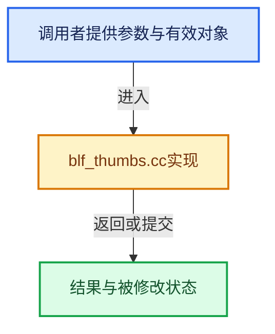

# 实现依赖专题：source/blender/blenfont/intern/blf_thumbs.cc

[实现依赖导航](../../../README.md) · [符号索引](../../../../00-课程指南/02-源码与提交索引/符号依赖与实现索引.md)

本专题从正文实际调用进入，集中保存共享实现。函数有稳定锚点，可从调用处直接跳到对应完整函数；递归与互相调用通过回链组织。

## 本文件的实现关系





## 完整成员与函数实现

<a id="f-89b8f49a2ff052eb"></a>

### `blender::blf_get_sample_text`

实现位置：[source/blender/blenfont/intern/blf_thumbs.cc](../../../../../../../../source/blender/blenfont/intern/blf_thumbs.cc) · L218—L300。

接口参数：

- `const FT_Face face`

**教学注释版**

<!-- annotated:590014634c62ba -->

```cpp
static const char32_t *blf_get_sample_text(const FT_Face face)
{
  /* First check for fonts with MS Symbol character map. */
  if (face->charmap->encoding == FT_ENCODING_MS_SYMBOL) {
    /* Many of these have characters starting from F020. */
    if (FT_Get_Char_Index(face, U'\uf041') != 0) {
      return U"\uf041\uf044\uf048";
    }
    if (FT_Get_Char_Index(face, U'\uf030') != 0) {
      return U"\uf030\uf031\uf032";
    }
    return U"ADH";
  }

  const char32_t *def = U"Aabg";
  const char32_t *sample = def;

  /* Fonts too old to have a Unicode character map. */
  if (face->charmap->encoding != FT_ENCODING_UNICODE) {
    return def;
  }

  /* TrueType table with bits to quickly test most Unicode block coverage. */
  TT_OS2 *os2_table = static_cast<TT_OS2 *>(FT_Get_Sfnt_Table(face, FT_SFNT_OS2));
  if (!os2_table) {
    return def;
  }

  /* Detect "Last resort" fonts. They have everything, except the last 5 bits. */
  if (os2_table->ulUnicodeRange1 == 0xffffffffU && os2_table->ulUnicodeRange2 == 0xffffffffU &&
      os2_table->ulUnicodeRange3 == 0xffffffffU && os2_table->ulUnicodeRange4 >= 0x7FFFFFFU)
  {
    return U"\xE000\xFFFF";
  }

  int language_count = count_bits_i(uint(os2_table->ulUnicodeRange1)) +
                       count_bits_i(uint(os2_table->ulUnicodeRange2)) +
                       count_bits_i(uint(os2_table->ulUnicodeRange3)) +
                       count_bits_i(uint(os2_table->ulUnicodeRange4));

  /* Use OS/2 Table code page range bits to differentiate between (combined) CJK fonts.
   * See https://learn.microsoft.com/en-us/typography/opentype/spec/os2#cpr */
  FT_ULong codepages = os2_table->ulCodePageRange1;
  if (codepages & (1 << 19) || codepages & (1 << 21)) {
    return U"\ud55c\uad6d\uc5b4"; /* 한국어 Korean. */
  }
  if (codepages & (1 << 20)) {
    return U"\u7E41\u9AD4\u5B57"; /* 繁體字 Traditional Chinese. */
  }
  if (codepages & (1 << 17) && !(codepages & (1 << 18))) {
    return U"\u65E5\u672C\u8A9E"; /* 日本語 Japanese. */
  }
  if (codepages & (1 << 18) && !(codepages & (1 << 17))) {
    return U"\u7B80\u4F53\u5B57"; /* 简体字 Simplified Chinese. */
  }

  for (uint i = 0; i < ARRAY_SIZE(unicode_samples); ++i) {
    const UnicodeSample *s = &unicode_samples[i];
    if (os2_table && s->field && s->mask) {
      /* OS/2 Table contains 4 contiguous integers of script coverage bit flags. */
      const FT_ULong *unicode_range = &os2_table->ulUnicodeRange1;
      const int index = (s->field - 1);
      BLI_assert(index < 4);
      if (!(unicode_range[index] & s->mask)) {
        continue;
      }
    }
    if (FT_Get_Char_Index(face, s->sample[0]) != 0) {
      sample = s->sample;
      break;
    }
  }

  bool has_latin = (os2_table && (os2_table->ulUnicodeRange1 & TT_UCR_BASIC_LATIN) &&
                    (FT_Get_Char_Index(face, U'A') != 0));
  bool has_cjk = (os2_table && (os2_table->ulUnicodeRange2 & TT_UCR_CJK_UNIFIED_IDEOGRAPHS));

  if (has_latin && ((has_cjk && language_count > 40) || (!has_cjk && language_count > 5))) {
    return def;
  }

  return sample;
}
```

<details>
<summary>核对原始源码：source/blender/blenfont/intern/blf_thumbs.cc · L218—L300</summary>

<!-- original:590014634c62ba:source/blender/blenfont/intern/blf_thumbs.cc:218:300 -->

```cpp
static const char32_t *blf_get_sample_text(const FT_Face face)
{
  /* First check for fonts with MS Symbol character map. */
  if (face->charmap->encoding == FT_ENCODING_MS_SYMBOL) {
    /* Many of these have characters starting from F020. */
    if (FT_Get_Char_Index(face, U'\uf041') != 0) {
      return U"\uf041\uf044\uf048";
    }
    if (FT_Get_Char_Index(face, U'\uf030') != 0) {
      return U"\uf030\uf031\uf032";
    }
    return U"ADH";
  }

  const char32_t *def = U"Aabg";
  const char32_t *sample = def;

  /* Fonts too old to have a Unicode character map. */
  if (face->charmap->encoding != FT_ENCODING_UNICODE) {
    return def;
  }

  /* TrueType table with bits to quickly test most Unicode block coverage. */
  TT_OS2 *os2_table = static_cast<TT_OS2 *>(FT_Get_Sfnt_Table(face, FT_SFNT_OS2));
  if (!os2_table) {
    return def;
  }

  /* Detect "Last resort" fonts. They have everything, except the last 5 bits. */
  if (os2_table->ulUnicodeRange1 == 0xffffffffU && os2_table->ulUnicodeRange2 == 0xffffffffU &&
      os2_table->ulUnicodeRange3 == 0xffffffffU && os2_table->ulUnicodeRange4 >= 0x7FFFFFFU)
  {
    return U"\xE000\xFFFF";
  }

  int language_count = count_bits_i(uint(os2_table->ulUnicodeRange1)) +
                       count_bits_i(uint(os2_table->ulUnicodeRange2)) +
                       count_bits_i(uint(os2_table->ulUnicodeRange3)) +
                       count_bits_i(uint(os2_table->ulUnicodeRange4));

  /* Use OS/2 Table code page range bits to differentiate between (combined) CJK fonts.
   * See https://learn.microsoft.com/en-us/typography/opentype/spec/os2#cpr */
  FT_ULong codepages = os2_table->ulCodePageRange1;
  if (codepages & (1 << 19) || codepages & (1 << 21)) {
    return U"\ud55c\uad6d\uc5b4"; /* 한국어 Korean. */
  }
  if (codepages & (1 << 20)) {
    return U"\u7E41\u9AD4\u5B57"; /* 繁體字 Traditional Chinese. */
  }
  if (codepages & (1 << 17) && !(codepages & (1 << 18))) {
    return U"\u65E5\u672C\u8A9E"; /* 日本語 Japanese. */
  }
  if (codepages & (1 << 18) && !(codepages & (1 << 17))) {
    return U"\u7B80\u4F53\u5B57"; /* 简体字 Simplified Chinese. */
  }

  for (uint i = 0; i < ARRAY_SIZE(unicode_samples); ++i) {
    const UnicodeSample *s = &unicode_samples[i];
    if (os2_table && s->field && s->mask) {
      /* OS/2 Table contains 4 contiguous integers of script coverage bit flags. */
      const FT_ULong *unicode_range = &os2_table->ulUnicodeRange1;
      const int index = (s->field - 1);
      BLI_assert(index < 4);
      if (!(unicode_range[index] & s->mask)) {
        continue;
      }
    }
    if (FT_Get_Char_Index(face, s->sample[0]) != 0) {
      sample = s->sample;
      break;
    }
  }

  bool has_latin = (os2_table && (os2_table->ulUnicodeRange1 & TT_UCR_BASIC_LATIN) &&
                    (FT_Get_Char_Index(face, U'A') != 0));
  bool has_cjk = (os2_table && (os2_table->ulUnicodeRange2 & TT_UCR_CJK_UNIFIED_IDEOGRAPHS));

  if (has_latin && ((has_cjk && language_count > 40) || (!has_cjk && language_count > 5))) {
    return def;
  }

  return sample;
}
```

</details>

**沿实际写入检查状态**

- `sample = s->sample;`

**结果出口**

- `return U"\uf041\uf044\uf048";`
- `return U"\uf030\uf031\uf032";`
- `return U"ADH";`
- `return def;`
- `return U"\xE000\xFFFF";`
- `return U"\ud55c\uad6d\uc5b4"; /* 한국어 Korean. */`
- `return U"\u7E41\u9AD4\u5B57"; /* 繁體字 Traditional Chinese. */`
- `return U"\u65E5\u672C\u8A9E"; /* 日本語 Japanese. */`
- `return U"\u7B80\u4F53\u5B57"; /* 简体字 Simplified Chinese. */`
- `return sample;`

**继续追踪实现**

- `FT_Get_Char_Index` → [调用协议](../../../../00-课程指南/01-路线与规范/模板宏与动态分派协议.md)：函数指针、局部可调用对象或未展开的宏；必须结合调用者环境。调用位置L223。
- `FT_Get_Sfnt_Table` → [调用协议](../../../../00-课程指南/01-路线与规范/模板宏与动态分派协议.md)：函数指针、局部可调用对象或未展开的宏；必须结合调用者环境。调用位置L241。
- `count_bits_i` → [blender::count_bits_i · L127](../../../01-BLI基础库/intern/math_bits_inline.cc.md#f-43d56d5da48d4eae)。
- `ARRAY_SIZE` → [blender::ARRAY_SIZE · L608](../../../01-BLI基础库/BLI_utildefines.hh.md#f-eaec3a7e47b85c7c)。
- `BLI_assert` → [BLI_assert · L48](../../../01-BLI基础库/BLI_assert.hh.md#m-57a88495704d)；[BLI_assert · L63](../../../01-BLI基础库/BLI_assert.hh.md#m-d07050020cb5)。宏定义由构建条件选择。

<a id="f-2e0c147a09695f54"></a>

### `blender::BLF_thumb_preview`

实现位置：[source/blender/blenfont/intern/blf_thumbs.cc](../../../../../../../../source/blender/blenfont/intern/blf_thumbs.cc) · L302—L423。

接口参数：

- `const char *filepath`
- `uchar *buf`
- `const int w`
- `const int h`
- `const int`

**教学注释版**

<!-- annotated:58cc5774b02900 -->

```cpp
bool BLF_thumb_preview(
    const char *filepath, uchar *buf, const int w, const int h, const int /*channels*/)
{
  /* Use own FT_Library and direct FreeType calls as this is called from multiple threads. */
  FT_Library ft_lib = nullptr;
  if (FT_Init_FreeType(&ft_lib) != FT_Err_Ok) {
    return false;
  }

  FT_Face face;
  if (FT_New_Face(ft_lib, filepath, 0, &face) != FT_Err_Ok) {
    FT_Done_FreeType(ft_lib);
    return false;
  }

  if (!(face->face_flags & FT_FACE_FLAG_SCALABLE)) {
    return false;
  }

  FT_Error err = FT_Select_Charmap(face, FT_ENCODING_UNICODE);
  if (err) {
    err = FT_Select_Charmap(face, FT_ENCODING_MS_SYMBOL);
  }
  if (err) {
    err = FT_Select_Charmap(face, FT_ENCODING_APPLE_ROMAN);
  }
  if (err && face->num_charmaps > 0) {
    err = FT_Select_Charmap(face, face->charmaps[0]->encoding);
  }
  if (err != FT_Err_Ok) {
    FT_Done_Face(face);
    FT_Done_FreeType(ft_lib);
    return false;
  }

  const char32_t *codepoints = blf_get_sample_text(face);
  uint glyph_ids[BLF_SAMPLE_LEN] = {0};

  /* A large initial font size for measuring. Nothing will be rendered this size. */
  if (FT_Set_Char_Size(face, w * 64, 0, 72, 72) != FT_Err_Ok) {
    FT_Done_Face(face);
    FT_Done_FreeType(ft_lib);
    return false;
  }

  /* Approximate length of the sample. Uses only advances, ignores bearings. */
  int width = 0;
  for (uint i = 0; i < BLF_SAMPLE_LEN && codepoints[i]; i++) {
    glyph_ids[i] = FT_Get_Char_Index(face, codepoints[i]);
    /* If sample glyph is not found, use another. */
    if (!glyph_ids[i]) {
      glyph_ids[i] = uint(face->num_glyphs / (BLF_SAMPLE_LEN + 1)) * (i + 1);
    }
    /* Get advance without loading the glyph. */
    FT_Fixed advance;
    FT_Get_Advance(face, glyph_ids[i], FT_LOAD_NO_HINTING, &advance);
    /* Advance is returned in 16.16 format, so divide by 65536 for pixels. */
    width += int(advance >> 16);
  }

  int height = ft_pix_to_int(ft_pix(face->size->metrics.ascender) -
                             ft_pix(face->size->metrics.descender));
  // [讲解] std::max：按比较关系选取较大值。本讲解中的增长公式同时满足最低请求和几何增长；若保存返回引用，还需注意实参寿命。
  width = std::max(width, height);

  /* Fill up to 96% horizontally or vertically. */
  // [讲解] std::min：按比较关系选取较小值；截断范围时还需先满足非负和可表示范围，min本身不会证明边界安全。
  float font_size = std::min({float(w),
                              (float(w) * 0.96f / float(width) * float(w)),
                              float(h) * 0.96f / float(height) * float(h)});

  if (font_size < 1 || FT_Set_Char_Size(face, int(font_size * 64.0f), 0, 72, 72) != FT_Err_Ok) {
    /* Sizing can fail, but very rarely. */
    FT_Done_Face(face);
    FT_Done_FreeType(ft_lib);
    return false;
  }

  /* Horizontally center, line up baselines vertically. */
  int left = int((float(w) - (float(width) * (font_size / float(w)))) / 2.0f);
  int top = int(float(h) * 0.7f);

  /* Print out to buffer. */

  FT_Pos advance_x = 0;
  int glyph_count = 0; /* How many are successfully loaded and rendered. */

  for (int i = 0; i < BLF_SAMPLE_LEN && glyph_ids[i]; i++) {
    if (FT_Load_Glyph(face, glyph_ids[i], FT_LOAD_TARGET_NORMAL | FT_LOAD_NO_HINTING) != FT_Err_Ok)
    {
      break;
    }

    if (FT_Render_Glyph(face->glyph, FT_RENDER_MODE_NORMAL) != FT_Err_Ok ||
        face->glyph->format != FT_GLYPH_FORMAT_BITMAP)
    {
      break;
    }

    glyph_count++;

    for (int y = 0; y < int(face->glyph->bitmap.rows); y++) {
      int dest_row = (h - y - 1 + int(face->glyph->bitmap_top) - top);
      if (dest_row >= 0 && dest_row < h) {
        for (int x = 0; x < int(face->glyph->bitmap.width); x++) {
          int dest_col = (x + ft_pix_to_int(ft_pix(advance_x)) + face->glyph->bitmap_left + left);
          if (dest_col >= 0 && dest_col < w) {
            uchar *source = &face->glyph->bitmap.buffer[y * int(face->glyph->bitmap.width) + x];
            uchar *dest = &buf[dest_row * w * 4 + (dest_col * 4 + 3)];
            *dest = uchar(std::min((uint(*dest) + uint(*source)), 255u));
          }
        }
      }
    }

    advance_x += face->glyph->advance.x;
  }

  FT_Done_Face(face);
  FT_Done_FreeType(ft_lib);

  /* Return success if we printed at least one glyph. */
  return glyph_count > 0;
}
```

<details>
<summary>核对原始源码：source/blender/blenfont/intern/blf_thumbs.cc · L302—L423</summary>

<!-- original:58cc5774b02900:source/blender/blenfont/intern/blf_thumbs.cc:302:423 -->

```cpp
bool BLF_thumb_preview(
    const char *filepath, uchar *buf, const int w, const int h, const int /*channels*/)
{
  /* Use own FT_Library and direct FreeType calls as this is called from multiple threads. */
  FT_Library ft_lib = nullptr;
  if (FT_Init_FreeType(&ft_lib) != FT_Err_Ok) {
    return false;
  }

  FT_Face face;
  if (FT_New_Face(ft_lib, filepath, 0, &face) != FT_Err_Ok) {
    FT_Done_FreeType(ft_lib);
    return false;
  }

  if (!(face->face_flags & FT_FACE_FLAG_SCALABLE)) {
    return false;
  }

  FT_Error err = FT_Select_Charmap(face, FT_ENCODING_UNICODE);
  if (err) {
    err = FT_Select_Charmap(face, FT_ENCODING_MS_SYMBOL);
  }
  if (err) {
    err = FT_Select_Charmap(face, FT_ENCODING_APPLE_ROMAN);
  }
  if (err && face->num_charmaps > 0) {
    err = FT_Select_Charmap(face, face->charmaps[0]->encoding);
  }
  if (err != FT_Err_Ok) {
    FT_Done_Face(face);
    FT_Done_FreeType(ft_lib);
    return false;
  }

  const char32_t *codepoints = blf_get_sample_text(face);
  uint glyph_ids[BLF_SAMPLE_LEN] = {0};

  /* A large initial font size for measuring. Nothing will be rendered this size. */
  if (FT_Set_Char_Size(face, w * 64, 0, 72, 72) != FT_Err_Ok) {
    FT_Done_Face(face);
    FT_Done_FreeType(ft_lib);
    return false;
  }

  /* Approximate length of the sample. Uses only advances, ignores bearings. */
  int width = 0;
  for (uint i = 0; i < BLF_SAMPLE_LEN && codepoints[i]; i++) {
    glyph_ids[i] = FT_Get_Char_Index(face, codepoints[i]);
    /* If sample glyph is not found, use another. */
    if (!glyph_ids[i]) {
      glyph_ids[i] = uint(face->num_glyphs / (BLF_SAMPLE_LEN + 1)) * (i + 1);
    }
    /* Get advance without loading the glyph. */
    FT_Fixed advance;
    FT_Get_Advance(face, glyph_ids[i], FT_LOAD_NO_HINTING, &advance);
    /* Advance is returned in 16.16 format, so divide by 65536 for pixels. */
    width += int(advance >> 16);
  }

  int height = ft_pix_to_int(ft_pix(face->size->metrics.ascender) -
                             ft_pix(face->size->metrics.descender));
  width = std::max(width, height);

  /* Fill up to 96% horizontally or vertically. */
  float font_size = std::min({float(w),
                              (float(w) * 0.96f / float(width) * float(w)),
                              float(h) * 0.96f / float(height) * float(h)});

  if (font_size < 1 || FT_Set_Char_Size(face, int(font_size * 64.0f), 0, 72, 72) != FT_Err_Ok) {
    /* Sizing can fail, but very rarely. */
    FT_Done_Face(face);
    FT_Done_FreeType(ft_lib);
    return false;
  }

  /* Horizontally center, line up baselines vertically. */
  int left = int((float(w) - (float(width) * (font_size / float(w)))) / 2.0f);
  int top = int(float(h) * 0.7f);

  /* Print out to buffer. */

  FT_Pos advance_x = 0;
  int glyph_count = 0; /* How many are successfully loaded and rendered. */

  for (int i = 0; i < BLF_SAMPLE_LEN && glyph_ids[i]; i++) {
    if (FT_Load_Glyph(face, glyph_ids[i], FT_LOAD_TARGET_NORMAL | FT_LOAD_NO_HINTING) != FT_Err_Ok)
    {
      break;
    }

    if (FT_Render_Glyph(face->glyph, FT_RENDER_MODE_NORMAL) != FT_Err_Ok ||
        face->glyph->format != FT_GLYPH_FORMAT_BITMAP)
    {
      break;
    }

    glyph_count++;

    for (int y = 0; y < int(face->glyph->bitmap.rows); y++) {
      int dest_row = (h - y - 1 + int(face->glyph->bitmap_top) - top);
      if (dest_row >= 0 && dest_row < h) {
        for (int x = 0; x < int(face->glyph->bitmap.width); x++) {
          int dest_col = (x + ft_pix_to_int(ft_pix(advance_x)) + face->glyph->bitmap_left + left);
          if (dest_col >= 0 && dest_col < w) {
            uchar *source = &face->glyph->bitmap.buffer[y * int(face->glyph->bitmap.width) + x];
            uchar *dest = &buf[dest_row * w * 4 + (dest_col * 4 + 3)];
            *dest = uchar(std::min((uint(*dest) + uint(*source)), 255u));
          }
        }
      }
    }

    advance_x += face->glyph->advance.x;
  }

  FT_Done_Face(face);
  FT_Done_FreeType(ft_lib);

  /* Return success if we printed at least one glyph. */
  return glyph_count > 0;
}
```

</details>

**沿实际写入检查状态**

- `err = FT_Select_Charmap(face, FT_ENCODING_MS_SYMBOL);`
- `err = FT_Select_Charmap(face, FT_ENCODING_APPLE_ROMAN);`
- `err = FT_Select_Charmap(face, face->charmaps[0]->encoding);`
- `glyph_ids[i] = FT_Get_Char_Index(face, codepoints[i]);`
- `glyph_ids[i] = uint(face->num_glyphs / (BLF_SAMPLE_LEN + 1)) * (i + 1);`
- `width += int(advance >> 16);`
- `width = std::max(width, height);`
- `advance_x += face->glyph->advance.x;`

**结果出口**

- `return false;`
- `return glyph_count > 0;`

**继续追踪实现**

- `FT_Init_FreeType` → [调用协议](../../../../00-课程指南/01-路线与规范/模板宏与动态分派协议.md)：函数指针、局部可调用对象或未展开的宏；必须结合调用者环境。调用位置L307。
- `FT_New_Face` → [FT_New_Face · L56](blf_font.cc.md#m-967d28cee2ec)。宏定义由构建条件选择。
- `FT_Done_FreeType` → [调用协议](../../../../00-课程指南/01-路线与规范/模板宏与动态分派协议.md)：函数指针、局部可调用对象或未展开的宏；必须结合调用者环境。调用位置L313。
- `FT_Select_Charmap` → [调用协议](../../../../00-课程指南/01-路线与规范/模板宏与动态分派协议.md)：函数指针、局部可调用对象或未展开的宏；必须结合调用者环境。调用位置L321。
- `FT_Done_Face` → [调用协议](../../../../00-课程指南/01-路线与规范/模板宏与动态分派协议.md)：函数指针、局部可调用对象或未展开的宏；必须结合调用者环境。调用位置L332。
- `blf_get_sample_text` → [blender::blf_get_sample_text · L218](blf_thumbs.cc.md#f-89b8f49a2ff052eb)。
- `FT_Set_Char_Size` → [调用协议](../../../../00-课程指南/01-路线与规范/模板宏与动态分派协议.md)：函数指针、局部可调用对象或未展开的宏；必须结合调用者环境。调用位置L341。
- `FT_Get_Char_Index` → [调用协议](../../../../00-课程指南/01-路线与规范/模板宏与动态分派协议.md)：函数指针、局部可调用对象或未展开的宏；必须结合调用者环境。调用位置L350。
- `FT_Get_Advance` → [调用协议](../../../../00-课程指南/01-路线与规范/模板宏与动态分派协议.md)：函数指针、局部可调用对象或未展开的宏；必须结合调用者环境。调用位置L357。
- `ft_pix_to_int` → [blender::ft_pix_to_int · L78](blf_internal_types.hh.md#f-8513f2178301e2c7)。
- `ft_pix` → [调用协议](../../../../00-课程指南/01-路线与规范/模板宏与动态分派协议.md)：函数指针、局部可调用对象或未展开的宏；必须结合调用者环境。调用位置L362。
- `std::max` → [外部契约](https://eel.is/c++draft/alg.min.max)：按比较关系选取较大值。本讲解中的增长公式同时满足最低请求和几何增长；若保存返回引用，还需注意实参寿命。
- `std::min` → [外部契约](https://eel.is/c++draft/alg.min.max)：按比较关系选取较小值；截断范围时还需先满足非负和可表示范围，min本身不会证明边界安全。
- `FT_Load_Glyph` → [调用协议](../../../../00-课程指南/01-路线与规范/模板宏与动态分派协议.md)：函数指针、局部可调用对象或未展开的宏；必须结合调用者环境。调用位置L388。
- `FT_Render_Glyph` → [调用协议](../../../../00-课程指南/01-路线与规范/模板宏与动态分派协议.md)：函数指针、局部可调用对象或未展开的宏；必须结合调用者环境。调用位置L393。
- `uchar` → [调用协议](../../../../00-课程指南/01-路线与规范/模板宏与动态分派协议.md)：函数指针、局部可调用对象或未展开的宏；必须结合调用者环境。调用位置L409。
