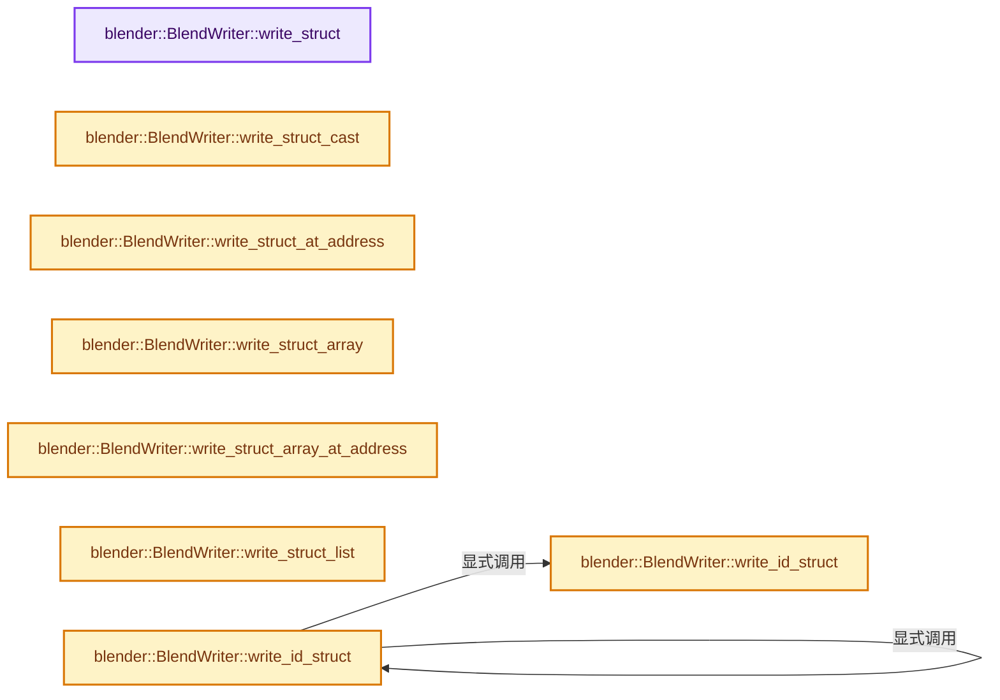

# 实现依赖专题：source/blender/blenloader/BLO_read_write.hh

[实现依赖导航](../../README.md) · [符号索引](../../../00-课程指南/02-源码与提交索引/符号依赖与实现索引.md)

本专题从正文实际调用进入，集中保存共享实现。函数有稳定锚点，可从调用处直接跳到对应完整函数；递归与互相调用通过回链组织。

## 本文件的实现关系




## 相关类型布局与成员入口

<a id="t-252e2b809ee5"></a>

### `blender::eReportType`

原始声明：[source/blender/blenloader/BLO_read_write.hh](../../../../../../../source/blender/blenloader/BLO_read_write.hh) · L56—L56。

以下保留类的数据声明与编译条件，成员函数实现通过后面的精确链接阅读。

<!-- annotated:7988aab337c5d4 -->

```cpp
enum eReportType : uint16_t;
```

<details>
<summary>核对原始源码：source/blender/blenloader/BLO_read_write.hh · L56—L56</summary>

<!-- original:7988aab337c5d4:source/blender/blenloader/BLO_read_write.hh:56:56 -->

```cpp
enum eReportType : uint16_t;
```

</details>


<a id="m-f8b1feebbe87"></a>

## 宏 `blo_blend_struct_writer_fn_typed`

<!-- annotated:bca7868669335c -->

```cpp
#define blo_blend_struct_writer_fn_typed(T, fn) \
  ((fn) ? BlendStructWriterFn([fn](BlendStructWriterVoid &struct_writer) { \
    BlendStructWriter<T> typed_writer(struct_writer); \
    fn(typed_writer); \
  }) : \
          nullptr)

```

<details>
<summary>核对原始源码：source/blender/blenloader/BLO_read_write.hh · L125—L131</summary>

<!-- original:bca7868669335c:source/blender/blenloader/BLO_read_write.hh:125:131 -->

```cpp
#define blo_blend_struct_writer_fn_typed(T, fn) \
  ((fn) ? BlendStructWriterFn([fn](BlendStructWriterVoid &struct_writer) { \
    BlendStructWriter<T> typed_writer(struct_writer); \
    fn(typed_writer); \
  }) : \
          nullptr)

```

</details>

宏在预处理阶段展开，参数替换、重复求值和条件编译应直接从该定义检查。与普通函数不同，宏不会自动提供参数类型检查；构建配置选择哪个定义需结合外围条件。

<a id="m-100f6a13febf"></a>

## 宏 `BLO_read_raw_address`

<!-- annotated:bbdee226cba71e -->

```cpp
#define BLO_read_raw_address(reader, ptr_p) \
  *((void **)ptr_p) = blo_read_raw_address_impl((reader), *(ptr_p))

```

<details>
<summary>核对原始源码：source/blender/blenloader/BLO_read_write.hh · L467—L469</summary>

<!-- original:bbdee226cba71e:source/blender/blenloader/BLO_read_write.hh:467:469 -->

```cpp
#define BLO_read_raw_address(reader, ptr_p) \
  *((void **)ptr_p) = blo_read_raw_address_impl((reader), *(ptr_p))

```

</details>

宏在预处理阶段展开，参数替换、重复求值和条件编译应直接从该定义检查。与普通函数不同，宏不会自动提供参数类型检查；构建配置选择哪个定义需结合外围条件。

<a id="m-d307fd6f7c0e"></a>

## 宏 `BLO_read_struct`

<!-- annotated:fa7f0d98cf8f1a -->

```cpp
#define BLO_read_struct(reader, struct_name, ptr_p) \
  (*((void **)ptr_p) = blo_read_struct_impl(reader, *((void **)ptr_p), sizeof(struct_name)))

```

<details>
<summary>核对原始源码：source/blender/blenloader/BLO_read_write.hh · L477—L479</summary>

<!-- original:fa7f0d98cf8f1a:source/blender/blenloader/BLO_read_write.hh:477:479 -->

```cpp
#define BLO_read_struct(reader, struct_name, ptr_p) \
  (*((void **)ptr_p) = blo_read_struct_impl(reader, *((void **)ptr_p), sizeof(struct_name)))

```

</details>

宏在预处理阶段展开，参数替换、重复求值和条件编译应直接从该定义检查。与普通函数不同，宏不会自动提供参数类型检查；构建配置选择哪个定义需结合外围条件。

<a id="m-f52dccc66a6c"></a>

## 宏 `BLO_read_struct_nonnull`

<!-- annotated:ca3d062d6c1ba6 -->

```cpp
#define BLO_read_struct_nonnull(reader, struct_name, ptr_p) \
  (*((void **)ptr_p) = blo_read_struct_nonnull_impl( \
       reader, *((void **)ptr_p), sizeof(struct_name)))

```

<details>
<summary>核对原始源码：source/blender/blenloader/BLO_read_write.hh · L487—L490</summary>

<!-- original:ca3d062d6c1ba6:source/blender/blenloader/BLO_read_write.hh:487:490 -->

```cpp
#define BLO_read_struct_nonnull(reader, struct_name, ptr_p) \
  (*((void **)ptr_p) = blo_read_struct_nonnull_impl( \
       reader, *((void **)ptr_p), sizeof(struct_name)))

```

</details>

宏在预处理阶段展开，参数替换、重复求值和条件编译应直接从该定义检查。与普通函数不同，宏不会自动提供参数类型检查；构建配置选择哪个定义需结合外围条件。

<a id="m-7f0b2171679f"></a>

## 宏 `BLO_read_struct_list`

<!-- annotated:a7b8d6437eabb5 -->

```cpp
#define BLO_read_struct_list(reader, struct_name, list) \
  BLO_read_struct_list_with_size(reader, sizeof(struct_name), list)

```

<details>
<summary>核对原始源码：source/blender/blenloader/BLO_read_write.hh · L542—L544</summary>

<!-- original:a7b8d6437eabb5:source/blender/blenloader/BLO_read_write.hh:542:544 -->

```cpp
#define BLO_read_struct_list(reader, struct_name, list) \
  BLO_read_struct_list_with_size(reader, sizeof(struct_name), list)

```

</details>

宏在预处理阶段展开，参数替换、重复求值和条件编译应直接从该定义检查。与普通函数不同，宏不会自动提供参数类型检查；构建配置选择哪个定义需结合外围条件。

## 完整成员与函数实现

<a id="f-65ffd01269f4b779"></a>

### `blender::BlendWriter::write_struct`

实现位置：[source/blender/blenloader/BLO_read_write.hh](../../../../../../../source/blender/blenloader/BLO_read_write.hh) · L236—L240。

接口参数：

- `const T *data`
- `BlendStructWriterTypedFn<T> fn = nullptr`

**教学注释版**

<!-- annotated:d9da237e5e0465 -->

```cpp
  template<typename T> void write_struct(const T *data, BlendStructWriterTypedFn<T> fn = nullptr)
  {
    this->write_struct_by_id(
        dna::sdna_struct_id_get<T>(), data, blo_blend_struct_writer_fn_typed(T, fn));
  }
```

<details>
<summary>核对原始源码：source/blender/blenloader/BLO_read_write.hh · L236—L240</summary>

<!-- original:d9da237e5e0465:source/blender/blenloader/BLO_read_write.hh:236:240 -->

```cpp
  template<typename T> void write_struct(const T *data, BlendStructWriterTypedFn<T> fn = nullptr)
  {
    this->write_struct_by_id(
        dna::sdna_struct_id_get<T>(), data, blo_blend_struct_writer_fn_typed(T, fn));
  }
```

</details>

**继续追踪实现**

- `this->write_struct_by_id` → [blender::BlendWriter::write_struct_by_id · L2228](intern/writefile.cc.md#f-ff79190f75341e09)。
- `dna::sdna_struct_id_get<T>` → [调用协议](../../../00-课程指南/01-路线与规范/模板宏与动态分派协议.md)：函数指针、局部可调用对象或未展开的宏；必须结合调用者环境。调用位置L239。
- `blo_blend_struct_writer_fn_typed` → [blo_blend_struct_writer_fn_typed · L125](BLO_read_write.hh.md#m-f8b1feebbe87)。宏定义由构建条件选择。

<a id="f-9f4cdb61a752062e"></a>

### `blender::BlendWriter::write_struct_cast`

实现位置：[source/blender/blenloader/BLO_read_write.hh](../../../../../../../source/blender/blenloader/BLO_read_write.hh) · L242—L247。

接口参数：

- `const void *data`
- `BlendStructWriterTypedFn<T> fn = nullptr`

**教学注释版**

<!-- annotated:9a46432c9483df -->

```cpp
  template<typename T>
  void write_struct_cast(const void *data, BlendStructWriterTypedFn<T> fn = nullptr)
  {
    this->write_struct_by_id(
        dna::sdna_struct_id_get<T>(), data, blo_blend_struct_writer_fn_typed(T, fn));
  }
```

<details>
<summary>核对原始源码：source/blender/blenloader/BLO_read_write.hh · L242—L247</summary>

<!-- original:9a46432c9483df:source/blender/blenloader/BLO_read_write.hh:242:247 -->

```cpp
  template<typename T>
  void write_struct_cast(const void *data, BlendStructWriterTypedFn<T> fn = nullptr)
  {
    this->write_struct_by_id(
        dna::sdna_struct_id_get<T>(), data, blo_blend_struct_writer_fn_typed(T, fn));
  }
```

</details>

**继续追踪实现**

- `this->write_struct_by_id` → [blender::BlendWriter::write_struct_by_id · L2228](intern/writefile.cc.md#f-ff79190f75341e09)。
- `dna::sdna_struct_id_get<T>` → [调用协议](../../../00-课程指南/01-路线与规范/模板宏与动态分派协议.md)：函数指针、局部可调用对象或未展开的宏；必须结合调用者环境。调用位置L246。
- `blo_blend_struct_writer_fn_typed` → [blo_blend_struct_writer_fn_typed · L125](BLO_read_write.hh.md#m-f8b1feebbe87)。宏定义由构建条件选择。

<a id="f-46d7d1ad26f4b14d"></a>

### `blender::BlendWriter::write_struct_at_address`

实现位置：[source/blender/blenloader/BLO_read_write.hh](../../../../../../../source/blender/blenloader/BLO_read_write.hh) · L249—L256。

接口参数：

- `const void *address`
- `const T *data`
- `BlendStructWriterTypedFn<T> fn = nullptr`

**教学注释版**

<!-- annotated:f285d1f144fbaa -->

```cpp
  template<typename T>
  void write_struct_at_address(const void *address,
                               const T *data,
                               BlendStructWriterTypedFn<T> fn = nullptr)
  {
    this->write_struct_at_address_by_id(
        dna::sdna_struct_id_get<T>(), address, data, blo_blend_struct_writer_fn_typed(T, fn));
  }
```

<details>
<summary>核对原始源码：source/blender/blenloader/BLO_read_write.hh · L249—L256</summary>

<!-- original:f285d1f144fbaa:source/blender/blenloader/BLO_read_write.hh:249:256 -->

```cpp
  template<typename T>
  void write_struct_at_address(const void *address,
                               const T *data,
                               BlendStructWriterTypedFn<T> fn = nullptr)
  {
    this->write_struct_at_address_by_id(
        dna::sdna_struct_id_get<T>(), address, data, blo_blend_struct_writer_fn_typed(T, fn));
  }
```

</details>

**继续追踪实现**

- `this->write_struct_at_address_by_id` → [blender::BlendWriter::write_struct_at_address_by_id · L2235](intern/writefile.cc.md#f-00b619d125ea56d2)。
- `dna::sdna_struct_id_get<T>` → [调用协议](../../../00-课程指南/01-路线与规范/模板宏与动态分派协议.md)：函数指针、局部可调用对象或未展开的宏；必须结合调用者环境。调用位置L255。
- `blo_blend_struct_writer_fn_typed` → [blo_blend_struct_writer_fn_typed · L125](BLO_read_write.hh.md#m-f8b1feebbe87)。宏定义由构建条件选择。

<a id="f-0dbd1649a1c88312"></a>

### `blender::BlendWriter::write_struct_array`

实现位置：[source/blender/blenloader/BLO_read_write.hh](../../../../../../../source/blender/blenloader/BLO_read_write.hh) · L267—L274。

接口参数：

- `const int64_t array_size`
- `const T *data`
- `BlendStructWriterTypedFn<T> fn = nullptr`

**教学注释版**

<!-- annotated:665f3de326dda8 -->

```cpp
  template<typename T>
  void write_struct_array(const int64_t array_size,
                          const T *data,
                          BlendStructWriterTypedFn<T> fn = nullptr)
  {
    this->write_struct_array_by_id(
        dna::sdna_struct_id_get<T>(), array_size, data, blo_blend_struct_writer_fn_typed(T, fn));
  }
```

<details>
<summary>核对原始源码：source/blender/blenloader/BLO_read_write.hh · L267—L274</summary>

<!-- original:665f3de326dda8:source/blender/blenloader/BLO_read_write.hh:267:274 -->

```cpp
  template<typename T>
  void write_struct_array(const int64_t array_size,
                          const T *data,
                          BlendStructWriterTypedFn<T> fn = nullptr)
  {
    this->write_struct_array_by_id(
        dna::sdna_struct_id_get<T>(), array_size, data, blo_blend_struct_writer_fn_typed(T, fn));
  }
```

</details>

**继续追踪实现**

- `this->write_struct_array_by_id` → [blender::BlendWriter::write_struct_array_by_id · L2252](intern/writefile.cc.md#f-05789193154f1647)。
- `dna::sdna_struct_id_get<T>` → [调用协议](../../../00-课程指南/01-路线与规范/模板宏与动态分派协议.md)：函数指针、局部可调用对象或未展开的宏；必须结合调用者环境。调用位置L273。
- `blo_blend_struct_writer_fn_typed` → [blo_blend_struct_writer_fn_typed · L125](BLO_read_write.hh.md#m-f8b1feebbe87)。宏定义由构建条件选择。

<a id="f-dd80985dc6c1b835"></a>

### `blender::BlendWriter::write_struct_array_at_address`

实现位置：[source/blender/blenloader/BLO_read_write.hh](../../../../../../../source/blender/blenloader/BLO_read_write.hh) · L285—L296。

接口参数：

- `const int64_t array_size`
- `const void *address`
- `const T *data`
- `BlendStructWriterTypedFn<T> fn = nullptr`

**教学注释版**

<!-- annotated:b335480932c475 -->

```cpp
  template<typename T>
  void write_struct_array_at_address(const int64_t array_size,
                                     const void *address,
                                     const T *data,
                                     BlendStructWriterTypedFn<T> fn = nullptr)
  {
    this->write_struct_array_at_address_by_id(dna::sdna_struct_id_get<T>(),
                                              array_size,
                                              address,
                                              data,
                                              blo_blend_struct_writer_fn_typed(T, fn));
  }
```

<details>
<summary>核对原始源码：source/blender/blenloader/BLO_read_write.hh · L285—L296</summary>

<!-- original:b335480932c475:source/blender/blenloader/BLO_read_write.hh:285:296 -->

```cpp
  template<typename T>
  void write_struct_array_at_address(const int64_t array_size,
                                     const void *address,
                                     const T *data,
                                     BlendStructWriterTypedFn<T> fn = nullptr)
  {
    this->write_struct_array_at_address_by_id(dna::sdna_struct_id_get<T>(),
                                              array_size,
                                              address,
                                              data,
                                              blo_blend_struct_writer_fn_typed(T, fn));
  }
```

</details>

**继续追踪实现**

- `this->write_struct_array_at_address_by_id` → [blender::BlendWriter::write_struct_array_at_address_by_id · L2260](intern/writefile.cc.md#f-9d11cc2160281318)。
- `dna::sdna_struct_id_get<T>` → [调用协议](../../../00-课程指南/01-路线与规范/模板宏与动态分派协议.md)：函数指针、局部可调用对象或未展开的宏；必须结合调用者环境。调用位置L291。
- `blo_blend_struct_writer_fn_typed` → [blo_blend_struct_writer_fn_typed · L125](BLO_read_write.hh.md#m-f8b1feebbe87)。宏定义由构建条件选择。

<a id="f-8aca3b06a9458bda"></a>

### `blender::BlendWriter::write_struct_list`

实现位置：[source/blender/blenloader/BLO_read_write.hh](../../../../../../../source/blender/blenloader/BLO_read_write.hh) · L298—L303。

接口参数：

- `const ListBaseT<T> *list`
- `BlendStructWriterTypedFn<T> fn = nullptr`

**教学注释版**

<!-- annotated:aa75198dd3036a -->

```cpp
  template<typename T>
  void write_struct_list(const ListBaseT<T> *list, BlendStructWriterTypedFn<T> fn = nullptr)
  {
    this->write_struct_list_by_id(
        dna::sdna_struct_id_get<T>(), list, blo_blend_struct_writer_fn_typed(T, fn));
  }
```

<details>
<summary>核对原始源码：source/blender/blenloader/BLO_read_write.hh · L298—L303</summary>

<!-- original:aa75198dd3036a:source/blender/blenloader/BLO_read_write.hh:298:303 -->

```cpp
  template<typename T>
  void write_struct_list(const ListBaseT<T> *list, BlendStructWriterTypedFn<T> fn = nullptr)
  {
    this->write_struct_list_by_id(
        dna::sdna_struct_id_get<T>(), list, blo_blend_struct_writer_fn_typed(T, fn));
  }
```

</details>

**继续追踪实现**

- `this->write_struct_list_by_id` → [blender::BlendWriter::write_struct_list_by_id · L2269](intern/writefile.cc.md#f-f91c965b13765bff)。
- `dna::sdna_struct_id_get<T>` → [调用协议](../../../00-课程指南/01-路线与规范/模板宏与动态分派协议.md)：函数指针、局部可调用对象或未展开的宏；必须结合调用者环境。调用位置L302。
- `blo_blend_struct_writer_fn_typed` → [blo_blend_struct_writer_fn_typed · L125](BLO_read_write.hh.md#m-f8b1feebbe87)。宏定义由构建条件选择。

<a id="f-78070d7dc12e9476"></a>

### `blender::BlendWriter::write_id_struct`

实现位置：[source/blender/blenloader/BLO_read_write.hh](../../../../../../../source/blender/blenloader/BLO_read_write.hh) · L305—L311。

接口参数：

- `const void *id_address`
- `const T *id`
- `BlendStructWriterTypedFn<T> fn = nullptr`

**教学注释版**

<!-- annotated:d39af658ee85cd -->

```cpp
  template<typename T>
  void write_id_struct(const void *id_address,
                       const T *id,
                       BlendStructWriterTypedFn<T> fn = nullptr)
  {
    this->write_id_struct(GS(id_cast<const ID *>(id)->name), id_address, id, fn);
  }
```

<details>
<summary>核对原始源码：source/blender/blenloader/BLO_read_write.hh · L305—L311</summary>

<!-- original:d39af658ee85cd:source/blender/blenloader/BLO_read_write.hh:305:311 -->

```cpp
  template<typename T>
  void write_id_struct(const void *id_address,
                       const T *id,
                       BlendStructWriterTypedFn<T> fn = nullptr)
  {
    this->write_id_struct(GS(id_cast<const ID *>(id)->name), id_address, id, fn);
  }
```

</details>

**继续追踪实现**

- `this->write_id_struct` → [blender::BlendWriter::write_id_struct · L305](BLO_read_write.hh.md#f-78070d7dc12e9476)；[blender::BlendWriter::write_id_struct · L322](BLO_read_write.hh.md#f-24d448cce2a1cc5b)。同名重载需按实参类型选择。
- `GS` → [blender::GS · L410](../makesdna/DNA_ID.h.md#f-c3ff509f79f21b05)。
- `id_cast<const ID *>` → [blender::id_cast · L1417](../makesdna/DNA_ID.h.md#f-6c8ac6412850ac5a)。

<a id="f-24d448cce2a1cc5b"></a>

### `blender::BlendWriter::write_id_struct`

实现位置：[source/blender/blenloader/BLO_read_write.hh](../../../../../../../source/blender/blenloader/BLO_read_write.hh) · L322—L359。

接口参数：

- `const int filecode`
- `const void *id_address`
- `const T *id`
- `BlendStructWriterTypedFn<T> fn = nullptr`

**教学注释版**

<!-- annotated:ed27db1145e03f -->

```cpp
  template<typename T>
  void write_id_struct(const int filecode,
                       const void *id_address,
                       const T *id,
                       BlendStructWriterTypedFn<T> fn = nullptr)
  {
    this->write_struct_at_address_by_id_with_filecode(
        filecode,
        dna::sdna_struct_id_get<T>(),
        id_address,
        id,
        [&](BlendStructWriterVoid &struct_writer) {
          BlendStructWriter<T> typed_writer(struct_writer);
          ID &shallow_id = *reinterpret_cast<ID *>(&typed_writer.shallow_data);
          /* Clear runtime ID fields shared by every ID write path. */
          if (this->is_undo()) {
            shallow_id.tag &= ID_TAG_KEEP_ON_UNDO;
          }
          else {
            shallow_id.tag = 0;
            shallow_id.session_uid = 0;
            shallow_id.recalc = 0;
            shallow_id.recalc_up_to_undo_push = 0;
            shallow_id.recalc_after_undo_push = 0;
          }
          shallow_id.us = 0;
          shallow_id.icon_id = 0;
          shallow_id.runtime = nullptr;
          shallow_id.prev = nullptr;
          shallow_id.next = nullptr;
          shallow_id.orig_id = nullptr;
          shallow_id.newid = nullptr;
          shallow_id.py_instance = nullptr;
          if (fn) {
            fn(typed_writer);
          }
        });
  }
```

<details>
<summary>核对原始源码：source/blender/blenloader/BLO_read_write.hh · L322—L359</summary>

<!-- original:ed27db1145e03f:source/blender/blenloader/BLO_read_write.hh:322:359 -->

```cpp
  template<typename T>
  void write_id_struct(const int filecode,
                       const void *id_address,
                       const T *id,
                       BlendStructWriterTypedFn<T> fn = nullptr)
  {
    this->write_struct_at_address_by_id_with_filecode(
        filecode,
        dna::sdna_struct_id_get<T>(),
        id_address,
        id,
        [&](BlendStructWriterVoid &struct_writer) {
          BlendStructWriter<T> typed_writer(struct_writer);
          ID &shallow_id = *reinterpret_cast<ID *>(&typed_writer.shallow_data);
          /* Clear runtime ID fields shared by every ID write path. */
          if (this->is_undo()) {
            shallow_id.tag &= ID_TAG_KEEP_ON_UNDO;
          }
          else {
            shallow_id.tag = 0;
            shallow_id.session_uid = 0;
            shallow_id.recalc = 0;
            shallow_id.recalc_up_to_undo_push = 0;
            shallow_id.recalc_after_undo_push = 0;
          }
          shallow_id.us = 0;
          shallow_id.icon_id = 0;
          shallow_id.runtime = nullptr;
          shallow_id.prev = nullptr;
          shallow_id.next = nullptr;
          shallow_id.orig_id = nullptr;
          shallow_id.newid = nullptr;
          shallow_id.py_instance = nullptr;
          if (fn) {
            fn(typed_writer);
          }
        });
  }
```

</details>

**沿实际写入检查状态**

- `shallow_id.tag &= ID_TAG_KEEP_ON_UNDO;`
- `shallow_id.tag = 0;`
- `shallow_id.session_uid = 0;`
- `shallow_id.recalc = 0;`
- `shallow_id.recalc_up_to_undo_push = 0;`
- `shallow_id.recalc_after_undo_push = 0;`
- `shallow_id.us = 0;`
- `shallow_id.icon_id = 0;`
- `shallow_id.runtime = nullptr;`
- `shallow_id.prev = nullptr;`
- `shallow_id.next = nullptr;`
- `shallow_id.orig_id = nullptr;`
- `shallow_id.newid = nullptr;`
- `shallow_id.py_instance = nullptr;`

**继续追踪实现**

- `this->write_struct_at_address_by_id_with_filecode` → [blender::BlendWriter::write_struct_at_address_by_id_with_filecode · L2243](intern/writefile.cc.md#f-d1e04d47f857684c)。
- `dna::sdna_struct_id_get<T>` → [调用协议](../../../00-课程指南/01-路线与规范/模板宏与动态分派协议.md)：函数指针、局部可调用对象或未展开的宏；必须结合调用者环境。调用位置L330。
- `this->is_undo` → [blender::BlendWriter::is_undo · L2199](intern/writefile.cc.md#f-575a0be6b62031df)。
- `fn` → [blender::fn::multi_function::CallInstruction::fn · L390](../../../07-MultiFunction与批量执行/07-Procedure指令与控制流.md#f-572ebb7362882f77)。

<a id="f-72510af36964431f"></a>

### `blender::BLO_read_array`

实现位置：[source/blender/blenloader/BLO_read_write.hh](../../../../../../../source/blender/blenloader/BLO_read_write.hh) · L560—L569。

接口参数：

- `BlendDataReader *reader`
- `T **ptr_p`
- `const SizeT array_size`
- `const int elems = 1`

**教学注释版**

<!-- annotated:37407b477080c2 -->

```cpp
template<typename T, typename SizeT>
  requires(!std::is_void_v<T> && !std::is_pointer_v<T>)
[[nodiscard]] bool BLO_read_array(BlendDataReader *reader,
                                  T **ptr_p,
                                  const SizeT array_size,
                                  const int elems = 1)
{
  return blo_read_array_impl(
      reader, int64_t(array_size), elems, sizeof(T), reinterpret_cast<void **>(ptr_p));
}
```

<details>
<summary>核对原始源码：source/blender/blenloader/BLO_read_write.hh · L560—L569</summary>

<!-- original:37407b477080c2:source/blender/blenloader/BLO_read_write.hh:560:569 -->

```cpp
template<typename T, typename SizeT>
  requires(!std::is_void_v<T> && !std::is_pointer_v<T>)
[[nodiscard]] bool BLO_read_array(BlendDataReader *reader,
                                  T **ptr_p,
                                  const SizeT array_size,
                                  const int elems = 1)
{
  return blo_read_array_impl(
      reader, int64_t(array_size), elems, sizeof(T), reinterpret_cast<void **>(ptr_p));
}
```

</details>

**结果出口**

- `return blo_read_array_impl(`

**继续追踪实现**

- `blo_read_array_impl` → [blo_read_array_impl · L6254](intern/readfile.cc.md#f-7a000d558f035fca)。

<a id="f-645e9600b66d0b15"></a>

### `blender::BLO_read_array_and_validate_size`

实现位置：[source/blender/blenloader/BLO_read_write.hh](../../../../../../../source/blender/blenloader/BLO_read_write.hh) · L571—L583。

接口参数：

- `BlendDataReader *reader`
- `T **ptr_p`
- `SizeT *array_size`
- `const int elems = 1`

**教学注释版**

<!-- annotated:928439ad6c532b -->

```cpp
template<typename T, typename SizeT>
  requires(!std::is_void_v<T> && !std::is_pointer_v<T>)
void BLO_read_array_and_validate_size(BlendDataReader *reader,
                                      T **ptr_p,
                                      SizeT *array_size,
                                      const int elems = 1)
{
  if (!blo_read_array_impl(
          reader, int64_t(*array_size), elems, sizeof(T), reinterpret_cast<void **>(ptr_p)))
  {
    *array_size = 0;
  }
}
```

<details>
<summary>核对原始源码：source/blender/blenloader/BLO_read_write.hh · L571—L583</summary>

<!-- original:928439ad6c532b:source/blender/blenloader/BLO_read_write.hh:571:583 -->

```cpp
template<typename T, typename SizeT>
  requires(!std::is_void_v<T> && !std::is_pointer_v<T>)
void BLO_read_array_and_validate_size(BlendDataReader *reader,
                                      T **ptr_p,
                                      SizeT *array_size,
                                      const int elems = 1)
{
  if (!blo_read_array_impl(
          reader, int64_t(*array_size), elems, sizeof(T), reinterpret_cast<void **>(ptr_p)))
  {
    *array_size = 0;
  }
}
```

</details>

**继续追踪实现**

- `blo_read_array_impl` → [blo_read_array_impl · L6254](intern/readfile.cc.md#f-7a000d558f035fca)。

<a id="f-339156ce23ff000f"></a>

### `blender::BLO_read_pointer_array_and_validate_size`

实现位置：[source/blender/blenloader/BLO_read_write.hh](../../../../../../../source/blender/blenloader/BLO_read_write.hh) · L602—L611。

接口参数：

- `BlendDataReader *reader`
- `T **ptr_p`
- `SizeT *array_size`

**教学注释版**

<!-- annotated:872c2a9b4d0563 -->

```cpp
template<typename T, typename SizeT>
  requires(std::is_pointer_v<T> || std::is_void_v<T>)
void BLO_read_pointer_array_and_validate_size(BlendDataReader *reader,
                                              T **ptr_p,
                                              SizeT *array_size)
{
  if (!blo_read_pointer_array_impl(reader, *array_size, reinterpret_cast<void **>(ptr_p))) {
    *array_size = 0;
  }
}
```

<details>
<summary>核对原始源码：source/blender/blenloader/BLO_read_write.hh · L602—L611</summary>

<!-- original:872c2a9b4d0563:source/blender/blenloader/BLO_read_write.hh:602:611 -->

```cpp
template<typename T, typename SizeT>
  requires(std::is_pointer_v<T> || std::is_void_v<T>)
void BLO_read_pointer_array_and_validate_size(BlendDataReader *reader,
                                              T **ptr_p,
                                              SizeT *array_size)
{
  if (!blo_read_pointer_array_impl(reader, *array_size, reinterpret_cast<void **>(ptr_p))) {
    *array_size = 0;
  }
}
```

</details>

**继续追踪实现**

- `blo_read_pointer_array_impl` → [blo_read_pointer_array_impl · L6403](intern/readfile.cc.md#f-72f56c72233c9ee1)。

<a id="f-80b03c9e038d30eb"></a>

### `blender::BLO_read_shared`

实现位置：[source/blender/blenloader/BLO_read_write.hh](../../../../../../../source/blender/blenloader/BLO_read_write.hh) · L630—L641。

接口参数：

- `BlendDataReader *reader`
- `T **data_ptr`
- `FunctionRef<const ImplicitSharingInfo *()> read_fn`

**教学注释版**

<!-- annotated:9fb0625a376a80 -->

```cpp
template<typename T>
const ImplicitSharingInfo *BLO_read_shared(BlendDataReader *reader,
                                           T **data_ptr,
                                           FunctionRef<const ImplicitSharingInfo *()> read_fn)
{
  ImplicitSharingInfoAndData shared_data = blo_read_shared_impl(
      reader, (const void **)data_ptr, read_fn);
  /* Need const-cast here, because not all DNA members that reference potentially shared data are
   * const yet. */
  *data_ptr = const_cast<T *>(static_cast<const T *>(shared_data.data));
  return shared_data.sharing_info;
}
```

<details>
<summary>核对原始源码：source/blender/blenloader/BLO_read_write.hh · L630—L641</summary>

<!-- original:9fb0625a376a80:source/blender/blenloader/BLO_read_write.hh:630:641 -->

```cpp
template<typename T>
const ImplicitSharingInfo *BLO_read_shared(BlendDataReader *reader,
                                           T **data_ptr,
                                           FunctionRef<const ImplicitSharingInfo *()> read_fn)
{
  ImplicitSharingInfoAndData shared_data = blo_read_shared_impl(
      reader, (const void **)data_ptr, read_fn);
  /* Need const-cast here, because not all DNA members that reference potentially shared data are
   * const yet. */
  *data_ptr = const_cast<T *>(static_cast<const T *>(shared_data.data));
  return shared_data.sharing_info;
}
```

</details>

**结果出口**

- `return shared_data.sharing_info;`

**继续追踪实现**

- `blo_read_shared_impl` → [blo_read_shared_impl · L6470](intern/readfile.cc.md#f-bfc9c5d9d6c03995)。
