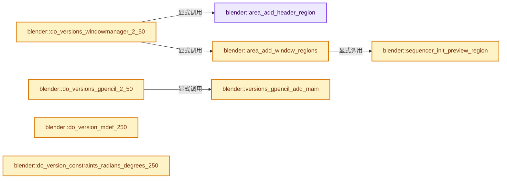
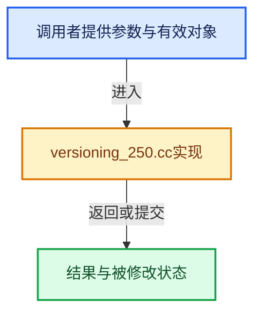

# 实现依赖专题：source/blender/blenloader/intern/versioning_250.cc

[实现依赖导航](../../../README.md) · [符号索引](../../../../00-课程指南/02-源码与提交索引/符号依赖与实现索引.md)

本专题从正文实际调用进入，集中保存共享实现。函数有稳定锚点，可从调用处直接跳到对应完整函数；递归与互相调用通过回链组织。

## 本文件的实现关系






## 完整成员与函数实现

<a id="f-15b323da80965b63"></a>

### `blender::area_add_header_region`

实现位置：[source/blender/blenloader/intern/versioning_250.cc](../../../../../../../../source/blender/blenloader/intern/versioning_250.cc) · L89—L109。

接口参数：

- `ScrArea *area`
- `ListBaseT<ARegion> *lb`

**教学注释版**

<!-- annotated:782c50388118a9 -->

```cpp
static void area_add_header_region(ScrArea *area, ListBaseT<ARegion> *lb)
{
  ARegion *region = BKE_area_region_new();

  BLI_addtail(lb, region);
  region->regiontype = RGN_TYPE_HEADER;
  if (area->headertype == 1) {
    region->alignment = RGN_ALIGN_BOTTOM;
  }
  else {
    region->alignment = RGN_ALIGN_TOP;
  }

  /* initialize view2d data for header region, to allow panning */
  /* is copy from ui_view2d.c */
  region->v2d.keepzoom = (V2D_LOCKZOOM_X | V2D_LOCKZOOM_Y | V2D_LIMITZOOM | V2D_KEEPASPECT);
  region->v2d.keepofs = V2D_LOCKOFS_Y;
  region->v2d.keeptot = V2D_KEEPTOT_STRICT;
  region->v2d.align = V2D_ALIGN_NO_NEG_X | V2D_ALIGN_NO_NEG_Y;
  region->v2d.flag = (V2D_PIXELOFS_X | V2D_PIXELOFS_Y);
}
```

<details>
<summary>核对原始源码：source/blender/blenloader/intern/versioning_250.cc · L89—L109</summary>

<!-- original:782c50388118a9:source/blender/blenloader/intern/versioning_250.cc:89:109 -->

```cpp
static void area_add_header_region(ScrArea *area, ListBaseT<ARegion> *lb)
{
  ARegion *region = BKE_area_region_new();

  BLI_addtail(lb, region);
  region->regiontype = RGN_TYPE_HEADER;
  if (area->headertype == 1) {
    region->alignment = RGN_ALIGN_BOTTOM;
  }
  else {
    region->alignment = RGN_ALIGN_TOP;
  }

  /* initialize view2d data for header region, to allow panning */
  /* is copy from ui_view2d.c */
  region->v2d.keepzoom = (V2D_LOCKZOOM_X | V2D_LOCKZOOM_Y | V2D_LIMITZOOM | V2D_KEEPASPECT);
  region->v2d.keepofs = V2D_LOCKOFS_Y;
  region->v2d.keeptot = V2D_KEEPTOT_STRICT;
  region->v2d.align = V2D_ALIGN_NO_NEG_X | V2D_ALIGN_NO_NEG_Y;
  region->v2d.flag = (V2D_PIXELOFS_X | V2D_PIXELOFS_Y);
}
```

</details>

**沿实际写入检查状态**

- `region->regiontype = RGN_TYPE_HEADER;`
- `region->alignment = RGN_ALIGN_BOTTOM;`
- `region->alignment = RGN_ALIGN_TOP;`
- `region->v2d.keepzoom = (V2D_LOCKZOOM_X | V2D_LOCKZOOM_Y | V2D_LIMITZOOM | V2D_KEEPASPECT);`
- `region->v2d.keepofs = V2D_LOCKOFS_Y;`
- `region->v2d.keeptot = V2D_KEEPTOT_STRICT;`
- `region->v2d.align = V2D_ALIGN_NO_NEG_X | V2D_ALIGN_NO_NEG_Y;`
- `region->v2d.flag = (V2D_PIXELOFS_X | V2D_PIXELOFS_Y);`

**继续追踪实现**

- `BKE_area_region_new` → [blender::BKE_area_region_new · L520](../../../02-BKE几何与数据/intern/screen.cc.md#f-65d2bf9c04020290)。
- `BLI_addtail` → [blender::BLI_addtail · L118](../../../01-BLI基础库/intern/listbase.cc.md#f-4fb027713fa3115b)。

<a id="f-ea15289a7ee1d56d"></a>

### `blender::sequencer_init_preview_region`

实现位置：[source/blender/blenloader/intern/versioning_250.cc](../../../../../../../../source/blender/blenloader/intern/versioning_250.cc) · L111—L132。

接口参数：

- `ARegion *region`

**教学注释版**

<!-- annotated:0199aba2366e5a -->

```cpp
void sequencer_init_preview_region(ARegion *region)
{
  /* XXX a bit ugly still, copied from space_sequencer */
  /* NOTE: if you change values here, also change them in `space_sequencer.cc`, sequencer_new */
  region->regiontype = RGN_TYPE_PREVIEW;
  region->alignment = RGN_ALIGN_TOP;
  region->flag &= ~RGN_FLAG_HIDDEN;
  region->v2d.keepzoom = V2D_KEEPASPECT | V2D_KEEPZOOM | V2D_LIMITZOOM;
  region->v2d.minzoom = 0.001f;
  region->v2d.maxzoom = 1000.0f;
  region->v2d.tot.xmin = -960.0f; /* 1920 width centered */
  region->v2d.tot.ymin = -540.0f; /* 1080 height centered */
  region->v2d.tot.xmax = 960.0f;
  region->v2d.tot.ymax = 540.0f;
  region->v2d.min[0] = 0.0f;
  region->v2d.min[1] = 0.0f;
  region->v2d.max[0] = 12000.0f;
  region->v2d.max[1] = 12000.0f;
  region->v2d.cur = region->v2d.tot;
  region->v2d.align = V2D_ALIGN_FREE; /* `(V2D_ALIGN_NO_NEG_X|V2D_ALIGN_NO_NEG_Y)` */
  region->v2d.keeptot = V2D_KEEPTOT_FREE;
}
```

<details>
<summary>核对原始源码：source/blender/blenloader/intern/versioning_250.cc · L111—L132</summary>

<!-- original:0199aba2366e5a:source/blender/blenloader/intern/versioning_250.cc:111:132 -->

```cpp
void sequencer_init_preview_region(ARegion *region)
{
  /* XXX a bit ugly still, copied from space_sequencer */
  /* NOTE: if you change values here, also change them in `space_sequencer.cc`, sequencer_new */
  region->regiontype = RGN_TYPE_PREVIEW;
  region->alignment = RGN_ALIGN_TOP;
  region->flag &= ~RGN_FLAG_HIDDEN;
  region->v2d.keepzoom = V2D_KEEPASPECT | V2D_KEEPZOOM | V2D_LIMITZOOM;
  region->v2d.minzoom = 0.001f;
  region->v2d.maxzoom = 1000.0f;
  region->v2d.tot.xmin = -960.0f; /* 1920 width centered */
  region->v2d.tot.ymin = -540.0f; /* 1080 height centered */
  region->v2d.tot.xmax = 960.0f;
  region->v2d.tot.ymax = 540.0f;
  region->v2d.min[0] = 0.0f;
  region->v2d.min[1] = 0.0f;
  region->v2d.max[0] = 12000.0f;
  region->v2d.max[1] = 12000.0f;
  region->v2d.cur = region->v2d.tot;
  region->v2d.align = V2D_ALIGN_FREE; /* `(V2D_ALIGN_NO_NEG_X|V2D_ALIGN_NO_NEG_Y)` */
  region->v2d.keeptot = V2D_KEEPTOT_FREE;
}
```

</details>

**沿实际写入检查状态**

- `region->regiontype = RGN_TYPE_PREVIEW;`
- `region->alignment = RGN_ALIGN_TOP;`
- `region->flag &= ~RGN_FLAG_HIDDEN;`
- `region->v2d.keepzoom = V2D_KEEPASPECT | V2D_KEEPZOOM | V2D_LIMITZOOM;`
- `region->v2d.minzoom = 0.001f;`
- `region->v2d.maxzoom = 1000.0f;`
- `region->v2d.tot.xmin = -960.0f; /* 1920 width centered */`
- `region->v2d.tot.ymin = -540.0f; /* 1080 height centered */`
- `region->v2d.tot.xmax = 960.0f;`
- `region->v2d.tot.ymax = 540.0f;`
- `region->v2d.min[0] = 0.0f;`
- `region->v2d.min[1] = 0.0f;`
- `region->v2d.max[0] = 12000.0f;`
- `region->v2d.max[1] = 12000.0f;`
- `region->v2d.cur = region->v2d.tot;`
- `region->v2d.align = V2D_ALIGN_FREE; /* ˋ(V2D_ALIGN_NO_NEG_X|V2D_ALIGN_NO_NEG_Y)ˋ */`
- `region->v2d.keeptot = V2D_KEEPTOT_FREE;`

**继续追踪实现**

本实现没有需要继续展开的显式调用；检查返回表达式、对象转换和调用者前置条件。

<a id="f-8df776b14db5a264"></a>

### `blender::area_add_window_regions`

实现位置：[source/blender/blenloader/intern/versioning_250.cc](../../../../../../../../source/blender/blenloader/intern/versioning_250.cc) · L134—L395。

接口参数：

- `ScrArea *area`
- `SpaceLink *sl`
- `ListBaseT<ARegion> *lb`

**教学注释版**

<!-- annotated:bc2396dde39ce7 -->

```cpp
static void area_add_window_regions(ScrArea *area, SpaceLink *sl, ListBaseT<ARegion> *lb)
{
  ARegion *region;

  if (sl) {
    /* first channels for ipo action nla... */
    switch (sl->spacetype) {
      case SPACE_GRAPH:
        region = BKE_area_region_new();
        BLI_addtail(lb, region);
        region->regiontype = RGN_TYPE_CHANNELS;
        region->alignment = RGN_ALIGN_LEFT;
        region->v2d.scroll = (V2D_SCROLL_RIGHT | V2D_SCROLL_BOTTOM);

        /* for some reason, this doesn't seem to go auto like for NLA... */
        region = BKE_area_region_new();
        BLI_addtail(lb, region);
        region->regiontype = RGN_TYPE_UI;
        region->alignment = RGN_ALIGN_RIGHT;
        region->v2d.scroll = V2D_SCROLL_RIGHT;
        region->v2d.flag = eView2D_Flag(RGN_FLAG_HIDDEN);
        break;

      case SPACE_ACTION:
        region = BKE_area_region_new();
        BLI_addtail(lb, region);
        region->regiontype = RGN_TYPE_CHANNELS;
        region->alignment = RGN_ALIGN_LEFT;
        region->v2d.scroll = V2D_SCROLL_BOTTOM;
        region->v2d.flag = V2D_VIEWSYNC_AREA_VERTICAL;
        break;

      case SPACE_NLA:
        region = BKE_area_region_new();
        BLI_addtail(lb, region);
        region->regiontype = RGN_TYPE_CHANNELS;
        region->alignment = RGN_ALIGN_LEFT;
        region->v2d.scroll = V2D_SCROLL_BOTTOM;
        region->v2d.flag = V2D_VIEWSYNC_AREA_VERTICAL;

        /* for some reason, some files still don't get this auto */
        region = BKE_area_region_new();
        BLI_addtail(lb, region);
        region->regiontype = RGN_TYPE_UI;
        region->alignment = RGN_ALIGN_RIGHT;
        region->v2d.scroll = V2D_SCROLL_RIGHT;
        region->v2d.flag = eView2D_Flag(RGN_FLAG_HIDDEN);
        break;

      case SPACE_NODE:
        region = BKE_area_region_new();
        BLI_addtail(lb, region);
        region->regiontype = RGN_TYPE_UI;
        region->alignment = RGN_ALIGN_LEFT;
        region->v2d.scroll = (V2D_SCROLL_RIGHT | V2D_SCROLL_BOTTOM);
        region->v2d.flag = V2D_VIEWSYNC_AREA_VERTICAL;
        /* temporarily hide it */
        region->flag = RGN_FLAG_HIDDEN;
        break;
      case SPACE_FILE:
        region = BKE_area_region_new();
        BLI_addtail(lb, region);
        region->regiontype = RGN_TYPE_CHANNELS;
        region->alignment = RGN_ALIGN_LEFT;

        region = BKE_area_region_new();
        BLI_addtail(lb, region);
        region->regiontype = RGN_TYPE_UI;
        region->alignment = RGN_ALIGN_TOP;
        break;
      case SPACE_SEQ: {
        ARegion *region_main = nullptr;
        for (ARegion &region_iter : *lb) {
          if (region_iter.regiontype == RGN_TYPE_WINDOW) {
            region_main = &region_iter;
            break;
          }
        }
        region = BKE_area_region_new();
        BLI_insertlinkbefore(lb, region_main, region);
        sequencer_init_preview_region(region);
        break;
      }
      case SPACE_VIEW3D:
        /* toolbar */
        region = BKE_area_region_new();

        BLI_addtail(lb, region);
        region->regiontype = RGN_TYPE_TOOLS;
        region->alignment = RGN_ALIGN_LEFT;
        region->flag = RGN_FLAG_HIDDEN;

        /* tool properties */
        region = BKE_area_region_new();

        BLI_addtail(lb, region);
        region->regiontype = RGN_TYPE_TOOL_PROPS;
        region->alignment = RGN_ALIGN_BOTTOM | RGN_SPLIT_PREV;
        region->flag = RGN_FLAG_HIDDEN;

        /* buttons/list view */
        region = BKE_area_region_new();

        BLI_addtail(lb, region);
        region->regiontype = RGN_TYPE_UI;
        region->alignment = RGN_ALIGN_RIGHT;
        region->flag = RGN_FLAG_HIDDEN;
#if 0
      case SPACE_PROPERTIES:
        /* context UI region */
        region = BKE_area_region_new();
        BLI_addtail(lb, region);
        region->regiontype = RGN_TYPE_UI;
        region->alignment = RGN_ALIGN_RIGHT;

        break;
#endif
    }
  }

  /* main region */
  region = BKE_area_region_new();

  BLI_addtail(lb, region);
  region->winrct = area->totrct;

  region->regiontype = RGN_TYPE_WINDOW;

  if (sl) {
    /* if active spacetype has view2d data, copy that over to main region */
    /* and we split view3d */
    switch (sl->spacetype) {
      case SPACE_VIEW3D:
        BKE_screen_view3d_do_versions_250(reinterpret_cast<View3D *>(sl), lb);
        break;

      case SPACE_OUTLINER: {
        SpaceOutliner *space_outliner = reinterpret_cast<SpaceOutliner *>(sl);

        // [讲解] memcpy：复制字节，源与目标不应重叠。类型生命周期、对齐和可复制表示须由调用者证明，不是任意对象的复制构造。
        memcpy(&region->v2d, &space_outliner->v2d, sizeof(View2D));

        region->v2d.scroll &= ~V2D_SCROLL_LEFT;
        region->v2d.scroll |= (V2D_SCROLL_RIGHT | V2D_SCROLL_BOTTOM);
        region->v2d.align = (V2D_ALIGN_NO_NEG_X | V2D_ALIGN_NO_POS_Y);
        region->v2d.keepzoom |= (V2D_LOCKZOOM_X | V2D_LOCKZOOM_Y | V2D_KEEPASPECT);
        region->v2d.keeptot = V2D_KEEPTOT_STRICT;
        region->v2d.minzoom = region->v2d.maxzoom = 1.0f;
        // region->v2d.flag |= V2D_IS_INIT;
        break;
      }
      case SPACE_GRAPH: {
        SpaceGraph *sipo = reinterpret_cast<SpaceGraph *>(sl);
        memcpy(&region->v2d, &sipo->v2d, sizeof(View2D));

        /* Initialize main-area view2d. */
        region->v2d.scroll |= (V2D_SCROLL_BOTTOM | V2D_SCROLL_HORIZONTAL_HANDLES);
        region->v2d.scroll |= (V2D_SCROLL_LEFT | V2D_SCROLL_VERTICAL_HANDLES);

        region->v2d.min[0] = FLT_MIN;
        region->v2d.min[1] = FLT_MIN;

        region->v2d.max[0] = MAXFRAMEF;
        region->v2d.max[1] = FLT_MAX;

        // region->v2d.flag |= V2D_IS_INIT;
        break;
      }
      case SPACE_NLA: {
        SpaceNla *snla = reinterpret_cast<SpaceNla *>(sl);
        memcpy(&region->v2d, &snla->v2d, sizeof(View2D));

        region->v2d.tot.ymin = float(-area->winy) / 3.0f;
        region->v2d.tot.ymax = 0.0f;

        region->v2d.scroll |= (V2D_SCROLL_BOTTOM | V2D_SCROLL_HORIZONTAL_HANDLES);
        region->v2d.scroll |= V2D_SCROLL_RIGHT;
        region->v2d.align = V2D_ALIGN_NO_POS_Y;
        region->v2d.flag |= V2D_VIEWSYNC_AREA_VERTICAL;
        break;
      }
      case SPACE_ACTION: {
        SpaceAction *saction = reinterpret_cast<SpaceAction *>(sl);

        /* We totally reinitialize the view for the Action Editor,
         * as some old instances had some weird cruft set. */
        region->v2d.tot.xmin = -20.0f;
        region->v2d.tot.ymin = float(-area->winy) / 3.0f;
        region->v2d.tot.xmax = float((area->winx > 120) ? (area->winx) : 120);
        region->v2d.tot.ymax = 0.0f;

        region->v2d.cur = region->v2d.tot;

        region->v2d.min[0] = 0.0f;
        region->v2d.min[1] = 0.0f;

        region->v2d.max[0] = MAXFRAMEF;
        region->v2d.max[1] = FLT_MAX;

        region->v2d.minzoom = 0.01f;
        region->v2d.maxzoom = 50;
        region->v2d.scroll = (V2D_SCROLL_BOTTOM | V2D_SCROLL_HORIZONTAL_HANDLES);
        region->v2d.scroll |= V2D_SCROLL_RIGHT;
        region->v2d.keepzoom = V2D_LOCKZOOM_Y;
        region->v2d.align = V2D_ALIGN_NO_POS_Y;
        region->v2d.flag = V2D_VIEWSYNC_AREA_VERTICAL;

        /* for old files with ShapeKey editors open + an action set, clear the action as
         * it doesn't make sense in the new system (i.e. violates concept that ShapeKey edit
         * only shows ShapeKey-rooted actions only)
         */
        if (saction->mode == SACTCONT_SHAPEKEY) {
          saction->action = nullptr;
        }
        break;
      }
      case SPACE_SEQ: {
        SpaceSeq *sseq = reinterpret_cast<SpaceSeq *>(sl);
        memcpy(&region->v2d, &sseq->v2d, sizeof(View2D));

        region->v2d.scroll |= (V2D_SCROLL_BOTTOM | V2D_SCROLL_HORIZONTAL_HANDLES);
        region->v2d.scroll |= (V2D_SCROLL_LEFT | V2D_SCROLL_VERTICAL_HANDLES);
        region->v2d.align = V2D_ALIGN_NO_NEG_Y;
        region->v2d.flag |= V2D_IS_INIT;
        break;
      }
      case SPACE_NODE: {
        SpaceNode *snode = reinterpret_cast<SpaceNode *>(sl);
        memcpy(&region->v2d, &snode->v2d, sizeof(View2D));

        region->v2d.scroll = (V2D_SCROLL_RIGHT | V2D_SCROLL_BOTTOM);
        region->v2d.keepzoom = V2D_LIMITZOOM | V2D_KEEPASPECT;
        break;
      }
      case SPACE_PROPERTIES: {
        SpaceProperties *sbuts = reinterpret_cast<SpaceProperties *>(sl);
        memcpy(&region->v2d, &sbuts->v2d, sizeof(View2D));

        region->v2d.scroll |= (V2D_SCROLL_RIGHT | V2D_SCROLL_BOTTOM);
        break;
      }
      case SPACE_FILE: {
        // SpaceFile *sfile = (SpaceFile *)sl;
        region->v2d.tot.xmin = region->v2d.tot.ymin = 0;
        region->v2d.tot.xmax = region->winx;
        region->v2d.tot.ymax = region->winy;
        region->v2d.cur = region->v2d.tot;
        region->regiontype = RGN_TYPE_WINDOW;
        region->v2d.scroll = (V2D_SCROLL_RIGHT | V2D_SCROLL_BOTTOM);
        region->v2d.align = (V2D_ALIGN_NO_NEG_X | V2D_ALIGN_NO_POS_Y);
        region->v2d.keepzoom = (V2D_LOCKZOOM_X | V2D_LOCKZOOM_Y | V2D_LIMITZOOM | V2D_KEEPASPECT);
        break;
      }
      case SPACE_TEXT: {
        SpaceText *st = reinterpret_cast<SpaceText *>(sl);
        st->flags |= ST_FIND_WRAP;
      }
        // case SPACE_XXX: // FIXME... add other ones
        //  memcpy(&region->v2d, &((SpaceXxx *)sl)->v2d, sizeof(View2D));
        //  break;
    }
  }
}
```

<details>
<summary>核对原始源码：source/blender/blenloader/intern/versioning_250.cc · L134—L395</summary>

<!-- original:bc2396dde39ce7:source/blender/blenloader/intern/versioning_250.cc:134:395 -->

```cpp
static void area_add_window_regions(ScrArea *area, SpaceLink *sl, ListBaseT<ARegion> *lb)
{
  ARegion *region;

  if (sl) {
    /* first channels for ipo action nla... */
    switch (sl->spacetype) {
      case SPACE_GRAPH:
        region = BKE_area_region_new();
        BLI_addtail(lb, region);
        region->regiontype = RGN_TYPE_CHANNELS;
        region->alignment = RGN_ALIGN_LEFT;
        region->v2d.scroll = (V2D_SCROLL_RIGHT | V2D_SCROLL_BOTTOM);

        /* for some reason, this doesn't seem to go auto like for NLA... */
        region = BKE_area_region_new();
        BLI_addtail(lb, region);
        region->regiontype = RGN_TYPE_UI;
        region->alignment = RGN_ALIGN_RIGHT;
        region->v2d.scroll = V2D_SCROLL_RIGHT;
        region->v2d.flag = eView2D_Flag(RGN_FLAG_HIDDEN);
        break;

      case SPACE_ACTION:
        region = BKE_area_region_new();
        BLI_addtail(lb, region);
        region->regiontype = RGN_TYPE_CHANNELS;
        region->alignment = RGN_ALIGN_LEFT;
        region->v2d.scroll = V2D_SCROLL_BOTTOM;
        region->v2d.flag = V2D_VIEWSYNC_AREA_VERTICAL;
        break;

      case SPACE_NLA:
        region = BKE_area_region_new();
        BLI_addtail(lb, region);
        region->regiontype = RGN_TYPE_CHANNELS;
        region->alignment = RGN_ALIGN_LEFT;
        region->v2d.scroll = V2D_SCROLL_BOTTOM;
        region->v2d.flag = V2D_VIEWSYNC_AREA_VERTICAL;

        /* for some reason, some files still don't get this auto */
        region = BKE_area_region_new();
        BLI_addtail(lb, region);
        region->regiontype = RGN_TYPE_UI;
        region->alignment = RGN_ALIGN_RIGHT;
        region->v2d.scroll = V2D_SCROLL_RIGHT;
        region->v2d.flag = eView2D_Flag(RGN_FLAG_HIDDEN);
        break;

      case SPACE_NODE:
        region = BKE_area_region_new();
        BLI_addtail(lb, region);
        region->regiontype = RGN_TYPE_UI;
        region->alignment = RGN_ALIGN_LEFT;
        region->v2d.scroll = (V2D_SCROLL_RIGHT | V2D_SCROLL_BOTTOM);
        region->v2d.flag = V2D_VIEWSYNC_AREA_VERTICAL;
        /* temporarily hide it */
        region->flag = RGN_FLAG_HIDDEN;
        break;
      case SPACE_FILE:
        region = BKE_area_region_new();
        BLI_addtail(lb, region);
        region->regiontype = RGN_TYPE_CHANNELS;
        region->alignment = RGN_ALIGN_LEFT;

        region = BKE_area_region_new();
        BLI_addtail(lb, region);
        region->regiontype = RGN_TYPE_UI;
        region->alignment = RGN_ALIGN_TOP;
        break;
      case SPACE_SEQ: {
        ARegion *region_main = nullptr;
        for (ARegion &region_iter : *lb) {
          if (region_iter.regiontype == RGN_TYPE_WINDOW) {
            region_main = &region_iter;
            break;
          }
        }
        region = BKE_area_region_new();
        BLI_insertlinkbefore(lb, region_main, region);
        sequencer_init_preview_region(region);
        break;
      }
      case SPACE_VIEW3D:
        /* toolbar */
        region = BKE_area_region_new();

        BLI_addtail(lb, region);
        region->regiontype = RGN_TYPE_TOOLS;
        region->alignment = RGN_ALIGN_LEFT;
        region->flag = RGN_FLAG_HIDDEN;

        /* tool properties */
        region = BKE_area_region_new();

        BLI_addtail(lb, region);
        region->regiontype = RGN_TYPE_TOOL_PROPS;
        region->alignment = RGN_ALIGN_BOTTOM | RGN_SPLIT_PREV;
        region->flag = RGN_FLAG_HIDDEN;

        /* buttons/list view */
        region = BKE_area_region_new();

        BLI_addtail(lb, region);
        region->regiontype = RGN_TYPE_UI;
        region->alignment = RGN_ALIGN_RIGHT;
        region->flag = RGN_FLAG_HIDDEN;
#if 0
      case SPACE_PROPERTIES:
        /* context UI region */
        region = BKE_area_region_new();
        BLI_addtail(lb, region);
        region->regiontype = RGN_TYPE_UI;
        region->alignment = RGN_ALIGN_RIGHT;

        break;
#endif
    }
  }

  /* main region */
  region = BKE_area_region_new();

  BLI_addtail(lb, region);
  region->winrct = area->totrct;

  region->regiontype = RGN_TYPE_WINDOW;

  if (sl) {
    /* if active spacetype has view2d data, copy that over to main region */
    /* and we split view3d */
    switch (sl->spacetype) {
      case SPACE_VIEW3D:
        BKE_screen_view3d_do_versions_250(reinterpret_cast<View3D *>(sl), lb);
        break;

      case SPACE_OUTLINER: {
        SpaceOutliner *space_outliner = reinterpret_cast<SpaceOutliner *>(sl);

        memcpy(&region->v2d, &space_outliner->v2d, sizeof(View2D));

        region->v2d.scroll &= ~V2D_SCROLL_LEFT;
        region->v2d.scroll |= (V2D_SCROLL_RIGHT | V2D_SCROLL_BOTTOM);
        region->v2d.align = (V2D_ALIGN_NO_NEG_X | V2D_ALIGN_NO_POS_Y);
        region->v2d.keepzoom |= (V2D_LOCKZOOM_X | V2D_LOCKZOOM_Y | V2D_KEEPASPECT);
        region->v2d.keeptot = V2D_KEEPTOT_STRICT;
        region->v2d.minzoom = region->v2d.maxzoom = 1.0f;
        // region->v2d.flag |= V2D_IS_INIT;
        break;
      }
      case SPACE_GRAPH: {
        SpaceGraph *sipo = reinterpret_cast<SpaceGraph *>(sl);
        memcpy(&region->v2d, &sipo->v2d, sizeof(View2D));

        /* Initialize main-area view2d. */
        region->v2d.scroll |= (V2D_SCROLL_BOTTOM | V2D_SCROLL_HORIZONTAL_HANDLES);
        region->v2d.scroll |= (V2D_SCROLL_LEFT | V2D_SCROLL_VERTICAL_HANDLES);

        region->v2d.min[0] = FLT_MIN;
        region->v2d.min[1] = FLT_MIN;

        region->v2d.max[0] = MAXFRAMEF;
        region->v2d.max[1] = FLT_MAX;

        // region->v2d.flag |= V2D_IS_INIT;
        break;
      }
      case SPACE_NLA: {
        SpaceNla *snla = reinterpret_cast<SpaceNla *>(sl);
        memcpy(&region->v2d, &snla->v2d, sizeof(View2D));

        region->v2d.tot.ymin = float(-area->winy) / 3.0f;
        region->v2d.tot.ymax = 0.0f;

        region->v2d.scroll |= (V2D_SCROLL_BOTTOM | V2D_SCROLL_HORIZONTAL_HANDLES);
        region->v2d.scroll |= V2D_SCROLL_RIGHT;
        region->v2d.align = V2D_ALIGN_NO_POS_Y;
        region->v2d.flag |= V2D_VIEWSYNC_AREA_VERTICAL;
        break;
      }
      case SPACE_ACTION: {
        SpaceAction *saction = reinterpret_cast<SpaceAction *>(sl);

        /* We totally reinitialize the view for the Action Editor,
         * as some old instances had some weird cruft set. */
        region->v2d.tot.xmin = -20.0f;
        region->v2d.tot.ymin = float(-area->winy) / 3.0f;
        region->v2d.tot.xmax = float((area->winx > 120) ? (area->winx) : 120);
        region->v2d.tot.ymax = 0.0f;

        region->v2d.cur = region->v2d.tot;

        region->v2d.min[0] = 0.0f;
        region->v2d.min[1] = 0.0f;

        region->v2d.max[0] = MAXFRAMEF;
        region->v2d.max[1] = FLT_MAX;

        region->v2d.minzoom = 0.01f;
        region->v2d.maxzoom = 50;
        region->v2d.scroll = (V2D_SCROLL_BOTTOM | V2D_SCROLL_HORIZONTAL_HANDLES);
        region->v2d.scroll |= V2D_SCROLL_RIGHT;
        region->v2d.keepzoom = V2D_LOCKZOOM_Y;
        region->v2d.align = V2D_ALIGN_NO_POS_Y;
        region->v2d.flag = V2D_VIEWSYNC_AREA_VERTICAL;

        /* for old files with ShapeKey editors open + an action set, clear the action as
         * it doesn't make sense in the new system (i.e. violates concept that ShapeKey edit
         * only shows ShapeKey-rooted actions only)
         */
        if (saction->mode == SACTCONT_SHAPEKEY) {
          saction->action = nullptr;
        }
        break;
      }
      case SPACE_SEQ: {
        SpaceSeq *sseq = reinterpret_cast<SpaceSeq *>(sl);
        memcpy(&region->v2d, &sseq->v2d, sizeof(View2D));

        region->v2d.scroll |= (V2D_SCROLL_BOTTOM | V2D_SCROLL_HORIZONTAL_HANDLES);
        region->v2d.scroll |= (V2D_SCROLL_LEFT | V2D_SCROLL_VERTICAL_HANDLES);
        region->v2d.align = V2D_ALIGN_NO_NEG_Y;
        region->v2d.flag |= V2D_IS_INIT;
        break;
      }
      case SPACE_NODE: {
        SpaceNode *snode = reinterpret_cast<SpaceNode *>(sl);
        memcpy(&region->v2d, &snode->v2d, sizeof(View2D));

        region->v2d.scroll = (V2D_SCROLL_RIGHT | V2D_SCROLL_BOTTOM);
        region->v2d.keepzoom = V2D_LIMITZOOM | V2D_KEEPASPECT;
        break;
      }
      case SPACE_PROPERTIES: {
        SpaceProperties *sbuts = reinterpret_cast<SpaceProperties *>(sl);
        memcpy(&region->v2d, &sbuts->v2d, sizeof(View2D));

        region->v2d.scroll |= (V2D_SCROLL_RIGHT | V2D_SCROLL_BOTTOM);
        break;
      }
      case SPACE_FILE: {
        // SpaceFile *sfile = (SpaceFile *)sl;
        region->v2d.tot.xmin = region->v2d.tot.ymin = 0;
        region->v2d.tot.xmax = region->winx;
        region->v2d.tot.ymax = region->winy;
        region->v2d.cur = region->v2d.tot;
        region->regiontype = RGN_TYPE_WINDOW;
        region->v2d.scroll = (V2D_SCROLL_RIGHT | V2D_SCROLL_BOTTOM);
        region->v2d.align = (V2D_ALIGN_NO_NEG_X | V2D_ALIGN_NO_POS_Y);
        region->v2d.keepzoom = (V2D_LOCKZOOM_X | V2D_LOCKZOOM_Y | V2D_LIMITZOOM | V2D_KEEPASPECT);
        break;
      }
      case SPACE_TEXT: {
        SpaceText *st = reinterpret_cast<SpaceText *>(sl);
        st->flags |= ST_FIND_WRAP;
      }
        // case SPACE_XXX: // FIXME... add other ones
        //  memcpy(&region->v2d, &((SpaceXxx *)sl)->v2d, sizeof(View2D));
        //  break;
    }
  }
}
```

</details>

**沿实际写入检查状态**

- `region = BKE_area_region_new();`
- `region->regiontype = RGN_TYPE_CHANNELS;`
- `region->alignment = RGN_ALIGN_LEFT;`
- `region->v2d.scroll = (V2D_SCROLL_RIGHT | V2D_SCROLL_BOTTOM);`
- `region->regiontype = RGN_TYPE_UI;`
- `region->alignment = RGN_ALIGN_RIGHT;`
- `region->v2d.scroll = V2D_SCROLL_RIGHT;`
- `region->v2d.flag = eView2D_Flag(RGN_FLAG_HIDDEN);`
- `region->v2d.scroll = V2D_SCROLL_BOTTOM;`
- `region->v2d.flag = V2D_VIEWSYNC_AREA_VERTICAL;`
- `region->flag = RGN_FLAG_HIDDEN;`
- `region->alignment = RGN_ALIGN_TOP;`
- `region_main = &region_iter;`
- `region->regiontype = RGN_TYPE_TOOLS;`
- `region->regiontype = RGN_TYPE_TOOL_PROPS;`
- `region->alignment = RGN_ALIGN_BOTTOM | RGN_SPLIT_PREV;`
- `region->winrct = area->totrct;`
- `region->regiontype = RGN_TYPE_WINDOW;`
- `region->v2d.scroll &= ~V2D_SCROLL_LEFT;`
- `region->v2d.scroll |= (V2D_SCROLL_RIGHT | V2D_SCROLL_BOTTOM);`
- `region->v2d.align = (V2D_ALIGN_NO_NEG_X | V2D_ALIGN_NO_POS_Y);`
- `region->v2d.keepzoom |= (V2D_LOCKZOOM_X | V2D_LOCKZOOM_Y | V2D_KEEPASPECT);`
- `region->v2d.keeptot = V2D_KEEPTOT_STRICT;`
- `region->v2d.minzoom = region->v2d.maxzoom = 1.0f;`
- `region->v2d.scroll |= (V2D_SCROLL_BOTTOM | V2D_SCROLL_HORIZONTAL_HANDLES);`
- `region->v2d.scroll |= (V2D_SCROLL_LEFT | V2D_SCROLL_VERTICAL_HANDLES);`
- `region->v2d.min[0] = FLT_MIN;`
- `region->v2d.min[1] = FLT_MIN;`
- `region->v2d.max[0] = MAXFRAMEF;`
- `region->v2d.max[1] = FLT_MAX;`
- `region->v2d.tot.ymin = float(-area->winy) / 3.0f;`
- `region->v2d.tot.ymax = 0.0f;`
- `region->v2d.scroll |= V2D_SCROLL_RIGHT;`
- `region->v2d.align = V2D_ALIGN_NO_POS_Y;`
- `region->v2d.flag |= V2D_VIEWSYNC_AREA_VERTICAL;`
- `region->v2d.tot.xmin = -20.0f;`
- `region->v2d.tot.xmax = float((area->winx > 120) ? (area->winx) : 120);`
- `region->v2d.cur = region->v2d.tot;`
- `region->v2d.min[0] = 0.0f;`
- `region->v2d.min[1] = 0.0f;`
- `region->v2d.minzoom = 0.01f;`
- `region->v2d.maxzoom = 50;`
- `region->v2d.scroll = (V2D_SCROLL_BOTTOM | V2D_SCROLL_HORIZONTAL_HANDLES);`
- `region->v2d.keepzoom = V2D_LOCKZOOM_Y;`
- `saction->action = nullptr;`
- `region->v2d.align = V2D_ALIGN_NO_NEG_Y;`
- `region->v2d.flag |= V2D_IS_INIT;`
- `region->v2d.keepzoom = V2D_LIMITZOOM | V2D_KEEPASPECT;`
- `region->v2d.tot.xmin = region->v2d.tot.ymin = 0;`
- `region->v2d.tot.xmax = region->winx;`
- `region->v2d.tot.ymax = region->winy;`
- `region->v2d.keepzoom = (V2D_LOCKZOOM_X | V2D_LOCKZOOM_Y | V2D_LIMITZOOM | V2D_KEEPASPECT);`
- `st->flags |= ST_FIND_WRAP;`

**继续追踪实现**

- `BKE_area_region_new` → [blender::BKE_area_region_new · L520](../../../02-BKE几何与数据/intern/screen.cc.md#f-65d2bf9c04020290)。
- `BLI_addtail` → [blender::BLI_addtail · L118](../../../01-BLI基础库/intern/listbase.cc.md#f-4fb027713fa3115b)。
- `eView2D_Flag` → [blender::eView2D_Flag](../../makesdna/DNA_view2d_types.h.md#t-08ccf70d1b39)。
- `BLI_insertlinkbefore` → [blender::BLI_insertlinkbefore · L378](../../../01-BLI基础库/intern/listbase.cc.md#f-b9a49151feaf9c08)。
- `sequencer_init_preview_region` → [blender::sequencer_init_preview_region · L111](versioning_250.cc.md#f-ea15289a7ee1d56d)。
- `BKE_screen_view3d_do_versions_250` → [blender::BKE_screen_view3d_do_versions_250 · L1651](../../../02-BKE几何与数据/intern/screen.cc.md#f-47d84b92e7ab82f7)。
- `memcpy` → [外部契约](https://eel.is/c++draft/cstring.syn)：复制字节，源与目标不应重叠。类型生命周期、对齐和可复制表示须由调用者证明，不是任意对象的复制构造。

<a id="f-e6c184f595fb4bd6"></a>

### `blender::do_versions_windowmanager_2_50`

实现位置：[source/blender/blenloader/intern/versioning_250.cc](../../../../../../../../source/blender/blenloader/intern/versioning_250.cc) · L397—L433。

接口参数：

- `bScreen *screen`

**教学注释版**

<!-- annotated:5fabc8b12378af -->

```cpp
static void do_versions_windowmanager_2_50(bScreen *screen)
{
  /* add regions */
  for (ScrArea &area : screen->areabase) {
    /* we keep headertype variable to convert old files only */
    if (area.headertype) {
      area_add_header_region(&area, &area.regionbase);
    }

    area_add_window_regions(&area, area.spacedata.first(), &area.regionbase);

    /* Space image-select is deprecated. */
    for (SpaceLink &sl : area.spacedata) {
      if (sl.spacetype == SPACE_IMASEL) {
        sl.spacetype = SPACE_EMPTY; /* spacedata then matches */
      }
    }

    /* space sound is deprecated */
    for (SpaceLink &sl : area.spacedata) {
      if (sl.spacetype == SPACE_SOUND) {
        sl.spacetype = SPACE_EMPTY; /* spacedata then matches */
      }
    }

    /* pushed back spaces also need regions! */
    if (area.spacedata.first_) {
      SpaceLink *sl = area.spacedata.first_as<SpaceLink>();
      for (sl = sl->next; sl; sl = sl->next) {
        if (area.headertype) {
          area_add_header_region(&area, &sl->regionbase);
        }
        area_add_window_regions(&area, sl, &sl->regionbase);
      }
    }
  }
}
```

<details>
<summary>核对原始源码：source/blender/blenloader/intern/versioning_250.cc · L397—L433</summary>

<!-- original:5fabc8b12378af:source/blender/blenloader/intern/versioning_250.cc:397:433 -->

```cpp
static void do_versions_windowmanager_2_50(bScreen *screen)
{
  /* add regions */
  for (ScrArea &area : screen->areabase) {
    /* we keep headertype variable to convert old files only */
    if (area.headertype) {
      area_add_header_region(&area, &area.regionbase);
    }

    area_add_window_regions(&area, area.spacedata.first(), &area.regionbase);

    /* Space image-select is deprecated. */
    for (SpaceLink &sl : area.spacedata) {
      if (sl.spacetype == SPACE_IMASEL) {
        sl.spacetype = SPACE_EMPTY; /* spacedata then matches */
      }
    }

    /* space sound is deprecated */
    for (SpaceLink &sl : area.spacedata) {
      if (sl.spacetype == SPACE_SOUND) {
        sl.spacetype = SPACE_EMPTY; /* spacedata then matches */
      }
    }

    /* pushed back spaces also need regions! */
    if (area.spacedata.first_) {
      SpaceLink *sl = area.spacedata.first_as<SpaceLink>();
      for (sl = sl->next; sl; sl = sl->next) {
        if (area.headertype) {
          area_add_header_region(&area, &sl->regionbase);
        }
        area_add_window_regions(&area, sl, &sl->regionbase);
      }
    }
  }
}
```

</details>

**沿实际写入检查状态**

- `sl.spacetype = SPACE_EMPTY; /* spacedata then matches */`

**继续追踪实现**

- `area_add_header_region` → [blender::area_add_header_region · L89](versioning_250.cc.md#f-15b323da80965b63)。
- `area_add_window_regions` → [blender::area_add_window_regions · L134](versioning_250.cc.md#f-8df776b14db5a264)。
- `area.spacedata.first` → [调用协议](../../../../00-课程指南/01-路线与规范/模板宏与动态分派协议.md)：接收对象类型依赖auto、返回值或模板实例；不按同名猜测目标。调用位置L406。
- `area.spacedata.first_as<SpaceLink>` → [调用协议](../../../../00-课程指南/01-路线与规范/模板宏与动态分派协议.md)：接收对象类型依赖auto、返回值或模板实例；不按同名猜测目标。调用位置L424。

<a id="f-070006e39eb64b6f"></a>

### `blender::versions_gpencil_add_main`

实现位置：[source/blender/blenloader/intern/versioning_250.cc](../../../../../../../../source/blender/blenloader/intern/versioning_250.cc) · L435—L456。

接口参数：

- `Main *bmain`
- `ListBaseT<bGPdata> *lb`
- `ID *id`
- `const char *name`

**教学注释版**

<!-- annotated:2a19bcb3369a0f -->

```cpp
static void versions_gpencil_add_main(Main *bmain,
                                      ListBaseT<bGPdata> *lb,
                                      ID *id,
                                      const char *name)
{
  BLI_addtail(lb, id);
  id->us = 1;
  id->flag = ID_FLAG_FAKEUSER;
  *(reinterpret_cast<short *>(id->name)) = ID_GD_LEGACY;

  BKE_id_new_name_validate(
      *bmain, lb->cast<ID>(), *id, name, IDNewNameMode::RenameExistingNever, false);
  /* alphabetic insertion: is in BKE_id_new_name_validate */

  if ((id->tag & ID_TAG_TEMP_MAIN) == 0) {
    BKE_lib_libblock_session_uid_ensure(id);
  }

  if (G.debug & G_DEBUG) {
    printf("Converted GPencil to ID: %s\n", id->name + 2);
  }
}
```

<details>
<summary>核对原始源码：source/blender/blenloader/intern/versioning_250.cc · L435—L456</summary>

<!-- original:2a19bcb3369a0f:source/blender/blenloader/intern/versioning_250.cc:435:456 -->

```cpp
static void versions_gpencil_add_main(Main *bmain,
                                      ListBaseT<bGPdata> *lb,
                                      ID *id,
                                      const char *name)
{
  BLI_addtail(lb, id);
  id->us = 1;
  id->flag = ID_FLAG_FAKEUSER;
  *(reinterpret_cast<short *>(id->name)) = ID_GD_LEGACY;

  BKE_id_new_name_validate(
      *bmain, lb->cast<ID>(), *id, name, IDNewNameMode::RenameExistingNever, false);
  /* alphabetic insertion: is in BKE_id_new_name_validate */

  if ((id->tag & ID_TAG_TEMP_MAIN) == 0) {
    BKE_lib_libblock_session_uid_ensure(id);
  }

  if (G.debug & G_DEBUG) {
    printf("Converted GPencil to ID: %s\n", id->name + 2);
  }
}
```

</details>

**沿实际写入检查状态**

- `id->us = 1;`
- `id->flag = ID_FLAG_FAKEUSER;`

**继续追踪实现**

- `BLI_addtail` → [blender::BLI_addtail · L118](../../../01-BLI基础库/intern/listbase.cc.md#f-4fb027713fa3115b)。
- `BKE_id_new_name_validate` → [blender::BKE_id_new_name_validate · L1999](../../../02-BKE几何与数据/intern/lib_id.cc.md#f-41b18cbf65cad8f7)。
- `lb->cast<ID>` → [blender::ListBaseT::cast · L186](../../makesdna/DNA_listBase.h.md#f-3ed7e795eed6a902)；[blender::ListBaseT::cast · L191](../../makesdna/DNA_listBase.h.md#f-82b47073c05302b7)。同名重载需按实参类型选择。
- `BKE_lib_libblock_session_uid_ensure` → [blender::BKE_lib_libblock_session_uid_ensure · L1575](../../../02-BKE几何与数据/intern/lib_id.cc.md#f-9cc19a6145626ae9)。
- `printf` → [外部契约](https://eel.is/c++draft/)：这个边界按实际表达式及所属类型核对参数、返回值、寿命与失败行为。这里提供接口入口，不声称已解释该第三方版本的内部实现。

<a id="f-a80a7dfdeff6f277"></a>

### `blender::do_versions_gpencil_2_50`

实现位置：[source/blender/blenloader/intern/versioning_250.cc](../../../../../../../../source/blender/blenloader/intern/versioning_250.cc) · L458—L500。

接口参数：

- `Main *main`
- `bScreen *screen`

**教学注释版**

<!-- annotated:feb73afca461d8 -->

```cpp
static void do_versions_gpencil_2_50(Main *main, bScreen *screen)
{
  /* add regions */
  for (ScrArea &area : screen->areabase) {
    for (SpaceLink &sl : area.spacedata) {
      if (sl.spacetype == SPACE_VIEW3D) {
        View3D *v3d = reinterpret_cast<View3D *>(&sl);
        if (v3d->gpd) {
          versions_gpencil_add_main(
              main, &main->gpencils, reinterpret_cast<ID *>(v3d->gpd), "GPencil View3D");
          v3d->gpd = nullptr;
        }
      }
      else if (sl.spacetype == SPACE_NODE) {
        SpaceNode *snode = reinterpret_cast<SpaceNode *>(&sl);
        if (snode->gpd) {
          versions_gpencil_add_main(
              main, &main->gpencils, reinterpret_cast<ID *>(snode->gpd), "GPencil Node");
          snode->gpd = nullptr;
        }
      }
      else if (sl.spacetype == SPACE_SEQ) {
        SpaceSeq *sseq = reinterpret_cast<SpaceSeq *>(&sl);
        if (sseq->gpd) {
          versions_gpencil_add_main(
              main, &main->gpencils, reinterpret_cast<ID *>(sseq->gpd), "GPencil Node");
          sseq->gpd = nullptr;
        }
      }
      else if (sl.spacetype == SPACE_IMAGE) {
        SpaceImage *sima = reinterpret_cast<SpaceImage *>(&sl);
#if 0 /* see comment on r28002 */
        if (sima->gpd) {
          versions_gpencil_add_main(main, &main->gpencil, (ID *)sima->gpd, "GPencil Image");
          sima->gpd = nullptr;
        }
#else
        sima->gpd = nullptr;
#endif
      }
    }
  }
}
```

<details>
<summary>核对原始源码：source/blender/blenloader/intern/versioning_250.cc · L458—L500</summary>

<!-- original:feb73afca461d8:source/blender/blenloader/intern/versioning_250.cc:458:500 -->

```cpp
static void do_versions_gpencil_2_50(Main *main, bScreen *screen)
{
  /* add regions */
  for (ScrArea &area : screen->areabase) {
    for (SpaceLink &sl : area.spacedata) {
      if (sl.spacetype == SPACE_VIEW3D) {
        View3D *v3d = reinterpret_cast<View3D *>(&sl);
        if (v3d->gpd) {
          versions_gpencil_add_main(
              main, &main->gpencils, reinterpret_cast<ID *>(v3d->gpd), "GPencil View3D");
          v3d->gpd = nullptr;
        }
      }
      else if (sl.spacetype == SPACE_NODE) {
        SpaceNode *snode = reinterpret_cast<SpaceNode *>(&sl);
        if (snode->gpd) {
          versions_gpencil_add_main(
              main, &main->gpencils, reinterpret_cast<ID *>(snode->gpd), "GPencil Node");
          snode->gpd = nullptr;
        }
      }
      else if (sl.spacetype == SPACE_SEQ) {
        SpaceSeq *sseq = reinterpret_cast<SpaceSeq *>(&sl);
        if (sseq->gpd) {
          versions_gpencil_add_main(
              main, &main->gpencils, reinterpret_cast<ID *>(sseq->gpd), "GPencil Node");
          sseq->gpd = nullptr;
        }
      }
      else if (sl.spacetype == SPACE_IMAGE) {
        SpaceImage *sima = reinterpret_cast<SpaceImage *>(&sl);
#if 0 /* see comment on r28002 */
        if (sima->gpd) {
          versions_gpencil_add_main(main, &main->gpencil, (ID *)sima->gpd, "GPencil Image");
          sima->gpd = nullptr;
        }
#else
        sima->gpd = nullptr;
#endif
      }
    }
  }
}
```

</details>

**沿实际写入检查状态**

- `v3d->gpd = nullptr;`
- `snode->gpd = nullptr;`
- `sseq->gpd = nullptr;`
- `sima->gpd = nullptr;`

**继续追踪实现**

- `versions_gpencil_add_main` → [blender::versions_gpencil_add_main · L435](versioning_250.cc.md#f-070006e39eb64b6f)。

<a id="f-675f8bac55eb9d2f"></a>

### `blender::do_version_mdef_250`

实现位置：[source/blender/blenloader/intern/versioning_250.cc](../../../../../../../../source/blender/blenloader/intern/versioning_250.cc) · L502—L520。

接口参数：

- `Main *main`

**教学注释版**

<!-- annotated:f822e478e040bf -->

```cpp
static void do_version_mdef_250(Main *main)
{
  for (Object &ob : main->objects) {
    for (ModifierData &md : ob.modifiers) {
      if (md.type == eModifierType_MeshDeform) {
        MeshDeformModifierData *mmd = reinterpret_cast<MeshDeformModifierData *>(&md);

        if (mmd->bindcos) {
          /* make bindcos nullptr in order to trick older versions
           * into thinking that the mesh was not bound yet */
          mmd->bindcagecos = mmd->bindcos;
          mmd->bindcos = nullptr;

          BKE_modifier_mdef_compact_influences(&md);
        }
      }
    }
  }
}
```

<details>
<summary>核对原始源码：source/blender/blenloader/intern/versioning_250.cc · L502—L520</summary>

<!-- original:f822e478e040bf:source/blender/blenloader/intern/versioning_250.cc:502:520 -->

```cpp
static void do_version_mdef_250(Main *main)
{
  for (Object &ob : main->objects) {
    for (ModifierData &md : ob.modifiers) {
      if (md.type == eModifierType_MeshDeform) {
        MeshDeformModifierData *mmd = reinterpret_cast<MeshDeformModifierData *>(&md);

        if (mmd->bindcos) {
          /* make bindcos nullptr in order to trick older versions
           * into thinking that the mesh was not bound yet */
          mmd->bindcagecos = mmd->bindcos;
          mmd->bindcos = nullptr;

          BKE_modifier_mdef_compact_influences(&md);
        }
      }
    }
  }
}
```

</details>

**沿实际写入检查状态**

- `mmd->bindcagecos = mmd->bindcos;`
- `mmd->bindcos = nullptr;`

**继续追踪实现**

- `BKE_modifier_mdef_compact_influences` → [blender::BKE_modifier_mdef_compact_influences · L429](../../modifiers/intern/MOD_meshdeform.cc.md#f-d454677b81e53dcf)。

<a id="f-ec4b5e67a039c3f6"></a>

### `blender::do_version_constraints_radians_degrees_250`

实现位置：[source/blender/blenloader/intern/versioning_250.cc](../../../../../../../../source/blender/blenloader/intern/versioning_250.cc) · L522—L540。

接口参数：

- `ListBaseT<bConstraint> *lb`

**教学注释版**

<!-- annotated:88062f005bf585 -->

```cpp
static void do_version_constraints_radians_degrees_250(ListBaseT<bConstraint> *lb)
{
  for (bConstraint &con : *lb) {
    if (con.type == CONSTRAINT_TYPE_KINEMATIC) {
      bKinematicConstraint *data = static_cast<bKinematicConstraint *>(con.data);
      data->poleangle *= float(M_PI / 180.0);
    }
    else if (con.type == CONSTRAINT_TYPE_ROTLIMIT) {
      bRotLimitConstraint *data = static_cast<bRotLimitConstraint *>(con.data);

      data->xmin *= float(M_PI / 180.0);
      data->xmax *= float(M_PI / 180.0);
      data->ymin *= float(M_PI / 180.0);
      data->ymax *= float(M_PI / 180.0);
      data->zmin *= float(M_PI / 180.0);
      data->zmax *= float(M_PI / 180.0);
    }
  }
}
```

<details>
<summary>核对原始源码：source/blender/blenloader/intern/versioning_250.cc · L522—L540</summary>

<!-- original:88062f005bf585:source/blender/blenloader/intern/versioning_250.cc:522:540 -->

```cpp
static void do_version_constraints_radians_degrees_250(ListBaseT<bConstraint> *lb)
{
  for (bConstraint &con : *lb) {
    if (con.type == CONSTRAINT_TYPE_KINEMATIC) {
      bKinematicConstraint *data = static_cast<bKinematicConstraint *>(con.data);
      data->poleangle *= float(M_PI / 180.0);
    }
    else if (con.type == CONSTRAINT_TYPE_ROTLIMIT) {
      bRotLimitConstraint *data = static_cast<bRotLimitConstraint *>(con.data);

      data->xmin *= float(M_PI / 180.0);
      data->xmax *= float(M_PI / 180.0);
      data->ymin *= float(M_PI / 180.0);
      data->ymax *= float(M_PI / 180.0);
      data->zmin *= float(M_PI / 180.0);
      data->zmax *= float(M_PI / 180.0);
    }
  }
}
```

</details>

**沿实际写入检查状态**

- `data->poleangle *= float(M_PI / 180.0);`
- `data->xmin *= float(M_PI / 180.0);`
- `data->xmax *= float(M_PI / 180.0);`
- `data->ymin *= float(M_PI / 180.0);`
- `data->ymax *= float(M_PI / 180.0);`
- `data->zmin *= float(M_PI / 180.0);`
- `data->zmax *= float(M_PI / 180.0);`

**继续追踪实现**

本实现没有需要继续展开的显式调用；检查返回表达式、对象转换和调用者前置条件。

<a id="f-7cac9c619a609c82"></a>

### `blender::do_version_bone_roll_256`

实现位置：[source/blender/blenloader/intern/versioning_250.cc](../../../../../../../../source/blender/blenloader/intern/versioning_250.cc) · L542—L552。

接口参数：

- `Bone *bone`

**教学注释版**

<!-- annotated:b4fae49367d242 -->

```cpp
static void do_version_bone_roll_256(Bone *bone)
{
  float submat[3][3];

  copy_m3_m4(submat, bone->arm_mat);
  mat3_to_vec_roll(submat, nullptr, &bone->arm_roll);

  for (Bone &child : bone->childbase) {
    do_version_bone_roll_256(&child);
  }
}
```

<details>
<summary>核对原始源码：source/blender/blenloader/intern/versioning_250.cc · L542—L552</summary>

<!-- original:b4fae49367d242:source/blender/blenloader/intern/versioning_250.cc:542:552 -->

```cpp
static void do_version_bone_roll_256(Bone *bone)
{
  float submat[3][3];

  copy_m3_m4(submat, bone->arm_mat);
  mat3_to_vec_roll(submat, nullptr, &bone->arm_roll);

  for (Bone &child : bone->childbase) {
    do_version_bone_roll_256(&child);
  }
}
```

</details>

**继续追踪实现**

- `copy_m3_m4` → [blender::copy_m3_m4 · L94](../../../01-BLI基础库/intern/math_matrix_c.cc.md#f-1141cb3624c754b0)。
- `mat3_to_vec_roll` → [blender::mat3_to_vec_roll · L2717](../../../02-BKE几何与数据/intern/armature.cc.md#f-b18eb62683427b36)。
- `do_version_bone_roll_256` → [blender::do_version_bone_roll_256 · L542](versioning_250.cc.md#f-7cac9c619a609c82)。

<a id="f-3fbd62d50def7ff4"></a>

### `blender::do_versions_node_group_add_socket_2_56_2`

实现位置：[source/blender/blenloader/intern/versioning_250.cc](../../../../../../../../source/blender/blenloader/intern/versioning_250.cc) · L561—L586。

接口参数：

- `bNodeTree *ngroup`
- `const char *name`
- `int type`
- `int in_out`

**教学注释版**

<!-- annotated:823793a7ccf001 -->

```cpp
static bNodeSocket *do_versions_node_group_add_socket_2_56_2(bNodeTree *ngroup,
                                                             const char *name,
                                                             int type,
                                                             int in_out)
{
  //  bNodeSocketType *stype = ntreeGetSocketType(type);
  bNodeSocket *gsock = MEM_new<bNodeSocket>("bNodeSocket");

  STRNCPY_UTF8(gsock->name, name);
  gsock->type = eNodeSocketDatatype(type);

  gsock->next = gsock->prev = nullptr;
  gsock->link = nullptr;
  /* assign new unique index */
  gsock->own_index = ngroup->cur_index++;
  gsock->limit = (in_out == SOCK_IN ? 0xFFF : 1);

  //  if (stype->value_structsize > 0)
  //      gsock->default_value = MEM_new_zeroed(stype->value_structsize, "default socket value");

  BLI_addtail(in_out == SOCK_IN ? &ngroup->inputs_legacy : &ngroup->outputs_legacy, gsock);

  ngroup->tree_interface.tag_items_changed();

  return gsock;
}
```

<details>
<summary>核对原始源码：source/blender/blenloader/intern/versioning_250.cc · L561—L586</summary>

<!-- original:823793a7ccf001:source/blender/blenloader/intern/versioning_250.cc:561:586 -->

```cpp
static bNodeSocket *do_versions_node_group_add_socket_2_56_2(bNodeTree *ngroup,
                                                             const char *name,
                                                             int type,
                                                             int in_out)
{
  //  bNodeSocketType *stype = ntreeGetSocketType(type);
  bNodeSocket *gsock = MEM_new<bNodeSocket>("bNodeSocket");

  STRNCPY_UTF8(gsock->name, name);
  gsock->type = eNodeSocketDatatype(type);

  gsock->next = gsock->prev = nullptr;
  gsock->link = nullptr;
  /* assign new unique index */
  gsock->own_index = ngroup->cur_index++;
  gsock->limit = (in_out == SOCK_IN ? 0xFFF : 1);

  //  if (stype->value_structsize > 0)
  //      gsock->default_value = MEM_new_zeroed(stype->value_structsize, "default socket value");

  BLI_addtail(in_out == SOCK_IN ? &ngroup->inputs_legacy : &ngroup->outputs_legacy, gsock);

  ngroup->tree_interface.tag_items_changed();

  return gsock;
}
```

</details>

**沿实际写入检查状态**

- `gsock->type = eNodeSocketDatatype(type);`
- `gsock->next = gsock->prev = nullptr;`
- `gsock->link = nullptr;`
- `gsock->own_index = ngroup->cur_index++;`
- `gsock->limit = (in_out == SOCK_IN ? 0xFFF : 1);`

**结果出口**

- `return gsock;`

**继续追踪实现**

- `MEM_new<bNodeSocket>` → [MEM_new · L351](../../../07-Intern运行时与平台/guardedalloc/MEM_guardedalloc.h.md#f-115f9b6784f89912)。
- `STRNCPY_UTF8` → [STRNCPY_UTF8 · L335](../../../01-BLI基础库/BLI_string_utf8.hh.md#m-222967f0ab6a)。宏定义由构建条件选择。
- `eNodeSocketDatatype` → [eNodeSocketDatatype](../../sequencer/intern/compositor.hh.md#t-09b65f729b18)；[blender::eNodeSocketDatatype](../../makesdna/DNA_node_types.h.md#t-fdea02f95b31)。
- `BLI_addtail` → [blender::BLI_addtail · L118](../../../01-BLI基础库/intern/listbase.cc.md#f-4fb027713fa3115b)。
- `ngroup->tree_interface.tag_items_changed` → [调用协议](../../../../00-课程指南/01-路线与规范/模板宏与动态分派协议.md)：接收对象类型依赖auto、返回值或模板实例；不按同名猜测目标。调用位置L583。

<a id="f-98411d59abbc7391"></a>

### `blender::do_versions_socket_default_value_259`

实现位置：[source/blender/blenloader/intern/versioning_250.cc](../../../../../../../../source/blender/blenloader/intern/versioning_250.cc) · L596—L631。

接口参数：

- `bNodeSocket *sock`

**教学注释版**

<!-- annotated:565763b8702048 -->

```cpp
static void do_versions_socket_default_value_259(bNodeSocket *sock)
{
  bNodeSocketValueFloat *valfloat;
  bNodeSocketValueVector *valvector;
  bNodeSocketValueRGBA *valrgba;

  if (sock->default_value) {
    return;
  }

  switch (sock->type) {
    case SOCK_FLOAT:
      valfloat = MEM_new<bNodeSocketValueFloat>("default socket value");
      valfloat->value = sock->ns.vec[0];
      valfloat->min = sock->ns.min;
      valfloat->max = sock->ns.max;
      valfloat->subtype = PROP_NONE;
      sock->default_value = valfloat;
      break;
    case SOCK_VECTOR:
      valvector = MEM_new<bNodeSocketValueVector>("default socket value");
      copy_v3_v3(valvector->value, sock->ns.vec);
      valvector->min = sock->ns.min;
      valvector->max = sock->ns.max;
      valvector->subtype = PROP_NONE;
      sock->default_value = valvector;
      break;
    case SOCK_RGBA:
      valrgba = MEM_new<bNodeSocketValueRGBA>("default socket value");
      copy_v4_v4(valrgba->value, sock->ns.vec);
      sock->default_value = valrgba;
      break;
    default:
      break;
  }
}
```

<details>
<summary>核对原始源码：source/blender/blenloader/intern/versioning_250.cc · L596—L631</summary>

<!-- original:565763b8702048:source/blender/blenloader/intern/versioning_250.cc:596:631 -->

```cpp
static void do_versions_socket_default_value_259(bNodeSocket *sock)
{
  bNodeSocketValueFloat *valfloat;
  bNodeSocketValueVector *valvector;
  bNodeSocketValueRGBA *valrgba;

  if (sock->default_value) {
    return;
  }

  switch (sock->type) {
    case SOCK_FLOAT:
      valfloat = MEM_new<bNodeSocketValueFloat>("default socket value");
      valfloat->value = sock->ns.vec[0];
      valfloat->min = sock->ns.min;
      valfloat->max = sock->ns.max;
      valfloat->subtype = PROP_NONE;
      sock->default_value = valfloat;
      break;
    case SOCK_VECTOR:
      valvector = MEM_new<bNodeSocketValueVector>("default socket value");
      copy_v3_v3(valvector->value, sock->ns.vec);
      valvector->min = sock->ns.min;
      valvector->max = sock->ns.max;
      valvector->subtype = PROP_NONE;
      sock->default_value = valvector;
      break;
    case SOCK_RGBA:
      valrgba = MEM_new<bNodeSocketValueRGBA>("default socket value");
      copy_v4_v4(valrgba->value, sock->ns.vec);
      sock->default_value = valrgba;
      break;
    default:
      break;
  }
}
```

</details>

**沿实际写入检查状态**

- `valfloat = MEM_new<bNodeSocketValueFloat>("default socket value");`
- `valfloat->value = sock->ns.vec[0];`
- `valfloat->min = sock->ns.min;`
- `valfloat->max = sock->ns.max;`
- `valfloat->subtype = PROP_NONE;`
- `sock->default_value = valfloat;`
- `valvector = MEM_new<bNodeSocketValueVector>("default socket value");`
- `valvector->min = sock->ns.min;`
- `valvector->max = sock->ns.max;`
- `valvector->subtype = PROP_NONE;`
- `sock->default_value = valvector;`
- `valrgba = MEM_new<bNodeSocketValueRGBA>("default socket value");`
- `sock->default_value = valrgba;`

**继续追踪实现**

- `MEM_new<bNodeSocketValueFloat>` → [MEM_new · L351](../../../07-Intern运行时与平台/guardedalloc/MEM_guardedalloc.h.md#f-115f9b6784f89912)。
- `MEM_new<bNodeSocketValueVector>` → [MEM_new · L351](../../../07-Intern运行时与平台/guardedalloc/MEM_guardedalloc.h.md#f-115f9b6784f89912)。
- `copy_v3_v3` → [blender::copy_v3_v3 · L47](../../../01-BLI基础库/intern/math_vector_inline.cc.md#f-037a0d5fa5060bd6)。
- `MEM_new<bNodeSocketValueRGBA>` → [MEM_new · L351](../../../07-Intern运行时与平台/guardedalloc/MEM_guardedalloc.h.md#f-115f9b6784f89912)。
- `copy_v4_v4` → [blender::copy_v4_v4 · L54](../../../01-BLI基础库/intern/math_vector_inline.cc.md#f-0cf225fc326edf4a)。

<a id="f-b1fb60fb3a932cee"></a>

### `blender::blo_do_versions_250`

实现位置：[source/blender/blenloader/intern/versioning_250.cc](../../../../../../../../source/blender/blenloader/intern/versioning_250.cc) · L667—L2110。

接口参数：

- `FileData *fd`
- `Library *`
- `Main *bmain`

**教学注释版**

<!-- annotated:4de93390026a0a -->

```cpp
void blo_do_versions_250(FileData *fd, Library * /*lib*/, Main *bmain)
{
  /* WATCH IT!!!: pointers from libdata have not been converted */

  if (bmain->versionfile < 250) {
#if 0
    ListBaseT<PTCacheID> pidlist;
#endif

    for (bSound &sound : bmain->sounds) {
      if (sound.newpackedfile) {
        sound.packedfile = sound.newpackedfile;
        sound.newpackedfile = nullptr;
      }
    }

    for (Scene &scene : bmain->scenes) {
      if (scene.ed) {
        seq::foreach_strip(&scene.ed->seqbase, strip_sound_proxy_update_cb, bmain);
      }
    }

    for (bScreen &screen : bmain->screens) {
      do_versions_windowmanager_2_50(&screen);
      do_versions_gpencil_2_50(bmain, &screen);
    }

    /* shader, composite and texture node trees have id.name empty, put something in
     * to have them show in RNA viewer and accessible otherwise.
     */
    for (Material &ma : bmain->materials) {
      if (ma.nodetree && ma.nodetree->id.name[0] == '\0') {
        STRNCPY_UTF8(ma.nodetree->id.name, "NTShader Nodetree");
      }
    }

    /* and composite trees */
    for (Scene &sce : bmain->scenes) {
      enum { R_PANORAMA = (1 << 10) };
      if (sce.nodetree && sce.nodetree->id.name[0] == '\0') {
        STRNCPY_UTF8(sce.nodetree->id.name, "NTCompositing Nodetree");
      }

      /* move to cameras */
      if (sce.r.mode & R_PANORAMA) {
        for (Base &base : sce.base) {
          Object *ob = static_cast<Object *>(
              blo_do_versions_newlibadr(fd, &sce.id, ID_IS_LINKED(&sce), base.object));
          if (ob->type == OB_CAMERA && !ob->id.lib) {
            Camera *cam = static_cast<Camera *>(
                blo_do_versions_newlibadr(fd, &ob->id, ID_IS_LINKED(ob), ob->data));
            cam->flag |= CAM_PANORAMA;
          }
        }

        sce.r.mode &= ~R_PANORAMA;
      }
    }

    /* and texture trees */
    for (Tex &tx : bmain->textures) {
      if (tx.nodetree) {
        if (tx.nodetree->id.name[0] == '\0') {
          STRNCPY_UTF8(tx.nodetree->id.name, "NTTexture Nodetree");
        }

        /* which_output 0 is now "not specified" */
        for (bNode &node : tx.nodetree->nodes) {
          if (node.type_legacy == TEX_NODE_OUTPUT) {
            node.custom1++;
          }
        }
      }
    }

    /* particle draw and render types */
    for (ParticleSettings &part : bmain->particles) {
      if (part.draw_as) {
        if (part.draw_as == PART_DRAW_DOT) {
          part.ren_as = PART_DRAW_HALO;
          part.draw_as = PART_DRAW_REND;
        }
        else if (part.draw_as <= PART_DRAW_AXIS) {
          part.ren_as = PART_DRAW_HALO;
        }
        else {
          part.ren_as = part.draw_as;
          part.draw_as = PART_DRAW_REND;
        }
      }
      part.path_end = 1.0f;
      part.clength = 1.0f;
    }

    /* Set old point-caches to have disk cache flag. */
#if 0
    for (Object &ob : bmain->objects) {
      BKE_ptcache_ids_from_object(&pidlist, ob);

      for (PTCacheID &pid : pidlist) {
        pid.cache->flag |= PTCACHE_DISK_CACHE;
      }

      pidlist.free_no_destruct();
    }
#endif

    /* type was a mixed flag & enum. move the 2d flag elsewhere */
    for (Curve &cu : bmain->curves) {
      for (Nurb &nu : cu.nurb) {
        nu.type = eNurbType(nu.type & CU_TYPE);
      }
    }
  }

  if (!MAIN_VERSION_FILE_ATLEAST(bmain, 250, 1)) {
#if 0
    ListBaseT<PTCacheID> pidlist;
#endif

    for (Object &ob : bmain->objects) {
#if 0
      BKE_ptcache_ids_from_object(&pidlist, ob);

      for (PTCacheID &pid : pidlist) {
        if (pid.ptcaches->is_empty()) {
          pid.ptcaches->first_ = pid.ptcaches->last_ = pid.cache;
        }
      }

      pidlist.free_no_destruct();
#endif

      if (ob.totcol && ob.matbits == nullptr) {
        int a;

        ob.matbits = MEM_new_array_zeroed<char>(ob.totcol, "ob->matbits");
        for (a = 0; a < ob.totcol; a++) {
          ob.matbits[a] = (ob.colbits & (1 << a)) != 0;
        }
      }
    }

    for (Scene &sce : bmain->scenes) {
      ToolSettings *ts = sce.toolsettings;
      if (!int(ts->uv_selectmode) || ts->vgroup_weight == 0.0f) {
        ts->selectmode = SCE_SELECT_VERTEX;

        /* The auto-keying setting should be taken from the user-preferences
         * but the user-preferences version may not have correct flags set
         * (i.e. will result in blank box when enabled). */
        ts->autokey_mode = U.autokey_mode;
        if (ts->autokey_mode == 0) {
          ts->autokey_mode = eAutokey_Mode(2); /* 'add/replace' but not on */
        }
        ts->uv_selectmode = UV_SELECT_VERT;
        ts->vgroup_weight = 1.0f;
      }
    }
  }

  if (!MAIN_VERSION_FILE_ATLEAST(bmain, 250, 2)) {
    for (Object &ob : bmain->objects) {
      if (ob.flag & 8192) { /* OB_POSEMODE = 8192. */
        ob.mode |= OB_MODE_POSE;
      }
    }
  }

  if (!MAIN_VERSION_FILE_ATLEAST(bmain, 250, 4)) {
    bool do_gravity = false;

    for (Scene &sce : bmain->scenes) {
      if (sce.unit.scale_length == 0.0f) {
        sce.unit.scale_length = 1.0f;
      }
    }

    for (Object &ob : bmain->objects) {
      /* fluid-sim stuff */
      FluidsimModifierData *fluidmd = reinterpret_cast<FluidsimModifierData *>(
          BKE_modifiers_findby_type(&ob, eModifierType_Fluidsim));
      if (fluidmd) {
        fluidmd->fss->fmd = fluidmd;
      }

      /* rotation modes were added,
       * but old objects would now default to being 'quaternion based' */
      ob.rotmode = ROT_MODE_EUL;
    }

    for (Scene &sce : bmain->scenes) {
      if (sce.audio.main == 0.0f) {
        sce.audio.main = 1.0f;
      }

      sce.r.ffcodecdata.audio_mixrate = sce.audio.mixrate;
      sce.r.ffcodecdata.audio_volume = sce.audio.main;
      sce.audio.distance_model = 2;
      sce.audio.doppler_factor = 1.0f;
      sce.audio.speed_of_sound = 343.3f;
    }

    /* Add default gravity to scenes */
    for (Scene &sce : bmain->scenes) {
      if ((sce.physics_settings.flag & PHYS_GLOBAL_GRAVITY) == 0 &&
          is_zero_v3(sce.physics_settings.gravity))
      {
        sce.physics_settings.gravity[0] = sce.physics_settings.gravity[1] = 0.0f;
        sce.physics_settings.gravity[2] = -9.81f;
        sce.physics_settings.flag = PHYS_GLOBAL_GRAVITY;
        do_gravity = true;
      }
    }

    /* Assign proper global gravity weights for dynamics
     * (only z-coordinate is taken into account) */
    if (do_gravity) {
      for (ParticleSettings &part : bmain->particles) {
        part.effector_weights->global_gravity = part.acc[2] / -9.81f;
      }
    }

    for (Object &ob : bmain->objects) {
      if (do_gravity) {
        for (ModifierData &md : ob.modifiers) {
          if (md.type == eModifierType_Cloth) {
            ClothModifierData &clmd = reinterpret_cast<ClothModifierData &>(md);
            clmd.sim_parms->effector_weights->global_gravity = clmd.sim_parms->gravity[2] / -9.81f;
          }
        }

        if (ob.soft) {
          ob.soft->effector_weights->global_gravity = ob.soft->grav / 9.81f;
        }
      }

      /* Normal wind shape is plane */
      if (ob.pd) {
        if (ob.pd->forcefield == PFIELD_WIND) {
          ob.pd->shape = PFIELD_SHAPE_PLANE;
        }

        if (ob.pd->flag & PFIELD_PLANAR) {
          ob.pd->shape = PFIELD_SHAPE_PLANE;
        }
        else if (ob.pd->flag & PFIELD_SURFACE) {
          ob.pd->shape = PFIELD_SHAPE_SURFACE;
        }

        ob.pd->flag |= PFIELD_DO_LOCATION;
      }
    }
  }

  if (!MAIN_VERSION_FILE_ATLEAST(bmain, 250, 6)) {
    /* New variables for axis-angle rotations and/or quaternion rotations were added,
     * and need proper initialization */
    for (Object &ob : bmain->objects) {
      /* new variables for all objects */
      ob.quat[0] = 1.0f;
      ob.rotAxis[1] = 1.0f;

      /* bones */
      if (ob.pose) {
        for (bPoseChannel &pchan : ob.pose->chanbase) {
          /* Just need to initialize rotation axis properly. */
          pchan.rotAxis[1] = 1.0f;
        }
      }
    }
  }

  if (!MAIN_VERSION_FILE_ATLEAST(bmain, 250, 7)) {
    const float *data;
    int a, tot;

    /* shape keys are no longer applied to the mesh itself, but rather
     * to the evaluated #Mesh, so here we ensure that the basis
     * shape key is always set in the mesh coordinates. */
    for (Mesh &me : bmain->meshes) {
      Key *key = static_cast<Key *>(
          blo_do_versions_newlibadr(fd, &me.id, ID_IS_LINKED(&me), me.key));
      if (key && key->refkey) {
        data = static_cast<const float *>(key->refkey->data);
        // [讲解] std::min：按比较关系选取较小值；截断范围时还需先满足非负和可表示范围，min本身不会证明边界安全。
        tot = std::min(me.verts_num, key->refkey->totelem);
        MVert *verts = static_cast<MVert *>(
            CustomData_get_layer_for_write(&me.vert_data, CD_MVERT, me.verts_num));
        for (a = 0; a < tot; a++, data += 3) {
          copy_v3_v3(verts[a].co_legacy, data);
        }
      }
    }

    for (Lattice &lt : bmain->lattices) {
      Key *key = static_cast<Key *>(
          blo_do_versions_newlibadr(fd, &lt.id, ID_IS_LINKED(&lt), lt.key));
      if (key && key->refkey) {
        data = static_cast<const float *>(key->refkey->data);
        tot = std::min(lt.pntsu * lt.pntsv * lt.pntsw, key->refkey->totelem);

        for (a = 0; a < tot; a++, data += 3) {
          copy_v3_v3(lt.def[a].vec, data);
        }
      }
    }

    for (Curve &cu : bmain->curves) {
      Key *key = static_cast<Key *>(
          blo_do_versions_newlibadr(fd, &cu.id, ID_IS_LINKED(&cu), cu.key));
      if (key && key->refkey) {
        data = static_cast<const float *>(key->refkey->data);

        for (Nurb &nu : cu.nurb) {
          if (nu.bezt) {
            BezTriple *bezt = nu.bezt;

            for (a = 0; a < nu.pntsu; a++, bezt++) {
              copy_v3_v3(bezt->vec[0], data);
              data += 3;
              copy_v3_v3(bezt->vec[1], data);
              data += 3;
              copy_v3_v3(bezt->vec[2], data);
              data += 3;
              bezt->tilt = *data;
              data++;
            }
          }
          else if (nu.bp) {
            BPoint *bp = nu.bp;

            for (a = 0; a < nu.pntsu * nu.pntsv; a++, bp++) {
              copy_v3_v3(bp->vec, data);
              data += 3;
              bp->tilt = *data;
              data++;
            }
          }
        }
      }
    }
  }

  if (!MAIN_VERSION_FILE_ATLEAST(bmain, 250, 8)) {
    {
      Scene *sce = bmain->scenes.first();
      while (sce) {
        if (sce->r.frame_step == 0) {
          sce->r.frame_step = 1;
        }

        sce = static_cast<Scene *>(sce->id.next);
      }
    }

    {
      /* ensure all nodes have unique names */
      bNodeTree *ntree = bmain->nodetrees.first();
      while (ntree) {
        bNode *node = ntree->nodes.first();

        while (node) {
          bke::node_unique_name(*ntree, *node);
          node = node->next;
        }

        ntree = static_cast<bNodeTree *>(ntree->id.next);
      }
    }

    {
      Object *ob = bmain->objects.first();
      while (ob) {
        /* shaded mode disabled for now */
        if (ob->dt == OB_MATERIAL) {
          ob->dt = OB_TEXTURE;
        }
        ob = static_cast<Object *>(ob->id.next);
      }
    }

    {
      for (bScreen &screen : bmain->screens) {
        for (ScrArea &area : screen.areabase) {
          for (SpaceLink &sl : area.spacedata) {
            if (sl.spacetype == SPACE_VIEW3D) {
              View3D *v3d = reinterpret_cast<View3D *>(&sl);
              if (v3d->drawtype == OB_MATERIAL) {
                v3d->drawtype = OB_SOLID;
              }
            }
          }
        }
      }
    }

    /* only convert old 2.50 files with color management */
    if (bmain->versionfile == 250) {
      Scene *sce = bmain->scenes.first();
      Material *ma = bmain->materials.first();
      Tex *tex = bmain->textures.first();
      int i, convert = 0;

      /* convert to new color management system:
       * while previously colors were stored as srgb,
       * now they are stored as linear internally,
       * with screen gamma correction in certain places in the UI. */

      /* don't know what scene is active, so we'll convert if any scene has it enabled... */
      while (sce) {
        if (sce->r.color_mgt_flag & R_COLOR_MANAGEMENT) {
          convert = 1;
        }
        sce = static_cast<Scene *>(sce->id.next);
      }

      if (convert) {
        while (ma) {
          srgb_to_linearrgb_v3_v3(&ma->r, &ma->r);
          srgb_to_linearrgb_v3_v3(&ma->specr, &ma->specr);
          ma = static_cast<Material *>(ma->id.next);
        }

        while (tex) {
          if (tex->coba) {
            ColorBand *band = static_cast<ColorBand *>(tex->coba);
            for (i = 0; i < band->tot; i++) {
              CBData *data = band->data + i;
              srgb_to_linearrgb_v3_v3(&data->r, &data->r);
            }
          }
          tex = static_cast<Tex *>(tex->id.next);
        }
      }
    }
  }

  if (!MAIN_VERSION_FILE_ATLEAST(bmain, 250, 9)) {
    for (Scene &sce : bmain->scenes) {
      if (!sce.toolsettings->particle.selectmode) {
        sce.toolsettings->particle.selectmode = SCE_SELECT_PATH;
      }
    }

    if (bmain->versionfile == 250 && bmain->subversionfile > 1) {
      for (Mesh &me : bmain->meshes) {
        CustomData_free_layer_active(&me.fdata_legacy, CD_MDISPS);
      }

      for (Object &ob : bmain->objects) {
        MultiresModifierData *mmd = reinterpret_cast<MultiresModifierData *>(
            BKE_modifiers_findby_type(&ob, eModifierType_Multires));

        if (mmd) {
          mmd->totlvl--;
          mmd->lvl--;
          mmd->sculptlvl = mmd->lvl;
          mmd->renderlvl = mmd->lvl;
        }
      }
    }
  }

  if (!MAIN_VERSION_FILE_ATLEAST(bmain, 250, 10)) {
    /* Properly initialize hair cloth-simulation data on old files. */
    for (Object &ob : bmain->objects) {
      for (ModifierData &md : ob.modifiers) {
        if (md.type == eModifierType_Cloth) {
          ClothModifierData *clmd = reinterpret_cast<ClothModifierData *>(&md);
          if (clmd->sim_parms->velocity_smooth < 0.01f) {
            clmd->sim_parms->velocity_smooth = 0.0f;
          }
        }
      }
    }
  }

  /* fix bad area setup in subversion 10 */
  if (bmain->versionfile == 250 && bmain->subversionfile == 10) {
    /* fix for new view type in sequencer */
    /* remove all preview window in wrong spaces */
    for (bScreen &screen : bmain->screens) {
      for (ScrArea &area : screen.areabase) {
        for (SpaceLink &sl : area.spacedata) {
          if (sl.spacetype != SPACE_SEQ) {
            ListBaseT<ARegion> *regionbase;

            if (&sl == area.spacedata.first_) {
              regionbase = &area.regionbase;
            }
            else {
              regionbase = &sl.regionbase;
            }

            for (ARegion &region : *regionbase) {
              if (region.regiontype == RGN_TYPE_PREVIEW) {
                SpaceType *st = BKE_spacetype_from_id(SPACE_SEQ);
                BKE_area_region_free(st, &region);
                BLI_freelinkN(regionbase, &region);
                break;
              }
            }
          }
        }
      }
    }
  }

  if (!MAIN_VERSION_FILE_ATLEAST(bmain, 250, 11)) {
    {
      /* fix for new view type in sequencer */
      for (bScreen &screen : bmain->screens) {
        for (ScrArea &area : screen.areabase) {
          for (SpaceLink &sl : area.spacedata) {
            if (sl.spacetype == SPACE_SEQ) {
              ListBaseT<ARegion> *regionbase;
              SpaceSeq *sseq = reinterpret_cast<SpaceSeq *>(&sl);

              if (&sl == area.spacedata.first_) {
                regionbase = &area.regionbase;
              }
              else {
                regionbase = &sl.regionbase;
              }

              if (sseq->view == 0) {
                sseq->view = SEQ_VIEW_SEQUENCE;
              }
              if (sseq->mainb == 0) {
                sseq->mainb = SEQ_DRAW_IMG_IMBUF;
              }

              ARegion *region_main = nullptr;
              for (ARegion &region : *regionbase) {
                if (region.regiontype == RGN_TYPE_WINDOW) {
                  region_main = &region;
                  break;
                }
              }
              ARegion *region = BKE_area_region_new();
              BLI_insertlinkbefore(regionbase, region_main, region);
              sequencer_init_preview_region(region);
            }
          }
        }
      }
    }
  }

  if (!MAIN_VERSION_FILE_ATLEAST(bmain, 250, 12)) {
    /* anim viz changes */
    for (Object &ob : bmain->objects) {
      /* initialize object defaults */
      bke::animviz::settings_init(&ob.avs);

      /* if armature, copy settings for pose from armature data
       * performing initialization where appropriate
       */
      if (ob.pose && ob.data) {
        bArmature *arm = static_cast<bArmature *>(
            blo_do_versions_newlibadr(fd, &ob.id, ID_IS_LINKED(&ob), ob.data));
        if (arm) { /* XXX: why does this fail in some cases? */
          bAnimVizSettings *avs = &ob.pose->avs;

          /* path settings --------------------- */
          /* ranges */
          avs->path_bc = 10;
          avs->path_ac = 10;

          avs->path_sf = 1;
          avs->path_ef = 250;

          /* flags */
          if (arm->pathflag & ARM_PATH_FNUMS) {
            avs->path_viewflag |= MOTIONPATH_VIEW_FNUMS;
          }
          if (arm->pathflag & ARM_PATH_KFRAS) {
            avs->path_viewflag |= MOTIONPATH_VIEW_KFRAS;
          }
          if (arm->pathflag & ARM_PATH_KFNOS) {
            avs->path_viewflag |= MOTIONPATH_VIEW_KFNOS;
          }

          /* bake flags */
          if (arm->pathflag & ARM_PATH_HEADS) {
            avs->path_bakeflag |= MOTIONPATH_BAKE_HEADS;
          }

          /* type */
          if (arm->pathflag & ARM_PATH_ACFRA) {
            avs->path_type = MOTIONPATH_TYPE_ACFRA;
          }

          /* stepsize */
          avs->path_step = 1;
        }
        else {
          bke::animviz::settings_init(&ob.pose->avs);
        }
      }
    }

    /* brush texture changes */
    for (Brush &brush : bmain->brushes) {
      BKE_texture_mtex_default(&brush.mtex);
      BKE_texture_mtex_default(&brush.mask_mtex);
    }
  }

  if (!MAIN_VERSION_FILE_ATLEAST(bmain, 250, 13)) {
    /* NOTE: if you do more conversion, be sure to do it outside of this and
     * increase subversion again, otherwise it will not be correct */
    /* convert degrees to radians for internal use */
    for (Object &ob : bmain->objects) {
      do_version_constraints_radians_degrees_250(&ob.constraints);

      if (ob.pose) {
        for (bPoseChannel &pchan : ob.pose->chanbase) {
          pchan.limitmin[0] *= float(M_PI / 180.0);
          pchan.limitmin[1] *= float(M_PI / 180.0);
          pchan.limitmin[2] *= float(M_PI / 180.0);
          pchan.limitmax[0] *= float(M_PI / 180.0);
          pchan.limitmax[1] *= float(M_PI / 180.0);
          pchan.limitmax[2] *= float(M_PI / 180.0);

          do_version_constraints_radians_degrees_250(&pchan.constraints);
        }
      }
    }
  }

  if (!MAIN_VERSION_FILE_ATLEAST(bmain, 250, 14)) {
    /* fix for bad View2D extents for Animation Editors */
    for (bScreen &screen : bmain->screens) {
      for (ScrArea &area : screen.areabase) {
        for (SpaceLink &sl : area.spacedata) {
          ListBaseT<ARegion> *regionbase;

          if (&sl == area.spacedata.first_) {
            regionbase = &area.regionbase;
          }
          else {
            regionbase = &sl.regionbase;
          }

          if (ELEM(sl.spacetype, SPACE_ACTION, SPACE_NLA)) {
            for (ARegion &region : *regionbase) {
              if (region.regiontype == RGN_TYPE_WINDOW) {
                region.v2d.cur.ymax = region.v2d.tot.ymax = 0.0f;
                region.v2d.cur.ymin = region.v2d.tot.ymin = float(-area.winy) / 3.0f;
              }
            }
          }
        }
      }
    }
  }

  if (!MAIN_VERSION_FILE_ATLEAST(bmain, 250, 17)) {
    /* initialize to sane default so toggling on border shows something */
    for (Scene &sce : bmain->scenes) {
      if (sce.r.border.xmin == 0.0f && sce.r.border.ymin == 0.0f && sce.r.border.xmax == 0.0f &&
          sce.r.border.ymax == 0.0f)
      {
        sce.r.border.xmin = 0.0f;
        sce.r.border.ymin = 0.0f;
        sce.r.border.xmax = 1.0f;
        sce.r.border.ymax = 1.0f;
      }

      if ((sce.r.ffcodecdata.flags & FFMPEG_MULTIPLEX_AUDIO) == 0) {
        sce.r.ffcodecdata.audio_codec = 0x0; /* `CODEC_ID_NONE` */
      }
      if (sce.ed) {
        seq::foreach_strip(&sce.ed->seqbase, strip_set_volume_cb, nullptr);
      }
    }

    /* particle brush strength factor was changed from int to float */
    for (Scene &sce : bmain->scenes) {
      ParticleEditSettings *pset = &sce.toolsettings->particle;
      int a;

      for (a = 0; a < ARRAY_SIZE(pset->brush); a++) {
        pset->brush[a].strength /= 100.0f;
      }
    }

    /* sequencer changes */
    {
      for (bScreen &screen : bmain->screens) {
        for (ScrArea &area : screen.areabase) {
          for (SpaceLink &sl : area.spacedata) {
            if (sl.spacetype == SPACE_SEQ) {
              ListBaseT<ARegion> *regionbase;

              if (&sl == area.spacedata.first_) {
                regionbase = &area.regionbase;
              }
              else {
                regionbase = &sl.regionbase;
              }

              for (ARegion &region_preview : *regionbase) {
                if (region_preview.regiontype == RGN_TYPE_PREVIEW) {
                  sequencer_init_preview_region(&region_preview);
                  break;
                }
              }
            }
          }
        }
      }
    } /* sequencer changes */
  }

  if (bmain->versionfile <= 251) { /* 2.5.1 had no sub-versions */
    /* Blender 2.5.2 - subversion 0 introduced a new setting: V3D_HIDE_OVERLAYS.
     * This bit was used in the past for V3D_TRANSFORM_SNAP, which is now deprecated.
     * Here we clear it for old files so they don't come in with V3D_HIDE_OVERLAYS set,
     * which would cause cameras, lights, etc to become invisible */
    for (bScreen &screen : bmain->screens) {
      for (ScrArea &area : screen.areabase) {
        for (SpaceLink &sl : area.spacedata) {
          if (sl.spacetype == SPACE_VIEW3D) {
            View3D *v3d = reinterpret_cast<View3D *>(&sl);
            v3d->flag2 &= ~V3D_HIDE_OVERLAYS;
          }
        }
      }
    }
  }

  if (!MAIN_VERSION_FILE_ATLEAST(bmain, 252, 1)) {
    for (Brush &brush : bmain->brushes) {
      if (brush.curve_distance_falloff) {
        brush.curve_distance_falloff->preset = CURVE_PRESET_SMOOTH;
      }
    }

    /* properly initialize active flag for fluidsim modifiers */
    for (Object &ob : bmain->objects) {
      for (ModifierData &md : ob.modifiers) {
        if (md.type == eModifierType_Fluidsim) {
          FluidsimModifierData *fmd = reinterpret_cast<FluidsimModifierData *>(&md);
          fmd->fss->flag |= OB_FLUIDSIM_ACTIVE;
          fmd->fss->flag |= OB_FLUIDSIM_OVERRIDE_TIME;
        }
      }
    }

    /* adjustment to color balance node values */
    for (Scene &scene : bmain->scenes) {
      if (scene.nodetree) {
        bNode *node = scene.nodetree->nodes.first();

        while (node) {
          if (node->type_legacy == CMP_NODE_COLORBALANCE) {
            if (version_node_ensure_storage_or_invalidate(*node)) {
              NodeColorBalance *n = static_cast<NodeColorBalance *>(node->storage);
              n->lift[0] += 1.0f;
              n->lift[1] += 1.0f;
              n->lift[2] += 1.0f;
            }
          }
          node = node->next;
        }
      }
    }
    /* check inside node groups too */
    for (bNodeTree &ntree : bmain->nodetrees) {
      bNode *node = ntree.nodes.first();

      while (node) {
        if (node->type_legacy == CMP_NODE_COLORBALANCE) {
          if (version_node_ensure_storage_or_invalidate(*node)) {
            NodeColorBalance *n = static_cast<NodeColorBalance *>(node->storage);
            n->lift[0] += 1.0f;
            n->lift[1] += 1.0f;
            n->lift[2] += 1.0f;
          }
        }

        node = node->next;
      }
    }
  }

  /* old-track -> constraints (this time we're really doing it!) */
  if (!MAIN_VERSION_FILE_ATLEAST(bmain, 252, 2)) {
    for (Object &ob : bmain->objects) {
      blo_do_version_old_trackto_to_constraints(&ob);
    }
  }

  if (!MAIN_VERSION_FILE_ATLEAST(bmain, 252, 5)) {
    /* Image editor scopes */
    for (bScreen &screen : bmain->screens) {
      for (ScrArea &area : screen.areabase) {
        for (SpaceLink &sl : area.spacedata) {
          if (sl.spacetype == SPACE_IMAGE) {
            SpaceImage *sima = reinterpret_cast<SpaceImage *>(&sl);
            BKE_scopes_new(&sima->scopes);
          }
        }
      }
    }
  }

  if (bmain->versionfile < 253) {
    for (bScreen &screen : bmain->screens) {
      for (ScrArea &area : screen.areabase) {
        for (SpaceLink &sl : area.spacedata) {
          if (sl.spacetype == SPACE_NODE) {
            SpaceNode *snode = reinterpret_cast<SpaceNode *>(&sl);
            ListBaseT<ARegion> *regionbase;

            if (&sl == area.spacedata.first_) {
              regionbase = &area.regionbase;
            }
            else {
              regionbase = &sl.regionbase;
            }

            snode->v2d.minzoom = std::min(snode->v2d.minzoom, 0.09f);
            // [讲解] std::max：按比较关系选取较大值。本讲解中的增长公式同时满足最低请求和几何增长；若保存返回引用，还需注意实参寿命。
            snode->v2d.maxzoom = std::max(snode->v2d.maxzoom, 2.31f);

            for (ARegion &region : *regionbase) {
              if (region.regiontype == RGN_TYPE_WINDOW) {
                region.v2d.minzoom = std::min(region.v2d.minzoom, 0.09f);
                region.v2d.maxzoom = std::max(region.v2d.maxzoom, 2.31f);
              }
            }
          }
        }
      }
    }

    do_version_mdef_250(bmain);

    /* parent type to modifier */
    for (Object &ob : bmain->objects) {
      if (ob.parent) {
        Object *parent = static_cast<Object *>(
            blo_do_versions_newlibadr(fd, &ob.id, ID_IS_LINKED(&ob), ob.parent));
        if (parent) { /* parent may not be in group */
          constexpr eObject_Partype PARCURVE = eObject_Partype(1);
          if (parent->type == OB_ARMATURE && ob.partype == PARSKEL) {
            ArmatureModifierData *amd;
            bArmature *arm = static_cast<bArmature *>(
                blo_do_versions_newlibadr(fd, &parent->id, ID_IS_LINKED(parent), parent->data));

            amd = reinterpret_cast<ArmatureModifierData *>(
                BKE_modifier_new(eModifierType_Armature));
            amd->object = ob.parent;
            BLI_addtail((&ob.modifiers), amd);
            amd->deformflag = arm->deformflag;
            ob.partype = PAROBJECT;
          }
          else if (parent->type == OB_LATTICE && ob.partype == PARSKEL) {
            LatticeModifierData *lmd;

            lmd = reinterpret_cast<LatticeModifierData *>(BKE_modifier_new(eModifierType_Lattice));
            lmd->object = ob.parent;
            BLI_addtail((&ob.modifiers), lmd);
            ob.partype = PAROBJECT;
          }
          else if (parent->type == OB_CURVES_LEGACY && ob.partype == PARCURVE) {
            CurveModifierData *cmd;

            cmd = reinterpret_cast<CurveModifierData *>(BKE_modifier_new(eModifierType_Curve));
            cmd->object = ob.parent;
            BLI_addtail((&ob.modifiers), cmd);
            ob.partype = PAROBJECT;
          }
        }
      }
    }

    /* initialize scene active layer */
    for (Scene &scene : bmain->scenes) {
      int i;
      for (i = 0; i < 20; i++) {
        if (scene.lay & (1 << i)) {
          scene.layact = 1 << i;
          break;
        }
      }
    }

    for (Tex &tex : bmain->textures) {
      /* If you're picky, this isn't correct until we do a version bump
       * since you could set saturation to be 0.0. */
      if (tex.saturation == 0.0f) {
        tex.saturation = 1.0f;
      }
    }

    for (Curve &cu : bmain->curves) {
      cu.smallcaps_scale = 0.75f;
    }

    for (Scene &scene : bmain->scenes) {
      if (scene.ed) {
        seq::foreach_strip(&scene.ed->seqbase, strip_set_sat_cb, nullptr);
      }
    }

    /* GSOC 2010 Sculpt - New settings for Brush */

    for (Brush &brush : bmain->brushes) {
      /* Sanity Check */

      /* infinite number of dabs */
      if (brush.spacing == 0) {
        brush.spacing = 10;
      }

      /* will have no effect */
      if (brush.alpha == 0) {
        brush.alpha = 1.0f;
      }

      /* bad radius */
      if (brush.unprojected_size == 0) {
        brush.unprojected_size = 0.125f;
      }

      /* unusable size */
      if (brush.size == 0) {
        brush.size = 35;
      }

      /* can't see overlay */
      if (brush.texture_overlay_alpha == 0) {
        brush.texture_overlay_alpha = 33;
      }

      /* same as draw brush */
      if (brush.crease_pinch_factor == 0) {
        brush.crease_pinch_factor = 0.5f;
      }

      /* will sculpt no vertices */
      if (brush.plane_trim == 0) {
        brush.plane_trim = 0.5f;
      }

      /* same as smooth stroke off */
      if (brush.smooth_stroke_radius == 0) {
        brush.smooth_stroke_radius = 75;
      }

      /* will keep cursor in one spot */
      if (brush.smooth_stroke_radius == 1) {
        brush.smooth_stroke_factor = 0.9f;
      }

      /* same as dots */
      if (brush.rate == 0) {
        brush.rate = 0.1f;
      }

      /* New Settings */
      if (!MAIN_VERSION_FILE_ATLEAST(bmain, 252, 5)) {
        brush.flag |= BRUSH_SPACE_ATTEN; /* Explicitly enable adaptive space. */

        /* spacing was originally in pixels, convert it to percentage for new version
         * size should not be zero due to sanity check above
         */
        brush.spacing = int(100 * float(brush.spacing) / float(brush.size));

        if (brush.add_col[0] == 0 && brush.add_col[1] == 0 && brush.add_col[2] == 0) {
          brush.add_col[0] = 1.00f;
          brush.add_col[1] = 0.39f;
          brush.add_col[2] = 0.39f;
        }

        if (brush.sub_col[0] == 0 && brush.sub_col[1] == 0 && brush.sub_col[2] == 0) {
          brush.sub_col[0] = 0.39f;
          brush.sub_col[1] = 0.39f;
          brush.sub_col[2] = 1.00f;
        }
      }
    }
  }

  /* GSOC Sculpt 2010 - Sanity check on Sculpt/Paint settings */
  if (bmain->versionfile < 253) {
    for (Scene &sce : bmain->scenes) {
      if (sce.toolsettings->sculpt_paint_unified_alpha == 0) {
        sce.toolsettings->sculpt_paint_unified_alpha = 0.5f;
      }

      if (sce.toolsettings->sculpt_paint_unified_unprojected_radius == 0) {
        sce.toolsettings->sculpt_paint_unified_unprojected_radius = 0.125f;
      }

      if (sce.toolsettings->sculpt_paint_unified_size == 0) {
        sce.toolsettings->sculpt_paint_unified_size = 35;
      }
    }
  }

  if (!MAIN_VERSION_FILE_ATLEAST(bmain, 253, 1)) {
    for (Object &ob : bmain->objects) {
      for (ModifierData &md : ob.modifiers) {
        if (md.type == eModifierType_Fluid) {
          FluidModifierData *fmd = reinterpret_cast<FluidModifierData *>(&md);

          if ((fmd->type & MOD_FLUID_TYPE_DOMAIN) && fmd->domain) {
            fmd->domain->vorticity = 2.0f;
            fmd->domain->time_scale = 1.0f;

            if (!(fmd->domain->flags & (1 << 4))) {
              continue;
            }

            /* delete old MOD_SMOKE_INITVELOCITY flag */
            fmd->domain->flags &= ~eFluidDomain_Flags(1 << 4);

            /* for now just add it to all flow objects in the scene */
            for (Object &ob2 : bmain->objects) {
              for (ModifierData &md2 : ob2.modifiers) {
                if (md2.type == eModifierType_Fluid) {
                  FluidModifierData *fmd2 = reinterpret_cast<FluidModifierData *>(&md2);

                  if ((fmd2->type & MOD_FLUID_TYPE_FLOW) && fmd2->flow) {
                    fmd2->flow->flags |= FLUID_FLOW_INITVELOCITY;
                  }
                }
              }
            }
          }
          else if ((fmd->type & MOD_FLUID_TYPE_FLOW) && fmd->flow) {
            fmd->flow->vel_multi = 1.0f;
          }
        }
      }
    }
  }

  if (!MAIN_VERSION_FILE_ATLEAST(bmain, 255, 1)) {
    for (Brush &br : bmain->brushes) {
      if (br.ob_mode == 0) {
        br.ob_mode = OB_MODE_ALL_PAINT_MESH;
      }
    }

    for (ParticleSettings &part : bmain->particles) {
      if (part.boids) {
        part.boids->pitch = 1.0f;
      }

      part.flag &= ~PART_HAIR_REGROW; /* this was a deprecated flag before */
      part.kink_amp_clump = 1.0f;     /* keep old files looking similar */
    }

    for (bScreen &screen : bmain->screens) {
      for (ScrArea &area : screen.areabase) {
        for (SpaceLink &sl : area.spacedata) {
          if (sl.spacetype == SPACE_INFO) {
            SpaceInfo *sinfo = reinterpret_cast<SpaceInfo *>(&sl);

            sinfo->rpt_mask = INFO_RPT_OP;

            for (ARegion &region : area.regionbase) {
              if (region.regiontype == RGN_TYPE_WINDOW) {
                region.v2d.scroll = (V2D_SCROLL_RIGHT);
                region.v2d.align = V2D_ALIGN_NO_NEG_X | V2D_ALIGN_NO_NEG_Y; /* align bottom left */
                region.v2d.keepofs = V2D_LOCKOFS_X;
                region.v2d.keepzoom = (V2D_LOCKZOOM_X | V2D_LOCKZOOM_Y | V2D_LIMITZOOM |
                                       V2D_KEEPASPECT);
                region.v2d.keeptot = V2D_KEEPTOT_BOUNDS;
                region.v2d.minzoom = region.v2d.maxzoom = 1.0f;
              }
            }
          }
        }
      }
    }
  }

  if (!MAIN_VERSION_FILE_ATLEAST(bmain, 255, 3)) {
    /* ocean res is now squared, reset old ones - will be massive */
    for (Object &ob : bmain->objects) {
      for (ModifierData &md : ob.modifiers) {
        if (md.type == eModifierType_Ocean) {
          OceanModifierData *omd = reinterpret_cast<OceanModifierData *>(&md);
          omd->resolution = 7;
          omd->oceancache = nullptr;
        }
      }
    }
  }

  if (bmain->versionfile < 256) {
    ScrArea *area;

    /* Fix for sample line scope initializing with no height */
    for (bScreen &screen : bmain->screens) {
      area = screen.areabase.first();
      while (area) {
        for (SpaceLink &sl : area->spacedata) {
          if (sl.spacetype == SPACE_IMAGE) {
            SpaceImage *sima = reinterpret_cast<SpaceImage *>(&sl);
            if (sima->sample_line_hist.height == 0) {
              sima->sample_line_hist.height = 100;
            }
          }
        }
        area = area->next;
      }
    }

    /* old files could have been saved with slidermin = slidermax = 0.0, but the UI in
     * 2.4x would never reveal this to users as a dummy value always ended up getting used
     * instead
     */
    for (Key &key : bmain->shapekeys) {
      for (KeyBlock &kb : key.block) {
        if (IS_EQF(kb.slidermin, kb.slidermax) && IS_EQF(kb.slidermax, 0.0f)) {
          kb.slidermax = kb.slidermin + 1.0f;
        }
      }
    }
  }

  if (!MAIN_VERSION_FILE_ATLEAST(bmain, 256, 1)) {
    /* fix for bones that didn't have arm_roll before */
    for (bArmature &arm : bmain->armatures) {
      for (Bone &bone : arm.bonebase) {
        do_version_bone_roll_256(&bone);
      }
    }

    /* fix for objects which have zero dquat's
     * since this is multiplied with the quat rather than added */
    for (Object &ob : bmain->objects) {
      if (is_zero_v4(ob.dquat)) {
        unit_qt(ob.dquat);
      }
      if (is_zero_v3(ob.drotAxis) && ob.drotAngle == 0.0f) {
        unit_axis_angle(ob.drotAxis, &ob.drotAngle);
      }
    }
  }

  if (!MAIN_VERSION_FILE_ATLEAST(bmain, 256, 2)) {
    /* node sockets are not exposed automatically any more,
     * this mimics the old behavior by adding all unlinked sockets to groups.
     */
    for (bNodeTree &ntree : bmain->nodetrees) {
      /* this adds copies and links from all unlinked internal sockets to group inputs/outputs. */

      /* first make sure the own_index for new sockets is valid */
      for (bNode &node : ntree.nodes) {
        for (bNodeSocket &sock : node.inputs) {
          if (sock.own_index >= ntree.cur_index) {
            ntree.cur_index = sock.own_index + 1;
          }
        }
        for (bNodeSocket &sock : node.outputs) {
          if (sock.own_index >= ntree.cur_index) {
            ntree.cur_index = sock.own_index + 1;
          }
        }
      }

      /* add ntree->inputs/ntree->outputs sockets for all unlinked sockets in the group tree. */
      for (bNode &node : ntree.nodes) {
        for (bNodeSocket &sock : node.inputs) {
          if (!sock.link && !((sock.flag & (SOCK_HIDDEN | SOCK_UNAVAIL)) != 0)) {

            bNodeSocket *gsock = do_versions_node_group_add_socket_2_56_2(
                &ntree, sock.name, sock.type, SOCK_IN);

            /* initialize the default socket value */
            copy_v4_v4(gsock->ns.vec, sock.ns.vec);

            /* XXX node_add_link does not work with incomplete (node==nullptr) links any longer,
             * have to create these directly here.
             * These links are updated again in subsequent do_version!
             */
            bNodeLink *link = MEM_new<bNodeLink>("link");
            BLI_addtail(&ntree.links, link);
            link->fromnode = nullptr;
            link->fromsock = gsock;
            link->tonode = &node;
            link->tosock = &sock;
            BKE_ntree_update_tag_link_added(&ntree, link);

            sock.link = link;
          }
        }
        for (bNodeSocket &sock : node.outputs) {
          if (bke::node_count_socket_links(ntree, sock) == 0 &&
              !((sock.flag & (SOCK_HIDDEN | SOCK_UNAVAIL)) != 0))
          {
            bNodeSocket *gsock = do_versions_node_group_add_socket_2_56_2(
                &ntree, sock.name, sock.type, SOCK_OUT);

            /* initialize the default socket value */
            copy_v4_v4(gsock->ns.vec, sock.ns.vec);

            /* XXX node_add_link does not work with incomplete (node==nullptr) links any longer,
             * have to create these directly here.
             * These links are updated again in subsequent do_version!
             */
            bNodeLink *link = MEM_new<bNodeLink>("link");
            BLI_addtail(&ntree.links, link);
            link->fromnode = &node;
            link->fromsock = &sock;
            link->tonode = nullptr;
            link->tosock = gsock;
            BKE_ntree_update_tag_link_added(&ntree, link);

            gsock->link = link;
          }
        }
      }

      /* External group node socket need to adjust their own_index to point at
       * associated 'ntree' inputs/outputs internal sockets. This happens in
       * do_versions_after_linking_250, after lib linking. */
    }
  }

  if (!MAIN_VERSION_FILE_ATLEAST(bmain, 256, 3)) {
    /* redraws flag in SpaceTime has been moved to Screen level */
    for (bScreen &screen : bmain->screens) {
      if (screen.redraws_flag == 0) {
        /* just initialize to default? */
        /* XXX: we could also have iterated through areas,
         * and taken them from the first timeline available... */
        screen.redraws_flag = TIME_ALL_3D_WIN | TIME_ALL_ANIM_WIN;
      }
    }

    for (Brush &brush : bmain->brushes) {
      if (brush.height == 0) {
        brush.height = 0.4f;
      }
    }

    /* Replace 'rim material' option for in offset. */
    for (Object &ob : bmain->objects) {
      for (ModifierData &md : ob.modifiers) {
        if (md.type == eModifierType_Solidify) {
          SolidifyModifierData *smd = reinterpret_cast<SolidifyModifierData *>(&md);
          if (smd->flag & MOD_SOLIDIFY_RIM_MATERIAL) {
            smd->mat_ofs_rim = 1;
            smd->flag &= ~MOD_SOLIDIFY_RIM_MATERIAL;
          }
        }
      }
    }

    /* particle draw color from material */
    for (ParticleSettings &part : bmain->particles) {
      if (part.draw & PART_DRAW_MAT_COL) {
        part.draw_col = PART_DRAW_COL_MAT;
      }
    }
  }

  if (false) {
    if (!MAIN_VERSION_FILE_ATLEAST(bmain, 256, 6)) {
      /* Vertex normal calculation from legacy 'MFace' has been removed.
       * update after calculating polygons in file reading code instead. */
    }
  }

  if (!MAIN_VERSION_FILE_ATLEAST(bmain, 256, 2)) {
    /* update blur area sizes from 0..1 range to 0..100 percentage */
    for (Scene &scene : bmain->scenes) {
      if (scene.nodetree) {
        for (bNode &node : scene.nodetree->nodes) {
          if (node.type_legacy == CMP_NODE_BLUR) {
            if (version_node_ensure_storage_or_invalidate(node)) {
              NodeBlurData *nbd = static_cast<NodeBlurData *>(node.storage);
              nbd->percentx *= 100.0f;
              nbd->percenty *= 100.0f;
            }
          }
        }
      }
    }
  }

  if (!MAIN_VERSION_FILE_ATLEAST(bmain, 258, 1)) {
    /* screen view2d settings were not properly initialized #27164.
     * v2d->scroll caused the bug but best reset other values too
     * which are in old blend files only.
     * Need to make less ugly - possibly an iterator? */
    for (bScreen &screen : bmain->screens) {
      /* add regions */
      for (ScrArea &area : screen.areabase) {
        SpaceLink *sl_first = area.spacedata.first();
        if (sl_first->spacetype == SPACE_IMAGE) {
          for (ARegion &region : area.regionbase) {
            if (region.regiontype == RGN_TYPE_WINDOW) {
              View2D *v2d = &region.v2d;
              v2d->minzoom = v2d->maxzoom = 0;
              v2d->scroll = {};
              v2d->keeptot = {};
              v2d->keepzoom = {};
              v2d->keepofs = {};
              v2d->align = {};
            }
          }
        }

        for (SpaceLink &sl : area.spacedata) {
          if (sl.spacetype == SPACE_IMAGE) {
            for (ARegion &region : sl.regionbase) {
              if (region.regiontype == RGN_TYPE_WINDOW) {
                View2D *v2d = &region.v2d;
                v2d->minzoom = v2d->maxzoom = 0;
                v2d->scroll = {};
                v2d->keeptot = {};
                v2d->keepzoom = {};
                v2d->keepofs = {};
                v2d->align = {};
              }
            }
          }
        }
      }
    }

    for (ParticleSettings &part : bmain->particles) {
      /* Initialize particle billboard scale */
      part.bb_size[0] = part.bb_size[1] = 1.0f;
    }
  }

  if (!MAIN_VERSION_FILE_ATLEAST(bmain, 259, 1)) {
    for (Scene &scene : bmain->scenes) {
      scene.r.ffcodecdata.audio_channels = eFFMpegAudioChannels(2);
      scene.audio.volume = 1.0f;
      if (scene.ed) {
        seq::foreach_strip(&scene.ed->seqbase, strip_set_pitch_cb, nullptr);
      }
    }

    for (bScreen &screen : bmain->screens) {
      /* add regions */
      for (ScrArea &area : screen.areabase) {
        SpaceLink *sl_first = area.spacedata.first();
        if (sl_first->spacetype == SPACE_SEQ) {
          for (ARegion &region : area.regionbase) {
            if (region.regiontype == RGN_TYPE_WINDOW) {
              if (region.v2d.min[1] == 4.0f) {
                region.v2d.min[1] = 0.5f;
              }
            }
          }
        }
        for (SpaceLink &sl : area.spacedata) {
          if (sl.spacetype == SPACE_SEQ) {
            for (ARegion &region : sl.regionbase) {
              if (region.regiontype == RGN_TYPE_WINDOW) {
                if (region.v2d.min[1] == 4.0f) {
                  region.v2d.min[1] = 0.5f;
                }
              }
            }
          }
        }
      }
    }

    /* Make "auto-clamped" handles a per-keyframe setting instead of per-FCurve
     *
     * We're only patching F-Curves in Actions here, since it is assumed that most
     * drivers out there won't be using this (and if they are, they're in the minority).
     * While we should aim to fix everything ideally, in practice it's far too hard
     * to get to every animdata block, not to mention the performance hit that'd have
     */
    for (bAction &act : bmain->actions) {
      for (FCurve &fcu : act.curves) {
        BezTriple *bezt;
        uint i = 0;

        /* only need to touch curves that had this flag set */
        if ((fcu.flag & FCURVE_AUTO_HANDLES) == 0) {
          continue;
        }
        if ((fcu.totvert == 0) || (fcu.bezt == nullptr)) {
          continue;
        }

        /* only change auto-handles to auto-clamped */
        for (bezt = fcu.bezt; i < fcu.totvert; i++, bezt++) {
          if (bezt->h1 == HD_AUTO) {
            bezt->h1 = HD_AUTO_ANIM;
          }
          if (bezt->h2 == HD_AUTO) {
            bezt->h2 = HD_AUTO_ANIM;
          }
        }

        fcu.flag &= ~FCURVE_AUTO_HANDLES;
      }
    }
  }

  if (!MAIN_VERSION_FILE_ATLEAST(bmain, 259, 2)) {
    {
      /* Convert default socket values from bNodeStack */
      FOREACH_NODETREE_BEGIN (bmain, ntree, id) {
        for (bNode &node : ntree->nodes) {
          for (bNodeSocket &sock : node.inputs) {
            do_versions_socket_default_value_259(&sock);
          }
          for (bNodeSocket &sock : node.outputs) {
            do_versions_socket_default_value_259(&sock);
          }
        }

        for (bNodeSocket &sock : ntree->inputs_legacy) {
          do_versions_socket_default_value_259(&sock);
        }
        for (bNodeSocket &sock : ntree->outputs_legacy) {
          do_versions_socket_default_value_259(&sock);
        }

        BKE_ntree_update_tag_all(ntree);
      }
      FOREACH_NODETREE_END;
    }
  }

  if (!MAIN_VERSION_FILE_ATLEAST(bmain, 259, 4)) {
    {
      /* Adaptive time step for particle systems */
      for (ParticleSettings &part : bmain->particles) {
        part.courant_target = 0.2f;
        part.time_flag &= ~PART_TIME_AUTOSF;
      }
    }
  }
}
```

<details>
<summary>核对原始源码：source/blender/blenloader/intern/versioning_250.cc · L667—L2110</summary>

<!-- original:4de93390026a0a:source/blender/blenloader/intern/versioning_250.cc:667:2110 -->

```cpp
void blo_do_versions_250(FileData *fd, Library * /*lib*/, Main *bmain)
{
  /* WATCH IT!!!: pointers from libdata have not been converted */

  if (bmain->versionfile < 250) {
#if 0
    ListBaseT<PTCacheID> pidlist;
#endif

    for (bSound &sound : bmain->sounds) {
      if (sound.newpackedfile) {
        sound.packedfile = sound.newpackedfile;
        sound.newpackedfile = nullptr;
      }
    }

    for (Scene &scene : bmain->scenes) {
      if (scene.ed) {
        seq::foreach_strip(&scene.ed->seqbase, strip_sound_proxy_update_cb, bmain);
      }
    }

    for (bScreen &screen : bmain->screens) {
      do_versions_windowmanager_2_50(&screen);
      do_versions_gpencil_2_50(bmain, &screen);
    }

    /* shader, composite and texture node trees have id.name empty, put something in
     * to have them show in RNA viewer and accessible otherwise.
     */
    for (Material &ma : bmain->materials) {
      if (ma.nodetree && ma.nodetree->id.name[0] == '\0') {
        STRNCPY_UTF8(ma.nodetree->id.name, "NTShader Nodetree");
      }
    }

    /* and composite trees */
    for (Scene &sce : bmain->scenes) {
      enum { R_PANORAMA = (1 << 10) };
      if (sce.nodetree && sce.nodetree->id.name[0] == '\0') {
        STRNCPY_UTF8(sce.nodetree->id.name, "NTCompositing Nodetree");
      }

      /* move to cameras */
      if (sce.r.mode & R_PANORAMA) {
        for (Base &base : sce.base) {
          Object *ob = static_cast<Object *>(
              blo_do_versions_newlibadr(fd, &sce.id, ID_IS_LINKED(&sce), base.object));
          if (ob->type == OB_CAMERA && !ob->id.lib) {
            Camera *cam = static_cast<Camera *>(
                blo_do_versions_newlibadr(fd, &ob->id, ID_IS_LINKED(ob), ob->data));
            cam->flag |= CAM_PANORAMA;
          }
        }

        sce.r.mode &= ~R_PANORAMA;
      }
    }

    /* and texture trees */
    for (Tex &tx : bmain->textures) {
      if (tx.nodetree) {
        if (tx.nodetree->id.name[0] == '\0') {
          STRNCPY_UTF8(tx.nodetree->id.name, "NTTexture Nodetree");
        }

        /* which_output 0 is now "not specified" */
        for (bNode &node : tx.nodetree->nodes) {
          if (node.type_legacy == TEX_NODE_OUTPUT) {
            node.custom1++;
          }
        }
      }
    }

    /* particle draw and render types */
    for (ParticleSettings &part : bmain->particles) {
      if (part.draw_as) {
        if (part.draw_as == PART_DRAW_DOT) {
          part.ren_as = PART_DRAW_HALO;
          part.draw_as = PART_DRAW_REND;
        }
        else if (part.draw_as <= PART_DRAW_AXIS) {
          part.ren_as = PART_DRAW_HALO;
        }
        else {
          part.ren_as = part.draw_as;
          part.draw_as = PART_DRAW_REND;
        }
      }
      part.path_end = 1.0f;
      part.clength = 1.0f;
    }

    /* Set old point-caches to have disk cache flag. */
#if 0
    for (Object &ob : bmain->objects) {
      BKE_ptcache_ids_from_object(&pidlist, ob);

      for (PTCacheID &pid : pidlist) {
        pid.cache->flag |= PTCACHE_DISK_CACHE;
      }

      pidlist.free_no_destruct();
    }
#endif

    /* type was a mixed flag & enum. move the 2d flag elsewhere */
    for (Curve &cu : bmain->curves) {
      for (Nurb &nu : cu.nurb) {
        nu.type = eNurbType(nu.type & CU_TYPE);
      }
    }
  }

  if (!MAIN_VERSION_FILE_ATLEAST(bmain, 250, 1)) {
#if 0
    ListBaseT<PTCacheID> pidlist;
#endif

    for (Object &ob : bmain->objects) {
#if 0
      BKE_ptcache_ids_from_object(&pidlist, ob);

      for (PTCacheID &pid : pidlist) {
        if (pid.ptcaches->is_empty()) {
          pid.ptcaches->first_ = pid.ptcaches->last_ = pid.cache;
        }
      }

      pidlist.free_no_destruct();
#endif

      if (ob.totcol && ob.matbits == nullptr) {
        int a;

        ob.matbits = MEM_new_array_zeroed<char>(ob.totcol, "ob->matbits");
        for (a = 0; a < ob.totcol; a++) {
          ob.matbits[a] = (ob.colbits & (1 << a)) != 0;
        }
      }
    }

    for (Scene &sce : bmain->scenes) {
      ToolSettings *ts = sce.toolsettings;
      if (!int(ts->uv_selectmode) || ts->vgroup_weight == 0.0f) {
        ts->selectmode = SCE_SELECT_VERTEX;

        /* The auto-keying setting should be taken from the user-preferences
         * but the user-preferences version may not have correct flags set
         * (i.e. will result in blank box when enabled). */
        ts->autokey_mode = U.autokey_mode;
        if (ts->autokey_mode == 0) {
          ts->autokey_mode = eAutokey_Mode(2); /* 'add/replace' but not on */
        }
        ts->uv_selectmode = UV_SELECT_VERT;
        ts->vgroup_weight = 1.0f;
      }
    }
  }

  if (!MAIN_VERSION_FILE_ATLEAST(bmain, 250, 2)) {
    for (Object &ob : bmain->objects) {
      if (ob.flag & 8192) { /* OB_POSEMODE = 8192. */
        ob.mode |= OB_MODE_POSE;
      }
    }
  }

  if (!MAIN_VERSION_FILE_ATLEAST(bmain, 250, 4)) {
    bool do_gravity = false;

    for (Scene &sce : bmain->scenes) {
      if (sce.unit.scale_length == 0.0f) {
        sce.unit.scale_length = 1.0f;
      }
    }

    for (Object &ob : bmain->objects) {
      /* fluid-sim stuff */
      FluidsimModifierData *fluidmd = reinterpret_cast<FluidsimModifierData *>(
          BKE_modifiers_findby_type(&ob, eModifierType_Fluidsim));
      if (fluidmd) {
        fluidmd->fss->fmd = fluidmd;
      }

      /* rotation modes were added,
       * but old objects would now default to being 'quaternion based' */
      ob.rotmode = ROT_MODE_EUL;
    }

    for (Scene &sce : bmain->scenes) {
      if (sce.audio.main == 0.0f) {
        sce.audio.main = 1.0f;
      }

      sce.r.ffcodecdata.audio_mixrate = sce.audio.mixrate;
      sce.r.ffcodecdata.audio_volume = sce.audio.main;
      sce.audio.distance_model = 2;
      sce.audio.doppler_factor = 1.0f;
      sce.audio.speed_of_sound = 343.3f;
    }

    /* Add default gravity to scenes */
    for (Scene &sce : bmain->scenes) {
      if ((sce.physics_settings.flag & PHYS_GLOBAL_GRAVITY) == 0 &&
          is_zero_v3(sce.physics_settings.gravity))
      {
        sce.physics_settings.gravity[0] = sce.physics_settings.gravity[1] = 0.0f;
        sce.physics_settings.gravity[2] = -9.81f;
        sce.physics_settings.flag = PHYS_GLOBAL_GRAVITY;
        do_gravity = true;
      }
    }

    /* Assign proper global gravity weights for dynamics
     * (only z-coordinate is taken into account) */
    if (do_gravity) {
      for (ParticleSettings &part : bmain->particles) {
        part.effector_weights->global_gravity = part.acc[2] / -9.81f;
      }
    }

    for (Object &ob : bmain->objects) {
      if (do_gravity) {
        for (ModifierData &md : ob.modifiers) {
          if (md.type == eModifierType_Cloth) {
            ClothModifierData &clmd = reinterpret_cast<ClothModifierData &>(md);
            clmd.sim_parms->effector_weights->global_gravity = clmd.sim_parms->gravity[2] / -9.81f;
          }
        }

        if (ob.soft) {
          ob.soft->effector_weights->global_gravity = ob.soft->grav / 9.81f;
        }
      }

      /* Normal wind shape is plane */
      if (ob.pd) {
        if (ob.pd->forcefield == PFIELD_WIND) {
          ob.pd->shape = PFIELD_SHAPE_PLANE;
        }

        if (ob.pd->flag & PFIELD_PLANAR) {
          ob.pd->shape = PFIELD_SHAPE_PLANE;
        }
        else if (ob.pd->flag & PFIELD_SURFACE) {
          ob.pd->shape = PFIELD_SHAPE_SURFACE;
        }

        ob.pd->flag |= PFIELD_DO_LOCATION;
      }
    }
  }

  if (!MAIN_VERSION_FILE_ATLEAST(bmain, 250, 6)) {
    /* New variables for axis-angle rotations and/or quaternion rotations were added,
     * and need proper initialization */
    for (Object &ob : bmain->objects) {
      /* new variables for all objects */
      ob.quat[0] = 1.0f;
      ob.rotAxis[1] = 1.0f;

      /* bones */
      if (ob.pose) {
        for (bPoseChannel &pchan : ob.pose->chanbase) {
          /* Just need to initialize rotation axis properly. */
          pchan.rotAxis[1] = 1.0f;
        }
      }
    }
  }

  if (!MAIN_VERSION_FILE_ATLEAST(bmain, 250, 7)) {
    const float *data;
    int a, tot;

    /* shape keys are no longer applied to the mesh itself, but rather
     * to the evaluated #Mesh, so here we ensure that the basis
     * shape key is always set in the mesh coordinates. */
    for (Mesh &me : bmain->meshes) {
      Key *key = static_cast<Key *>(
          blo_do_versions_newlibadr(fd, &me.id, ID_IS_LINKED(&me), me.key));
      if (key && key->refkey) {
        data = static_cast<const float *>(key->refkey->data);
        tot = std::min(me.verts_num, key->refkey->totelem);
        MVert *verts = static_cast<MVert *>(
            CustomData_get_layer_for_write(&me.vert_data, CD_MVERT, me.verts_num));
        for (a = 0; a < tot; a++, data += 3) {
          copy_v3_v3(verts[a].co_legacy, data);
        }
      }
    }

    for (Lattice &lt : bmain->lattices) {
      Key *key = static_cast<Key *>(
          blo_do_versions_newlibadr(fd, &lt.id, ID_IS_LINKED(&lt), lt.key));
      if (key && key->refkey) {
        data = static_cast<const float *>(key->refkey->data);
        tot = std::min(lt.pntsu * lt.pntsv * lt.pntsw, key->refkey->totelem);

        for (a = 0; a < tot; a++, data += 3) {
          copy_v3_v3(lt.def[a].vec, data);
        }
      }
    }

    for (Curve &cu : bmain->curves) {
      Key *key = static_cast<Key *>(
          blo_do_versions_newlibadr(fd, &cu.id, ID_IS_LINKED(&cu), cu.key));
      if (key && key->refkey) {
        data = static_cast<const float *>(key->refkey->data);

        for (Nurb &nu : cu.nurb) {
          if (nu.bezt) {
            BezTriple *bezt = nu.bezt;

            for (a = 0; a < nu.pntsu; a++, bezt++) {
              copy_v3_v3(bezt->vec[0], data);
              data += 3;
              copy_v3_v3(bezt->vec[1], data);
              data += 3;
              copy_v3_v3(bezt->vec[2], data);
              data += 3;
              bezt->tilt = *data;
              data++;
            }
          }
          else if (nu.bp) {
            BPoint *bp = nu.bp;

            for (a = 0; a < nu.pntsu * nu.pntsv; a++, bp++) {
              copy_v3_v3(bp->vec, data);
              data += 3;
              bp->tilt = *data;
              data++;
            }
          }
        }
      }
    }
  }

  if (!MAIN_VERSION_FILE_ATLEAST(bmain, 250, 8)) {
    {
      Scene *sce = bmain->scenes.first();
      while (sce) {
        if (sce->r.frame_step == 0) {
          sce->r.frame_step = 1;
        }

        sce = static_cast<Scene *>(sce->id.next);
      }
    }

    {
      /* ensure all nodes have unique names */
      bNodeTree *ntree = bmain->nodetrees.first();
      while (ntree) {
        bNode *node = ntree->nodes.first();

        while (node) {
          bke::node_unique_name(*ntree, *node);
          node = node->next;
        }

        ntree = static_cast<bNodeTree *>(ntree->id.next);
      }
    }

    {
      Object *ob = bmain->objects.first();
      while (ob) {
        /* shaded mode disabled for now */
        if (ob->dt == OB_MATERIAL) {
          ob->dt = OB_TEXTURE;
        }
        ob = static_cast<Object *>(ob->id.next);
      }
    }

    {
      for (bScreen &screen : bmain->screens) {
        for (ScrArea &area : screen.areabase) {
          for (SpaceLink &sl : area.spacedata) {
            if (sl.spacetype == SPACE_VIEW3D) {
              View3D *v3d = reinterpret_cast<View3D *>(&sl);
              if (v3d->drawtype == OB_MATERIAL) {
                v3d->drawtype = OB_SOLID;
              }
            }
          }
        }
      }
    }

    /* only convert old 2.50 files with color management */
    if (bmain->versionfile == 250) {
      Scene *sce = bmain->scenes.first();
      Material *ma = bmain->materials.first();
      Tex *tex = bmain->textures.first();
      int i, convert = 0;

      /* convert to new color management system:
       * while previously colors were stored as srgb,
       * now they are stored as linear internally,
       * with screen gamma correction in certain places in the UI. */

      /* don't know what scene is active, so we'll convert if any scene has it enabled... */
      while (sce) {
        if (sce->r.color_mgt_flag & R_COLOR_MANAGEMENT) {
          convert = 1;
        }
        sce = static_cast<Scene *>(sce->id.next);
      }

      if (convert) {
        while (ma) {
          srgb_to_linearrgb_v3_v3(&ma->r, &ma->r);
          srgb_to_linearrgb_v3_v3(&ma->specr, &ma->specr);
          ma = static_cast<Material *>(ma->id.next);
        }

        while (tex) {
          if (tex->coba) {
            ColorBand *band = static_cast<ColorBand *>(tex->coba);
            for (i = 0; i < band->tot; i++) {
              CBData *data = band->data + i;
              srgb_to_linearrgb_v3_v3(&data->r, &data->r);
            }
          }
          tex = static_cast<Tex *>(tex->id.next);
        }
      }
    }
  }

  if (!MAIN_VERSION_FILE_ATLEAST(bmain, 250, 9)) {
    for (Scene &sce : bmain->scenes) {
      if (!sce.toolsettings->particle.selectmode) {
        sce.toolsettings->particle.selectmode = SCE_SELECT_PATH;
      }
    }

    if (bmain->versionfile == 250 && bmain->subversionfile > 1) {
      for (Mesh &me : bmain->meshes) {
        CustomData_free_layer_active(&me.fdata_legacy, CD_MDISPS);
      }

      for (Object &ob : bmain->objects) {
        MultiresModifierData *mmd = reinterpret_cast<MultiresModifierData *>(
            BKE_modifiers_findby_type(&ob, eModifierType_Multires));

        if (mmd) {
          mmd->totlvl--;
          mmd->lvl--;
          mmd->sculptlvl = mmd->lvl;
          mmd->renderlvl = mmd->lvl;
        }
      }
    }
  }

  if (!MAIN_VERSION_FILE_ATLEAST(bmain, 250, 10)) {
    /* Properly initialize hair cloth-simulation data on old files. */
    for (Object &ob : bmain->objects) {
      for (ModifierData &md : ob.modifiers) {
        if (md.type == eModifierType_Cloth) {
          ClothModifierData *clmd = reinterpret_cast<ClothModifierData *>(&md);
          if (clmd->sim_parms->velocity_smooth < 0.01f) {
            clmd->sim_parms->velocity_smooth = 0.0f;
          }
        }
      }
    }
  }

  /* fix bad area setup in subversion 10 */
  if (bmain->versionfile == 250 && bmain->subversionfile == 10) {
    /* fix for new view type in sequencer */
    /* remove all preview window in wrong spaces */
    for (bScreen &screen : bmain->screens) {
      for (ScrArea &area : screen.areabase) {
        for (SpaceLink &sl : area.spacedata) {
          if (sl.spacetype != SPACE_SEQ) {
            ListBaseT<ARegion> *regionbase;

            if (&sl == area.spacedata.first_) {
              regionbase = &area.regionbase;
            }
            else {
              regionbase = &sl.regionbase;
            }

            for (ARegion &region : *regionbase) {
              if (region.regiontype == RGN_TYPE_PREVIEW) {
                SpaceType *st = BKE_spacetype_from_id(SPACE_SEQ);
                BKE_area_region_free(st, &region);
                BLI_freelinkN(regionbase, &region);
                break;
              }
            }
          }
        }
      }
    }
  }

  if (!MAIN_VERSION_FILE_ATLEAST(bmain, 250, 11)) {
    {
      /* fix for new view type in sequencer */
      for (bScreen &screen : bmain->screens) {
        for (ScrArea &area : screen.areabase) {
          for (SpaceLink &sl : area.spacedata) {
            if (sl.spacetype == SPACE_SEQ) {
              ListBaseT<ARegion> *regionbase;
              SpaceSeq *sseq = reinterpret_cast<SpaceSeq *>(&sl);

              if (&sl == area.spacedata.first_) {
                regionbase = &area.regionbase;
              }
              else {
                regionbase = &sl.regionbase;
              }

              if (sseq->view == 0) {
                sseq->view = SEQ_VIEW_SEQUENCE;
              }
              if (sseq->mainb == 0) {
                sseq->mainb = SEQ_DRAW_IMG_IMBUF;
              }

              ARegion *region_main = nullptr;
              for (ARegion &region : *regionbase) {
                if (region.regiontype == RGN_TYPE_WINDOW) {
                  region_main = &region;
                  break;
                }
              }
              ARegion *region = BKE_area_region_new();
              BLI_insertlinkbefore(regionbase, region_main, region);
              sequencer_init_preview_region(region);
            }
          }
        }
      }
    }
  }

  if (!MAIN_VERSION_FILE_ATLEAST(bmain, 250, 12)) {
    /* anim viz changes */
    for (Object &ob : bmain->objects) {
      /* initialize object defaults */
      bke::animviz::settings_init(&ob.avs);

      /* if armature, copy settings for pose from armature data
       * performing initialization where appropriate
       */
      if (ob.pose && ob.data) {
        bArmature *arm = static_cast<bArmature *>(
            blo_do_versions_newlibadr(fd, &ob.id, ID_IS_LINKED(&ob), ob.data));
        if (arm) { /* XXX: why does this fail in some cases? */
          bAnimVizSettings *avs = &ob.pose->avs;

          /* path settings --------------------- */
          /* ranges */
          avs->path_bc = 10;
          avs->path_ac = 10;

          avs->path_sf = 1;
          avs->path_ef = 250;

          /* flags */
          if (arm->pathflag & ARM_PATH_FNUMS) {
            avs->path_viewflag |= MOTIONPATH_VIEW_FNUMS;
          }
          if (arm->pathflag & ARM_PATH_KFRAS) {
            avs->path_viewflag |= MOTIONPATH_VIEW_KFRAS;
          }
          if (arm->pathflag & ARM_PATH_KFNOS) {
            avs->path_viewflag |= MOTIONPATH_VIEW_KFNOS;
          }

          /* bake flags */
          if (arm->pathflag & ARM_PATH_HEADS) {
            avs->path_bakeflag |= MOTIONPATH_BAKE_HEADS;
          }

          /* type */
          if (arm->pathflag & ARM_PATH_ACFRA) {
            avs->path_type = MOTIONPATH_TYPE_ACFRA;
          }

          /* stepsize */
          avs->path_step = 1;
        }
        else {
          bke::animviz::settings_init(&ob.pose->avs);
        }
      }
    }

    /* brush texture changes */
    for (Brush &brush : bmain->brushes) {
      BKE_texture_mtex_default(&brush.mtex);
      BKE_texture_mtex_default(&brush.mask_mtex);
    }
  }

  if (!MAIN_VERSION_FILE_ATLEAST(bmain, 250, 13)) {
    /* NOTE: if you do more conversion, be sure to do it outside of this and
     * increase subversion again, otherwise it will not be correct */
    /* convert degrees to radians for internal use */
    for (Object &ob : bmain->objects) {
      do_version_constraints_radians_degrees_250(&ob.constraints);

      if (ob.pose) {
        for (bPoseChannel &pchan : ob.pose->chanbase) {
          pchan.limitmin[0] *= float(M_PI / 180.0);
          pchan.limitmin[1] *= float(M_PI / 180.0);
          pchan.limitmin[2] *= float(M_PI / 180.0);
          pchan.limitmax[0] *= float(M_PI / 180.0);
          pchan.limitmax[1] *= float(M_PI / 180.0);
          pchan.limitmax[2] *= float(M_PI / 180.0);

          do_version_constraints_radians_degrees_250(&pchan.constraints);
        }
      }
    }
  }

  if (!MAIN_VERSION_FILE_ATLEAST(bmain, 250, 14)) {
    /* fix for bad View2D extents for Animation Editors */
    for (bScreen &screen : bmain->screens) {
      for (ScrArea &area : screen.areabase) {
        for (SpaceLink &sl : area.spacedata) {
          ListBaseT<ARegion> *regionbase;

          if (&sl == area.spacedata.first_) {
            regionbase = &area.regionbase;
          }
          else {
            regionbase = &sl.regionbase;
          }

          if (ELEM(sl.spacetype, SPACE_ACTION, SPACE_NLA)) {
            for (ARegion &region : *regionbase) {
              if (region.regiontype == RGN_TYPE_WINDOW) {
                region.v2d.cur.ymax = region.v2d.tot.ymax = 0.0f;
                region.v2d.cur.ymin = region.v2d.tot.ymin = float(-area.winy) / 3.0f;
              }
            }
          }
        }
      }
    }
  }

  if (!MAIN_VERSION_FILE_ATLEAST(bmain, 250, 17)) {
    /* initialize to sane default so toggling on border shows something */
    for (Scene &sce : bmain->scenes) {
      if (sce.r.border.xmin == 0.0f && sce.r.border.ymin == 0.0f && sce.r.border.xmax == 0.0f &&
          sce.r.border.ymax == 0.0f)
      {
        sce.r.border.xmin = 0.0f;
        sce.r.border.ymin = 0.0f;
        sce.r.border.xmax = 1.0f;
        sce.r.border.ymax = 1.0f;
      }

      if ((sce.r.ffcodecdata.flags & FFMPEG_MULTIPLEX_AUDIO) == 0) {
        sce.r.ffcodecdata.audio_codec = 0x0; /* `CODEC_ID_NONE` */
      }
      if (sce.ed) {
        seq::foreach_strip(&sce.ed->seqbase, strip_set_volume_cb, nullptr);
      }
    }

    /* particle brush strength factor was changed from int to float */
    for (Scene &sce : bmain->scenes) {
      ParticleEditSettings *pset = &sce.toolsettings->particle;
      int a;

      for (a = 0; a < ARRAY_SIZE(pset->brush); a++) {
        pset->brush[a].strength /= 100.0f;
      }
    }

    /* sequencer changes */
    {
      for (bScreen &screen : bmain->screens) {
        for (ScrArea &area : screen.areabase) {
          for (SpaceLink &sl : area.spacedata) {
            if (sl.spacetype == SPACE_SEQ) {
              ListBaseT<ARegion> *regionbase;

              if (&sl == area.spacedata.first_) {
                regionbase = &area.regionbase;
              }
              else {
                regionbase = &sl.regionbase;
              }

              for (ARegion &region_preview : *regionbase) {
                if (region_preview.regiontype == RGN_TYPE_PREVIEW) {
                  sequencer_init_preview_region(&region_preview);
                  break;
                }
              }
            }
          }
        }
      }
    } /* sequencer changes */
  }

  if (bmain->versionfile <= 251) { /* 2.5.1 had no sub-versions */
    /* Blender 2.5.2 - subversion 0 introduced a new setting: V3D_HIDE_OVERLAYS.
     * This bit was used in the past for V3D_TRANSFORM_SNAP, which is now deprecated.
     * Here we clear it for old files so they don't come in with V3D_HIDE_OVERLAYS set,
     * which would cause cameras, lights, etc to become invisible */
    for (bScreen &screen : bmain->screens) {
      for (ScrArea &area : screen.areabase) {
        for (SpaceLink &sl : area.spacedata) {
          if (sl.spacetype == SPACE_VIEW3D) {
            View3D *v3d = reinterpret_cast<View3D *>(&sl);
            v3d->flag2 &= ~V3D_HIDE_OVERLAYS;
          }
        }
      }
    }
  }

  if (!MAIN_VERSION_FILE_ATLEAST(bmain, 252, 1)) {
    for (Brush &brush : bmain->brushes) {
      if (brush.curve_distance_falloff) {
        brush.curve_distance_falloff->preset = CURVE_PRESET_SMOOTH;
      }
    }

    /* properly initialize active flag for fluidsim modifiers */
    for (Object &ob : bmain->objects) {
      for (ModifierData &md : ob.modifiers) {
        if (md.type == eModifierType_Fluidsim) {
          FluidsimModifierData *fmd = reinterpret_cast<FluidsimModifierData *>(&md);
          fmd->fss->flag |= OB_FLUIDSIM_ACTIVE;
          fmd->fss->flag |= OB_FLUIDSIM_OVERRIDE_TIME;
        }
      }
    }

    /* adjustment to color balance node values */
    for (Scene &scene : bmain->scenes) {
      if (scene.nodetree) {
        bNode *node = scene.nodetree->nodes.first();

        while (node) {
          if (node->type_legacy == CMP_NODE_COLORBALANCE) {
            if (version_node_ensure_storage_or_invalidate(*node)) {
              NodeColorBalance *n = static_cast<NodeColorBalance *>(node->storage);
              n->lift[0] += 1.0f;
              n->lift[1] += 1.0f;
              n->lift[2] += 1.0f;
            }
          }
          node = node->next;
        }
      }
    }
    /* check inside node groups too */
    for (bNodeTree &ntree : bmain->nodetrees) {
      bNode *node = ntree.nodes.first();

      while (node) {
        if (node->type_legacy == CMP_NODE_COLORBALANCE) {
          if (version_node_ensure_storage_or_invalidate(*node)) {
            NodeColorBalance *n = static_cast<NodeColorBalance *>(node->storage);
            n->lift[0] += 1.0f;
            n->lift[1] += 1.0f;
            n->lift[2] += 1.0f;
          }
        }

        node = node->next;
      }
    }
  }

  /* old-track -> constraints (this time we're really doing it!) */
  if (!MAIN_VERSION_FILE_ATLEAST(bmain, 252, 2)) {
    for (Object &ob : bmain->objects) {
      blo_do_version_old_trackto_to_constraints(&ob);
    }
  }

  if (!MAIN_VERSION_FILE_ATLEAST(bmain, 252, 5)) {
    /* Image editor scopes */
    for (bScreen &screen : bmain->screens) {
      for (ScrArea &area : screen.areabase) {
        for (SpaceLink &sl : area.spacedata) {
          if (sl.spacetype == SPACE_IMAGE) {
            SpaceImage *sima = reinterpret_cast<SpaceImage *>(&sl);
            BKE_scopes_new(&sima->scopes);
          }
        }
      }
    }
  }

  if (bmain->versionfile < 253) {
    for (bScreen &screen : bmain->screens) {
      for (ScrArea &area : screen.areabase) {
        for (SpaceLink &sl : area.spacedata) {
          if (sl.spacetype == SPACE_NODE) {
            SpaceNode *snode = reinterpret_cast<SpaceNode *>(&sl);
            ListBaseT<ARegion> *regionbase;

            if (&sl == area.spacedata.first_) {
              regionbase = &area.regionbase;
            }
            else {
              regionbase = &sl.regionbase;
            }

            snode->v2d.minzoom = std::min(snode->v2d.minzoom, 0.09f);
            snode->v2d.maxzoom = std::max(snode->v2d.maxzoom, 2.31f);

            for (ARegion &region : *regionbase) {
              if (region.regiontype == RGN_TYPE_WINDOW) {
                region.v2d.minzoom = std::min(region.v2d.minzoom, 0.09f);
                region.v2d.maxzoom = std::max(region.v2d.maxzoom, 2.31f);
              }
            }
          }
        }
      }
    }

    do_version_mdef_250(bmain);

    /* parent type to modifier */
    for (Object &ob : bmain->objects) {
      if (ob.parent) {
        Object *parent = static_cast<Object *>(
            blo_do_versions_newlibadr(fd, &ob.id, ID_IS_LINKED(&ob), ob.parent));
        if (parent) { /* parent may not be in group */
          constexpr eObject_Partype PARCURVE = eObject_Partype(1);
          if (parent->type == OB_ARMATURE && ob.partype == PARSKEL) {
            ArmatureModifierData *amd;
            bArmature *arm = static_cast<bArmature *>(
                blo_do_versions_newlibadr(fd, &parent->id, ID_IS_LINKED(parent), parent->data));

            amd = reinterpret_cast<ArmatureModifierData *>(
                BKE_modifier_new(eModifierType_Armature));
            amd->object = ob.parent;
            BLI_addtail((&ob.modifiers), amd);
            amd->deformflag = arm->deformflag;
            ob.partype = PAROBJECT;
          }
          else if (parent->type == OB_LATTICE && ob.partype == PARSKEL) {
            LatticeModifierData *lmd;

            lmd = reinterpret_cast<LatticeModifierData *>(BKE_modifier_new(eModifierType_Lattice));
            lmd->object = ob.parent;
            BLI_addtail((&ob.modifiers), lmd);
            ob.partype = PAROBJECT;
          }
          else if (parent->type == OB_CURVES_LEGACY && ob.partype == PARCURVE) {
            CurveModifierData *cmd;

            cmd = reinterpret_cast<CurveModifierData *>(BKE_modifier_new(eModifierType_Curve));
            cmd->object = ob.parent;
            BLI_addtail((&ob.modifiers), cmd);
            ob.partype = PAROBJECT;
          }
        }
      }
    }

    /* initialize scene active layer */
    for (Scene &scene : bmain->scenes) {
      int i;
      for (i = 0; i < 20; i++) {
        if (scene.lay & (1 << i)) {
          scene.layact = 1 << i;
          break;
        }
      }
    }

    for (Tex &tex : bmain->textures) {
      /* If you're picky, this isn't correct until we do a version bump
       * since you could set saturation to be 0.0. */
      if (tex.saturation == 0.0f) {
        tex.saturation = 1.0f;
      }
    }

    for (Curve &cu : bmain->curves) {
      cu.smallcaps_scale = 0.75f;
    }

    for (Scene &scene : bmain->scenes) {
      if (scene.ed) {
        seq::foreach_strip(&scene.ed->seqbase, strip_set_sat_cb, nullptr);
      }
    }

    /* GSOC 2010 Sculpt - New settings for Brush */

    for (Brush &brush : bmain->brushes) {
      /* Sanity Check */

      /* infinite number of dabs */
      if (brush.spacing == 0) {
        brush.spacing = 10;
      }

      /* will have no effect */
      if (brush.alpha == 0) {
        brush.alpha = 1.0f;
      }

      /* bad radius */
      if (brush.unprojected_size == 0) {
        brush.unprojected_size = 0.125f;
      }

      /* unusable size */
      if (brush.size == 0) {
        brush.size = 35;
      }

      /* can't see overlay */
      if (brush.texture_overlay_alpha == 0) {
        brush.texture_overlay_alpha = 33;
      }

      /* same as draw brush */
      if (brush.crease_pinch_factor == 0) {
        brush.crease_pinch_factor = 0.5f;
      }

      /* will sculpt no vertices */
      if (brush.plane_trim == 0) {
        brush.plane_trim = 0.5f;
      }

      /* same as smooth stroke off */
      if (brush.smooth_stroke_radius == 0) {
        brush.smooth_stroke_radius = 75;
      }

      /* will keep cursor in one spot */
      if (brush.smooth_stroke_radius == 1) {
        brush.smooth_stroke_factor = 0.9f;
      }

      /* same as dots */
      if (brush.rate == 0) {
        brush.rate = 0.1f;
      }

      /* New Settings */
      if (!MAIN_VERSION_FILE_ATLEAST(bmain, 252, 5)) {
        brush.flag |= BRUSH_SPACE_ATTEN; /* Explicitly enable adaptive space. */

        /* spacing was originally in pixels, convert it to percentage for new version
         * size should not be zero due to sanity check above
         */
        brush.spacing = int(100 * float(brush.spacing) / float(brush.size));

        if (brush.add_col[0] == 0 && brush.add_col[1] == 0 && brush.add_col[2] == 0) {
          brush.add_col[0] = 1.00f;
          brush.add_col[1] = 0.39f;
          brush.add_col[2] = 0.39f;
        }

        if (brush.sub_col[0] == 0 && brush.sub_col[1] == 0 && brush.sub_col[2] == 0) {
          brush.sub_col[0] = 0.39f;
          brush.sub_col[1] = 0.39f;
          brush.sub_col[2] = 1.00f;
        }
      }
    }
  }

  /* GSOC Sculpt 2010 - Sanity check on Sculpt/Paint settings */
  if (bmain->versionfile < 253) {
    for (Scene &sce : bmain->scenes) {
      if (sce.toolsettings->sculpt_paint_unified_alpha == 0) {
        sce.toolsettings->sculpt_paint_unified_alpha = 0.5f;
      }

      if (sce.toolsettings->sculpt_paint_unified_unprojected_radius == 0) {
        sce.toolsettings->sculpt_paint_unified_unprojected_radius = 0.125f;
      }

      if (sce.toolsettings->sculpt_paint_unified_size == 0) {
        sce.toolsettings->sculpt_paint_unified_size = 35;
      }
    }
  }

  if (!MAIN_VERSION_FILE_ATLEAST(bmain, 253, 1)) {
    for (Object &ob : bmain->objects) {
      for (ModifierData &md : ob.modifiers) {
        if (md.type == eModifierType_Fluid) {
          FluidModifierData *fmd = reinterpret_cast<FluidModifierData *>(&md);

          if ((fmd->type & MOD_FLUID_TYPE_DOMAIN) && fmd->domain) {
            fmd->domain->vorticity = 2.0f;
            fmd->domain->time_scale = 1.0f;

            if (!(fmd->domain->flags & (1 << 4))) {
              continue;
            }

            /* delete old MOD_SMOKE_INITVELOCITY flag */
            fmd->domain->flags &= ~eFluidDomain_Flags(1 << 4);

            /* for now just add it to all flow objects in the scene */
            for (Object &ob2 : bmain->objects) {
              for (ModifierData &md2 : ob2.modifiers) {
                if (md2.type == eModifierType_Fluid) {
                  FluidModifierData *fmd2 = reinterpret_cast<FluidModifierData *>(&md2);

                  if ((fmd2->type & MOD_FLUID_TYPE_FLOW) && fmd2->flow) {
                    fmd2->flow->flags |= FLUID_FLOW_INITVELOCITY;
                  }
                }
              }
            }
          }
          else if ((fmd->type & MOD_FLUID_TYPE_FLOW) && fmd->flow) {
            fmd->flow->vel_multi = 1.0f;
          }
        }
      }
    }
  }

  if (!MAIN_VERSION_FILE_ATLEAST(bmain, 255, 1)) {
    for (Brush &br : bmain->brushes) {
      if (br.ob_mode == 0) {
        br.ob_mode = OB_MODE_ALL_PAINT_MESH;
      }
    }

    for (ParticleSettings &part : bmain->particles) {
      if (part.boids) {
        part.boids->pitch = 1.0f;
      }

      part.flag &= ~PART_HAIR_REGROW; /* this was a deprecated flag before */
      part.kink_amp_clump = 1.0f;     /* keep old files looking similar */
    }

    for (bScreen &screen : bmain->screens) {
      for (ScrArea &area : screen.areabase) {
        for (SpaceLink &sl : area.spacedata) {
          if (sl.spacetype == SPACE_INFO) {
            SpaceInfo *sinfo = reinterpret_cast<SpaceInfo *>(&sl);

            sinfo->rpt_mask = INFO_RPT_OP;

            for (ARegion &region : area.regionbase) {
              if (region.regiontype == RGN_TYPE_WINDOW) {
                region.v2d.scroll = (V2D_SCROLL_RIGHT);
                region.v2d.align = V2D_ALIGN_NO_NEG_X | V2D_ALIGN_NO_NEG_Y; /* align bottom left */
                region.v2d.keepofs = V2D_LOCKOFS_X;
                region.v2d.keepzoom = (V2D_LOCKZOOM_X | V2D_LOCKZOOM_Y | V2D_LIMITZOOM |
                                       V2D_KEEPASPECT);
                region.v2d.keeptot = V2D_KEEPTOT_BOUNDS;
                region.v2d.minzoom = region.v2d.maxzoom = 1.0f;
              }
            }
          }
        }
      }
    }
  }

  if (!MAIN_VERSION_FILE_ATLEAST(bmain, 255, 3)) {
    /* ocean res is now squared, reset old ones - will be massive */
    for (Object &ob : bmain->objects) {
      for (ModifierData &md : ob.modifiers) {
        if (md.type == eModifierType_Ocean) {
          OceanModifierData *omd = reinterpret_cast<OceanModifierData *>(&md);
          omd->resolution = 7;
          omd->oceancache = nullptr;
        }
      }
    }
  }

  if (bmain->versionfile < 256) {
    ScrArea *area;

    /* Fix for sample line scope initializing with no height */
    for (bScreen &screen : bmain->screens) {
      area = screen.areabase.first();
      while (area) {
        for (SpaceLink &sl : area->spacedata) {
          if (sl.spacetype == SPACE_IMAGE) {
            SpaceImage *sima = reinterpret_cast<SpaceImage *>(&sl);
            if (sima->sample_line_hist.height == 0) {
              sima->sample_line_hist.height = 100;
            }
          }
        }
        area = area->next;
      }
    }

    /* old files could have been saved with slidermin = slidermax = 0.0, but the UI in
     * 2.4x would never reveal this to users as a dummy value always ended up getting used
     * instead
     */
    for (Key &key : bmain->shapekeys) {
      for (KeyBlock &kb : key.block) {
        if (IS_EQF(kb.slidermin, kb.slidermax) && IS_EQF(kb.slidermax, 0.0f)) {
          kb.slidermax = kb.slidermin + 1.0f;
        }
      }
    }
  }

  if (!MAIN_VERSION_FILE_ATLEAST(bmain, 256, 1)) {
    /* fix for bones that didn't have arm_roll before */
    for (bArmature &arm : bmain->armatures) {
      for (Bone &bone : arm.bonebase) {
        do_version_bone_roll_256(&bone);
      }
    }

    /* fix for objects which have zero dquat's
     * since this is multiplied with the quat rather than added */
    for (Object &ob : bmain->objects) {
      if (is_zero_v4(ob.dquat)) {
        unit_qt(ob.dquat);
      }
      if (is_zero_v3(ob.drotAxis) && ob.drotAngle == 0.0f) {
        unit_axis_angle(ob.drotAxis, &ob.drotAngle);
      }
    }
  }

  if (!MAIN_VERSION_FILE_ATLEAST(bmain, 256, 2)) {
    /* node sockets are not exposed automatically any more,
     * this mimics the old behavior by adding all unlinked sockets to groups.
     */
    for (bNodeTree &ntree : bmain->nodetrees) {
      /* this adds copies and links from all unlinked internal sockets to group inputs/outputs. */

      /* first make sure the own_index for new sockets is valid */
      for (bNode &node : ntree.nodes) {
        for (bNodeSocket &sock : node.inputs) {
          if (sock.own_index >= ntree.cur_index) {
            ntree.cur_index = sock.own_index + 1;
          }
        }
        for (bNodeSocket &sock : node.outputs) {
          if (sock.own_index >= ntree.cur_index) {
            ntree.cur_index = sock.own_index + 1;
          }
        }
      }

      /* add ntree->inputs/ntree->outputs sockets for all unlinked sockets in the group tree. */
      for (bNode &node : ntree.nodes) {
        for (bNodeSocket &sock : node.inputs) {
          if (!sock.link && !((sock.flag & (SOCK_HIDDEN | SOCK_UNAVAIL)) != 0)) {

            bNodeSocket *gsock = do_versions_node_group_add_socket_2_56_2(
                &ntree, sock.name, sock.type, SOCK_IN);

            /* initialize the default socket value */
            copy_v4_v4(gsock->ns.vec, sock.ns.vec);

            /* XXX node_add_link does not work with incomplete (node==nullptr) links any longer,
             * have to create these directly here.
             * These links are updated again in subsequent do_version!
             */
            bNodeLink *link = MEM_new<bNodeLink>("link");
            BLI_addtail(&ntree.links, link);
            link->fromnode = nullptr;
            link->fromsock = gsock;
            link->tonode = &node;
            link->tosock = &sock;
            BKE_ntree_update_tag_link_added(&ntree, link);

            sock.link = link;
          }
        }
        for (bNodeSocket &sock : node.outputs) {
          if (bke::node_count_socket_links(ntree, sock) == 0 &&
              !((sock.flag & (SOCK_HIDDEN | SOCK_UNAVAIL)) != 0))
          {
            bNodeSocket *gsock = do_versions_node_group_add_socket_2_56_2(
                &ntree, sock.name, sock.type, SOCK_OUT);

            /* initialize the default socket value */
            copy_v4_v4(gsock->ns.vec, sock.ns.vec);

            /* XXX node_add_link does not work with incomplete (node==nullptr) links any longer,
             * have to create these directly here.
             * These links are updated again in subsequent do_version!
             */
            bNodeLink *link = MEM_new<bNodeLink>("link");
            BLI_addtail(&ntree.links, link);
            link->fromnode = &node;
            link->fromsock = &sock;
            link->tonode = nullptr;
            link->tosock = gsock;
            BKE_ntree_update_tag_link_added(&ntree, link);

            gsock->link = link;
          }
        }
      }

      /* External group node socket need to adjust their own_index to point at
       * associated 'ntree' inputs/outputs internal sockets. This happens in
       * do_versions_after_linking_250, after lib linking. */
    }
  }

  if (!MAIN_VERSION_FILE_ATLEAST(bmain, 256, 3)) {
    /* redraws flag in SpaceTime has been moved to Screen level */
    for (bScreen &screen : bmain->screens) {
      if (screen.redraws_flag == 0) {
        /* just initialize to default? */
        /* XXX: we could also have iterated through areas,
         * and taken them from the first timeline available... */
        screen.redraws_flag = TIME_ALL_3D_WIN | TIME_ALL_ANIM_WIN;
      }
    }

    for (Brush &brush : bmain->brushes) {
      if (brush.height == 0) {
        brush.height = 0.4f;
      }
    }

    /* Replace 'rim material' option for in offset. */
    for (Object &ob : bmain->objects) {
      for (ModifierData &md : ob.modifiers) {
        if (md.type == eModifierType_Solidify) {
          SolidifyModifierData *smd = reinterpret_cast<SolidifyModifierData *>(&md);
          if (smd->flag & MOD_SOLIDIFY_RIM_MATERIAL) {
            smd->mat_ofs_rim = 1;
            smd->flag &= ~MOD_SOLIDIFY_RIM_MATERIAL;
          }
        }
      }
    }

    /* particle draw color from material */
    for (ParticleSettings &part : bmain->particles) {
      if (part.draw & PART_DRAW_MAT_COL) {
        part.draw_col = PART_DRAW_COL_MAT;
      }
    }
  }

  if (false) {
    if (!MAIN_VERSION_FILE_ATLEAST(bmain, 256, 6)) {
      /* Vertex normal calculation from legacy 'MFace' has been removed.
       * update after calculating polygons in file reading code instead. */
    }
  }

  if (!MAIN_VERSION_FILE_ATLEAST(bmain, 256, 2)) {
    /* update blur area sizes from 0..1 range to 0..100 percentage */
    for (Scene &scene : bmain->scenes) {
      if (scene.nodetree) {
        for (bNode &node : scene.nodetree->nodes) {
          if (node.type_legacy == CMP_NODE_BLUR) {
            if (version_node_ensure_storage_or_invalidate(node)) {
              NodeBlurData *nbd = static_cast<NodeBlurData *>(node.storage);
              nbd->percentx *= 100.0f;
              nbd->percenty *= 100.0f;
            }
          }
        }
      }
    }
  }

  if (!MAIN_VERSION_FILE_ATLEAST(bmain, 258, 1)) {
    /* screen view2d settings were not properly initialized #27164.
     * v2d->scroll caused the bug but best reset other values too
     * which are in old blend files only.
     * Need to make less ugly - possibly an iterator? */
    for (bScreen &screen : bmain->screens) {
      /* add regions */
      for (ScrArea &area : screen.areabase) {
        SpaceLink *sl_first = area.spacedata.first();
        if (sl_first->spacetype == SPACE_IMAGE) {
          for (ARegion &region : area.regionbase) {
            if (region.regiontype == RGN_TYPE_WINDOW) {
              View2D *v2d = &region.v2d;
              v2d->minzoom = v2d->maxzoom = 0;
              v2d->scroll = {};
              v2d->keeptot = {};
              v2d->keepzoom = {};
              v2d->keepofs = {};
              v2d->align = {};
            }
          }
        }

        for (SpaceLink &sl : area.spacedata) {
          if (sl.spacetype == SPACE_IMAGE) {
            for (ARegion &region : sl.regionbase) {
              if (region.regiontype == RGN_TYPE_WINDOW) {
                View2D *v2d = &region.v2d;
                v2d->minzoom = v2d->maxzoom = 0;
                v2d->scroll = {};
                v2d->keeptot = {};
                v2d->keepzoom = {};
                v2d->keepofs = {};
                v2d->align = {};
              }
            }
          }
        }
      }
    }

    for (ParticleSettings &part : bmain->particles) {
      /* Initialize particle billboard scale */
      part.bb_size[0] = part.bb_size[1] = 1.0f;
    }
  }

  if (!MAIN_VERSION_FILE_ATLEAST(bmain, 259, 1)) {
    for (Scene &scene : bmain->scenes) {
      scene.r.ffcodecdata.audio_channels = eFFMpegAudioChannels(2);
      scene.audio.volume = 1.0f;
      if (scene.ed) {
        seq::foreach_strip(&scene.ed->seqbase, strip_set_pitch_cb, nullptr);
      }
    }

    for (bScreen &screen : bmain->screens) {
      /* add regions */
      for (ScrArea &area : screen.areabase) {
        SpaceLink *sl_first = area.spacedata.first();
        if (sl_first->spacetype == SPACE_SEQ) {
          for (ARegion &region : area.regionbase) {
            if (region.regiontype == RGN_TYPE_WINDOW) {
              if (region.v2d.min[1] == 4.0f) {
                region.v2d.min[1] = 0.5f;
              }
            }
          }
        }
        for (SpaceLink &sl : area.spacedata) {
          if (sl.spacetype == SPACE_SEQ) {
            for (ARegion &region : sl.regionbase) {
              if (region.regiontype == RGN_TYPE_WINDOW) {
                if (region.v2d.min[1] == 4.0f) {
                  region.v2d.min[1] = 0.5f;
                }
              }
            }
          }
        }
      }
    }

    /* Make "auto-clamped" handles a per-keyframe setting instead of per-FCurve
     *
     * We're only patching F-Curves in Actions here, since it is assumed that most
     * drivers out there won't be using this (and if they are, they're in the minority).
     * While we should aim to fix everything ideally, in practice it's far too hard
     * to get to every animdata block, not to mention the performance hit that'd have
     */
    for (bAction &act : bmain->actions) {
      for (FCurve &fcu : act.curves) {
        BezTriple *bezt;
        uint i = 0;

        /* only need to touch curves that had this flag set */
        if ((fcu.flag & FCURVE_AUTO_HANDLES) == 0) {
          continue;
        }
        if ((fcu.totvert == 0) || (fcu.bezt == nullptr)) {
          continue;
        }

        /* only change auto-handles to auto-clamped */
        for (bezt = fcu.bezt; i < fcu.totvert; i++, bezt++) {
          if (bezt->h1 == HD_AUTO) {
            bezt->h1 = HD_AUTO_ANIM;
          }
          if (bezt->h2 == HD_AUTO) {
            bezt->h2 = HD_AUTO_ANIM;
          }
        }

        fcu.flag &= ~FCURVE_AUTO_HANDLES;
      }
    }
  }

  if (!MAIN_VERSION_FILE_ATLEAST(bmain, 259, 2)) {
    {
      /* Convert default socket values from bNodeStack */
      FOREACH_NODETREE_BEGIN (bmain, ntree, id) {
        for (bNode &node : ntree->nodes) {
          for (bNodeSocket &sock : node.inputs) {
            do_versions_socket_default_value_259(&sock);
          }
          for (bNodeSocket &sock : node.outputs) {
            do_versions_socket_default_value_259(&sock);
          }
        }

        for (bNodeSocket &sock : ntree->inputs_legacy) {
          do_versions_socket_default_value_259(&sock);
        }
        for (bNodeSocket &sock : ntree->outputs_legacy) {
          do_versions_socket_default_value_259(&sock);
        }

        BKE_ntree_update_tag_all(ntree);
      }
      FOREACH_NODETREE_END;
    }
  }

  if (!MAIN_VERSION_FILE_ATLEAST(bmain, 259, 4)) {
    {
      /* Adaptive time step for particle systems */
      for (ParticleSettings &part : bmain->particles) {
        part.courant_target = 0.2f;
        part.time_flag &= ~PART_TIME_AUTOSF;
      }
    }
  }
}
```

</details>

**沿实际写入检查状态**

- `sound.packedfile = sound.newpackedfile;`
- `sound.newpackedfile = nullptr;`
- `cam->flag |= CAM_PANORAMA;`
- `sce.r.mode &= ~R_PANORAMA;`
- `part.ren_as = PART_DRAW_HALO;`
- `part.draw_as = PART_DRAW_REND;`
- `part.ren_as = part.draw_as;`
- `part.path_end = 1.0f;`
- `part.clength = 1.0f;`
- `pid.cache->flag |= PTCACHE_DISK_CACHE;`
- `nu.type = eNurbType(nu.type & CU_TYPE);`
- `pid.ptcaches->first_ = pid.ptcaches->last_ = pid.cache;`
- `ob.matbits = MEM_new_array_zeroed<char>(ob.totcol, "ob->matbits");`
- `ob.matbits[a] = (ob.colbits & (1 << a)) != 0;`
- `ts->selectmode = SCE_SELECT_VERTEX;`
- `ts->autokey_mode = U.autokey_mode;`
- `ts->autokey_mode = eAutokey_Mode(2); /* 'add/replace' but not on */`
- `ts->uv_selectmode = UV_SELECT_VERT;`
- `ts->vgroup_weight = 1.0f;`
- `ob.mode |= OB_MODE_POSE;`
- `sce.unit.scale_length = 1.0f;`
- `fluidmd->fss->fmd = fluidmd;`
- `ob.rotmode = ROT_MODE_EUL;`
- `sce.audio.main = 1.0f;`
- `sce.r.ffcodecdata.audio_mixrate = sce.audio.mixrate;`
- `sce.r.ffcodecdata.audio_volume = sce.audio.main;`
- `sce.audio.distance_model = 2;`
- `sce.audio.doppler_factor = 1.0f;`
- `sce.audio.speed_of_sound = 343.3f;`
- `sce.physics_settings.gravity[0] = sce.physics_settings.gravity[1] = 0.0f;`
- `sce.physics_settings.gravity[2] = -9.81f;`
- `sce.physics_settings.flag = PHYS_GLOBAL_GRAVITY;`
- `do_gravity = true;`
- `part.effector_weights->global_gravity = part.acc[2] / -9.81f;`
- `clmd.sim_parms->effector_weights->global_gravity = clmd.sim_parms->gravity[2] / -9.81f;`
- `ob.soft->effector_weights->global_gravity = ob.soft->grav / 9.81f;`
- `ob.pd->shape = PFIELD_SHAPE_PLANE;`
- `ob.pd->shape = PFIELD_SHAPE_SURFACE;`
- `ob.pd->flag |= PFIELD_DO_LOCATION;`
- `ob.quat[0] = 1.0f;`
- `ob.rotAxis[1] = 1.0f;`
- `pchan.rotAxis[1] = 1.0f;`
- `data = static_cast<const float *>(key->refkey->data);`
- `tot = std::min(me.verts_num, key->refkey->totelem);`
- `tot = std::min(lt.pntsu * lt.pntsv * lt.pntsw, key->refkey->totelem);`
- `data += 3;`
- `bezt->tilt = *data;`
- `bp->tilt = *data;`
- `sce->r.frame_step = 1;`
- `sce = static_cast<Scene *>(sce->id.next);`
- `node = node->next;`
- `ntree = static_cast<bNodeTree *>(ntree->id.next);`
- `ob->dt = OB_TEXTURE;`
- `ob = static_cast<Object *>(ob->id.next);`
- `v3d->drawtype = OB_SOLID;`
- `convert = 1;`
- `ma = static_cast<Material *>(ma->id.next);`
- `tex = static_cast<Tex *>(tex->id.next);`
- `sce.toolsettings->particle.selectmode = SCE_SELECT_PATH;`
- `mmd->sculptlvl = mmd->lvl;`
- `mmd->renderlvl = mmd->lvl;`
- `clmd->sim_parms->velocity_smooth = 0.0f;`
- `regionbase = &area.regionbase;`
- `regionbase = &sl.regionbase;`
- `sseq->view = SEQ_VIEW_SEQUENCE;`
- `sseq->mainb = SEQ_DRAW_IMG_IMBUF;`
- `region_main = &region;`
- `avs->path_bc = 10;`
- `avs->path_ac = 10;`
- `avs->path_sf = 1;`
- `avs->path_ef = 250;`
- `avs->path_viewflag |= MOTIONPATH_VIEW_FNUMS;`
- `avs->path_viewflag |= MOTIONPATH_VIEW_KFRAS;`
- `avs->path_viewflag |= MOTIONPATH_VIEW_KFNOS;`
- `avs->path_bakeflag |= MOTIONPATH_BAKE_HEADS;`
- `avs->path_type = MOTIONPATH_TYPE_ACFRA;`
- `avs->path_step = 1;`
- `pchan.limitmin[0] *= float(M_PI / 180.0);`
- `pchan.limitmin[1] *= float(M_PI / 180.0);`
- `pchan.limitmin[2] *= float(M_PI / 180.0);`
- `pchan.limitmax[0] *= float(M_PI / 180.0);`
- `pchan.limitmax[1] *= float(M_PI / 180.0);`
- `pchan.limitmax[2] *= float(M_PI / 180.0);`
- `region.v2d.cur.ymax = region.v2d.tot.ymax = 0.0f;`
- `region.v2d.cur.ymin = region.v2d.tot.ymin = float(-area.winy) / 3.0f;`
- `sce.r.border.xmin = 0.0f;`
- `sce.r.border.ymin = 0.0f;`
- `sce.r.border.xmax = 1.0f;`
- `sce.r.border.ymax = 1.0f;`
- `sce.r.ffcodecdata.audio_codec = 0x0; /* ˋCODEC_ID_NONEˋ */`
- `v3d->flag2 &= ~V3D_HIDE_OVERLAYS;`
- `brush.curve_distance_falloff->preset = CURVE_PRESET_SMOOTH;`
- `fmd->fss->flag |= OB_FLUIDSIM_ACTIVE;`
- `fmd->fss->flag |= OB_FLUIDSIM_OVERRIDE_TIME;`
- `n->lift[0] += 1.0f;`
- `n->lift[1] += 1.0f;`
- `n->lift[2] += 1.0f;`
- `snode->v2d.minzoom = std::min(snode->v2d.minzoom, 0.09f);`
- `snode->v2d.maxzoom = std::max(snode->v2d.maxzoom, 2.31f);`
- `region.v2d.minzoom = std::min(region.v2d.minzoom, 0.09f);`
- `region.v2d.maxzoom = std::max(region.v2d.maxzoom, 2.31f);`
- `amd = reinterpret_cast<ArmatureModifierData *>(`
- `amd->object = ob.parent;`
- `amd->deformflag = arm->deformflag;`
- `ob.partype = PAROBJECT;`
- `lmd = reinterpret_cast<LatticeModifierData *>(BKE_modifier_new(eModifierType_Lattice));`
- `lmd->object = ob.parent;`
- `cmd = reinterpret_cast<CurveModifierData *>(BKE_modifier_new(eModifierType_Curve));`
- `cmd->object = ob.parent;`
- `scene.layact = 1 << i;`
- `tex.saturation = 1.0f;`
- `cu.smallcaps_scale = 0.75f;`
- `brush.spacing = 10;`
- `brush.alpha = 1.0f;`
- `brush.unprojected_size = 0.125f;`
- `brush.size = 35;`
- `brush.texture_overlay_alpha = 33;`
- `brush.crease_pinch_factor = 0.5f;`
- `brush.plane_trim = 0.5f;`
- `brush.smooth_stroke_radius = 75;`
- `brush.smooth_stroke_factor = 0.9f;`
- `brush.rate = 0.1f;`
- `brush.flag |= BRUSH_SPACE_ATTEN; /* Explicitly enable adaptive space. */`
- `brush.spacing = int(100 * float(brush.spacing) / float(brush.size));`
- `brush.add_col[0] = 1.00f;`
- `brush.add_col[1] = 0.39f;`
- `brush.add_col[2] = 0.39f;`
- `brush.sub_col[0] = 0.39f;`
- `brush.sub_col[1] = 0.39f;`
- `brush.sub_col[2] = 1.00f;`
- `sce.toolsettings->sculpt_paint_unified_alpha = 0.5f;`
- `sce.toolsettings->sculpt_paint_unified_unprojected_radius = 0.125f;`
- `sce.toolsettings->sculpt_paint_unified_size = 35;`
- `fmd->domain->vorticity = 2.0f;`
- `fmd->domain->time_scale = 1.0f;`
- `fmd->domain->flags &= ~eFluidDomain_Flags(1 << 4);`
- `fmd2->flow->flags |= FLUID_FLOW_INITVELOCITY;`
- `fmd->flow->vel_multi = 1.0f;`
- `br.ob_mode = OB_MODE_ALL_PAINT_MESH;`
- `part.boids->pitch = 1.0f;`
- `part.flag &= ~PART_HAIR_REGROW; /* this was a deprecated flag before */`
- `part.kink_amp_clump = 1.0f;     /* keep old files looking similar */`
- `sinfo->rpt_mask = INFO_RPT_OP;`
- `region.v2d.scroll = (V2D_SCROLL_RIGHT);`
- `region.v2d.align = V2D_ALIGN_NO_NEG_X | V2D_ALIGN_NO_NEG_Y; /* align bottom left */`
- `region.v2d.keepofs = V2D_LOCKOFS_X;`
- `region.v2d.keepzoom = (V2D_LOCKZOOM_X | V2D_LOCKZOOM_Y | V2D_LIMITZOOM |`
- `region.v2d.keeptot = V2D_KEEPTOT_BOUNDS;`
- `region.v2d.minzoom = region.v2d.maxzoom = 1.0f;`
- `omd->resolution = 7;`
- `omd->oceancache = nullptr;`
- `area = screen.areabase.first();`
- `sima->sample_line_hist.height = 100;`
- `area = area->next;`
- `kb.slidermax = kb.slidermin + 1.0f;`
- `ntree.cur_index = sock.own_index + 1;`
- `link->fromnode = nullptr;`
- `link->fromsock = gsock;`
- `link->tonode = &node;`
- `link->tosock = &sock;`
- `sock.link = link;`
- `link->fromnode = &node;`
- `link->fromsock = &sock;`
- `link->tonode = nullptr;`
- `link->tosock = gsock;`
- `gsock->link = link;`
- `screen.redraws_flag = TIME_ALL_3D_WIN | TIME_ALL_ANIM_WIN;`
- `brush.height = 0.4f;`
- `smd->mat_ofs_rim = 1;`
- `smd->flag &= ~MOD_SOLIDIFY_RIM_MATERIAL;`
- `part.draw_col = PART_DRAW_COL_MAT;`
- `nbd->percentx *= 100.0f;`
- `nbd->percenty *= 100.0f;`
- `v2d->minzoom = v2d->maxzoom = 0;`
- `v2d->scroll = {};`
- `v2d->keeptot = {};`
- `v2d->keepzoom = {};`
- `v2d->keepofs = {};`
- `v2d->align = {};`
- `part.bb_size[0] = part.bb_size[1] = 1.0f;`
- `scene.r.ffcodecdata.audio_channels = eFFMpegAudioChannels(2);`
- `scene.audio.volume = 1.0f;`
- `region.v2d.min[1] = 0.5f;`
- `bezt->h1 = HD_AUTO_ANIM;`
- `bezt->h2 = HD_AUTO_ANIM;`
- `fcu.flag &= ~FCURVE_AUTO_HANDLES;`
- `part.courant_target = 0.2f;`
- `part.time_flag &= ~PART_TIME_AUTOSF;`

**继续追踪实现**

- `seq::foreach_strip` → [blender::seq::foreach_strip · L60](../../sequencer/intern/iterator.cc.md#f-86cee6cf86eb707c)；[blender::seq::foreach_strip · L65](../../sequencer/intern/iterator.cc.md#f-f628b6218602a592)。同名重载需按实参类型选择。
- `do_versions_windowmanager_2_50` → [blender::do_versions_windowmanager_2_50 · L397](versioning_250.cc.md#f-e6c184f595fb4bd6)。
- `do_versions_gpencil_2_50` → [blender::do_versions_gpencil_2_50 · L458](versioning_250.cc.md#f-a80a7dfdeff6f277)。
- `STRNCPY_UTF8` → [STRNCPY_UTF8 · L335](../../../01-BLI基础库/BLI_string_utf8.hh.md#m-222967f0ab6a)。宏定义由构建条件选择。
- `blo_do_versions_newlibadr` → [blo_do_versions_newlibadr · L1503](readfile.cc.md#f-811939cbb5a0e459)。
- `ID_IS_LINKED` → [ID_IS_LINKED · L697](../../makesdna/DNA_ID.h.md#m-7e1e1e9b20e6)。宏定义由构建条件选择。
- `BKE_ptcache_ids_from_object` → [blender::BKE_ptcache_ids_from_object · L1244](../../../02-BKE几何与数据/intern/pointcache.cc.md#f-21449d6667ebe269)。
- `pidlist.free_no_destruct` → [blender::ListBaseT::free_no_destruct · L78](../../makesdna/DNA_listBase.h.md#f-8656670edd0f6b7e)。
- `eNurbType` → [blender::eNurbType](../../makesdna/DNA_curve_enums.h.md#t-0a45e333a619)。
- `MAIN_VERSION_FILE_ATLEAST` → [MAIN_VERSION_FILE_ATLEAST · L946](../../../02-BKE几何与数据/BKE_main.hh.md#m-f0c0a8da9411)。宏定义由构建条件选择。
- `pid.ptcaches->is_empty` → [调用协议](../../../../00-课程指南/01-路线与规范/模板宏与动态分派协议.md)：接收对象类型依赖auto、返回值或模板实例；不按同名猜测目标。调用位置L792。
- `MEM_new_array_zeroed<char>` → [MEM_new_array_zeroed · L566](../../../07-Intern运行时与平台/guardedalloc/MEM_guardedalloc.h.md#f-3a0cf63fb5216500)；[MEM_new_array_zeroed · L119](../../../07-Intern运行时与平台/guardedalloc/intern/mallocn.cc.md#f-6825557da566fdbe)。同名重载需按实参类型选择。
- `eAutokey_Mode` → [blender::eAutokey_Mode](../../makesdna/DNA_userdef_types.h.md#t-6855a02642c3)。
- `BKE_modifiers_findby_type` → [blender::BKE_modifiers_findby_type · L256](../../../02-BKE几何与数据/intern/modifier.cc.md#f-9f6b6b9b4343d30f)。
- `is_zero_v3` → [blender::is_zero_v3 · L963](../../../01-BLI基础库/intern/math_vector_inline.cc.md#f-80d0c8ecffdfad5b)。
- `std::min` → [外部契约](https://eel.is/c++draft/alg.min.max)：按比较关系选取较小值；截断范围时还需先满足非负和可表示范围，min本身不会证明边界安全。
- `CustomData_get_layer_for_write` → [blender::CustomData_get_layer_for_write · L3318](../../../02-BKE几何与数据/intern/customdata.cc.md#f-6af158905e2c1274)。
- `copy_v3_v3` → [blender::copy_v3_v3 · L47](../../../01-BLI基础库/intern/math_vector_inline.cc.md#f-037a0d5fa5060bd6)。
- `bmain->scenes.first` → [调用协议](../../../../00-课程指南/01-路线与规范/模板宏与动态分派协议.md)：接收对象类型依赖auto、返回值或模板实例；不按同名猜测目标。调用位置L1012。
- `bmain->nodetrees.first` → [调用协议](../../../../00-课程指南/01-路线与规范/模板宏与动态分派协议.md)：接收对象类型依赖auto、返回值或模板实例；不按同名猜测目标。调用位置L1024。
- `ntree->nodes.first` → [调用协议](../../../../00-课程指南/01-路线与规范/模板宏与动态分派协议.md)：接收对象类型依赖auto、返回值或模板实例；不按同名猜测目标。调用位置L1026。
- `bke::node_unique_name` → [blender::bke::node_unique_name · L4238](../../../02-BKE几何与数据/intern/node.cc.md#f-fb3ea2e8319c3590)。
- `bmain->objects.first` → [调用协议](../../../../00-课程指南/01-路线与规范/模板宏与动态分派协议.md)：接收对象类型依赖auto、返回值或模板实例；不按同名猜测目标。调用位置L1038。
- `bmain->materials.first` → [调用协议](../../../../00-课程指南/01-路线与规范/模板宏与动态分派协议.md)：接收对象类型依赖auto、返回值或模板实例；不按同名猜测目标。调用位置L1066。
- `bmain->textures.first` → [调用协议](../../../../00-课程指南/01-路线与规范/模板宏与动态分派协议.md)：接收对象类型依赖auto、返回值或模板实例；不按同名猜测目标。调用位置L1067。
- `srgb_to_linearrgb_v3_v3` → [blender::srgb_to_linearrgb_v3_v3 · L634](../../../01-BLI基础库/intern/math_color.cc.md#f-726cc9f39ac13d69)；[blender::srgb_to_linearrgb_v3_v3 · L785](../../../01-BLI基础库/intern/math_color.cc.md#f-6e6e32feab47a3b3)。同名重载需按实参类型选择。
- `CustomData_free_layer_active` → [blender::CustomData_free_layer_active · L2979](../../../02-BKE几何与数据/intern/customdata.cc.md#f-54464fd63c2facd7)。
- `BKE_spacetype_from_id` → [blender::BKE_spacetype_from_id · L354](../../../02-BKE几何与数据/intern/screen.cc.md#f-cd8d9b708be9750c)。
- `BKE_area_region_free` → [blender::BKE_area_region_free · L734](../../../02-BKE几何与数据/intern/screen.cc.md#f-d5d6a94225d341ef)。
- `BLI_freelinkN` → [blender::BLI_freelinkN · L277](../../../01-BLI基础库/intern/listbase.cc.md#f-c7719591852af7da)。
- `BKE_area_region_new` → [blender::BKE_area_region_new · L520](../../../02-BKE几何与数据/intern/screen.cc.md#f-65d2bf9c04020290)。
- `BLI_insertlinkbefore` → [blender::BLI_insertlinkbefore · L378](../../../01-BLI基础库/intern/listbase.cc.md#f-b9a49151feaf9c08)。
- `sequencer_init_preview_region` → [blender::sequencer_init_preview_region · L111](versioning_250.cc.md#f-ea15289a7ee1d56d)。
- `bke::animviz::settings_init` → [blender::bke::animviz::settings_init · L28](../../../02-BKE几何与数据/intern/anim_visualization.cc.md#f-a39b9f2503968c85)。
- `BKE_texture_mtex_default` → [blender::BKE_texture_mtex_default · L381](../../../02-BKE几何与数据/intern/texture.cc.md#f-3f5d6de83048c7aa)。
- `do_version_constraints_radians_degrees_250` → [blender::do_version_constraints_radians_degrees_250 · L522](versioning_250.cc.md#f-ec4b5e67a039c3f6)。
- `ELEM` → [ELEM · L88](../../../07-Intern运行时与平台/ghost/intern/GHOST_utildefines.hh.md#m-d28724a15928)；[ELEM · L135](../../../01-BLI基础库/BLI_utildefines.hh.md#m-d6572de7cae0)。宏定义由构建条件选择。
- `ARRAY_SIZE` → [blender::ARRAY_SIZE · L608](../../../01-BLI基础库/BLI_utildefines.hh.md#f-eaec3a7e47b85c7c)。
- `scene.nodetree->nodes.first` → [调用协议](../../../../00-课程指南/01-路线与规范/模板宏与动态分派协议.md)：接收对象类型依赖auto、返回值或模板实例；不按同名猜测目标。调用位置L1421。
- `version_node_ensure_storage_or_invalidate` → [blender::version_node_ensure_storage_or_invalidate · L389](versioning_common.cc.md#f-72131ae3b96134c2)。
- `ntree.nodes.first` → [调用协议](../../../../00-课程指南/01-路线与规范/模板宏与动态分派协议.md)：接收对象类型依赖auto、返回值或模板实例；不按同名猜测目标。调用位置L1438。
- `blo_do_version_old_trackto_to_constraints` → [blender::blo_do_version_old_trackto_to_constraints · L422](versioning_legacy.cc.md#f-65d8bf32e125d549)。
- `BKE_scopes_new` → [blender::BKE_scopes_new · L2040](../../../02-BKE几何与数据/intern/colortools.cc.md#f-a23c8f67b00946d7)。
- `std::max` → [外部契约](https://eel.is/c++draft/alg.min.max)：按比较关系选取较大值。本讲解中的增长公式同时满足最低请求和几何增长；若保存返回引用，还需注意实参寿命。
- `do_version_mdef_250` → [blender::do_version_mdef_250 · L502](versioning_250.cc.md#f-675f8bac55eb9d2f)。
- `eObject_Partype` → [blender::eObject_Partype](../../editors/include/ED_object.hh.md#t-113b3128308c)；[blender::eObject_Partype](../../makesdna/DNA_object_types.h.md#t-99f255625174)。
- `BKE_modifier_new` → [blender::BKE_modifier_new · L169](../../../02-BKE几何与数据/intern/modifier.cc.md#f-2cf62e2f18a9b71f)。
- `BLI_addtail` → [blender::BLI_addtail · L118](../../../01-BLI基础库/intern/listbase.cc.md#f-4fb027713fa3115b)。
- `eFluidDomain_Flags` → [blender::eFluidDomain_Flags](../../makesdna/DNA_fluid_types.h.md#t-63a2576e2335)。
- `screen.areabase.first` → [调用协议](../../../../00-课程指南/01-路线与规范/模板宏与动态分派协议.md)：接收对象类型依赖auto、返回值或模板实例；不按同名猜测目标。调用位置L1768。
- `IS_EQF` → [IS_EQF · L150](../../../01-BLI基础库/BLI_utildefines.hh.md#m-cbb89356c077)。宏定义由构建条件选择。
- `do_version_bone_roll_256` → [blender::do_version_bone_roll_256 · L542](versioning_250.cc.md#f-7cac9c619a609c82)。
- `is_zero_v4` → [blender::is_zero_v4 · L968](../../../01-BLI基础库/intern/math_vector_inline.cc.md#f-b920d70391ae8807)。
- `unit_qt` → [blender::unit_qt · L45](../../../01-BLI基础库/intern/math_rotation_c.cc.md#f-6323eadd66d3989a)。
- `unit_axis_angle` → [blender::unit_axis_angle · L37](../../../01-BLI基础库/intern/math_rotation_c.cc.md#f-cd4add707042a7a3)。
- `do_versions_node_group_add_socket_2_56_2` → [blender::do_versions_node_group_add_socket_2_56_2 · L561](versioning_250.cc.md#f-3fbd62d50def7ff4)。
- `copy_v4_v4` → [blender::copy_v4_v4 · L54](../../../01-BLI基础库/intern/math_vector_inline.cc.md#f-0cf225fc326edf4a)。
- `MEM_new<bNodeLink>` → [MEM_new · L351](../../../07-Intern运行时与平台/guardedalloc/MEM_guardedalloc.h.md#f-115f9b6784f89912)。
- `BKE_ntree_update_tag_link_added` → [blender::BKE_ntree_update_tag_link_added · L2339](../../../02-BKE几何与数据/intern/node_tree_update.cc.md#f-3a301d9f9830414d)。
- `bke::node_count_socket_links` → [blender::bke::node_count_socket_links · L5434](../../../02-BKE几何与数据/intern/node.cc.md#f-96bdc39854bafe76)。
- `area.spacedata.first` → [调用协议](../../../../00-课程指南/01-路线与规范/模板宏与动态分派协议.md)：接收对象类型依赖auto、返回值或模板实例；不按同名猜测目标。调用位置L1965。
- `eFFMpegAudioChannels` → [blender::eFFMpegAudioChannels](../../makesdna/DNA_scene_types.h.md#t-701007ec15a1)。
- `do_versions_socket_default_value_259` → [blender::do_versions_socket_default_value_259 · L596](versioning_250.cc.md#f-98411d59abbc7391)。
- `BKE_ntree_update_tag_all` → [blender::BKE_ntree_update_tag_all · L2269](../../../02-BKE几何与数据/intern/node_tree_update.cc.md#f-e1505dd42d1a4cca)。

<a id="f-73b68c81be96a446"></a>

### `blender::do_versions_after_linking_250`

实现位置：[source/blender/blenloader/intern/versioning_250.cc](../../../../../../../../source/blender/blenloader/intern/versioning_250.cc) · L2112—L2141。

接口参数：

- `Main *bmain`

**教学注释版**

<!-- annotated:54207a10a049ec -->

```cpp
void do_versions_after_linking_250(Main *bmain)
{
  if (!MAIN_VERSION_FILE_ATLEAST(bmain, 258, 0)) {
    /* Some very old (original comments claim pre-2.57) versioning that was wrongly done in
     * lib-linking code... Putting it here just to be sure (this is also checked at runtime anyway
     * by `action_idcode_patch_check`). */
    ID *id;
    FOREACH_MAIN_ID_BEGIN (bmain, id) {
      AnimData *adt = BKE_animdata_from_id(id);
      if (adt != nullptr) {
        /* Fix actions' id-roots (i.e. if they come from a pre 2.57 .blend file). */
        if ((adt->action) && (adt->action->idroot == 0)) {
          adt->action->idroot = id->id_type();
        }
        if ((adt->tmpact) && (adt->tmpact->idroot == 0)) {
          adt->tmpact->idroot = id->id_type();
        }

        for (NlaTrack &nla_track : adt->nla_tracks) {
          for (NlaStrip &nla_strip : nla_track.strips) {
            if ((nla_strip.act) && (nla_strip.act->idroot == 0)) {
              nla_strip.act->idroot = id->id_type();
            }
          }
        }
      }
    }
    FOREACH_MAIN_ID_END;
  }
}
```

<details>
<summary>核对原始源码：source/blender/blenloader/intern/versioning_250.cc · L2112—L2141</summary>

<!-- original:54207a10a049ec:source/blender/blenloader/intern/versioning_250.cc:2112:2141 -->

```cpp
void do_versions_after_linking_250(Main *bmain)
{
  if (!MAIN_VERSION_FILE_ATLEAST(bmain, 258, 0)) {
    /* Some very old (original comments claim pre-2.57) versioning that was wrongly done in
     * lib-linking code... Putting it here just to be sure (this is also checked at runtime anyway
     * by `action_idcode_patch_check`). */
    ID *id;
    FOREACH_MAIN_ID_BEGIN (bmain, id) {
      AnimData *adt = BKE_animdata_from_id(id);
      if (adt != nullptr) {
        /* Fix actions' id-roots (i.e. if they come from a pre 2.57 .blend file). */
        if ((adt->action) && (adt->action->idroot == 0)) {
          adt->action->idroot = id->id_type();
        }
        if ((adt->tmpact) && (adt->tmpact->idroot == 0)) {
          adt->tmpact->idroot = id->id_type();
        }

        for (NlaTrack &nla_track : adt->nla_tracks) {
          for (NlaStrip &nla_strip : nla_track.strips) {
            if ((nla_strip.act) && (nla_strip.act->idroot == 0)) {
              nla_strip.act->idroot = id->id_type();
            }
          }
        }
      }
    }
    FOREACH_MAIN_ID_END;
  }
}
```

</details>

**沿实际写入检查状态**

- `adt->action->idroot = id->id_type();`
- `adt->tmpact->idroot = id->id_type();`
- `nla_strip.act->idroot = id->id_type();`

**继续追踪实现**

- `MAIN_VERSION_FILE_ATLEAST` → [MAIN_VERSION_FILE_ATLEAST · L946](../../../02-BKE几何与数据/BKE_main.hh.md#m-f0c0a8da9411)。宏定义由构建条件选择。
- `BKE_animdata_from_id` → [blender::BKE_animdata_from_id · L93](../../../02-BKE几何与数据/intern/anim_data.cc.md#f-354e5421ff0a6c96)。
- `id->id_type` → [blender::ID::id_type · L544](../../makesdna/DNA_ID.h.md#f-ee8fe63f3948aa47)。
