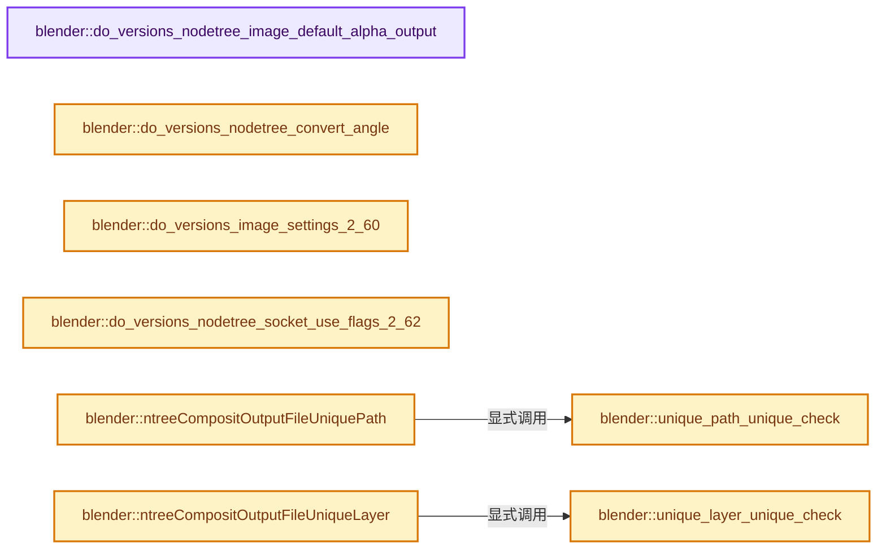
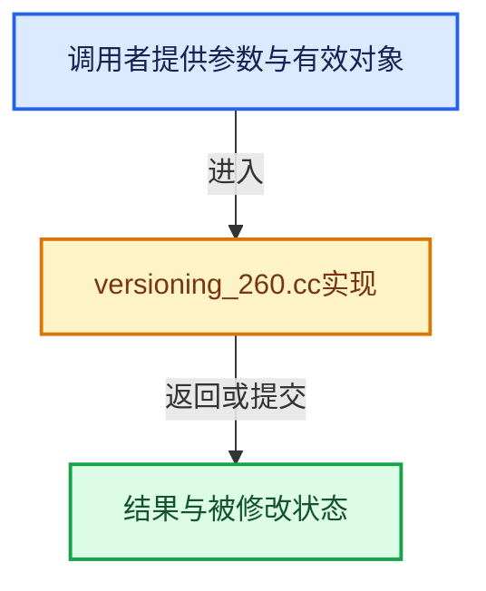

# 实现依赖专题：source/blender/blenloader/intern/versioning_260.cc

[实现依赖导航](../../../README.md) · [符号索引](../../../../00-课程指南/02-源码与提交索引/符号依赖与实现索引.md)

本专题从正文实际调用进入，集中保存共享实现。函数有稳定锚点，可从调用处直接跳到对应完整函数；递归与互相调用通过回链组织。

## 本文件的实现关系






## 完整成员与函数实现

<a id="f-771a19483e63df98"></a>

### `blender::do_versions_nodetree_image_default_alpha_output`

实现位置：[source/blender/blenloader/intern/versioning_260.cc](../../../../../../../../source/blender/blenloader/intern/versioning_260.cc) · L98—L107。

接口参数：

- `bNodeTree *ntree`

**教学注释版**

<!-- annotated:b95fb618b214ae -->

```cpp
static void do_versions_nodetree_image_default_alpha_output(bNodeTree *ntree)
{
  for (bNode &node : ntree->nodes) {
    if (ELEM(node.type_legacy, CMP_NODE_IMAGE, CMP_NODE_R_LAYERS)) {
      /* default Image output value should have 0 alpha */
      bNodeSocket *sock = node.outputs.first();
      (static_cast<bNodeSocketValueRGBA *>(sock->default_value))->value[3] = 0.0f;
    }
  }
}
```

<details>
<summary>核对原始源码：source/blender/blenloader/intern/versioning_260.cc · L98—L107</summary>

<!-- original:b95fb618b214ae:source/blender/blenloader/intern/versioning_260.cc:98:107 -->

```cpp
static void do_versions_nodetree_image_default_alpha_output(bNodeTree *ntree)
{
  for (bNode &node : ntree->nodes) {
    if (ELEM(node.type_legacy, CMP_NODE_IMAGE, CMP_NODE_R_LAYERS)) {
      /* default Image output value should have 0 alpha */
      bNodeSocket *sock = node.outputs.first();
      (static_cast<bNodeSocketValueRGBA *>(sock->default_value))->value[3] = 0.0f;
    }
  }
}
```

</details>

**继续追踪实现**

- `ELEM` → [ELEM · L88](../../../07-Intern运行时与平台/ghost/intern/GHOST_utildefines.hh.md#m-d28724a15928)；[ELEM · L135](../../../01-BLI基础库/BLI_utildefines.hh.md#m-d6572de7cae0)。宏定义由构建条件选择。
- `node.outputs.first` → [调用协议](../../../../00-课程指南/01-路线与规范/模板宏与动态分派协议.md)：接收对象类型依赖auto、返回值或模板实例；不按同名猜测目标。调用位置L103。

<a id="f-46cbe19a2db1c7a9"></a>

### `blender::do_versions_nodetree_convert_angle`

实现位置：[source/blender/blenloader/intern/versioning_260.cc](../../../../../../../../source/blender/blenloader/intern/versioning_260.cc) · L109—L165。

接口参数：

- `bNodeTree *ntree`

**教学注释版**

<!-- annotated:02bc29d0683285 -->

```cpp
static void do_versions_nodetree_convert_angle(bNodeTree *ntree)
{
  for (bNode &node : ntree->nodes) {
    if (node.type_legacy == CMP_NODE_ROTATE) {
      /* Convert degrees to radians. */
      bNodeSocket *sock = node.inputs.first()->next;
      (static_cast<bNodeSocketValueFloat *>(sock->default_value))->value = DEG2RADF(
          ((bNodeSocketValueFloat *)sock->default_value)->value);
    }
    else if (node.type_legacy == CMP_NODE_DBLUR) {
      if (version_node_ensure_storage_or_invalidate(node)) {
        /* Convert degrees to radians. */
        NodeDBlurData *ndbd = static_cast<NodeDBlurData *>(node.storage);
        ndbd->angle = DEG2RADF(ndbd->angle);
        ndbd->spin = DEG2RADF(ndbd->spin);
      }
    }
    else if (node.type_legacy == CMP_NODE_DEFOCUS) {
      if (version_node_ensure_storage_or_invalidate(node)) {
        /* Convert degrees to radians. */
        NodeDefocus *nqd = static_cast<NodeDefocus *>(node.storage);
        /* XXX DNA char to float conversion seems to map the char value
         * into the [0.0f, 1.0f] range. */
        nqd->rotation = DEG2RADF(nqd->rotation * 255.0f);
      }
    }
    else if (node.type_legacy == CMP_NODE_CHROMA_MATTE) {
      if (version_node_ensure_storage_or_invalidate(node)) {
        /* Convert degrees to radians. */
        NodeChroma *ndc = static_cast<NodeChroma *>(node.storage);
        ndc->t1 = DEG2RADF(ndc->t1);
        ndc->t2 = DEG2RADF(ndc->t2);
      }
    }
    else if (node.type_legacy == CMP_NODE_GLARE) {
      if (version_node_ensure_storage_or_invalidate(node)) {
        /* Convert degrees to radians. */
        NodeGlare *ndg = static_cast<NodeGlare *>(node.storage);
        /* XXX DNA char to float conversion seems to map the char value
         * into the [0.0f, 1.0f] range. */
        ndg->angle_ofs = DEG2RADF(ndg->angle_ofs * 255.0f);
      }
    }
    /* XXX TexMapping struct is used by other nodes too (at least node_composite_mapValue),
     *     but not the rot part...
     */
    else if (node.type_legacy == SH_NODE_MAPPING) {
      if (version_node_ensure_storage_or_invalidate(node)) {
        /* Convert degrees to radians. */
        TexMapping *tmap = static_cast<TexMapping *>(node.storage);
        tmap->rot[0] = DEG2RADF(tmap->rot[0]);
        tmap->rot[1] = DEG2RADF(tmap->rot[1]);
        tmap->rot[2] = DEG2RADF(tmap->rot[2]);
      }
    }
  }
}
```

<details>
<summary>核对原始源码：source/blender/blenloader/intern/versioning_260.cc · L109—L165</summary>

<!-- original:02bc29d0683285:source/blender/blenloader/intern/versioning_260.cc:109:165 -->

```cpp
static void do_versions_nodetree_convert_angle(bNodeTree *ntree)
{
  for (bNode &node : ntree->nodes) {
    if (node.type_legacy == CMP_NODE_ROTATE) {
      /* Convert degrees to radians. */
      bNodeSocket *sock = node.inputs.first()->next;
      (static_cast<bNodeSocketValueFloat *>(sock->default_value))->value = DEG2RADF(
          ((bNodeSocketValueFloat *)sock->default_value)->value);
    }
    else if (node.type_legacy == CMP_NODE_DBLUR) {
      if (version_node_ensure_storage_or_invalidate(node)) {
        /* Convert degrees to radians. */
        NodeDBlurData *ndbd = static_cast<NodeDBlurData *>(node.storage);
        ndbd->angle = DEG2RADF(ndbd->angle);
        ndbd->spin = DEG2RADF(ndbd->spin);
      }
    }
    else if (node.type_legacy == CMP_NODE_DEFOCUS) {
      if (version_node_ensure_storage_or_invalidate(node)) {
        /* Convert degrees to radians. */
        NodeDefocus *nqd = static_cast<NodeDefocus *>(node.storage);
        /* XXX DNA char to float conversion seems to map the char value
         * into the [0.0f, 1.0f] range. */
        nqd->rotation = DEG2RADF(nqd->rotation * 255.0f);
      }
    }
    else if (node.type_legacy == CMP_NODE_CHROMA_MATTE) {
      if (version_node_ensure_storage_or_invalidate(node)) {
        /* Convert degrees to radians. */
        NodeChroma *ndc = static_cast<NodeChroma *>(node.storage);
        ndc->t1 = DEG2RADF(ndc->t1);
        ndc->t2 = DEG2RADF(ndc->t2);
      }
    }
    else if (node.type_legacy == CMP_NODE_GLARE) {
      if (version_node_ensure_storage_or_invalidate(node)) {
        /* Convert degrees to radians. */
        NodeGlare *ndg = static_cast<NodeGlare *>(node.storage);
        /* XXX DNA char to float conversion seems to map the char value
         * into the [0.0f, 1.0f] range. */
        ndg->angle_ofs = DEG2RADF(ndg->angle_ofs * 255.0f);
      }
    }
    /* XXX TexMapping struct is used by other nodes too (at least node_composite_mapValue),
     *     but not the rot part...
     */
    else if (node.type_legacy == SH_NODE_MAPPING) {
      if (version_node_ensure_storage_or_invalidate(node)) {
        /* Convert degrees to radians. */
        TexMapping *tmap = static_cast<TexMapping *>(node.storage);
        tmap->rot[0] = DEG2RADF(tmap->rot[0]);
        tmap->rot[1] = DEG2RADF(tmap->rot[1]);
        tmap->rot[2] = DEG2RADF(tmap->rot[2]);
      }
    }
  }
}
```

</details>

**沿实际写入检查状态**

- `ndbd->angle = DEG2RADF(ndbd->angle);`
- `ndbd->spin = DEG2RADF(ndbd->spin);`
- `nqd->rotation = DEG2RADF(nqd->rotation * 255.0f);`
- `ndc->t1 = DEG2RADF(ndc->t1);`
- `ndc->t2 = DEG2RADF(ndc->t2);`
- `ndg->angle_ofs = DEG2RADF(ndg->angle_ofs * 255.0f);`
- `tmap->rot[0] = DEG2RADF(tmap->rot[0]);`
- `tmap->rot[1] = DEG2RADF(tmap->rot[1]);`
- `tmap->rot[2] = DEG2RADF(tmap->rot[2]);`

**继续追踪实现**

- `node.inputs.first` → [调用协议](../../../../00-课程指南/01-路线与规范/模板宏与动态分派协议.md)：接收对象类型依赖auto、返回值或模板实例；不按同名猜测目标。调用位置L114。
- `DEG2RADF` → [DEG2RADF · L75](../../../01-BLI基础库/BLI_math_constants.hh.md#m-b7feaa4acbdb)；[DEG2RADF · L17](../../../07-Intern运行时与平台/cycles/app/cycles_xml.h.md#m-de839cbb85d5)。宏定义由构建条件选择。
- `version_node_ensure_storage_or_invalidate` → [blender::version_node_ensure_storage_or_invalidate · L389](versioning_common.cc.md#f-72131ae3b96134c2)。

<a id="f-4c30f080e3ac6e16"></a>

### `blender::do_versions_image_settings_2_60`

实现位置：[source/blender/blenloader/intern/versioning_260.cc](../../../../../../../../source/blender/blenloader/intern/versioning_260.cc) · L167—L240。

接口参数：

- `Scene *sce`

**教学注释版**

<!-- annotated:6008c072a7ef1c -->

```cpp
static void do_versions_image_settings_2_60(Scene *sce)
{
  /* RenderData.subimtype flag options for imtype */
  enum {
    R_OPENEXR_HALF = (1 << 0),
    R_OPENEXR_ZBUF = (1 << 1),
    R_PREVIEW_JPG = (1 << 2),
    R_CINEON_LOG = (1 << 3),
    R_TIFF_16BIT = (1 << 4),

    R_JPEG2K_12BIT = (1 << 5),
    /* Jpeg2000 */
    R_JPEG2K_16BIT = (1 << 6),
    R_JPEG2K_YCC = (1 << 7),
    /* when disabled use RGB */
    R_JPEG2K_CINE_PRESET = (1 << 8),
    R_JPEG2K_CINE_48FPS = (1 << 9),
  };

  /* NOTE: rd->subimtype is moved into individual settings now and no longer
   * exists */
  RenderData *rd = &sce->r;
  ImageFormatData *imf = &sce->r.im_format;

  /* we know no data loss happens here, the old values were in char range */
  imf->imtype = char(rd->imtype);
  imf->color_mode = ImColorMode(rd->color_mode);
  imf->compress = char(rd->quality);
  imf->quality = char(rd->quality);

  /* default, was stored in multiple places, may override later */
  imf->depth = R_IMF_CHAN_DEPTH_8;

  /* openexr */
  imf->exr_codec = rd->quality & 7; /* 0-4 were valid values back then */

  switch (imf->imtype) {
    case R_IMF_IMTYPE_OPENEXR:
      imf->depth = (rd->subimtype & R_OPENEXR_HALF) ? R_IMF_CHAN_DEPTH_16 : R_IMF_CHAN_DEPTH_32;
      if (rd->subimtype & R_PREVIEW_JPG) {
        imf->flag |= R_IMF_FLAG_PREVIEW_JPG;
      }
      break;
    case R_IMF_IMTYPE_TIFF:
      if (rd->subimtype & R_TIFF_16BIT) {
        imf->depth = R_IMF_CHAN_DEPTH_16;
      }
      break;
    case R_IMF_IMTYPE_JP2:
      if (rd->subimtype & R_JPEG2K_16BIT) {
        imf->depth = R_IMF_CHAN_DEPTH_16;
      }
      else if (rd->subimtype & R_JPEG2K_12BIT) {
        imf->depth = R_IMF_CHAN_DEPTH_12;
      }

      if (rd->subimtype & R_JPEG2K_YCC) {
        imf->jp2_flag |= R_IMF_JP2_FLAG_YCC;
      }
      if (rd->subimtype & R_JPEG2K_CINE_PRESET) {
        imf->jp2_flag |= R_IMF_JP2_FLAG_CINE_PRESET;
      }
      if (rd->subimtype & R_JPEG2K_CINE_48FPS) {
        imf->jp2_flag |= R_IMF_JP2_FLAG_CINE_48;
      }
      break;
    case R_IMF_IMTYPE_CINEON:
    case R_IMF_IMTYPE_DPX:
      if (rd->subimtype & R_CINEON_LOG) {
        imf->cineon_flag |= R_IMF_CINEON_FLAG_LOG;
      }
      break;
  }
}
```

<details>
<summary>核对原始源码：source/blender/blenloader/intern/versioning_260.cc · L167—L240</summary>

<!-- original:6008c072a7ef1c:source/blender/blenloader/intern/versioning_260.cc:167:240 -->

```cpp
static void do_versions_image_settings_2_60(Scene *sce)
{
  /* RenderData.subimtype flag options for imtype */
  enum {
    R_OPENEXR_HALF = (1 << 0),
    R_OPENEXR_ZBUF = (1 << 1),
    R_PREVIEW_JPG = (1 << 2),
    R_CINEON_LOG = (1 << 3),
    R_TIFF_16BIT = (1 << 4),

    R_JPEG2K_12BIT = (1 << 5),
    /* Jpeg2000 */
    R_JPEG2K_16BIT = (1 << 6),
    R_JPEG2K_YCC = (1 << 7),
    /* when disabled use RGB */
    R_JPEG2K_CINE_PRESET = (1 << 8),
    R_JPEG2K_CINE_48FPS = (1 << 9),
  };

  /* NOTE: rd->subimtype is moved into individual settings now and no longer
   * exists */
  RenderData *rd = &sce->r;
  ImageFormatData *imf = &sce->r.im_format;

  /* we know no data loss happens here, the old values were in char range */
  imf->imtype = char(rd->imtype);
  imf->color_mode = ImColorMode(rd->color_mode);
  imf->compress = char(rd->quality);
  imf->quality = char(rd->quality);

  /* default, was stored in multiple places, may override later */
  imf->depth = R_IMF_CHAN_DEPTH_8;

  /* openexr */
  imf->exr_codec = rd->quality & 7; /* 0-4 were valid values back then */

  switch (imf->imtype) {
    case R_IMF_IMTYPE_OPENEXR:
      imf->depth = (rd->subimtype & R_OPENEXR_HALF) ? R_IMF_CHAN_DEPTH_16 : R_IMF_CHAN_DEPTH_32;
      if (rd->subimtype & R_PREVIEW_JPG) {
        imf->flag |= R_IMF_FLAG_PREVIEW_JPG;
      }
      break;
    case R_IMF_IMTYPE_TIFF:
      if (rd->subimtype & R_TIFF_16BIT) {
        imf->depth = R_IMF_CHAN_DEPTH_16;
      }
      break;
    case R_IMF_IMTYPE_JP2:
      if (rd->subimtype & R_JPEG2K_16BIT) {
        imf->depth = R_IMF_CHAN_DEPTH_16;
      }
      else if (rd->subimtype & R_JPEG2K_12BIT) {
        imf->depth = R_IMF_CHAN_DEPTH_12;
      }

      if (rd->subimtype & R_JPEG2K_YCC) {
        imf->jp2_flag |= R_IMF_JP2_FLAG_YCC;
      }
      if (rd->subimtype & R_JPEG2K_CINE_PRESET) {
        imf->jp2_flag |= R_IMF_JP2_FLAG_CINE_PRESET;
      }
      if (rd->subimtype & R_JPEG2K_CINE_48FPS) {
        imf->jp2_flag |= R_IMF_JP2_FLAG_CINE_48;
      }
      break;
    case R_IMF_IMTYPE_CINEON:
    case R_IMF_IMTYPE_DPX:
      if (rd->subimtype & R_CINEON_LOG) {
        imf->cineon_flag |= R_IMF_CINEON_FLAG_LOG;
      }
      break;
  }
}
```

</details>

**沿实际写入检查状态**

- `R_OPENEXR_HALF = (1 << 0),`
- `R_OPENEXR_ZBUF = (1 << 1),`
- `R_PREVIEW_JPG = (1 << 2),`
- `R_CINEON_LOG = (1 << 3),`
- `R_TIFF_16BIT = (1 << 4),`
- `R_JPEG2K_12BIT = (1 << 5),`
- `R_JPEG2K_16BIT = (1 << 6),`
- `R_JPEG2K_YCC = (1 << 7),`
- `R_JPEG2K_CINE_PRESET = (1 << 8),`
- `R_JPEG2K_CINE_48FPS = (1 << 9),`
- `imf->imtype = char(rd->imtype);`
- `imf->color_mode = ImColorMode(rd->color_mode);`
- `imf->compress = char(rd->quality);`
- `imf->quality = char(rd->quality);`
- `imf->depth = R_IMF_CHAN_DEPTH_8;`
- `imf->exr_codec = rd->quality & 7; /* 0-4 were valid values back then */`
- `imf->depth = (rd->subimtype & R_OPENEXR_HALF) ? R_IMF_CHAN_DEPTH_16 : R_IMF_CHAN_DEPTH_32;`
- `imf->flag |= R_IMF_FLAG_PREVIEW_JPG;`
- `imf->depth = R_IMF_CHAN_DEPTH_16;`
- `imf->depth = R_IMF_CHAN_DEPTH_12;`
- `imf->jp2_flag |= R_IMF_JP2_FLAG_YCC;`
- `imf->jp2_flag |= R_IMF_JP2_FLAG_CINE_PRESET;`
- `imf->jp2_flag |= R_IMF_JP2_FLAG_CINE_48;`
- `imf->cineon_flag |= R_IMF_CINEON_FLAG_LOG;`

**继续追踪实现**

- `ImColorMode` → [blender::ImColorMode](../../makesdna/DNA_image_enums.h.md#t-820778c4e5f0)。

<a id="f-ad98bfe3997bb241"></a>

### `blender::do_versions_nodetree_socket_use_flags_2_62`

实现位置：[source/blender/blenloader/intern/versioning_260.cc](../../../../../../../../source/blender/blenloader/intern/versioning_260.cc) · L243—L264。

接口参数：

- `bNodeTree *ntree`

**教学注释版**

<!-- annotated:31e00c83b7b201 -->

```cpp
static void do_versions_nodetree_socket_use_flags_2_62(bNodeTree *ntree)
{
  for (bNode &node : ntree->nodes) {
    for (bNodeSocket &sock : node.inputs) {
      sock.flag &= ~SOCK_IS_LINKED;
    }
    for (bNodeSocket &sock : node.outputs) {
      sock.flag &= ~SOCK_IS_LINKED;
    }
  }
  for (bNodeSocket &sock : ntree->inputs_legacy) {
    sock.flag &= ~SOCK_IS_LINKED;
  }
  for (bNodeSocket &sock : ntree->outputs_legacy) {
    sock.flag &= ~SOCK_IS_LINKED;
  }

  for (bNodeLink &link : ntree->links) {
    link.fromsock->flag |= SOCK_IS_LINKED;
    link.tosock->flag |= SOCK_IS_LINKED;
  }
}
```

<details>
<summary>核对原始源码：source/blender/blenloader/intern/versioning_260.cc · L243—L264</summary>

<!-- original:31e00c83b7b201:source/blender/blenloader/intern/versioning_260.cc:243:264 -->

```cpp
static void do_versions_nodetree_socket_use_flags_2_62(bNodeTree *ntree)
{
  for (bNode &node : ntree->nodes) {
    for (bNodeSocket &sock : node.inputs) {
      sock.flag &= ~SOCK_IS_LINKED;
    }
    for (bNodeSocket &sock : node.outputs) {
      sock.flag &= ~SOCK_IS_LINKED;
    }
  }
  for (bNodeSocket &sock : ntree->inputs_legacy) {
    sock.flag &= ~SOCK_IS_LINKED;
  }
  for (bNodeSocket &sock : ntree->outputs_legacy) {
    sock.flag &= ~SOCK_IS_LINKED;
  }

  for (bNodeLink &link : ntree->links) {
    link.fromsock->flag |= SOCK_IS_LINKED;
    link.tosock->flag |= SOCK_IS_LINKED;
  }
}
```

</details>

**沿实际写入检查状态**

- `sock.flag &= ~SOCK_IS_LINKED;`
- `link.fromsock->flag |= SOCK_IS_LINKED;`
- `link.tosock->flag |= SOCK_IS_LINKED;`

**继续追踪实现**

本实现没有需要继续展开的显式调用；检查返回表达式、对象转换和调用者前置条件。

<a id="f-db38021636711672"></a>

### `blender::unique_path_unique_check`

实现位置：[source/blender/blenloader/intern/versioning_260.cc](../../../../../../../../source/blender/blenloader/intern/versioning_260.cc) · L267—L281。

接口参数：

- `ListBaseT<bNodeSocket> *lb`
- `bNodeSocket *sock`
- `const StringRef name`

**教学注释版**

<!-- annotated:590f4fdd412e2c -->

```cpp
static bool unique_path_unique_check(ListBaseT<bNodeSocket> *lb,
                                     bNodeSocket *sock,
                                     const StringRef name)
{
  for (bNodeSocket &sock_iter : *lb) {
    if (&sock_iter != sock) {
      NodeImageMultiFileSocket *sockdata = static_cast<NodeImageMultiFileSocket *>(
          sock_iter.storage);
      if (sockdata->path == name) {
        return true;
      }
    }
  }
  return false;
}
```

<details>
<summary>核对原始源码：source/blender/blenloader/intern/versioning_260.cc · L267—L281</summary>

<!-- original:590f4fdd412e2c:source/blender/blenloader/intern/versioning_260.cc:267:281 -->

```cpp
static bool unique_path_unique_check(ListBaseT<bNodeSocket> *lb,
                                     bNodeSocket *sock,
                                     const StringRef name)
{
  for (bNodeSocket &sock_iter : *lb) {
    if (&sock_iter != sock) {
      NodeImageMultiFileSocket *sockdata = static_cast<NodeImageMultiFileSocket *>(
          sock_iter.storage);
      if (sockdata->path == name) {
        return true;
      }
    }
  }
  return false;
}
```

</details>

**结果出口**

- `return true;`
- `return false;`

**继续追踪实现**

本实现没有需要继续展开的显式调用；检查返回表达式、对象转换和调用者前置条件。

<a id="f-b653eaf1573e3702"></a>

### `blender::ntreeCompositOutputFileUniquePath`

实现位置：[source/blender/blenloader/intern/versioning_260.cc](../../../../../../../../source/blender/blenloader/intern/versioning_260.cc) · L283—L299。

接口参数：

- `ListBaseT<bNodeSocket> *list`
- `bNodeSocket *sock`
- `const char defname[]`
- `char delim`

**教学注释版**

<!-- annotated:3ea74389e51680 -->

```cpp
static void ntreeCompositOutputFileUniquePath(ListBaseT<bNodeSocket> *list,
                                              bNodeSocket *sock,
                                              const char defname[],
                                              char delim)
{
  /* See if we are given an empty string */
  if (ELEM(nullptr, sock, defname)) {
    return;
  }
  NodeImageMultiFileSocket *sockdata = static_cast<NodeImageMultiFileSocket *>(sock->storage);
  BLI_uniquename_cb(
      [&](const StringRef check_name) { return unique_path_unique_check(list, sock, check_name); },
      defname,
      delim,
      sockdata->path,
      sizeof(sockdata->path));
}
```

<details>
<summary>核对原始源码：source/blender/blenloader/intern/versioning_260.cc · L283—L299</summary>

<!-- original:3ea74389e51680:source/blender/blenloader/intern/versioning_260.cc:283:299 -->

```cpp
static void ntreeCompositOutputFileUniquePath(ListBaseT<bNodeSocket> *list,
                                              bNodeSocket *sock,
                                              const char defname[],
                                              char delim)
{
  /* See if we are given an empty string */
  if (ELEM(nullptr, sock, defname)) {
    return;
  }
  NodeImageMultiFileSocket *sockdata = static_cast<NodeImageMultiFileSocket *>(sock->storage);
  BLI_uniquename_cb(
      [&](const StringRef check_name) { return unique_path_unique_check(list, sock, check_name); },
      defname,
      delim,
      sockdata->path,
      sizeof(sockdata->path));
}
```

</details>

**继续追踪实现**

- `ELEM` → [ELEM · L88](../../../07-Intern运行时与平台/ghost/intern/GHOST_utildefines.hh.md#m-d28724a15928)；[ELEM · L135](../../../01-BLI基础库/BLI_utildefines.hh.md#m-d6572de7cae0)。宏定义由构建条件选择。
- `BLI_uniquename_cb` → [blender::BLI_uniquename_cb · L421](../../../01-BLI基础库/intern/string_utils.cc.md#f-651b82b9010ddef4)；[blender::BLI_uniquename_cb · L459](../../../01-BLI基础库/intern/string_utils.cc.md#f-0e0b6725b5b90a92)。同名重载需按实参类型选择。
- `unique_path_unique_check` → [blender::unique_path_unique_check · L267](versioning_260.cc.md#f-db38021636711672)。

<a id="f-f9ecf90d344a8eec"></a>

### `blender::unique_layer_unique_check`

实现位置：[source/blender/blenloader/intern/versioning_260.cc](../../../../../../../../source/blender/blenloader/intern/versioning_260.cc) · L302—L316。

接口参数：

- `ListBaseT<bNodeSocket> *lb`
- `bNodeSocket *sock`
- `const StringRef name`

**教学注释版**

<!-- annotated:7a2d4228b5d7b4 -->

```cpp
static bool unique_layer_unique_check(ListBaseT<bNodeSocket> *lb,
                                      bNodeSocket *sock,
                                      const StringRef name)
{
  for (bNodeSocket &sock_iter : *lb) {
    if (&sock_iter != sock) {
      NodeImageMultiFileSocket *sockdata = static_cast<NodeImageMultiFileSocket *>(
          sock_iter.storage);
      if (sockdata->layer == name) {
        return true;
      }
    }
  }
  return false;
}
```

<details>
<summary>核对原始源码：source/blender/blenloader/intern/versioning_260.cc · L302—L316</summary>

<!-- original:7a2d4228b5d7b4:source/blender/blenloader/intern/versioning_260.cc:302:316 -->

```cpp
static bool unique_layer_unique_check(ListBaseT<bNodeSocket> *lb,
                                      bNodeSocket *sock,
                                      const StringRef name)
{
  for (bNodeSocket &sock_iter : *lb) {
    if (&sock_iter != sock) {
      NodeImageMultiFileSocket *sockdata = static_cast<NodeImageMultiFileSocket *>(
          sock_iter.storage);
      if (sockdata->layer == name) {
        return true;
      }
    }
  }
  return false;
}
```

</details>

**结果出口**

- `return true;`
- `return false;`

**继续追踪实现**

本实现没有需要继续展开的显式调用；检查返回表达式、对象转换和调用者前置条件。

<a id="f-ecbc64737568ca05"></a>

### `blender::ntreeCompositOutputFileUniqueLayer`

实现位置：[source/blender/blenloader/intern/versioning_260.cc](../../../../../../../../source/blender/blenloader/intern/versioning_260.cc) · L318—L336。

接口参数：

- `ListBaseT<bNodeSocket> *list`
- `bNodeSocket *sock`
- `const char defname[]`
- `char delim`

**教学注释版**

<!-- annotated:2f7d0f6e37a5a9 -->

```cpp
static void ntreeCompositOutputFileUniqueLayer(ListBaseT<bNodeSocket> *list,
                                               bNodeSocket *sock,
                                               const char defname[],
                                               char delim)
{
  /* See if we are given an empty string */
  if (ELEM(nullptr, sock, defname)) {
    return;
  }
  NodeImageMultiFileSocket *sockdata = static_cast<NodeImageMultiFileSocket *>(sock->storage);
  BLI_uniquename_cb(
      [&](const StringRef check_name) {
        return unique_layer_unique_check(list, sock, check_name);
      },
      defname,
      delim,
      sockdata->layer,
      sizeof(sockdata->layer));
}
```

<details>
<summary>核对原始源码：source/blender/blenloader/intern/versioning_260.cc · L318—L336</summary>

<!-- original:2f7d0f6e37a5a9:source/blender/blenloader/intern/versioning_260.cc:318:336 -->

```cpp
static void ntreeCompositOutputFileUniqueLayer(ListBaseT<bNodeSocket> *list,
                                               bNodeSocket *sock,
                                               const char defname[],
                                               char delim)
{
  /* See if we are given an empty string */
  if (ELEM(nullptr, sock, defname)) {
    return;
  }
  NodeImageMultiFileSocket *sockdata = static_cast<NodeImageMultiFileSocket *>(sock->storage);
  BLI_uniquename_cb(
      [&](const StringRef check_name) {
        return unique_layer_unique_check(list, sock, check_name);
      },
      defname,
      delim,
      sockdata->layer,
      sizeof(sockdata->layer));
}
```

</details>

**结果出口**

- `return unique_layer_unique_check(list, sock, check_name);`

**继续追踪实现**

- `ELEM` → [ELEM · L88](../../../07-Intern运行时与平台/ghost/intern/GHOST_utildefines.hh.md#m-d28724a15928)；[ELEM · L135](../../../01-BLI基础库/BLI_utildefines.hh.md#m-d6572de7cae0)。宏定义由构建条件选择。
- `BLI_uniquename_cb` → [blender::BLI_uniquename_cb · L421](../../../01-BLI基础库/intern/string_utils.cc.md#f-651b82b9010ddef4)；[blender::BLI_uniquename_cb · L459](../../../01-BLI基础库/intern/string_utils.cc.md#f-0e0b6725b5b90a92)。同名重载需按实参类型选择。
- `unique_layer_unique_check` → [blender::unique_layer_unique_check · L302](versioning_260.cc.md#f-f9ecf90d344a8eec)。

<a id="f-2a2788e513018260"></a>

### `blender::ntreeCompositOutputFileAddSocket`

实现位置：[source/blender/blenloader/intern/versioning_260.cc](../../../../../../../../source/blender/blenloader/intern/versioning_260.cc) · L338—L378。

接口参数：

- `bNodeTree *ntree`
- `bNode *node`
- `const char *name`
- `const ImageFormatData *im_format`

**教学注释版**

<!-- annotated:63656df330ed8d -->

```cpp
static bNodeSocket *ntreeCompositOutputFileAddSocket(bNodeTree *ntree,
                                                     bNode *node,
                                                     const char *name,
                                                     const ImageFormatData *im_format)
{
  if (!version_node_ensure_storage_or_invalidate(*node)) {
    return nullptr;
  }
  NodeCompositorFileOutput *nimf = static_cast<NodeCompositorFileOutput *>(node->storage);
  bNodeSocket *sock = bke::node_add_static_socket(
      *ntree, *node, SOCK_IN, SOCK_RGBA, PROP_NONE, "", name);

  /* create format data for the input socket */
  NodeImageMultiFileSocket *sockdata = MEM_new<NodeImageMultiFileSocket>(__func__);
  sock->storage = sockdata;

  STRNCPY_UTF8(sockdata->path, name);
  ntreeCompositOutputFileUniquePath(&node->inputs, sock, name, '_');
  STRNCPY_UTF8(sockdata->layer, name);
  ntreeCompositOutputFileUniqueLayer(&node->inputs, sock, name, '_');

  if (im_format) {
    BKE_image_format_copy(&sockdata->format, im_format);
    sockdata->format.color_management = R_IMF_COLOR_MANAGEMENT_FOLLOW_SCENE;
    if (BKE_imtype_is_movie(sockdata->format.imtype)) {
      sockdata->format.imtype = R_IMF_IMTYPE_OPENEXR;
    }
  }
  else {
    BKE_image_format_init(&sockdata->format);
  }
  BKE_image_format_update_color_space_for_type(&sockdata->format);

  /* use node data format by default */
  sockdata->use_node_format = true;
  sockdata->save_as_render = true;

  nimf->active_item_index = BLI_findindex(&node->inputs, sock);

  return sock;
}
```

<details>
<summary>核对原始源码：source/blender/blenloader/intern/versioning_260.cc · L338—L378</summary>

<!-- original:63656df330ed8d:source/blender/blenloader/intern/versioning_260.cc:338:378 -->

```cpp
static bNodeSocket *ntreeCompositOutputFileAddSocket(bNodeTree *ntree,
                                                     bNode *node,
                                                     const char *name,
                                                     const ImageFormatData *im_format)
{
  if (!version_node_ensure_storage_or_invalidate(*node)) {
    return nullptr;
  }
  NodeCompositorFileOutput *nimf = static_cast<NodeCompositorFileOutput *>(node->storage);
  bNodeSocket *sock = bke::node_add_static_socket(
      *ntree, *node, SOCK_IN, SOCK_RGBA, PROP_NONE, "", name);

  /* create format data for the input socket */
  NodeImageMultiFileSocket *sockdata = MEM_new<NodeImageMultiFileSocket>(__func__);
  sock->storage = sockdata;

  STRNCPY_UTF8(sockdata->path, name);
  ntreeCompositOutputFileUniquePath(&node->inputs, sock, name, '_');
  STRNCPY_UTF8(sockdata->layer, name);
  ntreeCompositOutputFileUniqueLayer(&node->inputs, sock, name, '_');

  if (im_format) {
    BKE_image_format_copy(&sockdata->format, im_format);
    sockdata->format.color_management = R_IMF_COLOR_MANAGEMENT_FOLLOW_SCENE;
    if (BKE_imtype_is_movie(sockdata->format.imtype)) {
      sockdata->format.imtype = R_IMF_IMTYPE_OPENEXR;
    }
  }
  else {
    BKE_image_format_init(&sockdata->format);
  }
  BKE_image_format_update_color_space_for_type(&sockdata->format);

  /* use node data format by default */
  sockdata->use_node_format = true;
  sockdata->save_as_render = true;

  nimf->active_item_index = BLI_findindex(&node->inputs, sock);

  return sock;
}
```

</details>

**沿实际写入检查状态**

- `sock->storage = sockdata;`
- `sockdata->format.color_management = R_IMF_COLOR_MANAGEMENT_FOLLOW_SCENE;`
- `sockdata->format.imtype = R_IMF_IMTYPE_OPENEXR;`
- `sockdata->use_node_format = true;`
- `sockdata->save_as_render = true;`
- `nimf->active_item_index = BLI_findindex(&node->inputs, sock);`

**结果出口**

- `return nullptr;`
- `return sock;`

**继续追踪实现**

- `version_node_ensure_storage_or_invalidate` → [blender::version_node_ensure_storage_or_invalidate · L389](versioning_common.cc.md#f-72131ae3b96134c2)。
- `bke::node_add_static_socket` → [blender::bke::node_add_static_socket · L3980](../../../02-BKE几何与数据/intern/node.cc.md#f-d6d2fde9e1919837)。
- `MEM_new<NodeImageMultiFileSocket>` → [MEM_new · L351](../../../07-Intern运行时与平台/guardedalloc/MEM_guardedalloc.h.md#f-115f9b6784f89912)。
- `STRNCPY_UTF8` → [STRNCPY_UTF8 · L335](../../../01-BLI基础库/BLI_string_utf8.hh.md#m-222967f0ab6a)。宏定义由构建条件选择。
- `ntreeCompositOutputFileUniquePath` → [blender::ntreeCompositOutputFileUniquePath · L283](versioning_260.cc.md#f-b653eaf1573e3702)。
- `ntreeCompositOutputFileUniqueLayer` → [blender::ntreeCompositOutputFileUniqueLayer · L318](versioning_260.cc.md#f-ecbc64737568ca05)。
- `BKE_image_format_copy` → [blender::BKE_image_format_copy · L45](../../../02-BKE几何与数据/intern/image_format.cc.md#f-7f1a6e5f86fd6c3d)。
- `BKE_imtype_is_movie` → [blender::BKE_imtype_is_movie · L310](../../../02-BKE几何与数据/intern/image_format.cc.md#f-ca6733d2a96cafbd)。
- `BKE_image_format_init` → [blender::BKE_image_format_init · L34](../../../02-BKE几何与数据/intern/image_format.cc.md#f-4473cbce67b78c6a)。
- `BKE_image_format_update_color_space_for_type` → [blender::BKE_image_format_update_color_space_for_type · L59](../../../02-BKE几何与数据/intern/image_format.cc.md#f-d2fe00aa0f1c8f46)。
- `BLI_findindex` → [blender::BLI_findindex · L593](../../../01-BLI基础库/intern/listbase.cc.md#f-cb9036f12bd486b7)。

<a id="f-ce55ae64489475bb"></a>

### `blender::do_versions_nodetree_multi_file_output_format_2_62_1`

实现位置：[source/blender/blenloader/intern/versioning_260.cc](../../../../../../../../source/blender/blenloader/intern/versioning_260.cc) · L380—L491。

接口参数：

- `Scene *sce`
- `bNodeTree *ntree`

**教学注释版**

<!-- annotated:51ecac970734b1 -->

```cpp
static void do_versions_nodetree_multi_file_output_format_2_62_1(Scene *sce, bNodeTree *ntree)
{
  for (bNode &node : ntree->nodes) {
    if (node.type_legacy == CMP_NODE_OUTPUT_FILE) {
      /* previous CMP_NODE_OUTPUT_FILE nodes get converted to multi-file outputs */
      NodeImageFile *old_data = static_cast<NodeImageFile *>(node.storage);
      NodeCompositorFileOutput *nimf = MEM_new<NodeCompositorFileOutput>("node image multi file");
      bNodeSocket *old_image = static_cast<bNodeSocket *>(BLI_findlink(&node.inputs, 0));
      bNodeSocket *old_z = static_cast<bNodeSocket *>(BLI_findlink(&node.inputs, 1));

      char filename[FILE_MAXFILE];

      /* ugly, need to remove the old inputs list to avoid bad pointer
       * checks when adding new sockets.
       * sock->storage is expected to contain path info in ntreeCompositOutputFileAddSocket.
       */
      node.inputs.clear_no_delete();

      node.storage = nimf;

      /* looks like storage data can be messed up somehow, stupid check here */
      if (old_data) {
        char basepath[FILE_MAXDIR];

        /* split off filename from the old path, to be used as socket sub-path */
        BLI_path_split_dir_file(
            old_data->name, basepath, sizeof(basepath), filename, sizeof(filename));

        STRNCPY(nimf->directory, basepath);
        nimf->format = old_data->im_format;
      }
      else {
        STRNCPY(filename, old_image->name);
      }

      /* If Z buffer is saved, change the image type to multi-layer EXR.
       * XXX: this is slightly messy, Z buffer was ignored before for anything but EXR and IRIS ...
       * I'm just assuming here that IRIZ means IRIS with z buffer. */
      if (old_data && ELEM(old_data->im_format.imtype, R_IMF_IMTYPE_IRIZ, R_IMF_IMTYPE_OPENEXR)) {
        char sockpath[FILE_MAX];

        nimf->format.imtype = R_IMF_IMTYPE_MULTILAYER;

        SNPRINTF_UTF8(sockpath, "%s_Image", filename);
        bNodeSocket *sock = ntreeCompositOutputFileAddSocket(
            ntree, &node, sockpath, &nimf->format);
        if (!sock) {
          continue;
        }
        /* XXX later do_versions copies path from socket name, need to set this explicitly */
        STRNCPY_UTF8(sock->name, sockpath);
        if (old_image->link) {
          old_image->link->tosock = sock;
          sock->link = old_image->link;
        }

        SNPRINTF_UTF8(sockpath, "%s_Z", filename);
        sock = ntreeCompositOutputFileAddSocket(ntree, &node, sockpath, &nimf->format);
        if (!sock) {
          continue;
        }
        /* XXX later do_versions copies path from socket name, need to set this explicitly */
        STRNCPY_UTF8(sock->name, sockpath);
        if (old_z->link) {
          old_z->link->tosock = sock;
          sock->link = old_z->link;
        }
      }
      else {
        bNodeSocket *sock = ntreeCompositOutputFileAddSocket(
            ntree, &node, filename, &nimf->format);
        if (!sock) {
          continue;
        }
        /* XXX later do_versions copies path from socket name, need to set this explicitly */
        STRNCPY_UTF8(sock->name, filename);
        if (old_image->link) {
          old_image->link->tosock = sock;
          sock->link = old_image->link;
        }
      }

      bke::node_remove_socket(*ntree, node, *old_image);
      bke::node_remove_socket(*ntree, node, *old_z);
      if (old_data) {
        MEM_delete(old_data);
      }
    }
    else if (node.type_legacy == CMP_NODE_OUTPUT_MULTI_FILE__DEPRECATED) {
      if (version_node_ensure_storage_or_invalidate(node)) {
        NodeCompositorFileOutput *nimf = static_cast<NodeCompositorFileOutput *>(node.storage);

        /* #CMP_NODE_OUTPUT_MULTI_FILE has been re-declared as #CMP_NODE_OUTPUT_FILE. */
        node.type_legacy = CMP_NODE_OUTPUT_FILE;

        /* initialize the node-wide image format from render data, if available */
        if (sce) {
          nimf->format = sce->r.im_format;
        }

        /* transfer render format toggle to node format toggle */
        for (bNodeSocket &sock : node.inputs) {
          NodeImageMultiFileSocket *simf = static_cast<NodeImageMultiFileSocket *>(sock.storage);
          simf->use_node_format = simf->use_render_format;
        }

        /* we do have preview now */
        node.flag |= NODE_PREVIEW;
      }
    }
  }
}
```

<details>
<summary>核对原始源码：source/blender/blenloader/intern/versioning_260.cc · L380—L491</summary>

<!-- original:51ecac970734b1:source/blender/blenloader/intern/versioning_260.cc:380:491 -->

```cpp
static void do_versions_nodetree_multi_file_output_format_2_62_1(Scene *sce, bNodeTree *ntree)
{
  for (bNode &node : ntree->nodes) {
    if (node.type_legacy == CMP_NODE_OUTPUT_FILE) {
      /* previous CMP_NODE_OUTPUT_FILE nodes get converted to multi-file outputs */
      NodeImageFile *old_data = static_cast<NodeImageFile *>(node.storage);
      NodeCompositorFileOutput *nimf = MEM_new<NodeCompositorFileOutput>("node image multi file");
      bNodeSocket *old_image = static_cast<bNodeSocket *>(BLI_findlink(&node.inputs, 0));
      bNodeSocket *old_z = static_cast<bNodeSocket *>(BLI_findlink(&node.inputs, 1));

      char filename[FILE_MAXFILE];

      /* ugly, need to remove the old inputs list to avoid bad pointer
       * checks when adding new sockets.
       * sock->storage is expected to contain path info in ntreeCompositOutputFileAddSocket.
       */
      node.inputs.clear_no_delete();

      node.storage = nimf;

      /* looks like storage data can be messed up somehow, stupid check here */
      if (old_data) {
        char basepath[FILE_MAXDIR];

        /* split off filename from the old path, to be used as socket sub-path */
        BLI_path_split_dir_file(
            old_data->name, basepath, sizeof(basepath), filename, sizeof(filename));

        STRNCPY(nimf->directory, basepath);
        nimf->format = old_data->im_format;
      }
      else {
        STRNCPY(filename, old_image->name);
      }

      /* If Z buffer is saved, change the image type to multi-layer EXR.
       * XXX: this is slightly messy, Z buffer was ignored before for anything but EXR and IRIS ...
       * I'm just assuming here that IRIZ means IRIS with z buffer. */
      if (old_data && ELEM(old_data->im_format.imtype, R_IMF_IMTYPE_IRIZ, R_IMF_IMTYPE_OPENEXR)) {
        char sockpath[FILE_MAX];

        nimf->format.imtype = R_IMF_IMTYPE_MULTILAYER;

        SNPRINTF_UTF8(sockpath, "%s_Image", filename);
        bNodeSocket *sock = ntreeCompositOutputFileAddSocket(
            ntree, &node, sockpath, &nimf->format);
        if (!sock) {
          continue;
        }
        /* XXX later do_versions copies path from socket name, need to set this explicitly */
        STRNCPY_UTF8(sock->name, sockpath);
        if (old_image->link) {
          old_image->link->tosock = sock;
          sock->link = old_image->link;
        }

        SNPRINTF_UTF8(sockpath, "%s_Z", filename);
        sock = ntreeCompositOutputFileAddSocket(ntree, &node, sockpath, &nimf->format);
        if (!sock) {
          continue;
        }
        /* XXX later do_versions copies path from socket name, need to set this explicitly */
        STRNCPY_UTF8(sock->name, sockpath);
        if (old_z->link) {
          old_z->link->tosock = sock;
          sock->link = old_z->link;
        }
      }
      else {
        bNodeSocket *sock = ntreeCompositOutputFileAddSocket(
            ntree, &node, filename, &nimf->format);
        if (!sock) {
          continue;
        }
        /* XXX later do_versions copies path from socket name, need to set this explicitly */
        STRNCPY_UTF8(sock->name, filename);
        if (old_image->link) {
          old_image->link->tosock = sock;
          sock->link = old_image->link;
        }
      }

      bke::node_remove_socket(*ntree, node, *old_image);
      bke::node_remove_socket(*ntree, node, *old_z);
      if (old_data) {
        MEM_delete(old_data);
      }
    }
    else if (node.type_legacy == CMP_NODE_OUTPUT_MULTI_FILE__DEPRECATED) {
      if (version_node_ensure_storage_or_invalidate(node)) {
        NodeCompositorFileOutput *nimf = static_cast<NodeCompositorFileOutput *>(node.storage);

        /* #CMP_NODE_OUTPUT_MULTI_FILE has been re-declared as #CMP_NODE_OUTPUT_FILE. */
        node.type_legacy = CMP_NODE_OUTPUT_FILE;

        /* initialize the node-wide image format from render data, if available */
        if (sce) {
          nimf->format = sce->r.im_format;
        }

        /* transfer render format toggle to node format toggle */
        for (bNodeSocket &sock : node.inputs) {
          NodeImageMultiFileSocket *simf = static_cast<NodeImageMultiFileSocket *>(sock.storage);
          simf->use_node_format = simf->use_render_format;
        }

        /* we do have preview now */
        node.flag |= NODE_PREVIEW;
      }
    }
  }
}
```

</details>

**沿实际写入检查状态**

- `node.storage = nimf;`
- `nimf->format = old_data->im_format;`
- `nimf->format.imtype = R_IMF_IMTYPE_MULTILAYER;`
- `old_image->link->tosock = sock;`
- `sock->link = old_image->link;`
- `sock = ntreeCompositOutputFileAddSocket(ntree, &node, sockpath, &nimf->format);`
- `old_z->link->tosock = sock;`
- `sock->link = old_z->link;`
- `node.type_legacy = CMP_NODE_OUTPUT_FILE;`
- `nimf->format = sce->r.im_format;`
- `simf->use_node_format = simf->use_render_format;`
- `node.flag |= NODE_PREVIEW;`

**继续追踪实现**

- `MEM_new<NodeCompositorFileOutput>` → [MEM_new · L351](../../../07-Intern运行时与平台/guardedalloc/MEM_guardedalloc.h.md#f-115f9b6784f89912)。
- `BLI_findlink` → [blender::BLI_findlink · L541](../../../01-BLI基础库/intern/listbase.cc.md#f-6d3fd65974b4e808)。
- `node.inputs.clear_no_delete` → [调用协议](../../../../00-课程指南/01-路线与规范/模板宏与动态分派协议.md)：接收对象类型依赖auto、返回值或模板实例；不按同名猜测目标。调用位置L396。
- `BLI_path_split_dir_file` → [BLI_path_split_dir_file · L1641](../../../01-BLI基础库/intern/path_utils.cc.md#f-c894bd448541aaa1)。
- `STRNCPY` → [blender::STRNCPY · L690](../../../01-BLI基础库/BLI_string.hh.md#f-6b2d861724026be6)。
- `ELEM` → [ELEM · L88](../../../07-Intern运行时与平台/ghost/intern/GHOST_utildefines.hh.md#m-d28724a15928)；[ELEM · L135](../../../01-BLI基础库/BLI_utildefines.hh.md#m-d6572de7cae0)。宏定义由构建条件选择。
- `SNPRINTF_UTF8` → [SNPRINTF_UTF8 · L340](../../../01-BLI基础库/BLI_string_utf8.hh.md#m-5e57d7a30c64)。宏定义由构建条件选择。
- `ntreeCompositOutputFileAddSocket` → [blender::ntreeCompositOutputFileAddSocket · L338](versioning_260.cc.md#f-2a2788e513018260)。
- `STRNCPY_UTF8` → [STRNCPY_UTF8 · L335](../../../01-BLI基础库/BLI_string_utf8.hh.md#m-222967f0ab6a)。宏定义由构建条件选择。
- `bke::node_remove_socket` → [blender::bke::node_remove_socket · L4015](../../../02-BKE几何与数据/intern/node.cc.md#f-20598036ce8bb344)。
- `MEM_delete` → [MEM_delete · L400](../../../07-Intern运行时与平台/guardedalloc/MEM_guardedalloc.h.md#f-9049ffdd1682887c)。
- `version_node_ensure_storage_or_invalidate` → [blender::version_node_ensure_storage_or_invalidate · L389](versioning_common.cc.md#f-72131ae3b96134c2)。

<a id="f-8a5d16edab138da0"></a>

### `blender::do_versions_mesh_mloopcol_swap_2_62_1`

实现位置：[source/blender/blenloader/intern/versioning_260.cc](../../../../../../../../source/blender/blenloader/intern/versioning_260.cc) · L494—L506。

接口参数：

- `Mesh *mesh`

**教学注释版**

<!-- annotated:725dc4417f2d29 -->

```cpp
static void do_versions_mesh_mloopcol_swap_2_62_1(Mesh *mesh)
{
  for (int a = 0; a < mesh->corner_data.totlayer; a++) {
    CustomDataLayer *layer = &mesh->corner_data.layers[a];

    if (layer->type == CD_PROP_BYTE_COLOR) {
      MLoopCol *mloopcol = static_cast<MLoopCol *>(layer->data);
      for (int i = 0; i < mesh->corners_num; i++, mloopcol++) {
        std::swap(mloopcol->r, mloopcol->b);
      }
    }
  }
}
```

<details>
<summary>核对原始源码：source/blender/blenloader/intern/versioning_260.cc · L494—L506</summary>

<!-- original:725dc4417f2d29:source/blender/blenloader/intern/versioning_260.cc:494:506 -->

```cpp
static void do_versions_mesh_mloopcol_swap_2_62_1(Mesh *mesh)
{
  for (int a = 0; a < mesh->corner_data.totlayer; a++) {
    CustomDataLayer *layer = &mesh->corner_data.layers[a];

    if (layer->type == CD_PROP_BYTE_COLOR) {
      MLoopCol *mloopcol = static_cast<MLoopCol *>(layer->data);
      for (int i = 0; i < mesh->corners_num; i++, mloopcol++) {
        std::swap(mloopcol->r, mloopcol->b);
      }
    }
  }
}
```

</details>

**继续追踪实现**

- `std::swap` → [外部契约](https://eel.is/c++draft/)：这个边界按实际表达式及所属类型核对参数、返回值、寿命与失败行为。这里提供接口入口，不声称已解释该第三方版本的内部实现。

<a id="f-6d67e8c6d2d70fbf"></a>

### `blender::do_versions_nodetree_multi_file_output_path_2_63_1`

实现位置：[source/blender/blenloader/intern/versioning_260.cc](../../../../../../../../source/blender/blenloader/intern/versioning_260.cc) · L508—L519。

接口参数：

- `bNodeTree *ntree`

**教学注释版**

<!-- annotated:3590611d2873cb -->

```cpp
static void do_versions_nodetree_multi_file_output_path_2_63_1(bNodeTree *ntree)
{
  for (bNode &node : ntree->nodes) {
    if (node.type_legacy == CMP_NODE_OUTPUT_FILE) {
      for (bNodeSocket &sock : node.inputs) {
        NodeImageMultiFileSocket *input = static_cast<NodeImageMultiFileSocket *>(sock.storage);
        /* input file path is stored in dedicated struct now instead socket name */
        STRNCPY_UTF8(input->path, sock.name);
      }
    }
  }
}
```

<details>
<summary>核对原始源码：source/blender/blenloader/intern/versioning_260.cc · L508—L519</summary>

<!-- original:3590611d2873cb:source/blender/blenloader/intern/versioning_260.cc:508:519 -->

```cpp
static void do_versions_nodetree_multi_file_output_path_2_63_1(bNodeTree *ntree)
{
  for (bNode &node : ntree->nodes) {
    if (node.type_legacy == CMP_NODE_OUTPUT_FILE) {
      for (bNodeSocket &sock : node.inputs) {
        NodeImageMultiFileSocket *input = static_cast<NodeImageMultiFileSocket *>(sock.storage);
        /* input file path is stored in dedicated struct now instead socket name */
        STRNCPY_UTF8(input->path, sock.name);
      }
    }
  }
}
```

</details>

**继续追踪实现**

- `STRNCPY_UTF8` → [STRNCPY_UTF8 · L335](../../../01-BLI基础库/BLI_string_utf8.hh.md#m-222967f0ab6a)。宏定义由构建条件选择。

<a id="f-7819092ffce87a33"></a>

### `blender::do_versions_nodetree_file_output_layers_2_64_5`

实现位置：[source/blender/blenloader/intern/versioning_260.cc](../../../../../../../../source/blender/blenloader/intern/versioning_260.cc) · L521—L538。

接口参数：

- `bNodeTree *ntree`

**教学注释版**

<!-- annotated:1f86caa7b7adcf -->

```cpp
static void do_versions_nodetree_file_output_layers_2_64_5(bNodeTree *ntree)
{
  for (bNode &node : ntree->nodes) {
    if (node.type_legacy == CMP_NODE_OUTPUT_FILE) {
      for (bNodeSocket &sock : node.inputs) {
        NodeImageMultiFileSocket *input = static_cast<NodeImageMultiFileSocket *>(sock.storage);

        /* Multi-layer names are stored as separate strings now,
         * used the path string before, so copy it over. */
        STRNCPY_UTF8(input->layer, input->path);

        /* paths/layer names also have to be unique now, initial check */
        ntreeCompositOutputFileUniquePath(&node.inputs, &sock, input->path, '_');
        ntreeCompositOutputFileUniqueLayer(&node.inputs, &sock, input->layer, '_');
      }
    }
  }
}
```

<details>
<summary>核对原始源码：source/blender/blenloader/intern/versioning_260.cc · L521—L538</summary>

<!-- original:1f86caa7b7adcf:source/blender/blenloader/intern/versioning_260.cc:521:538 -->

```cpp
static void do_versions_nodetree_file_output_layers_2_64_5(bNodeTree *ntree)
{
  for (bNode &node : ntree->nodes) {
    if (node.type_legacy == CMP_NODE_OUTPUT_FILE) {
      for (bNodeSocket &sock : node.inputs) {
        NodeImageMultiFileSocket *input = static_cast<NodeImageMultiFileSocket *>(sock.storage);

        /* Multi-layer names are stored as separate strings now,
         * used the path string before, so copy it over. */
        STRNCPY_UTF8(input->layer, input->path);

        /* paths/layer names also have to be unique now, initial check */
        ntreeCompositOutputFileUniquePath(&node.inputs, &sock, input->path, '_');
        ntreeCompositOutputFileUniqueLayer(&node.inputs, &sock, input->layer, '_');
      }
    }
  }
}
```

</details>

**继续追踪实现**

- `STRNCPY_UTF8` → [STRNCPY_UTF8 · L335](../../../01-BLI基础库/BLI_string_utf8.hh.md#m-222967f0ab6a)。宏定义由构建条件选择。
- `ntreeCompositOutputFileUniquePath` → [blender::ntreeCompositOutputFileUniquePath · L283](versioning_260.cc.md#f-b653eaf1573e3702)。
- `ntreeCompositOutputFileUniqueLayer` → [blender::ntreeCompositOutputFileUniqueLayer · L318](versioning_260.cc.md#f-ecbc64737568ca05)。

<a id="f-6c921b03411af1b8"></a>

### `blender::do_versions_nodetree_image_layer_2_64_5`

实现位置：[source/blender/blenloader/intern/versioning_260.cc](../../../../../../../../source/blender/blenloader/intern/versioning_260.cc) · L540—L555。

接口参数：

- `bNodeTree *ntree`

**教学注释版**

<!-- annotated:9391cfbaa316cd -->

```cpp
static void do_versions_nodetree_image_layer_2_64_5(bNodeTree *ntree)
{
  for (bNode &node : ntree->nodes) {
    if (node.type_legacy == CMP_NODE_IMAGE) {
      for (bNodeSocket &sock : node.outputs) {
        NodeImageLayer *output = MEM_new<NodeImageLayer>("node image layer");

        /* Take pass index both from current storage pointer (actually an int). */
        output->pass_index = POINTER_AS_INT(sock.storage);

        /* replace socket data pointer */
        sock.storage = output;
      }
    }
  }
}
```

<details>
<summary>核对原始源码：source/blender/blenloader/intern/versioning_260.cc · L540—L555</summary>

<!-- original:9391cfbaa316cd:source/blender/blenloader/intern/versioning_260.cc:540:555 -->

```cpp
static void do_versions_nodetree_image_layer_2_64_5(bNodeTree *ntree)
{
  for (bNode &node : ntree->nodes) {
    if (node.type_legacy == CMP_NODE_IMAGE) {
      for (bNodeSocket &sock : node.outputs) {
        NodeImageLayer *output = MEM_new<NodeImageLayer>("node image layer");

        /* Take pass index both from current storage pointer (actually an int). */
        output->pass_index = POINTER_AS_INT(sock.storage);

        /* replace socket data pointer */
        sock.storage = output;
      }
    }
  }
}
```

</details>

**沿实际写入检查状态**

- `output->pass_index = POINTER_AS_INT(sock.storage);`
- `sock.storage = output;`

**继续追踪实现**

- `MEM_new<NodeImageLayer>` → [MEM_new · L351](../../../07-Intern运行时与平台/guardedalloc/MEM_guardedalloc.h.md#f-115f9b6784f89912)。
- `POINTER_AS_INT` → [POINTER_AS_INT · L322](../../../01-BLI基础库/BLI_utildefines.hh.md#m-5c041fdc2f74)。宏定义由构建条件选择。

<a id="f-3e06f5361d7e40c9"></a>

### `blender::do_versions_nodetree_frame_2_64_6`

实现位置：[source/blender/blenloader/intern/versioning_260.cc](../../../../../../../../source/blender/blenloader/intern/versioning_260.cc) · L557—L576。

接口参数：

- `bNodeTree *ntree`

**教学注释版**

<!-- annotated:15d99300225468 -->

```cpp
static void do_versions_nodetree_frame_2_64_6(bNodeTree *ntree)
{
  for (bNode &node : ntree->nodes) {
    if (node.type_legacy == NODE_FRAME) {
      /* initialize frame node storage data */
      if (node.storage == nullptr) {
        NodeFrame *data = MEM_new<NodeFrame>("frame node storage");
        node.storage = data;

        /* copy current flags */
        data->flag = node.custom1;

        data->label_size = 20;
      }
    }

    /* initialize custom node color */
    node.color[0] = node.color[1] = node.color[2] = 0.608f; /* default theme color */
  }
}
```

<details>
<summary>核对原始源码：source/blender/blenloader/intern/versioning_260.cc · L557—L576</summary>

<!-- original:15d99300225468:source/blender/blenloader/intern/versioning_260.cc:557:576 -->

```cpp
static void do_versions_nodetree_frame_2_64_6(bNodeTree *ntree)
{
  for (bNode &node : ntree->nodes) {
    if (node.type_legacy == NODE_FRAME) {
      /* initialize frame node storage data */
      if (node.storage == nullptr) {
        NodeFrame *data = MEM_new<NodeFrame>("frame node storage");
        node.storage = data;

        /* copy current flags */
        data->flag = node.custom1;

        data->label_size = 20;
      }
    }

    /* initialize custom node color */
    node.color[0] = node.color[1] = node.color[2] = 0.608f; /* default theme color */
  }
}
```

</details>

**沿实际写入检查状态**

- `node.storage = data;`
- `data->flag = node.custom1;`
- `data->label_size = 20;`
- `node.color[0] = node.color[1] = node.color[2] = 0.608f; /* default theme color */`

**继续追踪实现**

- `MEM_new<NodeFrame>` → [MEM_new · L351](../../../07-Intern运行时与平台/guardedalloc/MEM_guardedalloc.h.md#f-115f9b6784f89912)。

<a id="f-b9b936cbf27dc1ac"></a>

### `blender::do_versions_affine_tracker_track`

实现位置：[source/blender/blenloader/intern/versioning_260.cc](../../../../../../../../source/blender/blenloader/intern/versioning_260.cc) · L578—L604。

接口参数：

- `MovieTrackingTrack *track`

**教学注释版**

<!-- annotated:5b498f382d5e87 -->

```cpp
static void do_versions_affine_tracker_track(MovieTrackingTrack *track)
{
  for (int i = 0; i < track->markersnr; i++) {
    MovieTrackingMarker *marker = &track->markers[i];

    if (is_zero_v2(marker->pattern_corners[0]) && is_zero_v2(marker->pattern_corners[1]) &&
        is_zero_v2(marker->pattern_corners[2]) && is_zero_v2(marker->pattern_corners[3]))
    {
      marker->pattern_corners[0][0] = track->pat_min_legacy[0];
      marker->pattern_corners[0][1] = track->pat_min_legacy[1];

      marker->pattern_corners[1][0] = track->pat_max_legacy[0];
      marker->pattern_corners[1][1] = track->pat_min_legacy[1];

      marker->pattern_corners[2][0] = track->pat_max_legacy[0];
      marker->pattern_corners[2][1] = track->pat_max_legacy[1];

      marker->pattern_corners[3][0] = track->pat_min_legacy[0];
      marker->pattern_corners[3][1] = track->pat_max_legacy[1];
    }

    if (is_zero_v2(marker->search_min) && is_zero_v2(marker->search_max)) {
      copy_v2_v2(marker->search_min, track->search_min_legacy);
      copy_v2_v2(marker->search_max, track->search_max_legacy);
    }
  }
}
```

<details>
<summary>核对原始源码：source/blender/blenloader/intern/versioning_260.cc · L578—L604</summary>

<!-- original:5b498f382d5e87:source/blender/blenloader/intern/versioning_260.cc:578:604 -->

```cpp
static void do_versions_affine_tracker_track(MovieTrackingTrack *track)
{
  for (int i = 0; i < track->markersnr; i++) {
    MovieTrackingMarker *marker = &track->markers[i];

    if (is_zero_v2(marker->pattern_corners[0]) && is_zero_v2(marker->pattern_corners[1]) &&
        is_zero_v2(marker->pattern_corners[2]) && is_zero_v2(marker->pattern_corners[3]))
    {
      marker->pattern_corners[0][0] = track->pat_min_legacy[0];
      marker->pattern_corners[0][1] = track->pat_min_legacy[1];

      marker->pattern_corners[1][0] = track->pat_max_legacy[0];
      marker->pattern_corners[1][1] = track->pat_min_legacy[1];

      marker->pattern_corners[2][0] = track->pat_max_legacy[0];
      marker->pattern_corners[2][1] = track->pat_max_legacy[1];

      marker->pattern_corners[3][0] = track->pat_min_legacy[0];
      marker->pattern_corners[3][1] = track->pat_max_legacy[1];
    }

    if (is_zero_v2(marker->search_min) && is_zero_v2(marker->search_max)) {
      copy_v2_v2(marker->search_min, track->search_min_legacy);
      copy_v2_v2(marker->search_max, track->search_max_legacy);
    }
  }
}
```

</details>

**沿实际写入检查状态**

- `marker->pattern_corners[0][0] = track->pat_min_legacy[0];`
- `marker->pattern_corners[0][1] = track->pat_min_legacy[1];`
- `marker->pattern_corners[1][0] = track->pat_max_legacy[0];`
- `marker->pattern_corners[1][1] = track->pat_min_legacy[1];`
- `marker->pattern_corners[2][0] = track->pat_max_legacy[0];`
- `marker->pattern_corners[2][1] = track->pat_max_legacy[1];`
- `marker->pattern_corners[3][0] = track->pat_min_legacy[0];`
- `marker->pattern_corners[3][1] = track->pat_max_legacy[1];`

**继续追踪实现**

- `is_zero_v2` → [blender::is_zero_v2 · L958](../../../01-BLI基础库/intern/math_vector_inline.cc.md#f-bf045935d051b884)。
- `copy_v2_v2` → [blender::copy_v2_v2 · L41](../../../01-BLI基础库/intern/math_vector_inline.cc.md#f-e736ee2dd71cd821)。

<a id="f-e253a808112e20ed"></a>

### `blender::node_get_static_idname`

实现位置：[source/blender/blenloader/intern/versioning_260.cc](../../../../../../../../source/blender/blenloader/intern/versioning_260.cc) · L606—L1003。

接口参数：

- `int type`
- `int treetype`

**教学注释版**

<!-- annotated:c262f7512dd3e0 -->

```cpp
static const char *node_get_static_idname(int type, int treetype)
{
  /* XXX hack, group types share a single static integer identifier,
   * but are registered as separate types */
  if (type == NODE_GROUP) {
    switch (treetype) {
      case NTREE_COMPOSIT:
        return "CompositorNodeGroup";
      case NTREE_SHADER:
        return "ShaderNodeGroup";
      case NTREE_TEXTURE:
        return "TextureNodeGroup";
    }
  }
  else {
    switch (type) {
      case NODE_FRAME:
        return "NodeFrame";
      case NODE_GROUP:
        return "NodeGroup";
      case NODE_GROUP_INPUT:
        return "NodeGroupInput";
      case NODE_GROUP_OUTPUT:
        return "NodeGroupOutput";
      case NODE_REROUTE:
        return "NodeReroute";
      case /*SH_NODE_OUTPUT*/ 1:
        return "ShaderNodeOutput";
      case /*SH_NODE_MATERIAL*/ 100:
        return "ShaderNodeMaterial";
      case SH_NODE_RGB:
        return "ShaderNodeRGB";
      case SH_NODE_VALUE:
        return "ShaderNodeValue";
      case SH_NODE_MIX_RGB_LEGACY:
        return "ShaderNodeMixRGB";
      case SH_NODE_VALTORGB:
        return "ShaderNodeValToRGB";
      case SH_NODE_RGBTOBW:
        return "ShaderNodeRGBToBW";
      case /*SH_NODE_TEXTURE*/ 106:
        return "ShaderNodeTexture";
      case SH_NODE_NORMAL:
        return "ShaderNodeNormal";
      case SH_NODE_GAMMA:
        return "ShaderNodeGamma";
      case SH_NODE_BRIGHTCONTRAST:
        return "ShaderNodeBrightContrast";
      case /*SH_NODE_GEOMETRY*/ 108:
        return "ShaderNodeGeometry";
      case SH_NODE_MAPPING:
        return "ShaderNodeMapping";
      case SH_NODE_CURVE_VEC:
        return "ShaderNodeVectorCurve";
      case SH_NODE_CURVE_RGB:
        return "ShaderNodeRGBCurve";
      case SH_NODE_CAMERA:
        return "ShaderNodeCameraData";
      case SH_NODE_MATH:
        return "ShaderNodeMath";
      case SH_NODE_VECTOR_MATH:
        return "ShaderNodeVectorMath";
      case SH_NODE_SQUEEZE:
        return "ShaderNodeSqueeze";
      case /*SH_NODE_MATERIAL_EXT*/ 118:
        return "ShaderNodeExtendedMaterial";
      case SH_NODE_INVERT:
        return "ShaderNodeInvert";
      case SH_NODE_SEPRGB_LEGACY:
        return "ShaderNodeSeparateRGB";
      case SH_NODE_COMBRGB_LEGACY:
        return "ShaderNodeCombineRGB";
      case SH_NODE_HUE_SAT:
        return "ShaderNodeHueSaturation";
      case SH_NODE_OUTPUT_MATERIAL:
        return "ShaderNodeOutputMaterial";
      case SH_NODE_OUTPUT_LIGHT:
        return "ShaderNodeOutputLamp";
      case SH_NODE_OUTPUT_WORLD:
        return "ShaderNodeOutputWorld";
      case SH_NODE_FRESNEL:
        return "ShaderNodeFresnel";
      case SH_NODE_LAYER_WEIGHT:
        return "ShaderNodeLayerWeight";
      case SH_NODE_MIX_SHADER:
        return "ShaderNodeMixShader";
      case SH_NODE_ADD_SHADER:
        return "ShaderNodeAddShader";
      case SH_NODE_ATTRIBUTE:
        return "ShaderNodeAttribute";
      case SH_NODE_AMBIENT_OCCLUSION:
        return "ShaderNodeAmbientOcclusion";
      case SH_NODE_BACKGROUND:
        return "ShaderNodeBackground";
      case SH_NODE_HOLDOUT:
        return "ShaderNodeHoldout";
      case /*SH_NODE_BSDF_ANISOTROPIC*/ 131:
        return "ShaderNodeBsdfAnisotropic";
      case SH_NODE_BSDF_DIFFUSE:
        return "ShaderNodeBsdfDiffuse";
      case /*SH_NODE_BSDF_GLOSSY*/ 133:
        return "ShaderNodeBsdfGlossy";
      case SH_NODE_BSDF_GLASS:
        return "ShaderNodeBsdfGlass";
      case SH_NODE_BSDF_REFRACTION:
        return "ShaderNodeBsdfRefraction";
      case SH_NODE_BSDF_TRANSLUCENT:
        return "ShaderNodeBsdfTranslucent";
      case SH_NODE_BSDF_TRANSPARENT:
        return "ShaderNodeBsdfTransparent";
      case SH_NODE_BSDF_RAY_PORTAL:
        return "ShaderNodeBsdfRayPortal";
      case /*SH_NODE_BSDF_VELVET*/ 139:
        return "ShaderNodeBsdfVelvet";
      case /*SH_NODE_VOLUME_TRANSPARENT*/ 161:
        return "ShaderNodeVolumeTransparent";
      case /*SH_NODE_VOLUME_ISOTROPIC*/ 162:
        return "ShaderNodeVolumeIsotropic";
      case SH_NODE_EMISSION:
        return "ShaderNodeEmission";
      case SH_NODE_NEW_GEOMETRY:
        return "ShaderNodeNewGeometry";
      case SH_NODE_LIGHT_PATH:
        return "ShaderNodeLightPath";
      case SH_NODE_LIGHT_FALLOFF:
        return "ShaderNodeLightFalloff";
      case SH_NODE_OBJECT_INFO:
        return "ShaderNodeObjectInfo";
      case SH_NODE_PARTICLE_INFO:
        return "ShaderNodeParticleInfo";
      case SH_NODE_HAIR_INFO:
        return "ShaderNodeHairInfo";
      case SH_NODE_BUMP:
        return "ShaderNodeBump";
      case SH_NODE_NORMAL_MAP:
        return "ShaderNodeNormalMap";
      case SH_NODE_TANGENT:
        return "ShaderNodeTangent";
      case SH_NODE_SCRIPT:
        return "ShaderNodeScript";
      case SH_NODE_TEX_IMAGE:
        return "ShaderNodeTexImage";
      case SH_NODE_TEX_ENVIRONMENT:
        return "ShaderNodeTexEnvironment";
      case SH_NODE_TEX_SKY:
        return "ShaderNodeTexSky";
      case SH_NODE_TEX_GRADIENT:
        return "ShaderNodeTexGradient";
      case SH_NODE_TEX_NOISE:
        return "ShaderNodeTexNoise";
      case SH_NODE_TEX_MAGIC:
        return "ShaderNodeTexMagic";
      case SH_NODE_TEX_WAVE:
        return "ShaderNodeTexWave";
      case SH_NODE_TEX_MUSGRAVE_DEPRECATED:
        return "ShaderNodeTexMusgrave";
      case SH_NODE_TEX_VORONOI:
        return "ShaderNodeTexVoronoi";
      case SH_NODE_TEX_CHECKER:
        return "ShaderNodeTexChecker";
      case SH_NODE_TEX_BRICK:
        return "ShaderNodeTexBrick";
      case SH_NODE_TEX_COORD:
        return "ShaderNodeTexCoord";
      case CMP_NODE_VIEWER:
        return "CompositorNodeViewer";
      case CMP_NODE_RGB:
        return "CompositorNodeRGB";
      case CMP_NODE_VALUE_DEPRECATED:
        return "CompositorNodeValue";
      case CMP_NODE_MIX_RGB_DEPRECATED:
        return "CompositorNodeMixRGB";
      case CMP_NODE_VALTORGB_DEPRECATED:
        return "CompositorNodeValToRGB";
      case CMP_NODE_RGBTOBW:
        return "CompositorNodeRGBToBW";
      case CMP_NODE_NORMAL:
        return "CompositorNodeNormal";
      case CMP_NODE_CURVE_VEC_DEPRECATED:
        return "CompositorNodeCurveVec";
      case CMP_NODE_CURVE_RGB:
        return "CompositorNodeCurveRGB";
      case CMP_NODE_ALPHAOVER:
        return "CompositorNodeAlphaOver";
      case CMP_NODE_BLUR:
        return "CompositorNodeBlur";
      case CMP_NODE_FILTER:
        return "CompositorNodeFilter";
      case CMP_NODE_MAP_VALUE_DEPRECATED:
        return "CompositorNodeMapValue";
      case CMP_NODE_MAP_RANGE_DEPRECATED:
        return "CompositorNodeMapRange";
      case CMP_NODE_TIME:
        return "CompositorNodeTime";
      case CMP_NODE_VECBLUR:
        return "CompositorNodeVecBlur";
      case CMP_NODE_SEPRGBA_LEGACY:
        return "CompositorNodeSepRGBA";
      case CMP_NODE_SEPHSVA_LEGACY:
        return "CompositorNodeSepHSVA";
      case CMP_NODE_SETALPHA:
        return "CompositorNodeSetAlpha";
      case CMP_NODE_HUE_SAT:
        return "CompositorNodeHueSat";
      case CMP_NODE_IMAGE:
        return "CompositorNodeImage";
      case CMP_NODE_R_LAYERS:
        return "CompositorNodeRLayers";
      case CMP_NODE_COMPOSITE_DEPRECATED:
        return "CompositorNodeComposite";
      case CMP_NODE_OUTPUT_FILE:
        return "CompositorNodeOutputFile";
      case CMP_NODE_TEXTURE_DEPRECATED:
        return "CompositorNodeTexture";
      case CMP_NODE_TRANSLATE:
        return "CompositorNodeTranslate";
      case CMP_NODE_ZCOMBINE:
        return "CompositorNodeZcombine";
      case CMP_NODE_COMBRGBA_LEGACY:
        return "CompositorNodeCombRGBA";
      case CMP_NODE_DILATEERODE:
        return "CompositorNodeDilateErode";
      case CMP_NODE_INPAINT:
        return "CompositorNodeInpaint";
      case CMP_NODE_DESPECKLE:
        return "CompositorNodeDespeckle";
      case CMP_NODE_ROTATE:
        return "CompositorNodeRotate";
      case CMP_NODE_SCALE:
        return "CompositorNodeScale";
      case CMP_NODE_SEPYCCA_LEGACY:
        return "CompositorNodeSepYCCA";
      case CMP_NODE_COMBYCCA_LEGACY:
        return "CompositorNodeCombYCCA";
      case CMP_NODE_SEPYUVA_LEGACY:
        return "CompositorNodeSepYUVA";
      case CMP_NODE_COMBYUVA_LEGACY:
        return "CompositorNodeCombYUVA";
      case CMP_NODE_DIFF_MATTE:
        return "CompositorNodeDiffMatte";
      case CMP_NODE_COLOR_SPILL:
        return "CompositorNodeColorSpill";
      case CMP_NODE_CHROMA_MATTE:
        return "CompositorNodeChromaMatte";
      case CMP_NODE_CHANNEL_MATTE:
        return "CompositorNodeChannelMatte";
      case CMP_NODE_FLIP:
        return "CompositorNodeFlip";
      case CMP_NODE_SPLITVIEWER__DEPRECATED:
        return "CompositorNodeSplitViewer";
      case CMP_NODE_MAP_UV:
        return "CompositorNodeMapUV";
      case CMP_NODE_ID_MASK:
        return "CompositorNodeIDMask";
      case CMP_NODE_DOUBLEEDGEMASK:
        return "CompositorNodeDoubleEdgeMask";
      case CMP_NODE_DEFOCUS:
        return "CompositorNodeDefocus";
      case CMP_NODE_DISPLACE:
        return "CompositorNodeDisplace";
      case CMP_NODE_COMBHSVA_LEGACY:
        return "CompositorNodeCombHSVA";
      case CMP_NODE_MATH_DEPRECATED:
        return "CompositorNodeMath";
      case CMP_NODE_LUMA_MATTE:
        return "CompositorNodeLumaMatte";
      case CMP_NODE_BRIGHTCONTRAST:
        return "CompositorNodeBrightContrast";
      case CMP_NODE_GAMMA_DEPRECATED:
        return "CompositorNodeGamma";
      case CMP_NODE_INVERT:
        return "CompositorNodeInvert";
      case CMP_NODE_NORMALIZE:
        return "CompositorNodeNormalize";
      case CMP_NODE_CROP:
        return "CompositorNodeCrop";
      case CMP_NODE_DBLUR:
        return "CompositorNodeDBlur";
      case CMP_NODE_BILATERALBLUR:
        return "CompositorNodeBilateralblur";
      case CMP_NODE_PREMULKEY:
        return "CompositorNodePremulKey";
      case CMP_NODE_GLARE:
        return "CompositorNodeGlare";
      case CMP_NODE_TONEMAP:
        return "CompositorNodeTonemap";
      case CMP_NODE_LENSDIST:
        return "CompositorNodeLensdist";
      case CMP_NODE_VIEW_LEVELS:
        return "CompositorNodeLevels";
      case CMP_NODE_COLOR_MATTE:
        return "CompositorNodeColorMatte";
      case CMP_NODE_DIST_MATTE:
        return "CompositorNodeDistanceMatte";
      case CMP_NODE_COLORBALANCE:
        return "CompositorNodeColorBalance";
      case CMP_NODE_HUECORRECT:
        return "CompositorNodeHueCorrect";
      case CMP_NODE_MOVIECLIP:
        return "CompositorNodeMovieClip";
      case CMP_NODE_TRANSFORM:
        return "CompositorNodeTransform";
      case CMP_NODE_STABILIZE2D:
        return "CompositorNodeStabilize";
      case CMP_NODE_MOVIEDISTORTION:
        return "CompositorNodeMovieDistortion";
      case CMP_NODE_MASK_BOX:
        return "CompositorNodeBoxMask";
      case CMP_NODE_MASK_ELLIPSE:
        return "CompositorNodeEllipseMask";
      case CMP_NODE_BOKEHIMAGE:
        return "CompositorNodeBokehImage";
      case CMP_NODE_BOKEHBLUR:
        return "CompositorNodeBokehBlur";
      case CMP_NODE_SWITCH:
        return "CompositorNodeSwitch";
      case CMP_NODE_COLORCORRECTION:
        return "CompositorNodeColorCorrection";
      case CMP_NODE_MASK:
        return "CompositorNodeMask";
      case CMP_NODE_KEYINGSCREEN:
        return "CompositorNodeKeyingScreen";
      case CMP_NODE_KEYING:
        return "CompositorNodeKeying";
      case CMP_NODE_TRACKPOS:
        return "CompositorNodeTrackPos";
      case CMP_NODE_PIXELATE:
        return "CompositorNodePixelate";
      case TEX_NODE_OUTPUT:
        return "TextureNodeOutput";
      case TEX_NODE_CHECKER:
        return "TextureNodeChecker";
      case TEX_NODE_TEXTURE:
        return "TextureNodeTexture";
      case TEX_NODE_BRICKS:
        return "TextureNodeBricks";
      case TEX_NODE_MATH:
        return "TextureNodeMath";
      case TEX_NODE_MIX_RGB:
        return "TextureNodeMixRGB";
      case TEX_NODE_RGBTOBW:
        return "TextureNodeRGBToBW";
      case TEX_NODE_VALTORGB:
        return "TextureNodeValToRGB";
      case TEX_NODE_IMAGE:
        return "TextureNodeImage";
      case TEX_NODE_CURVE_RGB:
        return "TextureNodeCurveRGB";
      case TEX_NODE_INVERT:
        return "TextureNodeInvert";
      case TEX_NODE_HUE_SAT:
        return "TextureNodeHueSaturation";
      case TEX_NODE_CURVE_TIME:
        return "TextureNodeCurveTime";
      case TEX_NODE_ROTATE:
        return "TextureNodeRotate";
      case TEX_NODE_VIEWER:
        return "TextureNodeViewer";
      case TEX_NODE_TRANSLATE:
        return "TextureNodeTranslate";
      case TEX_NODE_COORD:
        return "TextureNodeCoordinates";
      case TEX_NODE_DISTANCE:
        return "TextureNodeDistance";
      case TEX_NODE_COMPOSE_LEGACY:
        return "TextureNodeCompose";
      case TEX_NODE_DECOMPOSE_LEGACY:
        return "TextureNodeDecompose";
      case TEX_NODE_VALTONOR:
        return "TextureNodeValToNor";
      case TEX_NODE_SCALE:
        return "TextureNodeScale";
      case TEX_NODE_AT:
        return "TextureNodeAt";
      case TEX_NODE_PROC + TEX_VORONOI:
        return "TextureNodeTexVoronoi";
      case TEX_NODE_PROC + TEX_BLEND:
        return "TextureNodeTexBlend";
      case TEX_NODE_PROC + TEX_MAGIC:
        return "TextureNodeTexMagic";
      case TEX_NODE_PROC + TEX_MARBLE:
        return "TextureNodeTexMarble";
      case TEX_NODE_PROC + TEX_CLOUDS:
        return "TextureNodeTexClouds";
      case TEX_NODE_PROC + TEX_WOOD:
        return "TextureNodeTexWood";
      case TEX_NODE_PROC + TEX_MUSGRAVE:
        return "TextureNodeTexMusgrave";
      case TEX_NODE_PROC + TEX_NOISE:
        return "TextureNodeTexNoise";
      case TEX_NODE_PROC + TEX_STUCCI:
        return "TextureNodeTexStucci";
      case TEX_NODE_PROC + TEX_DISTNOISE:
        return "TextureNodeTexDistNoise";
    }
  }
  return "";
}
```

<details>
<summary>核对原始源码：source/blender/blenloader/intern/versioning_260.cc · L606—L1003</summary>

<!-- original:c262f7512dd3e0:source/blender/blenloader/intern/versioning_260.cc:606:1003 -->

```cpp
static const char *node_get_static_idname(int type, int treetype)
{
  /* XXX hack, group types share a single static integer identifier,
   * but are registered as separate types */
  if (type == NODE_GROUP) {
    switch (treetype) {
      case NTREE_COMPOSIT:
        return "CompositorNodeGroup";
      case NTREE_SHADER:
        return "ShaderNodeGroup";
      case NTREE_TEXTURE:
        return "TextureNodeGroup";
    }
  }
  else {
    switch (type) {
      case NODE_FRAME:
        return "NodeFrame";
      case NODE_GROUP:
        return "NodeGroup";
      case NODE_GROUP_INPUT:
        return "NodeGroupInput";
      case NODE_GROUP_OUTPUT:
        return "NodeGroupOutput";
      case NODE_REROUTE:
        return "NodeReroute";
      case /*SH_NODE_OUTPUT*/ 1:
        return "ShaderNodeOutput";
      case /*SH_NODE_MATERIAL*/ 100:
        return "ShaderNodeMaterial";
      case SH_NODE_RGB:
        return "ShaderNodeRGB";
      case SH_NODE_VALUE:
        return "ShaderNodeValue";
      case SH_NODE_MIX_RGB_LEGACY:
        return "ShaderNodeMixRGB";
      case SH_NODE_VALTORGB:
        return "ShaderNodeValToRGB";
      case SH_NODE_RGBTOBW:
        return "ShaderNodeRGBToBW";
      case /*SH_NODE_TEXTURE*/ 106:
        return "ShaderNodeTexture";
      case SH_NODE_NORMAL:
        return "ShaderNodeNormal";
      case SH_NODE_GAMMA:
        return "ShaderNodeGamma";
      case SH_NODE_BRIGHTCONTRAST:
        return "ShaderNodeBrightContrast";
      case /*SH_NODE_GEOMETRY*/ 108:
        return "ShaderNodeGeometry";
      case SH_NODE_MAPPING:
        return "ShaderNodeMapping";
      case SH_NODE_CURVE_VEC:
        return "ShaderNodeVectorCurve";
      case SH_NODE_CURVE_RGB:
        return "ShaderNodeRGBCurve";
      case SH_NODE_CAMERA:
        return "ShaderNodeCameraData";
      case SH_NODE_MATH:
        return "ShaderNodeMath";
      case SH_NODE_VECTOR_MATH:
        return "ShaderNodeVectorMath";
      case SH_NODE_SQUEEZE:
        return "ShaderNodeSqueeze";
      case /*SH_NODE_MATERIAL_EXT*/ 118:
        return "ShaderNodeExtendedMaterial";
      case SH_NODE_INVERT:
        return "ShaderNodeInvert";
      case SH_NODE_SEPRGB_LEGACY:
        return "ShaderNodeSeparateRGB";
      case SH_NODE_COMBRGB_LEGACY:
        return "ShaderNodeCombineRGB";
      case SH_NODE_HUE_SAT:
        return "ShaderNodeHueSaturation";
      case SH_NODE_OUTPUT_MATERIAL:
        return "ShaderNodeOutputMaterial";
      case SH_NODE_OUTPUT_LIGHT:
        return "ShaderNodeOutputLamp";
      case SH_NODE_OUTPUT_WORLD:
        return "ShaderNodeOutputWorld";
      case SH_NODE_FRESNEL:
        return "ShaderNodeFresnel";
      case SH_NODE_LAYER_WEIGHT:
        return "ShaderNodeLayerWeight";
      case SH_NODE_MIX_SHADER:
        return "ShaderNodeMixShader";
      case SH_NODE_ADD_SHADER:
        return "ShaderNodeAddShader";
      case SH_NODE_ATTRIBUTE:
        return "ShaderNodeAttribute";
      case SH_NODE_AMBIENT_OCCLUSION:
        return "ShaderNodeAmbientOcclusion";
      case SH_NODE_BACKGROUND:
        return "ShaderNodeBackground";
      case SH_NODE_HOLDOUT:
        return "ShaderNodeHoldout";
      case /*SH_NODE_BSDF_ANISOTROPIC*/ 131:
        return "ShaderNodeBsdfAnisotropic";
      case SH_NODE_BSDF_DIFFUSE:
        return "ShaderNodeBsdfDiffuse";
      case /*SH_NODE_BSDF_GLOSSY*/ 133:
        return "ShaderNodeBsdfGlossy";
      case SH_NODE_BSDF_GLASS:
        return "ShaderNodeBsdfGlass";
      case SH_NODE_BSDF_REFRACTION:
        return "ShaderNodeBsdfRefraction";
      case SH_NODE_BSDF_TRANSLUCENT:
        return "ShaderNodeBsdfTranslucent";
      case SH_NODE_BSDF_TRANSPARENT:
        return "ShaderNodeBsdfTransparent";
      case SH_NODE_BSDF_RAY_PORTAL:
        return "ShaderNodeBsdfRayPortal";
      case /*SH_NODE_BSDF_VELVET*/ 139:
        return "ShaderNodeBsdfVelvet";
      case /*SH_NODE_VOLUME_TRANSPARENT*/ 161:
        return "ShaderNodeVolumeTransparent";
      case /*SH_NODE_VOLUME_ISOTROPIC*/ 162:
        return "ShaderNodeVolumeIsotropic";
      case SH_NODE_EMISSION:
        return "ShaderNodeEmission";
      case SH_NODE_NEW_GEOMETRY:
        return "ShaderNodeNewGeometry";
      case SH_NODE_LIGHT_PATH:
        return "ShaderNodeLightPath";
      case SH_NODE_LIGHT_FALLOFF:
        return "ShaderNodeLightFalloff";
      case SH_NODE_OBJECT_INFO:
        return "ShaderNodeObjectInfo";
      case SH_NODE_PARTICLE_INFO:
        return "ShaderNodeParticleInfo";
      case SH_NODE_HAIR_INFO:
        return "ShaderNodeHairInfo";
      case SH_NODE_BUMP:
        return "ShaderNodeBump";
      case SH_NODE_NORMAL_MAP:
        return "ShaderNodeNormalMap";
      case SH_NODE_TANGENT:
        return "ShaderNodeTangent";
      case SH_NODE_SCRIPT:
        return "ShaderNodeScript";
      case SH_NODE_TEX_IMAGE:
        return "ShaderNodeTexImage";
      case SH_NODE_TEX_ENVIRONMENT:
        return "ShaderNodeTexEnvironment";
      case SH_NODE_TEX_SKY:
        return "ShaderNodeTexSky";
      case SH_NODE_TEX_GRADIENT:
        return "ShaderNodeTexGradient";
      case SH_NODE_TEX_NOISE:
        return "ShaderNodeTexNoise";
      case SH_NODE_TEX_MAGIC:
        return "ShaderNodeTexMagic";
      case SH_NODE_TEX_WAVE:
        return "ShaderNodeTexWave";
      case SH_NODE_TEX_MUSGRAVE_DEPRECATED:
        return "ShaderNodeTexMusgrave";
      case SH_NODE_TEX_VORONOI:
        return "ShaderNodeTexVoronoi";
      case SH_NODE_TEX_CHECKER:
        return "ShaderNodeTexChecker";
      case SH_NODE_TEX_BRICK:
        return "ShaderNodeTexBrick";
      case SH_NODE_TEX_COORD:
        return "ShaderNodeTexCoord";
      case CMP_NODE_VIEWER:
        return "CompositorNodeViewer";
      case CMP_NODE_RGB:
        return "CompositorNodeRGB";
      case CMP_NODE_VALUE_DEPRECATED:
        return "CompositorNodeValue";
      case CMP_NODE_MIX_RGB_DEPRECATED:
        return "CompositorNodeMixRGB";
      case CMP_NODE_VALTORGB_DEPRECATED:
        return "CompositorNodeValToRGB";
      case CMP_NODE_RGBTOBW:
        return "CompositorNodeRGBToBW";
      case CMP_NODE_NORMAL:
        return "CompositorNodeNormal";
      case CMP_NODE_CURVE_VEC_DEPRECATED:
        return "CompositorNodeCurveVec";
      case CMP_NODE_CURVE_RGB:
        return "CompositorNodeCurveRGB";
      case CMP_NODE_ALPHAOVER:
        return "CompositorNodeAlphaOver";
      case CMP_NODE_BLUR:
        return "CompositorNodeBlur";
      case CMP_NODE_FILTER:
        return "CompositorNodeFilter";
      case CMP_NODE_MAP_VALUE_DEPRECATED:
        return "CompositorNodeMapValue";
      case CMP_NODE_MAP_RANGE_DEPRECATED:
        return "CompositorNodeMapRange";
      case CMP_NODE_TIME:
        return "CompositorNodeTime";
      case CMP_NODE_VECBLUR:
        return "CompositorNodeVecBlur";
      case CMP_NODE_SEPRGBA_LEGACY:
        return "CompositorNodeSepRGBA";
      case CMP_NODE_SEPHSVA_LEGACY:
        return "CompositorNodeSepHSVA";
      case CMP_NODE_SETALPHA:
        return "CompositorNodeSetAlpha";
      case CMP_NODE_HUE_SAT:
        return "CompositorNodeHueSat";
      case CMP_NODE_IMAGE:
        return "CompositorNodeImage";
      case CMP_NODE_R_LAYERS:
        return "CompositorNodeRLayers";
      case CMP_NODE_COMPOSITE_DEPRECATED:
        return "CompositorNodeComposite";
      case CMP_NODE_OUTPUT_FILE:
        return "CompositorNodeOutputFile";
      case CMP_NODE_TEXTURE_DEPRECATED:
        return "CompositorNodeTexture";
      case CMP_NODE_TRANSLATE:
        return "CompositorNodeTranslate";
      case CMP_NODE_ZCOMBINE:
        return "CompositorNodeZcombine";
      case CMP_NODE_COMBRGBA_LEGACY:
        return "CompositorNodeCombRGBA";
      case CMP_NODE_DILATEERODE:
        return "CompositorNodeDilateErode";
      case CMP_NODE_INPAINT:
        return "CompositorNodeInpaint";
      case CMP_NODE_DESPECKLE:
        return "CompositorNodeDespeckle";
      case CMP_NODE_ROTATE:
        return "CompositorNodeRotate";
      case CMP_NODE_SCALE:
        return "CompositorNodeScale";
      case CMP_NODE_SEPYCCA_LEGACY:
        return "CompositorNodeSepYCCA";
      case CMP_NODE_COMBYCCA_LEGACY:
        return "CompositorNodeCombYCCA";
      case CMP_NODE_SEPYUVA_LEGACY:
        return "CompositorNodeSepYUVA";
      case CMP_NODE_COMBYUVA_LEGACY:
        return "CompositorNodeCombYUVA";
      case CMP_NODE_DIFF_MATTE:
        return "CompositorNodeDiffMatte";
      case CMP_NODE_COLOR_SPILL:
        return "CompositorNodeColorSpill";
      case CMP_NODE_CHROMA_MATTE:
        return "CompositorNodeChromaMatte";
      case CMP_NODE_CHANNEL_MATTE:
        return "CompositorNodeChannelMatte";
      case CMP_NODE_FLIP:
        return "CompositorNodeFlip";
      case CMP_NODE_SPLITVIEWER__DEPRECATED:
        return "CompositorNodeSplitViewer";
      case CMP_NODE_MAP_UV:
        return "CompositorNodeMapUV";
      case CMP_NODE_ID_MASK:
        return "CompositorNodeIDMask";
      case CMP_NODE_DOUBLEEDGEMASK:
        return "CompositorNodeDoubleEdgeMask";
      case CMP_NODE_DEFOCUS:
        return "CompositorNodeDefocus";
      case CMP_NODE_DISPLACE:
        return "CompositorNodeDisplace";
      case CMP_NODE_COMBHSVA_LEGACY:
        return "CompositorNodeCombHSVA";
      case CMP_NODE_MATH_DEPRECATED:
        return "CompositorNodeMath";
      case CMP_NODE_LUMA_MATTE:
        return "CompositorNodeLumaMatte";
      case CMP_NODE_BRIGHTCONTRAST:
        return "CompositorNodeBrightContrast";
      case CMP_NODE_GAMMA_DEPRECATED:
        return "CompositorNodeGamma";
      case CMP_NODE_INVERT:
        return "CompositorNodeInvert";
      case CMP_NODE_NORMALIZE:
        return "CompositorNodeNormalize";
      case CMP_NODE_CROP:
        return "CompositorNodeCrop";
      case CMP_NODE_DBLUR:
        return "CompositorNodeDBlur";
      case CMP_NODE_BILATERALBLUR:
        return "CompositorNodeBilateralblur";
      case CMP_NODE_PREMULKEY:
        return "CompositorNodePremulKey";
      case CMP_NODE_GLARE:
        return "CompositorNodeGlare";
      case CMP_NODE_TONEMAP:
        return "CompositorNodeTonemap";
      case CMP_NODE_LENSDIST:
        return "CompositorNodeLensdist";
      case CMP_NODE_VIEW_LEVELS:
        return "CompositorNodeLevels";
      case CMP_NODE_COLOR_MATTE:
        return "CompositorNodeColorMatte";
      case CMP_NODE_DIST_MATTE:
        return "CompositorNodeDistanceMatte";
      case CMP_NODE_COLORBALANCE:
        return "CompositorNodeColorBalance";
      case CMP_NODE_HUECORRECT:
        return "CompositorNodeHueCorrect";
      case CMP_NODE_MOVIECLIP:
        return "CompositorNodeMovieClip";
      case CMP_NODE_TRANSFORM:
        return "CompositorNodeTransform";
      case CMP_NODE_STABILIZE2D:
        return "CompositorNodeStabilize";
      case CMP_NODE_MOVIEDISTORTION:
        return "CompositorNodeMovieDistortion";
      case CMP_NODE_MASK_BOX:
        return "CompositorNodeBoxMask";
      case CMP_NODE_MASK_ELLIPSE:
        return "CompositorNodeEllipseMask";
      case CMP_NODE_BOKEHIMAGE:
        return "CompositorNodeBokehImage";
      case CMP_NODE_BOKEHBLUR:
        return "CompositorNodeBokehBlur";
      case CMP_NODE_SWITCH:
        return "CompositorNodeSwitch";
      case CMP_NODE_COLORCORRECTION:
        return "CompositorNodeColorCorrection";
      case CMP_NODE_MASK:
        return "CompositorNodeMask";
      case CMP_NODE_KEYINGSCREEN:
        return "CompositorNodeKeyingScreen";
      case CMP_NODE_KEYING:
        return "CompositorNodeKeying";
      case CMP_NODE_TRACKPOS:
        return "CompositorNodeTrackPos";
      case CMP_NODE_PIXELATE:
        return "CompositorNodePixelate";
      case TEX_NODE_OUTPUT:
        return "TextureNodeOutput";
      case TEX_NODE_CHECKER:
        return "TextureNodeChecker";
      case TEX_NODE_TEXTURE:
        return "TextureNodeTexture";
      case TEX_NODE_BRICKS:
        return "TextureNodeBricks";
      case TEX_NODE_MATH:
        return "TextureNodeMath";
      case TEX_NODE_MIX_RGB:
        return "TextureNodeMixRGB";
      case TEX_NODE_RGBTOBW:
        return "TextureNodeRGBToBW";
      case TEX_NODE_VALTORGB:
        return "TextureNodeValToRGB";
      case TEX_NODE_IMAGE:
        return "TextureNodeImage";
      case TEX_NODE_CURVE_RGB:
        return "TextureNodeCurveRGB";
      case TEX_NODE_INVERT:
        return "TextureNodeInvert";
      case TEX_NODE_HUE_SAT:
        return "TextureNodeHueSaturation";
      case TEX_NODE_CURVE_TIME:
        return "TextureNodeCurveTime";
      case TEX_NODE_ROTATE:
        return "TextureNodeRotate";
      case TEX_NODE_VIEWER:
        return "TextureNodeViewer";
      case TEX_NODE_TRANSLATE:
        return "TextureNodeTranslate";
      case TEX_NODE_COORD:
        return "TextureNodeCoordinates";
      case TEX_NODE_DISTANCE:
        return "TextureNodeDistance";
      case TEX_NODE_COMPOSE_LEGACY:
        return "TextureNodeCompose";
      case TEX_NODE_DECOMPOSE_LEGACY:
        return "TextureNodeDecompose";
      case TEX_NODE_VALTONOR:
        return "TextureNodeValToNor";
      case TEX_NODE_SCALE:
        return "TextureNodeScale";
      case TEX_NODE_AT:
        return "TextureNodeAt";
      case TEX_NODE_PROC + TEX_VORONOI:
        return "TextureNodeTexVoronoi";
      case TEX_NODE_PROC + TEX_BLEND:
        return "TextureNodeTexBlend";
      case TEX_NODE_PROC + TEX_MAGIC:
        return "TextureNodeTexMagic";
      case TEX_NODE_PROC + TEX_MARBLE:
        return "TextureNodeTexMarble";
      case TEX_NODE_PROC + TEX_CLOUDS:
        return "TextureNodeTexClouds";
      case TEX_NODE_PROC + TEX_WOOD:
        return "TextureNodeTexWood";
      case TEX_NODE_PROC + TEX_MUSGRAVE:
        return "TextureNodeTexMusgrave";
      case TEX_NODE_PROC + TEX_NOISE:
        return "TextureNodeTexNoise";
      case TEX_NODE_PROC + TEX_STUCCI:
        return "TextureNodeTexStucci";
      case TEX_NODE_PROC + TEX_DISTNOISE:
        return "TextureNodeTexDistNoise";
    }
  }
  return "";
}
```

</details>

**结果出口**

- `return "CompositorNodeGroup";`
- `return "ShaderNodeGroup";`
- `return "TextureNodeGroup";`
- `return "NodeFrame";`
- `return "NodeGroup";`
- `return "NodeGroupInput";`
- `return "NodeGroupOutput";`
- `return "NodeReroute";`
- `return "ShaderNodeOutput";`
- `return "ShaderNodeMaterial";`
- `return "ShaderNodeRGB";`
- `return "ShaderNodeValue";`
- `return "ShaderNodeMixRGB";`
- `return "ShaderNodeValToRGB";`
- `return "ShaderNodeRGBToBW";`
- `return "ShaderNodeTexture";`
- `return "ShaderNodeNormal";`
- `return "ShaderNodeGamma";`
- `return "ShaderNodeBrightContrast";`
- `return "ShaderNodeGeometry";`
- `return "ShaderNodeMapping";`
- `return "ShaderNodeVectorCurve";`
- `return "ShaderNodeRGBCurve";`
- `return "ShaderNodeCameraData";`
- `return "ShaderNodeMath";`
- `return "ShaderNodeVectorMath";`
- `return "ShaderNodeSqueeze";`
- `return "ShaderNodeExtendedMaterial";`
- `return "ShaderNodeInvert";`
- `return "ShaderNodeSeparateRGB";`
- `return "ShaderNodeCombineRGB";`
- `return "ShaderNodeHueSaturation";`
- `return "ShaderNodeOutputMaterial";`
- `return "ShaderNodeOutputLamp";`
- `return "ShaderNodeOutputWorld";`
- `return "ShaderNodeFresnel";`
- `return "ShaderNodeLayerWeight";`
- `return "ShaderNodeMixShader";`
- `return "ShaderNodeAddShader";`
- `return "ShaderNodeAttribute";`
- `return "ShaderNodeAmbientOcclusion";`
- `return "ShaderNodeBackground";`
- `return "ShaderNodeHoldout";`
- `return "ShaderNodeBsdfAnisotropic";`
- `return "ShaderNodeBsdfDiffuse";`
- `return "ShaderNodeBsdfGlossy";`
- `return "ShaderNodeBsdfGlass";`
- `return "ShaderNodeBsdfRefraction";`
- `return "ShaderNodeBsdfTranslucent";`
- `return "ShaderNodeBsdfTransparent";`
- `return "ShaderNodeBsdfRayPortal";`
- `return "ShaderNodeBsdfVelvet";`
- `return "ShaderNodeVolumeTransparent";`
- `return "ShaderNodeVolumeIsotropic";`
- `return "ShaderNodeEmission";`
- `return "ShaderNodeNewGeometry";`
- `return "ShaderNodeLightPath";`
- `return "ShaderNodeLightFalloff";`
- `return "ShaderNodeObjectInfo";`
- `return "ShaderNodeParticleInfo";`
- `return "ShaderNodeHairInfo";`
- `return "ShaderNodeBump";`
- `return "ShaderNodeNormalMap";`
- `return "ShaderNodeTangent";`
- `return "ShaderNodeScript";`
- `return "ShaderNodeTexImage";`
- `return "ShaderNodeTexEnvironment";`
- `return "ShaderNodeTexSky";`
- `return "ShaderNodeTexGradient";`
- `return "ShaderNodeTexNoise";`
- `return "ShaderNodeTexMagic";`
- `return "ShaderNodeTexWave";`
- `return "ShaderNodeTexMusgrave";`
- `return "ShaderNodeTexVoronoi";`
- `return "ShaderNodeTexChecker";`
- `return "ShaderNodeTexBrick";`
- `return "ShaderNodeTexCoord";`
- `return "CompositorNodeViewer";`
- `return "CompositorNodeRGB";`
- `return "CompositorNodeValue";`
- `return "CompositorNodeMixRGB";`
- `return "CompositorNodeValToRGB";`
- `return "CompositorNodeRGBToBW";`
- `return "CompositorNodeNormal";`
- `return "CompositorNodeCurveVec";`
- `return "CompositorNodeCurveRGB";`
- `return "CompositorNodeAlphaOver";`
- `return "CompositorNodeBlur";`
- `return "CompositorNodeFilter";`
- `return "CompositorNodeMapValue";`
- `return "CompositorNodeMapRange";`
- `return "CompositorNodeTime";`
- `return "CompositorNodeVecBlur";`
- `return "CompositorNodeSepRGBA";`
- `return "CompositorNodeSepHSVA";`
- `return "CompositorNodeSetAlpha";`
- `return "CompositorNodeHueSat";`
- `return "CompositorNodeImage";`
- `return "CompositorNodeRLayers";`
- `return "CompositorNodeComposite";`
- `return "CompositorNodeOutputFile";`
- `return "CompositorNodeTexture";`
- `return "CompositorNodeTranslate";`
- `return "CompositorNodeZcombine";`
- `return "CompositorNodeCombRGBA";`
- `return "CompositorNodeDilateErode";`
- `return "CompositorNodeInpaint";`
- `return "CompositorNodeDespeckle";`
- `return "CompositorNodeRotate";`
- `return "CompositorNodeScale";`
- `return "CompositorNodeSepYCCA";`
- `return "CompositorNodeCombYCCA";`
- `return "CompositorNodeSepYUVA";`
- `return "CompositorNodeCombYUVA";`
- `return "CompositorNodeDiffMatte";`
- `return "CompositorNodeColorSpill";`
- `return "CompositorNodeChromaMatte";`
- `return "CompositorNodeChannelMatte";`
- `return "CompositorNodeFlip";`
- `return "CompositorNodeSplitViewer";`
- `return "CompositorNodeMapUV";`
- `return "CompositorNodeIDMask";`
- `return "CompositorNodeDoubleEdgeMask";`
- `return "CompositorNodeDefocus";`
- `return "CompositorNodeDisplace";`
- `return "CompositorNodeCombHSVA";`
- `return "CompositorNodeMath";`
- `return "CompositorNodeLumaMatte";`
- `return "CompositorNodeBrightContrast";`
- `return "CompositorNodeGamma";`
- `return "CompositorNodeInvert";`
- `return "CompositorNodeNormalize";`
- `return "CompositorNodeCrop";`
- `return "CompositorNodeDBlur";`
- `return "CompositorNodeBilateralblur";`
- `return "CompositorNodePremulKey";`
- `return "CompositorNodeGlare";`
- `return "CompositorNodeTonemap";`
- `return "CompositorNodeLensdist";`
- `return "CompositorNodeLevels";`
- `return "CompositorNodeColorMatte";`
- `return "CompositorNodeDistanceMatte";`
- `return "CompositorNodeColorBalance";`
- `return "CompositorNodeHueCorrect";`
- `return "CompositorNodeMovieClip";`
- `return "CompositorNodeTransform";`
- `return "CompositorNodeStabilize";`
- `return "CompositorNodeMovieDistortion";`
- `return "CompositorNodeBoxMask";`
- `return "CompositorNodeEllipseMask";`
- `return "CompositorNodeBokehImage";`
- `return "CompositorNodeBokehBlur";`
- `return "CompositorNodeSwitch";`
- `return "CompositorNodeColorCorrection";`
- `return "CompositorNodeMask";`
- `return "CompositorNodeKeyingScreen";`
- `return "CompositorNodeKeying";`
- `return "CompositorNodeTrackPos";`
- `return "CompositorNodePixelate";`
- `return "TextureNodeOutput";`
- `return "TextureNodeChecker";`
- `return "TextureNodeTexture";`
- `return "TextureNodeBricks";`
- `return "TextureNodeMath";`
- `return "TextureNodeMixRGB";`
- `return "TextureNodeRGBToBW";`
- `return "TextureNodeValToRGB";`
- `return "TextureNodeImage";`
- `return "TextureNodeCurveRGB";`
- `return "TextureNodeInvert";`
- `return "TextureNodeHueSaturation";`
- `return "TextureNodeCurveTime";`
- `return "TextureNodeRotate";`
- `return "TextureNodeViewer";`
- `return "TextureNodeTranslate";`
- `return "TextureNodeCoordinates";`
- `return "TextureNodeDistance";`
- `return "TextureNodeCompose";`
- `return "TextureNodeDecompose";`
- `return "TextureNodeValToNor";`
- `return "TextureNodeScale";`
- `return "TextureNodeAt";`
- `return "TextureNodeTexVoronoi";`
- `return "TextureNodeTexBlend";`
- `return "TextureNodeTexMagic";`
- `return "TextureNodeTexMarble";`
- `return "TextureNodeTexClouds";`
- `return "TextureNodeTexWood";`
- `return "TextureNodeTexMusgrave";`
- `return "TextureNodeTexNoise";`
- `return "TextureNodeTexStucci";`
- `return "TextureNodeTexDistNoise";`
- `return "";`

**继续追踪实现**

本实现没有需要继续展开的显式调用；检查返回表达式、对象转换和调用者前置条件。

<a id="f-a6d58b7cd9ab7022"></a>

### `blender::node_socket_get_static_idname`

实现位置：[source/blender/blenloader/intern/versioning_260.cc](../../../../../../../../source/blender/blenloader/intern/versioning_260.cc) · L1005—L1038。

接口参数：

- `bNodeSocket *sock`

**教学注释版**

<!-- annotated:294cea959e08ee -->

```cpp
static StringRefNull node_socket_get_static_idname(bNodeSocket *sock)
{
  switch (sock->type) {
    case SOCK_FLOAT: {
      bNodeSocketValueFloat *dval = sock->default_value_typed<bNodeSocketValueFloat>();
      return *bke::node_static_socket_type(SOCK_FLOAT, dval->subtype);
    }
    case SOCK_INT: {
      bNodeSocketValueInt *dval = sock->default_value_typed<bNodeSocketValueInt>();
      return *bke::node_static_socket_type(SOCK_INT, dval->subtype);
    }
    case SOCK_BOOLEAN: {
      return *bke::node_static_socket_type(SOCK_BOOLEAN, PROP_NONE);
    }
    case SOCK_VECTOR: {
      bNodeSocketValueVector *dval = sock->default_value_typed<bNodeSocketValueVector>();
      return *bke::node_static_socket_type(SOCK_VECTOR, dval->subtype);
    }
    case SOCK_RGBA: {
      return *bke::node_static_socket_type(SOCK_RGBA, PROP_NONE);
    }
    case SOCK_STRING: {
      bNodeSocketValueString *dval = sock->default_value_typed<bNodeSocketValueString>();
      return *bke::node_static_socket_type(SOCK_STRING, dval->subtype);
    }
    case SOCK_SHADER: {
      return *bke::node_static_socket_type(SOCK_SHADER, PROP_NONE);
    }
    default: {
      return "";
    }
  }
  return "";
}
```

<details>
<summary>核对原始源码：source/blender/blenloader/intern/versioning_260.cc · L1005—L1038</summary>

<!-- original:294cea959e08ee:source/blender/blenloader/intern/versioning_260.cc:1005:1038 -->

```cpp
static StringRefNull node_socket_get_static_idname(bNodeSocket *sock)
{
  switch (sock->type) {
    case SOCK_FLOAT: {
      bNodeSocketValueFloat *dval = sock->default_value_typed<bNodeSocketValueFloat>();
      return *bke::node_static_socket_type(SOCK_FLOAT, dval->subtype);
    }
    case SOCK_INT: {
      bNodeSocketValueInt *dval = sock->default_value_typed<bNodeSocketValueInt>();
      return *bke::node_static_socket_type(SOCK_INT, dval->subtype);
    }
    case SOCK_BOOLEAN: {
      return *bke::node_static_socket_type(SOCK_BOOLEAN, PROP_NONE);
    }
    case SOCK_VECTOR: {
      bNodeSocketValueVector *dval = sock->default_value_typed<bNodeSocketValueVector>();
      return *bke::node_static_socket_type(SOCK_VECTOR, dval->subtype);
    }
    case SOCK_RGBA: {
      return *bke::node_static_socket_type(SOCK_RGBA, PROP_NONE);
    }
    case SOCK_STRING: {
      bNodeSocketValueString *dval = sock->default_value_typed<bNodeSocketValueString>();
      return *bke::node_static_socket_type(SOCK_STRING, dval->subtype);
    }
    case SOCK_SHADER: {
      return *bke::node_static_socket_type(SOCK_SHADER, PROP_NONE);
    }
    default: {
      return "";
    }
  }
  return "";
}
```

</details>

**结果出口**

- `return *bke::node_static_socket_type(SOCK_FLOAT, dval->subtype);`
- `return *bke::node_static_socket_type(SOCK_INT, dval->subtype);`
- `return *bke::node_static_socket_type(SOCK_BOOLEAN, PROP_NONE);`
- `return *bke::node_static_socket_type(SOCK_VECTOR, dval->subtype);`
- `return *bke::node_static_socket_type(SOCK_RGBA, PROP_NONE);`
- `return *bke::node_static_socket_type(SOCK_STRING, dval->subtype);`
- `return *bke::node_static_socket_type(SOCK_SHADER, PROP_NONE);`
- `return "";`

**继续追踪实现**

- `sock->default_value_typed<bNodeSocketValueFloat>` → [blender::bNodeSocket::default_value_typed · L1134](../../../02-BKE几何与数据/BKE_node_runtime.hh.md#f-ce490d0e5a28d98d)；[blender::bNodeSocket::default_value_typed · L1139](../../../02-BKE几何与数据/BKE_node_runtime.hh.md#f-392726ff93a0389d)。同名重载需按实参类型选择。
- `bke::node_static_socket_type` → [blender::bke::node_static_socket_type · L3492](../../../02-BKE几何与数据/intern/node.cc.md#f-6782d37bd8af183e)。
- `sock->default_value_typed<bNodeSocketValueInt>` → [blender::bNodeSocket::default_value_typed · L1134](../../../02-BKE几何与数据/BKE_node_runtime.hh.md#f-ce490d0e5a28d98d)；[blender::bNodeSocket::default_value_typed · L1139](../../../02-BKE几何与数据/BKE_node_runtime.hh.md#f-392726ff93a0389d)。同名重载需按实参类型选择。
- `sock->default_value_typed<bNodeSocketValueVector>` → [blender::bNodeSocket::default_value_typed · L1134](../../../02-BKE几何与数据/BKE_node_runtime.hh.md#f-ce490d0e5a28d98d)；[blender::bNodeSocket::default_value_typed · L1139](../../../02-BKE几何与数据/BKE_node_runtime.hh.md#f-392726ff93a0389d)。同名重载需按实参类型选择。
- `sock->default_value_typed<bNodeSocketValueString>` → [blender::bNodeSocket::default_value_typed · L1134](../../../02-BKE几何与数据/BKE_node_runtime.hh.md#f-ce490d0e5a28d98d)；[blender::bNodeSocket::default_value_typed · L1139](../../../02-BKE几何与数据/BKE_node_runtime.hh.md#f-392726ff93a0389d)。同名重载需按实参类型选择。

<a id="f-aa420945562cc5cf"></a>

### `blender::do_versions_nodetree_customnodes`

实现位置：[source/blender/blenloader/intern/versioning_260.cc](../../../../../../../../source/blender/blenloader/intern/versioning_260.cc) · L1040—L1145。

接口参数：

- `bNodeTree *ntree`
- `int`

**教学注释版**

<!-- annotated:04890e851fce31 -->

```cpp
static void do_versions_nodetree_customnodes(bNodeTree *ntree, int /*is_group*/)
{
  /* initialize node tree type idname */
  {
    ntree->typeinfo = nullptr;

    /* tree type idname */
    switch (ntree->type) {
      case NTREE_COMPOSIT:
        STRNCPY(ntree->idname, "CompositorNodeTree");
        break;
      case NTREE_SHADER:
        STRNCPY(ntree->idname, "ShaderNodeTree");
        break;
      case NTREE_TEXTURE:
        STRNCPY(ntree->idname, "TextureNodeTree");
        break;
      default:
        break;
    }

    /* node type idname */
    for (bNode &node : ntree->nodes) {
      STRNCPY_UTF8(node.idname, node_get_static_idname(node.type_legacy, ntree->type));

      /* existing old nodes have been initialized already */
      node.flag |= NODE_INIT;

      /* sockets idname */
      for (bNodeSocket &sock : node.inputs) {
        STRNCPY_UTF8(sock.idname, node_socket_get_static_idname(&sock).c_str());
      }
      for (bNodeSocket &sock : node.outputs) {
        STRNCPY_UTF8(sock.idname, node_socket_get_static_idname(&sock).c_str());
      }
    }
    /* tree sockets idname */
    for (bNodeSocket &sock : ntree->inputs_legacy) {
      STRNCPY_UTF8(sock.idname, node_socket_get_static_idname(&sock).c_str());
    }
    for (bNodeSocket &sock : ntree->outputs_legacy) {
      STRNCPY_UTF8(sock.idname, node_socket_get_static_idname(&sock).c_str());
    }
  }

  {
    CLANG_FORMAT_NOP_WORKAROUND;
    /* initialize socket in_out values */
    for (bNode &node : ntree->nodes) {
      for (bNodeSocket &sock : node.inputs) {
        sock.in_out = SOCK_IN;
      }
      for (bNodeSocket &sock : node.outputs) {
        sock.in_out = SOCK_OUT;
      }
    }
    for (bNodeSocket &sock : ntree->inputs_legacy) {
      sock.in_out = SOCK_IN;
    }
    for (bNodeSocket &sock : ntree->outputs_legacy) {
      sock.in_out = SOCK_OUT;
    }
  }

  /* initialize socket identifier strings */
  {
    for (bNode &node : ntree->nodes) {
      for (bNodeSocket &sock : node.inputs) {
        version_node_socket_identifier_set(sock, sock.name);
        BLI_uniquename(&node.inputs,
                       &sock,
                       "socket",
                       '.',
                       offsetof(bNodeSocket, identifier),
                       sizeof(sock.identifier));
      }
      for (bNodeSocket &sock : node.outputs) {
        version_node_socket_identifier_set(sock, sock.name);
        BLI_uniquename(&node.outputs,
                       &sock,
                       "socket",
                       '.',
                       offsetof(bNodeSocket, identifier),
                       sizeof(sock.identifier));
      }
    }
    for (bNodeSocket &sock : ntree->inputs_legacy) {
      STRNCPY_UTF8(sock.identifier, sock.name);
      BLI_uniquename(&ntree->inputs_legacy,
                     &sock,
                     "socket",
                     '.',
                     offsetof(bNodeSocket, identifier),
                     sizeof(sock.identifier));
    }
    for (bNodeSocket &sock : ntree->outputs_legacy) {
      STRNCPY_UTF8(sock.identifier, sock.name);
      BLI_uniquename(&ntree->outputs_legacy,
                     &sock,
                     "socket",
                     '.',
                     offsetof(bNodeSocket, identifier),
                     sizeof(sock.identifier));
    }
  }
}
```

<details>
<summary>核对原始源码：source/blender/blenloader/intern/versioning_260.cc · L1040—L1145</summary>

<!-- original:04890e851fce31:source/blender/blenloader/intern/versioning_260.cc:1040:1145 -->

```cpp
static void do_versions_nodetree_customnodes(bNodeTree *ntree, int /*is_group*/)
{
  /* initialize node tree type idname */
  {
    ntree->typeinfo = nullptr;

    /* tree type idname */
    switch (ntree->type) {
      case NTREE_COMPOSIT:
        STRNCPY(ntree->idname, "CompositorNodeTree");
        break;
      case NTREE_SHADER:
        STRNCPY(ntree->idname, "ShaderNodeTree");
        break;
      case NTREE_TEXTURE:
        STRNCPY(ntree->idname, "TextureNodeTree");
        break;
      default:
        break;
    }

    /* node type idname */
    for (bNode &node : ntree->nodes) {
      STRNCPY_UTF8(node.idname, node_get_static_idname(node.type_legacy, ntree->type));

      /* existing old nodes have been initialized already */
      node.flag |= NODE_INIT;

      /* sockets idname */
      for (bNodeSocket &sock : node.inputs) {
        STRNCPY_UTF8(sock.idname, node_socket_get_static_idname(&sock).c_str());
      }
      for (bNodeSocket &sock : node.outputs) {
        STRNCPY_UTF8(sock.idname, node_socket_get_static_idname(&sock).c_str());
      }
    }
    /* tree sockets idname */
    for (bNodeSocket &sock : ntree->inputs_legacy) {
      STRNCPY_UTF8(sock.idname, node_socket_get_static_idname(&sock).c_str());
    }
    for (bNodeSocket &sock : ntree->outputs_legacy) {
      STRNCPY_UTF8(sock.idname, node_socket_get_static_idname(&sock).c_str());
    }
  }

  {
    CLANG_FORMAT_NOP_WORKAROUND;
    /* initialize socket in_out values */
    for (bNode &node : ntree->nodes) {
      for (bNodeSocket &sock : node.inputs) {
        sock.in_out = SOCK_IN;
      }
      for (bNodeSocket &sock : node.outputs) {
        sock.in_out = SOCK_OUT;
      }
    }
    for (bNodeSocket &sock : ntree->inputs_legacy) {
      sock.in_out = SOCK_IN;
    }
    for (bNodeSocket &sock : ntree->outputs_legacy) {
      sock.in_out = SOCK_OUT;
    }
  }

  /* initialize socket identifier strings */
  {
    for (bNode &node : ntree->nodes) {
      for (bNodeSocket &sock : node.inputs) {
        version_node_socket_identifier_set(sock, sock.name);
        BLI_uniquename(&node.inputs,
                       &sock,
                       "socket",
                       '.',
                       offsetof(bNodeSocket, identifier),
                       sizeof(sock.identifier));
      }
      for (bNodeSocket &sock : node.outputs) {
        version_node_socket_identifier_set(sock, sock.name);
        BLI_uniquename(&node.outputs,
                       &sock,
                       "socket",
                       '.',
                       offsetof(bNodeSocket, identifier),
                       sizeof(sock.identifier));
      }
    }
    for (bNodeSocket &sock : ntree->inputs_legacy) {
      STRNCPY_UTF8(sock.identifier, sock.name);
      BLI_uniquename(&ntree->inputs_legacy,
                     &sock,
                     "socket",
                     '.',
                     offsetof(bNodeSocket, identifier),
                     sizeof(sock.identifier));
    }
    for (bNodeSocket &sock : ntree->outputs_legacy) {
      STRNCPY_UTF8(sock.identifier, sock.name);
      BLI_uniquename(&ntree->outputs_legacy,
                     &sock,
                     "socket",
                     '.',
                     offsetof(bNodeSocket, identifier),
                     sizeof(sock.identifier));
    }
  }
}
```

</details>

**沿实际写入检查状态**

- `ntree->typeinfo = nullptr;`
- `node.flag |= NODE_INIT;`
- `sock.in_out = SOCK_IN;`
- `sock.in_out = SOCK_OUT;`

**继续追踪实现**

- `STRNCPY` → [blender::STRNCPY · L690](../../../01-BLI基础库/BLI_string.hh.md#f-6b2d861724026be6)。
- `STRNCPY_UTF8` → [STRNCPY_UTF8 · L335](../../../01-BLI基础库/BLI_string_utf8.hh.md#m-222967f0ab6a)。宏定义由构建条件选择。
- `node_get_static_idname` → [blender::node_get_static_idname · L606](versioning_260.cc.md#f-e253a808112e20ed)。
- `node_socket_get_static_idname(&sock).c_str` → [调用协议](../../../../00-课程指南/01-路线与规范/模板宏与动态分派协议.md)：接收对象类型依赖auto、返回值或模板实例；不按同名猜测目标。调用位置L1070。
- `node_socket_get_static_idname` → [blender::node_socket_get_static_idname · L1005](versioning_260.cc.md#f-a6d58b7cd9ab7022)。
- `version_node_socket_identifier_set` → [blender::version_node_socket_identifier_set · L179](versioning_common.cc.md#f-15a2cb7eae2868c2)。
- `BLI_uniquename` → [blender::BLI_uniquename · L491](../../../01-BLI基础库/intern/string_utils.cc.md#f-bcf1a000dbfb87d1)。

<a id="f-13f37efcf62589bf"></a>

### `blender::color_balance_node_cdl_from_lgg`

实现位置：[source/blender/blenloader/intern/versioning_260.cc](../../../../../../../../source/blender/blenloader/intern/versioning_260.cc) · L1151—L1162。

接口参数：

- `bNode *node`

**教学注释版**

<!-- annotated:5a283f2540559e -->

```cpp
static void color_balance_node_cdl_from_lgg(bNode *node)
{
  if (version_node_ensure_storage_or_invalidate(*node)) {
    NodeColorBalance *n = static_cast<NodeColorBalance *>(node->storage);

    for (int c = 0; c < 3; c++) {
      n->slope[c] = (2.0f - n->lift[c]) * n->gain[c];
      n->offset[c] = (n->lift[c] - 1.0f) * n->gain[c];
      n->power[c] = (n->gamma[c] != 0.0f) ? 1.0f / n->gamma[c] : 1000000.0f;
    }
  }
}
```

<details>
<summary>核对原始源码：source/blender/blenloader/intern/versioning_260.cc · L1151—L1162</summary>

<!-- original:5a283f2540559e:source/blender/blenloader/intern/versioning_260.cc:1151:1162 -->

```cpp
static void color_balance_node_cdl_from_lgg(bNode *node)
{
  if (version_node_ensure_storage_or_invalidate(*node)) {
    NodeColorBalance *n = static_cast<NodeColorBalance *>(node->storage);

    for (int c = 0; c < 3; c++) {
      n->slope[c] = (2.0f - n->lift[c]) * n->gain[c];
      n->offset[c] = (n->lift[c] - 1.0f) * n->gain[c];
      n->power[c] = (n->gamma[c] != 0.0f) ? 1.0f / n->gamma[c] : 1000000.0f;
    }
  }
}
```

</details>

**沿实际写入检查状态**

- `n->slope[c] = (2.0f - n->lift[c]) * n->gain[c];`
- `n->offset[c] = (n->lift[c] - 1.0f) * n->gain[c];`
- `n->power[c] = (n->gamma[c] != 0.0f) ? 1.0f / n->gamma[c] : 1000000.0f;`

**继续追踪实现**

- `version_node_ensure_storage_or_invalidate` → [blender::version_node_ensure_storage_or_invalidate · L389](versioning_common.cc.md#f-72131ae3b96134c2)。

<a id="f-8b284826aee9eac0"></a>

### `blender::color_balance_node_lgg_from_cdl`

实现位置：[source/blender/blenloader/intern/versioning_260.cc](../../../../../../../../source/blender/blenloader/intern/versioning_260.cc) · L1164—L1176。

接口参数：

- `bNode *node`

**教学注释版**

<!-- annotated:0277f310e9479a -->

```cpp
static void color_balance_node_lgg_from_cdl(bNode *node)
{
  if (version_node_ensure_storage_or_invalidate(*node)) {
    NodeColorBalance *n = static_cast<NodeColorBalance *>(node->storage);

    for (int c = 0; c < 3; c++) {
      float d = n->slope[c] + n->offset[c];
      n->lift[c] = (d != 0.0f ? n->slope[c] + 2.0f * n->offset[c] / d : 0.0f);
      n->gain[c] = d;
      n->gamma[c] = (n->power[c] != 0.0f) ? 1.0f / n->power[c] : 1000000.0f;
    }
  }
}
```

<details>
<summary>核对原始源码：source/blender/blenloader/intern/versioning_260.cc · L1164—L1176</summary>

<!-- original:0277f310e9479a:source/blender/blenloader/intern/versioning_260.cc:1164:1176 -->

```cpp
static void color_balance_node_lgg_from_cdl(bNode *node)
{
  if (version_node_ensure_storage_or_invalidate(*node)) {
    NodeColorBalance *n = static_cast<NodeColorBalance *>(node->storage);

    for (int c = 0; c < 3; c++) {
      float d = n->slope[c] + n->offset[c];
      n->lift[c] = (d != 0.0f ? n->slope[c] + 2.0f * n->offset[c] / d : 0.0f);
      n->gain[c] = d;
      n->gamma[c] = (n->power[c] != 0.0f) ? 1.0f / n->power[c] : 1000000.0f;
    }
  }
}
```

</details>

**沿实际写入检查状态**

- `n->lift[c] = (d != 0.0f ? n->slope[c] + 2.0f * n->offset[c] / d : 0.0f);`
- `n->gain[c] = d;`
- `n->gamma[c] = (n->power[c] != 0.0f) ? 1.0f / n->power[c] : 1000000.0f;`

**继续追踪实现**

- `version_node_ensure_storage_or_invalidate` → [blender::version_node_ensure_storage_or_invalidate · L389](versioning_common.cc.md#f-72131ae3b96134c2)。

<a id="f-94f9913f16f0764c"></a>

### `blender::version_make_socket_stub`

实现位置：[source/blender/blenloader/intern/versioning_260.cc](../../../../../../../../source/blender/blenloader/intern/versioning_260.cc) · L1223—L1251。

接口参数：

- `const char *idname`
- `eNodeSocketDatatype type`
- `eNodeSocketInOut in_out`
- `const char *identifier`
- `const char *name`
- `const void *default_value`
- `const IDProperty *prop`

**教学注释版**

<!-- annotated:e9ba7b7ed370e2 -->

```cpp
static bNodeSocket *version_make_socket_stub(const char *idname,
                                             eNodeSocketDatatype type,
                                             eNodeSocketInOut in_out,
                                             const char *identifier,
                                             const char *name,
                                             const void *default_value,
                                             const IDProperty *prop)
{
  bNodeSocket *socket = MEM_new<bNodeSocket>(__func__);
  socket->runtime = MEM_new<bke::bNodeSocketRuntime>(__func__);
  STRNCPY_UTF8(socket->idname, idname);
  socket->type = type;
  socket->in_out = in_out;

  socket->limit = (in_out == SOCK_IN ? 1 : 0xFFF);

  version_node_socket_identifier_set(*socket, identifier);
  STRNCPY_UTF8(socket->name, name);
  socket->storage = nullptr;
  socket->flag |= SOCK_COLLAPSED;

  /* NOTE: technically socket values can store ref-counted ID pointers, but at this stage the
   * refcount can be ignored. It gets recomputed after lib-linking for all ID pointers. Socket
   * values don't have allocated data, so a simple duplication works here. */
  socket->default_value = default_value ? MEM_dupalloc_void(default_value) : nullptr;
  socket->prop = prop ? IDP_CopyProperty(prop) : nullptr;

  return socket;
}
```

<details>
<summary>核对原始源码：source/blender/blenloader/intern/versioning_260.cc · L1223—L1251</summary>

<!-- original:e9ba7b7ed370e2:source/blender/blenloader/intern/versioning_260.cc:1223:1251 -->

```cpp
static bNodeSocket *version_make_socket_stub(const char *idname,
                                             eNodeSocketDatatype type,
                                             eNodeSocketInOut in_out,
                                             const char *identifier,
                                             const char *name,
                                             const void *default_value,
                                             const IDProperty *prop)
{
  bNodeSocket *socket = MEM_new<bNodeSocket>(__func__);
  socket->runtime = MEM_new<bke::bNodeSocketRuntime>(__func__);
  STRNCPY_UTF8(socket->idname, idname);
  socket->type = type;
  socket->in_out = in_out;

  socket->limit = (in_out == SOCK_IN ? 1 : 0xFFF);

  version_node_socket_identifier_set(*socket, identifier);
  STRNCPY_UTF8(socket->name, name);
  socket->storage = nullptr;
  socket->flag |= SOCK_COLLAPSED;

  /* NOTE: technically socket values can store ref-counted ID pointers, but at this stage the
   * refcount can be ignored. It gets recomputed after lib-linking for all ID pointers. Socket
   * values don't have allocated data, so a simple duplication works here. */
  socket->default_value = default_value ? MEM_dupalloc_void(default_value) : nullptr;
  socket->prop = prop ? IDP_CopyProperty(prop) : nullptr;

  return socket;
}
```

</details>

**沿实际写入检查状态**

- `socket->runtime = MEM_new<bke::bNodeSocketRuntime>(__func__);`
- `socket->type = type;`
- `socket->in_out = in_out;`
- `socket->limit = (in_out == SOCK_IN ? 1 : 0xFFF);`
- `socket->storage = nullptr;`
- `socket->flag |= SOCK_COLLAPSED;`
- `socket->default_value = default_value ? MEM_dupalloc_void(default_value) : nullptr;`
- `socket->prop = prop ? IDP_CopyProperty(prop) : nullptr;`

**结果出口**

- `return socket;`

**继续追踪实现**

- `MEM_new<bNodeSocket>` → [MEM_new · L351](../../../07-Intern运行时与平台/guardedalloc/MEM_guardedalloc.h.md#f-115f9b6784f89912)。
- `MEM_new<bke::bNodeSocketRuntime>` → [MEM_new · L351](../../../07-Intern运行时与平台/guardedalloc/MEM_guardedalloc.h.md#f-115f9b6784f89912)。
- `STRNCPY_UTF8` → [STRNCPY_UTF8 · L335](../../../01-BLI基础库/BLI_string_utf8.hh.md#m-222967f0ab6a)。宏定义由构建条件选择。
- `version_node_socket_identifier_set` → [blender::version_node_socket_identifier_set · L179](versioning_common.cc.md#f-15a2cb7eae2868c2)。
- `MEM_dupalloc_void` → [MEM_dupalloc_void · L139](../../../07-Intern运行时与平台/guardedalloc/intern/mallocn.cc.md#f-7a16d9233cb67bd0)。
- `IDP_CopyProperty` → [blender::IDP_CopyProperty · L986](../../../02-BKE几何与数据/intern/idprop.cc.md#f-e78bbf56cd2a07bd)。

<a id="f-221ad657b310fe92"></a>

### `blender::version_add_group_in_out_node`

实现位置：[source/blender/blenloader/intern/versioning_260.cc](../../../../../../../../source/blender/blenloader/intern/versioning_260.cc) · L1254—L1307。

接口参数：

- `bNodeTree *ntree`
- `const int type`

**教学注释版**

<!-- annotated:c12279b5579bd6 -->

```cpp
static bNode *version_add_group_in_out_node(bNodeTree *ntree, const int type)
{
  ListBaseT<bNodeSocket> *ntree_socket_list = nullptr;
  ListBaseT<bNodeSocket> *node_socket_list = nullptr;
  eNodeSocketInOut socket_in_out = SOCK_IN;

  bNode *node = MEM_new<bNode>("new node");
  switch (type) {
    case NODE_GROUP_INPUT:
      STRNCPY_UTF8(node->idname, "NodeGroupInput");
      ntree_socket_list = &ntree->inputs_legacy;
      /* Group input has only outputs. */
      node_socket_list = &node->outputs;
      socket_in_out = SOCK_OUT;
      break;
    case NODE_GROUP_OUTPUT:
      STRNCPY_UTF8(node->idname, "NodeGroupOutput");
      ntree_socket_list = &ntree->outputs_legacy;
      /* Group output has only inputs. */
      node_socket_list = &node->inputs;
      socket_in_out = SOCK_IN;
      break;
    default:
      BLI_assert_unreachable();
      return nullptr;
  }

  node->runtime = MEM_new<bke::bNodeRuntime>(__func__);
  BLI_addtail(&ntree->nodes, node);
  bke::node_unique_id(*ntree, *node);

  /* Manual initialization of the node,
   * node->typeinfo is only set after versioning. */
  node->type_legacy = type;
  {
    /* Add sockets without relying on declarations or typeinfo.
     * These are stubs for links, full typeinfo is defined later. */
    for (bNodeSocket &tree_socket : *ntree_socket_list) {
      bNodeSocket *node_socket = version_make_socket_stub(tree_socket.idname,
                                                          tree_socket.type,
                                                          socket_in_out,
                                                          tree_socket.identifier,
                                                          tree_socket.name,
                                                          tree_socket.default_value,
                                                          tree_socket.prop);

      BLI_addtail(node_socket_list, node_socket);
      BKE_ntree_update_tag_socket_type(ntree, node_socket);
      BKE_ntree_update_tag_socket_new(ntree, node_socket);
    }
  }
  BKE_ntree_update_tag_node_new(ntree, node);
  return node;
}
```

<details>
<summary>核对原始源码：source/blender/blenloader/intern/versioning_260.cc · L1254—L1307</summary>

<!-- original:c12279b5579bd6:source/blender/blenloader/intern/versioning_260.cc:1254:1307 -->

```cpp
static bNode *version_add_group_in_out_node(bNodeTree *ntree, const int type)
{
  ListBaseT<bNodeSocket> *ntree_socket_list = nullptr;
  ListBaseT<bNodeSocket> *node_socket_list = nullptr;
  eNodeSocketInOut socket_in_out = SOCK_IN;

  bNode *node = MEM_new<bNode>("new node");
  switch (type) {
    case NODE_GROUP_INPUT:
      STRNCPY_UTF8(node->idname, "NodeGroupInput");
      ntree_socket_list = &ntree->inputs_legacy;
      /* Group input has only outputs. */
      node_socket_list = &node->outputs;
      socket_in_out = SOCK_OUT;
      break;
    case NODE_GROUP_OUTPUT:
      STRNCPY_UTF8(node->idname, "NodeGroupOutput");
      ntree_socket_list = &ntree->outputs_legacy;
      /* Group output has only inputs. */
      node_socket_list = &node->inputs;
      socket_in_out = SOCK_IN;
      break;
    default:
      BLI_assert_unreachable();
      return nullptr;
  }

  node->runtime = MEM_new<bke::bNodeRuntime>(__func__);
  BLI_addtail(&ntree->nodes, node);
  bke::node_unique_id(*ntree, *node);

  /* Manual initialization of the node,
   * node->typeinfo is only set after versioning. */
  node->type_legacy = type;
  {
    /* Add sockets without relying on declarations or typeinfo.
     * These are stubs for links, full typeinfo is defined later. */
    for (bNodeSocket &tree_socket : *ntree_socket_list) {
      bNodeSocket *node_socket = version_make_socket_stub(tree_socket.idname,
                                                          tree_socket.type,
                                                          socket_in_out,
                                                          tree_socket.identifier,
                                                          tree_socket.name,
                                                          tree_socket.default_value,
                                                          tree_socket.prop);

      BLI_addtail(node_socket_list, node_socket);
      BKE_ntree_update_tag_socket_type(ntree, node_socket);
      BKE_ntree_update_tag_socket_new(ntree, node_socket);
    }
  }
  BKE_ntree_update_tag_node_new(ntree, node);
  return node;
}
```

</details>

**沿实际写入检查状态**

- `ntree_socket_list = &ntree->inputs_legacy;`
- `node_socket_list = &node->outputs;`
- `socket_in_out = SOCK_OUT;`
- `ntree_socket_list = &ntree->outputs_legacy;`
- `node_socket_list = &node->inputs;`
- `socket_in_out = SOCK_IN;`
- `node->runtime = MEM_new<bke::bNodeRuntime>(__func__);`
- `node->type_legacy = type;`

**结果出口**

- `return nullptr;`
- `return node;`

**继续追踪实现**

- `MEM_new<bNode>` → [MEM_new · L351](../../../07-Intern运行时与平台/guardedalloc/MEM_guardedalloc.h.md#f-115f9b6784f89912)。
- `STRNCPY_UTF8` → [STRNCPY_UTF8 · L335](../../../01-BLI基础库/BLI_string_utf8.hh.md#m-222967f0ab6a)。宏定义由构建条件选择。
- `BLI_assert_unreachable` → [BLI_assert_unreachable · L77](../../../01-BLI基础库/BLI_assert.hh.md#m-7a2d91a67d8e)。宏定义由构建条件选择。
- `MEM_new<bke::bNodeRuntime>` → [MEM_new · L351](../../../07-Intern运行时与平台/guardedalloc/MEM_guardedalloc.h.md#f-115f9b6784f89912)。
- `BLI_addtail` → [blender::BLI_addtail · L118](../../../01-BLI基础库/intern/listbase.cc.md#f-4fb027713fa3115b)。
- `bke::node_unique_id` → [blender::bke::node_unique_id · L4244](../../../02-BKE几何与数据/intern/node.cc.md#f-ad473ad36f0ca0b9)。
- `version_make_socket_stub` → [blender::version_make_socket_stub · L1223](versioning_260.cc.md#f-94f9913f16f0764c)。
- `BKE_ntree_update_tag_socket_type` → [blender::BKE_ntree_update_tag_socket_type · L2304](../../../02-BKE几何与数据/intern/node_tree_update.cc.md#f-0571c8574894faac)。
- `BKE_ntree_update_tag_socket_new` → [blender::BKE_ntree_update_tag_socket_new · L2294](../../../02-BKE几何与数据/intern/node_tree_update.cc.md#f-4e8b5b5568f8fe2b)。
- `BKE_ntree_update_tag_node_new` → [blender::BKE_ntree_update_tag_node_new · L2279](../../../02-BKE几何与数据/intern/node_tree_update.cc.md#f-8555329847fd0e77)。

<a id="f-04c4f3aba189a111"></a>

### `blender::blo_do_versions_260`

实现位置：[source/blender/blenloader/intern/versioning_260.cc](../../../../../../../../source/blender/blenloader/intern/versioning_260.cc) · L1310—L3062。

接口参数：

- `FileData *fd`
- `Library *`
- `Main *bmain`

**教学注释版**

<!-- annotated:798e3d976045aa -->

```cpp
void blo_do_versions_260(FileData *fd, Library * /*lib*/, Main *bmain)
{
  if (bmain->versionfile < 260) {
    {
      /* set default alpha value of Image outputs in image and render layer nodes to 0 */
      CLANG_FORMAT_NOP_WORKAROUND;
      for (Scene &sce : bmain->scenes) {
        /* there are files with invalid audio_channels value, the real cause
         * is unknown, but we fix it here anyway to avoid crashes */
        if (sce.r.ffcodecdata.audio_channels == 0) {
          sce.r.ffcodecdata.audio_channels = eFFMpegAudioChannels(2);
        }

        if (sce.nodetree) {
          do_versions_nodetree_image_default_alpha_output(sce.nodetree);
        }
      }

      for (bNodeTree &ntree : bmain->nodetrees) {
        do_versions_nodetree_image_default_alpha_output(&ntree);
      }
    }

    {
      /* Support old particle dupli-object rotation settings. */
      for (ParticleSettings &part : bmain->particles) {
        if (ELEM(part.ren_as, PART_DRAW_OB, PART_DRAW_GR)) {
          part.draw |= PART_DRAW_ROTATE_OB;

          if (part.rotmode == 0) {
            part.rotmode = PART_ROT_VEL;
          }
        }
      }
    }
  }

  if (!MAIN_VERSION_FILE_ATLEAST(bmain, 260, 1)) {
    for (Object &ob : bmain->objects) {
      ob.collision_boundtype = ob.boundtype;
    }

    {
      for (Camera &cam : bmain->cameras) {
        if (cam.sensor_x < 0.01f) {
          cam.sensor_x = DEFAULT_SENSOR_WIDTH;
        }

        if (cam.sensor_y < 0.01f) {
          cam.sensor_y = DEFAULT_SENSOR_HEIGHT;
        }
      }
    }
  }

  if (!MAIN_VERSION_FILE_ATLEAST(bmain, 260, 2)) {
    FOREACH_NODETREE_BEGIN (bmain, ntree, id) {
      if (ntree->type == NTREE_SHADER) {
        for (bNode &node : ntree->nodes) {
          if (node.type_legacy == SH_NODE_MAPPING) {
            if (version_node_ensure_storage_or_invalidate(node)) {
              TexMapping *tex_mapping = static_cast<TexMapping *>(node.storage);
              tex_mapping->projx = PROJ_X;
              tex_mapping->projy = PROJ_Y;
              tex_mapping->projz = PROJ_Z;
            }
          }
        }
      }
    }
    FOREACH_NODETREE_END;
  }

  if (!MAIN_VERSION_FILE_ATLEAST(bmain, 260, 4)) {
    {
      /* Convert node angles to radians! */
      CLANG_FORMAT_NOP_WORKAROUND;
      for (Scene &sce : bmain->scenes) {
        if (sce.nodetree) {
          do_versions_nodetree_convert_angle(sce.nodetree);
        }
      }

      for (Material &mat : bmain->materials) {
        if (mat.nodetree) {
          do_versions_nodetree_convert_angle(mat.nodetree);
        }
      }

      for (bNodeTree &ntree : bmain->nodetrees) {
        do_versions_nodetree_convert_angle(&ntree);
      }
    }

    {
      /* Tomato compatibility code. */
      CLANG_FORMAT_NOP_WORKAROUND;
      for (bScreen &screen : bmain->screens) {
        for (ScrArea &area : screen.areabase) {
          for (SpaceLink &sl : area.spacedata) {
            if (sl.spacetype == SPACE_VIEW3D) {
              View3D *v3d = reinterpret_cast<View3D *>(&sl);
              if (v3d->bundle_size == 0.0f) {
                v3d->bundle_size = 0.2f;
                v3d->flag2 |= V3D_SHOW_RECONSTRUCTION;
              }

              if (v3d->bundle_drawtype == 0) {
                v3d->bundle_drawtype = OB_PLAINAXES;
              }
            }
            else if (sl.spacetype == SPACE_CLIP) {
              SpaceClip *sclip = reinterpret_cast<SpaceClip *>(&sl);
              if (sclip->scopes.track_preview_height == 0) {
                sclip->scopes.track_preview_height = 120;
              }
            }
          }
        }
      }

      for (MovieClip &clip : bmain->movieclips) {
        if (clip.aspx < 1.0f) {
          clip.aspx = 1.0f;
          clip.aspy = 1.0f;
        }

        if (clip.proxy.build_size_flag == 0) {
          clip.proxy.build_size_flag = MCLIP_PROXY_SIZE_25;
        }

        if (clip.proxy.quality == 0) {
          clip.proxy.quality = 90;
        }

        if (clip.tracking.camera.pixel_aspect < 0.01f) {
          clip.tracking.camera.pixel_aspect = 1.0f;
        }

        MovieTrackingTrack *track = static_cast<MovieTrackingTrack *>(
            clip.tracking.tracks_legacy.first());
        while (track) {
          if (track->minimum_correlation == 0.0f) {
            track->minimum_correlation = 0.75f;
          }

          track = static_cast<MovieTrackingTrack *>(track->next);
        }
      }
    }
  }

  if (!MAIN_VERSION_FILE_ATLEAST(bmain, 260, 6)) {
    for (Scene &sce : bmain->scenes) {
      do_versions_image_settings_2_60(&sce);
    }

    for (MovieClip &clip : bmain->movieclips) {
      MovieTrackingSettings *settings = &clip.tracking.settings;

      if (settings->default_pattern_size == 0.0f) {
        settings->default_motion_model = TRACK_MOTION_MODEL_TRANSLATION;
        settings->default_minimum_correlation = 0.75;
        settings->default_pattern_size = 11;
        settings->default_search_size = 51;
      }
    }

    {
      for (Object &ob : bmain->objects) {
        /* convert delta addition into delta scale */
        int i;
        for (i = 0; i < 3; i++) {
          if ((ob.dsize[i] == 0.0f) || /* simple case, user never touched dsize */
              (ob.scale[i] == 0.0f))   /* can't scale the dsize to give a non zero result,
                                        * so fallback to 1.0f */
          {
            ob.dscale[i] = 1.0f;
          }
          else {
            ob.dscale[i] = (ob.scale[i] + ob.dsize[i]) / ob.scale[i];
          }
        }
      }
    }
  }
  /* sigh, this dscale vs dsize version patching was not done right, fix for fix,
   * this intentionally checks an exact subversion, also note this was never in a release,
   * at some point this could be removed. */
  else if (bmain->versionfile == 260 && bmain->subversionfile == 6) {
    for (Object &ob : bmain->objects) {
      if (is_zero_v3(ob.dscale)) {
        std::fill_n(ob.dscale, 3, 1.0f);
      }
    }
  }

  if (!MAIN_VERSION_FILE_ATLEAST(bmain, 260, 8)) {
    for (Brush &brush : bmain->brushes) {
      if (brush.sculpt_brush_type == SCULPT_BRUSH_TYPE_ROTATE) {
        brush.alpha = 1.0f;
      }
    }
  }

  if (!MAIN_VERSION_FILE_ATLEAST(bmain, 261, 1)) {
    {
      /* update use flags for node sockets (was only temporary before) */
      CLANG_FORMAT_NOP_WORKAROUND;
      for (Scene &sce : bmain->scenes) {
        if (sce.nodetree) {
          do_versions_nodetree_socket_use_flags_2_62(sce.nodetree);
        }
      }

      for (Material &mat : bmain->materials) {
        if (mat.nodetree) {
          do_versions_nodetree_socket_use_flags_2_62(mat.nodetree);
        }
      }

      for (Tex &tex : bmain->textures) {
        if (tex.nodetree) {
          do_versions_nodetree_socket_use_flags_2_62(tex.nodetree);
        }
      }

      for (Light &la : bmain->lights) {
        if (la.nodetree) {
          do_versions_nodetree_socket_use_flags_2_62(la.nodetree);
        }
      }

      for (World &world : bmain->worlds) {
        if (world.nodetree) {
          do_versions_nodetree_socket_use_flags_2_62(world.nodetree);
        }
      }

      for (bNodeTree &ntree : bmain->nodetrees) {
        do_versions_nodetree_socket_use_flags_2_62(&ntree);
      }
    }
    {
      for (MovieClip &clip : bmain->movieclips) {
        MovieTracking *tracking = &clip.tracking;
        MovieTrackingObject *tracking_object = static_cast<MovieTrackingObject *>(
            tracking->objects.first());

        if (!tracking->settings.object_distance) {
          tracking->settings.object_distance = 1.0f;
        }

        if (tracking->objects.is_empty()) {
          BKE_tracking_object_add(tracking, "Camera");
        }

        while (tracking_object) {
          if (!tracking_object->scale) {
            tracking_object->scale = 1.0f;
          }

          tracking_object = static_cast<MovieTrackingObject *>(tracking_object->next);
        }
      }

      for (Object &ob : bmain->objects) {
        for (bConstraint &con : ob.constraints) {
          if (con.type == CONSTRAINT_TYPE_OBJECTSOLVER) {
            bObjectSolverConstraint *data = static_cast<bObjectSolverConstraint *>(con.data);

            if (data->invmat[3][3] == 0.0f) {
              unit_m4(data->invmat);
            }
          }
        }
      }
    }
  }

  if (!MAIN_VERSION_FILE_ATLEAST(bmain, 261, 2)) {
    {
      /* convert deprecated sculpt_paint_unified_* fields to
       * UnifiedPaintSettings */
      for (Scene &scene : bmain->scenes) {
        ToolSettings *ts = scene.toolsettings;
        UnifiedPaintSettings *ups = &ts->unified_paint_settings;
        ups->size = ts->sculpt_paint_unified_size;
        ups->unprojected_size = ts->sculpt_paint_unified_unprojected_radius;
        ups->alpha = ts->sculpt_paint_unified_alpha;
        ups->flag = eUnifiedPaintSettingsFlags(ts->sculpt_paint_settings);
      }
    }
  }

  if (!MAIN_VERSION_FILE_ATLEAST(bmain, 261, 3)) {
    {
      /* Convert extended ASCII to UTF8 for text editor. */
      CLANG_FORMAT_NOP_WORKAROUND;
      for (Text &text : bmain->texts) {
        if (!(text.flags & TXT_ISEXT)) {
          for (TextLine &tl : text.lines) {
            int added = txt_extended_ascii_as_utf8(&tl.line);
            tl.len += added;

            /* reset cursor position if line was changed */
            if (added && &tl == text.curl) {
              text.curc = 0;
            }
          }
        }
      }
    }
    {
      /* set new dynamic paint values */
      for (Object &ob : bmain->objects) {
        for (ModifierData &md : ob.modifiers) {
          if (md.type == eModifierType_DynamicPaint) {
            DynamicPaintModifierData *pmd = reinterpret_cast<DynamicPaintModifierData *>(&md);
            if (pmd->canvas) {
              DynamicPaintSurface *surface = static_cast<DynamicPaintSurface *>(
                  pmd->canvas->surfaces.first());
              for (; surface; surface = static_cast<DynamicPaintSurface *>(surface->next)) {
                surface->color_dry_threshold = 1.0f;
                surface->influence_scale = 1.0f;
                surface->radius_scale = 1.0f;
                surface->flags |= MOD_DPAINT_USE_DRYING;
              }
            }
          }
        }
      }
    }
  }

  if (bmain->versionfile < 262) {
    for (Object &ob : bmain->objects) {
      for (ModifierData &md : ob.modifiers) {
        if (md.type == eModifierType_Cloth) {
          ClothModifierData *clmd = reinterpret_cast<ClothModifierData *>(&md);
          if (clmd->sim_parms) {
            clmd->sim_parms->vel_damping = 1.0f;
          }
        }
      }
    }
  }

  if (bmain->versionfile < 263) {
    /* set fluidsim rate. the version patch for this in 2.62 was wrong, so
     * try to correct it, if rate is 0.0 that's likely not intentional */
    for (Object &ob : bmain->objects) {
      for (ModifierData &md : ob.modifiers) {
        if (md.type == eModifierType_Fluidsim) {
          FluidsimModifierData *fmd = reinterpret_cast<FluidsimModifierData *>(&md);
          if (fmd->fss->animRate == 0.0f) {
            fmd->fss->animRate = 1.0f;
          }
        }
      }
    }
  }

  if (!MAIN_VERSION_FILE_ATLEAST(bmain, 262, 1)) {
    /* update use flags for node sockets (was only temporary before) */
    for (Scene &sce : bmain->scenes) {
      if (sce.nodetree) {
        do_versions_nodetree_multi_file_output_format_2_62_1(&sce, sce.nodetree);
      }
    }

    /* XXX can't associate with scene for group nodes, image format will stay uninitialized */
    for (bNodeTree &ntree : bmain->nodetrees) {
      do_versions_nodetree_multi_file_output_format_2_62_1(nullptr, &ntree);
    }
  }

  /* only swap for pre-release bmesh merge which had MLoopCol red/blue swap */
  if (bmain->versionfile == 262 && bmain->subversionfile == 1) {
    {
      for (Mesh &me : bmain->meshes) {
        do_versions_mesh_mloopcol_swap_2_62_1(&me);
      }
    }
  }

  if (!MAIN_VERSION_FILE_ATLEAST(bmain, 262, 2)) {
    /* Set new idname of keyingsets from their now "label-only" name. */
    for (Scene &scene : bmain->scenes) {
      for (KeyingSet &ks : scene.keyingsets) {
        if (!ks.idname[0]) {
          STRNCPY_UTF8(ks.idname, ks.name);
        }
      }
    }
  }

  if (!MAIN_VERSION_FILE_ATLEAST(bmain, 262, 3)) {
    for (Object &ob : bmain->objects) {
      for (ModifierData &md : ob.modifiers) {
        if (md.type == eModifierType_Lattice) {
          LatticeModifierData *lmd = reinterpret_cast<LatticeModifierData *>(&md);
          lmd->strength = 1.0f;
        }
      }
    }
  }

  if (!MAIN_VERSION_FILE_ATLEAST(bmain, 262, 4)) {
    /* Read Viscosity presets from older files */
    for (Object &ob : bmain->objects) {
      for (ModifierData &md : ob.modifiers) {
        if (md.type == eModifierType_Fluidsim) {
          FluidsimModifierData *fmd = reinterpret_cast<FluidsimModifierData *>(&md);
          if (fmd->fss->viscosityMode == 3) {
            fmd->fss->viscosityValue = 5.0;
            fmd->fss->viscosityExponent = 5;
          }
          else if (fmd->fss->viscosityMode == 4) {
            fmd->fss->viscosityValue = 2.0;
            fmd->fss->viscosityExponent = 3;
          }
        }
      }
    }
  }

  if (bmain->versionfile < 263) {
    /* Default for old files is to save particle rotations to pointcache */
    for (ParticleSettings &part : bmain->particles) {
      part.flag |= PART_ROTATIONS;
    }
  }

  if (!MAIN_VERSION_FILE_ATLEAST(bmain, 263, 1)) {
    /* file output node paths are now stored in the file info struct instead socket name */
    for (Scene &sce : bmain->scenes) {
      if (sce.nodetree) {
        do_versions_nodetree_multi_file_output_path_2_63_1(sce.nodetree);
      }
    }
    for (bNodeTree &ntree : bmain->nodetrees) {
      do_versions_nodetree_multi_file_output_path_2_63_1(&ntree);
    }
  }

  if (!MAIN_VERSION_FILE_ATLEAST(bmain, 263, 3)) {
    /* For weight paint, each brush now gets its own weight;
     * unified paint settings also have weight. Update unified
     * paint settings and brushes with a default weight value. */
    for (Scene &scene : bmain->scenes) {
      ToolSettings *ts = scene.toolsettings;
      if (ts) {
        ts->unified_paint_settings.weight = ts->vgroup_weight;
        ts->unified_paint_settings.flag |= UNIFIED_PAINT_WEIGHT_DEPRECATED;
      }
    }

    for (Brush &brush : bmain->brushes) {
      brush.weight = 0.5;
    }
  }

  if (!MAIN_VERSION_FILE_ATLEAST(bmain, 263, 2)) {
    for (bScreen &screen : bmain->screens) {
      for (ScrArea &area : screen.areabase) {
        for (SpaceLink &sl : area.spacedata) {
          if (sl.spacetype == SPACE_CLIP) {
            SpaceClip *sclip = reinterpret_cast<SpaceClip *>(&sl);
            bool hide = false;

            for (ARegion &region : area.regionbase) {
              if (region.regiontype == RGN_TYPE_PREVIEW) {
                if (region.alignment != RGN_ALIGN_NONE) {
                  region.flag |= RGN_FLAG_HIDDEN;
                  region.v2d.flag &= ~V2D_IS_INIT;
                  region.alignment = RGN_ALIGN_NONE;

                  hide = true;
                }
              }
            }

            if (hide) {
              sclip->view = SC_VIEW_CLIP;
            }
          }
        }
      }
    }
  }

  if (!MAIN_VERSION_FILE_ATLEAST(bmain, 263, 4)) {
    for (Camera &cam : bmain->cameras) {
      if (cam.flag & CAM_PANORAMA) {
        cam.type = CAM_PANO;
        cam.flag &= ~CAM_PANORAMA;
      }
    }

    for (Curve &cu : bmain->curves) {
      if (cu.bevfac2 == 0.0f) {
        cu.bevfac1 = 0.0f;
        cu.bevfac2 = 1.0f;
      }
    }
  }

  if (!MAIN_VERSION_FILE_ATLEAST(bmain, 263, 5)) {
    {
      /* file output node paths are now stored in the file info struct instead socket name */
      for (Scene &sce : bmain->scenes) {
        if (sce.nodetree) {
          do_versions_nodetree_file_output_layers_2_64_5(sce.nodetree);
          do_versions_nodetree_image_layer_2_64_5(sce.nodetree);
        }
      }
      for (bNodeTree &ntree : bmain->nodetrees) {
        do_versions_nodetree_file_output_layers_2_64_5(&ntree);
        do_versions_nodetree_image_layer_2_64_5(&ntree);
      }
    }
  }

  if (!MAIN_VERSION_FILE_ATLEAST(bmain, 263, 6)) {
    /* update use flags for node sockets (was only temporary before) */
    for (Scene &sce : bmain->scenes) {
      if (sce.nodetree) {
        do_versions_nodetree_frame_2_64_6(sce.nodetree);
      }
    }

    for (Material &mat : bmain->materials) {
      if (mat.nodetree) {
        do_versions_nodetree_frame_2_64_6(mat.nodetree);
      }
    }

    for (Tex &tex : bmain->textures) {
      if (tex.nodetree) {
        do_versions_nodetree_frame_2_64_6(tex.nodetree);
      }
    }

    for (Light &la : bmain->lights) {
      if (la.nodetree) {
        do_versions_nodetree_frame_2_64_6(la.nodetree);
      }
    }

    for (World &world : bmain->worlds) {
      if (world.nodetree) {
        do_versions_nodetree_frame_2_64_6(world.nodetree);
      }
    }

    for (bNodeTree &ntree : bmain->nodetrees) {
      do_versions_nodetree_frame_2_64_6(&ntree);
    }
  }

  if (!MAIN_VERSION_FILE_ATLEAST(bmain, 263, 7)) {
    for (Object &ob : bmain->objects) {
      for (ModifierData &md : ob.modifiers) {
        if (md.type == eModifierType_Fluid) {
          FluidModifierData *fmd = reinterpret_cast<FluidModifierData *>(&md);
          if ((fmd->type & MOD_FLUID_TYPE_DOMAIN) && fmd->domain) {
            // [讲解] std::max：按比较关系选取较大值。本讲解中的增长公式同时满足最低请求和几何增长；若保存返回引用，还需注意实参寿命。
            int maxres = std::max({fmd->domain->res[0], fmd->domain->res[1], fmd->domain->res[2]});
            fmd->domain->scale = fmd->domain->dx * maxres;
            fmd->domain->dx = 1.0f / fmd->domain->scale;
          }
        }
      }
    }
  }

  if (!MAIN_VERSION_FILE_ATLEAST(bmain, 263, 9)) {
    FOREACH_NODETREE_BEGIN (bmain, ntree, id) {
      if (ntree->type == NTREE_SHADER) {
        for (bNode &node : ntree->nodes) {
          if (ELEM(node.type_legacy, SH_NODE_TEX_IMAGE, SH_NODE_TEX_ENVIRONMENT)) {
            if (version_node_ensure_storage_or_invalidate(node)) {
              NodeTexImage *tex = static_cast<NodeTexImage *>(node.storage);

              tex->iuser.frames = 1;
              tex->iuser.sfra = 1;
            }
          }
        }
      }
    }
    FOREACH_NODETREE_END;
  }

  if (!MAIN_VERSION_FILE_ATLEAST(bmain, 263, 10)) {
    {
      /* composite redesign */
      FOREACH_NODETREE_BEGIN (bmain, ntree, id) {
        if (ntree->type == NTREE_COMPOSIT) {
          for (bNode &node : ntree->nodes) {
            if (node.type_legacy == CMP_NODE_DEFOCUS) {
              if (version_node_ensure_storage_or_invalidate(node)) {
                NodeDefocus *data = static_cast<NodeDefocus *>(node.storage);
                if (data->maxblur == 0.0f) {
                  data->maxblur = 16.0f;
                }
              }
            }
          }
        }
      }
      FOREACH_NODETREE_END;
    }

    {
      CLANG_FORMAT_NOP_WORKAROUND;
      for (bScreen &screen : bmain->screens) {
        for (ScrArea &area : screen.areabase) {
          for (SpaceLink &sl : area.spacedata) {
            if (sl.spacetype == SPACE_CLIP) {
              SpaceClip *sclip = reinterpret_cast<SpaceClip *>(&sl);

              if (sclip->around == 0) {
                sclip->around = V3D_AROUND_CENTER_MEDIAN;
              }
            }
          }
        }
      }
    }

    {
      for (MovieClip &clip : bmain->movieclips) {
        clip.start_frame = 1;
      }
    }
  }

  if (!MAIN_VERSION_FILE_ATLEAST(bmain, 263, 11)) {
    for (MovieClip &clip : bmain->movieclips) {
      MovieTrackingTrack *track = static_cast<MovieTrackingTrack *>(
          clip.tracking.tracks_legacy.first());
      while (track) {
        do_versions_affine_tracker_track(track);

        track = static_cast<MovieTrackingTrack *>(track->next);
      }
    }
  }

  if (!MAIN_VERSION_FILE_ATLEAST(bmain, 263, 13)) {
    FOREACH_NODETREE_BEGIN (bmain, ntree, id) {
      if (ntree->type == NTREE_COMPOSIT) {
        for (bNode &node : ntree->nodes) {
          if (node.type_legacy == CMP_NODE_DILATEERODE) {
            if (node.storage == nullptr) {
              NodeDilateErode *data = MEM_new<NodeDilateErode>(__func__);
              data->falloff = PROP_SMOOTH;
              node.storage = data;
            }
          }
        }
      }
    }
    FOREACH_NODETREE_END;
  }

  if (!MAIN_VERSION_FILE_ATLEAST(bmain, 263, 14)) {
    FOREACH_NODETREE_BEGIN (bmain, ntree, id) {
      if (ntree->type == NTREE_COMPOSIT) {
        for (bNode &node : ntree->nodes) {
          if (node.type_legacy == CMP_NODE_KEYING) {
            if (version_node_ensure_storage_or_invalidate(node)) {
              NodeKeyingData *data = static_cast<NodeKeyingData *>(node.storage);

              if (data->despill_balance == 0.0f) {
                data->despill_balance = 0.5f;
              }
            }
          }
        }
      }
    }
    FOREACH_NODETREE_END;

    /* Keep compatibility for dupli-object particle size. */
    for (ParticleSettings &part : bmain->particles) {
      if (ELEM(part.ren_as, PART_DRAW_OB, PART_DRAW_GR)) {
        if ((part.draw & PART_DRAW_ROTATE_OB) == 0) {
          part.draw |= PART_DRAW_NO_SCALE_OB;
        }
      }
    }
  }

  if (!MAIN_VERSION_FILE_ATLEAST(bmain, 263, 17)) {
    FOREACH_NODETREE_BEGIN (bmain, ntree, id) {
      if (ntree->type == NTREE_COMPOSIT) {
        for (bNode &node : ntree->nodes) {
          if (node.type_legacy == CMP_NODE_MASK) {
            if (node.storage == nullptr) {
              NodeMask *data = MEM_new<NodeMask>(__func__);
              /* move settings into own struct */
              data->size_x = int(node.custom3);
              data->size_y = int(node.custom4);
              node.custom3 = 0.5f; /* default shutter */
              node.storage = data;
            }
          }
        }
      }
    }
    FOREACH_NODETREE_END;
  }

  if (!MAIN_VERSION_FILE_ATLEAST(bmain, 263, 18)) {
    for (Scene &scene : bmain->scenes) {
      if (scene.ed) {
        seq::foreach_strip(&scene.ed->seqbase, strip_colorbalance_update_cb, nullptr);
      }
    }
  }

  /* color management pipeline changes compatibility code */
  if (!MAIN_VERSION_FILE_ATLEAST(bmain, 263, 19)) {
    bool colormanagement_disabled = false;

    /* make scenes which are not using color management have got None as display device,
     * so they wouldn't perform linear-to-sRGB conversion on display
     */
    for (Scene &scene : bmain->scenes) {
      if ((scene.r.color_mgt_flag & R_COLOR_MANAGEMENT) == 0) {
        ColorManagedDisplaySettings *display_settings = &scene.display_settings;

        if (display_settings->display_device[0] == 0) {
          BKE_scene_disable_color_management(&scene);
        }

        colormanagement_disabled = true;
      }
    }

    for (Image &ima : bmain->images) {
      if (ima.source == IMA_SRC_VIEWER) {
        ima.flag |= IMA_VIEW_AS_RENDER;
      }
      else if (colormanagement_disabled) {
        /* if color-management not used, set image's color space to raw, so no sRGB->linear
         * conversion would happen on display and render there's no clear way to check whether
         * color management is enabled or not in render engine so set all images to raw if there's
         * at least one scene with color management disabled this would still behave incorrect in
         * cases when color management was used for only some of scenes, but such a setup is
         * crazy anyway and think it's fair enough to break compatibility in that cases.
         */

        STRNCPY_UTF8(ima.colorspace_settings.name, "Raw");
      }
    }
  }

  if (!MAIN_VERSION_FILE_ATLEAST(bmain, 263, 20)) {
    for (Key &key : bmain->shapekeys) {
      blo_do_versions_key_uidgen(&key);
    }
  }

  if (!MAIN_VERSION_FILE_ATLEAST(bmain, 263, 21)) {
    {
      for (Mesh &me : bmain->meshes) {
        CustomData_update_typemap(&me.vert_data);
        CustomData_free_layers(&me.vert_data, CD_MSTICKY);
      }
    }
  }

  /* correction for files saved in blender version when BKE_pose_copy_data
   * didn't copy animation visualization, which lead to deadlocks on motion
   * path calculation for proxied armatures, see #32742.
   */
  if (bmain->versionfile < 264) {
    for (Object &ob : bmain->objects) {
      if (ob.pose) {
        if (ob.pose->avs.path_step == 0) {
          bke::animviz::settings_init(&ob.pose->avs);
        }
      }
    }
  }

  if (!MAIN_VERSION_FILE_ATLEAST(bmain, 264, 1)) {
    FOREACH_NODETREE_BEGIN (bmain, ntree, id) {
      if (ntree->type == NTREE_SHADER) {
        for (bNode &node : ntree->nodes) {
          if (node.type_legacy == SH_NODE_TEX_COORD) {
            node.flag |= NODE_OPTIONS;
          }
        }
      }
    }
    FOREACH_NODETREE_END;
  }

  if (!MAIN_VERSION_FILE_ATLEAST(bmain, 264, 2)) {
    for (MovieClip &clip : bmain->movieclips) {
      MovieTracking *tracking = &clip.tracking;
      for (MovieTrackingObject &tracking_object : tracking->objects) {
        if (tracking_object.keyframe1 == 0 && tracking_object.keyframe2 == 0) {
          tracking_object.keyframe1 = tracking->settings.keyframe1_legacy;
          tracking_object.keyframe2 = tracking->settings.keyframe2_legacy;
        }
      }
    }
  }

  if (!MAIN_VERSION_FILE_ATLEAST(bmain, 264, 3)) {
    /* smoke branch */
    {
      CLANG_FORMAT_NOP_WORKAROUND;
      for (Object &ob : bmain->objects) {
        for (ModifierData &md : ob.modifiers) {
          if (md.type == eModifierType_Fluid) {
            FluidModifierData *fmd = reinterpret_cast<FluidModifierData *>(&md);
            if ((fmd->type & MOD_FLUID_TYPE_DOMAIN) && fmd->domain) {
              /* keep branch saves if possible */
              if (!fmd->domain->flame_max_temp) {
                fmd->domain->burning_rate = 0.75f;
                fmd->domain->flame_smoke = 1.0f;
                fmd->domain->flame_vorticity = 0.5f;
                fmd->domain->flame_ignition = 1.25f;
                fmd->domain->flame_max_temp = 1.75f;
                fmd->domain->adapt_threshold = 0.002f;
                fmd->domain->adapt_margin = 4;
                fmd->domain->flame_smoke_color[0] = 0.7f;
                fmd->domain->flame_smoke_color[1] = 0.7f;
                fmd->domain->flame_smoke_color[2] = 0.7f;
              }
            }
            else if ((fmd->type & MOD_FLUID_TYPE_FLOW) && fmd->flow) {
              if (!fmd->flow->texture_size) {
                fmd->flow->fuel_amount = 1.0;
                fmd->flow->surface_distance = 1.5;
                fmd->flow->color[0] = 0.7f;
                fmd->flow->color[1] = 0.7f;
                fmd->flow->color[2] = 0.7f;
                fmd->flow->texture_size = 1.0f;
              }
            }
          }
        }
      }
    }

    /* render border for viewport */
    {
      for (bScreen &screen : bmain->screens) {
        for (ScrArea &area : screen.areabase) {
          for (SpaceLink &sl : area.spacedata) {
            if (sl.spacetype == SPACE_VIEW3D) {
              View3D *v3d = reinterpret_cast<View3D *>(&sl);
              if (v3d->render_border.xmin == 0.0f && v3d->render_border.ymin == 0.0f &&
                  v3d->render_border.xmax == 0.0f && v3d->render_border.ymax == 0.0f)
              {
                v3d->render_border.xmax = 1.0f;
                v3d->render_border.ymax = 1.0f;
              }
            }
          }
        }
      }
    }
  }

  if (!MAIN_VERSION_FILE_ATLEAST(bmain, 264, 5)) {
    /* set a unwrapping margin and ABF by default */
    for (Scene &scene : bmain->scenes) {
      if (scene.toolsettings->uvcalc_margin == 0.0f) {
        scene.toolsettings->uvcalc_margin = 0.001f;
        scene.toolsettings->unwrapper = UVCALC_UNWRAP_METHOD_ANGLE;
      }
    }
  }

  if (!MAIN_VERSION_FILE_ATLEAST(bmain, 264, 7)) {
    /* convert tiles size from resolution and number of tiles */
    {
      CLANG_FORMAT_NOP_WORKAROUND;
      for (Scene &scene : bmain->scenes) {
        if (scene.r.tilex == 0 || scene.r.tiley == 1) {
          scene.r.tilex = scene.r.tiley = 64;
        }
      }
    }

    /* collision masks */
    {
      for (Object &ob : bmain->objects) {
        if (ob.col_group == 0) {
          ob.col_group = 0x01;
          ob.col_mask = 0xff;
        }
      }
    }
  }

  if (!MAIN_VERSION_FILE_ATLEAST(bmain, 264, 7)) {
    for (MovieClip &clip : bmain->movieclips) {
      for (MovieTrackingTrack &track : clip.tracking.tracks_legacy) {
        do_versions_affine_tracker_track(&track);
      }

      for (MovieTrackingObject &tracking_object : clip.tracking.objects) {
        for (MovieTrackingTrack &track : tracking_object.tracks) {
          do_versions_affine_tracker_track(&track);
        }
      }
    }
  }

  if (!MAIN_VERSION_FILE_ATLEAST(bmain, 265, 3)) {
    for (bScreen &screen : bmain->screens) {
      for (ScrArea &area : screen.areabase) {
        for (SpaceLink &sl : area.spacedata) {
          switch (sl.spacetype) {
            case SPACE_VIEW3D: {
              View3D *v3d = reinterpret_cast<View3D *>(&sl);
              v3d->flag2 |= V3D_SHOW_ANNOTATION;
              break;
            }
            case SPACE_SEQ: {
              SpaceSeq *sseq = reinterpret_cast<SpaceSeq *>(&sl);
              sseq->preview_overlay.flag |= SEQ_PREVIEW_SHOW_GPENCIL;
              break;
            }
            case SPACE_IMAGE: {
              SpaceImage *sima = reinterpret_cast<SpaceImage *>(&sl);
              sima->flag |= SI_SHOW_GPENCIL;
              break;
            }
            case SPACE_NODE: {
              SpaceNode *snode = reinterpret_cast<SpaceNode *>(&sl);
              snode->flag |= SNODE_SHOW_GPENCIL;
              break;
            }
            case SPACE_CLIP: {
              SpaceClip *sclip = reinterpret_cast<SpaceClip *>(&sl);
              sclip->flag |= SC_SHOW_ANNOTATION;
              break;
            }
          }
        }
      }
    }
  }

  if (!MAIN_VERSION_FILE_ATLEAST(bmain, 265, 5)) {
    for (Scene &scene : bmain->scenes) {
      if (scene.ed) {
        seq::foreach_strip(&scene.ed->seqbase, strip_set_alpha_mode_cb, nullptr);
      }
    }

    for (Image &image : bmain->images) {
      if (image.flag & IMA_DO_PREMUL) {
        image.alpha_mode = IMA_ALPHA_STRAIGHT;
      }
      else {
        BKE_image_alpha_mode_from_extension(&image);
      }
    }

    for (Tex &tex : bmain->textures) {
      if (tex.type == TEX_IMAGE && (tex.imaflag & TEX_USEALPHA) == 0) {
        Image *image = static_cast<Image *>(
            blo_do_versions_newlibadr(fd, &tex.id, ID_IS_LINKED(&tex), tex.ima));

        if (image && (image->flag & IMA_DO_PREMUL) == 0) {
          constexpr eImage_Flag IMA_IGNORE_ALPHA = eImage_Flag(1 << 12);
          image->flag |= IMA_IGNORE_ALPHA;
        }
      }
    }
  }
  else if (!MAIN_VERSION_FILE_ATLEAST(bmain, 266, 1)) {
    /* texture use alpha was removed for 2.66 but added back again for 2.66a,
     * for compatibility all textures assumed it to be enabled */
    for (Tex &tex : bmain->textures) {
      if (tex.type == TEX_IMAGE) {
        tex.imaflag |= TEX_USEALPHA;
      }
    }
  }

  if (!MAIN_VERSION_FILE_ATLEAST(bmain, 265, 7)) {
    for (Curve &cu : bmain->curves) {
      if (cu.flag & (CU_FRONT | CU_BACK)) {
        if (cu.extrude != 0.0f || cu.bevel_radius != 0.0f) {
          for (Nurb &nu : cu.nurb) {
            int a;

            if (nu.bezt) {
              BezTriple *bezt = nu.bezt;
              a = nu.pntsu;

              while (a--) {
                bezt->radius = 1.0f;
                bezt++;
              }
            }
            else if (nu.bp) {
              BPoint *bp = nu.bp;
              a = nu.pntsu * nu.pntsv;

              while (a--) {
                bp->radius = 1.0f;
                bp++;
              }
            }
          }
        }
      }
    }
  }

  if (!MAIN_VERSION_FILE_ATLEAST(bmain, 265, 9)) {
    for (Mesh &me : bmain->meshes) {
      BKE_mesh_do_versions_cd_flag_init(&me);
    }
  }

  if (!MAIN_VERSION_FILE_ATLEAST(bmain, 265, 10)) {
    for (Brush &br : bmain->brushes) {
      if (br.ob_mode & OB_MODE_TEXTURE_PAINT) {
        br.mtex.brush_map_mode = MTEX_MAP_MODE_TILED;
      }
    }
  }

  /* add storage for compositor translate nodes when not existing */
  if (!MAIN_VERSION_FILE_ATLEAST(bmain, 265, 11)) {
    FOREACH_NODETREE_BEGIN (bmain, ntree, id) {
      if (ntree->type == NTREE_COMPOSIT) {
        for (bNode &node : ntree->nodes) {
          if (node.type_legacy == CMP_NODE_TRANSLATE && node.storage == nullptr) {
            node.storage = MEM_new<NodeTranslateData>("node translate data");
          }
        }
      }
    }
    FOREACH_NODETREE_END;
  }

  if (!MAIN_VERSION_FILE_ATLEAST(bmain, 266, 2)) {
    FOREACH_NODETREE_BEGIN (bmain, ntree, id) {
      do_versions_nodetree_customnodes(ntree, (id_cast<ID *>(ntree) == id));
    }
    FOREACH_NODETREE_END;
  }

  if (!MAIN_VERSION_FILE_ATLEAST(bmain, 266, 2)) {
    for (bScreen &screen : bmain->screens) {
      for (ScrArea &area : screen.areabase) {
        for (SpaceLink &sl : area.spacedata) {
          if (sl.spacetype == SPACE_NODE) {
            SpaceNode *snode = reinterpret_cast<SpaceNode *>(&sl);

            /* reset pointers to force tree path update from context */
            snode->nodetree = nullptr;
            snode->edittree = nullptr;
            snode->id = nullptr;
            snode->from = nullptr;

            /* convert deprecated treetype setting to tree_idname */
            switch (snode->treetype) {
              case NTREE_COMPOSIT:
                STRNCPY_UTF8(snode->tree_idname, "CompositorNodeTree");
                break;
              case NTREE_SHADER:
                STRNCPY_UTF8(snode->tree_idname, "ShaderNodeTree");
                break;
              case NTREE_TEXTURE:
                STRNCPY_UTF8(snode->tree_idname, "TextureNodeTree");
                break;
            }
          }
        }
      }
    }
  }

  if (!MAIN_VERSION_FILE_ATLEAST(bmain, 266, 3)) {
    {
      /* Fix for a very old issue:
       * Node names were nominally made unique in r24478 (2.50.8), but the do_versions check
       * to update existing node names only applied to `bmain->nodetree` (i.e. group nodes).
       * Uniqueness is now required for proper preview mapping,
       * so do this now to ensure old files don't break.
       */
      FOREACH_NODETREE_BEGIN (bmain, ntree, id) {
        if (id == &ntree->id) {
          continue; /* already fixed for node groups */
        }

        for (bNode &node : ntree->nodes) {
          bke::node_unique_name(*ntree, node);
        }
      }
      FOREACH_NODETREE_END;
    }

    /* Convert the previously used ntree->inputs/ntree->outputs lists to interface nodes.
     * Pre 2.56.2 node trees automatically have all unlinked sockets exposed already,
     * see do_versions_after_linking_250.
     *
     * This assumes valid typeinfo pointers, as set in lib_link_ntree.
     *
     * NOTE: theoretically only needed in node groups (main->nodetree),
     * but due to a temporary bug such links could have been added in all trees,
     * so have to clean up all of them ...
     *
     * NOTE: this always runs, without it links with nullptr fromnode and tonode remain
     * which causes problems.
     */
    FOREACH_NODETREE_BEGIN (bmain, ntree, id) {
      bNode *input_node = nullptr, *output_node = nullptr;
      int num_inputs = 0, num_outputs = 0;
      bNodeLink *link, *next_link;
      /* Only create new interface nodes for actual older files.
       * New file versions already have input/output nodes with duplicate links,
       * in that case just remove the invalid links.
       */
      const bool create_io_nodes = MAIN_VERSION_FILE_OLDER(bmain, 266, 2);

      float input_locx = 1000000.0f, input_locy = 0.0f;
      float output_locx = -1000000.0f, output_locy = 0.0f;
      /* Rough guess, not nice but we don't have access to UI constants here. */
      const float offsetx = 42 + 3 * 20 + 20;
      // const float offsety = 0.0f;

      if (create_io_nodes) {
        if (ntree->inputs_legacy.first()) {
          input_node = version_add_group_in_out_node(ntree, NODE_GROUP_INPUT);
        }

        if (ntree->outputs_legacy.first()) {
          output_node = version_add_group_in_out_node(ntree, NODE_GROUP_OUTPUT);
        }
      }

      /* Redirect links from/to the node tree interface to input/output node.
       * If the fromnode/tonode pointers are nullptr, this means a link from/to
       * the ntree interface sockets, which need to be redirected to new interface nodes.
       */
      for (link = ntree->links.first(); link != nullptr; link = next_link) {
        bool free_link = false;
        next_link = link->next;

        if (link->fromnode == nullptr) {
          if (input_node) {
            link->fromnode = input_node;
            link->fromsock = node_group_input_find_socket(input_node, link->fromsock->identifier);
            BLI_assert(link->fromsock != nullptr);
            num_inputs++;

            if (link->tonode) {
              // [讲解] std::min：按比较关系选取较小值；截断范围时还需先满足非负和可表示范围，min本身不会证明边界安全。
              input_locx = std::min(input_locx, link->tonode->locx_legacy - offsetx);
              input_locy += link->tonode->locy_legacy;
            }
          }
          else {
            free_link = true;
          }
        }

        if (link->tonode == nullptr) {
          if (output_node) {
            link->tonode = output_node;
            link->tosock = node_group_output_find_socket(output_node, link->tosock->identifier);
            BLI_assert(link->tosock != nullptr);
            num_outputs++;

            if (link->fromnode) {
              output_locx = std::max(output_locx, link->fromnode->locx_legacy + offsetx);
              output_locy += link->fromnode->locy_legacy;
            }
          }
          else {
            free_link = true;
          }
        }

        if (free_link) {
          bke::node_remove_link(ntree, *link);
        }
      }

      if (num_inputs > 0) {
        input_locy /= num_inputs;
        input_node->locx_legacy = input_locx;
        input_node->locy_legacy = input_locy;
      }
      if (num_outputs > 0) {
        output_locy /= num_outputs;
        output_node->locx_legacy = output_locx;
        output_node->locy_legacy = output_locy;
      }
    }
    FOREACH_NODETREE_END;
  }

  if (!MAIN_VERSION_FILE_ATLEAST(bmain, 280, 60)) {
    /* From this point we no longer write incomplete links for forward
     * compatibility with 2.66, we have to clean them up for all previous
     * versions. */
    FOREACH_NODETREE_BEGIN (bmain, ntree, id) {
      bNodeLink *link, *next_link;

      for (link = ntree->links.first(); link != nullptr; link = next_link) {
        next_link = link->next;
        if (link->fromnode == nullptr || link->tonode == nullptr) {
          bke::node_remove_link(ntree, *link);
        }
      }
    }
    FOREACH_NODETREE_END;
  }

  if (!MAIN_VERSION_FILE_ATLEAST(bmain, 266, 4)) {
    for (Brush &brush : bmain->brushes) {
      BKE_texture_mtex_default(&brush.mask_mtex);

      if (brush.ob_mode & OB_MODE_TEXTURE_PAINT) {
        brush.spacing /= 2;
      }
    }
  }

  if (!MAIN_VERSION_FILE_ATLEAST(bmain, 266, 6)) {
#define BRUSH_TEXTURE_OVERLAY (1 << 21)

    for (Brush &brush : bmain->brushes) {
      brush.overlay_flags = eOverlayFlags{};
      if (brush.flag & BRUSH_TEXTURE_OVERLAY) {
        brush.overlay_flags |= (BRUSH_OVERLAY_PRIMARY | BRUSH_OVERLAY_CURSOR);
      }
    }
#undef BRUSH_TEXTURE_OVERLAY
  }

  if (bmain->versionfile < 267) {
    // if (!DNA_struct_member_exists(fd->filesdna, "Brush", "int", "stencil_pos")) {
    for (Brush &brush : bmain->brushes) {
      if (brush.stencil_dimension[0] == 0) {
        brush.stencil_dimension[0] = 256;
        brush.stencil_dimension[1] = 256;
        brush.stencil_pos[0] = 256;
        brush.stencil_pos[1] = 256;
      }
      if (brush.mask_stencil_dimension[0] == 0) {
        brush.mask_stencil_dimension[0] = 256;
        brush.mask_stencil_dimension[1] = 256;
        brush.mask_stencil_pos[0] = 256;
        brush.mask_stencil_pos[1] = 256;
      }
    }

    /**
     * TIP: to initialize new variables added, use the new function:
     * `DNA_struct_member_exists(fd->filesdna, "structname", "typename", "varname")`, example:
     *
     * \code{.cc}
     * if (!DNA_struct_member_exists(fd->filesdna, "UserDef", "short", "image_gpubuffer_limit")) {
     *     user->image_gpubuffer_limit = 10;
     * }
     * \endcode
     */
  }

  /* default values in Freestyle settings */
  if (bmain->versionfile < 267) {
    for (Scene &sce : bmain->scenes) {
      if (sce.r.line_thickness_mode == 0) {
        sce.r.line_thickness_mode = R_LINE_THICKNESS_ABSOLUTE;
        sce.r.unit_line_thickness = 1.0f;
      }
      for (SceneRenderLayer &srl : sce.r.layers) {
        if (srl.freestyleConfig.mode == 0) {
          srl.freestyleConfig.mode = FREESTYLE_CONTROL_EDITOR_MODE;
        }
        if (ELEM(srl.freestyleConfig.raycasting_algorithm,
                 FREESTYLE_ALGO_CULLED_ADAPTIVE_CUMULATIVE,
                 FREESTYLE_ALGO_CULLED_ADAPTIVE_TRADITIONAL))
        {
          srl.freestyleConfig.raycasting_algorithm = 0; /* deprecated */
          srl.freestyleConfig.flags |= FREESTYLE_CULLING;
        }
      }

      /* not freestyle */
      {
        MeshStatVis *statvis = &sce.toolsettings->statvis;
        if (statvis->thickness_samples == 0) {
          statvis->overhang_axis = OB_NEGZ;
          statvis->overhang_min = 0;
          statvis->overhang_max = DEG2RADF(45.0f);

          statvis->thickness_max = 0.1f;
          statvis->thickness_samples = 1;

          statvis->distort_min = DEG2RADF(5.0f);
          statvis->distort_max = DEG2RADF(45.0f);

          statvis->sharp_min = DEG2RADF(90.0f);
          statvis->sharp_max = DEG2RADF(180.0f);
        }
      }
    }
    for (FreestyleLineStyle &linestyle : bmain->linestyles) {
#if 1
      /* disable the Misc panel for now */
      if (linestyle.panel == LS_PANEL_MISC) {
        linestyle.panel = LS_PANEL_STROKES;
      }
#endif
      if (linestyle.thickness_position == 0) {
        linestyle.thickness_position = LS_THICKNESS_CENTER;
        linestyle.thickness_ratio = 0.5f;
      }
      if (linestyle.chaining == 0) {
        linestyle.chaining = LS_CHAINING_PLAIN;
      }
      if (linestyle.rounds == 0) {
        linestyle.rounds = 3;
      }
    }
  }

  if (bmain->versionfile < 267) {
    /* Initialize the active_viewer_key for compositing */
    bNodeInstanceKey active_viewer_key = {0};
    /* simply pick the first node space and use that for the active viewer key */
    for (bScreen &screen : bmain->screens) {
      for (ScrArea &area : screen.areabase) {
        for (SpaceLink &sl : area.spacedata) {
          if (sl.spacetype == SPACE_NODE) {
            SpaceNode *snode = reinterpret_cast<SpaceNode *>(&sl);
            bNodeTreePath *path = snode->treepath.last();
            if (!path) {
              continue;
            }

            active_viewer_key = path->parent_key;
            break;
          }
        }
        if (active_viewer_key.value != 0) {
          break;
        }
      }
      if (active_viewer_key.value != 0) {
        break;
      }
    }

    for (Scene &scene : bmain->scenes) {
      /* NOTE: `scene->nodetree` is a local ID block, has been direct_link'ed. */
      if (scene.nodetree) {
        scene.nodetree->active_viewer_key = active_viewer_key;
      }
    }
  }

  if (!MAIN_VERSION_FILE_ATLEAST(bmain, 267, 1)) {
    for (Object &ob : bmain->objects) {
      for (ModifierData &md : ob.modifiers) {
        if (md.type == eModifierType_Fluid) {
          FluidModifierData *fmd = reinterpret_cast<FluidModifierData *>(&md);
          if ((fmd->type & MOD_FLUID_TYPE_DOMAIN) && fmd->domain) {
            if (fmd->domain->flags & FLUID_DOMAIN_USE_HIGH_SMOOTH) {
              fmd->domain->highres_sampling = SM_HRES_LINEAR;
            }
            else {
              fmd->domain->highres_sampling = SM_HRES_NEAREST;
            }
          }
        }
      }
    }
  }

  if (!MAIN_VERSION_FILE_ATLEAST(bmain, 268, 1)) {
    for (Brush &brush : bmain->brushes) {
      brush.spacing = std::max(1, brush.spacing);
    }
  }

  if (!MAIN_VERSION_FILE_ATLEAST(bmain, 268, 2)) {
    constexpr eBrushFlags BRUSH_FIXED = eBrushFlags(1 << 6);
    for (Brush &brush : bmain->brushes) {
      brush.flag &= ~BRUSH_FIXED;

      if (brush.cursor_overlay_alpha < 2) {
        brush.cursor_overlay_alpha = 33;
      }
      if (brush.texture_overlay_alpha < 2) {
        brush.texture_overlay_alpha = 33;
      }
      if (brush.mask_overlay_alpha < 2) {
        brush.mask_overlay_alpha = 33;
      }
    }
#undef BRUSH_FIXED
  }

  if (!MAIN_VERSION_FILE_ATLEAST(bmain, 268, 4)) {
    for (Object &ob : bmain->objects) {
      for (bConstraint &con : ob.constraints) {
        if (con.type == CONSTRAINT_TYPE_SHRINKWRAP) {
          bShrinkwrapConstraint *data = static_cast<bShrinkwrapConstraint *>(con.data);
          if (data->projAxis & MOD_SHRINKWRAP_PROJECT_OVER_X_AXIS) {
            data->projAxis = OB_POSX;
          }
          else if (data->projAxis & MOD_SHRINKWRAP_PROJECT_OVER_Y_AXIS) {
            data->projAxis = OB_POSY;
          }
          else {
            data->projAxis = OB_POSZ;
          }
          data->projAxisSpace = CONSTRAINT_SPACE_LOCAL;
        }
      }
    }

    for (Object &ob : bmain->objects) {
      for (ModifierData &md : ob.modifiers) {
        if (md.type == eModifierType_Fluid) {
          FluidModifierData *fmd = reinterpret_cast<FluidModifierData *>(&md);
          if ((fmd->type & MOD_FLUID_TYPE_FLOW) && fmd->flow) {
            if (!fmd->flow->particle_size) {
              fmd->flow->particle_size = 1.0f;
            }
          }
        }
      }
    }

    /*
     * FIX some files have a zoom level of 0, and was checked during the drawing of the node space
     *
     * We moved this check to the do versions to be sure the value makes any sense.
     */
    for (bScreen &screen : bmain->screens) {
      for (ScrArea &area : screen.areabase) {
        for (SpaceLink &sl : area.spacedata) {
          if (sl.spacetype == SPACE_NODE) {
            SpaceNode *snode = reinterpret_cast<SpaceNode *>(&sl);
            if (snode->zoom < 0.02f) {
              snode->zoom = 1.0;
            }
          }
        }
      }
    }
  }

  if (!MAIN_VERSION_FILE_ATLEAST(bmain, 268, 5)) {
    /* add missing (+) expander in node editor */
    for (bScreen &screen : bmain->screens) {
      for (ScrArea &area : screen.areabase) {
        if (area.spacetype == SPACE_NODE) {
          ARegion *region = BKE_area_find_region_type(&area, RGN_TYPE_TOOLS);

          if (region) {
            continue;
          }

          /* add subdiv level; after header */
          region = BKE_area_find_region_type(&area, RGN_TYPE_HEADER);

          /* is error! */
          if (region == nullptr) {
            continue;
          }

          ARegion *arnew = BKE_area_region_new();

          BLI_insertlinkafter(&area.regionbase, region, arnew);
          arnew->regiontype = RGN_TYPE_TOOLS;
          arnew->alignment = RGN_ALIGN_LEFT;

          arnew->flag = RGN_FLAG_HIDDEN;
        }
      }
    }
  }

  if (!MAIN_VERSION_FILE_ATLEAST(bmain, 269, 1)) {
    /* Removal of Cycles SSS Compatible falloff */
    FOREACH_NODETREE_BEGIN (bmain, ntree, id) {
      if (ntree->type == NTREE_SHADER) {
        for (bNode &node : ntree->nodes) {
          if (node.type_legacy == SH_NODE_SUBSURFACE_SCATTERING) {
            if (node.custom1 == SHD_SUBSURFACE_COMPATIBLE) {
              node.custom1 = SHD_SUBSURFACE_CUBIC;
            }
          }
        }
      }
    }
    FOREACH_NODETREE_END;
  }

  if (!MAIN_VERSION_FILE_ATLEAST(bmain, 269, 2)) {
    /* Initialize CDL settings for Color Balance nodes */
    FOREACH_NODETREE_BEGIN (bmain, ntree, id) {
      if (ntree->type == NTREE_COMPOSIT) {
        for (bNode &node : ntree->nodes) {
          if (node.type_legacy == CMP_NODE_COLORBALANCE) {
            if (version_node_ensure_storage_or_invalidate(node)) {
              NodeColorBalance *n = static_cast<NodeColorBalance *>(node.storage);
              if (node.custom1 == 0) {
                /* LGG mode stays the same, just init CDL settings */
                color_balance_node_cdl_from_lgg(&node);
              }
              else if (node.custom1 == 1) {
                /* CDL previously used same variables as LGG, copy them over
                 * and then sync LGG for comparable results in both modes.
                 */
                copy_v3_v3(n->offset, n->lift);
                copy_v3_v3(n->power, n->gamma);
                copy_v3_v3(n->slope, n->gain);
                color_balance_node_lgg_from_cdl(&node);
              }
            }
          }
        }
      }
    }
    FOREACH_NODETREE_END;
  }

  if (!MAIN_VERSION_FILE_ATLEAST(bmain, 269, 3)) {
    /* Update files using invalid (outdated) outlinevis Outliner values. */
    for (bScreen &screen : bmain->screens) {
      for (ScrArea &area : screen.areabase) {
        for (SpaceLink &sl : area.spacedata) {
          if (sl.spacetype == SPACE_OUTLINER) {
            SpaceOutliner *space_outliner = reinterpret_cast<SpaceOutliner *>(&sl);

            if (!ELEM(
                    space_outliner->outlinevis, SO_SCENES, SO_LIBRARIES, SO_SEQUENCE, SO_DATA_API))
            {
              space_outliner->outlinevis = SO_SCENES;
            }
          }
        }
      }
    }

    if (!DNA_struct_member_exists(fd->filesdna, "MovieTrackingTrack", "float", "weight")) {
      for (MovieClip &clip : bmain->movieclips) {
        const MovieTracking *tracking = &clip.tracking;
        for (MovieTrackingObject &tracking_object : tracking->objects) {
          const ListBaseT<MovieTrackingTrack> *tracksbase = (tracking_object.flag &
                                                             TRACKING_OBJECT_CAMERA) ?
                                                                &tracking->tracks_legacy :
                                                                &tracking_object.tracks;
          for (MovieTrackingTrack &track : *tracksbase) {
            track.weight = 1.0f;
          }
        }
      }
    }

    if (!DNA_struct_member_exists(fd->filesdna, "TriangulateModifierData", "int", "quad_method")) {
      for (Object &ob : bmain->objects) {
        for (ModifierData &md : ob.modifiers) {
          if (md.type == eModifierType_Triangulate) {
            TriangulateModifierData *tmd = reinterpret_cast<TriangulateModifierData *>(&md);
            if (tmd->flag & MOD_TRIANGULATE_BEAUTY) {
              tmd->quad_method = MOD_TRIANGULATE_QUAD_BEAUTY;
              tmd->ngon_method = MOD_TRIANGULATE_NGON_BEAUTY;
            }
            else {
              tmd->quad_method = MOD_TRIANGULATE_QUAD_FIXED;
              tmd->ngon_method = MOD_TRIANGULATE_NGON_EARCLIP;
            }
          }
        }
      }
    }

    for (Scene &scene : bmain->scenes) {
      /* this can now be turned off */
      ToolSettings *ts = scene.toolsettings;
      if (ts->sculpt) {
        ts->sculpt->flags |= SCULPT_DYNTOPO_SUBDIVIDE;
      }

      /* 'Increment' mode disabled for nodes, use true grid snapping instead */
      if (scene.toolsettings->snap_node_mode == 0) { /* SCE_SNAP_TO_INCREMENT */
        scene.toolsettings->snap_node_mode = 8;      /* SCE_SNAP_TO_GRID */
      }

      /* Update for removed "sound-only" option in FFMPEG export settings. */
      if (scene.r.ffcodecdata.type >= FFMPEG_INVALID) {
        scene.r.ffcodecdata.type = FFMPEG_AVI;
      }
    }
  }

  if (!MAIN_VERSION_FILE_ATLEAST(bmain, 269, 4)) {
    /* Internal degrees to radians conversions... */
    {
      for (Light &la : bmain->lights) {
        la.spotsize = DEG2RADF(la.spotsize);
      }

      for (Object &ob : bmain->objects) {
        for (ModifierData &md : ob.modifiers) {
          if (md.type == eModifierType_EdgeSplit) {
            EdgeSplitModifierData *emd = reinterpret_cast<EdgeSplitModifierData *>(&md);
            emd->split_angle = DEG2RADF(emd->split_angle);
          }
          else if (md.type == eModifierType_Bevel) {
            BevelModifierData *bmd = reinterpret_cast<BevelModifierData *>(&md);
            bmd->bevel_angle = DEG2RADF(bmd->bevel_angle);
          }
        }
      }

      for (Scene &scene : bmain->scenes) {
        if (scene.ed) {
          seq::foreach_strip(&scene.ed->seqbase, strip_set_wipe_angle_cb, nullptr);
        }
      }

      FOREACH_NODETREE_BEGIN (bmain, ntree, id) {
        if (ntree->type == NTREE_COMPOSIT) {
          for (bNode &node : ntree->nodes) {
            if (node.type_legacy == CMP_NODE_BOKEHIMAGE) {
              if (version_node_ensure_storage_or_invalidate(node)) {
                NodeBokehImage *n = static_cast<NodeBokehImage *>(node.storage);
                n->angle = DEG2RADF(n->angle);
              }
            }
            if (node.type_legacy == CMP_NODE_MASK_BOX) {
              if (version_node_ensure_storage_or_invalidate(node)) {
                NodeBoxMask *n = static_cast<NodeBoxMask *>(node.storage);
                n->rotation = DEG2RADF(n->rotation);
              }
            }
            if (node.type_legacy == CMP_NODE_MASK_ELLIPSE) {
              if (version_node_ensure_storage_or_invalidate(node)) {
                NodeEllipseMask *n = static_cast<NodeEllipseMask *>(node.storage);
                n->rotation = DEG2RADF(n->rotation);
              }
            }
          }
        }
      }
      FOREACH_NODETREE_END;
    }

    if (!DNA_struct_member_exists(
            fd->filesdna, "MovieTrackingPlaneTrack", "float", "image_opacity"))
    {
      for (MovieClip &clip : bmain->movieclips) {
        for (MovieTrackingPlaneTrack &plane_track : clip.tracking.plane_tracks_legacy) {
          plane_track.image_opacity = 1.0f;
        }
      }
    }
  }

  if (!MAIN_VERSION_FILE_ATLEAST(bmain, 269, 7)) {
    for (Scene &scene : bmain->scenes) {
      Sculpt *sd = scene.toolsettings->sculpt;

      if (sd) {
        enum {
          SCULPT_SYMM_X = (1 << 0),
          SCULPT_SYMM_Y = (1 << 1),
          SCULPT_SYMM_Z = (1 << 2),
          SCULPT_SYMMETRY_FEATHER = (1 << 6),
        };
        int symmetry_flags = sd->flags & 7;

        if (symmetry_flags & SCULPT_SYMM_X) {
          sd->paint.symmetry_flags |= PAINT_SYMM_X;
        }
        if (symmetry_flags & SCULPT_SYMM_Y) {
          sd->paint.symmetry_flags |= PAINT_SYMM_Y;
        }
        if (symmetry_flags & SCULPT_SYMM_Z) {
          sd->paint.symmetry_flags |= PAINT_SYMM_Z;
        }
        if (symmetry_flags & SCULPT_SYMMETRY_FEATHER) {
          sd->paint.symmetry_flags |= PAINT_SYMMETRY_FEATHER;
        }
      }
    }
  }

  if (!MAIN_VERSION_FILE_ATLEAST(bmain, 269, 8)) {
    for (Curve &cu : bmain->curves) {
      if (cu.str) {
        cu.len_char32 = BLI_strlen_utf8(cu.str);
      }
    }
  }

  if (!MAIN_VERSION_FILE_ATLEAST(bmain, 269, 9)) {
    for (Object &ob : bmain->objects) {
      for (ModifierData &md : ob.modifiers) {
        if (md.type == eModifierType_Build) {
          BuildModifierData *bmd = reinterpret_cast<BuildModifierData *>(&md);
          if (bmd->randomize) {
            bmd->flag |= MOD_BUILD_FLAG_RANDOMIZE;
          }
        }
      }
    }
  }

  if (!MAIN_VERSION_FILE_ATLEAST(bmain, 269, 11)) {
    for (bScreen &screen : bmain->screens) {
      for (ScrArea &area : screen.areabase) {
        for (SpaceLink &space_link : area.spacedata) {
          if (space_link.spacetype == SPACE_IMAGE) {
            ListBaseT<ARegion> *lb;

            if (&space_link == area.spacedata.first_) {
              lb = &area.regionbase;
            }
            else {
              lb = &space_link.regionbase;
            }

            for (ARegion &region : *lb) {
              if (region.regiontype == RGN_TYPE_PREVIEW) {
                region.regiontype = RGN_TYPE_TOOLS;
                region.alignment = RGN_ALIGN_LEFT;
              }
              else if (region.regiontype == RGN_TYPE_UI) {
                region.alignment = RGN_ALIGN_RIGHT;
              }
            }
          }
        }
      }
    }
  }
}
```

<details>
<summary>核对原始源码：source/blender/blenloader/intern/versioning_260.cc · L1310—L3062</summary>

<!-- original:798e3d976045aa:source/blender/blenloader/intern/versioning_260.cc:1310:3062 -->

```cpp
void blo_do_versions_260(FileData *fd, Library * /*lib*/, Main *bmain)
{
  if (bmain->versionfile < 260) {
    {
      /* set default alpha value of Image outputs in image and render layer nodes to 0 */
      CLANG_FORMAT_NOP_WORKAROUND;
      for (Scene &sce : bmain->scenes) {
        /* there are files with invalid audio_channels value, the real cause
         * is unknown, but we fix it here anyway to avoid crashes */
        if (sce.r.ffcodecdata.audio_channels == 0) {
          sce.r.ffcodecdata.audio_channels = eFFMpegAudioChannels(2);
        }

        if (sce.nodetree) {
          do_versions_nodetree_image_default_alpha_output(sce.nodetree);
        }
      }

      for (bNodeTree &ntree : bmain->nodetrees) {
        do_versions_nodetree_image_default_alpha_output(&ntree);
      }
    }

    {
      /* Support old particle dupli-object rotation settings. */
      for (ParticleSettings &part : bmain->particles) {
        if (ELEM(part.ren_as, PART_DRAW_OB, PART_DRAW_GR)) {
          part.draw |= PART_DRAW_ROTATE_OB;

          if (part.rotmode == 0) {
            part.rotmode = PART_ROT_VEL;
          }
        }
      }
    }
  }

  if (!MAIN_VERSION_FILE_ATLEAST(bmain, 260, 1)) {
    for (Object &ob : bmain->objects) {
      ob.collision_boundtype = ob.boundtype;
    }

    {
      for (Camera &cam : bmain->cameras) {
        if (cam.sensor_x < 0.01f) {
          cam.sensor_x = DEFAULT_SENSOR_WIDTH;
        }

        if (cam.sensor_y < 0.01f) {
          cam.sensor_y = DEFAULT_SENSOR_HEIGHT;
        }
      }
    }
  }

  if (!MAIN_VERSION_FILE_ATLEAST(bmain, 260, 2)) {
    FOREACH_NODETREE_BEGIN (bmain, ntree, id) {
      if (ntree->type == NTREE_SHADER) {
        for (bNode &node : ntree->nodes) {
          if (node.type_legacy == SH_NODE_MAPPING) {
            if (version_node_ensure_storage_or_invalidate(node)) {
              TexMapping *tex_mapping = static_cast<TexMapping *>(node.storage);
              tex_mapping->projx = PROJ_X;
              tex_mapping->projy = PROJ_Y;
              tex_mapping->projz = PROJ_Z;
            }
          }
        }
      }
    }
    FOREACH_NODETREE_END;
  }

  if (!MAIN_VERSION_FILE_ATLEAST(bmain, 260, 4)) {
    {
      /* Convert node angles to radians! */
      CLANG_FORMAT_NOP_WORKAROUND;
      for (Scene &sce : bmain->scenes) {
        if (sce.nodetree) {
          do_versions_nodetree_convert_angle(sce.nodetree);
        }
      }

      for (Material &mat : bmain->materials) {
        if (mat.nodetree) {
          do_versions_nodetree_convert_angle(mat.nodetree);
        }
      }

      for (bNodeTree &ntree : bmain->nodetrees) {
        do_versions_nodetree_convert_angle(&ntree);
      }
    }

    {
      /* Tomato compatibility code. */
      CLANG_FORMAT_NOP_WORKAROUND;
      for (bScreen &screen : bmain->screens) {
        for (ScrArea &area : screen.areabase) {
          for (SpaceLink &sl : area.spacedata) {
            if (sl.spacetype == SPACE_VIEW3D) {
              View3D *v3d = reinterpret_cast<View3D *>(&sl);
              if (v3d->bundle_size == 0.0f) {
                v3d->bundle_size = 0.2f;
                v3d->flag2 |= V3D_SHOW_RECONSTRUCTION;
              }

              if (v3d->bundle_drawtype == 0) {
                v3d->bundle_drawtype = OB_PLAINAXES;
              }
            }
            else if (sl.spacetype == SPACE_CLIP) {
              SpaceClip *sclip = reinterpret_cast<SpaceClip *>(&sl);
              if (sclip->scopes.track_preview_height == 0) {
                sclip->scopes.track_preview_height = 120;
              }
            }
          }
        }
      }

      for (MovieClip &clip : bmain->movieclips) {
        if (clip.aspx < 1.0f) {
          clip.aspx = 1.0f;
          clip.aspy = 1.0f;
        }

        if (clip.proxy.build_size_flag == 0) {
          clip.proxy.build_size_flag = MCLIP_PROXY_SIZE_25;
        }

        if (clip.proxy.quality == 0) {
          clip.proxy.quality = 90;
        }

        if (clip.tracking.camera.pixel_aspect < 0.01f) {
          clip.tracking.camera.pixel_aspect = 1.0f;
        }

        MovieTrackingTrack *track = static_cast<MovieTrackingTrack *>(
            clip.tracking.tracks_legacy.first());
        while (track) {
          if (track->minimum_correlation == 0.0f) {
            track->minimum_correlation = 0.75f;
          }

          track = static_cast<MovieTrackingTrack *>(track->next);
        }
      }
    }
  }

  if (!MAIN_VERSION_FILE_ATLEAST(bmain, 260, 6)) {
    for (Scene &sce : bmain->scenes) {
      do_versions_image_settings_2_60(&sce);
    }

    for (MovieClip &clip : bmain->movieclips) {
      MovieTrackingSettings *settings = &clip.tracking.settings;

      if (settings->default_pattern_size == 0.0f) {
        settings->default_motion_model = TRACK_MOTION_MODEL_TRANSLATION;
        settings->default_minimum_correlation = 0.75;
        settings->default_pattern_size = 11;
        settings->default_search_size = 51;
      }
    }

    {
      for (Object &ob : bmain->objects) {
        /* convert delta addition into delta scale */
        int i;
        for (i = 0; i < 3; i++) {
          if ((ob.dsize[i] == 0.0f) || /* simple case, user never touched dsize */
              (ob.scale[i] == 0.0f))   /* can't scale the dsize to give a non zero result,
                                        * so fallback to 1.0f */
          {
            ob.dscale[i] = 1.0f;
          }
          else {
            ob.dscale[i] = (ob.scale[i] + ob.dsize[i]) / ob.scale[i];
          }
        }
      }
    }
  }
  /* sigh, this dscale vs dsize version patching was not done right, fix for fix,
   * this intentionally checks an exact subversion, also note this was never in a release,
   * at some point this could be removed. */
  else if (bmain->versionfile == 260 && bmain->subversionfile == 6) {
    for (Object &ob : bmain->objects) {
      if (is_zero_v3(ob.dscale)) {
        std::fill_n(ob.dscale, 3, 1.0f);
      }
    }
  }

  if (!MAIN_VERSION_FILE_ATLEAST(bmain, 260, 8)) {
    for (Brush &brush : bmain->brushes) {
      if (brush.sculpt_brush_type == SCULPT_BRUSH_TYPE_ROTATE) {
        brush.alpha = 1.0f;
      }
    }
  }

  if (!MAIN_VERSION_FILE_ATLEAST(bmain, 261, 1)) {
    {
      /* update use flags for node sockets (was only temporary before) */
      CLANG_FORMAT_NOP_WORKAROUND;
      for (Scene &sce : bmain->scenes) {
        if (sce.nodetree) {
          do_versions_nodetree_socket_use_flags_2_62(sce.nodetree);
        }
      }

      for (Material &mat : bmain->materials) {
        if (mat.nodetree) {
          do_versions_nodetree_socket_use_flags_2_62(mat.nodetree);
        }
      }

      for (Tex &tex : bmain->textures) {
        if (tex.nodetree) {
          do_versions_nodetree_socket_use_flags_2_62(tex.nodetree);
        }
      }

      for (Light &la : bmain->lights) {
        if (la.nodetree) {
          do_versions_nodetree_socket_use_flags_2_62(la.nodetree);
        }
      }

      for (World &world : bmain->worlds) {
        if (world.nodetree) {
          do_versions_nodetree_socket_use_flags_2_62(world.nodetree);
        }
      }

      for (bNodeTree &ntree : bmain->nodetrees) {
        do_versions_nodetree_socket_use_flags_2_62(&ntree);
      }
    }
    {
      for (MovieClip &clip : bmain->movieclips) {
        MovieTracking *tracking = &clip.tracking;
        MovieTrackingObject *tracking_object = static_cast<MovieTrackingObject *>(
            tracking->objects.first());

        if (!tracking->settings.object_distance) {
          tracking->settings.object_distance = 1.0f;
        }

        if (tracking->objects.is_empty()) {
          BKE_tracking_object_add(tracking, "Camera");
        }

        while (tracking_object) {
          if (!tracking_object->scale) {
            tracking_object->scale = 1.0f;
          }

          tracking_object = static_cast<MovieTrackingObject *>(tracking_object->next);
        }
      }

      for (Object &ob : bmain->objects) {
        for (bConstraint &con : ob.constraints) {
          if (con.type == CONSTRAINT_TYPE_OBJECTSOLVER) {
            bObjectSolverConstraint *data = static_cast<bObjectSolverConstraint *>(con.data);

            if (data->invmat[3][3] == 0.0f) {
              unit_m4(data->invmat);
            }
          }
        }
      }
    }
  }

  if (!MAIN_VERSION_FILE_ATLEAST(bmain, 261, 2)) {
    {
      /* convert deprecated sculpt_paint_unified_* fields to
       * UnifiedPaintSettings */
      for (Scene &scene : bmain->scenes) {
        ToolSettings *ts = scene.toolsettings;
        UnifiedPaintSettings *ups = &ts->unified_paint_settings;
        ups->size = ts->sculpt_paint_unified_size;
        ups->unprojected_size = ts->sculpt_paint_unified_unprojected_radius;
        ups->alpha = ts->sculpt_paint_unified_alpha;
        ups->flag = eUnifiedPaintSettingsFlags(ts->sculpt_paint_settings);
      }
    }
  }

  if (!MAIN_VERSION_FILE_ATLEAST(bmain, 261, 3)) {
    {
      /* Convert extended ASCII to UTF8 for text editor. */
      CLANG_FORMAT_NOP_WORKAROUND;
      for (Text &text : bmain->texts) {
        if (!(text.flags & TXT_ISEXT)) {
          for (TextLine &tl : text.lines) {
            int added = txt_extended_ascii_as_utf8(&tl.line);
            tl.len += added;

            /* reset cursor position if line was changed */
            if (added && &tl == text.curl) {
              text.curc = 0;
            }
          }
        }
      }
    }
    {
      /* set new dynamic paint values */
      for (Object &ob : bmain->objects) {
        for (ModifierData &md : ob.modifiers) {
          if (md.type == eModifierType_DynamicPaint) {
            DynamicPaintModifierData *pmd = reinterpret_cast<DynamicPaintModifierData *>(&md);
            if (pmd->canvas) {
              DynamicPaintSurface *surface = static_cast<DynamicPaintSurface *>(
                  pmd->canvas->surfaces.first());
              for (; surface; surface = static_cast<DynamicPaintSurface *>(surface->next)) {
                surface->color_dry_threshold = 1.0f;
                surface->influence_scale = 1.0f;
                surface->radius_scale = 1.0f;
                surface->flags |= MOD_DPAINT_USE_DRYING;
              }
            }
          }
        }
      }
    }
  }

  if (bmain->versionfile < 262) {
    for (Object &ob : bmain->objects) {
      for (ModifierData &md : ob.modifiers) {
        if (md.type == eModifierType_Cloth) {
          ClothModifierData *clmd = reinterpret_cast<ClothModifierData *>(&md);
          if (clmd->sim_parms) {
            clmd->sim_parms->vel_damping = 1.0f;
          }
        }
      }
    }
  }

  if (bmain->versionfile < 263) {
    /* set fluidsim rate. the version patch for this in 2.62 was wrong, so
     * try to correct it, if rate is 0.0 that's likely not intentional */
    for (Object &ob : bmain->objects) {
      for (ModifierData &md : ob.modifiers) {
        if (md.type == eModifierType_Fluidsim) {
          FluidsimModifierData *fmd = reinterpret_cast<FluidsimModifierData *>(&md);
          if (fmd->fss->animRate == 0.0f) {
            fmd->fss->animRate = 1.0f;
          }
        }
      }
    }
  }

  if (!MAIN_VERSION_FILE_ATLEAST(bmain, 262, 1)) {
    /* update use flags for node sockets (was only temporary before) */
    for (Scene &sce : bmain->scenes) {
      if (sce.nodetree) {
        do_versions_nodetree_multi_file_output_format_2_62_1(&sce, sce.nodetree);
      }
    }

    /* XXX can't associate with scene for group nodes, image format will stay uninitialized */
    for (bNodeTree &ntree : bmain->nodetrees) {
      do_versions_nodetree_multi_file_output_format_2_62_1(nullptr, &ntree);
    }
  }

  /* only swap for pre-release bmesh merge which had MLoopCol red/blue swap */
  if (bmain->versionfile == 262 && bmain->subversionfile == 1) {
    {
      for (Mesh &me : bmain->meshes) {
        do_versions_mesh_mloopcol_swap_2_62_1(&me);
      }
    }
  }

  if (!MAIN_VERSION_FILE_ATLEAST(bmain, 262, 2)) {
    /* Set new idname of keyingsets from their now "label-only" name. */
    for (Scene &scene : bmain->scenes) {
      for (KeyingSet &ks : scene.keyingsets) {
        if (!ks.idname[0]) {
          STRNCPY_UTF8(ks.idname, ks.name);
        }
      }
    }
  }

  if (!MAIN_VERSION_FILE_ATLEAST(bmain, 262, 3)) {
    for (Object &ob : bmain->objects) {
      for (ModifierData &md : ob.modifiers) {
        if (md.type == eModifierType_Lattice) {
          LatticeModifierData *lmd = reinterpret_cast<LatticeModifierData *>(&md);
          lmd->strength = 1.0f;
        }
      }
    }
  }

  if (!MAIN_VERSION_FILE_ATLEAST(bmain, 262, 4)) {
    /* Read Viscosity presets from older files */
    for (Object &ob : bmain->objects) {
      for (ModifierData &md : ob.modifiers) {
        if (md.type == eModifierType_Fluidsim) {
          FluidsimModifierData *fmd = reinterpret_cast<FluidsimModifierData *>(&md);
          if (fmd->fss->viscosityMode == 3) {
            fmd->fss->viscosityValue = 5.0;
            fmd->fss->viscosityExponent = 5;
          }
          else if (fmd->fss->viscosityMode == 4) {
            fmd->fss->viscosityValue = 2.0;
            fmd->fss->viscosityExponent = 3;
          }
        }
      }
    }
  }

  if (bmain->versionfile < 263) {
    /* Default for old files is to save particle rotations to pointcache */
    for (ParticleSettings &part : bmain->particles) {
      part.flag |= PART_ROTATIONS;
    }
  }

  if (!MAIN_VERSION_FILE_ATLEAST(bmain, 263, 1)) {
    /* file output node paths are now stored in the file info struct instead socket name */
    for (Scene &sce : bmain->scenes) {
      if (sce.nodetree) {
        do_versions_nodetree_multi_file_output_path_2_63_1(sce.nodetree);
      }
    }
    for (bNodeTree &ntree : bmain->nodetrees) {
      do_versions_nodetree_multi_file_output_path_2_63_1(&ntree);
    }
  }

  if (!MAIN_VERSION_FILE_ATLEAST(bmain, 263, 3)) {
    /* For weight paint, each brush now gets its own weight;
     * unified paint settings also have weight. Update unified
     * paint settings and brushes with a default weight value. */
    for (Scene &scene : bmain->scenes) {
      ToolSettings *ts = scene.toolsettings;
      if (ts) {
        ts->unified_paint_settings.weight = ts->vgroup_weight;
        ts->unified_paint_settings.flag |= UNIFIED_PAINT_WEIGHT_DEPRECATED;
      }
    }

    for (Brush &brush : bmain->brushes) {
      brush.weight = 0.5;
    }
  }

  if (!MAIN_VERSION_FILE_ATLEAST(bmain, 263, 2)) {
    for (bScreen &screen : bmain->screens) {
      for (ScrArea &area : screen.areabase) {
        for (SpaceLink &sl : area.spacedata) {
          if (sl.spacetype == SPACE_CLIP) {
            SpaceClip *sclip = reinterpret_cast<SpaceClip *>(&sl);
            bool hide = false;

            for (ARegion &region : area.regionbase) {
              if (region.regiontype == RGN_TYPE_PREVIEW) {
                if (region.alignment != RGN_ALIGN_NONE) {
                  region.flag |= RGN_FLAG_HIDDEN;
                  region.v2d.flag &= ~V2D_IS_INIT;
                  region.alignment = RGN_ALIGN_NONE;

                  hide = true;
                }
              }
            }

            if (hide) {
              sclip->view = SC_VIEW_CLIP;
            }
          }
        }
      }
    }
  }

  if (!MAIN_VERSION_FILE_ATLEAST(bmain, 263, 4)) {
    for (Camera &cam : bmain->cameras) {
      if (cam.flag & CAM_PANORAMA) {
        cam.type = CAM_PANO;
        cam.flag &= ~CAM_PANORAMA;
      }
    }

    for (Curve &cu : bmain->curves) {
      if (cu.bevfac2 == 0.0f) {
        cu.bevfac1 = 0.0f;
        cu.bevfac2 = 1.0f;
      }
    }
  }

  if (!MAIN_VERSION_FILE_ATLEAST(bmain, 263, 5)) {
    {
      /* file output node paths are now stored in the file info struct instead socket name */
      for (Scene &sce : bmain->scenes) {
        if (sce.nodetree) {
          do_versions_nodetree_file_output_layers_2_64_5(sce.nodetree);
          do_versions_nodetree_image_layer_2_64_5(sce.nodetree);
        }
      }
      for (bNodeTree &ntree : bmain->nodetrees) {
        do_versions_nodetree_file_output_layers_2_64_5(&ntree);
        do_versions_nodetree_image_layer_2_64_5(&ntree);
      }
    }
  }

  if (!MAIN_VERSION_FILE_ATLEAST(bmain, 263, 6)) {
    /* update use flags for node sockets (was only temporary before) */
    for (Scene &sce : bmain->scenes) {
      if (sce.nodetree) {
        do_versions_nodetree_frame_2_64_6(sce.nodetree);
      }
    }

    for (Material &mat : bmain->materials) {
      if (mat.nodetree) {
        do_versions_nodetree_frame_2_64_6(mat.nodetree);
      }
    }

    for (Tex &tex : bmain->textures) {
      if (tex.nodetree) {
        do_versions_nodetree_frame_2_64_6(tex.nodetree);
      }
    }

    for (Light &la : bmain->lights) {
      if (la.nodetree) {
        do_versions_nodetree_frame_2_64_6(la.nodetree);
      }
    }

    for (World &world : bmain->worlds) {
      if (world.nodetree) {
        do_versions_nodetree_frame_2_64_6(world.nodetree);
      }
    }

    for (bNodeTree &ntree : bmain->nodetrees) {
      do_versions_nodetree_frame_2_64_6(&ntree);
    }
  }

  if (!MAIN_VERSION_FILE_ATLEAST(bmain, 263, 7)) {
    for (Object &ob : bmain->objects) {
      for (ModifierData &md : ob.modifiers) {
        if (md.type == eModifierType_Fluid) {
          FluidModifierData *fmd = reinterpret_cast<FluidModifierData *>(&md);
          if ((fmd->type & MOD_FLUID_TYPE_DOMAIN) && fmd->domain) {
            int maxres = std::max({fmd->domain->res[0], fmd->domain->res[1], fmd->domain->res[2]});
            fmd->domain->scale = fmd->domain->dx * maxres;
            fmd->domain->dx = 1.0f / fmd->domain->scale;
          }
        }
      }
    }
  }

  if (!MAIN_VERSION_FILE_ATLEAST(bmain, 263, 9)) {
    FOREACH_NODETREE_BEGIN (bmain, ntree, id) {
      if (ntree->type == NTREE_SHADER) {
        for (bNode &node : ntree->nodes) {
          if (ELEM(node.type_legacy, SH_NODE_TEX_IMAGE, SH_NODE_TEX_ENVIRONMENT)) {
            if (version_node_ensure_storage_or_invalidate(node)) {
              NodeTexImage *tex = static_cast<NodeTexImage *>(node.storage);

              tex->iuser.frames = 1;
              tex->iuser.sfra = 1;
            }
          }
        }
      }
    }
    FOREACH_NODETREE_END;
  }

  if (!MAIN_VERSION_FILE_ATLEAST(bmain, 263, 10)) {
    {
      /* composite redesign */
      FOREACH_NODETREE_BEGIN (bmain, ntree, id) {
        if (ntree->type == NTREE_COMPOSIT) {
          for (bNode &node : ntree->nodes) {
            if (node.type_legacy == CMP_NODE_DEFOCUS) {
              if (version_node_ensure_storage_or_invalidate(node)) {
                NodeDefocus *data = static_cast<NodeDefocus *>(node.storage);
                if (data->maxblur == 0.0f) {
                  data->maxblur = 16.0f;
                }
              }
            }
          }
        }
      }
      FOREACH_NODETREE_END;
    }

    {
      CLANG_FORMAT_NOP_WORKAROUND;
      for (bScreen &screen : bmain->screens) {
        for (ScrArea &area : screen.areabase) {
          for (SpaceLink &sl : area.spacedata) {
            if (sl.spacetype == SPACE_CLIP) {
              SpaceClip *sclip = reinterpret_cast<SpaceClip *>(&sl);

              if (sclip->around == 0) {
                sclip->around = V3D_AROUND_CENTER_MEDIAN;
              }
            }
          }
        }
      }
    }

    {
      for (MovieClip &clip : bmain->movieclips) {
        clip.start_frame = 1;
      }
    }
  }

  if (!MAIN_VERSION_FILE_ATLEAST(bmain, 263, 11)) {
    for (MovieClip &clip : bmain->movieclips) {
      MovieTrackingTrack *track = static_cast<MovieTrackingTrack *>(
          clip.tracking.tracks_legacy.first());
      while (track) {
        do_versions_affine_tracker_track(track);

        track = static_cast<MovieTrackingTrack *>(track->next);
      }
    }
  }

  if (!MAIN_VERSION_FILE_ATLEAST(bmain, 263, 13)) {
    FOREACH_NODETREE_BEGIN (bmain, ntree, id) {
      if (ntree->type == NTREE_COMPOSIT) {
        for (bNode &node : ntree->nodes) {
          if (node.type_legacy == CMP_NODE_DILATEERODE) {
            if (node.storage == nullptr) {
              NodeDilateErode *data = MEM_new<NodeDilateErode>(__func__);
              data->falloff = PROP_SMOOTH;
              node.storage = data;
            }
          }
        }
      }
    }
    FOREACH_NODETREE_END;
  }

  if (!MAIN_VERSION_FILE_ATLEAST(bmain, 263, 14)) {
    FOREACH_NODETREE_BEGIN (bmain, ntree, id) {
      if (ntree->type == NTREE_COMPOSIT) {
        for (bNode &node : ntree->nodes) {
          if (node.type_legacy == CMP_NODE_KEYING) {
            if (version_node_ensure_storage_or_invalidate(node)) {
              NodeKeyingData *data = static_cast<NodeKeyingData *>(node.storage);

              if (data->despill_balance == 0.0f) {
                data->despill_balance = 0.5f;
              }
            }
          }
        }
      }
    }
    FOREACH_NODETREE_END;

    /* Keep compatibility for dupli-object particle size. */
    for (ParticleSettings &part : bmain->particles) {
      if (ELEM(part.ren_as, PART_DRAW_OB, PART_DRAW_GR)) {
        if ((part.draw & PART_DRAW_ROTATE_OB) == 0) {
          part.draw |= PART_DRAW_NO_SCALE_OB;
        }
      }
    }
  }

  if (!MAIN_VERSION_FILE_ATLEAST(bmain, 263, 17)) {
    FOREACH_NODETREE_BEGIN (bmain, ntree, id) {
      if (ntree->type == NTREE_COMPOSIT) {
        for (bNode &node : ntree->nodes) {
          if (node.type_legacy == CMP_NODE_MASK) {
            if (node.storage == nullptr) {
              NodeMask *data = MEM_new<NodeMask>(__func__);
              /* move settings into own struct */
              data->size_x = int(node.custom3);
              data->size_y = int(node.custom4);
              node.custom3 = 0.5f; /* default shutter */
              node.storage = data;
            }
          }
        }
      }
    }
    FOREACH_NODETREE_END;
  }

  if (!MAIN_VERSION_FILE_ATLEAST(bmain, 263, 18)) {
    for (Scene &scene : bmain->scenes) {
      if (scene.ed) {
        seq::foreach_strip(&scene.ed->seqbase, strip_colorbalance_update_cb, nullptr);
      }
    }
  }

  /* color management pipeline changes compatibility code */
  if (!MAIN_VERSION_FILE_ATLEAST(bmain, 263, 19)) {
    bool colormanagement_disabled = false;

    /* make scenes which are not using color management have got None as display device,
     * so they wouldn't perform linear-to-sRGB conversion on display
     */
    for (Scene &scene : bmain->scenes) {
      if ((scene.r.color_mgt_flag & R_COLOR_MANAGEMENT) == 0) {
        ColorManagedDisplaySettings *display_settings = &scene.display_settings;

        if (display_settings->display_device[0] == 0) {
          BKE_scene_disable_color_management(&scene);
        }

        colormanagement_disabled = true;
      }
    }

    for (Image &ima : bmain->images) {
      if (ima.source == IMA_SRC_VIEWER) {
        ima.flag |= IMA_VIEW_AS_RENDER;
      }
      else if (colormanagement_disabled) {
        /* if color-management not used, set image's color space to raw, so no sRGB->linear
         * conversion would happen on display and render there's no clear way to check whether
         * color management is enabled or not in render engine so set all images to raw if there's
         * at least one scene with color management disabled this would still behave incorrect in
         * cases when color management was used for only some of scenes, but such a setup is
         * crazy anyway and think it's fair enough to break compatibility in that cases.
         */

        STRNCPY_UTF8(ima.colorspace_settings.name, "Raw");
      }
    }
  }

  if (!MAIN_VERSION_FILE_ATLEAST(bmain, 263, 20)) {
    for (Key &key : bmain->shapekeys) {
      blo_do_versions_key_uidgen(&key);
    }
  }

  if (!MAIN_VERSION_FILE_ATLEAST(bmain, 263, 21)) {
    {
      for (Mesh &me : bmain->meshes) {
        CustomData_update_typemap(&me.vert_data);
        CustomData_free_layers(&me.vert_data, CD_MSTICKY);
      }
    }
  }

  /* correction for files saved in blender version when BKE_pose_copy_data
   * didn't copy animation visualization, which lead to deadlocks on motion
   * path calculation for proxied armatures, see #32742.
   */
  if (bmain->versionfile < 264) {
    for (Object &ob : bmain->objects) {
      if (ob.pose) {
        if (ob.pose->avs.path_step == 0) {
          bke::animviz::settings_init(&ob.pose->avs);
        }
      }
    }
  }

  if (!MAIN_VERSION_FILE_ATLEAST(bmain, 264, 1)) {
    FOREACH_NODETREE_BEGIN (bmain, ntree, id) {
      if (ntree->type == NTREE_SHADER) {
        for (bNode &node : ntree->nodes) {
          if (node.type_legacy == SH_NODE_TEX_COORD) {
            node.flag |= NODE_OPTIONS;
          }
        }
      }
    }
    FOREACH_NODETREE_END;
  }

  if (!MAIN_VERSION_FILE_ATLEAST(bmain, 264, 2)) {
    for (MovieClip &clip : bmain->movieclips) {
      MovieTracking *tracking = &clip.tracking;
      for (MovieTrackingObject &tracking_object : tracking->objects) {
        if (tracking_object.keyframe1 == 0 && tracking_object.keyframe2 == 0) {
          tracking_object.keyframe1 = tracking->settings.keyframe1_legacy;
          tracking_object.keyframe2 = tracking->settings.keyframe2_legacy;
        }
      }
    }
  }

  if (!MAIN_VERSION_FILE_ATLEAST(bmain, 264, 3)) {
    /* smoke branch */
    {
      CLANG_FORMAT_NOP_WORKAROUND;
      for (Object &ob : bmain->objects) {
        for (ModifierData &md : ob.modifiers) {
          if (md.type == eModifierType_Fluid) {
            FluidModifierData *fmd = reinterpret_cast<FluidModifierData *>(&md);
            if ((fmd->type & MOD_FLUID_TYPE_DOMAIN) && fmd->domain) {
              /* keep branch saves if possible */
              if (!fmd->domain->flame_max_temp) {
                fmd->domain->burning_rate = 0.75f;
                fmd->domain->flame_smoke = 1.0f;
                fmd->domain->flame_vorticity = 0.5f;
                fmd->domain->flame_ignition = 1.25f;
                fmd->domain->flame_max_temp = 1.75f;
                fmd->domain->adapt_threshold = 0.002f;
                fmd->domain->adapt_margin = 4;
                fmd->domain->flame_smoke_color[0] = 0.7f;
                fmd->domain->flame_smoke_color[1] = 0.7f;
                fmd->domain->flame_smoke_color[2] = 0.7f;
              }
            }
            else if ((fmd->type & MOD_FLUID_TYPE_FLOW) && fmd->flow) {
              if (!fmd->flow->texture_size) {
                fmd->flow->fuel_amount = 1.0;
                fmd->flow->surface_distance = 1.5;
                fmd->flow->color[0] = 0.7f;
                fmd->flow->color[1] = 0.7f;
                fmd->flow->color[2] = 0.7f;
                fmd->flow->texture_size = 1.0f;
              }
            }
          }
        }
      }
    }

    /* render border for viewport */
    {
      for (bScreen &screen : bmain->screens) {
        for (ScrArea &area : screen.areabase) {
          for (SpaceLink &sl : area.spacedata) {
            if (sl.spacetype == SPACE_VIEW3D) {
              View3D *v3d = reinterpret_cast<View3D *>(&sl);
              if (v3d->render_border.xmin == 0.0f && v3d->render_border.ymin == 0.0f &&
                  v3d->render_border.xmax == 0.0f && v3d->render_border.ymax == 0.0f)
              {
                v3d->render_border.xmax = 1.0f;
                v3d->render_border.ymax = 1.0f;
              }
            }
          }
        }
      }
    }
  }

  if (!MAIN_VERSION_FILE_ATLEAST(bmain, 264, 5)) {
    /* set a unwrapping margin and ABF by default */
    for (Scene &scene : bmain->scenes) {
      if (scene.toolsettings->uvcalc_margin == 0.0f) {
        scene.toolsettings->uvcalc_margin = 0.001f;
        scene.toolsettings->unwrapper = UVCALC_UNWRAP_METHOD_ANGLE;
      }
    }
  }

  if (!MAIN_VERSION_FILE_ATLEAST(bmain, 264, 7)) {
    /* convert tiles size from resolution and number of tiles */
    {
      CLANG_FORMAT_NOP_WORKAROUND;
      for (Scene &scene : bmain->scenes) {
        if (scene.r.tilex == 0 || scene.r.tiley == 1) {
          scene.r.tilex = scene.r.tiley = 64;
        }
      }
    }

    /* collision masks */
    {
      for (Object &ob : bmain->objects) {
        if (ob.col_group == 0) {
          ob.col_group = 0x01;
          ob.col_mask = 0xff;
        }
      }
    }
  }

  if (!MAIN_VERSION_FILE_ATLEAST(bmain, 264, 7)) {
    for (MovieClip &clip : bmain->movieclips) {
      for (MovieTrackingTrack &track : clip.tracking.tracks_legacy) {
        do_versions_affine_tracker_track(&track);
      }

      for (MovieTrackingObject &tracking_object : clip.tracking.objects) {
        for (MovieTrackingTrack &track : tracking_object.tracks) {
          do_versions_affine_tracker_track(&track);
        }
      }
    }
  }

  if (!MAIN_VERSION_FILE_ATLEAST(bmain, 265, 3)) {
    for (bScreen &screen : bmain->screens) {
      for (ScrArea &area : screen.areabase) {
        for (SpaceLink &sl : area.spacedata) {
          switch (sl.spacetype) {
            case SPACE_VIEW3D: {
              View3D *v3d = reinterpret_cast<View3D *>(&sl);
              v3d->flag2 |= V3D_SHOW_ANNOTATION;
              break;
            }
            case SPACE_SEQ: {
              SpaceSeq *sseq = reinterpret_cast<SpaceSeq *>(&sl);
              sseq->preview_overlay.flag |= SEQ_PREVIEW_SHOW_GPENCIL;
              break;
            }
            case SPACE_IMAGE: {
              SpaceImage *sima = reinterpret_cast<SpaceImage *>(&sl);
              sima->flag |= SI_SHOW_GPENCIL;
              break;
            }
            case SPACE_NODE: {
              SpaceNode *snode = reinterpret_cast<SpaceNode *>(&sl);
              snode->flag |= SNODE_SHOW_GPENCIL;
              break;
            }
            case SPACE_CLIP: {
              SpaceClip *sclip = reinterpret_cast<SpaceClip *>(&sl);
              sclip->flag |= SC_SHOW_ANNOTATION;
              break;
            }
          }
        }
      }
    }
  }

  if (!MAIN_VERSION_FILE_ATLEAST(bmain, 265, 5)) {
    for (Scene &scene : bmain->scenes) {
      if (scene.ed) {
        seq::foreach_strip(&scene.ed->seqbase, strip_set_alpha_mode_cb, nullptr);
      }
    }

    for (Image &image : bmain->images) {
      if (image.flag & IMA_DO_PREMUL) {
        image.alpha_mode = IMA_ALPHA_STRAIGHT;
      }
      else {
        BKE_image_alpha_mode_from_extension(&image);
      }
    }

    for (Tex &tex : bmain->textures) {
      if (tex.type == TEX_IMAGE && (tex.imaflag & TEX_USEALPHA) == 0) {
        Image *image = static_cast<Image *>(
            blo_do_versions_newlibadr(fd, &tex.id, ID_IS_LINKED(&tex), tex.ima));

        if (image && (image->flag & IMA_DO_PREMUL) == 0) {
          constexpr eImage_Flag IMA_IGNORE_ALPHA = eImage_Flag(1 << 12);
          image->flag |= IMA_IGNORE_ALPHA;
        }
      }
    }
  }
  else if (!MAIN_VERSION_FILE_ATLEAST(bmain, 266, 1)) {
    /* texture use alpha was removed for 2.66 but added back again for 2.66a,
     * for compatibility all textures assumed it to be enabled */
    for (Tex &tex : bmain->textures) {
      if (tex.type == TEX_IMAGE) {
        tex.imaflag |= TEX_USEALPHA;
      }
    }
  }

  if (!MAIN_VERSION_FILE_ATLEAST(bmain, 265, 7)) {
    for (Curve &cu : bmain->curves) {
      if (cu.flag & (CU_FRONT | CU_BACK)) {
        if (cu.extrude != 0.0f || cu.bevel_radius != 0.0f) {
          for (Nurb &nu : cu.nurb) {
            int a;

            if (nu.bezt) {
              BezTriple *bezt = nu.bezt;
              a = nu.pntsu;

              while (a--) {
                bezt->radius = 1.0f;
                bezt++;
              }
            }
            else if (nu.bp) {
              BPoint *bp = nu.bp;
              a = nu.pntsu * nu.pntsv;

              while (a--) {
                bp->radius = 1.0f;
                bp++;
              }
            }
          }
        }
      }
    }
  }

  if (!MAIN_VERSION_FILE_ATLEAST(bmain, 265, 9)) {
    for (Mesh &me : bmain->meshes) {
      BKE_mesh_do_versions_cd_flag_init(&me);
    }
  }

  if (!MAIN_VERSION_FILE_ATLEAST(bmain, 265, 10)) {
    for (Brush &br : bmain->brushes) {
      if (br.ob_mode & OB_MODE_TEXTURE_PAINT) {
        br.mtex.brush_map_mode = MTEX_MAP_MODE_TILED;
      }
    }
  }

  /* add storage for compositor translate nodes when not existing */
  if (!MAIN_VERSION_FILE_ATLEAST(bmain, 265, 11)) {
    FOREACH_NODETREE_BEGIN (bmain, ntree, id) {
      if (ntree->type == NTREE_COMPOSIT) {
        for (bNode &node : ntree->nodes) {
          if (node.type_legacy == CMP_NODE_TRANSLATE && node.storage == nullptr) {
            node.storage = MEM_new<NodeTranslateData>("node translate data");
          }
        }
      }
    }
    FOREACH_NODETREE_END;
  }

  if (!MAIN_VERSION_FILE_ATLEAST(bmain, 266, 2)) {
    FOREACH_NODETREE_BEGIN (bmain, ntree, id) {
      do_versions_nodetree_customnodes(ntree, (id_cast<ID *>(ntree) == id));
    }
    FOREACH_NODETREE_END;
  }

  if (!MAIN_VERSION_FILE_ATLEAST(bmain, 266, 2)) {
    for (bScreen &screen : bmain->screens) {
      for (ScrArea &area : screen.areabase) {
        for (SpaceLink &sl : area.spacedata) {
          if (sl.spacetype == SPACE_NODE) {
            SpaceNode *snode = reinterpret_cast<SpaceNode *>(&sl);

            /* reset pointers to force tree path update from context */
            snode->nodetree = nullptr;
            snode->edittree = nullptr;
            snode->id = nullptr;
            snode->from = nullptr;

            /* convert deprecated treetype setting to tree_idname */
            switch (snode->treetype) {
              case NTREE_COMPOSIT:
                STRNCPY_UTF8(snode->tree_idname, "CompositorNodeTree");
                break;
              case NTREE_SHADER:
                STRNCPY_UTF8(snode->tree_idname, "ShaderNodeTree");
                break;
              case NTREE_TEXTURE:
                STRNCPY_UTF8(snode->tree_idname, "TextureNodeTree");
                break;
            }
          }
        }
      }
    }
  }

  if (!MAIN_VERSION_FILE_ATLEAST(bmain, 266, 3)) {
    {
      /* Fix for a very old issue:
       * Node names were nominally made unique in r24478 (2.50.8), but the do_versions check
       * to update existing node names only applied to `bmain->nodetree` (i.e. group nodes).
       * Uniqueness is now required for proper preview mapping,
       * so do this now to ensure old files don't break.
       */
      FOREACH_NODETREE_BEGIN (bmain, ntree, id) {
        if (id == &ntree->id) {
          continue; /* already fixed for node groups */
        }

        for (bNode &node : ntree->nodes) {
          bke::node_unique_name(*ntree, node);
        }
      }
      FOREACH_NODETREE_END;
    }

    /* Convert the previously used ntree->inputs/ntree->outputs lists to interface nodes.
     * Pre 2.56.2 node trees automatically have all unlinked sockets exposed already,
     * see do_versions_after_linking_250.
     *
     * This assumes valid typeinfo pointers, as set in lib_link_ntree.
     *
     * NOTE: theoretically only needed in node groups (main->nodetree),
     * but due to a temporary bug such links could have been added in all trees,
     * so have to clean up all of them ...
     *
     * NOTE: this always runs, without it links with nullptr fromnode and tonode remain
     * which causes problems.
     */
    FOREACH_NODETREE_BEGIN (bmain, ntree, id) {
      bNode *input_node = nullptr, *output_node = nullptr;
      int num_inputs = 0, num_outputs = 0;
      bNodeLink *link, *next_link;
      /* Only create new interface nodes for actual older files.
       * New file versions already have input/output nodes with duplicate links,
       * in that case just remove the invalid links.
       */
      const bool create_io_nodes = MAIN_VERSION_FILE_OLDER(bmain, 266, 2);

      float input_locx = 1000000.0f, input_locy = 0.0f;
      float output_locx = -1000000.0f, output_locy = 0.0f;
      /* Rough guess, not nice but we don't have access to UI constants here. */
      const float offsetx = 42 + 3 * 20 + 20;
      // const float offsety = 0.0f;

      if (create_io_nodes) {
        if (ntree->inputs_legacy.first()) {
          input_node = version_add_group_in_out_node(ntree, NODE_GROUP_INPUT);
        }

        if (ntree->outputs_legacy.first()) {
          output_node = version_add_group_in_out_node(ntree, NODE_GROUP_OUTPUT);
        }
      }

      /* Redirect links from/to the node tree interface to input/output node.
       * If the fromnode/tonode pointers are nullptr, this means a link from/to
       * the ntree interface sockets, which need to be redirected to new interface nodes.
       */
      for (link = ntree->links.first(); link != nullptr; link = next_link) {
        bool free_link = false;
        next_link = link->next;

        if (link->fromnode == nullptr) {
          if (input_node) {
            link->fromnode = input_node;
            link->fromsock = node_group_input_find_socket(input_node, link->fromsock->identifier);
            BLI_assert(link->fromsock != nullptr);
            num_inputs++;

            if (link->tonode) {
              input_locx = std::min(input_locx, link->tonode->locx_legacy - offsetx);
              input_locy += link->tonode->locy_legacy;
            }
          }
          else {
            free_link = true;
          }
        }

        if (link->tonode == nullptr) {
          if (output_node) {
            link->tonode = output_node;
            link->tosock = node_group_output_find_socket(output_node, link->tosock->identifier);
            BLI_assert(link->tosock != nullptr);
            num_outputs++;

            if (link->fromnode) {
              output_locx = std::max(output_locx, link->fromnode->locx_legacy + offsetx);
              output_locy += link->fromnode->locy_legacy;
            }
          }
          else {
            free_link = true;
          }
        }

        if (free_link) {
          bke::node_remove_link(ntree, *link);
        }
      }

      if (num_inputs > 0) {
        input_locy /= num_inputs;
        input_node->locx_legacy = input_locx;
        input_node->locy_legacy = input_locy;
      }
      if (num_outputs > 0) {
        output_locy /= num_outputs;
        output_node->locx_legacy = output_locx;
        output_node->locy_legacy = output_locy;
      }
    }
    FOREACH_NODETREE_END;
  }

  if (!MAIN_VERSION_FILE_ATLEAST(bmain, 280, 60)) {
    /* From this point we no longer write incomplete links for forward
     * compatibility with 2.66, we have to clean them up for all previous
     * versions. */
    FOREACH_NODETREE_BEGIN (bmain, ntree, id) {
      bNodeLink *link, *next_link;

      for (link = ntree->links.first(); link != nullptr; link = next_link) {
        next_link = link->next;
        if (link->fromnode == nullptr || link->tonode == nullptr) {
          bke::node_remove_link(ntree, *link);
        }
      }
    }
    FOREACH_NODETREE_END;
  }

  if (!MAIN_VERSION_FILE_ATLEAST(bmain, 266, 4)) {
    for (Brush &brush : bmain->brushes) {
      BKE_texture_mtex_default(&brush.mask_mtex);

      if (brush.ob_mode & OB_MODE_TEXTURE_PAINT) {
        brush.spacing /= 2;
      }
    }
  }

  if (!MAIN_VERSION_FILE_ATLEAST(bmain, 266, 6)) {
#define BRUSH_TEXTURE_OVERLAY (1 << 21)

    for (Brush &brush : bmain->brushes) {
      brush.overlay_flags = eOverlayFlags{};
      if (brush.flag & BRUSH_TEXTURE_OVERLAY) {
        brush.overlay_flags |= (BRUSH_OVERLAY_PRIMARY | BRUSH_OVERLAY_CURSOR);
      }
    }
#undef BRUSH_TEXTURE_OVERLAY
  }

  if (bmain->versionfile < 267) {
    // if (!DNA_struct_member_exists(fd->filesdna, "Brush", "int", "stencil_pos")) {
    for (Brush &brush : bmain->brushes) {
      if (brush.stencil_dimension[0] == 0) {
        brush.stencil_dimension[0] = 256;
        brush.stencil_dimension[1] = 256;
        brush.stencil_pos[0] = 256;
        brush.stencil_pos[1] = 256;
      }
      if (brush.mask_stencil_dimension[0] == 0) {
        brush.mask_stencil_dimension[0] = 256;
        brush.mask_stencil_dimension[1] = 256;
        brush.mask_stencil_pos[0] = 256;
        brush.mask_stencil_pos[1] = 256;
      }
    }

    /**
     * TIP: to initialize new variables added, use the new function:
     * `DNA_struct_member_exists(fd->filesdna, "structname", "typename", "varname")`, example:
     *
     * \code{.cc}
     * if (!DNA_struct_member_exists(fd->filesdna, "UserDef", "short", "image_gpubuffer_limit")) {
     *     user->image_gpubuffer_limit = 10;
     * }
     * \endcode
     */
  }

  /* default values in Freestyle settings */
  if (bmain->versionfile < 267) {
    for (Scene &sce : bmain->scenes) {
      if (sce.r.line_thickness_mode == 0) {
        sce.r.line_thickness_mode = R_LINE_THICKNESS_ABSOLUTE;
        sce.r.unit_line_thickness = 1.0f;
      }
      for (SceneRenderLayer &srl : sce.r.layers) {
        if (srl.freestyleConfig.mode == 0) {
          srl.freestyleConfig.mode = FREESTYLE_CONTROL_EDITOR_MODE;
        }
        if (ELEM(srl.freestyleConfig.raycasting_algorithm,
                 FREESTYLE_ALGO_CULLED_ADAPTIVE_CUMULATIVE,
                 FREESTYLE_ALGO_CULLED_ADAPTIVE_TRADITIONAL))
        {
          srl.freestyleConfig.raycasting_algorithm = 0; /* deprecated */
          srl.freestyleConfig.flags |= FREESTYLE_CULLING;
        }
      }

      /* not freestyle */
      {
        MeshStatVis *statvis = &sce.toolsettings->statvis;
        if (statvis->thickness_samples == 0) {
          statvis->overhang_axis = OB_NEGZ;
          statvis->overhang_min = 0;
          statvis->overhang_max = DEG2RADF(45.0f);

          statvis->thickness_max = 0.1f;
          statvis->thickness_samples = 1;

          statvis->distort_min = DEG2RADF(5.0f);
          statvis->distort_max = DEG2RADF(45.0f);

          statvis->sharp_min = DEG2RADF(90.0f);
          statvis->sharp_max = DEG2RADF(180.0f);
        }
      }
    }
    for (FreestyleLineStyle &linestyle : bmain->linestyles) {
#if 1
      /* disable the Misc panel for now */
      if (linestyle.panel == LS_PANEL_MISC) {
        linestyle.panel = LS_PANEL_STROKES;
      }
#endif
      if (linestyle.thickness_position == 0) {
        linestyle.thickness_position = LS_THICKNESS_CENTER;
        linestyle.thickness_ratio = 0.5f;
      }
      if (linestyle.chaining == 0) {
        linestyle.chaining = LS_CHAINING_PLAIN;
      }
      if (linestyle.rounds == 0) {
        linestyle.rounds = 3;
      }
    }
  }

  if (bmain->versionfile < 267) {
    /* Initialize the active_viewer_key for compositing */
    bNodeInstanceKey active_viewer_key = {0};
    /* simply pick the first node space and use that for the active viewer key */
    for (bScreen &screen : bmain->screens) {
      for (ScrArea &area : screen.areabase) {
        for (SpaceLink &sl : area.spacedata) {
          if (sl.spacetype == SPACE_NODE) {
            SpaceNode *snode = reinterpret_cast<SpaceNode *>(&sl);
            bNodeTreePath *path = snode->treepath.last();
            if (!path) {
              continue;
            }

            active_viewer_key = path->parent_key;
            break;
          }
        }
        if (active_viewer_key.value != 0) {
          break;
        }
      }
      if (active_viewer_key.value != 0) {
        break;
      }
    }

    for (Scene &scene : bmain->scenes) {
      /* NOTE: `scene->nodetree` is a local ID block, has been direct_link'ed. */
      if (scene.nodetree) {
        scene.nodetree->active_viewer_key = active_viewer_key;
      }
    }
  }

  if (!MAIN_VERSION_FILE_ATLEAST(bmain, 267, 1)) {
    for (Object &ob : bmain->objects) {
      for (ModifierData &md : ob.modifiers) {
        if (md.type == eModifierType_Fluid) {
          FluidModifierData *fmd = reinterpret_cast<FluidModifierData *>(&md);
          if ((fmd->type & MOD_FLUID_TYPE_DOMAIN) && fmd->domain) {
            if (fmd->domain->flags & FLUID_DOMAIN_USE_HIGH_SMOOTH) {
              fmd->domain->highres_sampling = SM_HRES_LINEAR;
            }
            else {
              fmd->domain->highres_sampling = SM_HRES_NEAREST;
            }
          }
        }
      }
    }
  }

  if (!MAIN_VERSION_FILE_ATLEAST(bmain, 268, 1)) {
    for (Brush &brush : bmain->brushes) {
      brush.spacing = std::max(1, brush.spacing);
    }
  }

  if (!MAIN_VERSION_FILE_ATLEAST(bmain, 268, 2)) {
    constexpr eBrushFlags BRUSH_FIXED = eBrushFlags(1 << 6);
    for (Brush &brush : bmain->brushes) {
      brush.flag &= ~BRUSH_FIXED;

      if (brush.cursor_overlay_alpha < 2) {
        brush.cursor_overlay_alpha = 33;
      }
      if (brush.texture_overlay_alpha < 2) {
        brush.texture_overlay_alpha = 33;
      }
      if (brush.mask_overlay_alpha < 2) {
        brush.mask_overlay_alpha = 33;
      }
    }
#undef BRUSH_FIXED
  }

  if (!MAIN_VERSION_FILE_ATLEAST(bmain, 268, 4)) {
    for (Object &ob : bmain->objects) {
      for (bConstraint &con : ob.constraints) {
        if (con.type == CONSTRAINT_TYPE_SHRINKWRAP) {
          bShrinkwrapConstraint *data = static_cast<bShrinkwrapConstraint *>(con.data);
          if (data->projAxis & MOD_SHRINKWRAP_PROJECT_OVER_X_AXIS) {
            data->projAxis = OB_POSX;
          }
          else if (data->projAxis & MOD_SHRINKWRAP_PROJECT_OVER_Y_AXIS) {
            data->projAxis = OB_POSY;
          }
          else {
            data->projAxis = OB_POSZ;
          }
          data->projAxisSpace = CONSTRAINT_SPACE_LOCAL;
        }
      }
    }

    for (Object &ob : bmain->objects) {
      for (ModifierData &md : ob.modifiers) {
        if (md.type == eModifierType_Fluid) {
          FluidModifierData *fmd = reinterpret_cast<FluidModifierData *>(&md);
          if ((fmd->type & MOD_FLUID_TYPE_FLOW) && fmd->flow) {
            if (!fmd->flow->particle_size) {
              fmd->flow->particle_size = 1.0f;
            }
          }
        }
      }
    }

    /*
     * FIX some files have a zoom level of 0, and was checked during the drawing of the node space
     *
     * We moved this check to the do versions to be sure the value makes any sense.
     */
    for (bScreen &screen : bmain->screens) {
      for (ScrArea &area : screen.areabase) {
        for (SpaceLink &sl : area.spacedata) {
          if (sl.spacetype == SPACE_NODE) {
            SpaceNode *snode = reinterpret_cast<SpaceNode *>(&sl);
            if (snode->zoom < 0.02f) {
              snode->zoom = 1.0;
            }
          }
        }
      }
    }
  }

  if (!MAIN_VERSION_FILE_ATLEAST(bmain, 268, 5)) {
    /* add missing (+) expander in node editor */
    for (bScreen &screen : bmain->screens) {
      for (ScrArea &area : screen.areabase) {
        if (area.spacetype == SPACE_NODE) {
          ARegion *region = BKE_area_find_region_type(&area, RGN_TYPE_TOOLS);

          if (region) {
            continue;
          }

          /* add subdiv level; after header */
          region = BKE_area_find_region_type(&area, RGN_TYPE_HEADER);

          /* is error! */
          if (region == nullptr) {
            continue;
          }

          ARegion *arnew = BKE_area_region_new();

          BLI_insertlinkafter(&area.regionbase, region, arnew);
          arnew->regiontype = RGN_TYPE_TOOLS;
          arnew->alignment = RGN_ALIGN_LEFT;

          arnew->flag = RGN_FLAG_HIDDEN;
        }
      }
    }
  }

  if (!MAIN_VERSION_FILE_ATLEAST(bmain, 269, 1)) {
    /* Removal of Cycles SSS Compatible falloff */
    FOREACH_NODETREE_BEGIN (bmain, ntree, id) {
      if (ntree->type == NTREE_SHADER) {
        for (bNode &node : ntree->nodes) {
          if (node.type_legacy == SH_NODE_SUBSURFACE_SCATTERING) {
            if (node.custom1 == SHD_SUBSURFACE_COMPATIBLE) {
              node.custom1 = SHD_SUBSURFACE_CUBIC;
            }
          }
        }
      }
    }
    FOREACH_NODETREE_END;
  }

  if (!MAIN_VERSION_FILE_ATLEAST(bmain, 269, 2)) {
    /* Initialize CDL settings for Color Balance nodes */
    FOREACH_NODETREE_BEGIN (bmain, ntree, id) {
      if (ntree->type == NTREE_COMPOSIT) {
        for (bNode &node : ntree->nodes) {
          if (node.type_legacy == CMP_NODE_COLORBALANCE) {
            if (version_node_ensure_storage_or_invalidate(node)) {
              NodeColorBalance *n = static_cast<NodeColorBalance *>(node.storage);
              if (node.custom1 == 0) {
                /* LGG mode stays the same, just init CDL settings */
                color_balance_node_cdl_from_lgg(&node);
              }
              else if (node.custom1 == 1) {
                /* CDL previously used same variables as LGG, copy them over
                 * and then sync LGG for comparable results in both modes.
                 */
                copy_v3_v3(n->offset, n->lift);
                copy_v3_v3(n->power, n->gamma);
                copy_v3_v3(n->slope, n->gain);
                color_balance_node_lgg_from_cdl(&node);
              }
            }
          }
        }
      }
    }
    FOREACH_NODETREE_END;
  }

  if (!MAIN_VERSION_FILE_ATLEAST(bmain, 269, 3)) {
    /* Update files using invalid (outdated) outlinevis Outliner values. */
    for (bScreen &screen : bmain->screens) {
      for (ScrArea &area : screen.areabase) {
        for (SpaceLink &sl : area.spacedata) {
          if (sl.spacetype == SPACE_OUTLINER) {
            SpaceOutliner *space_outliner = reinterpret_cast<SpaceOutliner *>(&sl);

            if (!ELEM(
                    space_outliner->outlinevis, SO_SCENES, SO_LIBRARIES, SO_SEQUENCE, SO_DATA_API))
            {
              space_outliner->outlinevis = SO_SCENES;
            }
          }
        }
      }
    }

    if (!DNA_struct_member_exists(fd->filesdna, "MovieTrackingTrack", "float", "weight")) {
      for (MovieClip &clip : bmain->movieclips) {
        const MovieTracking *tracking = &clip.tracking;
        for (MovieTrackingObject &tracking_object : tracking->objects) {
          const ListBaseT<MovieTrackingTrack> *tracksbase = (tracking_object.flag &
                                                             TRACKING_OBJECT_CAMERA) ?
                                                                &tracking->tracks_legacy :
                                                                &tracking_object.tracks;
          for (MovieTrackingTrack &track : *tracksbase) {
            track.weight = 1.0f;
          }
        }
      }
    }

    if (!DNA_struct_member_exists(fd->filesdna, "TriangulateModifierData", "int", "quad_method")) {
      for (Object &ob : bmain->objects) {
        for (ModifierData &md : ob.modifiers) {
          if (md.type == eModifierType_Triangulate) {
            TriangulateModifierData *tmd = reinterpret_cast<TriangulateModifierData *>(&md);
            if (tmd->flag & MOD_TRIANGULATE_BEAUTY) {
              tmd->quad_method = MOD_TRIANGULATE_QUAD_BEAUTY;
              tmd->ngon_method = MOD_TRIANGULATE_NGON_BEAUTY;
            }
            else {
              tmd->quad_method = MOD_TRIANGULATE_QUAD_FIXED;
              tmd->ngon_method = MOD_TRIANGULATE_NGON_EARCLIP;
            }
          }
        }
      }
    }

    for (Scene &scene : bmain->scenes) {
      /* this can now be turned off */
      ToolSettings *ts = scene.toolsettings;
      if (ts->sculpt) {
        ts->sculpt->flags |= SCULPT_DYNTOPO_SUBDIVIDE;
      }

      /* 'Increment' mode disabled for nodes, use true grid snapping instead */
      if (scene.toolsettings->snap_node_mode == 0) { /* SCE_SNAP_TO_INCREMENT */
        scene.toolsettings->snap_node_mode = 8;      /* SCE_SNAP_TO_GRID */
      }

      /* Update for removed "sound-only" option in FFMPEG export settings. */
      if (scene.r.ffcodecdata.type >= FFMPEG_INVALID) {
        scene.r.ffcodecdata.type = FFMPEG_AVI;
      }
    }
  }

  if (!MAIN_VERSION_FILE_ATLEAST(bmain, 269, 4)) {
    /* Internal degrees to radians conversions... */
    {
      for (Light &la : bmain->lights) {
        la.spotsize = DEG2RADF(la.spotsize);
      }

      for (Object &ob : bmain->objects) {
        for (ModifierData &md : ob.modifiers) {
          if (md.type == eModifierType_EdgeSplit) {
            EdgeSplitModifierData *emd = reinterpret_cast<EdgeSplitModifierData *>(&md);
            emd->split_angle = DEG2RADF(emd->split_angle);
          }
          else if (md.type == eModifierType_Bevel) {
            BevelModifierData *bmd = reinterpret_cast<BevelModifierData *>(&md);
            bmd->bevel_angle = DEG2RADF(bmd->bevel_angle);
          }
        }
      }

      for (Scene &scene : bmain->scenes) {
        if (scene.ed) {
          seq::foreach_strip(&scene.ed->seqbase, strip_set_wipe_angle_cb, nullptr);
        }
      }

      FOREACH_NODETREE_BEGIN (bmain, ntree, id) {
        if (ntree->type == NTREE_COMPOSIT) {
          for (bNode &node : ntree->nodes) {
            if (node.type_legacy == CMP_NODE_BOKEHIMAGE) {
              if (version_node_ensure_storage_or_invalidate(node)) {
                NodeBokehImage *n = static_cast<NodeBokehImage *>(node.storage);
                n->angle = DEG2RADF(n->angle);
              }
            }
            if (node.type_legacy == CMP_NODE_MASK_BOX) {
              if (version_node_ensure_storage_or_invalidate(node)) {
                NodeBoxMask *n = static_cast<NodeBoxMask *>(node.storage);
                n->rotation = DEG2RADF(n->rotation);
              }
            }
            if (node.type_legacy == CMP_NODE_MASK_ELLIPSE) {
              if (version_node_ensure_storage_or_invalidate(node)) {
                NodeEllipseMask *n = static_cast<NodeEllipseMask *>(node.storage);
                n->rotation = DEG2RADF(n->rotation);
              }
            }
          }
        }
      }
      FOREACH_NODETREE_END;
    }

    if (!DNA_struct_member_exists(
            fd->filesdna, "MovieTrackingPlaneTrack", "float", "image_opacity"))
    {
      for (MovieClip &clip : bmain->movieclips) {
        for (MovieTrackingPlaneTrack &plane_track : clip.tracking.plane_tracks_legacy) {
          plane_track.image_opacity = 1.0f;
        }
      }
    }
  }

  if (!MAIN_VERSION_FILE_ATLEAST(bmain, 269, 7)) {
    for (Scene &scene : bmain->scenes) {
      Sculpt *sd = scene.toolsettings->sculpt;

      if (sd) {
        enum {
          SCULPT_SYMM_X = (1 << 0),
          SCULPT_SYMM_Y = (1 << 1),
          SCULPT_SYMM_Z = (1 << 2),
          SCULPT_SYMMETRY_FEATHER = (1 << 6),
        };
        int symmetry_flags = sd->flags & 7;

        if (symmetry_flags & SCULPT_SYMM_X) {
          sd->paint.symmetry_flags |= PAINT_SYMM_X;
        }
        if (symmetry_flags & SCULPT_SYMM_Y) {
          sd->paint.symmetry_flags |= PAINT_SYMM_Y;
        }
        if (symmetry_flags & SCULPT_SYMM_Z) {
          sd->paint.symmetry_flags |= PAINT_SYMM_Z;
        }
        if (symmetry_flags & SCULPT_SYMMETRY_FEATHER) {
          sd->paint.symmetry_flags |= PAINT_SYMMETRY_FEATHER;
        }
      }
    }
  }

  if (!MAIN_VERSION_FILE_ATLEAST(bmain, 269, 8)) {
    for (Curve &cu : bmain->curves) {
      if (cu.str) {
        cu.len_char32 = BLI_strlen_utf8(cu.str);
      }
    }
  }

  if (!MAIN_VERSION_FILE_ATLEAST(bmain, 269, 9)) {
    for (Object &ob : bmain->objects) {
      for (ModifierData &md : ob.modifiers) {
        if (md.type == eModifierType_Build) {
          BuildModifierData *bmd = reinterpret_cast<BuildModifierData *>(&md);
          if (bmd->randomize) {
            bmd->flag |= MOD_BUILD_FLAG_RANDOMIZE;
          }
        }
      }
    }
  }

  if (!MAIN_VERSION_FILE_ATLEAST(bmain, 269, 11)) {
    for (bScreen &screen : bmain->screens) {
      for (ScrArea &area : screen.areabase) {
        for (SpaceLink &space_link : area.spacedata) {
          if (space_link.spacetype == SPACE_IMAGE) {
            ListBaseT<ARegion> *lb;

            if (&space_link == area.spacedata.first_) {
              lb = &area.regionbase;
            }
            else {
              lb = &space_link.regionbase;
            }

            for (ARegion &region : *lb) {
              if (region.regiontype == RGN_TYPE_PREVIEW) {
                region.regiontype = RGN_TYPE_TOOLS;
                region.alignment = RGN_ALIGN_LEFT;
              }
              else if (region.regiontype == RGN_TYPE_UI) {
                region.alignment = RGN_ALIGN_RIGHT;
              }
            }
          }
        }
      }
    }
  }
}
```

</details>

**沿实际写入检查状态**

- `sce.r.ffcodecdata.audio_channels = eFFMpegAudioChannels(2);`
- `part.draw |= PART_DRAW_ROTATE_OB;`
- `part.rotmode = PART_ROT_VEL;`
- `ob.collision_boundtype = ob.boundtype;`
- `cam.sensor_x = DEFAULT_SENSOR_WIDTH;`
- `cam.sensor_y = DEFAULT_SENSOR_HEIGHT;`
- `tex_mapping->projx = PROJ_X;`
- `tex_mapping->projy = PROJ_Y;`
- `tex_mapping->projz = PROJ_Z;`
- `v3d->bundle_size = 0.2f;`
- `v3d->flag2 |= V3D_SHOW_RECONSTRUCTION;`
- `v3d->bundle_drawtype = OB_PLAINAXES;`
- `sclip->scopes.track_preview_height = 120;`
- `clip.aspx = 1.0f;`
- `clip.aspy = 1.0f;`
- `clip.proxy.build_size_flag = MCLIP_PROXY_SIZE_25;`
- `clip.proxy.quality = 90;`
- `clip.tracking.camera.pixel_aspect = 1.0f;`
- `track->minimum_correlation = 0.75f;`
- `track = static_cast<MovieTrackingTrack *>(track->next);`
- `settings->default_motion_model = TRACK_MOTION_MODEL_TRANSLATION;`
- `settings->default_minimum_correlation = 0.75;`
- `settings->default_pattern_size = 11;`
- `settings->default_search_size = 51;`
- `ob.dscale[i] = 1.0f;`
- `ob.dscale[i] = (ob.scale[i] + ob.dsize[i]) / ob.scale[i];`
- `brush.alpha = 1.0f;`
- `tracking->settings.object_distance = 1.0f;`
- `tracking_object->scale = 1.0f;`
- `tracking_object = static_cast<MovieTrackingObject *>(tracking_object->next);`
- `ups->size = ts->sculpt_paint_unified_size;`
- `ups->unprojected_size = ts->sculpt_paint_unified_unprojected_radius;`
- `ups->alpha = ts->sculpt_paint_unified_alpha;`
- `ups->flag = eUnifiedPaintSettingsFlags(ts->sculpt_paint_settings);`
- `tl.len += added;`
- `text.curc = 0;`
- `surface->color_dry_threshold = 1.0f;`
- `surface->influence_scale = 1.0f;`
- `surface->radius_scale = 1.0f;`
- `surface->flags |= MOD_DPAINT_USE_DRYING;`
- `clmd->sim_parms->vel_damping = 1.0f;`
- `fmd->fss->animRate = 1.0f;`
- `lmd->strength = 1.0f;`
- `fmd->fss->viscosityValue = 5.0;`
- `fmd->fss->viscosityExponent = 5;`
- `fmd->fss->viscosityValue = 2.0;`
- `fmd->fss->viscosityExponent = 3;`
- `part.flag |= PART_ROTATIONS;`
- `ts->unified_paint_settings.weight = ts->vgroup_weight;`
- `ts->unified_paint_settings.flag |= UNIFIED_PAINT_WEIGHT_DEPRECATED;`
- `brush.weight = 0.5;`
- `region.flag |= RGN_FLAG_HIDDEN;`
- `region.v2d.flag &= ~V2D_IS_INIT;`
- `region.alignment = RGN_ALIGN_NONE;`
- `hide = true;`
- `sclip->view = SC_VIEW_CLIP;`
- `cam.type = CAM_PANO;`
- `cam.flag &= ~CAM_PANORAMA;`
- `cu.bevfac1 = 0.0f;`
- `cu.bevfac2 = 1.0f;`
- `fmd->domain->scale = fmd->domain->dx * maxres;`
- `fmd->domain->dx = 1.0f / fmd->domain->scale;`
- `tex->iuser.frames = 1;`
- `tex->iuser.sfra = 1;`
- `data->maxblur = 16.0f;`
- `sclip->around = V3D_AROUND_CENTER_MEDIAN;`
- `clip.start_frame = 1;`
- `data->falloff = PROP_SMOOTH;`
- `node.storage = data;`
- `data->despill_balance = 0.5f;`
- `part.draw |= PART_DRAW_NO_SCALE_OB;`
- `data->size_x = int(node.custom3);`
- `data->size_y = int(node.custom4);`
- `node.custom3 = 0.5f; /* default shutter */`
- `colormanagement_disabled = true;`
- `ima.flag |= IMA_VIEW_AS_RENDER;`
- `node.flag |= NODE_OPTIONS;`
- `tracking_object.keyframe1 = tracking->settings.keyframe1_legacy;`
- `tracking_object.keyframe2 = tracking->settings.keyframe2_legacy;`
- `fmd->domain->burning_rate = 0.75f;`
- `fmd->domain->flame_smoke = 1.0f;`
- `fmd->domain->flame_vorticity = 0.5f;`
- `fmd->domain->flame_ignition = 1.25f;`
- `fmd->domain->flame_max_temp = 1.75f;`
- `fmd->domain->adapt_threshold = 0.002f;`
- `fmd->domain->adapt_margin = 4;`
- `fmd->domain->flame_smoke_color[0] = 0.7f;`
- `fmd->domain->flame_smoke_color[1] = 0.7f;`
- `fmd->domain->flame_smoke_color[2] = 0.7f;`
- `fmd->flow->fuel_amount = 1.0;`
- `fmd->flow->surface_distance = 1.5;`
- `fmd->flow->color[0] = 0.7f;`
- `fmd->flow->color[1] = 0.7f;`
- `fmd->flow->color[2] = 0.7f;`
- `fmd->flow->texture_size = 1.0f;`
- `v3d->render_border.xmax = 1.0f;`
- `v3d->render_border.ymax = 1.0f;`
- `scene.toolsettings->uvcalc_margin = 0.001f;`
- `scene.toolsettings->unwrapper = UVCALC_UNWRAP_METHOD_ANGLE;`
- `scene.r.tilex = scene.r.tiley = 64;`
- `ob.col_group = 0x01;`
- `ob.col_mask = 0xff;`
- `v3d->flag2 |= V3D_SHOW_ANNOTATION;`
- `sseq->preview_overlay.flag |= SEQ_PREVIEW_SHOW_GPENCIL;`
- `sima->flag |= SI_SHOW_GPENCIL;`
- `snode->flag |= SNODE_SHOW_GPENCIL;`
- `sclip->flag |= SC_SHOW_ANNOTATION;`
- `image.alpha_mode = IMA_ALPHA_STRAIGHT;`
- `image->flag |= IMA_IGNORE_ALPHA;`
- `tex.imaflag |= TEX_USEALPHA;`
- `a = nu.pntsu;`
- `bezt->radius = 1.0f;`
- `a = nu.pntsu * nu.pntsv;`
- `bp->radius = 1.0f;`
- `br.mtex.brush_map_mode = MTEX_MAP_MODE_TILED;`
- `node.storage = MEM_new<NodeTranslateData>("node translate data");`
- `snode->nodetree = nullptr;`
- `snode->edittree = nullptr;`
- `snode->id = nullptr;`
- `snode->from = nullptr;`
- `input_node = version_add_group_in_out_node(ntree, NODE_GROUP_INPUT);`
- `output_node = version_add_group_in_out_node(ntree, NODE_GROUP_OUTPUT);`
- `next_link = link->next;`
- `link->fromnode = input_node;`
- `link->fromsock = node_group_input_find_socket(input_node, link->fromsock->identifier);`
- `input_locx = std::min(input_locx, link->tonode->locx_legacy - offsetx);`
- `input_locy += link->tonode->locy_legacy;`
- `free_link = true;`
- `link->tonode = output_node;`
- `link->tosock = node_group_output_find_socket(output_node, link->tosock->identifier);`
- `output_locx = std::max(output_locx, link->fromnode->locx_legacy + offsetx);`
- `output_locy += link->fromnode->locy_legacy;`
- `input_node->locx_legacy = input_locx;`
- `input_node->locy_legacy = input_locy;`
- `output_node->locx_legacy = output_locx;`
- `output_node->locy_legacy = output_locy;`
- `brush.overlay_flags = eOverlayFlags{};`
- `brush.overlay_flags |= (BRUSH_OVERLAY_PRIMARY | BRUSH_OVERLAY_CURSOR);`
- `brush.stencil_dimension[0] = 256;`
- `brush.stencil_dimension[1] = 256;`
- `brush.stencil_pos[0] = 256;`
- `brush.stencil_pos[1] = 256;`
- `brush.mask_stencil_dimension[0] = 256;`
- `brush.mask_stencil_dimension[1] = 256;`
- `brush.mask_stencil_pos[0] = 256;`
- `brush.mask_stencil_pos[1] = 256;`
- `sce.r.line_thickness_mode = R_LINE_THICKNESS_ABSOLUTE;`
- `sce.r.unit_line_thickness = 1.0f;`
- `srl.freestyleConfig.mode = FREESTYLE_CONTROL_EDITOR_MODE;`
- `srl.freestyleConfig.raycasting_algorithm = 0; /* deprecated */`
- `srl.freestyleConfig.flags |= FREESTYLE_CULLING;`
- `statvis->overhang_axis = OB_NEGZ;`
- `statvis->overhang_min = 0;`
- `statvis->overhang_max = DEG2RADF(45.0f);`
- `statvis->thickness_max = 0.1f;`
- `statvis->thickness_samples = 1;`
- `statvis->distort_min = DEG2RADF(5.0f);`
- `statvis->distort_max = DEG2RADF(45.0f);`
- `statvis->sharp_min = DEG2RADF(90.0f);`
- `statvis->sharp_max = DEG2RADF(180.0f);`
- `linestyle.panel = LS_PANEL_STROKES;`
- `linestyle.thickness_position = LS_THICKNESS_CENTER;`
- `linestyle.thickness_ratio = 0.5f;`
- `linestyle.chaining = LS_CHAINING_PLAIN;`
- `linestyle.rounds = 3;`
- `active_viewer_key = path->parent_key;`
- `scene.nodetree->active_viewer_key = active_viewer_key;`
- `fmd->domain->highres_sampling = SM_HRES_LINEAR;`
- `fmd->domain->highres_sampling = SM_HRES_NEAREST;`
- `brush.spacing = std::max(1, brush.spacing);`
- `brush.flag &= ~BRUSH_FIXED;`
- `brush.cursor_overlay_alpha = 33;`
- `brush.texture_overlay_alpha = 33;`
- `brush.mask_overlay_alpha = 33;`
- `data->projAxis = OB_POSX;`
- `data->projAxis = OB_POSY;`
- `data->projAxis = OB_POSZ;`
- `data->projAxisSpace = CONSTRAINT_SPACE_LOCAL;`
- `fmd->flow->particle_size = 1.0f;`
- `snode->zoom = 1.0;`
- `region = BKE_area_find_region_type(&area, RGN_TYPE_HEADER);`
- `arnew->regiontype = RGN_TYPE_TOOLS;`
- `arnew->alignment = RGN_ALIGN_LEFT;`
- `arnew->flag = RGN_FLAG_HIDDEN;`
- `node.custom1 = SHD_SUBSURFACE_CUBIC;`
- `space_outliner->outlinevis = SO_SCENES;`
- `track.weight = 1.0f;`
- `tmd->quad_method = MOD_TRIANGULATE_QUAD_BEAUTY;`
- `tmd->ngon_method = MOD_TRIANGULATE_NGON_BEAUTY;`
- `tmd->quad_method = MOD_TRIANGULATE_QUAD_FIXED;`
- `tmd->ngon_method = MOD_TRIANGULATE_NGON_EARCLIP;`
- `ts->sculpt->flags |= SCULPT_DYNTOPO_SUBDIVIDE;`
- `scene.toolsettings->snap_node_mode = 8;      /* SCE_SNAP_TO_GRID */`
- `scene.r.ffcodecdata.type = FFMPEG_AVI;`
- `la.spotsize = DEG2RADF(la.spotsize);`
- `emd->split_angle = DEG2RADF(emd->split_angle);`
- `bmd->bevel_angle = DEG2RADF(bmd->bevel_angle);`
- `n->angle = DEG2RADF(n->angle);`
- `n->rotation = DEG2RADF(n->rotation);`
- `plane_track.image_opacity = 1.0f;`
- `SCULPT_SYMM_X = (1 << 0),`
- `SCULPT_SYMM_Y = (1 << 1),`
- `SCULPT_SYMM_Z = (1 << 2),`
- `SCULPT_SYMMETRY_FEATHER = (1 << 6),`
- `sd->paint.symmetry_flags |= PAINT_SYMM_X;`
- `sd->paint.symmetry_flags |= PAINT_SYMM_Y;`
- `sd->paint.symmetry_flags |= PAINT_SYMM_Z;`
- `sd->paint.symmetry_flags |= PAINT_SYMMETRY_FEATHER;`
- `cu.len_char32 = BLI_strlen_utf8(cu.str);`
- `bmd->flag |= MOD_BUILD_FLAG_RANDOMIZE;`
- `lb = &area.regionbase;`
- `lb = &space_link.regionbase;`
- `region.regiontype = RGN_TYPE_TOOLS;`
- `region.alignment = RGN_ALIGN_LEFT;`
- `region.alignment = RGN_ALIGN_RIGHT;`

**继续追踪实现**

- `eFFMpegAudioChannels` → [blender::eFFMpegAudioChannels](../../makesdna/DNA_scene_types.h.md#t-701007ec15a1)。
- `do_versions_nodetree_image_default_alpha_output` → [blender::do_versions_nodetree_image_default_alpha_output · L98](versioning_260.cc.md#f-771a19483e63df98)。
- `ELEM` → [ELEM · L88](../../../07-Intern运行时与平台/ghost/intern/GHOST_utildefines.hh.md#m-d28724a15928)；[ELEM · L135](../../../01-BLI基础库/BLI_utildefines.hh.md#m-d6572de7cae0)。宏定义由构建条件选择。
- `MAIN_VERSION_FILE_ATLEAST` → [MAIN_VERSION_FILE_ATLEAST · L946](../../../02-BKE几何与数据/BKE_main.hh.md#m-f0c0a8da9411)。宏定义由构建条件选择。
- `version_node_ensure_storage_or_invalidate` → [blender::version_node_ensure_storage_or_invalidate · L389](versioning_common.cc.md#f-72131ae3b96134c2)。
- `do_versions_nodetree_convert_angle` → [blender::do_versions_nodetree_convert_angle · L109](versioning_260.cc.md#f-46cbe19a2db1c7a9)。
- `clip.tracking.tracks_legacy.first` → [调用协议](../../../../00-课程指南/01-路线与规范/模板宏与动态分派协议.md)：接收对象类型依赖auto、返回值或模板实例；不按同名猜测目标。调用位置L1450。
- `do_versions_image_settings_2_60` → [blender::do_versions_image_settings_2_60 · L167](versioning_260.cc.md#f-4c30f080e3ac6e16)。
- `is_zero_v3` → [blender::is_zero_v3 · L963](../../../01-BLI基础库/intern/math_vector_inline.cc.md#f-80d0c8ecffdfad5b)。
- `std::fill_n` → [外部契约](https://eel.is/c++draft/)：这个边界按实际表达式及所属类型核对参数、返回值、寿命与失败行为。这里提供接口入口，不声称已解释该第三方版本的内部实现。
- `do_versions_nodetree_socket_use_flags_2_62` → [blender::do_versions_nodetree_socket_use_flags_2_62 · L243](versioning_260.cc.md#f-ad98bfe3997bb241)。
- `tracking->objects.first` → [调用协议](../../../../00-课程指南/01-路线与规范/模板宏与动态分派协议.md)：接收对象类型依赖auto、返回值或模板实例；不按同名猜测目标。调用位置L1557。
- `tracking->objects.is_empty` → [调用协议](../../../../00-课程指南/01-路线与规范/模板宏与动态分派协议.md)：接收对象类型依赖auto、返回值或模板实例；不按同名猜测目标。调用位置L1563。
- `BKE_tracking_object_add` → [blender::BKE_tracking_object_add · L1902](../../../02-BKE几何与数据/intern/tracking.cc.md#f-22a265547c1e1740)。
- `unit_m4` → [blender::unit_m4 · L55](../../../01-BLI基础库/intern/math_matrix_c.cc.md#f-e6cd812aae119176)。
- `eUnifiedPaintSettingsFlags` → [blender::eUnifiedPaintSettingsFlags](../../makesdna/DNA_scene_enums.h.md#t-469710adad0d)。
- `txt_extended_ascii_as_utf8` → [blender::txt_extended_ascii_as_utf8 · L297](../../../02-BKE几何与数据/intern/text.cc.md#f-853dbdd12260654d)。
- `pmd->canvas->surfaces.first` → [调用协议](../../../../00-课程指南/01-路线与规范/模板宏与动态分派协议.md)：接收对象类型依赖auto、返回值或模板实例；不按同名猜测目标。调用位置L1631。
- `do_versions_nodetree_multi_file_output_format_2_62_1` → [blender::do_versions_nodetree_multi_file_output_format_2_62_1 · L380](versioning_260.cc.md#f-ce55ae64489475bb)。
- `do_versions_mesh_mloopcol_swap_2_62_1` → [blender::do_versions_mesh_mloopcol_swap_2_62_1 · L494](versioning_260.cc.md#f-8a5d16edab138da0)。
- `STRNCPY_UTF8` → [STRNCPY_UTF8 · L335](../../../01-BLI基础库/BLI_string_utf8.hh.md#m-222967f0ab6a)。宏定义由构建条件选择。
- `do_versions_nodetree_multi_file_output_path_2_63_1` → [blender::do_versions_nodetree_multi_file_output_path_2_63_1 · L508](versioning_260.cc.md#f-6d67e8c6d2d70fbf)。
- `do_versions_nodetree_file_output_layers_2_64_5` → [blender::do_versions_nodetree_file_output_layers_2_64_5 · L521](versioning_260.cc.md#f-7819092ffce87a33)。
- `do_versions_nodetree_image_layer_2_64_5` → [blender::do_versions_nodetree_image_layer_2_64_5 · L540](versioning_260.cc.md#f-6c921b03411af1b8)。
- `do_versions_nodetree_frame_2_64_6` → [blender::do_versions_nodetree_frame_2_64_6 · L557](versioning_260.cc.md#f-3e06f5361d7e40c9)。
- `std::max` → [外部契约](https://eel.is/c++draft/alg.min.max)：按比较关系选取较大值。本讲解中的增长公式同时满足最低请求和几何增长；若保存返回引用，还需注意实参寿命。
- `do_versions_affine_tracker_track` → [blender::do_versions_affine_tracker_track · L578](versioning_260.cc.md#f-b9b936cbf27dc1ac)。
- `MEM_new<NodeDilateErode>` → [MEM_new · L351](../../../07-Intern运行时与平台/guardedalloc/MEM_guardedalloc.h.md#f-115f9b6784f89912)。
- `MEM_new<NodeMask>` → [MEM_new · L351](../../../07-Intern运行时与平台/guardedalloc/MEM_guardedalloc.h.md#f-115f9b6784f89912)。
- `seq::foreach_strip` → [blender::seq::foreach_strip · L60](../../sequencer/intern/iterator.cc.md#f-86cee6cf86eb707c)；[blender::seq::foreach_strip · L65](../../sequencer/intern/iterator.cc.md#f-f628b6218602a592)。同名重载需按实参类型选择。
- `BKE_scene_disable_color_management` → [blender::BKE_scene_disable_color_management · L3127](../../../02-BKE几何与数据/intern/scene.cc.md#f-bed60534b6270df4)。
- `blo_do_versions_key_uidgen` → [blo_do_versions_key_uidgen · L2414](readfile.cc.md#f-1b52f2a9d6c7e322)。
- `CustomData_update_typemap` → [blender::CustomData_update_typemap · L2149](../../../02-BKE几何与数据/intern/customdata.cc.md#f-3dab2a9f34d99eba)。
- `CustomData_free_layers` → [blender::CustomData_free_layers · L2988](../../../02-BKE几何与数据/intern/customdata.cc.md#f-13fed7d5cd3b8b69)。
- `bke::animviz::settings_init` → [blender::bke::animviz::settings_init · L28](../../../02-BKE几何与数据/intern/anim_visualization.cc.md#f-a39b9f2503968c85)。
- `BKE_image_alpha_mode_from_extension` → [blender::BKE_image_alpha_mode_from_extension · L1180](../../../02-BKE几何与数据/intern/image.cc.md#f-ae0857403735393d)。
- `blo_do_versions_newlibadr` → [blo_do_versions_newlibadr · L1503](readfile.cc.md#f-811939cbb5a0e459)。
- `ID_IS_LINKED` → [ID_IS_LINKED · L697](../../makesdna/DNA_ID.h.md#m-7e1e1e9b20e6)。宏定义由构建条件选择。
- `eImage_Flag` → [blender::eImage_Flag](../../makesdna/DNA_image_types.h.md#t-936d3ff32bb4)。
- `BKE_mesh_do_versions_cd_flag_init` → [blender::BKE_mesh_do_versions_cd_flag_init · L288](../../../02-BKE几何与数据/intern/mesh_legacy_convert.cc.md#f-14dc53cad701ab5b)。
- `MEM_new<NodeTranslateData>` → [MEM_new · L351](../../../07-Intern运行时与平台/guardedalloc/MEM_guardedalloc.h.md#f-115f9b6784f89912)。
- `do_versions_nodetree_customnodes` → [blender::do_versions_nodetree_customnodes · L1040](versioning_260.cc.md#f-aa420945562cc5cf)。
- `id_cast<ID *>` → [blender::id_cast · L1417](../../makesdna/DNA_ID.h.md#f-6c8ac6412850ac5a)。
- `bke::node_unique_name` → [blender::bke::node_unique_name · L4238](../../../02-BKE几何与数据/intern/node.cc.md#f-fb3ea2e8319c3590)。
- `MAIN_VERSION_FILE_OLDER` → [MAIN_VERSION_FILE_OLDER · L950](../../../02-BKE几何与数据/BKE_main.hh.md#m-365a875153a5)。宏定义由构建条件选择。
- `ntree->inputs_legacy.first` → [调用协议](../../../../00-课程指南/01-路线与规范/模板宏与动态分派协议.md)：接收对象类型依赖auto、返回值或模板实例；不按同名猜测目标。调用位置L2449。
- `version_add_group_in_out_node` → [blender::version_add_group_in_out_node · L1254](versioning_260.cc.md#f-221ad657b310fe92)。
- `ntree->outputs_legacy.first` → [调用协议](../../../../00-课程指南/01-路线与规范/模板宏与动态分派协议.md)：接收对象类型依赖auto、返回值或模板实例；不按同名猜测目标。调用位置L2453。
- `ntree->links.first` → [调用协议](../../../../00-课程指南/01-路线与规范/模板宏与动态分派协议.md)：接收对象类型依赖auto、返回值或模板实例；不按同名猜测目标。调用位置L2462。
- `node_group_input_find_socket` → [blender::node_group_input_find_socket · L968](../../../04-Nodes节点系统/intern/node_common.cc.md#f-50aa1f1f4e6d5b49)。
- `BLI_assert` → [BLI_assert · L48](../../../01-BLI基础库/BLI_assert.hh.md#m-57a88495704d)；[BLI_assert · L63](../../../01-BLI基础库/BLI_assert.hh.md#m-d07050020cb5)。宏定义由构建条件选择。
- `std::min` → [外部契约](https://eel.is/c++draft/alg.min.max)：按比较关系选取较小值；截断范围时还需先满足非负和可表示范围，min本身不会证明边界安全。
- `node_group_output_find_socket` → [blender::node_group_output_find_socket · L1125](../../../04-Nodes节点系统/intern/node_common.cc.md#f-d58f808e019910e0)。
- `bke::node_remove_link` → [blender::bke::node_remove_link · L4676](../../../02-BKE几何与数据/intern/node.cc.md#f-3cf1faf3e4cf3dd2)。
- `BKE_texture_mtex_default` → [blender::BKE_texture_mtex_default · L381](../../../02-BKE几何与数据/intern/texture.cc.md#f-3f5d6de83048c7aa)。
- `DEG2RADF` → [DEG2RADF · L75](../../../01-BLI基础库/BLI_math_constants.hh.md#m-b7feaa4acbdb)；[DEG2RADF · L17](../../../07-Intern运行时与平台/cycles/app/cycles_xml.h.md#m-de839cbb85d5)。宏定义由构建条件选择。
- `snode->treepath.last` → [调用协议](../../../../00-课程指南/01-路线与规范/模板宏与动态分派协议.md)：接收对象类型依赖auto、返回值或模板实例；不按同名猜测目标。调用位置L2655。
- `eBrushFlags` → [blender::eBrushFlags](../../makesdna/DNA_brush_enums.h.md#t-eb63f73df41e)。
- `BKE_area_find_region_type` → [blender::BKE_area_find_region_type · L1022](../../../02-BKE几何与数据/intern/screen.cc.md#f-0196b501297e2f5c)。
- `BKE_area_region_new` → [blender::BKE_area_region_new · L520](../../../02-BKE几何与数据/intern/screen.cc.md#f-65d2bf9c04020290)。
- `BLI_insertlinkafter` → [blender::BLI_insertlinkafter · L339](../../../01-BLI基础库/intern/listbase.cc.md#f-fb34ee702e68c1d5)。
- `color_balance_node_cdl_from_lgg` → [blender::color_balance_node_cdl_from_lgg · L1151](versioning_260.cc.md#f-13f37efcf62589bf)。
- `copy_v3_v3` → [blender::copy_v3_v3 · L47](../../../01-BLI基础库/intern/math_vector_inline.cc.md#f-037a0d5fa5060bd6)。
- `color_balance_node_lgg_from_cdl` → [blender::color_balance_node_lgg_from_cdl · L1164](versioning_260.cc.md#f-8b284826aee9eac0)。
- `DNA_struct_member_exists` → [DNA_struct_member_exists · L236](../../makesdna/DNA_genfile.h.md#m-b937e198178a)。宏定义由构建条件选择。
- `BLI_strlen_utf8` → [blender::BLI_strlen_utf8 · L496](../../../01-BLI基础库/intern/string_utf8.cc.md#f-bc30e6eb8f81798c)。

<a id="f-071cfd08191375d8"></a>

### `blender::do_versions_after_linking_260`

实现位置：[source/blender/blenloader/intern/versioning_260.cc](../../../../../../../../source/blender/blenloader/intern/versioning_260.cc) · L3064—L3064。

接口参数：

- `Main *`

**教学注释版**

<!-- annotated:53ceebf615105e -->

```cpp
void do_versions_after_linking_260(Main * /*bmain*/) {}
```

<details>
<summary>核对原始源码：source/blender/blenloader/intern/versioning_260.cc · L3064—L3064</summary>

<!-- original:53ceebf615105e:source/blender/blenloader/intern/versioning_260.cc:3064:3064 -->

```cpp
void do_versions_after_linking_260(Main * /*bmain*/) {}
```

</details>

**继续追踪实现**

本实现没有需要继续展开的显式调用；检查返回表达式、对象转换和调用者前置条件。
