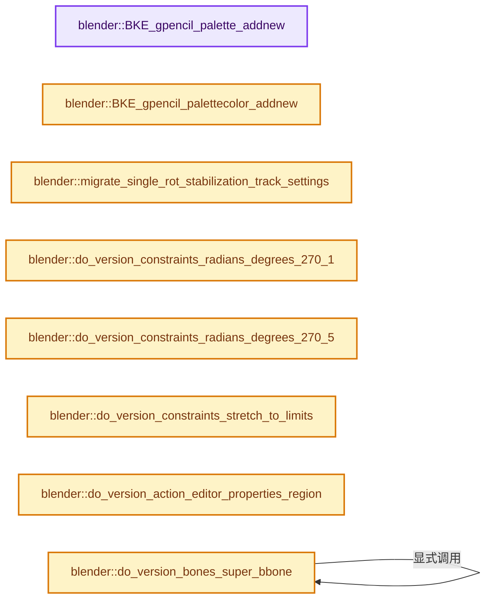
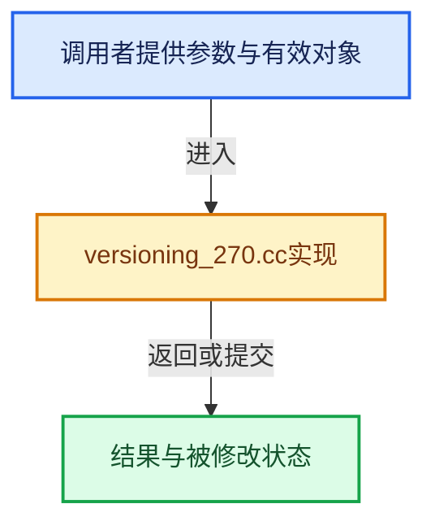

# 实现依赖专题：source/blender/blenloader/intern/versioning_270.cc

[实现依赖导航](../../../README.md) · [符号索引](../../../../00-课程指南/02-源码与提交索引/符号依赖与实现索引.md)

本专题从正文实际调用进入，集中保存共享实现。函数有稳定锚点，可从调用处直接跳到对应完整函数；递归与互相调用通过回链组织。

## 本文件的实现关系






## 完整成员与函数实现

<a id="f-cfe0549fcd45924e"></a>

### `blender::BKE_gpencil_palette_addnew`

实现位置：[source/blender/blenloader/intern/versioning_270.cc](../../../../../../../../source/blender/blenloader/intern/versioning_270.cc) · L96—L123。

接口参数：

- `bGPdata *gpd`
- `const char *name`

**教学注释版**

<!-- annotated:60779d6c8dc2a6 -->

```cpp
static bGPDpalette *BKE_gpencil_palette_addnew(bGPdata *gpd, const char *name)
{
  bGPDpalette *palette;

  /* check that list is ok */
  if (gpd == nullptr) {
    return nullptr;
  }

  /* allocate memory and add to end of list */
  palette = MEM_new<bGPDpalette>("bGPDpalette");

  /* add to datablock */
  BLI_addtail(&gpd->palettes, palette);

  /* set basic settings */
  /* auto-name */
  STRNCPY_UTF8(palette->info, name);
  BLI_uniquename(&gpd->palettes,
                 palette,
                 DATA_("GP_Palette"),
                 '.',
                 offsetof(bGPDpalette, info),
                 sizeof(palette->info));

  /* return palette */
  return palette;
}
```

<details>
<summary>核对原始源码：source/blender/blenloader/intern/versioning_270.cc · L96—L123</summary>

<!-- original:60779d6c8dc2a6:source/blender/blenloader/intern/versioning_270.cc:96:123 -->

```cpp
static bGPDpalette *BKE_gpencil_palette_addnew(bGPdata *gpd, const char *name)
{
  bGPDpalette *palette;

  /* check that list is ok */
  if (gpd == nullptr) {
    return nullptr;
  }

  /* allocate memory and add to end of list */
  palette = MEM_new<bGPDpalette>("bGPDpalette");

  /* add to datablock */
  BLI_addtail(&gpd->palettes, palette);

  /* set basic settings */
  /* auto-name */
  STRNCPY_UTF8(palette->info, name);
  BLI_uniquename(&gpd->palettes,
                 palette,
                 DATA_("GP_Palette"),
                 '.',
                 offsetof(bGPDpalette, info),
                 sizeof(palette->info));

  /* return palette */
  return palette;
}
```

</details>

**沿实际写入检查状态**

- `palette = MEM_new<bGPDpalette>("bGPDpalette");`

**结果出口**

- `return nullptr;`
- `return palette;`

**继续追踪实现**

- `MEM_new<bGPDpalette>` → [MEM_new · L351](../../../07-Intern运行时与平台/guardedalloc/MEM_guardedalloc.h.md#f-115f9b6784f89912)。
- `BLI_addtail` → [blender::BLI_addtail · L118](../../../01-BLI基础库/intern/listbase.cc.md#f-4fb027713fa3115b)。
- `STRNCPY_UTF8` → [STRNCPY_UTF8 · L335](../../../01-BLI基础库/BLI_string_utf8.hh.md#m-222967f0ab6a)。宏定义由构建条件选择。
- `BLI_uniquename` → [blender::BLI_uniquename · L491](../../../01-BLI基础库/intern/string_utils.cc.md#f-bcf1a000dbfb87d1)。
- `DATA_` → [DATA_ · L52](../../blentranslation/BLT_translation.hh.md#m-178736083f83)。宏定义由构建条件选择。

<a id="f-34265269b30fc35f"></a>

### `blender::BKE_gpencil_palettecolor_addnew`

实现位置：[source/blender/blenloader/intern/versioning_270.cc](../../../../../../../../source/blender/blenloader/intern/versioning_270.cc) · L126—L156。

接口参数：

- `bGPDpalette *palette`
- `const char *name`

**教学注释版**

<!-- annotated:c0a880fe8bc362 -->

```cpp
static bGPDpalettecolor *BKE_gpencil_palettecolor_addnew(bGPDpalette *palette, const char *name)
{
  bGPDpalettecolor *palcolor;

  /* check that list is ok */
  if (palette == nullptr) {
    return nullptr;
  }

  /* allocate memory and add to end of list */
  palcolor = MEM_new<bGPDpalettecolor>("bGPDpalettecolor");

  /* add to datablock */
  BLI_addtail(&palette->colors, palcolor);

  /* set basic settings */
  copy_v4_v4(palcolor->color, U.gpencil_new_layer_col);
  ARRAY_SET_ITEMS(palcolor->fill, 1.0f, 1.0f, 1.0f);

  /* auto-name */
  STRNCPY_UTF8(palcolor->info, name);
  BLI_uniquename(&palette->colors,
                 palcolor,
                 DATA_("Color"),
                 '.',
                 offsetof(bGPDpalettecolor, info),
                 sizeof(palcolor->info));

  /* return palette color */
  return palcolor;
}
```

<details>
<summary>核对原始源码：source/blender/blenloader/intern/versioning_270.cc · L126—L156</summary>

<!-- original:c0a880fe8bc362:source/blender/blenloader/intern/versioning_270.cc:126:156 -->

```cpp
static bGPDpalettecolor *BKE_gpencil_palettecolor_addnew(bGPDpalette *palette, const char *name)
{
  bGPDpalettecolor *palcolor;

  /* check that list is ok */
  if (palette == nullptr) {
    return nullptr;
  }

  /* allocate memory and add to end of list */
  palcolor = MEM_new<bGPDpalettecolor>("bGPDpalettecolor");

  /* add to datablock */
  BLI_addtail(&palette->colors, palcolor);

  /* set basic settings */
  copy_v4_v4(palcolor->color, U.gpencil_new_layer_col);
  ARRAY_SET_ITEMS(palcolor->fill, 1.0f, 1.0f, 1.0f);

  /* auto-name */
  STRNCPY_UTF8(palcolor->info, name);
  BLI_uniquename(&palette->colors,
                 palcolor,
                 DATA_("Color"),
                 '.',
                 offsetof(bGPDpalettecolor, info),
                 sizeof(palcolor->info));

  /* return palette color */
  return palcolor;
}
```

</details>

**沿实际写入检查状态**

- `palcolor = MEM_new<bGPDpalettecolor>("bGPDpalettecolor");`

**结果出口**

- `return nullptr;`
- `return palcolor;`

**继续追踪实现**

- `MEM_new<bGPDpalettecolor>` → [MEM_new · L351](../../../07-Intern运行时与平台/guardedalloc/MEM_guardedalloc.h.md#f-115f9b6784f89912)。
- `BLI_addtail` → [blender::BLI_addtail · L118](../../../01-BLI基础库/intern/listbase.cc.md#f-4fb027713fa3115b)。
- `copy_v4_v4` → [blender::copy_v4_v4 · L54](../../../01-BLI基础库/intern/math_vector_inline.cc.md#f-0cf225fc326edf4a)。
- `ARRAY_SET_ITEMS` → [ARRAY_SET_ITEMS · L304](../../../01-BLI基础库/BLI_utildefines.hh.md#m-80336b50a95e)。宏定义由构建条件选择。
- `STRNCPY_UTF8` → [STRNCPY_UTF8 · L335](../../../01-BLI基础库/BLI_string_utf8.hh.md#m-222967f0ab6a)。宏定义由构建条件选择。
- `BLI_uniquename` → [blender::BLI_uniquename · L491](../../../01-BLI基础库/intern/string_utils.cc.md#f-bcf1a000dbfb87d1)。
- `DATA_` → [DATA_ · L52](../../blentranslation/BLT_translation.hh.md#m-178736083f83)。宏定义由构建条件选择。

<a id="f-189cbba97a9d8505"></a>

### `blender::migrate_single_rot_stabilization_track_settings`

实现位置：[source/blender/blenloader/intern/versioning_270.cc](../../../../../../../../source/blender/blenloader/intern/versioning_270.cc) · L164—L173。

接口参数：

- `MovieTrackingStabilization *stab`

**教学注释版**

<!-- annotated:8f437cf993a121 -->

```cpp
static void migrate_single_rot_stabilization_track_settings(MovieTrackingStabilization *stab)
{
  if (stab->rot_track_legacy) {
    if (!(stab->rot_track_legacy->flag & TRACK_USE_2D_STAB_ROT)) {
      stab->tot_rot_track++;
      stab->rot_track_legacy->flag |= TRACK_USE_2D_STAB_ROT;
    }
  }
  stab->rot_track_legacy = nullptr; /* this field is now ignored */
}
```

<details>
<summary>核对原始源码：source/blender/blenloader/intern/versioning_270.cc · L164—L173</summary>

<!-- original:8f437cf993a121:source/blender/blenloader/intern/versioning_270.cc:164:173 -->

```cpp
static void migrate_single_rot_stabilization_track_settings(MovieTrackingStabilization *stab)
{
  if (stab->rot_track_legacy) {
    if (!(stab->rot_track_legacy->flag & TRACK_USE_2D_STAB_ROT)) {
      stab->tot_rot_track++;
      stab->rot_track_legacy->flag |= TRACK_USE_2D_STAB_ROT;
    }
  }
  stab->rot_track_legacy = nullptr; /* this field is now ignored */
}
```

</details>

**沿实际写入检查状态**

- `stab->rot_track_legacy->flag |= TRACK_USE_2D_STAB_ROT;`
- `stab->rot_track_legacy = nullptr; /* this field is now ignored */`

**继续追踪实现**

本实现没有需要继续展开的显式调用；检查返回表达式、对象转换和调用者前置条件。

<a id="f-fe5ee6a164f636c8"></a>

### `blender::do_version_constraints_radians_degrees_270_1`

实现位置：[source/blender/blenloader/intern/versioning_270.cc](../../../../../../../../source/blender/blenloader/intern/versioning_270.cc) · L175—L193。

接口参数：

- `ListBaseT<bConstraint> *lb`

**教学注释版**

<!-- annotated:71cf9284532407 -->

```cpp
static void do_version_constraints_radians_degrees_270_1(ListBaseT<bConstraint> *lb)
{
  for (bConstraint &con : *lb) {
    if (con.type == CONSTRAINT_TYPE_TRANSFORM) {
      bTransformConstraint *data = static_cast<bTransformConstraint *>(con.data);
      const float deg_to_rad_f = DEG2RADF(1.0f);

      if (data->from == TRANS_ROTATION) {
        mul_v3_fl(data->from_min, deg_to_rad_f);
        mul_v3_fl(data->from_max, deg_to_rad_f);
      }

      if (data->to == TRANS_ROTATION) {
        mul_v3_fl(data->to_min, deg_to_rad_f);
        mul_v3_fl(data->to_max, deg_to_rad_f);
      }
    }
  }
}
```

<details>
<summary>核对原始源码：source/blender/blenloader/intern/versioning_270.cc · L175—L193</summary>

<!-- original:71cf9284532407:source/blender/blenloader/intern/versioning_270.cc:175:193 -->

```cpp
static void do_version_constraints_radians_degrees_270_1(ListBaseT<bConstraint> *lb)
{
  for (bConstraint &con : *lb) {
    if (con.type == CONSTRAINT_TYPE_TRANSFORM) {
      bTransformConstraint *data = static_cast<bTransformConstraint *>(con.data);
      const float deg_to_rad_f = DEG2RADF(1.0f);

      if (data->from == TRANS_ROTATION) {
        mul_v3_fl(data->from_min, deg_to_rad_f);
        mul_v3_fl(data->from_max, deg_to_rad_f);
      }

      if (data->to == TRANS_ROTATION) {
        mul_v3_fl(data->to_min, deg_to_rad_f);
        mul_v3_fl(data->to_max, deg_to_rad_f);
      }
    }
  }
}
```

</details>

**继续追踪实现**

- `DEG2RADF` → [DEG2RADF · L75](../../../01-BLI基础库/BLI_math_constants.hh.md#m-b7feaa4acbdb)；[DEG2RADF · L17](../../../07-Intern运行时与平台/cycles/app/cycles_xml.h.md#m-de839cbb85d5)。宏定义由构建条件选择。
- `mul_v3_fl` → [blender::mul_v3_fl · L414](../../../01-BLI基础库/intern/math_vector_inline.cc.md#f-00165156a06d1224)。

<a id="f-5dc0f0a2d3d961c9"></a>

### `blender::do_version_constraints_radians_degrees_270_5`

实现位置：[source/blender/blenloader/intern/versioning_270.cc](../../../../../../../../source/blender/blenloader/intern/versioning_270.cc) · L195—L220。

接口参数：

- `ListBaseT<bConstraint> *lb`

**教学注释版**

<!-- annotated:b6ddc3d38e3757 -->

```cpp
static void do_version_constraints_radians_degrees_270_5(ListBaseT<bConstraint> *lb)
{
  for (bConstraint &con : *lb) {
    if (con.type == CONSTRAINT_TYPE_TRANSFORM) {
      bTransformConstraint *data = static_cast<bTransformConstraint *>(con.data);

      if (data->from == TRANS_ROTATION) {
        copy_v3_v3(data->from_min_rot, data->from_min);
        copy_v3_v3(data->from_max_rot, data->from_max);
      }
      else if (data->from == TRANS_SCALE) {
        copy_v3_v3(data->from_min_scale, data->from_min);
        copy_v3_v3(data->from_max_scale, data->from_max);
      }

      if (data->to == TRANS_ROTATION) {
        copy_v3_v3(data->to_min_rot, data->to_min);
        copy_v3_v3(data->to_max_rot, data->to_max);
      }
      else if (data->to == TRANS_SCALE) {
        copy_v3_v3(data->to_min_scale, data->to_min);
        copy_v3_v3(data->to_max_scale, data->to_max);
      }
    }
  }
}
```

<details>
<summary>核对原始源码：source/blender/blenloader/intern/versioning_270.cc · L195—L220</summary>

<!-- original:b6ddc3d38e3757:source/blender/blenloader/intern/versioning_270.cc:195:220 -->

```cpp
static void do_version_constraints_radians_degrees_270_5(ListBaseT<bConstraint> *lb)
{
  for (bConstraint &con : *lb) {
    if (con.type == CONSTRAINT_TYPE_TRANSFORM) {
      bTransformConstraint *data = static_cast<bTransformConstraint *>(con.data);

      if (data->from == TRANS_ROTATION) {
        copy_v3_v3(data->from_min_rot, data->from_min);
        copy_v3_v3(data->from_max_rot, data->from_max);
      }
      else if (data->from == TRANS_SCALE) {
        copy_v3_v3(data->from_min_scale, data->from_min);
        copy_v3_v3(data->from_max_scale, data->from_max);
      }

      if (data->to == TRANS_ROTATION) {
        copy_v3_v3(data->to_min_rot, data->to_min);
        copy_v3_v3(data->to_max_rot, data->to_max);
      }
      else if (data->to == TRANS_SCALE) {
        copy_v3_v3(data->to_min_scale, data->to_min);
        copy_v3_v3(data->to_max_scale, data->to_max);
      }
    }
  }
}
```

</details>

**继续追踪实现**

- `copy_v3_v3` → [blender::copy_v3_v3 · L47](../../../01-BLI基础库/intern/math_vector_inline.cc.md#f-037a0d5fa5060bd6)。

<a id="f-8c78e9de464f1288"></a>

### `blender::do_version_constraints_stretch_to_limits`

实现位置：[source/blender/blenloader/intern/versioning_270.cc](../../../../../../../../source/blender/blenloader/intern/versioning_270.cc) · L222—L231。

接口参数：

- `ListBaseT<bConstraint> *lb`

**教学注释版**

<!-- annotated:22fd8f6688b858 -->

```cpp
static void do_version_constraints_stretch_to_limits(ListBaseT<bConstraint> *lb)
{
  for (bConstraint &con : *lb) {
    if (con.type == CONSTRAINT_TYPE_STRETCHTO) {
      bStretchToConstraint *data = static_cast<bStretchToConstraint *>(con.data);
      data->bulge_min = 1.0f;
      data->bulge_max = 1.0f;
    }
  }
}
```

<details>
<summary>核对原始源码：source/blender/blenloader/intern/versioning_270.cc · L222—L231</summary>

<!-- original:22fd8f6688b858:source/blender/blenloader/intern/versioning_270.cc:222:231 -->

```cpp
static void do_version_constraints_stretch_to_limits(ListBaseT<bConstraint> *lb)
{
  for (bConstraint &con : *lb) {
    if (con.type == CONSTRAINT_TYPE_STRETCHTO) {
      bStretchToConstraint *data = static_cast<bStretchToConstraint *>(con.data);
      data->bulge_min = 1.0f;
      data->bulge_max = 1.0f;
    }
  }
}
```

</details>

**沿实际写入检查状态**

- `data->bulge_min = 1.0f;`
- `data->bulge_max = 1.0f;`

**继续追踪实现**

本实现没有需要继续展开的显式调用；检查返回表达式、对象转换和调用者前置条件。

<a id="f-74ef7886eaf058e6"></a>

### `blender::do_version_action_editor_properties_region`

实现位置：[source/blender/blenloader/intern/versioning_270.cc](../../../../../../../../source/blender/blenloader/intern/versioning_270.cc) · L233—L253。

接口参数：

- `ListBaseT<ARegion> *regionbase`

**教学注释版**

<!-- annotated:732c20c4935227 -->

```cpp
static void do_version_action_editor_properties_region(ListBaseT<ARegion> *regionbase)
{
  for (ARegion &region : *regionbase) {
    if (region.regiontype == RGN_TYPE_UI) {
      /* already exists */
      return;
    }
    if (region.regiontype == RGN_TYPE_WINDOW) {
      /* add new region here */
      ARegion *region_new = BKE_area_region_new();

      BLI_insertlinkbefore(regionbase, &region, region_new);

      region_new->regiontype = RGN_TYPE_UI;
      region_new->alignment = RGN_ALIGN_RIGHT;
      region_new->flag = RGN_FLAG_HIDDEN;

      return;
    }
  }
}
```

<details>
<summary>核对原始源码：source/blender/blenloader/intern/versioning_270.cc · L233—L253</summary>

<!-- original:732c20c4935227:source/blender/blenloader/intern/versioning_270.cc:233:253 -->

```cpp
static void do_version_action_editor_properties_region(ListBaseT<ARegion> *regionbase)
{
  for (ARegion &region : *regionbase) {
    if (region.regiontype == RGN_TYPE_UI) {
      /* already exists */
      return;
    }
    if (region.regiontype == RGN_TYPE_WINDOW) {
      /* add new region here */
      ARegion *region_new = BKE_area_region_new();

      BLI_insertlinkbefore(regionbase, &region, region_new);

      region_new->regiontype = RGN_TYPE_UI;
      region_new->alignment = RGN_ALIGN_RIGHT;
      region_new->flag = RGN_FLAG_HIDDEN;

      return;
    }
  }
}
```

</details>

**沿实际写入检查状态**

- `region_new->regiontype = RGN_TYPE_UI;`
- `region_new->alignment = RGN_ALIGN_RIGHT;`
- `region_new->flag = RGN_FLAG_HIDDEN;`

**继续追踪实现**

- `BKE_area_region_new` → [blender::BKE_area_region_new · L520](../../../02-BKE几何与数据/intern/screen.cc.md#f-65d2bf9c04020290)。
- `BLI_insertlinkbefore` → [blender::BLI_insertlinkbefore · L378](../../../01-BLI基础库/intern/listbase.cc.md#f-b9a49151feaf9c08)。

<a id="f-46b7f3f4a78fb85d"></a>

### `blender::do_version_bones_super_bbone`

实现位置：[source/blender/blenloader/intern/versioning_270.cc](../../../../../../../../source/blender/blenloader/intern/versioning_270.cc) · L255—L263。

接口参数：

- `ListBaseT<Bone> *lb`

**教学注释版**

<!-- annotated:cec870d2cc2ecc -->

```cpp
static void do_version_bones_super_bbone(ListBaseT<Bone> *lb)
{
  for (Bone &bone : *lb) {
    bone.scale_in_x = bone.scale_in_z = 1.0f;
    bone.scale_out_x = bone.scale_out_z = 1.0f;

    do_version_bones_super_bbone(&bone.childbase);
  }
}
```

<details>
<summary>核对原始源码：source/blender/blenloader/intern/versioning_270.cc · L255—L263</summary>

<!-- original:cec870d2cc2ecc:source/blender/blenloader/intern/versioning_270.cc:255:263 -->

```cpp
static void do_version_bones_super_bbone(ListBaseT<Bone> *lb)
{
  for (Bone &bone : *lb) {
    bone.scale_in_x = bone.scale_in_z = 1.0f;
    bone.scale_out_x = bone.scale_out_z = 1.0f;

    do_version_bones_super_bbone(&bone.childbase);
  }
}
```

</details>

**沿实际写入检查状态**

- `bone.scale_in_x = bone.scale_in_z = 1.0f;`
- `bone.scale_out_x = bone.scale_out_z = 1.0f;`

**继续追踪实现**

- `do_version_bones_super_bbone` → [blender::do_version_bones_super_bbone · L255](versioning_270.cc.md#f-46b7f3f4a78fb85d)。

<a id="f-45c3a00d329c953a"></a>

### `blender::anim_change_prop_name`

实现位置：[source/blender/blenloader/intern/versioning_270.cc](../../../../../../../../source/blender/blenloader/intern/versioning_270.cc) · L266—L276。

接口参数：

- `FCurve *fcu`
- `const char *prefix`
- `const char *old_prop_name`
- `const char *new_prop_name`

**教学注释版**

<!-- annotated:d7cf0d76f7662a -->

```cpp
static void anim_change_prop_name(FCurve *fcu,
                                  const char *prefix,
                                  const char *old_prop_name,
                                  const char *new_prop_name)
{
  const char *old_path = BLI_sprintfN("%s.%s", prefix, old_prop_name);
  if (fcu->rna_path() == old_path) {
    fcu->rna_path_set_move(BLI_sprintfN("%s.%s", prefix, new_prop_name));
  }
  MEM_delete(const_cast<char *>(old_path));
}
```

<details>
<summary>核对原始源码：source/blender/blenloader/intern/versioning_270.cc · L266—L276</summary>

<!-- original:d7cf0d76f7662a:source/blender/blenloader/intern/versioning_270.cc:266:276 -->

```cpp
static void anim_change_prop_name(FCurve *fcu,
                                  const char *prefix,
                                  const char *old_prop_name,
                                  const char *new_prop_name)
{
  const char *old_path = BLI_sprintfN("%s.%s", prefix, old_prop_name);
  if (fcu->rna_path() == old_path) {
    fcu->rna_path_set_move(BLI_sprintfN("%s.%s", prefix, new_prop_name));
  }
  MEM_delete(const_cast<char *>(old_path));
}
```

</details>

**继续追踪实现**

- `BLI_sprintfN` → [blender::BLI_sprintfN · L296](../../../01-BLI基础库/intern/string.cc.md#f-bfbc2f7076298fc0)。
- `fcu->rna_path` → [blender::FCurve::rna_path · L189](../../../02-BKE几何与数据/intern/fcurve.cc.md#f-b3be61588d36ab9c)。
- `fcu->rna_path_set_move` → [blender::FCurve::rna_path_set_move · L182](../../../02-BKE几何与数据/intern/fcurve.cc.md#f-feffe802a84cd660)。
- `MEM_delete` → [MEM_delete · L400](../../../07-Intern运行时与平台/guardedalloc/MEM_guardedalloc.h.md#f-9049ffdd1682887c)。

<a id="f-55421f5113dc98ff"></a>

### `blender::do_version_hue_sat_node`

实现位置：[source/blender/blenloader/intern/versioning_270.cc](../../../../../../../../source/blender/blenloader/intern/versioning_270.cc) · L278—L323。

接口参数：

- `bNodeTree *ntree`
- `bNode *node`

**教学注释版**

<!-- annotated:04bc33013beeb2 -->

```cpp
static void do_version_hue_sat_node(bNodeTree *ntree, bNode *node)
{
  if (node->storage == nullptr) {
    return;
  }

  /* Convert value from old storage to new sockets. */
  NodeHueSat *nhs = static_cast<NodeHueSat *>(node->storage);
  bNodeSocket *hue = bke::node_find_socket(*node, SOCK_IN, "Hue"_ustr);
  bNodeSocket *saturation = bke::node_find_socket(*node, SOCK_IN, "Saturation"_ustr);
  bNodeSocket *value = bke::node_find_socket(*node, SOCK_IN, "Value"_ustr);
  if (hue == nullptr) {
    hue = bke::node_add_static_socket(
        *ntree, *node, SOCK_IN, SOCK_FLOAT, PROP_FACTOR, "Hue", "Hue");
  }
  if (saturation == nullptr) {
    saturation = bke::node_add_static_socket(
        *ntree, *node, SOCK_IN, SOCK_FLOAT, PROP_FACTOR, "Saturation", "Saturation");
  }
  if (value == nullptr) {
    value = bke::node_add_static_socket(
        *ntree, *node, SOCK_IN, SOCK_FLOAT, PROP_FACTOR, "Value", "Value");
  }

  (static_cast<bNodeSocketValueFloat *>(hue->default_value))->value = nhs->hue;
  (static_cast<bNodeSocketValueFloat *>(saturation->default_value))->value = nhs->sat;
  (static_cast<bNodeSocketValueFloat *>(value->default_value))->value = nhs->val;
  /* Take care of possible animation. */
  AnimData *adt = BKE_animdata_from_id(&ntree->id);
  if (adt != nullptr && adt->action != nullptr) {
    char node_name_esc[sizeof(node->name) * 2];
    BLI_str_escape(node_name_esc, node->name, sizeof(node_name_esc));
    const char *prefix = BLI_sprintfN("nodes[\"%s\"]", node_name_esc);
    for (FCurve &fcu : adt->action->curves) {
      if (fcu.rna_path().startswith(prefix)) {
        anim_change_prop_name(&fcu, prefix, "color_hue", "inputs[1].default_value");
        anim_change_prop_name(&fcu, prefix, "color_saturation", "inputs[2].default_value");
        anim_change_prop_name(&fcu, prefix, "color_value", "inputs[3].default_value");
      }
    }
    MEM_delete(const_cast<char *>(prefix));
  }
  /* Free storage, it is no longer used. */
  MEM_delete(nhs);
  node->storage = nullptr;
}
```

<details>
<summary>核对原始源码：source/blender/blenloader/intern/versioning_270.cc · L278—L323</summary>

<!-- original:04bc33013beeb2:source/blender/blenloader/intern/versioning_270.cc:278:323 -->

```cpp
static void do_version_hue_sat_node(bNodeTree *ntree, bNode *node)
{
  if (node->storage == nullptr) {
    return;
  }

  /* Convert value from old storage to new sockets. */
  NodeHueSat *nhs = static_cast<NodeHueSat *>(node->storage);
  bNodeSocket *hue = bke::node_find_socket(*node, SOCK_IN, "Hue"_ustr);
  bNodeSocket *saturation = bke::node_find_socket(*node, SOCK_IN, "Saturation"_ustr);
  bNodeSocket *value = bke::node_find_socket(*node, SOCK_IN, "Value"_ustr);
  if (hue == nullptr) {
    hue = bke::node_add_static_socket(
        *ntree, *node, SOCK_IN, SOCK_FLOAT, PROP_FACTOR, "Hue", "Hue");
  }
  if (saturation == nullptr) {
    saturation = bke::node_add_static_socket(
        *ntree, *node, SOCK_IN, SOCK_FLOAT, PROP_FACTOR, "Saturation", "Saturation");
  }
  if (value == nullptr) {
    value = bke::node_add_static_socket(
        *ntree, *node, SOCK_IN, SOCK_FLOAT, PROP_FACTOR, "Value", "Value");
  }

  (static_cast<bNodeSocketValueFloat *>(hue->default_value))->value = nhs->hue;
  (static_cast<bNodeSocketValueFloat *>(saturation->default_value))->value = nhs->sat;
  (static_cast<bNodeSocketValueFloat *>(value->default_value))->value = nhs->val;
  /* Take care of possible animation. */
  AnimData *adt = BKE_animdata_from_id(&ntree->id);
  if (adt != nullptr && adt->action != nullptr) {
    char node_name_esc[sizeof(node->name) * 2];
    BLI_str_escape(node_name_esc, node->name, sizeof(node_name_esc));
    const char *prefix = BLI_sprintfN("nodes[\"%s\"]", node_name_esc);
    for (FCurve &fcu : adt->action->curves) {
      if (fcu.rna_path().startswith(prefix)) {
        anim_change_prop_name(&fcu, prefix, "color_hue", "inputs[1].default_value");
        anim_change_prop_name(&fcu, prefix, "color_saturation", "inputs[2].default_value");
        anim_change_prop_name(&fcu, prefix, "color_value", "inputs[3].default_value");
      }
    }
    MEM_delete(const_cast<char *>(prefix));
  }
  /* Free storage, it is no longer used. */
  MEM_delete(nhs);
  node->storage = nullptr;
}
```

</details>

**沿实际写入检查状态**

- `hue = bke::node_add_static_socket(`
- `saturation = bke::node_add_static_socket(`
- `value = bke::node_add_static_socket(`
- `node->storage = nullptr;`

**继续追踪实现**

- `bke::node_find_socket` → [blender::bke::node_find_socket · L3036](../../../02-BKE几何与数据/intern/node.cc.md#f-cbf9dec71aff5b59)；[blender::bke::node_find_socket · L3047](../../../02-BKE几何与数据/intern/node.cc.md#f-4a7a677634b7fbd1)。同名重载需按实参类型选择。
- `bke::node_add_static_socket` → [blender::bke::node_add_static_socket · L3980](../../../02-BKE几何与数据/intern/node.cc.md#f-d6d2fde9e1919837)。
- `BKE_animdata_from_id` → [blender::BKE_animdata_from_id · L93](../../../02-BKE几何与数据/intern/anim_data.cc.md#f-354e5421ff0a6c96)。
- `BLI_str_escape` → [blender::BLI_str_escape · L335](../../../01-BLI基础库/intern/string.cc.md#f-ade392f6fb397ef6)；[blender::BLI_str_escape · L366](../../../01-BLI基础库/intern/string.cc.md#f-56725a2c129075c6)。同名重载需按实参类型选择。
- `BLI_sprintfN` → [blender::BLI_sprintfN · L296](../../../01-BLI基础库/intern/string.cc.md#f-bfbc2f7076298fc0)。
- `fcu.rna_path().startswith` → [调用协议](../../../../00-课程指南/01-路线与规范/模板宏与动态分派协议.md)：接收对象类型依赖auto、返回值或模板实例；不按同名猜测目标。调用位置L312。
- `fcu.rna_path` → [调用协议](../../../../00-课程指南/01-路线与规范/模板宏与动态分派协议.md)：接收对象类型依赖auto、返回值或模板实例；不按同名猜测目标。调用位置L312。
- `anim_change_prop_name` → [blender::anim_change_prop_name · L266](versioning_270.cc.md#f-45c3a00d329c953a)。
- `MEM_delete` → [MEM_delete · L400](../../../07-Intern运行时与平台/guardedalloc/MEM_guardedalloc.h.md#f-9049ffdd1682887c)。

<a id="f-80c9403ae5abfee1"></a>

### `blender::legacy_socket_index_to_pass_name`

实现位置：[source/blender/blenloader/intern/versioning_270.cc](../../../../../../../../source/blender/blenloader/intern/versioning_270.cc) · L361—L369。

接口参数：

- `int sock_index`

**教学注释版**

<!-- annotated:b186983087a913 -->

```cpp
static const char *legacy_socket_index_to_pass_name(int sock_index)
{
  if (sock_index >= NUM_LEGACY_SOCKETS) {
    return nullptr;
  }
  const char *name = legacy_render_layers_outputs[sock_index].name;
  /* Exception for alpha, which is derived from Combined. */
  return STREQ(name, "Alpha") ? RE_PASSNAME_COMBINED : name;
}
```

<details>
<summary>核对原始源码：source/blender/blenloader/intern/versioning_270.cc · L361—L369</summary>

<!-- original:b186983087a913:source/blender/blenloader/intern/versioning_270.cc:361:369 -->

```cpp
static const char *legacy_socket_index_to_pass_name(int sock_index)
{
  if (sock_index >= NUM_LEGACY_SOCKETS) {
    return nullptr;
  }
  const char *name = legacy_render_layers_outputs[sock_index].name;
  /* Exception for alpha, which is derived from Combined. */
  return STREQ(name, "Alpha") ? RE_PASSNAME_COMBINED : name;
}
```

</details>

**结果出口**

- `return nullptr;`
- `return STREQ(name, "Alpha") ? RE_PASSNAME_COMBINED : name;`

**继续追踪实现**

- `STREQ` → [STREQ · L112](../../../07-Intern运行时与平台/ghost/intern/GHOST_utildefines.hh.md#m-9549fb6aafd2)；[STREQ · L451](../../../01-BLI基础库/BLI_utildefines.hh.md#m-c7b745bcfad2)；[STREQ · L55](../../../07-Intern运行时与平台/clog/clog.cc.md#m-96e78f386894)。宏定义由构建条件选择。

<a id="f-b5c691af0e9127ff"></a>

### `blender::do_versions_compositor_render_passes_storage`

实现位置：[source/blender/blenloader/intern/versioning_270.cc](../../../../../../../../source/blender/blenloader/intern/versioning_270.cc) · L371—L395。

接口参数：

- `bNode *node`

**教学注释版**

<!-- annotated:9c70df9c31c724 -->

```cpp
static void do_versions_compositor_render_passes_storage(bNode *node)
{
  int pass_index = 0;
  const char *sockname;
  for (bNodeSocket *sock = node->outputs.first(); sock && pass_index < 31;
       sock = static_cast<bNodeSocket *>(sock->next), pass_index++)
  {
    if (sock->storage == nullptr) {
      NodeImageLayer *sockdata = MEM_new<NodeImageLayer>("node image layer");
      sock->storage = sockdata;
      STRNCPY_UTF8(sockdata->pass_name, legacy_socket_index_to_pass_name(pass_index));

      if (pass_index == 0) {
        sockname = "Image";
      }
      else if (pass_index == 1) {
        sockname = "Alpha";
      }
      else {
        sockname = legacy_socket_index_to_pass_name(pass_index);
      }
      STRNCPY_UTF8(sock->name, sockname);
    }
  }
}
```

<details>
<summary>核对原始源码：source/blender/blenloader/intern/versioning_270.cc · L371—L395</summary>

<!-- original:9c70df9c31c724:source/blender/blenloader/intern/versioning_270.cc:371:395 -->

```cpp
static void do_versions_compositor_render_passes_storage(bNode *node)
{
  int pass_index = 0;
  const char *sockname;
  for (bNodeSocket *sock = node->outputs.first(); sock && pass_index < 31;
       sock = static_cast<bNodeSocket *>(sock->next), pass_index++)
  {
    if (sock->storage == nullptr) {
      NodeImageLayer *sockdata = MEM_new<NodeImageLayer>("node image layer");
      sock->storage = sockdata;
      STRNCPY_UTF8(sockdata->pass_name, legacy_socket_index_to_pass_name(pass_index));

      if (pass_index == 0) {
        sockname = "Image";
      }
      else if (pass_index == 1) {
        sockname = "Alpha";
      }
      else {
        sockname = legacy_socket_index_to_pass_name(pass_index);
      }
      STRNCPY_UTF8(sock->name, sockname);
    }
  }
}
```

</details>

**沿实际写入检查状态**

- `sock = static_cast<bNodeSocket *>(sock->next), pass_index++)`
- `sock->storage = sockdata;`
- `sockname = "Image";`
- `sockname = "Alpha";`
- `sockname = legacy_socket_index_to_pass_name(pass_index);`

**继续追踪实现**

- `node->outputs.first` → [调用协议](../../../../00-课程指南/01-路线与规范/模板宏与动态分派协议.md)：接收对象类型依赖auto、返回值或模板实例；不按同名猜测目标。调用位置L375。
- `MEM_new<NodeImageLayer>` → [MEM_new · L351](../../../07-Intern运行时与平台/guardedalloc/MEM_guardedalloc.h.md#f-115f9b6784f89912)。
- `STRNCPY_UTF8` → [STRNCPY_UTF8 · L335](../../../01-BLI基础库/BLI_string_utf8.hh.md#m-222967f0ab6a)。宏定义由构建条件选择。
- `legacy_socket_index_to_pass_name` → [blender::legacy_socket_index_to_pass_name · L361](versioning_270.cc.md#f-80c9403ae5abfee1)。

<a id="f-49eab0dd7256eec3"></a>

### `blender::do_versions_compositor_render_passes`

实现位置：[source/blender/blenloader/intern/versioning_270.cc](../../../../../../../../source/blender/blenloader/intern/versioning_270.cc) · L397—L408。

接口参数：

- `bNodeTree *ntree`

**教学注释版**

<!-- annotated:621087fe338861 -->

```cpp
static void do_versions_compositor_render_passes(bNodeTree *ntree)
{
  for (bNode &node : ntree->nodes) {
    if (node.type_legacy == CMP_NODE_R_LAYERS) {
      /* First we make sure existing sockets have proper names.
       * This is important because otherwise verification will
       * drop links from sockets which were renamed.
       */
      do_versions_compositor_render_passes_storage(&node);
    }
  }
}
```

<details>
<summary>核对原始源码：source/blender/blenloader/intern/versioning_270.cc · L397—L408</summary>

<!-- original:621087fe338861:source/blender/blenloader/intern/versioning_270.cc:397:408 -->

```cpp
static void do_versions_compositor_render_passes(bNodeTree *ntree)
{
  for (bNode &node : ntree->nodes) {
    if (node.type_legacy == CMP_NODE_R_LAYERS) {
      /* First we make sure existing sockets have proper names.
       * This is important because otherwise verification will
       * drop links from sockets which were renamed.
       */
      do_versions_compositor_render_passes_storage(&node);
    }
  }
}
```

</details>

**继续追踪实现**

- `do_versions_compositor_render_passes_storage` → [blender::do_versions_compositor_render_passes_storage · L371](versioning_270.cc.md#f-b5c691af0e9127ff)。

<a id="f-234474f79c4ec687"></a>

### `blender::blo_do_versions_270`

实现位置：[source/blender/blenloader/intern/versioning_270.cc](../../../../../../../../source/blender/blenloader/intern/versioning_270.cc) · L503—L1647。

接口参数：

- `FileData *fd`
- `Library *`
- `Main *bmain`

**教学注释版**

<!-- annotated:1780329a988edf -->

```cpp
void blo_do_versions_270(FileData *fd, Library * /*lib*/, Main *bmain)
{
  if (!MAIN_VERSION_FILE_ATLEAST(bmain, 270, 0)) {

    if (!DNA_struct_member_exists(fd->filesdna, "BevelModifierData", "float", "profile")) {
      for (Object &ob : bmain->objects) {
        for (ModifierData &md : ob.modifiers) {
          if (md.type == eModifierType_Bevel) {
            BevelModifierData *bmd = reinterpret_cast<BevelModifierData *>(&md);
            bmd->profile = 0.5f;
            bmd->val_flags = MOD_BEVEL_AMT_OFFSET;
          }
        }
      }
    }

    /* nodes don't use fixed node->id any more, clean up */
    FOREACH_NODETREE_BEGIN (bmain, ntree, id) {
      if (ntree->type == NTREE_COMPOSIT) {
        for (bNode &node : ntree->nodes) {
          if (ELEM(node.type_legacy, CMP_NODE_COMPOSITE_DEPRECATED, CMP_NODE_OUTPUT_FILE)) {
            node.id = nullptr;
          }
        }
      }
    }
    FOREACH_NODETREE_END;

    for (bScreen &screen : bmain->screens) {
      for (ScrArea &area : screen.areabase) {
        for (SpaceLink &space_link : area.spacedata) {
          if (space_link.spacetype == SPACE_CLIP) {
            SpaceClip *space_clip = reinterpret_cast<SpaceClip *>(&space_link);
            if (space_clip->mode != SC_MODE_MASKEDIT) {
              space_clip->mode = SC_MODE_TRACKING;
            }
          }
        }
      }
    }

    if (!DNA_struct_member_exists(
            fd->filesdna, "MovieTrackingSettings", "float", "default_weight"))
    {
      for (MovieClip &clip : bmain->movieclips) {
        clip.tracking.settings.default_weight = 1.0f;
      }
    }
  }

  if (!MAIN_VERSION_FILE_ATLEAST(bmain, 270, 1)) {
    /* Update Transform constraint (another deg -> rad stuff). */
    for (Object &ob : bmain->objects) {
      do_version_constraints_radians_degrees_270_1(&ob.constraints);

      if (ob.pose) {
        /* Bones constraints! */
        for (bPoseChannel &pchan : ob.pose->chanbase) {
          do_version_constraints_radians_degrees_270_1(&pchan.constraints);
        }
      }
    }
  }

  if (!MAIN_VERSION_FILE_ATLEAST(bmain, 270, 2)) {
    /* Mesh smoothresh_legacy deg->rad. */
    for (Mesh &me : bmain->meshes) {
      me.smoothresh_legacy = DEG2RADF(me.smoothresh_legacy);
    }
  }

  if (!MAIN_VERSION_FILE_ATLEAST(bmain, 270, 3)) {
    for (FreestyleLineStyle &linestyle : bmain->linestyles) {
      linestyle.flag |= LS_NO_SORTING;
      linestyle.sort_key = LS_SORT_KEY_DISTANCE_FROM_CAMERA;
      linestyle.integration_type = LS_INTEGRATION_MEAN;
    }
  }

  if (!MAIN_VERSION_FILE_ATLEAST(bmain, 270, 4)) {
    /* ui_previews were not handled correctly when copying areas,
     * leading to corrupted files (see #39847).
     * This will always reset situation to a valid state.
     */
    for (bScreen &screen : bmain->screens) {
      for (ScrArea &area : screen.areabase) {
        for (SpaceLink &sl : area.spacedata) {
          ListBaseT<ARegion> *lb = (&sl == area.spacedata.first_) ? &area.regionbase :
                                                                    &sl.regionbase;
          for (ARegion &region : *lb) {
            region.ui_previews.clear_no_delete();
          }
        }
      }
    }
  }

  if (!MAIN_VERSION_FILE_ATLEAST(bmain, 270, 5)) {
    /* Update Transform constraint (again :|). */
    for (Object &ob : bmain->objects) {
      do_version_constraints_radians_degrees_270_5(&ob.constraints);

      if (ob.pose) {
        /* Bones constraints! */
        for (bPoseChannel &pchan : ob.pose->chanbase) {
          do_version_constraints_radians_degrees_270_5(&pchan.constraints);
        }
      }
    }
  }

  if (!MAIN_VERSION_FILE_ATLEAST(bmain, 271, 0)) {
    if (!DNA_struct_member_exists(fd->filesdna, "RenderData", "BakeData", "bake")) {
      for (Scene &sce : bmain->scenes) {
        sce.r.bake.flag = R_BAKE_CLEAR;
        sce.r.bake.width = 512;
        sce.r.bake.height = 512;
        sce.r.bake.margin = 16;
        sce.r.bake.normal_space = R_BAKE_SPACE_TANGENT;
        sce.r.bake.normal_swizzle[0] = R_BAKE_POSX;
        sce.r.bake.normal_swizzle[1] = R_BAKE_POSY;
        sce.r.bake.normal_swizzle[2] = R_BAKE_POSZ;
        STRNCPY(sce.r.bake.filepath, U.renderdir);

        sce.r.bake.im_format.color_mode = ImColorMode::RGBA;
        sce.r.bake.im_format.imtype = R_IMF_IMTYPE_PNG;
        sce.r.bake.im_format.depth = R_IMF_CHAN_DEPTH_8;
        sce.r.bake.im_format.quality = 90;
        sce.r.bake.im_format.compress = 15;
      }
    }

    if (!DNA_struct_member_exists(fd->filesdna, "FreestyleLineStyle", "float", "texstep")) {
      for (FreestyleLineStyle &linestyle : bmain->linestyles) {
        linestyle.flag |= LS_TEXTURE;
        linestyle.texstep = 1.0;
      }
    }

    {
      for (Scene &scene : bmain->scenes) {
        int num_layers = scene.r.layers.count();
        scene.r.actlay = min_ff(scene.r.actlay, num_layers - 1);
      }
    }
  }

  if (!MAIN_VERSION_FILE_ATLEAST(bmain, 271, 1)) {
    if (!DNA_struct_member_exists(fd->filesdna, "Material", "float", "line_col[4]")) {
      for (Material &mat : bmain->materials) {
        mat.line_col[0] = mat.line_col[1] = mat.line_col[2] = 0.0f;
        mat.line_col[3] = mat.alpha;
      }
    }
  }

  if (!MAIN_VERSION_FILE_ATLEAST(bmain, 271, 3)) {
    for (Brush &br : bmain->brushes) {
      br.fill_threshold = 0.2f;
    }

    if (!DNA_struct_member_exists(fd->filesdna, "BevelModifierData", "int", "mat")) {
      for (Object &ob : bmain->objects) {
        for (ModifierData &md : ob.modifiers) {
          if (md.type == eModifierType_Bevel) {
            BevelModifierData *bmd = reinterpret_cast<BevelModifierData *>(&md);
            bmd->mat = -1;
          }
        }
      }
    }
  }

  if (!MAIN_VERSION_FILE_ATLEAST(bmain, 271, 6)) {
    for (Object &ob : bmain->objects) {
      for (ModifierData &md : ob.modifiers) {
        if (md.type == eModifierType_ParticleSystem) {
          ParticleSystemModifierData *pmd = reinterpret_cast<ParticleSystemModifierData *>(&md);
          if (pmd->psys && pmd->psys->clmd) {
            pmd->psys->clmd->sim_parms->vel_damping = 1.0f;
          }
        }
      }
    }
  }

  if (!MAIN_VERSION_FILE_ATLEAST(bmain, 272, 1)) {
    for (Brush &br : bmain->brushes) {
      if ((br.ob_mode & OB_MODE_SCULPT) &&
          ELEM(br.sculpt_brush_type, SCULPT_BRUSH_TYPE_GRAB, SCULPT_BRUSH_TYPE_SNAKE_HOOK))
      {
        br.alpha = 1.0f;
      }
    }
  }

  if (!MAIN_VERSION_FILE_ATLEAST(bmain, 272, 2)) {
    if (!DNA_struct_member_exists(fd->filesdna, "Image", "float", "gen_color")) {
      for (Image &image : bmain->images) {
        image.gen_color[3] = 1.0f;
      }
    }

    if (!DNA_struct_member_exists(fd->filesdna, "bStretchToConstraint", "float", "bulge_min")) {
      /* Update Transform constraint (again :|). */
      for (Object &ob : bmain->objects) {
        do_version_constraints_stretch_to_limits(&ob.constraints);

        if (ob.pose) {
          /* Bones constraints! */
          for (bPoseChannel &pchan : ob.pose->chanbase) {
            do_version_constraints_stretch_to_limits(&pchan.constraints);
          }
        }
      }
    }
  }

  if (!MAIN_VERSION_FILE_ATLEAST(bmain, 273, 1)) {
#define BRUSH_RAKE (1 << 7)
#define BRUSH_RANDOM_ROTATION (1 << 25)

    for (Brush &br : bmain->brushes) {
      if (br.flag & BRUSH_RAKE) {
        br.mtex.brush_angle_mode |= MTEX_ANGLE_RAKE;
        br.mask_mtex.brush_angle_mode |= MTEX_ANGLE_RAKE;
      }
      else if (br.flag & BRUSH_RANDOM_ROTATION) {
        br.mtex.brush_angle_mode |= MTEX_ANGLE_RANDOM;
        br.mask_mtex.brush_angle_mode |= MTEX_ANGLE_RANDOM;
      }
      br.mtex.random_angle = 2.0 * M_PI;
      br.mask_mtex.random_angle = 2.0 * M_PI;
    }
  }

#undef BRUSH_RAKE
#undef BRUSH_RANDOM_ROTATION

  /* Customizable Safe Areas */
  if (!MAIN_VERSION_FILE_ATLEAST(bmain, 273, 2)) {
    if (!DNA_struct_member_exists(fd->filesdna, "Scene", "DisplaySafeAreas", "safe_areas")) {
      for (Scene &scene : bmain->scenes) {
        copy_v2_fl2(scene.safe_areas.title, 3.5f / 100.0f, 3.5f / 100.0f);
        copy_v2_fl2(scene.safe_areas.action, 10.0f / 100.0f, 5.0f / 100.0f);
        copy_v2_fl2(scene.safe_areas.title_center, 17.5f / 100.0f, 5.0f / 100.0f);
        copy_v2_fl2(scene.safe_areas.action_center, 15.0f / 100.0f, 5.0f / 100.0f);
      }
    }
  }

  if (!MAIN_VERSION_FILE_ATLEAST(bmain, 273, 3)) {
    for (ParticleSettings &part : bmain->particles) {
      if (part.clumpcurve) {
        part.child_flag |= PART_CHILD_USE_CLUMP_CURVE;
      }
      if (part.roughcurve) {
        part.child_flag |= PART_CHILD_USE_ROUGH_CURVE;
      }
    }
  }

  if (!MAIN_VERSION_FILE_ATLEAST(bmain, 273, 6)) {
    if (!DNA_struct_member_exists(fd->filesdna, "ClothSimSettings", "float", "bending_damping")) {
      for (Object &ob : bmain->objects) {
        for (ModifierData &md : ob.modifiers) {
          if (md.type == eModifierType_Cloth) {
            ClothModifierData *clmd = reinterpret_cast<ClothModifierData *>(&md);
            clmd->sim_parms->bending_damping = 0.5f;
          }
          else if (md.type == eModifierType_ParticleSystem) {
            ParticleSystemModifierData *pmd = reinterpret_cast<ParticleSystemModifierData *>(&md);
            if (pmd->psys->clmd) {
              pmd->psys->clmd->sim_parms->bending_damping = 0.5f;
            }
          }
        }
      }
    }

    if (!DNA_struct_member_exists(fd->filesdna, "ParticleSettings", "float", "clump_noise_size")) {
      for (ParticleSettings &part : bmain->particles) {
        part.clump_noise_size = 1.0f;
      }
    }

    if (!DNA_struct_member_exists(fd->filesdna, "ParticleSettings", "int", "kink_extra_steps")) {
      for (ParticleSettings &part : bmain->particles) {
        part.kink_extra_steps = 4;
      }
    }

    if (!DNA_struct_member_exists(fd->filesdna, "MTex", "float", "kinkampfac")) {
      for (ParticleSettings &part : bmain->particles) {
        for (int a = 0; a < MAX_MTEX; a++) {
          MTex *mtex = part.mtex[a];
          if (mtex) {
            mtex->kinkampfac = 1.0f;
          }
        }
      }
    }

    if (!DNA_struct_member_exists(fd->filesdna, "HookModifierData", "char", "flag")) {
      for (Object &ob : bmain->objects) {
        for (ModifierData &md : ob.modifiers) {
          if (md.type == eModifierType_Hook) {
            HookModifierData *hmd = reinterpret_cast<HookModifierData *>(&md);
            hmd->falloff_type = eHook_Falloff_InvSquare;
          }
        }
      }
    }

    if (!DNA_struct_member_exists(fd->filesdna, "NodePlaneTrackDeformData", "char", "flag")) {
      FOREACH_NODETREE_BEGIN (bmain, ntree, id) {
        if (ntree->type == NTREE_COMPOSIT) {
          for (bNode &node : ntree->nodes) {
            if (ELEM(node.type_legacy, CMP_NODE_PLANETRACKDEFORM)) {
              if (version_node_ensure_storage_or_invalidate(node)) {
                NodePlaneTrackDeformData *data = static_cast<NodePlaneTrackDeformData *>(
                    node.storage);
                data->flag = 0;
                data->motion_blur_samples = 16;
                data->motion_blur_shutter = 0.5f;
              }
            }
          }
        }
      }
      FOREACH_NODETREE_END;
    }

    if (!DNA_struct_member_exists(fd->filesdna, "Camera", "GPUDOFSettings", "gpu_dof")) {
      for (Camera &ca : bmain->cameras) {
        ca.gpu_dof.fstop = 128.0f;
        ca.gpu_dof.focal_length = 1.0f;
        ca.gpu_dof.focus_distance = 1.0f;
        ca.gpu_dof.sensor = 1.0f;
      }
    }
  }

  if (!MAIN_VERSION_FILE_ATLEAST(bmain, 273, 8)) {
    for (Object &ob : bmain->objects) {
      for (ModifierData &md : ob.modifiers) {
        const std::string old_name = md.name;
        BKE_modifier_unique_name(&ob.modifiers, &md);
        if (old_name != md.name) {
          printf(
              "Warning: Object '%s' had several modifiers with the "
              "same name, renamed one of them to '%s'.\n",
              ob.id.name + 2,
              md.name);
        }
      }
    }
  }

  if (!MAIN_VERSION_FILE_ATLEAST(bmain, 273, 9)) {
    /* Make sure sequencer preview area limits zoom */
    for (bScreen &screen : bmain->screens) {
      for (ScrArea &area : screen.areabase) {
        for (SpaceLink &sl : area.spacedata) {
          if (sl.spacetype == SPACE_SEQ) {
            for (ARegion &region : sl.regionbase) {
              if (region.regiontype == RGN_TYPE_PREVIEW) {
                region.v2d.keepzoom |= V2D_LIMITZOOM;
                region.v2d.minzoom = 0.001f;
                region.v2d.maxzoom = 1000.0f;
                break;
              }
            }
          }
        }
      }
    }
  }

  if (!MAIN_VERSION_FILE_ATLEAST(bmain, 274, 1)) {
    /* particle systems need to be forced to redistribute for jitter mode fix */
    {
      for (Object &ob : bmain->objects) {
        for (ParticleSystem &psys : ob.particlesystem) {
          if ((psys.pointcache->flag & PTCACHE_BAKED) == 0) {
            psys.recalc |= ID_RECALC_PSYS_RESET;
          }
        }
      }
    }
  }

  if (!MAIN_VERSION_FILE_ATLEAST(bmain, 274, 4)) {
    for (Scene &scene : bmain->scenes) {
      BKE_scene_add_render_view(&scene, STEREO_LEFT_NAME);
      SceneRenderView *srv = scene.r.views.first();
      STRNCPY_UTF8(srv->suffix, STEREO_LEFT_SUFFIX);

      BKE_scene_add_render_view(&scene, STEREO_RIGHT_NAME);
      srv = scene.r.views.last();
      STRNCPY_UTF8(srv->suffix, STEREO_RIGHT_SUFFIX);

      if (scene.ed) {
        seq::foreach_strip(&scene.ed->seqbase, strip_update_proxy_cb, nullptr);
      }
    }

    for (bScreen &screen : bmain->screens) {
      for (ScrArea &area : screen.areabase) {
        for (SpaceLink &sl : area.spacedata) {
          switch (sl.spacetype) {
            case SPACE_VIEW3D: {
              View3D *v3d = reinterpret_cast<View3D *>(&sl);
              v3d->stereo3d_camera = STEREO_3D_ID;
              v3d->stereo3d_flag |= V3D_S3D_DISPPLANE;
              v3d->stereo3d_convergence_alpha = 0.15f;
              v3d->stereo3d_volume_alpha = 0.05f;
              break;
            }
            case SPACE_IMAGE: {
              SpaceImage *sima = reinterpret_cast<SpaceImage *>(&sl);
              sima->iuser.flag |= IMA_SHOW_STEREO;
              break;
            }
          }
        }
      }
    }

    for (Camera &cam : bmain->cameras) {
      cam.stereo.interocular_distance = 0.065f;
      cam.stereo.convergence_distance = 30.0f * 0.065f;
    }

    for (Image &ima : bmain->images) {
      ima.stereo3d_format = MEM_new<Stereo3dFormat>("Image Stereo 3d Format");

      if (ima.packedfile) {
        ImagePackedFile *imapf = MEM_new<ImagePackedFile>("Image Packed File");
        BLI_addtail(&ima.packedfiles, imapf);

        imapf->packedfile = ima.packedfile;
        STRNCPY(imapf->filepath, ima.filepath);
        ima.packedfile = nullptr;
      }
    }

    for (wmWindowManager &wm : bmain->wm) {
      for (wmWindow &win : wm.windows) {
        win.stereo3d_format = MEM_new<Stereo3dFormat>("Stereo Display 3d Format");
      }
    }
  }

  if (!MAIN_VERSION_FILE_ATLEAST(bmain, 274, 6)) {
    if (!DNA_struct_member_exists(fd->filesdna, "FileSelectParams", "int", "thumbnail_size")) {
      for (bScreen &screen : bmain->screens) {
        for (ScrArea &area : screen.areabase) {
          for (SpaceLink &sl : area.spacedata) {
            if (sl.spacetype == SPACE_FILE) {
              SpaceFile *sfile = reinterpret_cast<SpaceFile *>(&sl);

              if (sfile->params) {
                sfile->params->thumbnail_size = 128;
              }
            }
          }
        }
      }
    }

    if (!DNA_struct_member_exists(fd->filesdna, "RenderData", "short", "simplify_subsurf_render"))
    {
      for (Scene &scene : bmain->scenes) {
        scene.r.simplify_subsurf_render = scene.r.simplify_subsurf;
        scene.r.simplify_particles_render = scene.r.simplify_particles;
      }
    }

    if (!DNA_struct_member_exists(fd->filesdna, "DecimateModifierData", "float", "defgrp_factor"))
    {
      for (Object &ob : bmain->objects) {
        for (ModifierData &md : ob.modifiers) {
          if (md.type == eModifierType_Decimate) {
            DecimateModifierData *dmd = reinterpret_cast<DecimateModifierData *>(&md);
            dmd->defgrp_factor = 1.0f;
          }
        }
      }
    }
  }

  if (!MAIN_VERSION_FILE_ATLEAST(bmain, 275, 3)) {
    constexpr eBrushFlags BRUSH_TORUS = eBrushFlags(1 << 1);
    for (Brush &br : bmain->brushes) {
      br.flag &= ~BRUSH_TORUS;
    }
#undef BRUSH_TORUS
  }

  if (!MAIN_VERSION_FILE_ATLEAST(bmain, 276, 2)) {
    if (!DNA_struct_member_exists(fd->filesdna, "bPoseChannel", "float", "custom_scale")) {
      for (Object &ob : bmain->objects) {
        if (ob.pose) {
          for (bPoseChannel &pchan : ob.pose->chanbase) {
            pchan.custom_scale = 1.0f;
          }
        }
      }
    }

#define RV3D_VIEW_PERSPORTHO 7
    for (bScreen &screen : bmain->screens) {
      for (ScrArea &area : screen.areabase) {
        for (SpaceLink &sl : area.spacedata) {
          if (sl.spacetype == SPACE_VIEW3D) {
            ListBaseT<ARegion> *lb = (&sl == area.spacedata.first_) ? &area.regionbase :
                                                                      &sl.regionbase;
            for (ARegion &region : *lb) {
              if (region.regiontype == RGN_TYPE_WINDOW) {
                if (region.regiondata) {
                  RegionView3D *rv3d = static_cast<RegionView3D *>(region.regiondata);
                  if (rv3d->view == RV3D_VIEW_PERSPORTHO) {
                    rv3d->view = RV3D_VIEW_USER;
                  }
                }
              }
            }
            break;
          }
        }
      }
    }
#undef RV3D_VIEW_PERSPORTHO

#define LA_YF_PHOTON 5
    for (Light &la : bmain->lights) {
      if (la.type == LA_YF_PHOTON) {
        la.type = LA_LOCAL;
      }
    }
#undef LA_YF_PHOTON
  }

  if (!MAIN_VERSION_FILE_ATLEAST(bmain, 276, 3)) {
    if (!DNA_struct_member_exists(
            fd->filesdna, "RenderData", "CurveMapping", "mblur_shutter_curve"))
    {
      for (Scene &scene : bmain->scenes) {
        CurveMapping *curve_mapping = &scene.r.mblur_shutter_curve;
        BKE_curvemapping_set_defaults(curve_mapping, 1, 0.0f, 0.0f, 1.0f, 1.0f, HD_AUTO);
        BKE_curvemapping_init(curve_mapping);
        BKE_curvemap_reset(curve_mapping->cm,
                           &curve_mapping->clipr,
                           CURVE_PRESET_MAX,
                           CurveMapSlopeType::PositiveNegative);
      }
    }
  }

  if (!MAIN_VERSION_FILE_ATLEAST(bmain, 276, 4)) {
    for (Scene &scene : bmain->scenes) {
      ToolSettings *ts = scene.toolsettings;
      if (!DNA_struct_member_exists(fd->filesdna, "ToolSettings", "char", "gpencil_v3d_align")) {
        ts->gpencil_v3d_align = GP_PROJECT_VIEWSPACE;
        ts->gpencil_v2d_align = GP_PROJECT_VIEWSPACE;
      }
    }

    for (bGPdata &gpd : bmain->gpencils) {
      bool enabled = false;

      /* Ensure that the data-block's onion-skinning toggle flag
       * stays in sync with the status of the actual layers. */
      for (bGPDlayer &gpl : gpd.layers) {
        if (gpl.flag & eGPDlayer_Flag(GP_LAYER_ONIONSKIN)) {
          enabled = true;
        }
      }

      if (enabled) {
        gpd.flag |= GP_DATA_SHOW_ONIONSKINS;
      }
      else {
        gpd.flag &= ~GP_DATA_SHOW_ONIONSKINS;
      }
    }
  }
  if (!MAIN_VERSION_FILE_ATLEAST(bmain, 276, 5)) {
    /* Important to clear all non-persistent flags from older versions here,
     * otherwise they could collide with any new persistent flag we may add in the future. */
    MainListsArray lbarray = BKE_main_lists_get(*bmain);
    int a = lbarray.size();
    while (a--) {
      for (ID &id : *lbarray[a]) {
        id.flag &= ID_FLAG_FAKEUSER;

        /* NOTE: This is added in 4.1 code.
         *
         * Original commit (3fcf535d2e) forgot to handle embedded IDs. Fortunately, back then, the
         * only embedded IDs that existed were the NodeTree ones, and the current API to access
         * them should still be valid on code from 9 years ago. */
        bNodeTree *node_tree = bke::node_tree_from_id(&id);
        if (node_tree) {
          node_tree->id.flag &= ID_FLAG_FAKEUSER;
        }
      }
    }
  }

  if (!MAIN_VERSION_FILE_ATLEAST(bmain, 276, 7)) {
    for (Scene &scene : bmain->scenes) {
      scene.r.bake.pass_filter = R_BAKE_PASS_FILTER_ALL;
    }
  }

  if (!MAIN_VERSION_FILE_ATLEAST(bmain, 277, 1)) {
    for (Scene &scene : bmain->scenes) {
      ParticleEditSettings *pset = &scene.toolsettings->particle;
      for (int a = 0; a < ARRAY_SIZE(pset->brush); a++) {
        if (pset->brush[a].strength > 1.0f) {
          pset->brush[a].strength *= 0.01f;
        }
      }
    }

    for (bScreen &screen : bmain->screens) {
      for (ScrArea &area : screen.areabase) {
        for (SpaceLink &sl : area.spacedata) {
          ListBaseT<ARegion> *regionbase = (&sl == area.spacedata.first_) ? &area.regionbase :
                                                                            &sl.regionbase;
          /* Bug: Was possible to add preview region to sequencer view by using AZones. */
          if (sl.spacetype == SPACE_SEQ) {
            SpaceSeq *sseq = reinterpret_cast<SpaceSeq *>(&sl);
            if (sseq->view == SEQ_VIEW_SEQUENCE) {
              for (ARegion &region : *regionbase) {
                /* remove preview region for sequencer-only view! */
                if (region.regiontype == RGN_TYPE_PREVIEW) {
                  region.flag |= RGN_FLAG_HIDDEN;
                  region.alignment = RGN_ALIGN_NONE;
                  break;
                }
              }
            }
          }
          /* Remove old deprecated region from file-browsers. */
          else if (sl.spacetype == SPACE_FILE) {
            for (ARegion &region : *regionbase) {
              if (region.regiontype == RGN_TYPE_CHANNELS) {
                /* Free old deprecated 'channel' region... */
                BKE_area_region_free(nullptr, &region);
                BLI_freelinkN(regionbase, &region);
                break;
              }
            }
          }
        }
      }
    }

    for (Scene &scene : bmain->scenes) {
      CurvePaintSettings *cps = &scene.toolsettings->curve_paint_settings;
      if (cps->error_threshold == 0) {
        cps->curve_type = CU_BEZIER;
        cps->flag |= CURVE_PAINT_FLAG_CORNERS_DETECT;
        cps->error_threshold = 8;
        cps->radius_max = 1.0f;
        cps->corner_angle = DEG2RADF(70.0f);
      }
    }

    for (Scene &scene : bmain->scenes) {
      if (scene.ed) {
        seq::foreach_strip(&scene.ed->seqbase, strip_init_text_effect_data, nullptr);
      }
    }

    /* Adding "Properties" region to DopeSheet */
    for (bScreen &screen : bmain->screens) {
      for (ScrArea &area : screen.areabase) {
        /* handle pushed-back space data first */
        for (SpaceLink &sl : area.spacedata) {
          if (sl.spacetype == SPACE_ACTION) {
            SpaceAction *saction = reinterpret_cast<SpaceAction *>(&sl);
            do_version_action_editor_properties_region(&saction->regionbase);
          }
        }

        /* active spacedata info must be handled too... */
        if (area.spacetype == SPACE_ACTION) {
          do_version_action_editor_properties_region(&area.regionbase);
        }
      }
    }
  }

  if (!MAIN_VERSION_FILE_ATLEAST(bmain, 277, 2)) {
    if (!DNA_struct_member_exists(fd->filesdna, "Bone", "float", "scale_in_x")) {
      for (bArmature &arm : bmain->armatures) {
        do_version_bones_super_bbone(&arm.bonebase);
      }
    }
    if (!DNA_struct_member_exists(fd->filesdna, "bPoseChannel", "float", "scale_in_x")) {
      for (Object &ob : bmain->objects) {
        if (ob.pose) {
          for (bPoseChannel &pchan : ob.pose->chanbase) {
            /* see do_version_bones_super_bbone()... */
            pchan.scale_in_x = pchan.scale_in_z = 1.0f;
            pchan.scale_out_x = pchan.scale_out_z = 1.0f;

            /* also make sure some legacy (unused for over a decade) flags are unset,
             * so that we can reuse them for stuff that matters now...
             * (i.e. POSE_IK_MAT, (unknown/unused x 4), POSE_HAS_IK)
             *
             * These seem to have been runtime flags used by the IK solver, but that stuff
             * should be able to be recalculated automatically anyway, so it should be fine.
             */
            pchan.flag &= ~ePchan_Flag((1 << 3) | (1 << 4) | (1 << 5) | (1 << 6) | (1 << 7) |
                                       (1 << 8));
          }
        }
      }
    }

    for (Camera &camera : bmain->cameras) {
      if (camera.stereo.pole_merge_angle_from == 0.0f && camera.stereo.pole_merge_angle_to == 0.0f)
      {
        camera.stereo.pole_merge_angle_from = DEG2RADF(60.0f);
        camera.stereo.pole_merge_angle_to = DEG2RADF(75.0f);
      }
    }

    if (!DNA_struct_member_exists(fd->filesdna, "NormalEditModifierData", "float", "mix_limit")) {
      for (Object &ob : bmain->objects) {
        for (ModifierData &md : ob.modifiers) {
          if (md.type == eModifierType_NormalEdit) {
            NormalEditModifierData *nemd = reinterpret_cast<NormalEditModifierData *>(&md);
            nemd->mix_limit = DEG2RADF(180.0f);
          }
        }
      }
    }

    if (!DNA_struct_member_exists(
            fd->filesdna, "BooleanModifierData", "float", "double_threshold"))
    {
      for (Object &ob : bmain->objects) {
        for (ModifierData &md : ob.modifiers) {
          if (md.type == eModifierType_Boolean) {
            BooleanModifierData *bmd = reinterpret_cast<BooleanModifierData *>(&md);
            bmd->double_threshold = 1e-6f;
          }
        }
      }
    }

    for (Brush &br : bmain->brushes) {
      if (br.sculpt_brush_type == SCULPT_BRUSH_TYPE_FLATTEN) {
        br.flag |= BRUSH_ACCUMULATE;
      }
    }

    if (!DNA_struct_member_exists(fd->filesdna, "ClothSimSettings", "float", "time_scale")) {
      for (Object &ob : bmain->objects) {
        for (ModifierData &md : ob.modifiers) {
          if (md.type == eModifierType_Cloth) {
            ClothModifierData *clmd = reinterpret_cast<ClothModifierData *>(&md);
            clmd->sim_parms->time_scale = 1.0f;
          }
          else if (md.type == eModifierType_ParticleSystem) {
            ParticleSystemModifierData *pmd = reinterpret_cast<ParticleSystemModifierData *>(&md);
            if (pmd->psys->clmd) {
              pmd->psys->clmd->sim_parms->time_scale = 1.0f;
            }
          }
        }
      }
    }
  }

  if (!MAIN_VERSION_FILE_ATLEAST(bmain, 277, 3)) {
    /* ------- init of grease pencil initialization --------------- */
    if (!DNA_struct_member_exists(fd->filesdna, "bGPDstroke", "bGPDpalettecolor", "*palcolor")) {
      /* Convert Grease Pencil to new palettes/brushes
       * Loop all strokes and create the palette and all colors
       */
      for (bGPdata &gpd : bmain->gpencils) {
        if (gpd.palettes.is_empty()) {
          /* create palette */
          bGPDpalette *palette = BKE_gpencil_palette_addnew(&gpd, "GP_Palette");
          for (bGPDlayer &gpl : gpd.layers) {
            /* create color using layer name */
            bGPDpalettecolor *palcolor = BKE_gpencil_palettecolor_addnew(palette, gpl.info);
            if (palcolor != nullptr) {
              /* set color attributes */
              copy_v4_v4(palcolor->color, gpl.color);
              copy_v4_v4(palcolor->fill, gpl.fill);

              if (gpl.flag & GP_LAYER_HIDE) {
                palcolor->flag |= PC_COLOR_HIDE;
              }
              if (gpl.flag & GP_LAYER_LOCKED) {
                palcolor->flag |= PC_COLOR_LOCKED;
              }
              if (gpl.flag & eGPDlayer_Flag(GP_LAYER_ONIONSKIN)) {
                palcolor->flag |= PC_COLOR_ONIONSKIN;
              }
              if (gpl.flag & GP_LAYER_VOLUMETRIC) {
                palcolor->flag |= PC_COLOR_VOLUMETRIC;
              }

              /* set layer opacity to 1 */
              gpl.opacity = 1.0f;

              /* set tint color */
              ARRAY_SET_ITEMS(gpl.tintcolor, 0.0f, 0.0f, 0.0f, 0.0f);

              /* flush relevant layer-settings to strokes */
              for (bGPDframe &gpf : gpl.frames) {
                for (bGPDstroke &gps : gpf.strokes) {
                  /* set stroke to palette and force recalculation */
                  STRNCPY_UTF8(gps.colorname, gpl.info);
                  gps.thickness = gpl.thickness;

                  /* set alpha strength to 1 */
                  for (int i = 0; i < gps.totpoints; i++) {
                    gps.points[i].strength = 1.0f;
                  }
                }
              }
            }
          }
        }
      }
    }
    /* ------- end of grease pencil initialization --------------- */
  }

  if (!MAIN_VERSION_FILE_ATLEAST(bmain, 278, 0)) {
    if (!DNA_struct_member_exists(fd->filesdna, "MovieTrackingTrack", "float", "weight_stab")) {
      for (MovieClip &clip : bmain->movieclips) {
        const MovieTracking *tracking = &clip.tracking;
        for (MovieTrackingObject &tracking_object : tracking->objects) {
          const ListBaseT<MovieTrackingTrack> *tracksbase = (tracking_object.flag &
                                                             TRACKING_OBJECT_CAMERA) ?
                                                                &tracking->tracks_legacy :
                                                                &tracking_object.tracks;
          for (MovieTrackingTrack &track : *tracksbase) {
            track.weight_stab = track.weight;
          }
        }
      }
    }

    if (!DNA_struct_member_exists(
            fd->filesdna, "MovieTrackingStabilization", "int", "tot_rot_track"))
    {
      for (MovieClip &clip : bmain->movieclips) {
        if (clip.tracking.stabilization.rot_track_legacy) {
          migrate_single_rot_stabilization_track_settings(&clip.tracking.stabilization);
        }
        if (clip.tracking.stabilization.scale == 0.0f) {
          /* ensure init.
           * Was previously used for auto-scale only,
           * now used always (as "target scale") */
          clip.tracking.stabilization.scale = 1.0f;
        }
        /* blender prefers 1-based frame counting;
         * thus using frame 1 as reference typically works best */
        clip.tracking.stabilization.anchor_frame = 1;
        /* by default show the track lists expanded, to improve "discoverability" */
        clip.tracking.stabilization.flag |= TRACKING_SHOW_STAB_TRACKS;
      }
    }
  }
  if (!MAIN_VERSION_FILE_ATLEAST(bmain, 278, 2)) {
    if (!DNA_struct_member_exists(fd->filesdna, "FFMpegCodecData", "int", "ffmpeg_preset")) {
      for (Scene &scene : bmain->scenes) {
        /* "medium" is the preset FFmpeg uses when no presets are given. */
        scene.r.ffcodecdata.ffmpeg_preset = FFM_PRESET_MEDIUM;
      }
    }
    if (!DNA_struct_member_exists(fd->filesdna, "FFMpegCodecData", "int", "constant_rate_factor"))
    {
      for (Scene &scene : bmain->scenes) {
        /* fall back to behavior from before we introduced CRF for old files */
        scene.r.ffcodecdata.constant_rate_factor = FFM_CRF_NONE;
      }
    }

    if (!DNA_struct_member_exists(fd->filesdna, "FluidModifierData", "float", "slice_per_voxel")) {
      for (Object &ob : bmain->objects) {
        for (ModifierData &md : ob.modifiers) {
          if (md.type == eModifierType_Fluid) {
            FluidModifierData *fmd = reinterpret_cast<FluidModifierData *>(&md);
            if (fmd->domain) {
              fmd->domain->slice_per_voxel = 5.0f;
              fmd->domain->slice_depth = 0.5f;
              fmd->domain->display_thickness = 1.0f;
            }
          }
        }
      }
    }
  }

  if (!MAIN_VERSION_FILE_ATLEAST(bmain, 278, 3)) {
    for (Scene &scene : bmain->scenes) {
      if (scene.toolsettings != nullptr) {
        ToolSettings *ts = scene.toolsettings;
        ParticleEditSettings *pset = &ts->particle;
        for (int a = 0; a < ARRAY_SIZE(pset->brush); a++) {
          if (pset->brush[a].count == 0) {
            pset->brush[a].count = 10;
          }
        }
      }
    }

    if (!DNA_struct_member_exists(fd->filesdna, "RigidBodyCon", "float", "spring_stiffness_ang_x"))
    {
      for (Object &ob : bmain->objects) {
        RigidBodyCon *rbc = ob.rigidbody_constraint;
        if (rbc) {
          rbc->spring_stiffness_ang_x = 10.0;
          rbc->spring_stiffness_ang_y = 10.0;
          rbc->spring_stiffness_ang_z = 10.0;
          rbc->spring_damping_ang_x = 0.5;
          rbc->spring_damping_ang_y = 0.5;
          rbc->spring_damping_ang_z = 0.5;
        }
      }
    }

    /* constant detail for sculpting is now a resolution value instead of
     * a percentage, we reuse old DNA struct member but convert it */
    for (Scene &scene : bmain->scenes) {
      if (scene.toolsettings != nullptr) {
        ToolSettings *ts = scene.toolsettings;
        if (ts->sculpt && ts->sculpt->constant_detail != 0.0f) {
          ts->sculpt->constant_detail = 100.0f / ts->sculpt->constant_detail;
        }
      }
    }
  }

  if (!MAIN_VERSION_FILE_ATLEAST(bmain, 278, 4)) {
    const float sqrt_3 = float(M_SQRT3);
    for (Brush &br : bmain->brushes) {
      br.fill_threshold /= sqrt_3;
    }

    /* Custom motion paths */
    if (!DNA_struct_member_exists(fd->filesdna, "bMotionPath", "int", "line_thickness")) {
      for (Object &ob : bmain->objects) {
        if (bMotionPath *mpath = ob.mpath) {
          mpath->color[0] = 1.0f;
          mpath->color[1] = 0.0f;
          mpath->color[2] = 0.0f;
          mpath->line_thickness = 1;
          mpath->flag |= MOTIONPATH_FLAG_LINES;
        }
        /* bones motion path */
        if (ob.pose) {
          for (bPoseChannel &pchan : ob.pose->chanbase) {
            if (bMotionPath *mpath = pchan.mpath) {
              mpath->color[0] = 1.0f;
              mpath->color[1] = 0.0f;
              mpath->color[2] = 0.0f;
              mpath->line_thickness = 1;
              mpath->flag |= MOTIONPATH_FLAG_LINES;
            }
          }
        }
      }
    }
  }

  if (!MAIN_VERSION_FILE_ATLEAST(bmain, 278, 5)) {
    /* Mask primitive adding code was not initializing correctly id_type of its points' parent. */
    for (Mask &mask : bmain->masks) {
      for (MaskLayer &mlayer : mask.masklayers) {
        for (MaskSpline &mspline : mlayer.splines) {
          int i = 0;
          for (MaskSplinePoint *mspoint = mspline.points; i < mspline.tot_point; mspoint++, i++) {
            if (mspoint->parent.id_type == 0) {
              BKE_mask_parent_init(&mspoint->parent);
            }
          }
        }
      }
    }

    /* Fix for #50736, Glare comp node using same var for two different things. */
    if (!DNA_struct_member_exists(fd->filesdna, "NodeGlare", "char", "star_45")) {
      FOREACH_NODETREE_BEGIN (bmain, ntree, id) {
        if (ntree->type == NTREE_COMPOSIT) {
          bke::node_tree_set_type(*ntree);
          for (bNode &node : ntree->nodes) {
            if (node.type_legacy == CMP_NODE_GLARE) {
              if (version_node_ensure_storage_or_invalidate(node)) {
                NodeGlare *ndg = static_cast<NodeGlare *>(node.storage);
                switch (ndg->type) {
                  case CMP_NODE_GLARE_STREAKS:
                    ndg->streaks = ndg->angle;
                    break;
                  case CMP_NODE_GLARE_SIMPLE_STAR:
                    ndg->star_45 = ndg->angle != 0;
                    break;
                  default:
                    break;
                }
              }
            }
          }
        }
      }
      FOREACH_NODETREE_END;
    }

    if (!DNA_struct_member_exists(fd->filesdna, "SurfaceDeformModifierData", "float", "mat[4][4]"))
    {
      for (Object &ob : bmain->objects) {
        for (ModifierData &md : ob.modifiers) {
          if (md.type == eModifierType_SurfaceDeform) {
            SurfaceDeformModifierData *smd = reinterpret_cast<SurfaceDeformModifierData *>(&md);
            unit_m4(smd->mat);
          }
        }
      }
    }

    FOREACH_NODETREE_BEGIN (bmain, ntree, id) {
      if (ntree->type == NTREE_COMPOSIT) {
        do_versions_compositor_render_passes(ntree);
      }
    }
    FOREACH_NODETREE_END;
  }

  if (!MAIN_VERSION_FILE_ATLEAST(bmain, 279, 0)) {
    for (Scene &scene : bmain->scenes) {
      if (scene.r.im_format.exr_codec == R_IMF_EXR_CODEC_DWAB) {
        scene.r.im_format.exr_codec = R_IMF_EXR_CODEC_DWAA;
      }
    }

    /* Fix related to VGroup modifiers creating named defgroup CD layers! See #51520. */
    for (Mesh &me : bmain->meshes) {
      CustomData_set_layer_name(&me.vert_data, CD_MDEFORMVERT, 0, "");
    }
  }

  if (!MAIN_VERSION_FILE_ATLEAST(bmain, 279, 3)) {
    if (!DNA_struct_member_exists(fd->filesdna, "FluidDomainSettings", "float", "clipping")) {
      for (Object &ob : bmain->objects) {
        for (ModifierData &md : ob.modifiers) {
          if (md.type == eModifierType_Fluid) {
            FluidModifierData *fmd = reinterpret_cast<FluidModifierData *>(&md);
            if (fmd->domain) {
              fmd->domain->clipping = 1e-3f;
            }
          }
        }
      }
    }
  }

  if (!MAIN_VERSION_FILE_ATLEAST(bmain, 279, 4)) {
    /* Fix for invalid state of screen due to bug in older versions. */
    for (bScreen &screen : bmain->screens) {
      for (ScrArea &area : screen.areabase) {
        if (area.full && screen.state == SCREENNORMAL) {
          area.full = nullptr;
        }
      }
    }

    if (!DNA_struct_member_exists(fd->filesdna, "Brush", "float", "falloff_angle_legacy")) {
      for (Brush &br : bmain->brushes) {
        br.falloff_angle_legacy = DEG2RADF(80);
        /* These flags are used for new features. They are not related to `falloff_angle`. */
        br.flag &= ~(BRUSH_INVERT_TO_SCRAPE_FILL | BRUSH_ORIGINAL_PLANE |
                     BRUSH_GRAB_ACTIVE_VERTEX | BRUSH_SCENE_SPACING | BRUSH_UNUSED_7);
      }

      for (Scene &scene : bmain->scenes) {
        ToolSettings *ts = scene.toolsettings;
        for (int i = 0; i < 2; i++) {
          VPaint *vp = i ? ts->vpaint : ts->wpaint;
          if (vp != nullptr) {
            /* remove all other flags */
            vp->flag &= (VP_FLAG_VGROUP_RESTRICT);
          }
        }
      }
    }

    /* Simple deform modifier no longer assumes Z axis (X for bend type).
     * Must set previous defaults. */
    if (!DNA_struct_member_exists(fd->filesdna, "SimpleDeformModifierData", "char", "deform_axis"))
    {
      for (Object &ob : bmain->objects) {
        for (ModifierData &md : ob.modifiers) {
          if (md.type == eModifierType_SimpleDeform) {
            SimpleDeformModifierData *smd = reinterpret_cast<SimpleDeformModifierData *>(&md);
            smd->deform_axis = SimpleDeformModifierLockAxis(2);
          }
        }
      }
    }

    for (Scene &scene : bmain->scenes) {
      int preset = scene.r.ffcodecdata.ffmpeg_preset;
      if (preset == FFM_PRESET_NONE || preset >= FFM_PRESET_GOOD) {
        continue;
      }
      if (preset <= FFM_PRESET_FAST) {
        preset = FFM_PRESET_REALTIME;
      }
      else if (preset >= FFM_PRESET_SLOW) {
        preset = FFM_PRESET_BEST;
      }
      else {
        preset = FFM_PRESET_GOOD;
      }
      scene.r.ffcodecdata.ffmpeg_preset = eFFMpegPreset(preset);
    }

    if (!DNA_struct_member_exists(
            fd->filesdna, "ParticleInstanceModifierData", "float", "particle_amount"))
    {
      for (Object &ob : bmain->objects) {
        for (ModifierData &md : ob.modifiers) {
          if (md.type == eModifierType_ParticleInstance) {
            ParticleInstanceModifierData *pimd = reinterpret_cast<ParticleInstanceModifierData *>(
                &md);
            pimd->space = eParticleInstanceSpace_World;
            pimd->particle_amount = 1.0f;
          }
        }
      }
    }
  }
}
```

<details>
<summary>核对原始源码：source/blender/blenloader/intern/versioning_270.cc · L503—L1647</summary>

<!-- original:1780329a988edf:source/blender/blenloader/intern/versioning_270.cc:503:1647 -->

```cpp
void blo_do_versions_270(FileData *fd, Library * /*lib*/, Main *bmain)
{
  if (!MAIN_VERSION_FILE_ATLEAST(bmain, 270, 0)) {

    if (!DNA_struct_member_exists(fd->filesdna, "BevelModifierData", "float", "profile")) {
      for (Object &ob : bmain->objects) {
        for (ModifierData &md : ob.modifiers) {
          if (md.type == eModifierType_Bevel) {
            BevelModifierData *bmd = reinterpret_cast<BevelModifierData *>(&md);
            bmd->profile = 0.5f;
            bmd->val_flags = MOD_BEVEL_AMT_OFFSET;
          }
        }
      }
    }

    /* nodes don't use fixed node->id any more, clean up */
    FOREACH_NODETREE_BEGIN (bmain, ntree, id) {
      if (ntree->type == NTREE_COMPOSIT) {
        for (bNode &node : ntree->nodes) {
          if (ELEM(node.type_legacy, CMP_NODE_COMPOSITE_DEPRECATED, CMP_NODE_OUTPUT_FILE)) {
            node.id = nullptr;
          }
        }
      }
    }
    FOREACH_NODETREE_END;

    for (bScreen &screen : bmain->screens) {
      for (ScrArea &area : screen.areabase) {
        for (SpaceLink &space_link : area.spacedata) {
          if (space_link.spacetype == SPACE_CLIP) {
            SpaceClip *space_clip = reinterpret_cast<SpaceClip *>(&space_link);
            if (space_clip->mode != SC_MODE_MASKEDIT) {
              space_clip->mode = SC_MODE_TRACKING;
            }
          }
        }
      }
    }

    if (!DNA_struct_member_exists(
            fd->filesdna, "MovieTrackingSettings", "float", "default_weight"))
    {
      for (MovieClip &clip : bmain->movieclips) {
        clip.tracking.settings.default_weight = 1.0f;
      }
    }
  }

  if (!MAIN_VERSION_FILE_ATLEAST(bmain, 270, 1)) {
    /* Update Transform constraint (another deg -> rad stuff). */
    for (Object &ob : bmain->objects) {
      do_version_constraints_radians_degrees_270_1(&ob.constraints);

      if (ob.pose) {
        /* Bones constraints! */
        for (bPoseChannel &pchan : ob.pose->chanbase) {
          do_version_constraints_radians_degrees_270_1(&pchan.constraints);
        }
      }
    }
  }

  if (!MAIN_VERSION_FILE_ATLEAST(bmain, 270, 2)) {
    /* Mesh smoothresh_legacy deg->rad. */
    for (Mesh &me : bmain->meshes) {
      me.smoothresh_legacy = DEG2RADF(me.smoothresh_legacy);
    }
  }

  if (!MAIN_VERSION_FILE_ATLEAST(bmain, 270, 3)) {
    for (FreestyleLineStyle &linestyle : bmain->linestyles) {
      linestyle.flag |= LS_NO_SORTING;
      linestyle.sort_key = LS_SORT_KEY_DISTANCE_FROM_CAMERA;
      linestyle.integration_type = LS_INTEGRATION_MEAN;
    }
  }

  if (!MAIN_VERSION_FILE_ATLEAST(bmain, 270, 4)) {
    /* ui_previews were not handled correctly when copying areas,
     * leading to corrupted files (see #39847).
     * This will always reset situation to a valid state.
     */
    for (bScreen &screen : bmain->screens) {
      for (ScrArea &area : screen.areabase) {
        for (SpaceLink &sl : area.spacedata) {
          ListBaseT<ARegion> *lb = (&sl == area.spacedata.first_) ? &area.regionbase :
                                                                    &sl.regionbase;
          for (ARegion &region : *lb) {
            region.ui_previews.clear_no_delete();
          }
        }
      }
    }
  }

  if (!MAIN_VERSION_FILE_ATLEAST(bmain, 270, 5)) {
    /* Update Transform constraint (again :|). */
    for (Object &ob : bmain->objects) {
      do_version_constraints_radians_degrees_270_5(&ob.constraints);

      if (ob.pose) {
        /* Bones constraints! */
        for (bPoseChannel &pchan : ob.pose->chanbase) {
          do_version_constraints_radians_degrees_270_5(&pchan.constraints);
        }
      }
    }
  }

  if (!MAIN_VERSION_FILE_ATLEAST(bmain, 271, 0)) {
    if (!DNA_struct_member_exists(fd->filesdna, "RenderData", "BakeData", "bake")) {
      for (Scene &sce : bmain->scenes) {
        sce.r.bake.flag = R_BAKE_CLEAR;
        sce.r.bake.width = 512;
        sce.r.bake.height = 512;
        sce.r.bake.margin = 16;
        sce.r.bake.normal_space = R_BAKE_SPACE_TANGENT;
        sce.r.bake.normal_swizzle[0] = R_BAKE_POSX;
        sce.r.bake.normal_swizzle[1] = R_BAKE_POSY;
        sce.r.bake.normal_swizzle[2] = R_BAKE_POSZ;
        STRNCPY(sce.r.bake.filepath, U.renderdir);

        sce.r.bake.im_format.color_mode = ImColorMode::RGBA;
        sce.r.bake.im_format.imtype = R_IMF_IMTYPE_PNG;
        sce.r.bake.im_format.depth = R_IMF_CHAN_DEPTH_8;
        sce.r.bake.im_format.quality = 90;
        sce.r.bake.im_format.compress = 15;
      }
    }

    if (!DNA_struct_member_exists(fd->filesdna, "FreestyleLineStyle", "float", "texstep")) {
      for (FreestyleLineStyle &linestyle : bmain->linestyles) {
        linestyle.flag |= LS_TEXTURE;
        linestyle.texstep = 1.0;
      }
    }

    {
      for (Scene &scene : bmain->scenes) {
        int num_layers = scene.r.layers.count();
        scene.r.actlay = min_ff(scene.r.actlay, num_layers - 1);
      }
    }
  }

  if (!MAIN_VERSION_FILE_ATLEAST(bmain, 271, 1)) {
    if (!DNA_struct_member_exists(fd->filesdna, "Material", "float", "line_col[4]")) {
      for (Material &mat : bmain->materials) {
        mat.line_col[0] = mat.line_col[1] = mat.line_col[2] = 0.0f;
        mat.line_col[3] = mat.alpha;
      }
    }
  }

  if (!MAIN_VERSION_FILE_ATLEAST(bmain, 271, 3)) {
    for (Brush &br : bmain->brushes) {
      br.fill_threshold = 0.2f;
    }

    if (!DNA_struct_member_exists(fd->filesdna, "BevelModifierData", "int", "mat")) {
      for (Object &ob : bmain->objects) {
        for (ModifierData &md : ob.modifiers) {
          if (md.type == eModifierType_Bevel) {
            BevelModifierData *bmd = reinterpret_cast<BevelModifierData *>(&md);
            bmd->mat = -1;
          }
        }
      }
    }
  }

  if (!MAIN_VERSION_FILE_ATLEAST(bmain, 271, 6)) {
    for (Object &ob : bmain->objects) {
      for (ModifierData &md : ob.modifiers) {
        if (md.type == eModifierType_ParticleSystem) {
          ParticleSystemModifierData *pmd = reinterpret_cast<ParticleSystemModifierData *>(&md);
          if (pmd->psys && pmd->psys->clmd) {
            pmd->psys->clmd->sim_parms->vel_damping = 1.0f;
          }
        }
      }
    }
  }

  if (!MAIN_VERSION_FILE_ATLEAST(bmain, 272, 1)) {
    for (Brush &br : bmain->brushes) {
      if ((br.ob_mode & OB_MODE_SCULPT) &&
          ELEM(br.sculpt_brush_type, SCULPT_BRUSH_TYPE_GRAB, SCULPT_BRUSH_TYPE_SNAKE_HOOK))
      {
        br.alpha = 1.0f;
      }
    }
  }

  if (!MAIN_VERSION_FILE_ATLEAST(bmain, 272, 2)) {
    if (!DNA_struct_member_exists(fd->filesdna, "Image", "float", "gen_color")) {
      for (Image &image : bmain->images) {
        image.gen_color[3] = 1.0f;
      }
    }

    if (!DNA_struct_member_exists(fd->filesdna, "bStretchToConstraint", "float", "bulge_min")) {
      /* Update Transform constraint (again :|). */
      for (Object &ob : bmain->objects) {
        do_version_constraints_stretch_to_limits(&ob.constraints);

        if (ob.pose) {
          /* Bones constraints! */
          for (bPoseChannel &pchan : ob.pose->chanbase) {
            do_version_constraints_stretch_to_limits(&pchan.constraints);
          }
        }
      }
    }
  }

  if (!MAIN_VERSION_FILE_ATLEAST(bmain, 273, 1)) {
#define BRUSH_RAKE (1 << 7)
#define BRUSH_RANDOM_ROTATION (1 << 25)

    for (Brush &br : bmain->brushes) {
      if (br.flag & BRUSH_RAKE) {
        br.mtex.brush_angle_mode |= MTEX_ANGLE_RAKE;
        br.mask_mtex.brush_angle_mode |= MTEX_ANGLE_RAKE;
      }
      else if (br.flag & BRUSH_RANDOM_ROTATION) {
        br.mtex.brush_angle_mode |= MTEX_ANGLE_RANDOM;
        br.mask_mtex.brush_angle_mode |= MTEX_ANGLE_RANDOM;
      }
      br.mtex.random_angle = 2.0 * M_PI;
      br.mask_mtex.random_angle = 2.0 * M_PI;
    }
  }

#undef BRUSH_RAKE
#undef BRUSH_RANDOM_ROTATION

  /* Customizable Safe Areas */
  if (!MAIN_VERSION_FILE_ATLEAST(bmain, 273, 2)) {
    if (!DNA_struct_member_exists(fd->filesdna, "Scene", "DisplaySafeAreas", "safe_areas")) {
      for (Scene &scene : bmain->scenes) {
        copy_v2_fl2(scene.safe_areas.title, 3.5f / 100.0f, 3.5f / 100.0f);
        copy_v2_fl2(scene.safe_areas.action, 10.0f / 100.0f, 5.0f / 100.0f);
        copy_v2_fl2(scene.safe_areas.title_center, 17.5f / 100.0f, 5.0f / 100.0f);
        copy_v2_fl2(scene.safe_areas.action_center, 15.0f / 100.0f, 5.0f / 100.0f);
      }
    }
  }

  if (!MAIN_VERSION_FILE_ATLEAST(bmain, 273, 3)) {
    for (ParticleSettings &part : bmain->particles) {
      if (part.clumpcurve) {
        part.child_flag |= PART_CHILD_USE_CLUMP_CURVE;
      }
      if (part.roughcurve) {
        part.child_flag |= PART_CHILD_USE_ROUGH_CURVE;
      }
    }
  }

  if (!MAIN_VERSION_FILE_ATLEAST(bmain, 273, 6)) {
    if (!DNA_struct_member_exists(fd->filesdna, "ClothSimSettings", "float", "bending_damping")) {
      for (Object &ob : bmain->objects) {
        for (ModifierData &md : ob.modifiers) {
          if (md.type == eModifierType_Cloth) {
            ClothModifierData *clmd = reinterpret_cast<ClothModifierData *>(&md);
            clmd->sim_parms->bending_damping = 0.5f;
          }
          else if (md.type == eModifierType_ParticleSystem) {
            ParticleSystemModifierData *pmd = reinterpret_cast<ParticleSystemModifierData *>(&md);
            if (pmd->psys->clmd) {
              pmd->psys->clmd->sim_parms->bending_damping = 0.5f;
            }
          }
        }
      }
    }

    if (!DNA_struct_member_exists(fd->filesdna, "ParticleSettings", "float", "clump_noise_size")) {
      for (ParticleSettings &part : bmain->particles) {
        part.clump_noise_size = 1.0f;
      }
    }

    if (!DNA_struct_member_exists(fd->filesdna, "ParticleSettings", "int", "kink_extra_steps")) {
      for (ParticleSettings &part : bmain->particles) {
        part.kink_extra_steps = 4;
      }
    }

    if (!DNA_struct_member_exists(fd->filesdna, "MTex", "float", "kinkampfac")) {
      for (ParticleSettings &part : bmain->particles) {
        for (int a = 0; a < MAX_MTEX; a++) {
          MTex *mtex = part.mtex[a];
          if (mtex) {
            mtex->kinkampfac = 1.0f;
          }
        }
      }
    }

    if (!DNA_struct_member_exists(fd->filesdna, "HookModifierData", "char", "flag")) {
      for (Object &ob : bmain->objects) {
        for (ModifierData &md : ob.modifiers) {
          if (md.type == eModifierType_Hook) {
            HookModifierData *hmd = reinterpret_cast<HookModifierData *>(&md);
            hmd->falloff_type = eHook_Falloff_InvSquare;
          }
        }
      }
    }

    if (!DNA_struct_member_exists(fd->filesdna, "NodePlaneTrackDeformData", "char", "flag")) {
      FOREACH_NODETREE_BEGIN (bmain, ntree, id) {
        if (ntree->type == NTREE_COMPOSIT) {
          for (bNode &node : ntree->nodes) {
            if (ELEM(node.type_legacy, CMP_NODE_PLANETRACKDEFORM)) {
              if (version_node_ensure_storage_or_invalidate(node)) {
                NodePlaneTrackDeformData *data = static_cast<NodePlaneTrackDeformData *>(
                    node.storage);
                data->flag = 0;
                data->motion_blur_samples = 16;
                data->motion_blur_shutter = 0.5f;
              }
            }
          }
        }
      }
      FOREACH_NODETREE_END;
    }

    if (!DNA_struct_member_exists(fd->filesdna, "Camera", "GPUDOFSettings", "gpu_dof")) {
      for (Camera &ca : bmain->cameras) {
        ca.gpu_dof.fstop = 128.0f;
        ca.gpu_dof.focal_length = 1.0f;
        ca.gpu_dof.focus_distance = 1.0f;
        ca.gpu_dof.sensor = 1.0f;
      }
    }
  }

  if (!MAIN_VERSION_FILE_ATLEAST(bmain, 273, 8)) {
    for (Object &ob : bmain->objects) {
      for (ModifierData &md : ob.modifiers) {
        const std::string old_name = md.name;
        BKE_modifier_unique_name(&ob.modifiers, &md);
        if (old_name != md.name) {
          printf(
              "Warning: Object '%s' had several modifiers with the "
              "same name, renamed one of them to '%s'.\n",
              ob.id.name + 2,
              md.name);
        }
      }
    }
  }

  if (!MAIN_VERSION_FILE_ATLEAST(bmain, 273, 9)) {
    /* Make sure sequencer preview area limits zoom */
    for (bScreen &screen : bmain->screens) {
      for (ScrArea &area : screen.areabase) {
        for (SpaceLink &sl : area.spacedata) {
          if (sl.spacetype == SPACE_SEQ) {
            for (ARegion &region : sl.regionbase) {
              if (region.regiontype == RGN_TYPE_PREVIEW) {
                region.v2d.keepzoom |= V2D_LIMITZOOM;
                region.v2d.minzoom = 0.001f;
                region.v2d.maxzoom = 1000.0f;
                break;
              }
            }
          }
        }
      }
    }
  }

  if (!MAIN_VERSION_FILE_ATLEAST(bmain, 274, 1)) {
    /* particle systems need to be forced to redistribute for jitter mode fix */
    {
      for (Object &ob : bmain->objects) {
        for (ParticleSystem &psys : ob.particlesystem) {
          if ((psys.pointcache->flag & PTCACHE_BAKED) == 0) {
            psys.recalc |= ID_RECALC_PSYS_RESET;
          }
        }
      }
    }
  }

  if (!MAIN_VERSION_FILE_ATLEAST(bmain, 274, 4)) {
    for (Scene &scene : bmain->scenes) {
      BKE_scene_add_render_view(&scene, STEREO_LEFT_NAME);
      SceneRenderView *srv = scene.r.views.first();
      STRNCPY_UTF8(srv->suffix, STEREO_LEFT_SUFFIX);

      BKE_scene_add_render_view(&scene, STEREO_RIGHT_NAME);
      srv = scene.r.views.last();
      STRNCPY_UTF8(srv->suffix, STEREO_RIGHT_SUFFIX);

      if (scene.ed) {
        seq::foreach_strip(&scene.ed->seqbase, strip_update_proxy_cb, nullptr);
      }
    }

    for (bScreen &screen : bmain->screens) {
      for (ScrArea &area : screen.areabase) {
        for (SpaceLink &sl : area.spacedata) {
          switch (sl.spacetype) {
            case SPACE_VIEW3D: {
              View3D *v3d = reinterpret_cast<View3D *>(&sl);
              v3d->stereo3d_camera = STEREO_3D_ID;
              v3d->stereo3d_flag |= V3D_S3D_DISPPLANE;
              v3d->stereo3d_convergence_alpha = 0.15f;
              v3d->stereo3d_volume_alpha = 0.05f;
              break;
            }
            case SPACE_IMAGE: {
              SpaceImage *sima = reinterpret_cast<SpaceImage *>(&sl);
              sima->iuser.flag |= IMA_SHOW_STEREO;
              break;
            }
          }
        }
      }
    }

    for (Camera &cam : bmain->cameras) {
      cam.stereo.interocular_distance = 0.065f;
      cam.stereo.convergence_distance = 30.0f * 0.065f;
    }

    for (Image &ima : bmain->images) {
      ima.stereo3d_format = MEM_new<Stereo3dFormat>("Image Stereo 3d Format");

      if (ima.packedfile) {
        ImagePackedFile *imapf = MEM_new<ImagePackedFile>("Image Packed File");
        BLI_addtail(&ima.packedfiles, imapf);

        imapf->packedfile = ima.packedfile;
        STRNCPY(imapf->filepath, ima.filepath);
        ima.packedfile = nullptr;
      }
    }

    for (wmWindowManager &wm : bmain->wm) {
      for (wmWindow &win : wm.windows) {
        win.stereo3d_format = MEM_new<Stereo3dFormat>("Stereo Display 3d Format");
      }
    }
  }

  if (!MAIN_VERSION_FILE_ATLEAST(bmain, 274, 6)) {
    if (!DNA_struct_member_exists(fd->filesdna, "FileSelectParams", "int", "thumbnail_size")) {
      for (bScreen &screen : bmain->screens) {
        for (ScrArea &area : screen.areabase) {
          for (SpaceLink &sl : area.spacedata) {
            if (sl.spacetype == SPACE_FILE) {
              SpaceFile *sfile = reinterpret_cast<SpaceFile *>(&sl);

              if (sfile->params) {
                sfile->params->thumbnail_size = 128;
              }
            }
          }
        }
      }
    }

    if (!DNA_struct_member_exists(fd->filesdna, "RenderData", "short", "simplify_subsurf_render"))
    {
      for (Scene &scene : bmain->scenes) {
        scene.r.simplify_subsurf_render = scene.r.simplify_subsurf;
        scene.r.simplify_particles_render = scene.r.simplify_particles;
      }
    }

    if (!DNA_struct_member_exists(fd->filesdna, "DecimateModifierData", "float", "defgrp_factor"))
    {
      for (Object &ob : bmain->objects) {
        for (ModifierData &md : ob.modifiers) {
          if (md.type == eModifierType_Decimate) {
            DecimateModifierData *dmd = reinterpret_cast<DecimateModifierData *>(&md);
            dmd->defgrp_factor = 1.0f;
          }
        }
      }
    }
  }

  if (!MAIN_VERSION_FILE_ATLEAST(bmain, 275, 3)) {
    constexpr eBrushFlags BRUSH_TORUS = eBrushFlags(1 << 1);
    for (Brush &br : bmain->brushes) {
      br.flag &= ~BRUSH_TORUS;
    }
#undef BRUSH_TORUS
  }

  if (!MAIN_VERSION_FILE_ATLEAST(bmain, 276, 2)) {
    if (!DNA_struct_member_exists(fd->filesdna, "bPoseChannel", "float", "custom_scale")) {
      for (Object &ob : bmain->objects) {
        if (ob.pose) {
          for (bPoseChannel &pchan : ob.pose->chanbase) {
            pchan.custom_scale = 1.0f;
          }
        }
      }
    }

#define RV3D_VIEW_PERSPORTHO 7
    for (bScreen &screen : bmain->screens) {
      for (ScrArea &area : screen.areabase) {
        for (SpaceLink &sl : area.spacedata) {
          if (sl.spacetype == SPACE_VIEW3D) {
            ListBaseT<ARegion> *lb = (&sl == area.spacedata.first_) ? &area.regionbase :
                                                                      &sl.regionbase;
            for (ARegion &region : *lb) {
              if (region.regiontype == RGN_TYPE_WINDOW) {
                if (region.regiondata) {
                  RegionView3D *rv3d = static_cast<RegionView3D *>(region.regiondata);
                  if (rv3d->view == RV3D_VIEW_PERSPORTHO) {
                    rv3d->view = RV3D_VIEW_USER;
                  }
                }
              }
            }
            break;
          }
        }
      }
    }
#undef RV3D_VIEW_PERSPORTHO

#define LA_YF_PHOTON 5
    for (Light &la : bmain->lights) {
      if (la.type == LA_YF_PHOTON) {
        la.type = LA_LOCAL;
      }
    }
#undef LA_YF_PHOTON
  }

  if (!MAIN_VERSION_FILE_ATLEAST(bmain, 276, 3)) {
    if (!DNA_struct_member_exists(
            fd->filesdna, "RenderData", "CurveMapping", "mblur_shutter_curve"))
    {
      for (Scene &scene : bmain->scenes) {
        CurveMapping *curve_mapping = &scene.r.mblur_shutter_curve;
        BKE_curvemapping_set_defaults(curve_mapping, 1, 0.0f, 0.0f, 1.0f, 1.0f, HD_AUTO);
        BKE_curvemapping_init(curve_mapping);
        BKE_curvemap_reset(curve_mapping->cm,
                           &curve_mapping->clipr,
                           CURVE_PRESET_MAX,
                           CurveMapSlopeType::PositiveNegative);
      }
    }
  }

  if (!MAIN_VERSION_FILE_ATLEAST(bmain, 276, 4)) {
    for (Scene &scene : bmain->scenes) {
      ToolSettings *ts = scene.toolsettings;
      if (!DNA_struct_member_exists(fd->filesdna, "ToolSettings", "char", "gpencil_v3d_align")) {
        ts->gpencil_v3d_align = GP_PROJECT_VIEWSPACE;
        ts->gpencil_v2d_align = GP_PROJECT_VIEWSPACE;
      }
    }

    for (bGPdata &gpd : bmain->gpencils) {
      bool enabled = false;

      /* Ensure that the data-block's onion-skinning toggle flag
       * stays in sync with the status of the actual layers. */
      for (bGPDlayer &gpl : gpd.layers) {
        if (gpl.flag & eGPDlayer_Flag(GP_LAYER_ONIONSKIN)) {
          enabled = true;
        }
      }

      if (enabled) {
        gpd.flag |= GP_DATA_SHOW_ONIONSKINS;
      }
      else {
        gpd.flag &= ~GP_DATA_SHOW_ONIONSKINS;
      }
    }
  }
  if (!MAIN_VERSION_FILE_ATLEAST(bmain, 276, 5)) {
    /* Important to clear all non-persistent flags from older versions here,
     * otherwise they could collide with any new persistent flag we may add in the future. */
    MainListsArray lbarray = BKE_main_lists_get(*bmain);
    int a = lbarray.size();
    while (a--) {
      for (ID &id : *lbarray[a]) {
        id.flag &= ID_FLAG_FAKEUSER;

        /* NOTE: This is added in 4.1 code.
         *
         * Original commit (3fcf535d2e) forgot to handle embedded IDs. Fortunately, back then, the
         * only embedded IDs that existed were the NodeTree ones, and the current API to access
         * them should still be valid on code from 9 years ago. */
        bNodeTree *node_tree = bke::node_tree_from_id(&id);
        if (node_tree) {
          node_tree->id.flag &= ID_FLAG_FAKEUSER;
        }
      }
    }
  }

  if (!MAIN_VERSION_FILE_ATLEAST(bmain, 276, 7)) {
    for (Scene &scene : bmain->scenes) {
      scene.r.bake.pass_filter = R_BAKE_PASS_FILTER_ALL;
    }
  }

  if (!MAIN_VERSION_FILE_ATLEAST(bmain, 277, 1)) {
    for (Scene &scene : bmain->scenes) {
      ParticleEditSettings *pset = &scene.toolsettings->particle;
      for (int a = 0; a < ARRAY_SIZE(pset->brush); a++) {
        if (pset->brush[a].strength > 1.0f) {
          pset->brush[a].strength *= 0.01f;
        }
      }
    }

    for (bScreen &screen : bmain->screens) {
      for (ScrArea &area : screen.areabase) {
        for (SpaceLink &sl : area.spacedata) {
          ListBaseT<ARegion> *regionbase = (&sl == area.spacedata.first_) ? &area.regionbase :
                                                                            &sl.regionbase;
          /* Bug: Was possible to add preview region to sequencer view by using AZones. */
          if (sl.spacetype == SPACE_SEQ) {
            SpaceSeq *sseq = reinterpret_cast<SpaceSeq *>(&sl);
            if (sseq->view == SEQ_VIEW_SEQUENCE) {
              for (ARegion &region : *regionbase) {
                /* remove preview region for sequencer-only view! */
                if (region.regiontype == RGN_TYPE_PREVIEW) {
                  region.flag |= RGN_FLAG_HIDDEN;
                  region.alignment = RGN_ALIGN_NONE;
                  break;
                }
              }
            }
          }
          /* Remove old deprecated region from file-browsers. */
          else if (sl.spacetype == SPACE_FILE) {
            for (ARegion &region : *regionbase) {
              if (region.regiontype == RGN_TYPE_CHANNELS) {
                /* Free old deprecated 'channel' region... */
                BKE_area_region_free(nullptr, &region);
                BLI_freelinkN(regionbase, &region);
                break;
              }
            }
          }
        }
      }
    }

    for (Scene &scene : bmain->scenes) {
      CurvePaintSettings *cps = &scene.toolsettings->curve_paint_settings;
      if (cps->error_threshold == 0) {
        cps->curve_type = CU_BEZIER;
        cps->flag |= CURVE_PAINT_FLAG_CORNERS_DETECT;
        cps->error_threshold = 8;
        cps->radius_max = 1.0f;
        cps->corner_angle = DEG2RADF(70.0f);
      }
    }

    for (Scene &scene : bmain->scenes) {
      if (scene.ed) {
        seq::foreach_strip(&scene.ed->seqbase, strip_init_text_effect_data, nullptr);
      }
    }

    /* Adding "Properties" region to DopeSheet */
    for (bScreen &screen : bmain->screens) {
      for (ScrArea &area : screen.areabase) {
        /* handle pushed-back space data first */
        for (SpaceLink &sl : area.spacedata) {
          if (sl.spacetype == SPACE_ACTION) {
            SpaceAction *saction = reinterpret_cast<SpaceAction *>(&sl);
            do_version_action_editor_properties_region(&saction->regionbase);
          }
        }

        /* active spacedata info must be handled too... */
        if (area.spacetype == SPACE_ACTION) {
          do_version_action_editor_properties_region(&area.regionbase);
        }
      }
    }
  }

  if (!MAIN_VERSION_FILE_ATLEAST(bmain, 277, 2)) {
    if (!DNA_struct_member_exists(fd->filesdna, "Bone", "float", "scale_in_x")) {
      for (bArmature &arm : bmain->armatures) {
        do_version_bones_super_bbone(&arm.bonebase);
      }
    }
    if (!DNA_struct_member_exists(fd->filesdna, "bPoseChannel", "float", "scale_in_x")) {
      for (Object &ob : bmain->objects) {
        if (ob.pose) {
          for (bPoseChannel &pchan : ob.pose->chanbase) {
            /* see do_version_bones_super_bbone()... */
            pchan.scale_in_x = pchan.scale_in_z = 1.0f;
            pchan.scale_out_x = pchan.scale_out_z = 1.0f;

            /* also make sure some legacy (unused for over a decade) flags are unset,
             * so that we can reuse them for stuff that matters now...
             * (i.e. POSE_IK_MAT, (unknown/unused x 4), POSE_HAS_IK)
             *
             * These seem to have been runtime flags used by the IK solver, but that stuff
             * should be able to be recalculated automatically anyway, so it should be fine.
             */
            pchan.flag &= ~ePchan_Flag((1 << 3) | (1 << 4) | (1 << 5) | (1 << 6) | (1 << 7) |
                                       (1 << 8));
          }
        }
      }
    }

    for (Camera &camera : bmain->cameras) {
      if (camera.stereo.pole_merge_angle_from == 0.0f && camera.stereo.pole_merge_angle_to == 0.0f)
      {
        camera.stereo.pole_merge_angle_from = DEG2RADF(60.0f);
        camera.stereo.pole_merge_angle_to = DEG2RADF(75.0f);
      }
    }

    if (!DNA_struct_member_exists(fd->filesdna, "NormalEditModifierData", "float", "mix_limit")) {
      for (Object &ob : bmain->objects) {
        for (ModifierData &md : ob.modifiers) {
          if (md.type == eModifierType_NormalEdit) {
            NormalEditModifierData *nemd = reinterpret_cast<NormalEditModifierData *>(&md);
            nemd->mix_limit = DEG2RADF(180.0f);
          }
        }
      }
    }

    if (!DNA_struct_member_exists(
            fd->filesdna, "BooleanModifierData", "float", "double_threshold"))
    {
      for (Object &ob : bmain->objects) {
        for (ModifierData &md : ob.modifiers) {
          if (md.type == eModifierType_Boolean) {
            BooleanModifierData *bmd = reinterpret_cast<BooleanModifierData *>(&md);
            bmd->double_threshold = 1e-6f;
          }
        }
      }
    }

    for (Brush &br : bmain->brushes) {
      if (br.sculpt_brush_type == SCULPT_BRUSH_TYPE_FLATTEN) {
        br.flag |= BRUSH_ACCUMULATE;
      }
    }

    if (!DNA_struct_member_exists(fd->filesdna, "ClothSimSettings", "float", "time_scale")) {
      for (Object &ob : bmain->objects) {
        for (ModifierData &md : ob.modifiers) {
          if (md.type == eModifierType_Cloth) {
            ClothModifierData *clmd = reinterpret_cast<ClothModifierData *>(&md);
            clmd->sim_parms->time_scale = 1.0f;
          }
          else if (md.type == eModifierType_ParticleSystem) {
            ParticleSystemModifierData *pmd = reinterpret_cast<ParticleSystemModifierData *>(&md);
            if (pmd->psys->clmd) {
              pmd->psys->clmd->sim_parms->time_scale = 1.0f;
            }
          }
        }
      }
    }
  }

  if (!MAIN_VERSION_FILE_ATLEAST(bmain, 277, 3)) {
    /* ------- init of grease pencil initialization --------------- */
    if (!DNA_struct_member_exists(fd->filesdna, "bGPDstroke", "bGPDpalettecolor", "*palcolor")) {
      /* Convert Grease Pencil to new palettes/brushes
       * Loop all strokes and create the palette and all colors
       */
      for (bGPdata &gpd : bmain->gpencils) {
        if (gpd.palettes.is_empty()) {
          /* create palette */
          bGPDpalette *palette = BKE_gpencil_palette_addnew(&gpd, "GP_Palette");
          for (bGPDlayer &gpl : gpd.layers) {
            /* create color using layer name */
            bGPDpalettecolor *palcolor = BKE_gpencil_palettecolor_addnew(palette, gpl.info);
            if (palcolor != nullptr) {
              /* set color attributes */
              copy_v4_v4(palcolor->color, gpl.color);
              copy_v4_v4(palcolor->fill, gpl.fill);

              if (gpl.flag & GP_LAYER_HIDE) {
                palcolor->flag |= PC_COLOR_HIDE;
              }
              if (gpl.flag & GP_LAYER_LOCKED) {
                palcolor->flag |= PC_COLOR_LOCKED;
              }
              if (gpl.flag & eGPDlayer_Flag(GP_LAYER_ONIONSKIN)) {
                palcolor->flag |= PC_COLOR_ONIONSKIN;
              }
              if (gpl.flag & GP_LAYER_VOLUMETRIC) {
                palcolor->flag |= PC_COLOR_VOLUMETRIC;
              }

              /* set layer opacity to 1 */
              gpl.opacity = 1.0f;

              /* set tint color */
              ARRAY_SET_ITEMS(gpl.tintcolor, 0.0f, 0.0f, 0.0f, 0.0f);

              /* flush relevant layer-settings to strokes */
              for (bGPDframe &gpf : gpl.frames) {
                for (bGPDstroke &gps : gpf.strokes) {
                  /* set stroke to palette and force recalculation */
                  STRNCPY_UTF8(gps.colorname, gpl.info);
                  gps.thickness = gpl.thickness;

                  /* set alpha strength to 1 */
                  for (int i = 0; i < gps.totpoints; i++) {
                    gps.points[i].strength = 1.0f;
                  }
                }
              }
            }
          }
        }
      }
    }
    /* ------- end of grease pencil initialization --------------- */
  }

  if (!MAIN_VERSION_FILE_ATLEAST(bmain, 278, 0)) {
    if (!DNA_struct_member_exists(fd->filesdna, "MovieTrackingTrack", "float", "weight_stab")) {
      for (MovieClip &clip : bmain->movieclips) {
        const MovieTracking *tracking = &clip.tracking;
        for (MovieTrackingObject &tracking_object : tracking->objects) {
          const ListBaseT<MovieTrackingTrack> *tracksbase = (tracking_object.flag &
                                                             TRACKING_OBJECT_CAMERA) ?
                                                                &tracking->tracks_legacy :
                                                                &tracking_object.tracks;
          for (MovieTrackingTrack &track : *tracksbase) {
            track.weight_stab = track.weight;
          }
        }
      }
    }

    if (!DNA_struct_member_exists(
            fd->filesdna, "MovieTrackingStabilization", "int", "tot_rot_track"))
    {
      for (MovieClip &clip : bmain->movieclips) {
        if (clip.tracking.stabilization.rot_track_legacy) {
          migrate_single_rot_stabilization_track_settings(&clip.tracking.stabilization);
        }
        if (clip.tracking.stabilization.scale == 0.0f) {
          /* ensure init.
           * Was previously used for auto-scale only,
           * now used always (as "target scale") */
          clip.tracking.stabilization.scale = 1.0f;
        }
        /* blender prefers 1-based frame counting;
         * thus using frame 1 as reference typically works best */
        clip.tracking.stabilization.anchor_frame = 1;
        /* by default show the track lists expanded, to improve "discoverability" */
        clip.tracking.stabilization.flag |= TRACKING_SHOW_STAB_TRACKS;
      }
    }
  }
  if (!MAIN_VERSION_FILE_ATLEAST(bmain, 278, 2)) {
    if (!DNA_struct_member_exists(fd->filesdna, "FFMpegCodecData", "int", "ffmpeg_preset")) {
      for (Scene &scene : bmain->scenes) {
        /* "medium" is the preset FFmpeg uses when no presets are given. */
        scene.r.ffcodecdata.ffmpeg_preset = FFM_PRESET_MEDIUM;
      }
    }
    if (!DNA_struct_member_exists(fd->filesdna, "FFMpegCodecData", "int", "constant_rate_factor"))
    {
      for (Scene &scene : bmain->scenes) {
        /* fall back to behavior from before we introduced CRF for old files */
        scene.r.ffcodecdata.constant_rate_factor = FFM_CRF_NONE;
      }
    }

    if (!DNA_struct_member_exists(fd->filesdna, "FluidModifierData", "float", "slice_per_voxel")) {
      for (Object &ob : bmain->objects) {
        for (ModifierData &md : ob.modifiers) {
          if (md.type == eModifierType_Fluid) {
            FluidModifierData *fmd = reinterpret_cast<FluidModifierData *>(&md);
            if (fmd->domain) {
              fmd->domain->slice_per_voxel = 5.0f;
              fmd->domain->slice_depth = 0.5f;
              fmd->domain->display_thickness = 1.0f;
            }
          }
        }
      }
    }
  }

  if (!MAIN_VERSION_FILE_ATLEAST(bmain, 278, 3)) {
    for (Scene &scene : bmain->scenes) {
      if (scene.toolsettings != nullptr) {
        ToolSettings *ts = scene.toolsettings;
        ParticleEditSettings *pset = &ts->particle;
        for (int a = 0; a < ARRAY_SIZE(pset->brush); a++) {
          if (pset->brush[a].count == 0) {
            pset->brush[a].count = 10;
          }
        }
      }
    }

    if (!DNA_struct_member_exists(fd->filesdna, "RigidBodyCon", "float", "spring_stiffness_ang_x"))
    {
      for (Object &ob : bmain->objects) {
        RigidBodyCon *rbc = ob.rigidbody_constraint;
        if (rbc) {
          rbc->spring_stiffness_ang_x = 10.0;
          rbc->spring_stiffness_ang_y = 10.0;
          rbc->spring_stiffness_ang_z = 10.0;
          rbc->spring_damping_ang_x = 0.5;
          rbc->spring_damping_ang_y = 0.5;
          rbc->spring_damping_ang_z = 0.5;
        }
      }
    }

    /* constant detail for sculpting is now a resolution value instead of
     * a percentage, we reuse old DNA struct member but convert it */
    for (Scene &scene : bmain->scenes) {
      if (scene.toolsettings != nullptr) {
        ToolSettings *ts = scene.toolsettings;
        if (ts->sculpt && ts->sculpt->constant_detail != 0.0f) {
          ts->sculpt->constant_detail = 100.0f / ts->sculpt->constant_detail;
        }
      }
    }
  }

  if (!MAIN_VERSION_FILE_ATLEAST(bmain, 278, 4)) {
    const float sqrt_3 = float(M_SQRT3);
    for (Brush &br : bmain->brushes) {
      br.fill_threshold /= sqrt_3;
    }

    /* Custom motion paths */
    if (!DNA_struct_member_exists(fd->filesdna, "bMotionPath", "int", "line_thickness")) {
      for (Object &ob : bmain->objects) {
        if (bMotionPath *mpath = ob.mpath) {
          mpath->color[0] = 1.0f;
          mpath->color[1] = 0.0f;
          mpath->color[2] = 0.0f;
          mpath->line_thickness = 1;
          mpath->flag |= MOTIONPATH_FLAG_LINES;
        }
        /* bones motion path */
        if (ob.pose) {
          for (bPoseChannel &pchan : ob.pose->chanbase) {
            if (bMotionPath *mpath = pchan.mpath) {
              mpath->color[0] = 1.0f;
              mpath->color[1] = 0.0f;
              mpath->color[2] = 0.0f;
              mpath->line_thickness = 1;
              mpath->flag |= MOTIONPATH_FLAG_LINES;
            }
          }
        }
      }
    }
  }

  if (!MAIN_VERSION_FILE_ATLEAST(bmain, 278, 5)) {
    /* Mask primitive adding code was not initializing correctly id_type of its points' parent. */
    for (Mask &mask : bmain->masks) {
      for (MaskLayer &mlayer : mask.masklayers) {
        for (MaskSpline &mspline : mlayer.splines) {
          int i = 0;
          for (MaskSplinePoint *mspoint = mspline.points; i < mspline.tot_point; mspoint++, i++) {
            if (mspoint->parent.id_type == 0) {
              BKE_mask_parent_init(&mspoint->parent);
            }
          }
        }
      }
    }

    /* Fix for #50736, Glare comp node using same var for two different things. */
    if (!DNA_struct_member_exists(fd->filesdna, "NodeGlare", "char", "star_45")) {
      FOREACH_NODETREE_BEGIN (bmain, ntree, id) {
        if (ntree->type == NTREE_COMPOSIT) {
          bke::node_tree_set_type(*ntree);
          for (bNode &node : ntree->nodes) {
            if (node.type_legacy == CMP_NODE_GLARE) {
              if (version_node_ensure_storage_or_invalidate(node)) {
                NodeGlare *ndg = static_cast<NodeGlare *>(node.storage);
                switch (ndg->type) {
                  case CMP_NODE_GLARE_STREAKS:
                    ndg->streaks = ndg->angle;
                    break;
                  case CMP_NODE_GLARE_SIMPLE_STAR:
                    ndg->star_45 = ndg->angle != 0;
                    break;
                  default:
                    break;
                }
              }
            }
          }
        }
      }
      FOREACH_NODETREE_END;
    }

    if (!DNA_struct_member_exists(fd->filesdna, "SurfaceDeformModifierData", "float", "mat[4][4]"))
    {
      for (Object &ob : bmain->objects) {
        for (ModifierData &md : ob.modifiers) {
          if (md.type == eModifierType_SurfaceDeform) {
            SurfaceDeformModifierData *smd = reinterpret_cast<SurfaceDeformModifierData *>(&md);
            unit_m4(smd->mat);
          }
        }
      }
    }

    FOREACH_NODETREE_BEGIN (bmain, ntree, id) {
      if (ntree->type == NTREE_COMPOSIT) {
        do_versions_compositor_render_passes(ntree);
      }
    }
    FOREACH_NODETREE_END;
  }

  if (!MAIN_VERSION_FILE_ATLEAST(bmain, 279, 0)) {
    for (Scene &scene : bmain->scenes) {
      if (scene.r.im_format.exr_codec == R_IMF_EXR_CODEC_DWAB) {
        scene.r.im_format.exr_codec = R_IMF_EXR_CODEC_DWAA;
      }
    }

    /* Fix related to VGroup modifiers creating named defgroup CD layers! See #51520. */
    for (Mesh &me : bmain->meshes) {
      CustomData_set_layer_name(&me.vert_data, CD_MDEFORMVERT, 0, "");
    }
  }

  if (!MAIN_VERSION_FILE_ATLEAST(bmain, 279, 3)) {
    if (!DNA_struct_member_exists(fd->filesdna, "FluidDomainSettings", "float", "clipping")) {
      for (Object &ob : bmain->objects) {
        for (ModifierData &md : ob.modifiers) {
          if (md.type == eModifierType_Fluid) {
            FluidModifierData *fmd = reinterpret_cast<FluidModifierData *>(&md);
            if (fmd->domain) {
              fmd->domain->clipping = 1e-3f;
            }
          }
        }
      }
    }
  }

  if (!MAIN_VERSION_FILE_ATLEAST(bmain, 279, 4)) {
    /* Fix for invalid state of screen due to bug in older versions. */
    for (bScreen &screen : bmain->screens) {
      for (ScrArea &area : screen.areabase) {
        if (area.full && screen.state == SCREENNORMAL) {
          area.full = nullptr;
        }
      }
    }

    if (!DNA_struct_member_exists(fd->filesdna, "Brush", "float", "falloff_angle_legacy")) {
      for (Brush &br : bmain->brushes) {
        br.falloff_angle_legacy = DEG2RADF(80);
        /* These flags are used for new features. They are not related to `falloff_angle`. */
        br.flag &= ~(BRUSH_INVERT_TO_SCRAPE_FILL | BRUSH_ORIGINAL_PLANE |
                     BRUSH_GRAB_ACTIVE_VERTEX | BRUSH_SCENE_SPACING | BRUSH_UNUSED_7);
      }

      for (Scene &scene : bmain->scenes) {
        ToolSettings *ts = scene.toolsettings;
        for (int i = 0; i < 2; i++) {
          VPaint *vp = i ? ts->vpaint : ts->wpaint;
          if (vp != nullptr) {
            /* remove all other flags */
            vp->flag &= (VP_FLAG_VGROUP_RESTRICT);
          }
        }
      }
    }

    /* Simple deform modifier no longer assumes Z axis (X for bend type).
     * Must set previous defaults. */
    if (!DNA_struct_member_exists(fd->filesdna, "SimpleDeformModifierData", "char", "deform_axis"))
    {
      for (Object &ob : bmain->objects) {
        for (ModifierData &md : ob.modifiers) {
          if (md.type == eModifierType_SimpleDeform) {
            SimpleDeformModifierData *smd = reinterpret_cast<SimpleDeformModifierData *>(&md);
            smd->deform_axis = SimpleDeformModifierLockAxis(2);
          }
        }
      }
    }

    for (Scene &scene : bmain->scenes) {
      int preset = scene.r.ffcodecdata.ffmpeg_preset;
      if (preset == FFM_PRESET_NONE || preset >= FFM_PRESET_GOOD) {
        continue;
      }
      if (preset <= FFM_PRESET_FAST) {
        preset = FFM_PRESET_REALTIME;
      }
      else if (preset >= FFM_PRESET_SLOW) {
        preset = FFM_PRESET_BEST;
      }
      else {
        preset = FFM_PRESET_GOOD;
      }
      scene.r.ffcodecdata.ffmpeg_preset = eFFMpegPreset(preset);
    }

    if (!DNA_struct_member_exists(
            fd->filesdna, "ParticleInstanceModifierData", "float", "particle_amount"))
    {
      for (Object &ob : bmain->objects) {
        for (ModifierData &md : ob.modifiers) {
          if (md.type == eModifierType_ParticleInstance) {
            ParticleInstanceModifierData *pimd = reinterpret_cast<ParticleInstanceModifierData *>(
                &md);
            pimd->space = eParticleInstanceSpace_World;
            pimd->particle_amount = 1.0f;
          }
        }
      }
    }
  }
}
```

</details>

**沿实际写入检查状态**

- `bmd->profile = 0.5f;`
- `bmd->val_flags = MOD_BEVEL_AMT_OFFSET;`
- `node.id = nullptr;`
- `space_clip->mode = SC_MODE_TRACKING;`
- `clip.tracking.settings.default_weight = 1.0f;`
- `me.smoothresh_legacy = DEG2RADF(me.smoothresh_legacy);`
- `linestyle.flag |= LS_NO_SORTING;`
- `linestyle.sort_key = LS_SORT_KEY_DISTANCE_FROM_CAMERA;`
- `linestyle.integration_type = LS_INTEGRATION_MEAN;`
- `sce.r.bake.flag = R_BAKE_CLEAR;`
- `sce.r.bake.width = 512;`
- `sce.r.bake.height = 512;`
- `sce.r.bake.margin = 16;`
- `sce.r.bake.normal_space = R_BAKE_SPACE_TANGENT;`
- `sce.r.bake.normal_swizzle[0] = R_BAKE_POSX;`
- `sce.r.bake.normal_swizzle[1] = R_BAKE_POSY;`
- `sce.r.bake.normal_swizzle[2] = R_BAKE_POSZ;`
- `sce.r.bake.im_format.color_mode = ImColorMode::RGBA;`
- `sce.r.bake.im_format.imtype = R_IMF_IMTYPE_PNG;`
- `sce.r.bake.im_format.depth = R_IMF_CHAN_DEPTH_8;`
- `sce.r.bake.im_format.quality = 90;`
- `sce.r.bake.im_format.compress = 15;`
- `linestyle.flag |= LS_TEXTURE;`
- `linestyle.texstep = 1.0;`
- `scene.r.actlay = min_ff(scene.r.actlay, num_layers - 1);`
- `mat.line_col[0] = mat.line_col[1] = mat.line_col[2] = 0.0f;`
- `mat.line_col[3] = mat.alpha;`
- `br.fill_threshold = 0.2f;`
- `bmd->mat = -1;`
- `pmd->psys->clmd->sim_parms->vel_damping = 1.0f;`
- `br.alpha = 1.0f;`
- `image.gen_color[3] = 1.0f;`
- `br.mtex.brush_angle_mode |= MTEX_ANGLE_RAKE;`
- `br.mask_mtex.brush_angle_mode |= MTEX_ANGLE_RAKE;`
- `br.mtex.brush_angle_mode |= MTEX_ANGLE_RANDOM;`
- `br.mask_mtex.brush_angle_mode |= MTEX_ANGLE_RANDOM;`
- `br.mtex.random_angle = 2.0 * M_PI;`
- `br.mask_mtex.random_angle = 2.0 * M_PI;`
- `part.child_flag |= PART_CHILD_USE_CLUMP_CURVE;`
- `part.child_flag |= PART_CHILD_USE_ROUGH_CURVE;`
- `clmd->sim_parms->bending_damping = 0.5f;`
- `pmd->psys->clmd->sim_parms->bending_damping = 0.5f;`
- `part.clump_noise_size = 1.0f;`
- `part.kink_extra_steps = 4;`
- `mtex->kinkampfac = 1.0f;`
- `hmd->falloff_type = eHook_Falloff_InvSquare;`
- `data->flag = 0;`
- `data->motion_blur_samples = 16;`
- `data->motion_blur_shutter = 0.5f;`
- `ca.gpu_dof.fstop = 128.0f;`
- `ca.gpu_dof.focal_length = 1.0f;`
- `ca.gpu_dof.focus_distance = 1.0f;`
- `ca.gpu_dof.sensor = 1.0f;`
- `region.v2d.keepzoom |= V2D_LIMITZOOM;`
- `region.v2d.minzoom = 0.001f;`
- `region.v2d.maxzoom = 1000.0f;`
- `psys.recalc |= ID_RECALC_PSYS_RESET;`
- `srv = scene.r.views.last();`
- `v3d->stereo3d_camera = STEREO_3D_ID;`
- `v3d->stereo3d_flag |= V3D_S3D_DISPPLANE;`
- `v3d->stereo3d_convergence_alpha = 0.15f;`
- `v3d->stereo3d_volume_alpha = 0.05f;`
- `sima->iuser.flag |= IMA_SHOW_STEREO;`
- `cam.stereo.interocular_distance = 0.065f;`
- `cam.stereo.convergence_distance = 30.0f * 0.065f;`
- `ima.stereo3d_format = MEM_new<Stereo3dFormat>("Image Stereo 3d Format");`
- `imapf->packedfile = ima.packedfile;`
- `ima.packedfile = nullptr;`
- `win.stereo3d_format = MEM_new<Stereo3dFormat>("Stereo Display 3d Format");`
- `sfile->params->thumbnail_size = 128;`
- `scene.r.simplify_subsurf_render = scene.r.simplify_subsurf;`
- `scene.r.simplify_particles_render = scene.r.simplify_particles;`
- `dmd->defgrp_factor = 1.0f;`
- `br.flag &= ~BRUSH_TORUS;`
- `pchan.custom_scale = 1.0f;`
- `rv3d->view = RV3D_VIEW_USER;`
- `la.type = LA_LOCAL;`
- `ts->gpencil_v3d_align = GP_PROJECT_VIEWSPACE;`
- `ts->gpencil_v2d_align = GP_PROJECT_VIEWSPACE;`
- `enabled = true;`
- `gpd.flag |= GP_DATA_SHOW_ONIONSKINS;`
- `gpd.flag &= ~GP_DATA_SHOW_ONIONSKINS;`
- `id.flag &= ID_FLAG_FAKEUSER;`
- `node_tree->id.flag &= ID_FLAG_FAKEUSER;`
- `scene.r.bake.pass_filter = R_BAKE_PASS_FILTER_ALL;`
- `pset->brush[a].strength *= 0.01f;`
- `region.flag |= RGN_FLAG_HIDDEN;`
- `region.alignment = RGN_ALIGN_NONE;`
- `cps->curve_type = CU_BEZIER;`
- `cps->flag |= CURVE_PAINT_FLAG_CORNERS_DETECT;`
- `cps->error_threshold = 8;`
- `cps->radius_max = 1.0f;`
- `cps->corner_angle = DEG2RADF(70.0f);`
- `pchan.scale_in_x = pchan.scale_in_z = 1.0f;`
- `pchan.scale_out_x = pchan.scale_out_z = 1.0f;`
- `pchan.flag &= ~ePchan_Flag((1 << 3) | (1 << 4) | (1 << 5) | (1 << 6) | (1 << 7) |`
- `camera.stereo.pole_merge_angle_from = DEG2RADF(60.0f);`
- `camera.stereo.pole_merge_angle_to = DEG2RADF(75.0f);`
- `nemd->mix_limit = DEG2RADF(180.0f);`
- `bmd->double_threshold = 1e-6f;`
- `br.flag |= BRUSH_ACCUMULATE;`
- `clmd->sim_parms->time_scale = 1.0f;`
- `pmd->psys->clmd->sim_parms->time_scale = 1.0f;`
- `palcolor->flag |= PC_COLOR_HIDE;`
- `palcolor->flag |= PC_COLOR_LOCKED;`
- `palcolor->flag |= PC_COLOR_ONIONSKIN;`
- `palcolor->flag |= PC_COLOR_VOLUMETRIC;`
- `gpl.opacity = 1.0f;`
- `gps.thickness = gpl.thickness;`
- `gps.points[i].strength = 1.0f;`
- `track.weight_stab = track.weight;`
- `clip.tracking.stabilization.scale = 1.0f;`
- `clip.tracking.stabilization.anchor_frame = 1;`
- `clip.tracking.stabilization.flag |= TRACKING_SHOW_STAB_TRACKS;`
- `scene.r.ffcodecdata.ffmpeg_preset = FFM_PRESET_MEDIUM;`
- `scene.r.ffcodecdata.constant_rate_factor = FFM_CRF_NONE;`
- `fmd->domain->slice_per_voxel = 5.0f;`
- `fmd->domain->slice_depth = 0.5f;`
- `fmd->domain->display_thickness = 1.0f;`
- `pset->brush[a].count = 10;`
- `rbc->spring_stiffness_ang_x = 10.0;`
- `rbc->spring_stiffness_ang_y = 10.0;`
- `rbc->spring_stiffness_ang_z = 10.0;`
- `rbc->spring_damping_ang_x = 0.5;`
- `rbc->spring_damping_ang_y = 0.5;`
- `rbc->spring_damping_ang_z = 0.5;`
- `ts->sculpt->constant_detail = 100.0f / ts->sculpt->constant_detail;`
- `mpath->color[0] = 1.0f;`
- `mpath->color[1] = 0.0f;`
- `mpath->color[2] = 0.0f;`
- `mpath->line_thickness = 1;`
- `mpath->flag |= MOTIONPATH_FLAG_LINES;`
- `ndg->streaks = ndg->angle;`
- `ndg->star_45 = ndg->angle != 0;`
- `scene.r.im_format.exr_codec = R_IMF_EXR_CODEC_DWAA;`
- `fmd->domain->clipping = 1e-3f;`
- `area.full = nullptr;`
- `br.falloff_angle_legacy = DEG2RADF(80);`
- `br.flag &= ~(BRUSH_INVERT_TO_SCRAPE_FILL | BRUSH_ORIGINAL_PLANE |`
- `vp->flag &= (VP_FLAG_VGROUP_RESTRICT);`
- `smd->deform_axis = SimpleDeformModifierLockAxis(2);`
- `preset = FFM_PRESET_REALTIME;`
- `preset = FFM_PRESET_BEST;`
- `preset = FFM_PRESET_GOOD;`
- `scene.r.ffcodecdata.ffmpeg_preset = eFFMpegPreset(preset);`
- `pimd->space = eParticleInstanceSpace_World;`
- `pimd->particle_amount = 1.0f;`

**继续追踪实现**

- `MAIN_VERSION_FILE_ATLEAST` → [MAIN_VERSION_FILE_ATLEAST · L946](../../../02-BKE几何与数据/BKE_main.hh.md#m-f0c0a8da9411)。宏定义由构建条件选择。
- `DNA_struct_member_exists` → [DNA_struct_member_exists · L236](../../makesdna/DNA_genfile.h.md#m-b937e198178a)。宏定义由构建条件选择。
- `ELEM` → [ELEM · L88](../../../07-Intern运行时与平台/ghost/intern/GHOST_utildefines.hh.md#m-d28724a15928)；[ELEM · L135](../../../01-BLI基础库/BLI_utildefines.hh.md#m-d6572de7cae0)。宏定义由构建条件选择。
- `do_version_constraints_radians_degrees_270_1` → [blender::do_version_constraints_radians_degrees_270_1 · L175](versioning_270.cc.md#f-fe5ee6a164f636c8)。
- `DEG2RADF` → [DEG2RADF · L75](../../../01-BLI基础库/BLI_math_constants.hh.md#m-b7feaa4acbdb)；[DEG2RADF · L17](../../../07-Intern运行时与平台/cycles/app/cycles_xml.h.md#m-de839cbb85d5)。宏定义由构建条件选择。
- `region.ui_previews.clear_no_delete` → [调用协议](../../../../00-课程指南/01-路线与规范/模板宏与动态分派协议.md)：接收对象类型依赖auto、返回值或模板实例；不按同名猜测目标。调用位置L593。
- `do_version_constraints_radians_degrees_270_5` → [blender::do_version_constraints_radians_degrees_270_5 · L195](versioning_270.cc.md#f-5dc0f0a2d3d961c9)。
- `STRNCPY` → [blender::STRNCPY · L690](../../../01-BLI基础库/BLI_string.hh.md#f-6b2d861724026be6)。
- `scene.r.layers.count` → [调用协议](../../../../00-课程指南/01-路线与规范/模板宏与动态分派协议.md)：接收对象类型依赖auto、返回值或模板实例；不按同名猜测目标。调用位置L644。
- `min_ff` → [blender::min_ff · L321](../../../01-BLI基础库/intern/math_base_inline.cc.md#f-5b8d83d6f191be1a)。
- `do_version_constraints_stretch_to_limits` → [blender::do_version_constraints_stretch_to_limits · L222](versioning_270.cc.md#f-8c78e9de464f1288)。
- `copy_v2_fl2` → [blender::copy_v2_fl2 · L234](../../../01-BLI基础库/intern/math_vector_inline.cc.md#f-226daf6ca03c8844)。
- `version_node_ensure_storage_or_invalidate` → [blender::version_node_ensure_storage_or_invalidate · L389](versioning_common.cc.md#f-72131ae3b96134c2)。
- `BKE_modifier_unique_name` → [blender::BKE_modifier_unique_name · L231](../../../02-BKE几何与数据/intern/modifier.cc.md#f-bbd0fc56e175304e)。
- `printf` → [外部契约](https://eel.is/c++draft/)：这个边界按实际表达式及所属类型核对参数、返回值、寿命与失败行为。这里提供接口入口，不声称已解释该第三方版本的内部实现。
- `BKE_scene_add_render_view` → [blender::BKE_scene_add_render_view · L2975](../../../02-BKE几何与数据/intern/scene.cc.md#f-140200a6386908f9)。
- `scene.r.views.first` → [调用协议](../../../../00-课程指南/01-路线与规范/模板宏与动态分派协议.md)：接收对象类型依赖auto、返回值或模板实例；不按同名猜测目标。调用位置L898。
- `STRNCPY_UTF8` → [STRNCPY_UTF8 · L335](../../../01-BLI基础库/BLI_string_utf8.hh.md#m-222967f0ab6a)。宏定义由构建条件选择。
- `scene.r.views.last` → [调用协议](../../../../00-课程指南/01-路线与规范/模板宏与动态分派协议.md)：接收对象类型依赖auto、返回值或模板实例；不按同名猜测目标。调用位置L902。
- `seq::foreach_strip` → [blender::seq::foreach_strip · L60](../../sequencer/intern/iterator.cc.md#f-86cee6cf86eb707c)；[blender::seq::foreach_strip · L65](../../sequencer/intern/iterator.cc.md#f-f628b6218602a592)。同名重载需按实参类型选择。
- `MEM_new<Stereo3dFormat>` → [MEM_new · L351](../../../07-Intern运行时与平台/guardedalloc/MEM_guardedalloc.h.md#f-115f9b6784f89912)。
- `MEM_new<ImagePackedFile>` → [MEM_new · L351](../../../07-Intern运行时与平台/guardedalloc/MEM_guardedalloc.h.md#f-115f9b6784f89912)。
- `BLI_addtail` → [blender::BLI_addtail · L118](../../../01-BLI基础库/intern/listbase.cc.md#f-4fb027713fa3115b)。
- `eBrushFlags` → [blender::eBrushFlags](../../makesdna/DNA_brush_enums.h.md#t-eb63f73df41e)。
- `BKE_curvemapping_set_defaults` → [blender::BKE_curvemapping_set_defaults · L47](../../../02-BKE几何与数据/intern/colortools.cc.md#f-fa23e368508d911a)。
- `BKE_curvemapping_init` → [blender::BKE_curvemapping_init · L1441](../../../02-BKE几何与数据/intern/colortools.cc.md#f-f7d75fd7ad2a5ee6)。
- `BKE_curvemap_reset` → [blender::BKE_curvemap_reset · L301](../../../02-BKE几何与数据/intern/colortools.cc.md#f-1994e7546d0d653c)。
- `eGPDlayer_Flag` → [blender::eGPDlayer_Flag](../../makesdna/DNA_gpencil_legacy_types.h.md#t-528533752ea9)。
- `BKE_main_lists_get` → [blender::BKE_main_lists_get · L1158](../../../02-BKE几何与数据/intern/main.cc.md#f-908cb8449aa99c35)。
- `lbarray.size` → [blender::Bounds<T>::size · L543](../../../../12-空间数据结构与几何算法/07-Bounds与BVH对比.md#f-fcce88c0824fcd97)；[blender::GVArrayImpl::size · L651](../../../../04-虚拟数组与索引选择/05-GVArray运行时类型.md#f-f23d3d1f3b110f1e)；[blender::GVArrayCommon::size · L759](../../../../04-虚拟数组与索引选择/05-GVArray运行时类型.md#f-0856784f4e4fd3c9)；[blender::StringRefBase::size · L196](../../../../01-基础容器与现代CPP/15-StringRef字符串视图.md#f-60d4631c74931d2e)；[blender::KDTreeNew<T>::size · L493](../../../../12-空间数据结构与几何算法/05-K近邻与范围查询.md#f-233c05ce6d5c8d39)；[blender::MainAllIDsIterator::size · L1291](../../../02-BKE几何与数据/intern/main.cc.md#f-520d1311c646452f)；[blender::GLSourcesBaked::size · L1541](../../gpu/opengl/gl_shader.cc.md#f-5b5b539d533c6792)。同名重载需按实参类型选择。
- `bke::node_tree_from_id` → [blender::bke::node_tree_from_id · L5337](../../../02-BKE几何与数据/intern/node.cc.md#f-9bb7511df53d8493)。
- `ARRAY_SIZE` → [blender::ARRAY_SIZE · L608](../../../01-BLI基础库/BLI_utildefines.hh.md#f-eaec3a7e47b85c7c)。
- `BKE_area_region_free` → [blender::BKE_area_region_free · L734](../../../02-BKE几何与数据/intern/screen.cc.md#f-d5d6a94225d341ef)。
- `BLI_freelinkN` → [blender::BLI_freelinkN · L277](../../../01-BLI基础库/intern/listbase.cc.md#f-c7719591852af7da)。
- `do_version_action_editor_properties_region` → [blender::do_version_action_editor_properties_region · L233](versioning_270.cc.md#f-74ef7886eaf058e6)。
- `do_version_bones_super_bbone` → [blender::do_version_bones_super_bbone · L255](versioning_270.cc.md#f-46b7f3f4a78fb85d)。
- `ePchan_Flag` → [blender::ePchan_Flag](../../makesdna/DNA_action_types.h.md#t-eb56e5a05751)。
- `gpd.palettes.is_empty` → [调用协议](../../../../00-课程指南/01-路线与规范/模板宏与动态分派协议.md)：接收对象类型依赖auto、返回值或模板实例；不按同名猜测目标。调用位置L1290。
- `BKE_gpencil_palette_addnew` → [blender::BKE_gpencil_palette_addnew · L96](versioning_270.cc.md#f-cfe0549fcd45924e)。
- `BKE_gpencil_palettecolor_addnew` → [blender::BKE_gpencil_palettecolor_addnew · L126](versioning_270.cc.md#f-34265269b30fc35f)。
- `copy_v4_v4` → [blender::copy_v4_v4 · L54](../../../01-BLI基础库/intern/math_vector_inline.cc.md#f-0cf225fc326edf4a)。
- `ARRAY_SET_ITEMS` → [ARRAY_SET_ITEMS · L304](../../../01-BLI基础库/BLI_utildefines.hh.md#m-80336b50a95e)。宏定义由构建条件选择。
- `migrate_single_rot_stabilization_track_settings` → [blender::migrate_single_rot_stabilization_track_settings · L164](versioning_270.cc.md#f-189cbba97a9d8505)。
- `BKE_mask_parent_init` → [blender::BKE_mask_parent_init · L1538](../../../02-BKE几何与数据/intern/mask.cc.md#f-be948bc7434616a0)。
- `bke::node_tree_set_type` → [blender::bke::node_tree_set_type · L2748](../../../02-BKE几何与数据/intern/node.cc.md#f-fc30a35ccbffc505)。
- `unit_m4` → [blender::unit_m4 · L55](../../../01-BLI基础库/intern/math_matrix_c.cc.md#f-e6cd812aae119176)。
- `do_versions_compositor_render_passes` → [blender::do_versions_compositor_render_passes · L397](versioning_270.cc.md#f-49eab0dd7256eec3)。
- `CustomData_set_layer_name` → [blender::CustomData_set_layer_name · L3410](../../../02-BKE几何与数据/intern/customdata.cc.md#f-f85e839c0f6c69d0)。
- `SimpleDeformModifierLockAxis` → [blender::SimpleDeformModifierLockAxis](../../makesdna/DNA_modifier_types.h.md#t-aff10fa8e4af)。
- `eFFMpegPreset` → [blender::eFFMpegPreset](../../makesdna/DNA_scene_types.h.md#t-1e69ad2de3f9)。

<a id="f-f8814a3ecd73fe98"></a>

### `blender::do_versions_after_linking_270`

实现位置：[source/blender/blenloader/intern/versioning_270.cc](../../../../../../../../source/blender/blenloader/intern/versioning_270.cc) · L1649—L1670。

接口参数：

- `Main *bmain`

**教学注释版**

<!-- annotated:75e1d7df79566c -->

```cpp
void do_versions_after_linking_270(Main *bmain)
{
  /* To be added to next subversion bump! */
  if (!MAIN_VERSION_FILE_ATLEAST(bmain, 279, 0)) {
    FOREACH_NODETREE_BEGIN (bmain, ntree, id) {
      if (ntree->type == NTREE_COMPOSIT) {
        bke::node_tree_set_type(*ntree);
        for (bNode &node : ntree->nodes) {
          if (node.type_legacy == CMP_NODE_HUE_SAT) {
            do_version_hue_sat_node(ntree, &node);
          }
        }
      }
    }
    FOREACH_NODETREE_END;
  }

  if (!MAIN_VERSION_FILE_ATLEAST(bmain, 279, 2)) {
    /* B-Bones (bbone_in/out -> bbone_easein/out) + Stepped FMod Frame Start/End fix */
    animrig::versioning::fcurves_main_cb(bmain, do_version_bbone_easing_fcurve_fix);
  }
}
```

<details>
<summary>核对原始源码：source/blender/blenloader/intern/versioning_270.cc · L1649—L1670</summary>

<!-- original:75e1d7df79566c:source/blender/blenloader/intern/versioning_270.cc:1649:1670 -->

```cpp
void do_versions_after_linking_270(Main *bmain)
{
  /* To be added to next subversion bump! */
  if (!MAIN_VERSION_FILE_ATLEAST(bmain, 279, 0)) {
    FOREACH_NODETREE_BEGIN (bmain, ntree, id) {
      if (ntree->type == NTREE_COMPOSIT) {
        bke::node_tree_set_type(*ntree);
        for (bNode &node : ntree->nodes) {
          if (node.type_legacy == CMP_NODE_HUE_SAT) {
            do_version_hue_sat_node(ntree, &node);
          }
        }
      }
    }
    FOREACH_NODETREE_END;
  }

  if (!MAIN_VERSION_FILE_ATLEAST(bmain, 279, 2)) {
    /* B-Bones (bbone_in/out -> bbone_easein/out) + Stepped FMod Frame Start/End fix */
    animrig::versioning::fcurves_main_cb(bmain, do_version_bbone_easing_fcurve_fix);
  }
}
```

</details>

**继续追踪实现**

- `MAIN_VERSION_FILE_ATLEAST` → [MAIN_VERSION_FILE_ATLEAST · L946](../../../02-BKE几何与数据/BKE_main.hh.md#m-f0c0a8da9411)。宏定义由构建条件选择。
- `bke::node_tree_set_type` → [blender::bke::node_tree_set_type · L2748](../../../02-BKE几何与数据/intern/node.cc.md#f-fc30a35ccbffc505)。
- `do_version_hue_sat_node` → [blender::do_version_hue_sat_node · L278](versioning_270.cc.md#f-55421f5113dc98ff)。
- `animrig::versioning::fcurves_main_cb` → [blender::animrig::versioning::fcurves_main_cb · L381](../../animrig/intern/versioning.cc.md#f-a36457ef6027e07a)。
