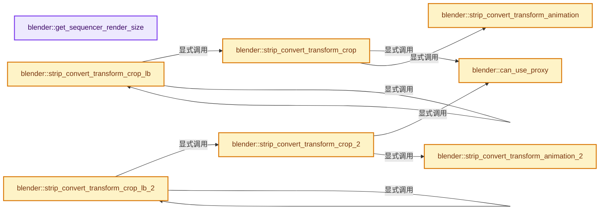
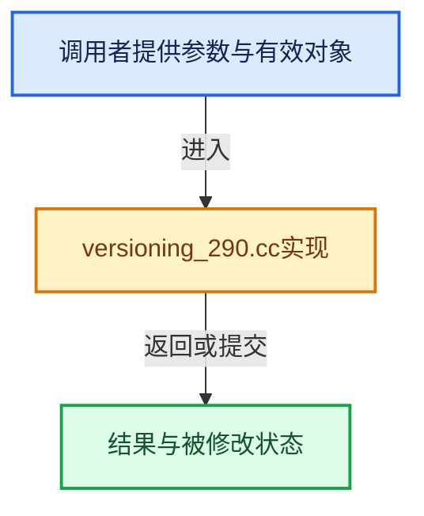

# 实现依赖专题：source/blender/blenloader/intern/versioning_290.cc

[实现依赖导航](../../../README.md) · [符号索引](../../../../00-课程指南/02-源码与提交索引/符号依赖与实现索引.md)

本专题从正文实际调用进入，集中保存共享实现。函数有稳定锚点，可从调用处直接跳到对应完整函数；递归与互相调用通过回链组织。

## 本文件的实现关系






## 完整成员与函数实现

<a id="f-088fd39c807ddd18"></a>

### `blender::get_sequencer_render_size`

实现位置：[source/blender/blenloader/intern/versioning_290.cc](../../../../../../../../source/blender/blenloader/intern/versioning_290.cc) · L91—L112。

接口参数：

- `Main *bmain`

**教学注释版**

<!-- annotated:03073f89fbaccf -->

```cpp
static eSpaceSeq_Proxy_RenderSize get_sequencer_render_size(Main *bmain)
{
  eSpaceSeq_Proxy_RenderSize render_size = eSpaceSeq_Proxy_RenderSize(100);

  for (bScreen &screen : bmain->screens) {
    for (ScrArea &area : screen.areabase) {
      for (SpaceLink &sl : area.spacedata) {
        switch (sl.spacetype) {
          case SPACE_SEQ: {
            SpaceSeq *sseq = reinterpret_cast<SpaceSeq *>(&sl);
            if (sseq->mainb == SEQ_DRAW_IMG_IMBUF) {
              render_size = eSpaceSeq_Proxy_RenderSize(sseq->render_size);
              break;
            }
          }
        }
      }
    }
  }

  return render_size;
}
```

<details>
<summary>核对原始源码：source/blender/blenloader/intern/versioning_290.cc · L91—L112</summary>

<!-- original:03073f89fbaccf:source/blender/blenloader/intern/versioning_290.cc:91:112 -->

```cpp
static eSpaceSeq_Proxy_RenderSize get_sequencer_render_size(Main *bmain)
{
  eSpaceSeq_Proxy_RenderSize render_size = eSpaceSeq_Proxy_RenderSize(100);

  for (bScreen &screen : bmain->screens) {
    for (ScrArea &area : screen.areabase) {
      for (SpaceLink &sl : area.spacedata) {
        switch (sl.spacetype) {
          case SPACE_SEQ: {
            SpaceSeq *sseq = reinterpret_cast<SpaceSeq *>(&sl);
            if (sseq->mainb == SEQ_DRAW_IMG_IMBUF) {
              render_size = eSpaceSeq_Proxy_RenderSize(sseq->render_size);
              break;
            }
          }
        }
      }
    }
  }

  return render_size;
}
```

</details>

**沿实际写入检查状态**

- `render_size = eSpaceSeq_Proxy_RenderSize(sseq->render_size);`

**结果出口**

- `return render_size;`

**继续追踪实现**

- `eSpaceSeq_Proxy_RenderSize` → [blender::eSpaceSeq_Proxy_RenderSize](../../makesdna/DNA_space_enums.h.md#t-54b54442e42f)。

<a id="f-5f3108a75b8cd86b"></a>

### `blender::can_use_proxy`

实现位置：[source/blender/blenloader/intern/versioning_290.cc](../../../../../../../../source/blender/blenloader/intern/versioning_290.cc) · L114—L122。

接口参数：

- `const Strip *strip`
- `IMB_Proxy_Size psize`

**教学注释版**

<!-- annotated:5c0f525c3b0f33 -->

```cpp
static bool can_use_proxy(const Strip *strip, IMB_Proxy_Size psize)
{
  if (strip->data->proxy == nullptr) {
    return false;
  }
  short size_flags = strip->data->proxy->build_size_flags;
  return (strip->flag & SEQ_USE_PROXY) != 0 && psize != IMB_PROXY_NONE &&
         (size_flags & psize) != 0;
}
```

<details>
<summary>核对原始源码：source/blender/blenloader/intern/versioning_290.cc · L114—L122</summary>

<!-- original:5c0f525c3b0f33:source/blender/blenloader/intern/versioning_290.cc:114:122 -->

```cpp
static bool can_use_proxy(const Strip *strip, IMB_Proxy_Size psize)
{
  if (strip->data->proxy == nullptr) {
    return false;
  }
  short size_flags = strip->data->proxy->build_size_flags;
  return (strip->flag & SEQ_USE_PROXY) != 0 && psize != IMB_PROXY_NONE &&
         (size_flags & psize) != 0;
}
```

</details>

**结果出口**

- `return false;`
- `return (strip->flag & SEQ_USE_PROXY) != 0 && psize != IMB_PROXY_NONE &&`

**继续追踪实现**

本实现没有需要继续展开的显式调用；检查返回表达式、对象转换和调用者前置条件。

<a id="f-86cd7166583904e6"></a>

### `blender::strip_convert_transform_animation`

实现位置：[source/blender/blenloader/intern/versioning_290.cc](../../../../../../../../source/blender/blenloader/intern/versioning_290.cc) · L125—L157。

接口参数：

- `const Strip *strip`
- `const Scene *scene`
- `const char *path`
- `const int image_size`
- `const int scene_size`

**教学注释版**

<!-- annotated:57d2980c806270 -->

```cpp
static void strip_convert_transform_animation(const Strip *strip,
                                              const Scene *scene,
                                              const char *path,
                                              const int image_size,
                                              const int scene_size)
{
  if (scene->adt == nullptr || scene->adt->action == nullptr) {
    return;
  }

  /* Hardcoded legacy bit-flags which has been removed. */
  const eStripFlag use_transform_flag = eStripFlag(1 << 16);
  const eStripFlag use_crop_flag = eStripFlag(1 << 17);

  /* Convert offset animation, but only if crop is not used. */
  if ((strip->flag & use_transform_flag) != 0 && (strip->flag & use_crop_flag) == 0) {
    FCurve *fcu = BKE_fcurve_find(&scene->adt->action->curves, path, 0);
    if (fcu != nullptr && !BKE_fcurve_is_empty(fcu)) {
      BezTriple *bezt = fcu->bezt;
      for (int i = 0; i < fcu->totvert; i++, bezt++) {
        /* Same math as with old_image_center_*, but simplified. */
        bezt->vec[0][1] = (image_size - scene_size) / 2 + bezt->vec[0][1];
        bezt->vec[1][1] = (image_size - scene_size) / 2 + bezt->vec[1][1];
        bezt->vec[2][1] = (image_size - scene_size) / 2 + bezt->vec[2][1];
      }
    }
  }
  else { /* Else, remove offset animation. */
    FCurve *fcu = BKE_fcurve_find(&scene->adt->action->curves, path, 0);
    BLI_remlink(&scene->adt->action->curves, fcu);
    BKE_fcurve_free(fcu);
  }
}
```

<details>
<summary>核对原始源码：source/blender/blenloader/intern/versioning_290.cc · L125—L157</summary>

<!-- original:57d2980c806270:source/blender/blenloader/intern/versioning_290.cc:125:157 -->

```cpp
static void strip_convert_transform_animation(const Strip *strip,
                                              const Scene *scene,
                                              const char *path,
                                              const int image_size,
                                              const int scene_size)
{
  if (scene->adt == nullptr || scene->adt->action == nullptr) {
    return;
  }

  /* Hardcoded legacy bit-flags which has been removed. */
  const eStripFlag use_transform_flag = eStripFlag(1 << 16);
  const eStripFlag use_crop_flag = eStripFlag(1 << 17);

  /* Convert offset animation, but only if crop is not used. */
  if ((strip->flag & use_transform_flag) != 0 && (strip->flag & use_crop_flag) == 0) {
    FCurve *fcu = BKE_fcurve_find(&scene->adt->action->curves, path, 0);
    if (fcu != nullptr && !BKE_fcurve_is_empty(fcu)) {
      BezTriple *bezt = fcu->bezt;
      for (int i = 0; i < fcu->totvert; i++, bezt++) {
        /* Same math as with old_image_center_*, but simplified. */
        bezt->vec[0][1] = (image_size - scene_size) / 2 + bezt->vec[0][1];
        bezt->vec[1][1] = (image_size - scene_size) / 2 + bezt->vec[1][1];
        bezt->vec[2][1] = (image_size - scene_size) / 2 + bezt->vec[2][1];
      }
    }
  }
  else { /* Else, remove offset animation. */
    FCurve *fcu = BKE_fcurve_find(&scene->adt->action->curves, path, 0);
    BLI_remlink(&scene->adt->action->curves, fcu);
    BKE_fcurve_free(fcu);
  }
}
```

</details>

**沿实际写入检查状态**

- `bezt->vec[0][1] = (image_size - scene_size) / 2 + bezt->vec[0][1];`
- `bezt->vec[1][1] = (image_size - scene_size) / 2 + bezt->vec[1][1];`
- `bezt->vec[2][1] = (image_size - scene_size) / 2 + bezt->vec[2][1];`

**继续追踪实现**

- `eStripFlag` → [blender::eStripFlag](../../makesdna/DNA_sequence_types.h.md#t-63369f1fc0c7)。
- `BKE_fcurve_find` → [blender::BKE_fcurve_find · L290](../../../02-BKE几何与数据/intern/fcurve.cc.md#f-8ed9925a0e597e12)。
- `BKE_fcurve_is_empty` → [blender::BKE_fcurve_is_empty · L2492](../../../02-BKE几何与数据/intern/fcurve.cc.md#f-d6df9e9e77afd03e)。
- `BLI_remlink` → [blender::BLI_remlink · L138](../../../01-BLI基础库/intern/listbase.cc.md#f-120d80f281ca4cb7)。
- `BKE_fcurve_free` → [blender::BKE_fcurve_free · L79](../../../02-BKE几何与数据/intern/fcurve.cc.md#f-1eca4335cbc9e0eb)。

<a id="f-7566bf21bf422df2"></a>

### `blender::strip_convert_transform_crop`

实现位置：[source/blender/blenloader/intern/versioning_290.cc](../../../../../../../../source/blender/blenloader/intern/versioning_290.cc) · L159—L265。

接口参数：

- `const Scene *scene`
- `Strip *strip`
- `const eSpaceSeq_Proxy_RenderSize render_size`

**教学注释版**

<!-- annotated:ed8eb5978a39eb -->

```cpp
static void strip_convert_transform_crop(const Scene *scene,
                                         Strip *strip,
                                         const eSpaceSeq_Proxy_RenderSize render_size)
{
  if (strip->data->transform == nullptr) {
    strip->data->transform = MEM_new<StripTransform>(__func__);
  }
  if (strip->data->crop == nullptr) {
    strip->data->crop = MEM_new<StripCrop>(__func__);
  }

  StripCrop *c = strip->data->crop;
  StripTransform *t = strip->data->transform;
  int old_image_center_x = scene->r.xsch / 2;
  int old_image_center_y = scene->r.ysch / 2;
  int image_size_x = scene->r.xsch;
  int image_size_y = scene->r.ysch;

  /* Hard-coded legacy bit-flags which have been removed. */
  const eStripFlag use_transform_flag = eStripFlag(1 << 16);
  const eStripFlag use_crop_flag = eStripFlag(1 << 17);

  const StripElem *s_elem = strip->data->stripdata;
  if (s_elem != nullptr) {
    image_size_x = s_elem->orig_width;
    image_size_y = s_elem->orig_height;

    if (can_use_proxy(strip, seq::rendersize_to_proxysize(render_size))) {
      image_size_x /= seq::rendersize_to_scale_factor(render_size);
      image_size_y /= seq::rendersize_to_scale_factor(render_size);
    }
  }

  /* Default scale. */
  if (t->scale_x == 0.0f && t->scale_y == 0.0f) {
    t->scale_x = 1.0f;
    t->scale_y = 1.0f;
  }

  /* Clear crop if it was unused. This must happen before converting values. */
  if ((strip->flag & use_crop_flag) == 0) {
    c->bottom = c->top = c->left = c->right = 0;
  }

  if ((strip->flag & use_transform_flag) == 0) {
    t->xofs = t->yofs = 0;

    /* Reverse scale to fit for strips not using offset. */
    float project_aspect = float(scene->r.xsch) / float(scene->r.ysch);
    float image_aspect = float(image_size_x) / float(image_size_y);
    if (project_aspect > image_aspect) {
      t->scale_x = project_aspect / image_aspect;
    }
    else {
      t->scale_y = image_aspect / project_aspect;
    }
  }

  if ((strip->flag & use_crop_flag) != 0 && (strip->flag & use_transform_flag) == 0) {
    /* Calculate image offset. */
    float s_x = scene->r.xsch / image_size_x;
    float s_y = scene->r.ysch / image_size_y;
    old_image_center_x += c->right * s_x - c->left * s_x;
    old_image_center_y += c->top * s_y - c->bottom * s_y;

    /* Convert crop to scale. */
    int cropped_image_size_x = image_size_x - c->right - c->left;
    int cropped_image_size_y = image_size_y - c->top - c->bottom;
    c->bottom = c->top = c->left = c->right = 0;
    t->scale_x *= float(image_size_x) / float(cropped_image_size_x);
    t->scale_y *= float(image_size_y) / float(cropped_image_size_y);
  }

  if ((strip->flag & use_transform_flag) != 0) {
    /* Convert image offset. */
    old_image_center_x = image_size_x / 2 - c->left + t->xofs;
    old_image_center_y = image_size_y / 2 - c->bottom + t->yofs;

    /* Preserve original image size. */
    // [讲解] std::max：按比较关系选取较大值。本讲解中的增长公式同时满足最低请求和几何增长；若保存返回引用，还需注意实参寿命。
    t->scale_x = t->scale_y = std::max(float(image_size_x) / float(scene->r.xsch),
                                       float(image_size_y) / float(scene->r.ysch));

    /* Convert crop. */
    if ((strip->flag & use_crop_flag) != 0) {
      c->top /= t->scale_x;
      c->bottom /= t->scale_x;
      c->left /= t->scale_x;
      c->right /= t->scale_x;
    }
  }

  t->xofs = old_image_center_x - scene->r.xsch / 2;
  t->yofs = old_image_center_y - scene->r.ysch / 2;

  char name_esc[(sizeof(strip->name) - 2) * 2], *path;
  BLI_str_escape(name_esc, strip->name + 2, sizeof(name_esc));

  path = BLI_sprintfN("sequence_editor.sequences_all[\"%s\"].transform.offset_x", name_esc);
  strip_convert_transform_animation(strip, scene, path, image_size_x, scene->r.xsch);
  MEM_delete(path);
  path = BLI_sprintfN("sequence_editor.sequences_all[\"%s\"].transform.offset_y", name_esc);
  strip_convert_transform_animation(strip, scene, path, image_size_y, scene->r.ysch);
  MEM_delete(path);

  strip->flag &= ~use_transform_flag;
  strip->flag &= ~use_crop_flag;
}
```

<details>
<summary>核对原始源码：source/blender/blenloader/intern/versioning_290.cc · L159—L265</summary>

<!-- original:ed8eb5978a39eb:source/blender/blenloader/intern/versioning_290.cc:159:265 -->

```cpp
static void strip_convert_transform_crop(const Scene *scene,
                                         Strip *strip,
                                         const eSpaceSeq_Proxy_RenderSize render_size)
{
  if (strip->data->transform == nullptr) {
    strip->data->transform = MEM_new<StripTransform>(__func__);
  }
  if (strip->data->crop == nullptr) {
    strip->data->crop = MEM_new<StripCrop>(__func__);
  }

  StripCrop *c = strip->data->crop;
  StripTransform *t = strip->data->transform;
  int old_image_center_x = scene->r.xsch / 2;
  int old_image_center_y = scene->r.ysch / 2;
  int image_size_x = scene->r.xsch;
  int image_size_y = scene->r.ysch;

  /* Hard-coded legacy bit-flags which have been removed. */
  const eStripFlag use_transform_flag = eStripFlag(1 << 16);
  const eStripFlag use_crop_flag = eStripFlag(1 << 17);

  const StripElem *s_elem = strip->data->stripdata;
  if (s_elem != nullptr) {
    image_size_x = s_elem->orig_width;
    image_size_y = s_elem->orig_height;

    if (can_use_proxy(strip, seq::rendersize_to_proxysize(render_size))) {
      image_size_x /= seq::rendersize_to_scale_factor(render_size);
      image_size_y /= seq::rendersize_to_scale_factor(render_size);
    }
  }

  /* Default scale. */
  if (t->scale_x == 0.0f && t->scale_y == 0.0f) {
    t->scale_x = 1.0f;
    t->scale_y = 1.0f;
  }

  /* Clear crop if it was unused. This must happen before converting values. */
  if ((strip->flag & use_crop_flag) == 0) {
    c->bottom = c->top = c->left = c->right = 0;
  }

  if ((strip->flag & use_transform_flag) == 0) {
    t->xofs = t->yofs = 0;

    /* Reverse scale to fit for strips not using offset. */
    float project_aspect = float(scene->r.xsch) / float(scene->r.ysch);
    float image_aspect = float(image_size_x) / float(image_size_y);
    if (project_aspect > image_aspect) {
      t->scale_x = project_aspect / image_aspect;
    }
    else {
      t->scale_y = image_aspect / project_aspect;
    }
  }

  if ((strip->flag & use_crop_flag) != 0 && (strip->flag & use_transform_flag) == 0) {
    /* Calculate image offset. */
    float s_x = scene->r.xsch / image_size_x;
    float s_y = scene->r.ysch / image_size_y;
    old_image_center_x += c->right * s_x - c->left * s_x;
    old_image_center_y += c->top * s_y - c->bottom * s_y;

    /* Convert crop to scale. */
    int cropped_image_size_x = image_size_x - c->right - c->left;
    int cropped_image_size_y = image_size_y - c->top - c->bottom;
    c->bottom = c->top = c->left = c->right = 0;
    t->scale_x *= float(image_size_x) / float(cropped_image_size_x);
    t->scale_y *= float(image_size_y) / float(cropped_image_size_y);
  }

  if ((strip->flag & use_transform_flag) != 0) {
    /* Convert image offset. */
    old_image_center_x = image_size_x / 2 - c->left + t->xofs;
    old_image_center_y = image_size_y / 2 - c->bottom + t->yofs;

    /* Preserve original image size. */
    t->scale_x = t->scale_y = std::max(float(image_size_x) / float(scene->r.xsch),
                                       float(image_size_y) / float(scene->r.ysch));

    /* Convert crop. */
    if ((strip->flag & use_crop_flag) != 0) {
      c->top /= t->scale_x;
      c->bottom /= t->scale_x;
      c->left /= t->scale_x;
      c->right /= t->scale_x;
    }
  }

  t->xofs = old_image_center_x - scene->r.xsch / 2;
  t->yofs = old_image_center_y - scene->r.ysch / 2;

  char name_esc[(sizeof(strip->name) - 2) * 2], *path;
  BLI_str_escape(name_esc, strip->name + 2, sizeof(name_esc));

  path = BLI_sprintfN("sequence_editor.sequences_all[\"%s\"].transform.offset_x", name_esc);
  strip_convert_transform_animation(strip, scene, path, image_size_x, scene->r.xsch);
  MEM_delete(path);
  path = BLI_sprintfN("sequence_editor.sequences_all[\"%s\"].transform.offset_y", name_esc);
  strip_convert_transform_animation(strip, scene, path, image_size_y, scene->r.ysch);
  MEM_delete(path);

  strip->flag &= ~use_transform_flag;
  strip->flag &= ~use_crop_flag;
}
```

</details>

**沿实际写入检查状态**

- `strip->data->transform = MEM_new<StripTransform>(__func__);`
- `strip->data->crop = MEM_new<StripCrop>(__func__);`
- `image_size_x = s_elem->orig_width;`
- `image_size_y = s_elem->orig_height;`
- `t->scale_x = 1.0f;`
- `t->scale_y = 1.0f;`
- `c->bottom = c->top = c->left = c->right = 0;`
- `t->xofs = t->yofs = 0;`
- `t->scale_x = project_aspect / image_aspect;`
- `t->scale_y = image_aspect / project_aspect;`
- `old_image_center_x += c->right * s_x - c->left * s_x;`
- `old_image_center_y += c->top * s_y - c->bottom * s_y;`
- `t->scale_x *= float(image_size_x) / float(cropped_image_size_x);`
- `t->scale_y *= float(image_size_y) / float(cropped_image_size_y);`
- `old_image_center_x = image_size_x / 2 - c->left + t->xofs;`
- `old_image_center_y = image_size_y / 2 - c->bottom + t->yofs;`
- `t->scale_x = t->scale_y = std::max(float(image_size_x) / float(scene->r.xsch),`
- `t->xofs = old_image_center_x - scene->r.xsch / 2;`
- `t->yofs = old_image_center_y - scene->r.ysch / 2;`
- `path = BLI_sprintfN("sequence_editor.sequences_all[\"%s\"].transform.offset_x", name_esc);`
- `path = BLI_sprintfN("sequence_editor.sequences_all[\"%s\"].transform.offset_y", name_esc);`
- `strip->flag &= ~use_transform_flag;`
- `strip->flag &= ~use_crop_flag;`

**继续追踪实现**

- `MEM_new<StripTransform>` → [MEM_new · L351](../../../07-Intern运行时与平台/guardedalloc/MEM_guardedalloc.h.md#f-115f9b6784f89912)。
- `MEM_new<StripCrop>` → [MEM_new · L351](../../../07-Intern运行时与平台/guardedalloc/MEM_guardedalloc.h.md#f-115f9b6784f89912)。
- `eStripFlag` → [blender::eStripFlag](../../makesdna/DNA_sequence_types.h.md#t-63369f1fc0c7)。
- `can_use_proxy` → [blender::can_use_proxy · L114](versioning_290.cc.md#f-5f3108a75b8cd86b)。
- `seq::rendersize_to_proxysize` → [blender::seq::rendersize_to_proxysize · L137](../../sequencer/intern/proxy.cc.md#f-6dc1181f407c5fca)。
- `seq::rendersize_to_scale_factor` → [blender::seq::rendersize_to_scale_factor · L153](../../sequencer/intern/proxy.cc.md#f-12b59564fd33774e)。
- `std::max` → [外部契约](https://eel.is/c++draft/alg.min.max)：按比较关系选取较大值。本讲解中的增长公式同时满足最低请求和几何增长；若保存返回引用，还需注意实参寿命。
- `BLI_str_escape` → [blender::BLI_str_escape · L335](../../../01-BLI基础库/intern/string.cc.md#f-ade392f6fb397ef6)；[blender::BLI_str_escape · L366](../../../01-BLI基础库/intern/string.cc.md#f-56725a2c129075c6)。同名重载需按实参类型选择。
- `BLI_sprintfN` → [blender::BLI_sprintfN · L296](../../../01-BLI基础库/intern/string.cc.md#f-bfbc2f7076298fc0)。
- `strip_convert_transform_animation` → [blender::strip_convert_transform_animation · L125](versioning_290.cc.md#f-86cd7166583904e6)。
- `MEM_delete` → [MEM_delete · L400](../../../07-Intern运行时与平台/guardedalloc/MEM_guardedalloc.h.md#f-9049ffdd1682887c)。

<a id="f-bcc01afe1aa22f2a"></a>

### `blender::strip_convert_transform_crop_lb`

实现位置：[source/blender/blenloader/intern/versioning_290.cc](../../../../../../../../source/blender/blenloader/intern/versioning_290.cc) · L267—L280。

接口参数：

- `const Scene *scene`
- `const ListBaseT<Strip> *lb`
- `const eSpaceSeq_Proxy_RenderSize render_size`

**教学注释版**

<!-- annotated:dd920483963f63 -->

```cpp
static void strip_convert_transform_crop_lb(const Scene *scene,
                                            const ListBaseT<Strip> *lb,
                                            const eSpaceSeq_Proxy_RenderSize render_size)
{

  for (Strip &strip : *lb) {
    if (!ELEM(strip.type, STRIP_TYPE_SOUND, STRIP_TYPE_SOUND_HD)) {
      strip_convert_transform_crop(scene, &strip, render_size);
    }
    if (strip.type == STRIP_TYPE_META) {
      strip_convert_transform_crop_lb(scene, &strip.seqbase, render_size);
    }
  }
}
```

<details>
<summary>核对原始源码：source/blender/blenloader/intern/versioning_290.cc · L267—L280</summary>

<!-- original:dd920483963f63:source/blender/blenloader/intern/versioning_290.cc:267:280 -->

```cpp
static void strip_convert_transform_crop_lb(const Scene *scene,
                                            const ListBaseT<Strip> *lb,
                                            const eSpaceSeq_Proxy_RenderSize render_size)
{

  for (Strip &strip : *lb) {
    if (!ELEM(strip.type, STRIP_TYPE_SOUND, STRIP_TYPE_SOUND_HD)) {
      strip_convert_transform_crop(scene, &strip, render_size);
    }
    if (strip.type == STRIP_TYPE_META) {
      strip_convert_transform_crop_lb(scene, &strip.seqbase, render_size);
    }
  }
}
```

</details>

**继续追踪实现**

- `ELEM` → [ELEM · L88](../../../07-Intern运行时与平台/ghost/intern/GHOST_utildefines.hh.md#m-d28724a15928)；[ELEM · L135](../../../01-BLI基础库/BLI_utildefines.hh.md#m-d6572de7cae0)。宏定义由构建条件选择。
- `strip_convert_transform_crop` → [blender::strip_convert_transform_crop · L159](versioning_290.cc.md#f-7566bf21bf422df2)。
- `strip_convert_transform_crop_lb` → [blender::strip_convert_transform_crop_lb · L267](versioning_290.cc.md#f-bcc01afe1aa22f2a)。

<a id="f-65958e75c076ada4"></a>

### `blender::strip_convert_transform_animation_2`

实现位置：[source/blender/blenloader/intern/versioning_290.cc](../../../../../../../../source/blender/blenloader/intern/versioning_290.cc) · L282—L300。

接口参数：

- `const Scene *scene`
- `const char *path`
- `const float scale_to_fit_factor`

**教学注释版**

<!-- annotated:86295ccfc5ab73 -->

```cpp
static void strip_convert_transform_animation_2(const Scene *scene,
                                                const char *path,
                                                const float scale_to_fit_factor)
{
  if (scene->adt == nullptr || scene->adt->action == nullptr) {
    return;
  }

  FCurve *fcu = BKE_fcurve_find(&scene->adt->action->curves, path, 0);
  if (fcu != nullptr && !BKE_fcurve_is_empty(fcu)) {
    BezTriple *bezt = fcu->bezt;
    for (int i = 0; i < fcu->totvert; i++, bezt++) {
      /* Same math as with old_image_center_*, but simplified. */
      bezt->vec[0][1] *= scale_to_fit_factor;
      bezt->vec[1][1] *= scale_to_fit_factor;
      bezt->vec[2][1] *= scale_to_fit_factor;
    }
  }
}
```

<details>
<summary>核对原始源码：source/blender/blenloader/intern/versioning_290.cc · L282—L300</summary>

<!-- original:86295ccfc5ab73:source/blender/blenloader/intern/versioning_290.cc:282:300 -->

```cpp
static void strip_convert_transform_animation_2(const Scene *scene,
                                                const char *path,
                                                const float scale_to_fit_factor)
{
  if (scene->adt == nullptr || scene->adt->action == nullptr) {
    return;
  }

  FCurve *fcu = BKE_fcurve_find(&scene->adt->action->curves, path, 0);
  if (fcu != nullptr && !BKE_fcurve_is_empty(fcu)) {
    BezTriple *bezt = fcu->bezt;
    for (int i = 0; i < fcu->totvert; i++, bezt++) {
      /* Same math as with old_image_center_*, but simplified. */
      bezt->vec[0][1] *= scale_to_fit_factor;
      bezt->vec[1][1] *= scale_to_fit_factor;
      bezt->vec[2][1] *= scale_to_fit_factor;
    }
  }
}
```

</details>

**沿实际写入检查状态**

- `bezt->vec[0][1] *= scale_to_fit_factor;`
- `bezt->vec[1][1] *= scale_to_fit_factor;`
- `bezt->vec[2][1] *= scale_to_fit_factor;`

**继续追踪实现**

- `BKE_fcurve_find` → [blender::BKE_fcurve_find · L290](../../../02-BKE几何与数据/intern/fcurve.cc.md#f-8ed9925a0e597e12)。
- `BKE_fcurve_is_empty` → [blender::BKE_fcurve_is_empty · L2492](../../../02-BKE几何与数据/intern/fcurve.cc.md#f-d6df9e9e77afd03e)。

<a id="f-5a1e29091129f863"></a>

### `blender::strip_convert_transform_crop_2`

实现位置：[source/blender/blenloader/intern/versioning_290.cc](../../../../../../../../source/blender/blenloader/intern/versioning_290.cc) · L302—L351。

接口参数：

- `const Scene *scene`
- `Strip *strip`
- `const eSpaceSeq_Proxy_RenderSize render_size`

**教学注释版**

<!-- annotated:3f7b2d3c08d1c3 -->

```cpp
static void strip_convert_transform_crop_2(const Scene *scene,
                                           Strip *strip,
                                           const eSpaceSeq_Proxy_RenderSize render_size)
{
  const StripElem *s_elem = strip->data->stripdata;
  if (s_elem == nullptr) {
    return;
  }

  StripCrop *c = strip->data->crop;
  StripTransform *t = strip->data->transform;
  int image_size_x = s_elem->orig_width;
  int image_size_y = s_elem->orig_height;

  if (can_use_proxy(strip, seq::rendersize_to_proxysize(render_size))) {
    image_size_x /= seq::rendersize_to_scale_factor(render_size);
    image_size_y /= seq::rendersize_to_scale_factor(render_size);
  }

  /* Calculate scale factor, so image fits in preview area with original aspect ratio. */
  // [讲解] std::min：按比较关系选取较小值；截断范围时还需先满足非负和可表示范围，min本身不会证明边界安全。
  const float scale_to_fit_factor = std::min(float(scene->r.xsch) / float(image_size_x),
                                             float(scene->r.ysch) / float(image_size_y));
  t->scale_x *= scale_to_fit_factor;
  t->scale_y *= scale_to_fit_factor;
  c->top /= scale_to_fit_factor;
  c->bottom /= scale_to_fit_factor;
  c->left /= scale_to_fit_factor;
  c->right /= scale_to_fit_factor;

  char name_esc[(sizeof(strip->name) - 2) * 2], *path;
  BLI_str_escape(name_esc, strip->name + 2, sizeof(name_esc));
  path = BLI_sprintfN("sequence_editor.sequences_all[\"%s\"].transform.scale_x", name_esc);
  strip_convert_transform_animation_2(scene, path, scale_to_fit_factor);
  MEM_delete(path);
  path = BLI_sprintfN("sequence_editor.sequences_all[\"%s\"].transform.scale_y", name_esc);
  strip_convert_transform_animation_2(scene, path, scale_to_fit_factor);
  MEM_delete(path);
  path = BLI_sprintfN("sequence_editor.sequences_all[\"%s\"].crop.min_x", name_esc);
  strip_convert_transform_animation_2(scene, path, 1 / scale_to_fit_factor);
  MEM_delete(path);
  path = BLI_sprintfN("sequence_editor.sequences_all[\"%s\"].crop.max_x", name_esc);
  strip_convert_transform_animation_2(scene, path, 1 / scale_to_fit_factor);
  MEM_delete(path);
  path = BLI_sprintfN("sequence_editor.sequences_all[\"%s\"].crop.min_y", name_esc);
  strip_convert_transform_animation_2(scene, path, 1 / scale_to_fit_factor);
  MEM_delete(path);
  path = BLI_sprintfN("sequence_editor.sequences_all[\"%s\"].crop.max_x", name_esc);
  strip_convert_transform_animation_2(scene, path, 1 / scale_to_fit_factor);
  MEM_delete(path);
}
```

<details>
<summary>核对原始源码：source/blender/blenloader/intern/versioning_290.cc · L302—L351</summary>

<!-- original:3f7b2d3c08d1c3:source/blender/blenloader/intern/versioning_290.cc:302:351 -->

```cpp
static void strip_convert_transform_crop_2(const Scene *scene,
                                           Strip *strip,
                                           const eSpaceSeq_Proxy_RenderSize render_size)
{
  const StripElem *s_elem = strip->data->stripdata;
  if (s_elem == nullptr) {
    return;
  }

  StripCrop *c = strip->data->crop;
  StripTransform *t = strip->data->transform;
  int image_size_x = s_elem->orig_width;
  int image_size_y = s_elem->orig_height;

  if (can_use_proxy(strip, seq::rendersize_to_proxysize(render_size))) {
    image_size_x /= seq::rendersize_to_scale_factor(render_size);
    image_size_y /= seq::rendersize_to_scale_factor(render_size);
  }

  /* Calculate scale factor, so image fits in preview area with original aspect ratio. */
  const float scale_to_fit_factor = std::min(float(scene->r.xsch) / float(image_size_x),
                                             float(scene->r.ysch) / float(image_size_y));
  t->scale_x *= scale_to_fit_factor;
  t->scale_y *= scale_to_fit_factor;
  c->top /= scale_to_fit_factor;
  c->bottom /= scale_to_fit_factor;
  c->left /= scale_to_fit_factor;
  c->right /= scale_to_fit_factor;

  char name_esc[(sizeof(strip->name) - 2) * 2], *path;
  BLI_str_escape(name_esc, strip->name + 2, sizeof(name_esc));
  path = BLI_sprintfN("sequence_editor.sequences_all[\"%s\"].transform.scale_x", name_esc);
  strip_convert_transform_animation_2(scene, path, scale_to_fit_factor);
  MEM_delete(path);
  path = BLI_sprintfN("sequence_editor.sequences_all[\"%s\"].transform.scale_y", name_esc);
  strip_convert_transform_animation_2(scene, path, scale_to_fit_factor);
  MEM_delete(path);
  path = BLI_sprintfN("sequence_editor.sequences_all[\"%s\"].crop.min_x", name_esc);
  strip_convert_transform_animation_2(scene, path, 1 / scale_to_fit_factor);
  MEM_delete(path);
  path = BLI_sprintfN("sequence_editor.sequences_all[\"%s\"].crop.max_x", name_esc);
  strip_convert_transform_animation_2(scene, path, 1 / scale_to_fit_factor);
  MEM_delete(path);
  path = BLI_sprintfN("sequence_editor.sequences_all[\"%s\"].crop.min_y", name_esc);
  strip_convert_transform_animation_2(scene, path, 1 / scale_to_fit_factor);
  MEM_delete(path);
  path = BLI_sprintfN("sequence_editor.sequences_all[\"%s\"].crop.max_x", name_esc);
  strip_convert_transform_animation_2(scene, path, 1 / scale_to_fit_factor);
  MEM_delete(path);
}
```

</details>

**沿实际写入检查状态**

- `t->scale_x *= scale_to_fit_factor;`
- `t->scale_y *= scale_to_fit_factor;`
- `path = BLI_sprintfN("sequence_editor.sequences_all[\"%s\"].transform.scale_x", name_esc);`
- `path = BLI_sprintfN("sequence_editor.sequences_all[\"%s\"].transform.scale_y", name_esc);`
- `path = BLI_sprintfN("sequence_editor.sequences_all[\"%s\"].crop.min_x", name_esc);`
- `path = BLI_sprintfN("sequence_editor.sequences_all[\"%s\"].crop.max_x", name_esc);`
- `path = BLI_sprintfN("sequence_editor.sequences_all[\"%s\"].crop.min_y", name_esc);`

**继续追踪实现**

- `can_use_proxy` → [blender::can_use_proxy · L114](versioning_290.cc.md#f-5f3108a75b8cd86b)。
- `seq::rendersize_to_proxysize` → [blender::seq::rendersize_to_proxysize · L137](../../sequencer/intern/proxy.cc.md#f-6dc1181f407c5fca)。
- `seq::rendersize_to_scale_factor` → [blender::seq::rendersize_to_scale_factor · L153](../../sequencer/intern/proxy.cc.md#f-12b59564fd33774e)。
- `std::min` → [外部契约](https://eel.is/c++draft/alg.min.max)：按比较关系选取较小值；截断范围时还需先满足非负和可表示范围，min本身不会证明边界安全。
- `BLI_str_escape` → [blender::BLI_str_escape · L335](../../../01-BLI基础库/intern/string.cc.md#f-ade392f6fb397ef6)；[blender::BLI_str_escape · L366](../../../01-BLI基础库/intern/string.cc.md#f-56725a2c129075c6)。同名重载需按实参类型选择。
- `BLI_sprintfN` → [blender::BLI_sprintfN · L296](../../../01-BLI基础库/intern/string.cc.md#f-bfbc2f7076298fc0)。
- `strip_convert_transform_animation_2` → [blender::strip_convert_transform_animation_2 · L282](versioning_290.cc.md#f-65958e75c076ada4)。
- `MEM_delete` → [MEM_delete · L400](../../../07-Intern运行时与平台/guardedalloc/MEM_guardedalloc.h.md#f-9049ffdd1682887c)。

<a id="f-c06d7a571b9ddec8"></a>

### `blender::strip_convert_transform_crop_lb_2`

实现位置：[source/blender/blenloader/intern/versioning_290.cc](../../../../../../../../source/blender/blenloader/intern/versioning_290.cc) · L353—L366。

接口参数：

- `const Scene *scene`
- `const ListBaseT<Strip> *lb`
- `const eSpaceSeq_Proxy_RenderSize render_size`

**教学注释版**

<!-- annotated:e62c851157f18a -->

```cpp
static void strip_convert_transform_crop_lb_2(const Scene *scene,
                                              const ListBaseT<Strip> *lb,
                                              const eSpaceSeq_Proxy_RenderSize render_size)
{

  for (Strip &strip : *lb) {
    if (!ELEM(strip.type, STRIP_TYPE_SOUND, STRIP_TYPE_SOUND_HD)) {
      strip_convert_transform_crop_2(scene, &strip, render_size);
    }
    if (strip.type == STRIP_TYPE_META) {
      strip_convert_transform_crop_lb_2(scene, &strip.seqbase, render_size);
    }
  }
}
```

<details>
<summary>核对原始源码：source/blender/blenloader/intern/versioning_290.cc · L353—L366</summary>

<!-- original:e62c851157f18a:source/blender/blenloader/intern/versioning_290.cc:353:366 -->

```cpp
static void strip_convert_transform_crop_lb_2(const Scene *scene,
                                              const ListBaseT<Strip> *lb,
                                              const eSpaceSeq_Proxy_RenderSize render_size)
{

  for (Strip &strip : *lb) {
    if (!ELEM(strip.type, STRIP_TYPE_SOUND, STRIP_TYPE_SOUND_HD)) {
      strip_convert_transform_crop_2(scene, &strip, render_size);
    }
    if (strip.type == STRIP_TYPE_META) {
      strip_convert_transform_crop_lb_2(scene, &strip.seqbase, render_size);
    }
  }
}
```

</details>

**继续追踪实现**

- `ELEM` → [ELEM · L88](../../../07-Intern运行时与平台/ghost/intern/GHOST_utildefines.hh.md#m-d28724a15928)；[ELEM · L135](../../../01-BLI基础库/BLI_utildefines.hh.md#m-d6572de7cae0)。宏定义由构建条件选择。
- `strip_convert_transform_crop_2` → [blender::strip_convert_transform_crop_2 · L302](versioning_290.cc.md#f-5a1e29091129f863)。
- `strip_convert_transform_crop_lb_2` → [blender::strip_convert_transform_crop_lb_2 · L353](versioning_290.cc.md#f-c06d7a571b9ddec8)。

<a id="f-fc8ea6a07ea578f3"></a>

### `blender::seq_update_meta_disp_range`

实现位置：[source/blender/blenloader/intern/versioning_290.cc](../../../../../../../../source/blender/blenloader/intern/versioning_290.cc) · L368—L399。

接口参数：

- `Scene *scene`

**教学注释版**

<!-- annotated:11143872967af1 -->

```cpp
static void seq_update_meta_disp_range(Scene *scene)
{
  Editing *ed = seq::editing_get(scene);

  if (ed == nullptr) {
    return;
  }

  for (MetaStack &ms : ed->metastack.items_reversed()) {
    /* Update ms->disp_range from meta. */
    if (ms.disp_range[0] == ms.disp_range[1]) {
      ms.disp_range[0] = ms.parent_strip->left_handle();
      ms.disp_range[1] = ms.parent_strip->right_handle(scene);
    }

    /* Update meta strip endpoints. */
    ms.parent_strip->left_handle_set(scene, ms.disp_range[0]);
    ms.parent_strip->right_handle_set(scene, ms.disp_range[1]);

    /* Recalculate effects using meta strip. */
    ListBaseT<Strip> *old_seqbasep = ms.old_strip ? &ms.old_strip->seqbase : &ed->seqbase;
    for (Strip &strip : *old_seqbasep) {
      if (strip.input2) {
        strip.start = strip.startdisp = max_ii(strip.input1->startdisp, strip.input2->startdisp);
        strip.enddisp = min_ii(strip.input1->enddisp, strip.input2->enddisp);
      }
    }

    MetaStack *active_ms = seq::meta_stack_active_get(ed);
    active_ms->old_strip = ms.parent_strip;
  }
}
```

<details>
<summary>核对原始源码：source/blender/blenloader/intern/versioning_290.cc · L368—L399</summary>

<!-- original:11143872967af1:source/blender/blenloader/intern/versioning_290.cc:368:399 -->

```cpp
static void seq_update_meta_disp_range(Scene *scene)
{
  Editing *ed = seq::editing_get(scene);

  if (ed == nullptr) {
    return;
  }

  for (MetaStack &ms : ed->metastack.items_reversed()) {
    /* Update ms->disp_range from meta. */
    if (ms.disp_range[0] == ms.disp_range[1]) {
      ms.disp_range[0] = ms.parent_strip->left_handle();
      ms.disp_range[1] = ms.parent_strip->right_handle(scene);
    }

    /* Update meta strip endpoints. */
    ms.parent_strip->left_handle_set(scene, ms.disp_range[0]);
    ms.parent_strip->right_handle_set(scene, ms.disp_range[1]);

    /* Recalculate effects using meta strip. */
    ListBaseT<Strip> *old_seqbasep = ms.old_strip ? &ms.old_strip->seqbase : &ed->seqbase;
    for (Strip &strip : *old_seqbasep) {
      if (strip.input2) {
        strip.start = strip.startdisp = max_ii(strip.input1->startdisp, strip.input2->startdisp);
        strip.enddisp = min_ii(strip.input1->enddisp, strip.input2->enddisp);
      }
    }

    MetaStack *active_ms = seq::meta_stack_active_get(ed);
    active_ms->old_strip = ms.parent_strip;
  }
}
```

</details>

**沿实际写入检查状态**

- `ms.disp_range[0] = ms.parent_strip->left_handle();`
- `ms.disp_range[1] = ms.parent_strip->right_handle(scene);`
- `strip.start = strip.startdisp = max_ii(strip.input1->startdisp, strip.input2->startdisp);`
- `strip.enddisp = min_ii(strip.input1->enddisp, strip.input2->enddisp);`
- `active_ms->old_strip = ms.parent_strip;`

**继续追踪实现**

- `seq::editing_get` → [blender::seq::editing_get · L304](../../sequencer/intern/sequencer.cc.md#f-6332e57a33c5dd16)。
- `ed->metastack.items_reversed` → [调用协议](../../../../00-课程指南/01-路线与规范/模板宏与动态分派协议.md)：接收对象类型依赖auto、返回值或模板实例；不按同名猜测目标。调用位置L376。
- `ms.parent_strip->left_handle` → [调用协议](../../../../00-课程指南/01-路线与规范/模板宏与动态分派协议.md)：接收对象类型依赖auto、返回值或模板实例；不按同名猜测目标。调用位置L379。
- `ms.parent_strip->right_handle` → [调用协议](../../../../00-课程指南/01-路线与规范/模板宏与动态分派协议.md)：接收对象类型依赖auto、返回值或模板实例；不按同名猜测目标。调用位置L380。
- `ms.parent_strip->left_handle_set` → [调用协议](../../../../00-课程指南/01-路线与规范/模板宏与动态分派协议.md)：接收对象类型依赖auto、返回值或模板实例；不按同名猜测目标。调用位置L384。
- `ms.parent_strip->right_handle_set` → [调用协议](../../../../00-课程指南/01-路线与规范/模板宏与动态分派协议.md)：接收对象类型依赖auto、返回值或模板实例；不按同名猜测目标。调用位置L385。
- `max_ii` → [blender::max_ii · L368](../../../01-BLI基础库/intern/math_base_inline.cc.md#f-c45aa7b373adb94c)。
- `min_ii` → [blender::min_ii · L364](../../../01-BLI基础库/intern/math_base_inline.cc.md#f-30336db35b2810b8)。
- `seq::meta_stack_active_get` → [blender::seq::meta_stack_active_get · L484](../../sequencer/intern/sequencer.cc.md#f-38c94c63236ad8aa)。

<a id="f-56d35a930683fa5a"></a>

### `blender::version_node_socket_duplicate`

实现位置：[source/blender/blenloader/intern/versioning_290.cc](../../../../../../../../source/blender/blenloader/intern/versioning_290.cc) · L401—L430。

接口参数：

- `bNodeTree *ntree`
- `const int node_type`
- `const char *old_name`
- `const char *new_name`

**教学注释版**

<!-- annotated:528d938f61c036 -->

```cpp
static void version_node_socket_duplicate(bNodeTree *ntree,
                                          const int node_type,
                                          const char *old_name,
                                          const char *new_name)
{
  /* Duplicate a link going into the original socket. */
  for (bNodeLink &link : ntree->links.items_mutable()) {
    if (link.tonode->type_legacy == node_type) {
      bNode *node = link.tonode;
      bNodeSocket *dest_socket = bke::node_find_socket(*node, SOCK_IN, UString(new_name));
      BLI_assert(dest_socket);
      if (STREQ(link.tosock->name, old_name)) {
        bke::node_add_link(*ntree, *link.fromnode, *link.fromsock, *node, *dest_socket);
      }
    }
  }

  /* Duplicate the default value from the old socket and assign it to the new socket. */
  for (bNode &node : ntree->nodes) {
    if (node.type_legacy == node_type) {
      bNodeSocket *source_socket = bke::node_find_socket(node, SOCK_IN, UString(old_name));
      bNodeSocket *dest_socket = bke::node_find_socket(node, SOCK_IN, UString(new_name));
      BLI_assert(source_socket && dest_socket);
      if (dest_socket->default_value) {
        // [讲解] MEM_delete_void：以原始存储释放约定调用当前后端。
        MEM_delete_void(dest_socket->default_value);
      }
      dest_socket->default_value = MEM_dupalloc_void(source_socket->default_value);
    }
  }
}
```

<details>
<summary>核对原始源码：source/blender/blenloader/intern/versioning_290.cc · L401—L430</summary>

<!-- original:528d938f61c036:source/blender/blenloader/intern/versioning_290.cc:401:430 -->

```cpp
static void version_node_socket_duplicate(bNodeTree *ntree,
                                          const int node_type,
                                          const char *old_name,
                                          const char *new_name)
{
  /* Duplicate a link going into the original socket. */
  for (bNodeLink &link : ntree->links.items_mutable()) {
    if (link.tonode->type_legacy == node_type) {
      bNode *node = link.tonode;
      bNodeSocket *dest_socket = bke::node_find_socket(*node, SOCK_IN, UString(new_name));
      BLI_assert(dest_socket);
      if (STREQ(link.tosock->name, old_name)) {
        bke::node_add_link(*ntree, *link.fromnode, *link.fromsock, *node, *dest_socket);
      }
    }
  }

  /* Duplicate the default value from the old socket and assign it to the new socket. */
  for (bNode &node : ntree->nodes) {
    if (node.type_legacy == node_type) {
      bNodeSocket *source_socket = bke::node_find_socket(node, SOCK_IN, UString(old_name));
      bNodeSocket *dest_socket = bke::node_find_socket(node, SOCK_IN, UString(new_name));
      BLI_assert(source_socket && dest_socket);
      if (dest_socket->default_value) {
        MEM_delete_void(dest_socket->default_value);
      }
      dest_socket->default_value = MEM_dupalloc_void(source_socket->default_value);
    }
  }
}
```

</details>

**沿实际写入检查状态**

- `dest_socket->default_value = MEM_dupalloc_void(source_socket->default_value);`

**继续追踪实现**

- `ntree->links.items_mutable` → [调用协议](../../../../00-课程指南/01-路线与规范/模板宏与动态分派协议.md)：接收对象类型依赖auto、返回值或模板实例；不按同名猜测目标。调用位置L407。
- `bke::node_find_socket` → [blender::bke::node_find_socket · L3036](../../../02-BKE几何与数据/intern/node.cc.md#f-cbf9dec71aff5b59)；[blender::bke::node_find_socket · L3047](../../../02-BKE几何与数据/intern/node.cc.md#f-4a7a677634b7fbd1)。同名重载需按实参类型选择。
- `UString` → [blender::UString::UString · L65](../../../01-BLI基础库/BLI_ustring.hh.md#f-af044c001f6ab696)；[blender::UString::UString · L68](../../../01-BLI基础库/BLI_ustring.hh.md#f-acdd59bd65bf3333)；[blender::UString::UString · L69](../../../01-BLI基础库/BLI_ustring.hh.md#f-bc4cac73ffd771a5)。同名重载需按实参类型选择。
- `BLI_assert` → [BLI_assert · L48](../../../01-BLI基础库/BLI_assert.hh.md#m-57a88495704d)；[BLI_assert · L63](../../../01-BLI基础库/BLI_assert.hh.md#m-d07050020cb5)。宏定义由构建条件选择。
- `STREQ` → [STREQ · L112](../../../07-Intern运行时与平台/ghost/intern/GHOST_utildefines.hh.md#m-9549fb6aafd2)；[STREQ · L451](../../../01-BLI基础库/BLI_utildefines.hh.md#m-c7b745bcfad2)；[STREQ · L55](../../../07-Intern运行时与平台/clog/clog.cc.md#m-96e78f386894)。宏定义由构建条件选择。
- `bke::node_add_link` → [blender::bke::node_add_link · L4638](../../../02-BKE几何与数据/intern/node.cc.md#f-e4b0f883348f0d24)。
- `MEM_delete_void` → [MEM_delete_void · L647](../../../07-Intern运行时与平台/guardedalloc/MEM_guardedalloc.h.md#f-642896c7c62ff8b9)；[MEM_delete_void · L109](../../../07-Intern运行时与平台/guardedalloc/intern/mallocn.cc.md#f-9a07b26421f2bee6)。同名重载需按实参类型选择。
- `MEM_dupalloc_void` → [MEM_dupalloc_void · L139](../../../07-Intern运行时与平台/guardedalloc/intern/mallocn.cc.md#f-7a16d9233cb67bd0)。

<a id="f-8d14ae532d8a12a6"></a>

### `blender::do_versions_after_linking_290`

实现位置：[source/blender/blenloader/intern/versioning_290.cc](../../../../../../../../source/blender/blenloader/intern/versioning_290.cc) · L432—L698。

接口参数：

- `FileData *`
- `Main *bmain`

**教学注释版**

<!-- annotated:04a67fd391aaa1 -->

```cpp
void do_versions_after_linking_290(FileData * /*fd*/, Main *bmain)
{
  if (!MAIN_VERSION_FILE_ATLEAST(bmain, 290, 1)) {
    /* Patch old grease pencil modifiers material filter. */
    for (Object &ob : bmain->objects) {
      for (GpencilModifierData &md : ob.greasepencil_modifiers) {
        switch (md.type) {
          case eGpencilModifierType_Array: {
            ArrayGpencilModifierData *gpmd = reinterpret_cast<ArrayGpencilModifierData *>(&md);
            if (gpmd->materialname[0] != '\0') {
              gpmd->material = static_cast<Material *>(
                  BLI_findstring(&bmain->materials, gpmd->materialname, offsetof(ID, name) + 2));
              gpmd->materialname[0] = '\0';
            }
            break;
          }
          case eGpencilModifierType_Color: {
            ColorGpencilModifierData *gpmd = reinterpret_cast<ColorGpencilModifierData *>(&md);
            if (gpmd->materialname[0] != '\0') {
              gpmd->material = static_cast<Material *>(
                  BLI_findstring(&bmain->materials, gpmd->materialname, offsetof(ID, name) + 2));
              gpmd->materialname[0] = '\0';
            }
            break;
          }
          case eGpencilModifierType_Hook: {
            HookGpencilModifierData *gpmd = reinterpret_cast<HookGpencilModifierData *>(&md);
            if (gpmd->materialname[0] != '\0') {
              gpmd->material = static_cast<Material *>(
                  BLI_findstring(&bmain->materials, gpmd->materialname, offsetof(ID, name) + 2));
              gpmd->materialname[0] = '\0';
            }
            break;
          }
          case eGpencilModifierType_Lattice: {
            LatticeGpencilModifierData *gpmd = reinterpret_cast<LatticeGpencilModifierData *>(&md);
            if (gpmd->materialname[0] != '\0') {
              gpmd->material = static_cast<Material *>(
                  BLI_findstring(&bmain->materials, gpmd->materialname, offsetof(ID, name) + 2));
              gpmd->materialname[0] = '\0';
            }
            break;
          }
          case eGpencilModifierType_Mirror: {
            MirrorGpencilModifierData *gpmd = reinterpret_cast<MirrorGpencilModifierData *>(&md);
            if (gpmd->materialname[0] != '\0') {
              gpmd->material = static_cast<Material *>(
                  BLI_findstring(&bmain->materials, gpmd->materialname, offsetof(ID, name) + 2));
              gpmd->materialname[0] = '\0';
            }
            break;
          }
          case eGpencilModifierType_Multiply: {
            MultiplyGpencilModifierData *gpmd = reinterpret_cast<MultiplyGpencilModifierData *>(
                &md);
            if (gpmd->materialname[0] != '\0') {
              gpmd->material = static_cast<Material *>(
                  BLI_findstring(&bmain->materials, gpmd->materialname, offsetof(ID, name) + 2));
              gpmd->materialname[0] = '\0';
            }
            break;
          }
          case eGpencilModifierType_Noise: {
            NoiseGpencilModifierData *gpmd = reinterpret_cast<NoiseGpencilModifierData *>(&md);
            if (gpmd->materialname[0] != '\0') {
              gpmd->material = static_cast<Material *>(
                  BLI_findstring(&bmain->materials, gpmd->materialname, offsetof(ID, name) + 2));
              gpmd->materialname[0] = '\0';
            }
            break;
          }
          case eGpencilModifierType_Offset: {
            OffsetGpencilModifierData *gpmd = reinterpret_cast<OffsetGpencilModifierData *>(&md);
            if (gpmd->materialname[0] != '\0') {
              gpmd->material = static_cast<Material *>(
                  BLI_findstring(&bmain->materials, gpmd->materialname, offsetof(ID, name) + 2));
              gpmd->materialname[0] = '\0';
            }
            break;
          }
          case eGpencilModifierType_Opacity: {
            OpacityGpencilModifierData *gpmd = reinterpret_cast<OpacityGpencilModifierData *>(&md);
            if (gpmd->materialname[0] != '\0') {
              gpmd->material = static_cast<Material *>(
                  BLI_findstring(&bmain->materials, gpmd->materialname, offsetof(ID, name) + 2));
              gpmd->materialname[0] = '\0';
            }
            break;
          }
          case eGpencilModifierType_Simplify: {
            SimplifyGpencilModifierData *gpmd = reinterpret_cast<SimplifyGpencilModifierData *>(
                &md);
            if (gpmd->materialname[0] != '\0') {
              gpmd->material = static_cast<Material *>(
                  BLI_findstring(&bmain->materials, gpmd->materialname, offsetof(ID, name) + 2));
              gpmd->materialname[0] = '\0';
            }
            break;
          }
          case eGpencilModifierType_Smooth: {
            SmoothGpencilModifierData *gpmd = reinterpret_cast<SmoothGpencilModifierData *>(&md);
            if (gpmd->materialname[0] != '\0') {
              gpmd->material = static_cast<Material *>(
                  BLI_findstring(&bmain->materials, gpmd->materialname, offsetof(ID, name) + 2));
              gpmd->materialname[0] = '\0';
            }
            break;
          }
          case eGpencilModifierType_Subdiv: {
            SubdivGpencilModifierData *gpmd = reinterpret_cast<SubdivGpencilModifierData *>(&md);
            if (gpmd->materialname[0] != '\0') {
              gpmd->material = static_cast<Material *>(
                  BLI_findstring(&bmain->materials, gpmd->materialname, offsetof(ID, name) + 2));
              gpmd->materialname[0] = '\0';
            }
            break;
          }
          case eGpencilModifierType_Texture: {
            TextureGpencilModifierData *gpmd = reinterpret_cast<TextureGpencilModifierData *>(&md);
            if (gpmd->materialname[0] != '\0') {
              gpmd->material = static_cast<Material *>(
                  BLI_findstring(&bmain->materials, gpmd->materialname, offsetof(ID, name) + 2));
              gpmd->materialname[0] = '\0';
            }
            break;
          }
          case eGpencilModifierType_Thick: {
            ThickGpencilModifierData *gpmd = reinterpret_cast<ThickGpencilModifierData *>(&md);
            if (gpmd->materialname[0] != '\0') {
              gpmd->material = static_cast<Material *>(
                  BLI_findstring(&bmain->materials, gpmd->materialname, offsetof(ID, name) + 2));
              gpmd->materialname[0] = '\0';
            }
            break;
          }
          default:
            break;
        }
      }
    }

    /* Patch first frame for old files. */
    Scene *scene = bmain->scenes.first();
    if (scene != nullptr) {
      for (Object &ob : bmain->objects) {
        if (ob.type != OB_GPENCIL_LEGACY) {
          continue;
        }
        bGPdata *gpd = id_cast<bGPdata *>(ob.data);
        for (bGPDlayer &gpl : gpd->layers) {
          bGPDframe *gpf = gpl.frames.first();
          if (gpf && gpf->framenum > scene->r.sfra) {
            bGPDframe *gpf_dup = BKE_annotations_frame_duplicate(gpf, true);
            gpf_dup->framenum = scene->r.sfra;
            BLI_addhead(&gpl.frames, gpf_dup);
          }
        }
      }
    }
  }

  if (!MAIN_VERSION_FILE_ATLEAST(bmain, 291, 1)) {
    for (Collection &collection : bmain->collections) {
      if (BKE_collection_cycles_fix(bmain, &collection)) {
        printf(
            "WARNING: Cycle detected in collection '%s', fixed as best as possible.\n"
            "You may have to reconstruct your View Layers...\n",
            collection.id.name);
      }
    }
  }

  if (!MAIN_VERSION_FILE_ATLEAST(bmain, 291, 8)) {
    /**
     * Make sure Emission Alpha fcurve and drivers is properly mapped after the Emission Strength
     * got introduced.
     */

    /**
     * Effectively we are replacing the (animation of) node socket input 18 with 19.
     * Emission Strength is the new socket input 18, pushing Emission Alpha to input 19.
     *
     * To play safe we move all the inputs beyond 18 to their rightful new place.
     * In case users are doing unexpected things with not-really supported keyframeable channels.
     */
    version_node_socket_index_animdata(bmain, NTREE_SHADER, SH_NODE_BSDF_PRINCIPLED, 18, 1, 22);
  }

  /* Convert all Multires displacement to Catmull-Clark subdivision limit surface. */
  if (!MAIN_VERSION_FILE_ATLEAST(bmain, 292, 1)) {
    for (Object &ob : bmain->objects) {
      for (ModifierData &md : ob.modifiers) {
        if (md.type == eModifierType_Multires) {
          MultiresModifierData *mmd = reinterpret_cast<MultiresModifierData *>(&md);
          if (mmd->simple) {
            multires_do_versions_simple_to_catmull_clark(&ob, mmd);
          }
        }
      }
    }
  }

  if (!MAIN_VERSION_FILE_ATLEAST(bmain, 292, 2)) {

    eSpaceSeq_Proxy_RenderSize render_size = get_sequencer_render_size(bmain);

    for (Scene &scene : bmain->scenes) {
      if (scene.ed != nullptr) {
        strip_convert_transform_crop_lb(&scene, &scene.ed->seqbase, render_size);
      }
    }
  }

  if (!MAIN_VERSION_FILE_ATLEAST(bmain, 292, 8)) {
    /* Systematically rebuild pose-bones to ensure consistent ordering matching the one of bones in
     * Armature obdata. */
    for (Object &ob : bmain->objects) {
      if (ob.type == OB_ARMATURE) {
        BKE_pose_rebuild(bmain, &ob, id_cast<bArmature *>(ob.data), true);
      }
    }

    /* Wet Paint Radius Factor */
    for (Brush &br : bmain->brushes) {
      if (br.ob_mode & OB_MODE_SCULPT && br.wet_paint_radius_factor == 0.0f) {
        br.wet_paint_radius_factor = 1.0f;
      }
    }

    eSpaceSeq_Proxy_RenderSize render_size = get_sequencer_render_size(bmain);
    for (Scene &scene : bmain->scenes) {
      if (scene.ed != nullptr) {
        strip_convert_transform_crop_lb_2(&scene, &scene.ed->seqbase, render_size);
      }
    }
  }

  if (!MAIN_VERSION_FILE_ATLEAST(bmain, 293, 16)) {
    for (Scene &scene : bmain->scenes) {
      seq_update_meta_disp_range(&scene);
    }

    /* Add a separate socket for Grid node X and Y size. */
    FOREACH_NODETREE_BEGIN (bmain, ntree, id) {
      if (ntree->type == NTREE_GEOMETRY) {
        version_node_socket_duplicate(ntree, GEO_NODE_MESH_PRIMITIVE_GRID, "Size X", "Size Y");
      }
      FOREACH_NODETREE_END;
    }
  }

  if (!MAIN_VERSION_FILE_ATLEAST(bmain, 293, 20)) {
    /* Set zero user text objects to have a fake user. */
    for (Text &text : bmain->texts) {
      if (text.id.us == 0) {
        id_fake_user_set(&text.id);
      }
    }
  }

  /**
   * Always bump subversion in BKE_blender_version.h when adding versioning
   * code here, and wrap it inside a MAIN_VERSION_FILE_ATLEAST check.
   *
   * \note Keep this message at the bottom of the function.
   */
}
```

<details>
<summary>核对原始源码：source/blender/blenloader/intern/versioning_290.cc · L432—L698</summary>

<!-- original:04a67fd391aaa1:source/blender/blenloader/intern/versioning_290.cc:432:698 -->

```cpp
void do_versions_after_linking_290(FileData * /*fd*/, Main *bmain)
{
  if (!MAIN_VERSION_FILE_ATLEAST(bmain, 290, 1)) {
    /* Patch old grease pencil modifiers material filter. */
    for (Object &ob : bmain->objects) {
      for (GpencilModifierData &md : ob.greasepencil_modifiers) {
        switch (md.type) {
          case eGpencilModifierType_Array: {
            ArrayGpencilModifierData *gpmd = reinterpret_cast<ArrayGpencilModifierData *>(&md);
            if (gpmd->materialname[0] != '\0') {
              gpmd->material = static_cast<Material *>(
                  BLI_findstring(&bmain->materials, gpmd->materialname, offsetof(ID, name) + 2));
              gpmd->materialname[0] = '\0';
            }
            break;
          }
          case eGpencilModifierType_Color: {
            ColorGpencilModifierData *gpmd = reinterpret_cast<ColorGpencilModifierData *>(&md);
            if (gpmd->materialname[0] != '\0') {
              gpmd->material = static_cast<Material *>(
                  BLI_findstring(&bmain->materials, gpmd->materialname, offsetof(ID, name) + 2));
              gpmd->materialname[0] = '\0';
            }
            break;
          }
          case eGpencilModifierType_Hook: {
            HookGpencilModifierData *gpmd = reinterpret_cast<HookGpencilModifierData *>(&md);
            if (gpmd->materialname[0] != '\0') {
              gpmd->material = static_cast<Material *>(
                  BLI_findstring(&bmain->materials, gpmd->materialname, offsetof(ID, name) + 2));
              gpmd->materialname[0] = '\0';
            }
            break;
          }
          case eGpencilModifierType_Lattice: {
            LatticeGpencilModifierData *gpmd = reinterpret_cast<LatticeGpencilModifierData *>(&md);
            if (gpmd->materialname[0] != '\0') {
              gpmd->material = static_cast<Material *>(
                  BLI_findstring(&bmain->materials, gpmd->materialname, offsetof(ID, name) + 2));
              gpmd->materialname[0] = '\0';
            }
            break;
          }
          case eGpencilModifierType_Mirror: {
            MirrorGpencilModifierData *gpmd = reinterpret_cast<MirrorGpencilModifierData *>(&md);
            if (gpmd->materialname[0] != '\0') {
              gpmd->material = static_cast<Material *>(
                  BLI_findstring(&bmain->materials, gpmd->materialname, offsetof(ID, name) + 2));
              gpmd->materialname[0] = '\0';
            }
            break;
          }
          case eGpencilModifierType_Multiply: {
            MultiplyGpencilModifierData *gpmd = reinterpret_cast<MultiplyGpencilModifierData *>(
                &md);
            if (gpmd->materialname[0] != '\0') {
              gpmd->material = static_cast<Material *>(
                  BLI_findstring(&bmain->materials, gpmd->materialname, offsetof(ID, name) + 2));
              gpmd->materialname[0] = '\0';
            }
            break;
          }
          case eGpencilModifierType_Noise: {
            NoiseGpencilModifierData *gpmd = reinterpret_cast<NoiseGpencilModifierData *>(&md);
            if (gpmd->materialname[0] != '\0') {
              gpmd->material = static_cast<Material *>(
                  BLI_findstring(&bmain->materials, gpmd->materialname, offsetof(ID, name) + 2));
              gpmd->materialname[0] = '\0';
            }
            break;
          }
          case eGpencilModifierType_Offset: {
            OffsetGpencilModifierData *gpmd = reinterpret_cast<OffsetGpencilModifierData *>(&md);
            if (gpmd->materialname[0] != '\0') {
              gpmd->material = static_cast<Material *>(
                  BLI_findstring(&bmain->materials, gpmd->materialname, offsetof(ID, name) + 2));
              gpmd->materialname[0] = '\0';
            }
            break;
          }
          case eGpencilModifierType_Opacity: {
            OpacityGpencilModifierData *gpmd = reinterpret_cast<OpacityGpencilModifierData *>(&md);
            if (gpmd->materialname[0] != '\0') {
              gpmd->material = static_cast<Material *>(
                  BLI_findstring(&bmain->materials, gpmd->materialname, offsetof(ID, name) + 2));
              gpmd->materialname[0] = '\0';
            }
            break;
          }
          case eGpencilModifierType_Simplify: {
            SimplifyGpencilModifierData *gpmd = reinterpret_cast<SimplifyGpencilModifierData *>(
                &md);
            if (gpmd->materialname[0] != '\0') {
              gpmd->material = static_cast<Material *>(
                  BLI_findstring(&bmain->materials, gpmd->materialname, offsetof(ID, name) + 2));
              gpmd->materialname[0] = '\0';
            }
            break;
          }
          case eGpencilModifierType_Smooth: {
            SmoothGpencilModifierData *gpmd = reinterpret_cast<SmoothGpencilModifierData *>(&md);
            if (gpmd->materialname[0] != '\0') {
              gpmd->material = static_cast<Material *>(
                  BLI_findstring(&bmain->materials, gpmd->materialname, offsetof(ID, name) + 2));
              gpmd->materialname[0] = '\0';
            }
            break;
          }
          case eGpencilModifierType_Subdiv: {
            SubdivGpencilModifierData *gpmd = reinterpret_cast<SubdivGpencilModifierData *>(&md);
            if (gpmd->materialname[0] != '\0') {
              gpmd->material = static_cast<Material *>(
                  BLI_findstring(&bmain->materials, gpmd->materialname, offsetof(ID, name) + 2));
              gpmd->materialname[0] = '\0';
            }
            break;
          }
          case eGpencilModifierType_Texture: {
            TextureGpencilModifierData *gpmd = reinterpret_cast<TextureGpencilModifierData *>(&md);
            if (gpmd->materialname[0] != '\0') {
              gpmd->material = static_cast<Material *>(
                  BLI_findstring(&bmain->materials, gpmd->materialname, offsetof(ID, name) + 2));
              gpmd->materialname[0] = '\0';
            }
            break;
          }
          case eGpencilModifierType_Thick: {
            ThickGpencilModifierData *gpmd = reinterpret_cast<ThickGpencilModifierData *>(&md);
            if (gpmd->materialname[0] != '\0') {
              gpmd->material = static_cast<Material *>(
                  BLI_findstring(&bmain->materials, gpmd->materialname, offsetof(ID, name) + 2));
              gpmd->materialname[0] = '\0';
            }
            break;
          }
          default:
            break;
        }
      }
    }

    /* Patch first frame for old files. */
    Scene *scene = bmain->scenes.first();
    if (scene != nullptr) {
      for (Object &ob : bmain->objects) {
        if (ob.type != OB_GPENCIL_LEGACY) {
          continue;
        }
        bGPdata *gpd = id_cast<bGPdata *>(ob.data);
        for (bGPDlayer &gpl : gpd->layers) {
          bGPDframe *gpf = gpl.frames.first();
          if (gpf && gpf->framenum > scene->r.sfra) {
            bGPDframe *gpf_dup = BKE_annotations_frame_duplicate(gpf, true);
            gpf_dup->framenum = scene->r.sfra;
            BLI_addhead(&gpl.frames, gpf_dup);
          }
        }
      }
    }
  }

  if (!MAIN_VERSION_FILE_ATLEAST(bmain, 291, 1)) {
    for (Collection &collection : bmain->collections) {
      if (BKE_collection_cycles_fix(bmain, &collection)) {
        printf(
            "WARNING: Cycle detected in collection '%s', fixed as best as possible.\n"
            "You may have to reconstruct your View Layers...\n",
            collection.id.name);
      }
    }
  }

  if (!MAIN_VERSION_FILE_ATLEAST(bmain, 291, 8)) {
    /**
     * Make sure Emission Alpha fcurve and drivers is properly mapped after the Emission Strength
     * got introduced.
     */

    /**
     * Effectively we are replacing the (animation of) node socket input 18 with 19.
     * Emission Strength is the new socket input 18, pushing Emission Alpha to input 19.
     *
     * To play safe we move all the inputs beyond 18 to their rightful new place.
     * In case users are doing unexpected things with not-really supported keyframeable channels.
     */
    version_node_socket_index_animdata(bmain, NTREE_SHADER, SH_NODE_BSDF_PRINCIPLED, 18, 1, 22);
  }

  /* Convert all Multires displacement to Catmull-Clark subdivision limit surface. */
  if (!MAIN_VERSION_FILE_ATLEAST(bmain, 292, 1)) {
    for (Object &ob : bmain->objects) {
      for (ModifierData &md : ob.modifiers) {
        if (md.type == eModifierType_Multires) {
          MultiresModifierData *mmd = reinterpret_cast<MultiresModifierData *>(&md);
          if (mmd->simple) {
            multires_do_versions_simple_to_catmull_clark(&ob, mmd);
          }
        }
      }
    }
  }

  if (!MAIN_VERSION_FILE_ATLEAST(bmain, 292, 2)) {

    eSpaceSeq_Proxy_RenderSize render_size = get_sequencer_render_size(bmain);

    for (Scene &scene : bmain->scenes) {
      if (scene.ed != nullptr) {
        strip_convert_transform_crop_lb(&scene, &scene.ed->seqbase, render_size);
      }
    }
  }

  if (!MAIN_VERSION_FILE_ATLEAST(bmain, 292, 8)) {
    /* Systematically rebuild pose-bones to ensure consistent ordering matching the one of bones in
     * Armature obdata. */
    for (Object &ob : bmain->objects) {
      if (ob.type == OB_ARMATURE) {
        BKE_pose_rebuild(bmain, &ob, id_cast<bArmature *>(ob.data), true);
      }
    }

    /* Wet Paint Radius Factor */
    for (Brush &br : bmain->brushes) {
      if (br.ob_mode & OB_MODE_SCULPT && br.wet_paint_radius_factor == 0.0f) {
        br.wet_paint_radius_factor = 1.0f;
      }
    }

    eSpaceSeq_Proxy_RenderSize render_size = get_sequencer_render_size(bmain);
    for (Scene &scene : bmain->scenes) {
      if (scene.ed != nullptr) {
        strip_convert_transform_crop_lb_2(&scene, &scene.ed->seqbase, render_size);
      }
    }
  }

  if (!MAIN_VERSION_FILE_ATLEAST(bmain, 293, 16)) {
    for (Scene &scene : bmain->scenes) {
      seq_update_meta_disp_range(&scene);
    }

    /* Add a separate socket for Grid node X and Y size. */
    FOREACH_NODETREE_BEGIN (bmain, ntree, id) {
      if (ntree->type == NTREE_GEOMETRY) {
        version_node_socket_duplicate(ntree, GEO_NODE_MESH_PRIMITIVE_GRID, "Size X", "Size Y");
      }
      FOREACH_NODETREE_END;
    }
  }

  if (!MAIN_VERSION_FILE_ATLEAST(bmain, 293, 20)) {
    /* Set zero user text objects to have a fake user. */
    for (Text &text : bmain->texts) {
      if (text.id.us == 0) {
        id_fake_user_set(&text.id);
      }
    }
  }

  /**
   * Always bump subversion in BKE_blender_version.h when adding versioning
   * code here, and wrap it inside a MAIN_VERSION_FILE_ATLEAST check.
   *
   * \note Keep this message at the bottom of the function.
   */
}
```

</details>

**沿实际写入检查状态**

- `gpmd->material = static_cast<Material *>(`
- `gpmd->materialname[0] = '\0';`
- `gpf_dup->framenum = scene->r.sfra;`
- `br.wet_paint_radius_factor = 1.0f;`

**继续追踪实现**

- `MAIN_VERSION_FILE_ATLEAST` → [MAIN_VERSION_FILE_ATLEAST · L946](../../../02-BKE几何与数据/BKE_main.hh.md#m-f0c0a8da9411)。宏定义由构建条件选择。
- `BLI_findstring` → [blender::BLI_findstring · L615](../../../01-BLI基础库/intern/listbase.cc.md#f-d913b13b2651348e)。
- `bmain->scenes.first` → [调用协议](../../../../00-课程指南/01-路线与规范/模板宏与动态分派协议.md)：接收对象类型依赖auto、返回值或模板实例；不按同名猜测目标。调用位置L574。
- `id_cast<bGPdata *>` → [blender::id_cast · L1417](../../makesdna/DNA_ID.h.md#f-6c8ac6412850ac5a)。
- `gpl.frames.first` → [调用协议](../../../../00-课程指南/01-路线与规范/模板宏与动态分派协议.md)：接收对象类型依赖auto、返回值或模板实例；不按同名猜测目标。调用位置L582。
- `BKE_annotations_frame_duplicate` → [blender::BKE_annotations_frame_duplicate · L744](../../../02-BKE几何与数据/intern/annotations.cc.md#f-0edae75cd3c07c19)。
- `BLI_addhead` → [blender::BLI_addhead · L98](../../../01-BLI基础库/intern/listbase.cc.md#f-fed3ad483fcdfeb9)。
- `BKE_collection_cycles_fix` → [blender::BKE_collection_cycles_fix · L2064](../../../02-BKE几何与数据/intern/collection.cc.md#f-88542284809fe2a5)。
- `printf` → [外部契约](https://eel.is/c++draft/)：这个边界按实际表达式及所属类型核对参数、返回值、寿命与失败行为。这里提供接口入口，不声称已解释该第三方版本的内部实现。
- `version_node_socket_index_animdata` → [blender::version_node_socket_index_animdata · L484](versioning_common.cc.md#f-27c2e2a91a515631)；[blender::version_node_socket_index_animdata · L500](versioning_common.cc.md#f-522ccbf91978b798)。同名重载需按实参类型选择。
- `multires_do_versions_simple_to_catmull_clark` → [blender::multires_do_versions_simple_to_catmull_clark · L56](../../../02-BKE几何与数据/intern/multires_versioning.cc.md#f-5c1d14de6ec48def)。
- `get_sequencer_render_size` → [blender::get_sequencer_render_size · L91](versioning_290.cc.md#f-088fd39c807ddd18)。
- `strip_convert_transform_crop_lb` → [blender::strip_convert_transform_crop_lb · L267](versioning_290.cc.md#f-bcc01afe1aa22f2a)。
- `BKE_pose_rebuild` → [blender::BKE_pose_rebuild · L3011](../../../02-BKE几何与数据/intern/armature.cc.md#f-7ff4f18d4e1279e4)。
- `id_cast<bArmature *>` → [blender::id_cast · L1417](../../makesdna/DNA_ID.h.md#f-6c8ac6412850ac5a)。
- `strip_convert_transform_crop_lb_2` → [blender::strip_convert_transform_crop_lb_2 · L353](versioning_290.cc.md#f-c06d7a571b9ddec8)。
- `seq_update_meta_disp_range` → [blender::seq_update_meta_disp_range · L368](versioning_290.cc.md#f-fc8ea6a07ea578f3)。
- `version_node_socket_duplicate` → [blender::version_node_socket_duplicate · L401](versioning_290.cc.md#f-56d35a930683fa5a)。
- `id_fake_user_set` → [blender::id_fake_user_set · L471](../../../02-BKE几何与数据/intern/lib_id.cc.md#f-b1cc5ae2024991f3)。

<a id="f-49bdadfba2353868"></a>

### `blender::panels_remove_x_closed_flag_recursive`

实现位置：[source/blender/blenloader/intern/versioning_290.cc](../../../../../../../../source/blender/blenloader/intern/versioning_290.cc) · L700—L713。

接口参数：

- `Panel *panel`

**教学注释版**

<!-- annotated:3a98d99f327701 -->

```cpp
static void panels_remove_x_closed_flag_recursive(Panel *panel)
{
  const bool was_closed_x = panel->flag & PNL_UNUSED_1;
  const bool was_closed_y = panel->flag & PNL_CLOSED; /* That value was the Y closed flag. */

  SET_FLAG_FROM_TEST(panel->flag, was_closed_x || was_closed_y, PNL_CLOSED);

  /* Clear the old PNL_CLOSEDX flag. */
  panel->flag &= ~PNL_UNUSED_1;

  for (Panel &child_panel : panel->children) {
    panels_remove_x_closed_flag_recursive(&child_panel);
  }
}
```

<details>
<summary>核对原始源码：source/blender/blenloader/intern/versioning_290.cc · L700—L713</summary>

<!-- original:3a98d99f327701:source/blender/blenloader/intern/versioning_290.cc:700:713 -->

```cpp
static void panels_remove_x_closed_flag_recursive(Panel *panel)
{
  const bool was_closed_x = panel->flag & PNL_UNUSED_1;
  const bool was_closed_y = panel->flag & PNL_CLOSED; /* That value was the Y closed flag. */

  SET_FLAG_FROM_TEST(panel->flag, was_closed_x || was_closed_y, PNL_CLOSED);

  /* Clear the old PNL_CLOSEDX flag. */
  panel->flag &= ~PNL_UNUSED_1;

  for (Panel &child_panel : panel->children) {
    panels_remove_x_closed_flag_recursive(&child_panel);
  }
}
```

</details>

**沿实际写入检查状态**

- `panel->flag &= ~PNL_UNUSED_1;`

**继续追踪实现**

- `SET_FLAG_FROM_TEST` → [SET_FLAG_FROM_TEST · L557](../../../01-BLI基础库/BLI_utildefines.hh.md#m-8e0dc83e01a8)。宏定义由构建条件选择。
- `panels_remove_x_closed_flag_recursive` → [blender::panels_remove_x_closed_flag_recursive · L700](versioning_290.cc.md#f-49bdadfba2353868)。

<a id="f-45f3d4c905b5cfba"></a>

### `blender::do_versions_point_attributes`

实现位置：[source/blender/blenloader/intern/versioning_290.cc](../../../../../../../../source/blender/blenloader/intern/versioning_290.cc) · L715—L732。

接口参数：

- `CustomData *pdata`

**教学注释版**

<!-- annotated:e04df493297f35 -->

```cpp
static void do_versions_point_attributes(CustomData *pdata)
{
  /* Change to generic named float/float3 attributes. */
  constexpr eCustomDataType CD_LOCATION = eCustomDataType(43);
  constexpr eCustomDataType CD_RADIUS = eCustomDataType(44);

  for (int i = 0; i < pdata->totlayer; i++) {
    CustomDataLayer *layer = &pdata->layers[i];
    if (layer->type == CD_LOCATION) {
      STRNCPY_UTF8(layer->name, "Position");
      layer->type = CD_PROP_FLOAT3;
    }
    else if (layer->type == CD_RADIUS) {
      STRNCPY_UTF8(layer->name, "Radius");
      layer->type = CD_PROP_FLOAT;
    }
  }
}
```

<details>
<summary>核对原始源码：source/blender/blenloader/intern/versioning_290.cc · L715—L732</summary>

<!-- original:e04df493297f35:source/blender/blenloader/intern/versioning_290.cc:715:732 -->

```cpp
static void do_versions_point_attributes(CustomData *pdata)
{
  /* Change to generic named float/float3 attributes. */
  constexpr eCustomDataType CD_LOCATION = eCustomDataType(43);
  constexpr eCustomDataType CD_RADIUS = eCustomDataType(44);

  for (int i = 0; i < pdata->totlayer; i++) {
    CustomDataLayer *layer = &pdata->layers[i];
    if (layer->type == CD_LOCATION) {
      STRNCPY_UTF8(layer->name, "Position");
      layer->type = CD_PROP_FLOAT3;
    }
    else if (layer->type == CD_RADIUS) {
      STRNCPY_UTF8(layer->name, "Radius");
      layer->type = CD_PROP_FLOAT;
    }
  }
}
```

</details>

**沿实际写入检查状态**

- `layer->type = CD_PROP_FLOAT3;`
- `layer->type = CD_PROP_FLOAT;`

**继续追踪实现**

- `eCustomDataType` → [blender::eCustomDataType](../../makesdna/DNA_customdata_types.h.md#t-dfbf4a4ce0e1)。
- `STRNCPY_UTF8` → [STRNCPY_UTF8 · L335](../../../01-BLI基础库/BLI_string_utf8.hh.md#m-222967f0ab6a)。宏定义由构建条件选择。

<a id="f-4c5c9d7f76277361"></a>

### `blender::do_versions_point_attribute_names`

实现位置：[source/blender/blenloader/intern/versioning_290.cc](../../../../../../../../source/blender/blenloader/intern/versioning_290.cc) · L734—L746。

接口参数：

- `CustomData *pdata`

**教学注释版**

<!-- annotated:8dc27257d8242b -->

```cpp
static void do_versions_point_attribute_names(CustomData *pdata)
{
  /* Change from capital initial letter to lower case (#82693). */
  for (int i = 0; i < pdata->totlayer; i++) {
    CustomDataLayer *layer = &pdata->layers[i];
    if (layer->type == CD_PROP_FLOAT3 && STREQ(layer->name, "Position")) {
      STRNCPY_UTF8(layer->name, "position");
    }
    else if (layer->type == CD_PROP_FLOAT && STREQ(layer->name, "Radius")) {
      STRNCPY_UTF8(layer->name, "radius");
    }
  }
}
```

<details>
<summary>核对原始源码：source/blender/blenloader/intern/versioning_290.cc · L734—L746</summary>

<!-- original:8dc27257d8242b:source/blender/blenloader/intern/versioning_290.cc:734:746 -->

```cpp
static void do_versions_point_attribute_names(CustomData *pdata)
{
  /* Change from capital initial letter to lower case (#82693). */
  for (int i = 0; i < pdata->totlayer; i++) {
    CustomDataLayer *layer = &pdata->layers[i];
    if (layer->type == CD_PROP_FLOAT3 && STREQ(layer->name, "Position")) {
      STRNCPY_UTF8(layer->name, "position");
    }
    else if (layer->type == CD_PROP_FLOAT && STREQ(layer->name, "Radius")) {
      STRNCPY_UTF8(layer->name, "radius");
    }
  }
}
```

</details>

**继续追踪实现**

- `STREQ` → [STREQ · L112](../../../07-Intern运行时与平台/ghost/intern/GHOST_utildefines.hh.md#m-9549fb6aafd2)；[STREQ · L451](../../../01-BLI基础库/BLI_utildefines.hh.md#m-c7b745bcfad2)；[STREQ · L55](../../../07-Intern运行时与平台/clog/clog.cc.md#m-96e78f386894)。宏定义由构建条件选择。
- `STRNCPY_UTF8` → [STRNCPY_UTF8 · L335](../../../01-BLI基础库/BLI_string_utf8.hh.md#m-222967f0ab6a)。宏定义由构建条件选择。

<a id="f-d6e5e1a9af354519"></a>

### `blender::do_versions_291_fcurve_handles_limit`

实现位置：[source/blender/blenloader/intern/versioning_290.cc](../../../../../../../../source/blender/blenloader/intern/versioning_290.cc) · L752—L794。

接口参数：

- `FCurve *fcu`

**教学注释版**

<!-- annotated:7711df6fd7c0e1 -->

```cpp
static void do_versions_291_fcurve_handles_limit(FCurve *fcu)
{
  uint i = 1;
  for (BezTriple *bezt = fcu->bezt; i < fcu->totvert; i++, bezt++) {
    /* Only adjust bezier key-frames. */
    if (bezt->ipo != BEZT_IPO_BEZ) {
      continue;
    }

    BezTriple *nextbezt = bezt + 1;
    const float v1[2] = {bezt->vec[1][0], bezt->vec[1][1]};
    const float v2[2] = {bezt->vec[2][0], bezt->vec[2][1]};
    const float v3[2] = {nextbezt->vec[0][0], nextbezt->vec[0][1]};
    const float v4[2] = {nextbezt->vec[1][0], nextbezt->vec[1][1]};

    /* If the handles have no length, no need to do any corrections. */
    if (v1[0] == v2[0] && v3[0] == v4[0]) {
      continue;
    }

    /* Calculate handle deltas. */
    float delta1[2], delta2[2];
    sub_v2_v2v2(delta1, v1, v2);
    sub_v2_v2v2(delta2, v4, v3);

    const float len1 = fabsf(delta1[0]); /* Length of handle of first key. */
    const float len2 = fabsf(delta2[0]); /* Length of handle of second key. */

    /* Overlapping handles used to be internally scaled down in previous versions.
     * We bake the handles onto these previously virtual values. */
    const float time_delta = v4[0] - v1[0];
    const float total_len = len1 + len2;
    if (total_len <= time_delta) {
      continue;
    }

    const float factor = time_delta / total_len;
    /* Current key-frame's right handle: */
    madd_v2_v2v2fl(bezt->vec[2], v1, delta1, -factor); /* vec[2] = v1 - factor * delta1 */
    /* Next key-frame's left handle: */
    madd_v2_v2v2fl(nextbezt->vec[0], v4, delta2, -factor); /* vec[0] = v4 - factor * delta2 */
  }
}
```

<details>
<summary>核对原始源码：source/blender/blenloader/intern/versioning_290.cc · L752—L794</summary>

<!-- original:7711df6fd7c0e1:source/blender/blenloader/intern/versioning_290.cc:752:794 -->

```cpp
static void do_versions_291_fcurve_handles_limit(FCurve *fcu)
{
  uint i = 1;
  for (BezTriple *bezt = fcu->bezt; i < fcu->totvert; i++, bezt++) {
    /* Only adjust bezier key-frames. */
    if (bezt->ipo != BEZT_IPO_BEZ) {
      continue;
    }

    BezTriple *nextbezt = bezt + 1;
    const float v1[2] = {bezt->vec[1][0], bezt->vec[1][1]};
    const float v2[2] = {bezt->vec[2][0], bezt->vec[2][1]};
    const float v3[2] = {nextbezt->vec[0][0], nextbezt->vec[0][1]};
    const float v4[2] = {nextbezt->vec[1][0], nextbezt->vec[1][1]};

    /* If the handles have no length, no need to do any corrections. */
    if (v1[0] == v2[0] && v3[0] == v4[0]) {
      continue;
    }

    /* Calculate handle deltas. */
    float delta1[2], delta2[2];
    sub_v2_v2v2(delta1, v1, v2);
    sub_v2_v2v2(delta2, v4, v3);

    const float len1 = fabsf(delta1[0]); /* Length of handle of first key. */
    const float len2 = fabsf(delta2[0]); /* Length of handle of second key. */

    /* Overlapping handles used to be internally scaled down in previous versions.
     * We bake the handles onto these previously virtual values. */
    const float time_delta = v4[0] - v1[0];
    const float total_len = len1 + len2;
    if (total_len <= time_delta) {
      continue;
    }

    const float factor = time_delta / total_len;
    /* Current key-frame's right handle: */
    madd_v2_v2v2fl(bezt->vec[2], v1, delta1, -factor); /* vec[2] = v1 - factor * delta1 */
    /* Next key-frame's left handle: */
    madd_v2_v2v2fl(nextbezt->vec[0], v4, delta2, -factor); /* vec[0] = v4 - factor * delta2 */
  }
}
```

</details>

**继续追踪实现**

- `sub_v2_v2v2` → [blender::sub_v2_v2v2 · L335](../../../01-BLI基础库/intern/math_vector_inline.cc.md#f-f37d18ab53de26ca)。
- `fabsf` → [fabsf · L21](../../../07-Intern运行时与平台/cycles/kernel/svm/radial_tiling_shared.h.md#m-02cc4c69cfb3)；[fabsf · L43](../../../07-Intern运行时与平台/cycles/kernel/svm/radial_tiling_shared.h.md#m-04effe61803b)；[fabsf · L74](../../../07-Intern运行时与平台/cycles/kernel/svm/radial_tiling_shared.h.md#m-927dd4eba7dc)；[fabsf · L25](../../../01-BLI基础库/intern/radial_tiling_shared.hh.md#m-8348d6b3d08f)；[fabsf · L47](../../../01-BLI基础库/intern/radial_tiling_shared.hh.md#m-13b7e0b6d84f)；[fabsf · L78](../../../01-BLI基础库/intern/radial_tiling_shared.hh.md#m-326c83464a0d)；[fabsf · L21](../../../07-Intern运行时与平台/cycles/kernel/osl/shaders/node_radial_tiling_shared.h.md#m-7c3ee12fc119)；[fabsf · L43](../../../07-Intern运行时与平台/cycles/kernel/osl/shaders/node_radial_tiling_shared.h.md#m-9112db0e2dd1)；[fabsf · L74](../../../07-Intern运行时与平台/cycles/kernel/osl/shaders/node_radial_tiling_shared.h.md#m-ee4e61908a6f)；[fabsf · L167](../../../07-Intern运行时与平台/cycles/kernel/device/oneapi/compat.h.md#m-b039ee6c1601)；[fabsf · L265](../../../07-Intern运行时与平台/cycles/kernel/device/metal/compat.h.md#m-6b21869e9f3f)。宏定义由构建条件选择。
- `madd_v2_v2v2fl` → [blender::madd_v2_v2v2fl · L508](../../../01-BLI基础库/intern/math_vector_inline.cc.md#f-b14866659666729f)。

<a id="f-34a922f0d124de58"></a>

### `blender::version_node_join_geometry_for_multi_input_socket`

实现位置：[source/blender/blenloader/intern/versioning_290.cc](../../../../../../../../source/blender/blenloader/intern/versioning_290.cc) · L796—L813。

接口参数：

- `bNodeTree *ntree`

**教学注释版**

<!-- annotated:7e109cf45cf1ea -->

```cpp
static void version_node_join_geometry_for_multi_input_socket(bNodeTree *ntree)
{
  for (bNodeLink &link : ntree->links.items_mutable()) {
    if (link.tonode->type_legacy == GEO_NODE_JOIN_GEOMETRY &&
        !(link.tosock->flag & SOCK_MULTI_INPUT))
    {
      link.tosock = link.tonode->inputs.first();
    }
  }
  for (bNode &node : ntree->nodes) {
    if (node.type_legacy == GEO_NODE_JOIN_GEOMETRY) {
      bNodeSocket *socket = node.inputs.first();
      socket->flag |= SOCK_MULTI_INPUT;
      socket->limit = 4095;
      bke::node_remove_socket(*ntree, node, *socket->next);
    }
  }
}
```

<details>
<summary>核对原始源码：source/blender/blenloader/intern/versioning_290.cc · L796—L813</summary>

<!-- original:7e109cf45cf1ea:source/blender/blenloader/intern/versioning_290.cc:796:813 -->

```cpp
static void version_node_join_geometry_for_multi_input_socket(bNodeTree *ntree)
{
  for (bNodeLink &link : ntree->links.items_mutable()) {
    if (link.tonode->type_legacy == GEO_NODE_JOIN_GEOMETRY &&
        !(link.tosock->flag & SOCK_MULTI_INPUT))
    {
      link.tosock = link.tonode->inputs.first();
    }
  }
  for (bNode &node : ntree->nodes) {
    if (node.type_legacy == GEO_NODE_JOIN_GEOMETRY) {
      bNodeSocket *socket = node.inputs.first();
      socket->flag |= SOCK_MULTI_INPUT;
      socket->limit = 4095;
      bke::node_remove_socket(*ntree, node, *socket->next);
    }
  }
}
```

</details>

**沿实际写入检查状态**

- `link.tosock = link.tonode->inputs.first();`
- `socket->flag |= SOCK_MULTI_INPUT;`
- `socket->limit = 4095;`

**继续追踪实现**

- `ntree->links.items_mutable` → [调用协议](../../../../00-课程指南/01-路线与规范/模板宏与动态分派协议.md)：接收对象类型依赖auto、返回值或模板实例；不按同名猜测目标。调用位置L798。
- `link.tonode->inputs.first` → [调用协议](../../../../00-课程指南/01-路线与规范/模板宏与动态分派协议.md)：接收对象类型依赖auto、返回值或模板实例；不按同名猜测目标。调用位置L802。
- `node.inputs.first` → [调用协议](../../../../00-课程指南/01-路线与规范/模板宏与动态分派协议.md)：接收对象类型依赖auto、返回值或模板实例；不按同名猜测目标。调用位置L807。
- `bke::node_remove_socket` → [blender::bke::node_remove_socket · L4015](../../../02-BKE几何与数据/intern/node.cc.md#f-20598036ce8bb344)。

<a id="f-60e40da62f8b7f0f"></a>

### `blender::blo_do_versions_290`

实现位置：[source/blender/blenloader/intern/versioning_290.cc](../../../../../../../../source/blender/blenloader/intern/versioning_290.cc) · L816—L1945。

接口参数：

- `FileData *fd`
- `Library *`
- `Main *bmain`

**教学注释版**

<!-- annotated:074be99b3891e4 -->

```cpp
void blo_do_versions_290(FileData *fd, Library * /*lib*/, Main *bmain)
{
  UNUSED_VARS(fd);

  if (MAIN_VERSION_FILE_ATLEAST(bmain, 290, 2) && MAIN_VERSION_FILE_OLDER(bmain, 291, 1)) {
    /* In this range, the extrude manifold could generate meshes with degenerated face. */
    for (Mesh &me : bmain->meshes) {
      const MPoly *polys = static_cast<const MPoly *>(
          CustomData_get_layer(&me.face_data, CD_MPOLY));
      for (const int i : IndexRange(me.faces_num)) {
        if (polys[i].totloop == 2) {
          std::string message = fmt::format(
              fmt::runtime(RPT_("Mesh %s has invalid faces, likely caused by the manifold extrude "
                                "tool in version 2.90.0. Opening and saving the file in a version "
                                "prior to 5.1 should resolve the issue\n")),
              me.id.name + 2);
          BLO_read_invalidate_message(reinterpret_cast<BlendHandle *>(fd), bmain, message.c_str());
          break;
        }
      }
    }
  }

  /** Repair files from duplicate brushes added to blend files, see: #76738. */
  if (!MAIN_VERSION_FILE_ATLEAST(bmain, 290, 2)) {
    {
      short id_codes[] = {ID_BR, ID_PAL};
      for (int i = 0; i < ARRAY_SIZE(id_codes); i++) {
        ListBaseT<ID> *lb = which_libbase(bmain, id_codes[i]);
        BKE_main_id_repair_duplicate_names_listbase(bmain, lb);
      }
    }

    if (!DNA_struct_member_exists(fd->filesdna, "SpaceImage", "float", "uv_opacity")) {
      for (bScreen &screen : bmain->screens) {
        for (ScrArea &area : screen.areabase) {
          for (SpaceLink &sl : area.spacedata) {
            if (sl.spacetype == SPACE_IMAGE) {
              SpaceImage *sima = reinterpret_cast<SpaceImage *>(&sl);
              sima->uv_opacity = 1.0f;
            }
          }
        }
      }
    }

    /* Init Grease Pencil new random curves. */
    if (!DNA_struct_member_exists(fd->filesdna, "BrushGpencilSettings", "float", "random_hue")) {
      for (Brush &brush : bmain->brushes) {
        if ((brush.gpencil_settings) && (brush.gpencil_settings->curve_rand_pressure == nullptr)) {
          brush.gpencil_settings->curve_rand_pressure = BKE_curvemapping_add(
              1, 0.0f, 0.0f, 1.0f, 1.0f);
          brush.gpencil_settings->curve_rand_strength = BKE_curvemapping_add(
              1, 0.0f, 0.0f, 1.0f, 1.0f);
          brush.gpencil_settings->curve_rand_uv = BKE_curvemapping_add(1, 0.0f, 0.0f, 1.0f, 1.0f);
          brush.gpencil_settings->curve_rand_hue = BKE_curvemapping_add(1, 0.0f, 0.0f, 1.0f, 1.0f);
          brush.gpencil_settings->curve_rand_saturation = BKE_curvemapping_add(
              1, 0.0f, 0.0f, 1.0f, 1.0f);
          brush.gpencil_settings->curve_rand_value = BKE_curvemapping_add(
              1, 0.0f, 0.0f, 1.0f, 1.0f);
        }
      }
    }
  }

  if (!MAIN_VERSION_FILE_ATLEAST(bmain, 290, 4)) {
    /* Clear old deprecated bit-flag from edit weights modifiers, we now use it for something else.
     */
    for (Object &ob : bmain->objects) {
      for (ModifierData &md : ob.modifiers) {
        if (md.type == eModifierType_WeightVGEdit) {
          (reinterpret_cast<WeightVGEditModifierData *>(&md))->edit_flags &=
              ~MOD_WVG_EDIT_WEIGHTS_NORMALIZE;
        }
      }
    }

    /* Initialize parameters of the new Nishita sky model. */
    if (!DNA_struct_member_exists(fd->filesdna, "NodeTexSky", "float", "sun_size")) {
      FOREACH_NODETREE_BEGIN (bmain, ntree, id) {
        if (ntree->type == NTREE_SHADER) {
          for (bNode &node : ntree->nodes) {
            if (node.type_legacy == SH_NODE_TEX_SKY && node.storage) {
              NodeTexSky *tex = static_cast<NodeTexSky *>(node.storage);
              tex->sun_disc = true;
              tex->sun_size = DEG2RADF(0.545);
              tex->sun_elevation = M_PI_2;
              tex->sun_rotation = 0.0f;
              tex->altitude = 0.0f;
              tex->air_density = 1.0f;
              tex->aerosol_density = 1.0f;
              tex->ozone_density = 1.0f;
            }
          }
        }
      }
      FOREACH_NODETREE_END;
    }
  }

  if (!MAIN_VERSION_FILE_ATLEAST(bmain, 290, 5)) {
    /* New denoiser settings. */
    for (Scene &scene : bmain->scenes) {
      IDProperty *cscene = version_cycles_properties_from_ID(&scene.id);

      /* Check if any view layers had (optix) denoising enabled.
       * Both view and render layers because conversion only happens after linking. */
      bool use_optix = false;
      bool use_denoising = false;
      for (ViewLayer &view_layer : scene.view_layers) {
        IDProperty *cview_layer = version_cycles_properties_from_view_layer(&view_layer);
        if (cview_layer) {
          use_denoising = use_denoising ||
                          version_cycles_property_boolean(cview_layer, "use_denoising", false);
          use_optix = use_optix ||
                      version_cycles_property_boolean(cview_layer, "use_optix_denoising", false);
        }
      }
      for (SceneRenderLayer &render_layer : scene.r.layers) {
        IDProperty *crender_layer = version_cycles_properties_from_render_layer(&render_layer);
        if (crender_layer) {
          use_denoising = use_denoising ||
                          version_cycles_property_boolean(crender_layer, "use_denoising", false);
          use_optix = use_optix ||
                      version_cycles_property_boolean(crender_layer, "use_optix_denoising", false);
        }
      }

      if (cscene) {
        enum {
          DENOISER_AUTO = 0,
          DENOISER_NLM = 1,
          DENOISER_OPTIX = 2,
        };

        /* Enable denoiser if it was enabled for one view layer before. */
        version_cycles_property_int_set(
            cscene, "denoiser", (use_optix) ? DENOISER_OPTIX : DENOISER_NLM);
        version_cycles_property_boolean_set(cscene, "use_denoising", use_denoising);

        /* Migrate Optix denoiser to new settings. */
        if (version_cycles_property_int(cscene, "preview_denoising", 0)) {
          version_cycles_property_boolean_set(cscene, "use_preview_denoising", true);
          version_cycles_property_int_set(cscene, "preview_denoiser", DENOISER_AUTO);
        }
      }

      /* Enable denoising in all view layer if there was no denoising before,
       * so that enabling the scene settings auto enables it for all view layers. */
      if (!use_denoising) {
        for (ViewLayer &view_layer : scene.view_layers) {
          IDProperty *cview_layer = version_cycles_properties_from_view_layer(&view_layer);
          if (cview_layer) {
            version_cycles_property_boolean_set(cview_layer, "use_denoising", true);
          }
        }
        for (SceneRenderLayer &render_layer : scene.r.layers) {
          IDProperty *crender_layer = version_cycles_properties_from_render_layer(&render_layer);
          if (crender_layer) {
            version_cycles_property_boolean_set(crender_layer, "use_denoising", true);
          }
        }
      }
    }
  }

  if (!MAIN_VERSION_FILE_ATLEAST(bmain, 290, 6)) {
    /* Transition to saving expansion for all of a modifier's sub-panels. */
    if (!DNA_struct_member_exists(fd->filesdna, "ModifierData", "short", "ui_expand_flag")) {
      for (Object &object : bmain->objects) {
        for (ModifierData &md : object.modifiers) {
          if (md.mode & eModifierMode_Expanded_DEPRECATED) {
            md.ui_expand_flag = UI_PANEL_DATA_EXPAND_ROOT;
          }
          else {
            md.ui_expand_flag = 0;
          }
        }
      }
    }

    /* EEVEE Motion blur new parameters. */
    if (!DNA_struct_member_exists(fd->filesdna, "SceneEEVEE", "float", "motion_blur_depth_scale"))
    {
      for (Scene &scene : bmain->scenes) {
        scene.eevee.motion_blur_depth_scale = 100.0f;
        scene.eevee.motion_blur_max = 32;
      }
    }

    if (!DNA_struct_member_exists(fd->filesdna, "SceneEEVEE", "int", "motion_blur_steps")) {
      for (Scene &scene : bmain->scenes) {
        scene.eevee.motion_blur_steps = 1;
      }
    }

    /* Transition to saving expansion for all of a constraint's sub-panels. */
    if (!DNA_struct_member_exists(fd->filesdna, "bConstraint", "short", "ui_expand_flag")) {
      for (Object &object : bmain->objects) {
        for (bConstraint &con : object.constraints) {
          if (con.flag & CONSTRAINT_EXPAND_DEPRECATED) {
            con.ui_expand_flag = UI_PANEL_DATA_EXPAND_ROOT;
          }
          else {
            con.ui_expand_flag = 0;
          }
        }
      }
    }

    /* Transition to saving expansion for all of grease pencil modifier's sub-panels. */
    if (!DNA_struct_member_exists(fd->filesdna, "GpencilModifierData", "short", "ui_expand_flag"))
    {
      for (Object &object : bmain->objects) {
        for (GpencilModifierData &md : object.greasepencil_modifiers) {
          if (md.mode & eGpencilModifierMode_Expanded_DEPRECATED) {
            md.ui_expand_flag = UI_PANEL_DATA_EXPAND_ROOT;
          }
          else {
            md.ui_expand_flag = 0;
          }
        }
      }
    }

    /* Transition to saving expansion for all of an effect's sub-panels. */
    if (!DNA_struct_member_exists(fd->filesdna, "ShaderFxData", "short", "ui_expand_flag")) {
      for (Object &object : bmain->objects) {
        for (ShaderFxData &fx : object.shader_fx) {
          if (fx.mode & eShaderFxMode_Expanded_DEPRECATED) {
            fx.ui_expand_flag = UI_PANEL_DATA_EXPAND_ROOT;
          }
          else {
            fx.ui_expand_flag = 0;
          }
        }
      }
    }

    /* Refactor bevel profile type to use an enum. */
    if (!DNA_struct_member_exists(fd->filesdna, "BevelModifierData", "short", "profile_type")) {
      for (Object &object : bmain->objects) {
        for (ModifierData &md : object.modifiers) {
          if (md.type == eModifierType_Bevel) {
            BevelModifierData *bmd = reinterpret_cast<BevelModifierData *>(&md);
            bool use_custom_profile = bmd->flags & MOD_BEVEL_CUSTOM_PROFILE_DEPRECATED;
            bmd->profile_type = use_custom_profile ? MOD_BEVEL_PROFILE_CUSTOM :
                                                     MOD_BEVEL_PROFILE_SUPERELLIPSE;
          }
        }
      }
    }

    /* Change ocean modifier values from [0, 10] to [0, 1] ranges. */
    for (Object &object : bmain->objects) {
      for (ModifierData &md : object.modifiers) {
        if (md.type == eModifierType_Ocean) {
          OceanModifierData *omd = reinterpret_cast<OceanModifierData *>(&md);
          omd->wave_alignment *= 0.1f;
          omd->sharpen_peak_jonswap *= 0.1f;
        }
      }
    }
  }

  if (!MAIN_VERSION_FILE_ATLEAST(bmain, 291, 1)) {

    /* Initialize additional parameter of the Nishita sky model and change altitude unit. */
    if (!DNA_struct_member_exists(fd->filesdna, "NodeTexSky", "float", "sun_intensity")) {
      FOREACH_NODETREE_BEGIN (bmain, ntree, id) {
        if (ntree->type == NTREE_SHADER) {
          for (bNode &node : ntree->nodes) {
            if (node.type_legacy == SH_NODE_TEX_SKY && node.storage) {
              NodeTexSky *tex = static_cast<NodeTexSky *>(node.storage);
              tex->sun_intensity = 1.0f;
              tex->altitude *= 0.001f;
            }
          }
        }
      }
      FOREACH_NODETREE_END;
    }

    /* Refactor bevel affect type to use an enum. */
    if (!DNA_struct_member_exists(fd->filesdna, "BevelModifierData", "char", "affect_type")) {
      for (Object &object : bmain->objects) {
        for (ModifierData &md : object.modifiers) {
          if (md.type == eModifierType_Bevel) {
            BevelModifierData *bmd = reinterpret_cast<BevelModifierData *>(&md);
            const bool use_vertex_bevel = bmd->flags & MOD_BEVEL_VERT_DEPRECATED;
            bmd->affect_type = use_vertex_bevel ? MOD_BEVEL_AFFECT_VERTICES :
                                                  MOD_BEVEL_AFFECT_EDGES;
          }
        }
      }
    }

    /* Initialize additional velocity parameter for #CacheFile's. */
    if (!DNA_struct_member_exists(
            fd->filesdna, "MeshSeqCacheModifierData", "float", "velocity_scale"))
    {
      for (Object &object : bmain->objects) {
        for (ModifierData &md : object.modifiers) {
          if (md.type == eModifierType_MeshSequenceCache) {
            MeshSeqCacheModifierData *mcmd = reinterpret_cast<MeshSeqCacheModifierData *>(&md);
            mcmd->velocity_scale = 1.0f;
          }
        }
      }
    }

    if (!DNA_struct_member_exists(fd->filesdna, "CacheFile", "char", "velocity_unit")) {
      for (CacheFile &cache_file : bmain->cachefiles) {
        STRNCPY_UTF8(cache_file.velocity_name, ".velocities");
        cache_file.velocity_unit = CACHEFILE_VELOCITY_UNIT_SECOND;
      }
    }

    if (!DNA_struct_member_exists(fd->filesdna, "OceanModifierData", "int", "viewport_resolution"))
    {
      for (Object &object : bmain->objects) {
        for (ModifierData &md : object.modifiers) {
          if (md.type == eModifierType_Ocean) {
            OceanModifierData *omd = reinterpret_cast<OceanModifierData *>(&md);
            omd->viewport_resolution = omd->resolution;
          }
        }
      }
    }

    /* Remove panel X axis collapsing, a remnant of horizontal panel alignment. */
    for (bScreen &screen : bmain->screens) {
      for (ScrArea &area : screen.areabase) {
        for (ARegion &region : area.regionbase) {
          for (Panel &panel : region.panels) {
            panels_remove_x_closed_flag_recursive(&panel);
          }
        }
      }
    }
  }

  if (!MAIN_VERSION_FILE_ATLEAST(bmain, 291, 2)) {
    for (Scene &scene : bmain->scenes) {
      RigidBodyWorld *rbw = scene.rigidbody_world;

      if (rbw == nullptr) {
        continue;
      }

      /* The sub-step method changed from "per second" to "per frame".
       * To get the new value simply divide the old bullet sim FPS with the scene FPS. */
      rbw->substeps_per_frame /= scene.frames_per_second();

      if (rbw->substeps_per_frame <= 0) {
        rbw->substeps_per_frame = 1;
      }
    }

    /* PointCloud attributes. */
    for (PointCloud &pointcloud : bmain->pointclouds) {
      do_versions_point_attributes(&pointcloud.pdata_legacy);
    }

    /* Show outliner mode column by default. */
    for (bScreen &screen : bmain->screens) {
      for (ScrArea &area : screen.areabase) {
        for (SpaceLink &space : area.spacedata) {
          if (space.spacetype == SPACE_OUTLINER) {
            SpaceOutliner *space_outliner = reinterpret_cast<SpaceOutliner *>(&space);

            space_outliner->flag |= SO_MODE_COLUMN;
          }
        }
      }
    }

    /* Solver and Collections for Boolean. */
    for (Object &object : bmain->objects) {
      for (ModifierData &md : object.modifiers) {
        if (md.type == eModifierType_Boolean) {
          BooleanModifierData *bmd = reinterpret_cast<BooleanModifierData *>(&md);
          bmd->solver = eBooleanModifierSolver_Float;
          bmd->flag = eBooleanModifierFlag_Object;
        }
      }
    }
  }

  if (!MAIN_VERSION_FILE_ATLEAST(bmain, 291, 5)) {
    /* Fix fcurves to allow for new bezier handles behavior (#75881 and D8752). */
    for (bAction &act : bmain->actions) {
      for (FCurve &fcu : act.curves) {
        /* Only need to fix Bezier curves with at least 2 key-frames. */
        if (fcu.totvert < 2 || fcu.bezt == nullptr) {
          continue;
        }
        do_versions_291_fcurve_handles_limit(&fcu);
      }
    }

    for (Collection &collection : bmain->collections) {
      collection.color_tag = COLLECTION_COLOR_NONE;
    }
    for (Scene &scene : bmain->scenes) {
      /* Old files do not have a master collection, but it will be created by
       * `BKE_collection_master_add()`. */
      if (scene.master_collection) {
        scene.master_collection->color_tag = COLLECTION_COLOR_NONE;
      }
    }

    /* Add custom profile and bevel mode to curve bevels. */
    if (!DNA_struct_member_exists(fd->filesdna, "Curve", "char", "bevel_mode")) {
      for (Curve &curve : bmain->curves) {
        if (curve.bevobj != nullptr) {
          curve.bevel_mode = CU_BEV_MODE_OBJECT;
        }
        else {
          curve.bevel_mode = CU_BEV_MODE_ROUND;
        }
      }
    }

    /* Ensure that new viewport display fields are initialized correctly. */
    for (Object &ob : bmain->objects) {
      for (ModifierData &md : ob.modifiers) {
        if (md.type == eModifierType_Fluid) {
          FluidModifierData *fmd = reinterpret_cast<FluidModifierData *>(&md);
          if (fmd->domain != nullptr) {
            if (!fmd->domain->coba_field && fmd->domain->type == FLUID_DOMAIN_TYPE_LIQUID) {
              fmd->domain->coba_field = FLUID_DOMAIN_FIELD_PHI;
            }
            fmd->domain->grid_scale = 1.0;
            fmd->domain->gridlines_upper_bound = 1.0;
            fmd->domain->vector_scale_with_magnitude = true;
            const float grid_lines[4] = {1.0, 0.0, 0.0, 1.0};
            copy_v4_v4(fmd->domain->gridlines_range_color, grid_lines);
          }
        }
      }
    }
  }

  if (!MAIN_VERSION_FILE_ATLEAST(bmain, 291, 6)) {
    /* Darken Inactive Overlay. */
    if (!DNA_struct_member_exists(fd->filesdna, "View3DOverlay", "float", "fade_alpha")) {
      for (bScreen &screen : bmain->screens) {
        for (ScrArea &area : screen.areabase) {
          for (SpaceLink &sl : area.spacedata) {
            if (sl.spacetype == SPACE_VIEW3D) {
              View3D *v3d = reinterpret_cast<View3D *>(&sl);
              v3d->overlay.fade_alpha = 0.40f;
              v3d->overlay.flag |= V3D_OVERLAY_FADE_INACTIVE;
            }
          }
        }
      }
    }

    /* Unify symmetry as a mesh property. */
    if (!DNA_struct_member_exists(fd->filesdna, "Mesh", "char", "symmetry")) {
      for (Mesh &mesh : bmain->meshes) {
        /* The previous flags used to store mesh symmetry in edit-mode match the new ones that are
         * used in #Mesh.symmetry. */
        mesh.symmetry = eMeshSymmetryType(int(mesh.editflag) &
                                          (ME_SYMMETRY_X | ME_SYMMETRY_Y | ME_SYMMETRY_Z));
      }
    }

    /* Alembic importer: allow vertex interpolation by default. */
    for (Object &object : bmain->objects) {
      for (ModifierData &md : object.modifiers) {
        if (md.type != eModifierType_MeshSequenceCache) {
          continue;
        }

        MeshSeqCacheModifierData *data = reinterpret_cast<MeshSeqCacheModifierData *>(&md);
        data->read_flag |= MOD_MESHSEQ_INTERPOLATE_VERTICES;
      }
    }
  }

  if (!MAIN_VERSION_FILE_ATLEAST(bmain, 291, 7)) {
    for (Scene &scene : bmain->scenes) {
      scene.r.simplify_volumes = 1.0f;
    }
  }

  if (!MAIN_VERSION_FILE_ATLEAST(bmain, 291, 8)) {
    if (!DNA_struct_member_exists(fd->filesdna, "WorkSpaceDataRelation", "int", "parentid")) {
      for (WorkSpace &workspace : bmain->workspaces) {
        for (WorkSpaceDataRelation &relation : workspace.hook_layout_relations.items_mutable()) {
          relation.parent = blo_read_get_new_globaldata_address(fd, relation.parent);
          BLI_assert(relation.parentid == 0);
          if (relation.parent != nullptr) {
            for (wmWindowManager &wm : bmain->wm) {
              wmWindow *win = static_cast<wmWindow *>(
                  BLI_findptr(&wm.windows, relation.parent, offsetof(wmWindow, workspace_hook)));
              if (win != nullptr) {
                relation.parentid = win->winid;
                break;
              }
            }
            if (relation.parentid == 0) {
              BLI_assert_msg(
                  false,
                  "Found a valid parent for workspace data relation, but no valid parent id.");
            }
          }
          if (relation.parentid == 0) {
            BLI_freelinkN(&workspace.hook_layout_relations, &relation);
          }
        }
      }
    }

    /* UV/Image show overlay option. */
    if (!DNA_struct_exists(fd->filesdna, "SpaceImageOverlay")) {
      for (bScreen &screen : bmain->screens) {
        for (ScrArea &area : screen.areabase) {
          for (SpaceLink &space : area.spacedata) {
            if (space.spacetype == SPACE_IMAGE) {
              SpaceImage *sima = reinterpret_cast<SpaceImage *>(&space);
              sima->overlay.flag = SI_OVERLAY_SHOW_OVERLAYS;
            }
          }
        }
      }
    }

    /* Ensure that particle systems generated by fluid modifier have correct phystype. */
    for (ParticleSettings &part : bmain->particles) {
      if (ELEM(part.type, PART_FLUID_FLIP, PART_FLUID_SPRAY, PART_FLUID_BUBBLE, PART_FLUID_FOAM)) {
        part.phystype = PART_PHYS_NO;
      }
    }
  }

  if (!MAIN_VERSION_FILE_ATLEAST(bmain, 291, 9)) {
    /* Remove options of legacy UV/Image editor */
    for (bScreen &screen : bmain->screens) {
      for (ScrArea &area : screen.areabase) {
        for (SpaceLink &sl : area.spacedata) {
          switch (sl.spacetype) {
            case SPACE_IMAGE: {
              SpaceImage *sima = reinterpret_cast<SpaceImage *>(&sl);
              sima->flag &= ~SI_FLAG_UNUSED_20;
              break;
            }
          }
        }
      }
    }

    if (!DNA_struct_member_exists(
            fd->filesdna, "FluidModifierData", "float", "fractions_distance"))
    {
      for (Object &ob : bmain->objects) {
        for (ModifierData &md : ob.modifiers) {
          if (md.type == eModifierType_Fluid) {
            FluidModifierData *fmd = reinterpret_cast<FluidModifierData *>(&md);
            if (fmd->domain) {
              fmd->domain->fractions_distance = 0.5;
            }
          }
        }
      }
    }
  }

  if (!MAIN_VERSION_FILE_ATLEAST(bmain, 292, 1)) {
    {
      const int LEGACY_REFINE_RADIAL_DISTORTION_K1 = (1 << 2);

      for (MovieClip &clip : bmain->movieclips) {
        MovieTracking *tracking = &clip.tracking;
        MovieTrackingSettings *settings = &tracking->settings;
        TrackingRefineCameraFlag new_refine_camera_intrinsics = REFINE_NO_INTRINSICS;

        if (settings->refine_camera_intrinsics & REFINE_FOCAL_LENGTH) {
          new_refine_camera_intrinsics |= REFINE_FOCAL_LENGTH;
        }

        if (settings->refine_camera_intrinsics & REFINE_PRINCIPAL_POINT) {
          new_refine_camera_intrinsics |= REFINE_PRINCIPAL_POINT;
        }

        /* The end goal is to enable radial distortion refinement if either K1 or K2 were set for
         * refinement. It is enough to only check for L1 it was not possible to refine K2 without
         * K1. */
        if (settings->refine_camera_intrinsics & LEGACY_REFINE_RADIAL_DISTORTION_K1) {
          new_refine_camera_intrinsics |= REFINE_RADIAL_DISTORTION;
        }

        settings->refine_camera_intrinsics = new_refine_camera_intrinsics;
      }
    }
  }

  if (!MAIN_VERSION_FILE_ATLEAST(bmain, 292, 5)) {
    /* Initialize the opacity of the overlay wireframe */
    if (!DNA_struct_member_exists(fd->filesdna, "View3DOverlay", "float", "wireframe_opacity")) {
      for (bScreen &screen : bmain->screens) {
        for (ScrArea &area : screen.areabase) {
          for (SpaceLink &sl : area.spacedata) {
            if (sl.spacetype == SPACE_VIEW3D) {
              View3D *v3d = reinterpret_cast<View3D *>(&sl);
              v3d->overlay.wireframe_opacity = 1.0f;
            }
          }
        }
      }
    }

    /* Replace object hidden filter with inverted object visible filter. */
    for (bScreen &screen : bmain->screens) {
      for (ScrArea &area : screen.areabase) {
        for (SpaceLink &space : area.spacedata) {
          if (space.spacetype == SPACE_OUTLINER) {
            SpaceOutliner *space_outliner = reinterpret_cast<SpaceOutliner *>(&space);
            if (space_outliner->filter_state == SO_FILTER_OB_HIDDEN) {
              space_outliner->filter_state = SO_FILTER_OB_VISIBLE;
              space_outliner->filter |= SO_FILTER_OB_STATE_INVERSE;
            }
          }
        }
      }
    }

    for (Object &ob : bmain->objects) {
      for (ModifierData &md : ob.modifiers) {
        if (md.type == eModifierType_WeightVGProximity) {
          WeightVGProximityModifierData *wmd = reinterpret_cast<WeightVGProximityModifierData *>(
              &md);
          if (wmd->cmap_curve == nullptr) {
            wmd->cmap_curve = BKE_curvemapping_add(1, 0.0, 0.0, 1.0, 1.0);
            BKE_curvemapping_init(wmd->cmap_curve);
          }
        }
      }
    }

    /* PointCloud attributes names. */
    for (PointCloud &pointcloud : bmain->pointclouds) {
      do_versions_point_attribute_names(&pointcloud.pdata_legacy);
    }

    /* Cryptomatte render pass */
    if (!DNA_struct_member_exists(fd->filesdna, "ViewLayer", "short", "cryptomatte_levels")) {
      for (Scene &scene : bmain->scenes) {
        for (ViewLayer &view_layer : scene.view_layers) {
          view_layer.cryptomatte_levels = 6;
          view_layer.cryptomatte_flag = VIEW_LAYER_CRYPTOMATTE_ACCURATE;
        }
      }
    }
  }

  if (!MAIN_VERSION_FILE_ATLEAST(bmain, 292, 7)) {
    /* Make all IDProperties used as interface of geometry node trees overridable. */
    for (Object &ob : bmain->objects) {
      for (ModifierData &md : ob.modifiers) {
        if (md.type == eModifierType_Nodes) {
          NodesModifierData *nmd = reinterpret_cast<NodesModifierData *>(&md);
          IDProperty *nmd_properties = nmd->settings_legacy.properties;

          BLI_assert(nmd_properties->type == IDP_GROUP);
          for (IDProperty &nmd_socket_idprop : nmd_properties->data.group) {
            nmd_socket_idprop.flag |= IDP_FLAG_OVERRIDABLE_LIBRARY;
          }
        }
      }
    }

    /* EEVEE/Cycles Volumes consistency */
    for (Scene &scene : bmain->scenes) {
      /* Remove Volume Transmittance render pass from each view layer. */
      for (ViewLayer &view_layer : scene.view_layers) {
        view_layer.eevee.render_passes &= ~EEVEE_RENDER_PASS_UNUSED_8;
      }

      /* Rename Render-layer Socket `VolumeScatterCol` to `VolumeDir`. */
      if (scene.nodetree) {
        for (bNode &node : scene.nodetree->nodes) {
          if (node.type_legacy == CMP_NODE_R_LAYERS) {
            for (bNodeSocket &output_socket : node.outputs) {
              const char *volume_scatter = "VolumeScatterCol";
              if (STREQLEN(output_socket.name, volume_scatter, MAX_NAME)) {
                STRNCPY_UTF8(output_socket.name, RE_PASSNAME_VOLUME_LIGHT);
              }
            }
          }
        }
      }
    }

    /* Convert `NodeCryptomatte->storage->matte_id` to `NodeCryptomatte->storage->entries` */
    if (!DNA_struct_exists(fd->filesdna, "CryptomatteEntry")) {
      for (Scene &scene : bmain->scenes) {
        if (scene.nodetree) {
          for (bNode &node : scene.nodetree->nodes) {
            if (node.type_legacy == CMP_NODE_CRYPTOMATTE_LEGACY) {
              if (version_node_ensure_storage_or_invalidate(node)) {
                NodeCryptomatte *storage = static_cast<NodeCryptomatte *>(node.storage);
                char *matte_id = storage->matte_id;
                if ((matte_id == nullptr) || (storage->matte_id[0] == '\0')) {
                  continue;
                }
                BKE_cryptomatte_matte_id_to_entries(storage, storage->matte_id);
              }
            }
          }
        }
      }
    }

    /* Overlay elements in the sequencer. */
    for (bScreen &screen : bmain->screens) {
      for (ScrArea &area : screen.areabase) {
        for (SpaceLink &sl : area.spacedata) {
          if (sl.spacetype == SPACE_SEQ) {
            SpaceSeq *sseq = reinterpret_cast<SpaceSeq *>(&sl);
            sseq->flag |= SEQ_SHOW_OVERLAY;
            sseq->timeline_overlay.flag |= SEQ_TIMELINE_SHOW_STRIP_NAME |
                                           SEQ_TIMELINE_SHOW_STRIP_SOURCE |
                                           SEQ_TIMELINE_SHOW_STRIP_DURATION;
          }
        }
      }
    }
  }

  if (!MAIN_VERSION_FILE_ATLEAST(bmain, 292, 8)) {
    for (bNodeTree &ntree : bmain->nodetrees) {
      for (bNode &node : ntree.nodes) {
        if (STREQ(node.idname, "GeometryNodeRandomAttribute")) {
          STRNCPY_UTF8(node.idname, "GeometryLegacyNodeAttributeRandomize");
        }
      }
    }

    for (Scene &scene : bmain->scenes) {
      if (scene.toolsettings->sequencer_tool_settings == nullptr) {
        scene.toolsettings->sequencer_tool_settings = seq::tool_settings_init();
      }
    }
  }

  if (!MAIN_VERSION_FILE_ATLEAST(bmain, 292, 9)) {
    /* Default properties editors to auto outliner sync. */
    for (bScreen &screen : bmain->screens) {
      for (ScrArea &area : screen.areabase) {
        for (SpaceLink &space : area.spacedata) {
          if (space.spacetype == SPACE_PROPERTIES) {
            SpaceProperties *space_properties = reinterpret_cast<SpaceProperties *>(&space);
            space_properties->outliner_sync = PROPERTIES_SYNC_AUTO;
          }
        }
      }
    }

    /* Ensure that new viscosity strength field is initialized correctly. */
    if (!DNA_struct_member_exists(fd->filesdna, "FluidModifierData", "float", "viscosity_value")) {
      for (Object &ob : bmain->objects) {
        for (ModifierData &md : ob.modifiers) {
          if (md.type == eModifierType_Fluid) {
            FluidModifierData *fmd = reinterpret_cast<FluidModifierData *>(&md);
            if (fmd->domain != nullptr) {
              fmd->domain->viscosity_value = 0.05;
            }
          }
        }
      }
    }
  }

  if (!MAIN_VERSION_FILE_ATLEAST(bmain, 292, 10)) {
    if (!DNA_struct_exists(fd->filesdna, "NodeSetAlpha")) {
      FOREACH_NODETREE_BEGIN (bmain, ntree, id) {
        if (ntree->type != NTREE_COMPOSIT) {
          continue;
        }
        for (bNode &node : ntree->nodes) {
          if (node.type_legacy != CMP_NODE_SETALPHA) {
            continue;
          }
          NodeSetAlpha *storage = MEM_new<NodeSetAlpha>("NodeSetAlpha");
          storage->mode = CMP_NODE_SETALPHA_MODE_REPLACE_ALPHA;
          node.storage = storage;
        }
      }
      FOREACH_NODETREE_END;
    }

    for (Scene &scene : bmain->scenes) {
      Editing *ed = seq::editing_get(&scene);
      if (ed == nullptr) {
        continue;
      }
      ed->cache_flag = (SEQ_CACHE_STORE_RAW | SEQ_CACHE_STORE_FINAL_OUT);
    }
  }

  /* Enable "Save as Render" option for file output node by default (apply view transform to image
   * on save) */
  if (!MAIN_VERSION_FILE_ATLEAST(bmain, 292, 11)) {
    FOREACH_NODETREE_BEGIN (bmain, ntree, id) {
      if (ntree->type == NTREE_COMPOSIT) {
        for (bNode &node : ntree->nodes) {
          if (node.type_legacy == CMP_NODE_OUTPUT_FILE) {
            for (bNodeSocket &sock : node.inputs) {
              NodeImageMultiFileSocket *simf = static_cast<NodeImageMultiFileSocket *>(
                  sock.storage);
              simf->save_as_render = true;
            }
          }
        }
      }
    }
    FOREACH_NODETREE_END;
  }

  if (!MAIN_VERSION_FILE_ATLEAST(bmain, 293, 1)) {
    FOREACH_NODETREE_BEGIN (bmain, ntree, id) {
      if (ntree->type == NTREE_GEOMETRY) {
        version_node_socket_name(ntree, GEO_NODE_MESH_BOOLEAN, "Geometry A", "Geometry 1");
        version_node_socket_name(ntree, GEO_NODE_MESH_BOOLEAN, "Geometry B", "Geometry 2");
      }
    }
    FOREACH_NODETREE_END;

    /* Init grease pencil default curve resolution. */
    if (!DNA_struct_member_exists(fd->filesdna, "bGPdata", "int", "curve_edit_resolution")) {
      for (bGPdata &gpd : bmain->gpencils) {
        gpd.curve_edit_resolution = GP_DEFAULT_CURVE_RESOLUTION;
        gpd.flag |= GP_DATA_CURVE_ADAPTIVE_RESOLUTION;
      }
    }
    /* Init grease pencil curve editing error threshold. */
    if (!DNA_struct_member_exists(fd->filesdna, "bGPdata", "float", "curve_edit_threshold")) {
      for (bGPdata &gpd : bmain->gpencils) {
        gpd.curve_edit_threshold = GP_DEFAULT_CURVE_ERROR;
        gpd.curve_edit_corner_angle = GP_DEFAULT_CURVE_EDIT_CORNER_ANGLE;
      }
    }
  }

  if (!MAIN_VERSION_FILE_ATLEAST(bmain, 292, 14) ||
      ((bmain->versionfile == 293) && !MAIN_VERSION_FILE_ATLEAST(bmain, 293, 1)))
  {
    FOREACH_NODETREE_BEGIN (bmain, ntree, id) {
      if (ntree->type != NTREE_GEOMETRY) {
        continue;
      }
      for (bNode &node : ntree->nodes) {
        if (node.type_legacy == GEO_NODE_OBJECT_INFO && node.storage == nullptr) {
          NodeGeometryObjectInfo *data = MEM_new<NodeGeometryObjectInfo>(__func__);
          data->transform_space = GEO_NODE_TRANSFORM_SPACE_RELATIVE;
          node.storage = data;
        }
      }
    }
    FOREACH_NODETREE_END;
  }

  if (!MAIN_VERSION_FILE_ATLEAST(bmain, 293, 1)) {
    /* Grease pencil layer transform matrix. */
    if (!DNA_struct_member_exists(fd->filesdna, "bGPDlayer", "float", "location[0]")) {
      for (bGPdata &gpd : bmain->gpencils) {
        for (bGPDlayer &gpl : gpd.layers) {
          zero_v3(gpl.location);
          zero_v3(gpl.rotation);
          copy_v3_fl(gpl.scale, 1.0f);
          loc_eul_size_to_mat4(gpl.layer_mat, gpl.location, gpl.rotation, gpl.scale);
          invert_m4_m4(gpl.layer_invmat, gpl.layer_mat);
        }
      }
    }
    /* Fix Fill factor for grease pencil fill brushes. */
    for (Brush &brush : bmain->brushes) {
      if ((brush.gpencil_settings) && (brush.gpencil_settings->fill_factor == 0.0f)) {
        brush.gpencil_settings->fill_factor = 1.0f;
      }
    }
  }

  if (!MAIN_VERSION_FILE_ATLEAST(bmain, 293, 5)) {
    /* Change Nishita sky model Altitude unit. */
    FOREACH_NODETREE_BEGIN (bmain, ntree, id) {
      if (ntree->type == NTREE_SHADER) {
        for (bNode &node : ntree->nodes) {
          if (node.type_legacy == SH_NODE_TEX_SKY && node.storage) {
            if (version_node_ensure_storage_or_invalidate(node)) {
              NodeTexSky *tex = static_cast<NodeTexSky *>(node.storage);
              tex->altitude *= 1000.0f;
            }
          }
        }
      }
    }
    FOREACH_NODETREE_END;
  }

  if (!MAIN_VERSION_FILE_ATLEAST(bmain, 293, 6)) {
    for (bScreen &screen : bmain->screens) {
      for (ScrArea &area : screen.areabase) {
        for (SpaceLink &space : area.spacedata) {
          /* Enable Outliner render visibility column. */
          if (space.spacetype == SPACE_OUTLINER) {
            SpaceOutliner *space_outliner = reinterpret_cast<SpaceOutliner *>(&space);
            space_outliner->show_restrict_flags |= SO_RESTRICT_RENDER;
          }
        }
      }
    }
  }

  if (!MAIN_VERSION_FILE_ATLEAST(bmain, 293, 7)) {
    FOREACH_NODETREE_BEGIN (bmain, ntree, id) {
      if (ntree->type == NTREE_GEOMETRY) {
        version_node_join_geometry_for_multi_input_socket(ntree);
      }
    }
    FOREACH_NODETREE_END;
  }

  if (!MAIN_VERSION_FILE_ATLEAST(bmain, 293, 9)) {
    if (!DNA_struct_member_exists(fd->filesdna, "SceneEEVEE", "float", "bokeh_overblur")) {
      for (Scene &scene : bmain->scenes) {
        scene.eevee.bokeh_neighbor_max = 10.0f;
        scene.eevee.bokeh_overblur = 5.0f;
      }
    }

    /* Add sub-panels for FModifiers, which requires a field to store expansion. */
    if (!DNA_struct_member_exists(fd->filesdna, "FModifier", "short", "ui_expand_flag")) {
      for (bAction &act : bmain->actions) {
        for (FCurve &fcu : act.curves) {
          for (FModifier &fcm : fcu.modifiers) {
            SET_FLAG_FROM_TEST(
                fcm.ui_expand_flag, fcm.flag & FMODIFIER_FLAG_EXPANDED, UI_PANEL_DATA_EXPAND_ROOT);
          }
        }
      }
    }
  }

  if (!MAIN_VERSION_FILE_ATLEAST(bmain, 293, 10)) {
    for (Scene &scene : bmain->scenes) {
      /* Fix old scene with too many samples that were not being used.
       * Now they are properly used and might produce a huge slowdown.
       * So we clamp to what the old max actual was. */
      // [讲解] std::min：按比较关系选取较小值；截断范围时还需先满足非负和可表示范围，min本身不会证明边界安全。
      scene.eevee.volumetric_shadow_samples = std::min(scene.eevee.volumetric_shadow_samples, 32);
    }
  }

  if (!MAIN_VERSION_FILE_ATLEAST(bmain, 293, 11)) {
    for (bNodeTree &ntree : bmain->nodetrees) {
      if (ntree.type == NTREE_GEOMETRY) {
        for (bNode &node : ntree.nodes) {
          if (STREQ(node.idname, "GeometryNodeSubdivisionSurfaceSimple")) {
            STRNCPY_UTF8(node.idname, "GeometryNodeSubdivide");
          }
          if (STREQ(node.idname, "GeometryNodeSubdivisionSurface")) {
            STRNCPY_UTF8(node.idname, "GeometryNodeSubdivideSmooth");
          }
        }
      }
    }
  }

  if (!MAIN_VERSION_FILE_ATLEAST(bmain, 293, 12)) {
    for (bScreen &screen : bmain->screens) {
      for (ScrArea &area : screen.areabase) {
        for (SpaceLink &sl : area.spacedata) {
          switch (sl.spacetype) {
            case SPACE_SEQ: {
              SpaceSeq *sseq = reinterpret_cast<SpaceSeq *>(&sl);
              if (ELEM(sseq->render_size,
                       SEQ_RENDER_SIZE_PROXY_100,
                       SEQ_RENDER_SIZE_PROXY_75,
                       SEQ_RENDER_SIZE_PROXY_50,
                       SEQ_RENDER_SIZE_PROXY_25))
              {
                sseq->flag |= SEQ_USE_PROXIES;
              }
              if (sseq->render_size == SEQ_RENDER_SIZE_FULL_DEPRECATED) {
                sseq->render_size = SEQ_RENDER_SIZE_PROXY_100;
              }
            }
          }
        }
      }
    }

    for (bScreen &screen : bmain->screens) {
      for (ScrArea &area : screen.areabase) {
        for (SpaceLink &sl : area.spacedata) {
          if (sl.spacetype == SPACE_SPREADSHEET) {
            ListBaseT<ARegion> *regionbase = (&sl == area.spacedata.first_) ? &area.regionbase :
                                                                              &sl.regionbase;
            ARegion *new_footer = do_versions_add_region_if_not_found(
                regionbase, RGN_TYPE_FOOTER, "footer for spreadsheet", RGN_TYPE_HEADER);
            if (new_footer != nullptr) {
              new_footer->alignment = (U.uiflag & USER_HEADER_BOTTOM) ? RGN_ALIGN_TOP :
                                                                        RGN_ALIGN_BOTTOM;
            }
          }
        }
      }
    }
  }

  if (!MAIN_VERSION_FILE_ATLEAST(bmain, 293, 13)) {
    for (bNodeTree &ntree : bmain->nodetrees) {
      if (ntree.type == NTREE_GEOMETRY) {
        for (bNode &node : ntree.nodes) {
          if (STREQ(node.idname, "GeometryNodeSubdivideSmooth")) {
            STRNCPY_UTF8(node.idname, "GeometryNodeSubdivisionSurface");
          }
        }
      }
    }
  }

  if (!MAIN_VERSION_FILE_ATLEAST(bmain, 293, 14)) {
    if (!DNA_struct_member_exists(fd->filesdna, "Light", "float", "diff_fac")) {
      for (Light &light : bmain->lights) {
        light.diff_fac = 1.0f;
        light.volume_fac = 1.0f;
      }
    }
  }

  if (!MAIN_VERSION_FILE_ATLEAST(bmain, 293, 15)) {
    for (bNodeTree &ntree : bmain->nodetrees) {
      if (ntree.type == NTREE_GEOMETRY) {
        for (bNode &node : ntree.nodes) {
          if (STREQ(node.idname, "GeometryNodeMeshPlane")) {
            STRNCPY(node.idname, "GeometryNodeMeshGrid");
          }
        }
      }
    }
  }

  if (!MAIN_VERSION_FILE_ATLEAST(bmain, 293, 16)) {
    FOREACH_NODETREE_BEGIN (bmain, ntree, id) {
      if (ntree->type == NTREE_GEOMETRY) {
        version_node_socket_name(ntree, GEO_NODE_MESH_PRIMITIVE_GRID, "Size", "Size X");
      }
      FOREACH_NODETREE_END;
    }

    /* The CU_2D flag has been removed. */
    for (Curve &cu : bmain->curves) {
#define CU_2D (1 << 3)
      ListBaseT<Nurb> *nurbs = BKE_curve_nurbs_get(&cu);
      bool is_2d = true;

      for (Nurb &nu : *nurbs) {
        if (nu.flag & CU_2D) {
          nu.flag &= ~eNurbFlag(CU_2D);
        }
        else {
          is_2d = false;
        }
      }
#undef CU_2D
      if (!is_2d && CU_IS_2D(&cu)) {
        cu.flag |= CU_3D;
      }
    }
  }

  if (!MAIN_VERSION_FILE_ATLEAST(bmain, 293, 18)) {
    if (!DNA_struct_member_exists(fd->filesdna, "bArmature", "float", "axes_position")) {
      /* Convert the axes draw position to its old default (tip of bone). */
      for (bArmature &arm : bmain->armatures) {
        arm.axes_position = 1.0;
      }
    }

    /* Initialize the spread parameter for area lights. */
    if (!DNA_struct_member_exists(fd->filesdna, "Light", "float", "area_spread")) {
      for (Light &la : bmain->lights) {
        la.area_spread = DEG2RADF(180.0f);
      }
    }

    for (bScreen &screen : bmain->screens) {
      for (ScrArea &area : screen.areabase) {
        for (SpaceLink &sl : area.spacedata) {
          if (sl.spacetype == SPACE_NODE) {
            SpaceNode *snode = reinterpret_cast<SpaceNode *>(&sl);
            for (bNodeTreePath &path : snode->treepath) {
              STRNCPY_UTF8(path.display_name, path.node_name);
            }
          }
        }
      }
    }
  }

  /* Set default value for the new bisect_threshold parameter in the mirror modifier. */
  if (!MAIN_VERSION_FILE_ATLEAST(bmain, 293, 19)) {
    for (Object &ob : bmain->objects) {
      for (ModifierData &md : ob.modifiers) {
        if (md.type == eModifierType_Mirror) {
          MirrorModifierData *mmd = reinterpret_cast<MirrorModifierData *>(&md);
          /* This was the previous hard-coded value. */
          mmd->bisect_threshold = 0.001f;
        }
      }
    }

    for (Curve &cu : bmain->curves) {
      /* Turn on clamping as this was implicit before. */
      cu.flag |= CU_PATH_CLAMP;
    }
  }

  /**
   * Always bump subversion in BKE_blender_version.h when adding versioning
   * code here, and wrap it inside a MAIN_VERSION_FILE_ATLEAST check.
   *
   * \note Keep this message at the bottom of the function.
   */
}
```

<details>
<summary>核对原始源码：source/blender/blenloader/intern/versioning_290.cc · L816—L1945</summary>

<!-- original:074be99b3891e4:source/blender/blenloader/intern/versioning_290.cc:816:1945 -->

```cpp
void blo_do_versions_290(FileData *fd, Library * /*lib*/, Main *bmain)
{
  UNUSED_VARS(fd);

  if (MAIN_VERSION_FILE_ATLEAST(bmain, 290, 2) && MAIN_VERSION_FILE_OLDER(bmain, 291, 1)) {
    /* In this range, the extrude manifold could generate meshes with degenerated face. */
    for (Mesh &me : bmain->meshes) {
      const MPoly *polys = static_cast<const MPoly *>(
          CustomData_get_layer(&me.face_data, CD_MPOLY));
      for (const int i : IndexRange(me.faces_num)) {
        if (polys[i].totloop == 2) {
          std::string message = fmt::format(
              fmt::runtime(RPT_("Mesh %s has invalid faces, likely caused by the manifold extrude "
                                "tool in version 2.90.0. Opening and saving the file in a version "
                                "prior to 5.1 should resolve the issue\n")),
              me.id.name + 2);
          BLO_read_invalidate_message(reinterpret_cast<BlendHandle *>(fd), bmain, message.c_str());
          break;
        }
      }
    }
  }

  /** Repair files from duplicate brushes added to blend files, see: #76738. */
  if (!MAIN_VERSION_FILE_ATLEAST(bmain, 290, 2)) {
    {
      short id_codes[] = {ID_BR, ID_PAL};
      for (int i = 0; i < ARRAY_SIZE(id_codes); i++) {
        ListBaseT<ID> *lb = which_libbase(bmain, id_codes[i]);
        BKE_main_id_repair_duplicate_names_listbase(bmain, lb);
      }
    }

    if (!DNA_struct_member_exists(fd->filesdna, "SpaceImage", "float", "uv_opacity")) {
      for (bScreen &screen : bmain->screens) {
        for (ScrArea &area : screen.areabase) {
          for (SpaceLink &sl : area.spacedata) {
            if (sl.spacetype == SPACE_IMAGE) {
              SpaceImage *sima = reinterpret_cast<SpaceImage *>(&sl);
              sima->uv_opacity = 1.0f;
            }
          }
        }
      }
    }

    /* Init Grease Pencil new random curves. */
    if (!DNA_struct_member_exists(fd->filesdna, "BrushGpencilSettings", "float", "random_hue")) {
      for (Brush &brush : bmain->brushes) {
        if ((brush.gpencil_settings) && (brush.gpencil_settings->curve_rand_pressure == nullptr)) {
          brush.gpencil_settings->curve_rand_pressure = BKE_curvemapping_add(
              1, 0.0f, 0.0f, 1.0f, 1.0f);
          brush.gpencil_settings->curve_rand_strength = BKE_curvemapping_add(
              1, 0.0f, 0.0f, 1.0f, 1.0f);
          brush.gpencil_settings->curve_rand_uv = BKE_curvemapping_add(1, 0.0f, 0.0f, 1.0f, 1.0f);
          brush.gpencil_settings->curve_rand_hue = BKE_curvemapping_add(1, 0.0f, 0.0f, 1.0f, 1.0f);
          brush.gpencil_settings->curve_rand_saturation = BKE_curvemapping_add(
              1, 0.0f, 0.0f, 1.0f, 1.0f);
          brush.gpencil_settings->curve_rand_value = BKE_curvemapping_add(
              1, 0.0f, 0.0f, 1.0f, 1.0f);
        }
      }
    }
  }

  if (!MAIN_VERSION_FILE_ATLEAST(bmain, 290, 4)) {
    /* Clear old deprecated bit-flag from edit weights modifiers, we now use it for something else.
     */
    for (Object &ob : bmain->objects) {
      for (ModifierData &md : ob.modifiers) {
        if (md.type == eModifierType_WeightVGEdit) {
          (reinterpret_cast<WeightVGEditModifierData *>(&md))->edit_flags &=
              ~MOD_WVG_EDIT_WEIGHTS_NORMALIZE;
        }
      }
    }

    /* Initialize parameters of the new Nishita sky model. */
    if (!DNA_struct_member_exists(fd->filesdna, "NodeTexSky", "float", "sun_size")) {
      FOREACH_NODETREE_BEGIN (bmain, ntree, id) {
        if (ntree->type == NTREE_SHADER) {
          for (bNode &node : ntree->nodes) {
            if (node.type_legacy == SH_NODE_TEX_SKY && node.storage) {
              NodeTexSky *tex = static_cast<NodeTexSky *>(node.storage);
              tex->sun_disc = true;
              tex->sun_size = DEG2RADF(0.545);
              tex->sun_elevation = M_PI_2;
              tex->sun_rotation = 0.0f;
              tex->altitude = 0.0f;
              tex->air_density = 1.0f;
              tex->aerosol_density = 1.0f;
              tex->ozone_density = 1.0f;
            }
          }
        }
      }
      FOREACH_NODETREE_END;
    }
  }

  if (!MAIN_VERSION_FILE_ATLEAST(bmain, 290, 5)) {
    /* New denoiser settings. */
    for (Scene &scene : bmain->scenes) {
      IDProperty *cscene = version_cycles_properties_from_ID(&scene.id);

      /* Check if any view layers had (optix) denoising enabled.
       * Both view and render layers because conversion only happens after linking. */
      bool use_optix = false;
      bool use_denoising = false;
      for (ViewLayer &view_layer : scene.view_layers) {
        IDProperty *cview_layer = version_cycles_properties_from_view_layer(&view_layer);
        if (cview_layer) {
          use_denoising = use_denoising ||
                          version_cycles_property_boolean(cview_layer, "use_denoising", false);
          use_optix = use_optix ||
                      version_cycles_property_boolean(cview_layer, "use_optix_denoising", false);
        }
      }
      for (SceneRenderLayer &render_layer : scene.r.layers) {
        IDProperty *crender_layer = version_cycles_properties_from_render_layer(&render_layer);
        if (crender_layer) {
          use_denoising = use_denoising ||
                          version_cycles_property_boolean(crender_layer, "use_denoising", false);
          use_optix = use_optix ||
                      version_cycles_property_boolean(crender_layer, "use_optix_denoising", false);
        }
      }

      if (cscene) {
        enum {
          DENOISER_AUTO = 0,
          DENOISER_NLM = 1,
          DENOISER_OPTIX = 2,
        };

        /* Enable denoiser if it was enabled for one view layer before. */
        version_cycles_property_int_set(
            cscene, "denoiser", (use_optix) ? DENOISER_OPTIX : DENOISER_NLM);
        version_cycles_property_boolean_set(cscene, "use_denoising", use_denoising);

        /* Migrate Optix denoiser to new settings. */
        if (version_cycles_property_int(cscene, "preview_denoising", 0)) {
          version_cycles_property_boolean_set(cscene, "use_preview_denoising", true);
          version_cycles_property_int_set(cscene, "preview_denoiser", DENOISER_AUTO);
        }
      }

      /* Enable denoising in all view layer if there was no denoising before,
       * so that enabling the scene settings auto enables it for all view layers. */
      if (!use_denoising) {
        for (ViewLayer &view_layer : scene.view_layers) {
          IDProperty *cview_layer = version_cycles_properties_from_view_layer(&view_layer);
          if (cview_layer) {
            version_cycles_property_boolean_set(cview_layer, "use_denoising", true);
          }
        }
        for (SceneRenderLayer &render_layer : scene.r.layers) {
          IDProperty *crender_layer = version_cycles_properties_from_render_layer(&render_layer);
          if (crender_layer) {
            version_cycles_property_boolean_set(crender_layer, "use_denoising", true);
          }
        }
      }
    }
  }

  if (!MAIN_VERSION_FILE_ATLEAST(bmain, 290, 6)) {
    /* Transition to saving expansion for all of a modifier's sub-panels. */
    if (!DNA_struct_member_exists(fd->filesdna, "ModifierData", "short", "ui_expand_flag")) {
      for (Object &object : bmain->objects) {
        for (ModifierData &md : object.modifiers) {
          if (md.mode & eModifierMode_Expanded_DEPRECATED) {
            md.ui_expand_flag = UI_PANEL_DATA_EXPAND_ROOT;
          }
          else {
            md.ui_expand_flag = 0;
          }
        }
      }
    }

    /* EEVEE Motion blur new parameters. */
    if (!DNA_struct_member_exists(fd->filesdna, "SceneEEVEE", "float", "motion_blur_depth_scale"))
    {
      for (Scene &scene : bmain->scenes) {
        scene.eevee.motion_blur_depth_scale = 100.0f;
        scene.eevee.motion_blur_max = 32;
      }
    }

    if (!DNA_struct_member_exists(fd->filesdna, "SceneEEVEE", "int", "motion_blur_steps")) {
      for (Scene &scene : bmain->scenes) {
        scene.eevee.motion_blur_steps = 1;
      }
    }

    /* Transition to saving expansion for all of a constraint's sub-panels. */
    if (!DNA_struct_member_exists(fd->filesdna, "bConstraint", "short", "ui_expand_flag")) {
      for (Object &object : bmain->objects) {
        for (bConstraint &con : object.constraints) {
          if (con.flag & CONSTRAINT_EXPAND_DEPRECATED) {
            con.ui_expand_flag = UI_PANEL_DATA_EXPAND_ROOT;
          }
          else {
            con.ui_expand_flag = 0;
          }
        }
      }
    }

    /* Transition to saving expansion for all of grease pencil modifier's sub-panels. */
    if (!DNA_struct_member_exists(fd->filesdna, "GpencilModifierData", "short", "ui_expand_flag"))
    {
      for (Object &object : bmain->objects) {
        for (GpencilModifierData &md : object.greasepencil_modifiers) {
          if (md.mode & eGpencilModifierMode_Expanded_DEPRECATED) {
            md.ui_expand_flag = UI_PANEL_DATA_EXPAND_ROOT;
          }
          else {
            md.ui_expand_flag = 0;
          }
        }
      }
    }

    /* Transition to saving expansion for all of an effect's sub-panels. */
    if (!DNA_struct_member_exists(fd->filesdna, "ShaderFxData", "short", "ui_expand_flag")) {
      for (Object &object : bmain->objects) {
        for (ShaderFxData &fx : object.shader_fx) {
          if (fx.mode & eShaderFxMode_Expanded_DEPRECATED) {
            fx.ui_expand_flag = UI_PANEL_DATA_EXPAND_ROOT;
          }
          else {
            fx.ui_expand_flag = 0;
          }
        }
      }
    }

    /* Refactor bevel profile type to use an enum. */
    if (!DNA_struct_member_exists(fd->filesdna, "BevelModifierData", "short", "profile_type")) {
      for (Object &object : bmain->objects) {
        for (ModifierData &md : object.modifiers) {
          if (md.type == eModifierType_Bevel) {
            BevelModifierData *bmd = reinterpret_cast<BevelModifierData *>(&md);
            bool use_custom_profile = bmd->flags & MOD_BEVEL_CUSTOM_PROFILE_DEPRECATED;
            bmd->profile_type = use_custom_profile ? MOD_BEVEL_PROFILE_CUSTOM :
                                                     MOD_BEVEL_PROFILE_SUPERELLIPSE;
          }
        }
      }
    }

    /* Change ocean modifier values from [0, 10] to [0, 1] ranges. */
    for (Object &object : bmain->objects) {
      for (ModifierData &md : object.modifiers) {
        if (md.type == eModifierType_Ocean) {
          OceanModifierData *omd = reinterpret_cast<OceanModifierData *>(&md);
          omd->wave_alignment *= 0.1f;
          omd->sharpen_peak_jonswap *= 0.1f;
        }
      }
    }
  }

  if (!MAIN_VERSION_FILE_ATLEAST(bmain, 291, 1)) {

    /* Initialize additional parameter of the Nishita sky model and change altitude unit. */
    if (!DNA_struct_member_exists(fd->filesdna, "NodeTexSky", "float", "sun_intensity")) {
      FOREACH_NODETREE_BEGIN (bmain, ntree, id) {
        if (ntree->type == NTREE_SHADER) {
          for (bNode &node : ntree->nodes) {
            if (node.type_legacy == SH_NODE_TEX_SKY && node.storage) {
              NodeTexSky *tex = static_cast<NodeTexSky *>(node.storage);
              tex->sun_intensity = 1.0f;
              tex->altitude *= 0.001f;
            }
          }
        }
      }
      FOREACH_NODETREE_END;
    }

    /* Refactor bevel affect type to use an enum. */
    if (!DNA_struct_member_exists(fd->filesdna, "BevelModifierData", "char", "affect_type")) {
      for (Object &object : bmain->objects) {
        for (ModifierData &md : object.modifiers) {
          if (md.type == eModifierType_Bevel) {
            BevelModifierData *bmd = reinterpret_cast<BevelModifierData *>(&md);
            const bool use_vertex_bevel = bmd->flags & MOD_BEVEL_VERT_DEPRECATED;
            bmd->affect_type = use_vertex_bevel ? MOD_BEVEL_AFFECT_VERTICES :
                                                  MOD_BEVEL_AFFECT_EDGES;
          }
        }
      }
    }

    /* Initialize additional velocity parameter for #CacheFile's. */
    if (!DNA_struct_member_exists(
            fd->filesdna, "MeshSeqCacheModifierData", "float", "velocity_scale"))
    {
      for (Object &object : bmain->objects) {
        for (ModifierData &md : object.modifiers) {
          if (md.type == eModifierType_MeshSequenceCache) {
            MeshSeqCacheModifierData *mcmd = reinterpret_cast<MeshSeqCacheModifierData *>(&md);
            mcmd->velocity_scale = 1.0f;
          }
        }
      }
    }

    if (!DNA_struct_member_exists(fd->filesdna, "CacheFile", "char", "velocity_unit")) {
      for (CacheFile &cache_file : bmain->cachefiles) {
        STRNCPY_UTF8(cache_file.velocity_name, ".velocities");
        cache_file.velocity_unit = CACHEFILE_VELOCITY_UNIT_SECOND;
      }
    }

    if (!DNA_struct_member_exists(fd->filesdna, "OceanModifierData", "int", "viewport_resolution"))
    {
      for (Object &object : bmain->objects) {
        for (ModifierData &md : object.modifiers) {
          if (md.type == eModifierType_Ocean) {
            OceanModifierData *omd = reinterpret_cast<OceanModifierData *>(&md);
            omd->viewport_resolution = omd->resolution;
          }
        }
      }
    }

    /* Remove panel X axis collapsing, a remnant of horizontal panel alignment. */
    for (bScreen &screen : bmain->screens) {
      for (ScrArea &area : screen.areabase) {
        for (ARegion &region : area.regionbase) {
          for (Panel &panel : region.panels) {
            panels_remove_x_closed_flag_recursive(&panel);
          }
        }
      }
    }
  }

  if (!MAIN_VERSION_FILE_ATLEAST(bmain, 291, 2)) {
    for (Scene &scene : bmain->scenes) {
      RigidBodyWorld *rbw = scene.rigidbody_world;

      if (rbw == nullptr) {
        continue;
      }

      /* The sub-step method changed from "per second" to "per frame".
       * To get the new value simply divide the old bullet sim FPS with the scene FPS. */
      rbw->substeps_per_frame /= scene.frames_per_second();

      if (rbw->substeps_per_frame <= 0) {
        rbw->substeps_per_frame = 1;
      }
    }

    /* PointCloud attributes. */
    for (PointCloud &pointcloud : bmain->pointclouds) {
      do_versions_point_attributes(&pointcloud.pdata_legacy);
    }

    /* Show outliner mode column by default. */
    for (bScreen &screen : bmain->screens) {
      for (ScrArea &area : screen.areabase) {
        for (SpaceLink &space : area.spacedata) {
          if (space.spacetype == SPACE_OUTLINER) {
            SpaceOutliner *space_outliner = reinterpret_cast<SpaceOutliner *>(&space);

            space_outliner->flag |= SO_MODE_COLUMN;
          }
        }
      }
    }

    /* Solver and Collections for Boolean. */
    for (Object &object : bmain->objects) {
      for (ModifierData &md : object.modifiers) {
        if (md.type == eModifierType_Boolean) {
          BooleanModifierData *bmd = reinterpret_cast<BooleanModifierData *>(&md);
          bmd->solver = eBooleanModifierSolver_Float;
          bmd->flag = eBooleanModifierFlag_Object;
        }
      }
    }
  }

  if (!MAIN_VERSION_FILE_ATLEAST(bmain, 291, 5)) {
    /* Fix fcurves to allow for new bezier handles behavior (#75881 and D8752). */
    for (bAction &act : bmain->actions) {
      for (FCurve &fcu : act.curves) {
        /* Only need to fix Bezier curves with at least 2 key-frames. */
        if (fcu.totvert < 2 || fcu.bezt == nullptr) {
          continue;
        }
        do_versions_291_fcurve_handles_limit(&fcu);
      }
    }

    for (Collection &collection : bmain->collections) {
      collection.color_tag = COLLECTION_COLOR_NONE;
    }
    for (Scene &scene : bmain->scenes) {
      /* Old files do not have a master collection, but it will be created by
       * `BKE_collection_master_add()`. */
      if (scene.master_collection) {
        scene.master_collection->color_tag = COLLECTION_COLOR_NONE;
      }
    }

    /* Add custom profile and bevel mode to curve bevels. */
    if (!DNA_struct_member_exists(fd->filesdna, "Curve", "char", "bevel_mode")) {
      for (Curve &curve : bmain->curves) {
        if (curve.bevobj != nullptr) {
          curve.bevel_mode = CU_BEV_MODE_OBJECT;
        }
        else {
          curve.bevel_mode = CU_BEV_MODE_ROUND;
        }
      }
    }

    /* Ensure that new viewport display fields are initialized correctly. */
    for (Object &ob : bmain->objects) {
      for (ModifierData &md : ob.modifiers) {
        if (md.type == eModifierType_Fluid) {
          FluidModifierData *fmd = reinterpret_cast<FluidModifierData *>(&md);
          if (fmd->domain != nullptr) {
            if (!fmd->domain->coba_field && fmd->domain->type == FLUID_DOMAIN_TYPE_LIQUID) {
              fmd->domain->coba_field = FLUID_DOMAIN_FIELD_PHI;
            }
            fmd->domain->grid_scale = 1.0;
            fmd->domain->gridlines_upper_bound = 1.0;
            fmd->domain->vector_scale_with_magnitude = true;
            const float grid_lines[4] = {1.0, 0.0, 0.0, 1.0};
            copy_v4_v4(fmd->domain->gridlines_range_color, grid_lines);
          }
        }
      }
    }
  }

  if (!MAIN_VERSION_FILE_ATLEAST(bmain, 291, 6)) {
    /* Darken Inactive Overlay. */
    if (!DNA_struct_member_exists(fd->filesdna, "View3DOverlay", "float", "fade_alpha")) {
      for (bScreen &screen : bmain->screens) {
        for (ScrArea &area : screen.areabase) {
          for (SpaceLink &sl : area.spacedata) {
            if (sl.spacetype == SPACE_VIEW3D) {
              View3D *v3d = reinterpret_cast<View3D *>(&sl);
              v3d->overlay.fade_alpha = 0.40f;
              v3d->overlay.flag |= V3D_OVERLAY_FADE_INACTIVE;
            }
          }
        }
      }
    }

    /* Unify symmetry as a mesh property. */
    if (!DNA_struct_member_exists(fd->filesdna, "Mesh", "char", "symmetry")) {
      for (Mesh &mesh : bmain->meshes) {
        /* The previous flags used to store mesh symmetry in edit-mode match the new ones that are
         * used in #Mesh.symmetry. */
        mesh.symmetry = eMeshSymmetryType(int(mesh.editflag) &
                                          (ME_SYMMETRY_X | ME_SYMMETRY_Y | ME_SYMMETRY_Z));
      }
    }

    /* Alembic importer: allow vertex interpolation by default. */
    for (Object &object : bmain->objects) {
      for (ModifierData &md : object.modifiers) {
        if (md.type != eModifierType_MeshSequenceCache) {
          continue;
        }

        MeshSeqCacheModifierData *data = reinterpret_cast<MeshSeqCacheModifierData *>(&md);
        data->read_flag |= MOD_MESHSEQ_INTERPOLATE_VERTICES;
      }
    }
  }

  if (!MAIN_VERSION_FILE_ATLEAST(bmain, 291, 7)) {
    for (Scene &scene : bmain->scenes) {
      scene.r.simplify_volumes = 1.0f;
    }
  }

  if (!MAIN_VERSION_FILE_ATLEAST(bmain, 291, 8)) {
    if (!DNA_struct_member_exists(fd->filesdna, "WorkSpaceDataRelation", "int", "parentid")) {
      for (WorkSpace &workspace : bmain->workspaces) {
        for (WorkSpaceDataRelation &relation : workspace.hook_layout_relations.items_mutable()) {
          relation.parent = blo_read_get_new_globaldata_address(fd, relation.parent);
          BLI_assert(relation.parentid == 0);
          if (relation.parent != nullptr) {
            for (wmWindowManager &wm : bmain->wm) {
              wmWindow *win = static_cast<wmWindow *>(
                  BLI_findptr(&wm.windows, relation.parent, offsetof(wmWindow, workspace_hook)));
              if (win != nullptr) {
                relation.parentid = win->winid;
                break;
              }
            }
            if (relation.parentid == 0) {
              BLI_assert_msg(
                  false,
                  "Found a valid parent for workspace data relation, but no valid parent id.");
            }
          }
          if (relation.parentid == 0) {
            BLI_freelinkN(&workspace.hook_layout_relations, &relation);
          }
        }
      }
    }

    /* UV/Image show overlay option. */
    if (!DNA_struct_exists(fd->filesdna, "SpaceImageOverlay")) {
      for (bScreen &screen : bmain->screens) {
        for (ScrArea &area : screen.areabase) {
          for (SpaceLink &space : area.spacedata) {
            if (space.spacetype == SPACE_IMAGE) {
              SpaceImage *sima = reinterpret_cast<SpaceImage *>(&space);
              sima->overlay.flag = SI_OVERLAY_SHOW_OVERLAYS;
            }
          }
        }
      }
    }

    /* Ensure that particle systems generated by fluid modifier have correct phystype. */
    for (ParticleSettings &part : bmain->particles) {
      if (ELEM(part.type, PART_FLUID_FLIP, PART_FLUID_SPRAY, PART_FLUID_BUBBLE, PART_FLUID_FOAM)) {
        part.phystype = PART_PHYS_NO;
      }
    }
  }

  if (!MAIN_VERSION_FILE_ATLEAST(bmain, 291, 9)) {
    /* Remove options of legacy UV/Image editor */
    for (bScreen &screen : bmain->screens) {
      for (ScrArea &area : screen.areabase) {
        for (SpaceLink &sl : area.spacedata) {
          switch (sl.spacetype) {
            case SPACE_IMAGE: {
              SpaceImage *sima = reinterpret_cast<SpaceImage *>(&sl);
              sima->flag &= ~SI_FLAG_UNUSED_20;
              break;
            }
          }
        }
      }
    }

    if (!DNA_struct_member_exists(
            fd->filesdna, "FluidModifierData", "float", "fractions_distance"))
    {
      for (Object &ob : bmain->objects) {
        for (ModifierData &md : ob.modifiers) {
          if (md.type == eModifierType_Fluid) {
            FluidModifierData *fmd = reinterpret_cast<FluidModifierData *>(&md);
            if (fmd->domain) {
              fmd->domain->fractions_distance = 0.5;
            }
          }
        }
      }
    }
  }

  if (!MAIN_VERSION_FILE_ATLEAST(bmain, 292, 1)) {
    {
      const int LEGACY_REFINE_RADIAL_DISTORTION_K1 = (1 << 2);

      for (MovieClip &clip : bmain->movieclips) {
        MovieTracking *tracking = &clip.tracking;
        MovieTrackingSettings *settings = &tracking->settings;
        TrackingRefineCameraFlag new_refine_camera_intrinsics = REFINE_NO_INTRINSICS;

        if (settings->refine_camera_intrinsics & REFINE_FOCAL_LENGTH) {
          new_refine_camera_intrinsics |= REFINE_FOCAL_LENGTH;
        }

        if (settings->refine_camera_intrinsics & REFINE_PRINCIPAL_POINT) {
          new_refine_camera_intrinsics |= REFINE_PRINCIPAL_POINT;
        }

        /* The end goal is to enable radial distortion refinement if either K1 or K2 were set for
         * refinement. It is enough to only check for L1 it was not possible to refine K2 without
         * K1. */
        if (settings->refine_camera_intrinsics & LEGACY_REFINE_RADIAL_DISTORTION_K1) {
          new_refine_camera_intrinsics |= REFINE_RADIAL_DISTORTION;
        }

        settings->refine_camera_intrinsics = new_refine_camera_intrinsics;
      }
    }
  }

  if (!MAIN_VERSION_FILE_ATLEAST(bmain, 292, 5)) {
    /* Initialize the opacity of the overlay wireframe */
    if (!DNA_struct_member_exists(fd->filesdna, "View3DOverlay", "float", "wireframe_opacity")) {
      for (bScreen &screen : bmain->screens) {
        for (ScrArea &area : screen.areabase) {
          for (SpaceLink &sl : area.spacedata) {
            if (sl.spacetype == SPACE_VIEW3D) {
              View3D *v3d = reinterpret_cast<View3D *>(&sl);
              v3d->overlay.wireframe_opacity = 1.0f;
            }
          }
        }
      }
    }

    /* Replace object hidden filter with inverted object visible filter. */
    for (bScreen &screen : bmain->screens) {
      for (ScrArea &area : screen.areabase) {
        for (SpaceLink &space : area.spacedata) {
          if (space.spacetype == SPACE_OUTLINER) {
            SpaceOutliner *space_outliner = reinterpret_cast<SpaceOutliner *>(&space);
            if (space_outliner->filter_state == SO_FILTER_OB_HIDDEN) {
              space_outliner->filter_state = SO_FILTER_OB_VISIBLE;
              space_outliner->filter |= SO_FILTER_OB_STATE_INVERSE;
            }
          }
        }
      }
    }

    for (Object &ob : bmain->objects) {
      for (ModifierData &md : ob.modifiers) {
        if (md.type == eModifierType_WeightVGProximity) {
          WeightVGProximityModifierData *wmd = reinterpret_cast<WeightVGProximityModifierData *>(
              &md);
          if (wmd->cmap_curve == nullptr) {
            wmd->cmap_curve = BKE_curvemapping_add(1, 0.0, 0.0, 1.0, 1.0);
            BKE_curvemapping_init(wmd->cmap_curve);
          }
        }
      }
    }

    /* PointCloud attributes names. */
    for (PointCloud &pointcloud : bmain->pointclouds) {
      do_versions_point_attribute_names(&pointcloud.pdata_legacy);
    }

    /* Cryptomatte render pass */
    if (!DNA_struct_member_exists(fd->filesdna, "ViewLayer", "short", "cryptomatte_levels")) {
      for (Scene &scene : bmain->scenes) {
        for (ViewLayer &view_layer : scene.view_layers) {
          view_layer.cryptomatte_levels = 6;
          view_layer.cryptomatte_flag = VIEW_LAYER_CRYPTOMATTE_ACCURATE;
        }
      }
    }
  }

  if (!MAIN_VERSION_FILE_ATLEAST(bmain, 292, 7)) {
    /* Make all IDProperties used as interface of geometry node trees overridable. */
    for (Object &ob : bmain->objects) {
      for (ModifierData &md : ob.modifiers) {
        if (md.type == eModifierType_Nodes) {
          NodesModifierData *nmd = reinterpret_cast<NodesModifierData *>(&md);
          IDProperty *nmd_properties = nmd->settings_legacy.properties;

          BLI_assert(nmd_properties->type == IDP_GROUP);
          for (IDProperty &nmd_socket_idprop : nmd_properties->data.group) {
            nmd_socket_idprop.flag |= IDP_FLAG_OVERRIDABLE_LIBRARY;
          }
        }
      }
    }

    /* EEVEE/Cycles Volumes consistency */
    for (Scene &scene : bmain->scenes) {
      /* Remove Volume Transmittance render pass from each view layer. */
      for (ViewLayer &view_layer : scene.view_layers) {
        view_layer.eevee.render_passes &= ~EEVEE_RENDER_PASS_UNUSED_8;
      }

      /* Rename Render-layer Socket `VolumeScatterCol` to `VolumeDir`. */
      if (scene.nodetree) {
        for (bNode &node : scene.nodetree->nodes) {
          if (node.type_legacy == CMP_NODE_R_LAYERS) {
            for (bNodeSocket &output_socket : node.outputs) {
              const char *volume_scatter = "VolumeScatterCol";
              if (STREQLEN(output_socket.name, volume_scatter, MAX_NAME)) {
                STRNCPY_UTF8(output_socket.name, RE_PASSNAME_VOLUME_LIGHT);
              }
            }
          }
        }
      }
    }

    /* Convert `NodeCryptomatte->storage->matte_id` to `NodeCryptomatte->storage->entries` */
    if (!DNA_struct_exists(fd->filesdna, "CryptomatteEntry")) {
      for (Scene &scene : bmain->scenes) {
        if (scene.nodetree) {
          for (bNode &node : scene.nodetree->nodes) {
            if (node.type_legacy == CMP_NODE_CRYPTOMATTE_LEGACY) {
              if (version_node_ensure_storage_or_invalidate(node)) {
                NodeCryptomatte *storage = static_cast<NodeCryptomatte *>(node.storage);
                char *matte_id = storage->matte_id;
                if ((matte_id == nullptr) || (storage->matte_id[0] == '\0')) {
                  continue;
                }
                BKE_cryptomatte_matte_id_to_entries(storage, storage->matte_id);
              }
            }
          }
        }
      }
    }

    /* Overlay elements in the sequencer. */
    for (bScreen &screen : bmain->screens) {
      for (ScrArea &area : screen.areabase) {
        for (SpaceLink &sl : area.spacedata) {
          if (sl.spacetype == SPACE_SEQ) {
            SpaceSeq *sseq = reinterpret_cast<SpaceSeq *>(&sl);
            sseq->flag |= SEQ_SHOW_OVERLAY;
            sseq->timeline_overlay.flag |= SEQ_TIMELINE_SHOW_STRIP_NAME |
                                           SEQ_TIMELINE_SHOW_STRIP_SOURCE |
                                           SEQ_TIMELINE_SHOW_STRIP_DURATION;
          }
        }
      }
    }
  }

  if (!MAIN_VERSION_FILE_ATLEAST(bmain, 292, 8)) {
    for (bNodeTree &ntree : bmain->nodetrees) {
      for (bNode &node : ntree.nodes) {
        if (STREQ(node.idname, "GeometryNodeRandomAttribute")) {
          STRNCPY_UTF8(node.idname, "GeometryLegacyNodeAttributeRandomize");
        }
      }
    }

    for (Scene &scene : bmain->scenes) {
      if (scene.toolsettings->sequencer_tool_settings == nullptr) {
        scene.toolsettings->sequencer_tool_settings = seq::tool_settings_init();
      }
    }
  }

  if (!MAIN_VERSION_FILE_ATLEAST(bmain, 292, 9)) {
    /* Default properties editors to auto outliner sync. */
    for (bScreen &screen : bmain->screens) {
      for (ScrArea &area : screen.areabase) {
        for (SpaceLink &space : area.spacedata) {
          if (space.spacetype == SPACE_PROPERTIES) {
            SpaceProperties *space_properties = reinterpret_cast<SpaceProperties *>(&space);
            space_properties->outliner_sync = PROPERTIES_SYNC_AUTO;
          }
        }
      }
    }

    /* Ensure that new viscosity strength field is initialized correctly. */
    if (!DNA_struct_member_exists(fd->filesdna, "FluidModifierData", "float", "viscosity_value")) {
      for (Object &ob : bmain->objects) {
        for (ModifierData &md : ob.modifiers) {
          if (md.type == eModifierType_Fluid) {
            FluidModifierData *fmd = reinterpret_cast<FluidModifierData *>(&md);
            if (fmd->domain != nullptr) {
              fmd->domain->viscosity_value = 0.05;
            }
          }
        }
      }
    }
  }

  if (!MAIN_VERSION_FILE_ATLEAST(bmain, 292, 10)) {
    if (!DNA_struct_exists(fd->filesdna, "NodeSetAlpha")) {
      FOREACH_NODETREE_BEGIN (bmain, ntree, id) {
        if (ntree->type != NTREE_COMPOSIT) {
          continue;
        }
        for (bNode &node : ntree->nodes) {
          if (node.type_legacy != CMP_NODE_SETALPHA) {
            continue;
          }
          NodeSetAlpha *storage = MEM_new<NodeSetAlpha>("NodeSetAlpha");
          storage->mode = CMP_NODE_SETALPHA_MODE_REPLACE_ALPHA;
          node.storage = storage;
        }
      }
      FOREACH_NODETREE_END;
    }

    for (Scene &scene : bmain->scenes) {
      Editing *ed = seq::editing_get(&scene);
      if (ed == nullptr) {
        continue;
      }
      ed->cache_flag = (SEQ_CACHE_STORE_RAW | SEQ_CACHE_STORE_FINAL_OUT);
    }
  }

  /* Enable "Save as Render" option for file output node by default (apply view transform to image
   * on save) */
  if (!MAIN_VERSION_FILE_ATLEAST(bmain, 292, 11)) {
    FOREACH_NODETREE_BEGIN (bmain, ntree, id) {
      if (ntree->type == NTREE_COMPOSIT) {
        for (bNode &node : ntree->nodes) {
          if (node.type_legacy == CMP_NODE_OUTPUT_FILE) {
            for (bNodeSocket &sock : node.inputs) {
              NodeImageMultiFileSocket *simf = static_cast<NodeImageMultiFileSocket *>(
                  sock.storage);
              simf->save_as_render = true;
            }
          }
        }
      }
    }
    FOREACH_NODETREE_END;
  }

  if (!MAIN_VERSION_FILE_ATLEAST(bmain, 293, 1)) {
    FOREACH_NODETREE_BEGIN (bmain, ntree, id) {
      if (ntree->type == NTREE_GEOMETRY) {
        version_node_socket_name(ntree, GEO_NODE_MESH_BOOLEAN, "Geometry A", "Geometry 1");
        version_node_socket_name(ntree, GEO_NODE_MESH_BOOLEAN, "Geometry B", "Geometry 2");
      }
    }
    FOREACH_NODETREE_END;

    /* Init grease pencil default curve resolution. */
    if (!DNA_struct_member_exists(fd->filesdna, "bGPdata", "int", "curve_edit_resolution")) {
      for (bGPdata &gpd : bmain->gpencils) {
        gpd.curve_edit_resolution = GP_DEFAULT_CURVE_RESOLUTION;
        gpd.flag |= GP_DATA_CURVE_ADAPTIVE_RESOLUTION;
      }
    }
    /* Init grease pencil curve editing error threshold. */
    if (!DNA_struct_member_exists(fd->filesdna, "bGPdata", "float", "curve_edit_threshold")) {
      for (bGPdata &gpd : bmain->gpencils) {
        gpd.curve_edit_threshold = GP_DEFAULT_CURVE_ERROR;
        gpd.curve_edit_corner_angle = GP_DEFAULT_CURVE_EDIT_CORNER_ANGLE;
      }
    }
  }

  if (!MAIN_VERSION_FILE_ATLEAST(bmain, 292, 14) ||
      ((bmain->versionfile == 293) && !MAIN_VERSION_FILE_ATLEAST(bmain, 293, 1)))
  {
    FOREACH_NODETREE_BEGIN (bmain, ntree, id) {
      if (ntree->type != NTREE_GEOMETRY) {
        continue;
      }
      for (bNode &node : ntree->nodes) {
        if (node.type_legacy == GEO_NODE_OBJECT_INFO && node.storage == nullptr) {
          NodeGeometryObjectInfo *data = MEM_new<NodeGeometryObjectInfo>(__func__);
          data->transform_space = GEO_NODE_TRANSFORM_SPACE_RELATIVE;
          node.storage = data;
        }
      }
    }
    FOREACH_NODETREE_END;
  }

  if (!MAIN_VERSION_FILE_ATLEAST(bmain, 293, 1)) {
    /* Grease pencil layer transform matrix. */
    if (!DNA_struct_member_exists(fd->filesdna, "bGPDlayer", "float", "location[0]")) {
      for (bGPdata &gpd : bmain->gpencils) {
        for (bGPDlayer &gpl : gpd.layers) {
          zero_v3(gpl.location);
          zero_v3(gpl.rotation);
          copy_v3_fl(gpl.scale, 1.0f);
          loc_eul_size_to_mat4(gpl.layer_mat, gpl.location, gpl.rotation, gpl.scale);
          invert_m4_m4(gpl.layer_invmat, gpl.layer_mat);
        }
      }
    }
    /* Fix Fill factor for grease pencil fill brushes. */
    for (Brush &brush : bmain->brushes) {
      if ((brush.gpencil_settings) && (brush.gpencil_settings->fill_factor == 0.0f)) {
        brush.gpencil_settings->fill_factor = 1.0f;
      }
    }
  }

  if (!MAIN_VERSION_FILE_ATLEAST(bmain, 293, 5)) {
    /* Change Nishita sky model Altitude unit. */
    FOREACH_NODETREE_BEGIN (bmain, ntree, id) {
      if (ntree->type == NTREE_SHADER) {
        for (bNode &node : ntree->nodes) {
          if (node.type_legacy == SH_NODE_TEX_SKY && node.storage) {
            if (version_node_ensure_storage_or_invalidate(node)) {
              NodeTexSky *tex = static_cast<NodeTexSky *>(node.storage);
              tex->altitude *= 1000.0f;
            }
          }
        }
      }
    }
    FOREACH_NODETREE_END;
  }

  if (!MAIN_VERSION_FILE_ATLEAST(bmain, 293, 6)) {
    for (bScreen &screen : bmain->screens) {
      for (ScrArea &area : screen.areabase) {
        for (SpaceLink &space : area.spacedata) {
          /* Enable Outliner render visibility column. */
          if (space.spacetype == SPACE_OUTLINER) {
            SpaceOutliner *space_outliner = reinterpret_cast<SpaceOutliner *>(&space);
            space_outliner->show_restrict_flags |= SO_RESTRICT_RENDER;
          }
        }
      }
    }
  }

  if (!MAIN_VERSION_FILE_ATLEAST(bmain, 293, 7)) {
    FOREACH_NODETREE_BEGIN (bmain, ntree, id) {
      if (ntree->type == NTREE_GEOMETRY) {
        version_node_join_geometry_for_multi_input_socket(ntree);
      }
    }
    FOREACH_NODETREE_END;
  }

  if (!MAIN_VERSION_FILE_ATLEAST(bmain, 293, 9)) {
    if (!DNA_struct_member_exists(fd->filesdna, "SceneEEVEE", "float", "bokeh_overblur")) {
      for (Scene &scene : bmain->scenes) {
        scene.eevee.bokeh_neighbor_max = 10.0f;
        scene.eevee.bokeh_overblur = 5.0f;
      }
    }

    /* Add sub-panels for FModifiers, which requires a field to store expansion. */
    if (!DNA_struct_member_exists(fd->filesdna, "FModifier", "short", "ui_expand_flag")) {
      for (bAction &act : bmain->actions) {
        for (FCurve &fcu : act.curves) {
          for (FModifier &fcm : fcu.modifiers) {
            SET_FLAG_FROM_TEST(
                fcm.ui_expand_flag, fcm.flag & FMODIFIER_FLAG_EXPANDED, UI_PANEL_DATA_EXPAND_ROOT);
          }
        }
      }
    }
  }

  if (!MAIN_VERSION_FILE_ATLEAST(bmain, 293, 10)) {
    for (Scene &scene : bmain->scenes) {
      /* Fix old scene with too many samples that were not being used.
       * Now they are properly used and might produce a huge slowdown.
       * So we clamp to what the old max actual was. */
      scene.eevee.volumetric_shadow_samples = std::min(scene.eevee.volumetric_shadow_samples, 32);
    }
  }

  if (!MAIN_VERSION_FILE_ATLEAST(bmain, 293, 11)) {
    for (bNodeTree &ntree : bmain->nodetrees) {
      if (ntree.type == NTREE_GEOMETRY) {
        for (bNode &node : ntree.nodes) {
          if (STREQ(node.idname, "GeometryNodeSubdivisionSurfaceSimple")) {
            STRNCPY_UTF8(node.idname, "GeometryNodeSubdivide");
          }
          if (STREQ(node.idname, "GeometryNodeSubdivisionSurface")) {
            STRNCPY_UTF8(node.idname, "GeometryNodeSubdivideSmooth");
          }
        }
      }
    }
  }

  if (!MAIN_VERSION_FILE_ATLEAST(bmain, 293, 12)) {
    for (bScreen &screen : bmain->screens) {
      for (ScrArea &area : screen.areabase) {
        for (SpaceLink &sl : area.spacedata) {
          switch (sl.spacetype) {
            case SPACE_SEQ: {
              SpaceSeq *sseq = reinterpret_cast<SpaceSeq *>(&sl);
              if (ELEM(sseq->render_size,
                       SEQ_RENDER_SIZE_PROXY_100,
                       SEQ_RENDER_SIZE_PROXY_75,
                       SEQ_RENDER_SIZE_PROXY_50,
                       SEQ_RENDER_SIZE_PROXY_25))
              {
                sseq->flag |= SEQ_USE_PROXIES;
              }
              if (sseq->render_size == SEQ_RENDER_SIZE_FULL_DEPRECATED) {
                sseq->render_size = SEQ_RENDER_SIZE_PROXY_100;
              }
            }
          }
        }
      }
    }

    for (bScreen &screen : bmain->screens) {
      for (ScrArea &area : screen.areabase) {
        for (SpaceLink &sl : area.spacedata) {
          if (sl.spacetype == SPACE_SPREADSHEET) {
            ListBaseT<ARegion> *regionbase = (&sl == area.spacedata.first_) ? &area.regionbase :
                                                                              &sl.regionbase;
            ARegion *new_footer = do_versions_add_region_if_not_found(
                regionbase, RGN_TYPE_FOOTER, "footer for spreadsheet", RGN_TYPE_HEADER);
            if (new_footer != nullptr) {
              new_footer->alignment = (U.uiflag & USER_HEADER_BOTTOM) ? RGN_ALIGN_TOP :
                                                                        RGN_ALIGN_BOTTOM;
            }
          }
        }
      }
    }
  }

  if (!MAIN_VERSION_FILE_ATLEAST(bmain, 293, 13)) {
    for (bNodeTree &ntree : bmain->nodetrees) {
      if (ntree.type == NTREE_GEOMETRY) {
        for (bNode &node : ntree.nodes) {
          if (STREQ(node.idname, "GeometryNodeSubdivideSmooth")) {
            STRNCPY_UTF8(node.idname, "GeometryNodeSubdivisionSurface");
          }
        }
      }
    }
  }

  if (!MAIN_VERSION_FILE_ATLEAST(bmain, 293, 14)) {
    if (!DNA_struct_member_exists(fd->filesdna, "Light", "float", "diff_fac")) {
      for (Light &light : bmain->lights) {
        light.diff_fac = 1.0f;
        light.volume_fac = 1.0f;
      }
    }
  }

  if (!MAIN_VERSION_FILE_ATLEAST(bmain, 293, 15)) {
    for (bNodeTree &ntree : bmain->nodetrees) {
      if (ntree.type == NTREE_GEOMETRY) {
        for (bNode &node : ntree.nodes) {
          if (STREQ(node.idname, "GeometryNodeMeshPlane")) {
            STRNCPY(node.idname, "GeometryNodeMeshGrid");
          }
        }
      }
    }
  }

  if (!MAIN_VERSION_FILE_ATLEAST(bmain, 293, 16)) {
    FOREACH_NODETREE_BEGIN (bmain, ntree, id) {
      if (ntree->type == NTREE_GEOMETRY) {
        version_node_socket_name(ntree, GEO_NODE_MESH_PRIMITIVE_GRID, "Size", "Size X");
      }
      FOREACH_NODETREE_END;
    }

    /* The CU_2D flag has been removed. */
    for (Curve &cu : bmain->curves) {
#define CU_2D (1 << 3)
      ListBaseT<Nurb> *nurbs = BKE_curve_nurbs_get(&cu);
      bool is_2d = true;

      for (Nurb &nu : *nurbs) {
        if (nu.flag & CU_2D) {
          nu.flag &= ~eNurbFlag(CU_2D);
        }
        else {
          is_2d = false;
        }
      }
#undef CU_2D
      if (!is_2d && CU_IS_2D(&cu)) {
        cu.flag |= CU_3D;
      }
    }
  }

  if (!MAIN_VERSION_FILE_ATLEAST(bmain, 293, 18)) {
    if (!DNA_struct_member_exists(fd->filesdna, "bArmature", "float", "axes_position")) {
      /* Convert the axes draw position to its old default (tip of bone). */
      for (bArmature &arm : bmain->armatures) {
        arm.axes_position = 1.0;
      }
    }

    /* Initialize the spread parameter for area lights. */
    if (!DNA_struct_member_exists(fd->filesdna, "Light", "float", "area_spread")) {
      for (Light &la : bmain->lights) {
        la.area_spread = DEG2RADF(180.0f);
      }
    }

    for (bScreen &screen : bmain->screens) {
      for (ScrArea &area : screen.areabase) {
        for (SpaceLink &sl : area.spacedata) {
          if (sl.spacetype == SPACE_NODE) {
            SpaceNode *snode = reinterpret_cast<SpaceNode *>(&sl);
            for (bNodeTreePath &path : snode->treepath) {
              STRNCPY_UTF8(path.display_name, path.node_name);
            }
          }
        }
      }
    }
  }

  /* Set default value for the new bisect_threshold parameter in the mirror modifier. */
  if (!MAIN_VERSION_FILE_ATLEAST(bmain, 293, 19)) {
    for (Object &ob : bmain->objects) {
      for (ModifierData &md : ob.modifiers) {
        if (md.type == eModifierType_Mirror) {
          MirrorModifierData *mmd = reinterpret_cast<MirrorModifierData *>(&md);
          /* This was the previous hard-coded value. */
          mmd->bisect_threshold = 0.001f;
        }
      }
    }

    for (Curve &cu : bmain->curves) {
      /* Turn on clamping as this was implicit before. */
      cu.flag |= CU_PATH_CLAMP;
    }
  }

  /**
   * Always bump subversion in BKE_blender_version.h when adding versioning
   * code here, and wrap it inside a MAIN_VERSION_FILE_ATLEAST check.
   *
   * \note Keep this message at the bottom of the function.
   */
}
```

</details>

**沿实际写入检查状态**

- `sima->uv_opacity = 1.0f;`
- `brush.gpencil_settings->curve_rand_pressure = BKE_curvemapping_add(`
- `brush.gpencil_settings->curve_rand_strength = BKE_curvemapping_add(`
- `brush.gpencil_settings->curve_rand_uv = BKE_curvemapping_add(1, 0.0f, 0.0f, 1.0f, 1.0f);`
- `brush.gpencil_settings->curve_rand_hue = BKE_curvemapping_add(1, 0.0f, 0.0f, 1.0f, 1.0f);`
- `brush.gpencil_settings->curve_rand_saturation = BKE_curvemapping_add(`
- `brush.gpencil_settings->curve_rand_value = BKE_curvemapping_add(`
- `tex->sun_disc = true;`
- `tex->sun_size = DEG2RADF(0.545);`
- `tex->sun_elevation = M_PI_2;`
- `tex->sun_rotation = 0.0f;`
- `tex->altitude = 0.0f;`
- `tex->air_density = 1.0f;`
- `tex->aerosol_density = 1.0f;`
- `tex->ozone_density = 1.0f;`
- `use_denoising = use_denoising ||`
- `use_optix = use_optix ||`
- `DENOISER_AUTO = 0,`
- `DENOISER_NLM = 1,`
- `DENOISER_OPTIX = 2,`
- `md.ui_expand_flag = UI_PANEL_DATA_EXPAND_ROOT;`
- `md.ui_expand_flag = 0;`
- `scene.eevee.motion_blur_depth_scale = 100.0f;`
- `scene.eevee.motion_blur_max = 32;`
- `scene.eevee.motion_blur_steps = 1;`
- `con.ui_expand_flag = UI_PANEL_DATA_EXPAND_ROOT;`
- `con.ui_expand_flag = 0;`
- `fx.ui_expand_flag = UI_PANEL_DATA_EXPAND_ROOT;`
- `fx.ui_expand_flag = 0;`
- `bmd->profile_type = use_custom_profile ? MOD_BEVEL_PROFILE_CUSTOM :`
- `omd->wave_alignment *= 0.1f;`
- `omd->sharpen_peak_jonswap *= 0.1f;`
- `tex->sun_intensity = 1.0f;`
- `tex->altitude *= 0.001f;`
- `bmd->affect_type = use_vertex_bevel ? MOD_BEVEL_AFFECT_VERTICES :`
- `mcmd->velocity_scale = 1.0f;`
- `cache_file.velocity_unit = CACHEFILE_VELOCITY_UNIT_SECOND;`
- `omd->viewport_resolution = omd->resolution;`
- `rbw->substeps_per_frame = 1;`
- `space_outliner->flag |= SO_MODE_COLUMN;`
- `bmd->solver = eBooleanModifierSolver_Float;`
- `bmd->flag = eBooleanModifierFlag_Object;`
- `collection.color_tag = COLLECTION_COLOR_NONE;`
- `scene.master_collection->color_tag = COLLECTION_COLOR_NONE;`
- `curve.bevel_mode = CU_BEV_MODE_OBJECT;`
- `curve.bevel_mode = CU_BEV_MODE_ROUND;`
- `fmd->domain->coba_field = FLUID_DOMAIN_FIELD_PHI;`
- `fmd->domain->grid_scale = 1.0;`
- `fmd->domain->gridlines_upper_bound = 1.0;`
- `fmd->domain->vector_scale_with_magnitude = true;`
- `v3d->overlay.fade_alpha = 0.40f;`
- `v3d->overlay.flag |= V3D_OVERLAY_FADE_INACTIVE;`
- `mesh.symmetry = eMeshSymmetryType(int(mesh.editflag) &`
- `data->read_flag |= MOD_MESHSEQ_INTERPOLATE_VERTICES;`
- `scene.r.simplify_volumes = 1.0f;`
- `relation.parent = blo_read_get_new_globaldata_address(fd, relation.parent);`
- `relation.parentid = win->winid;`
- `sima->overlay.flag = SI_OVERLAY_SHOW_OVERLAYS;`
- `part.phystype = PART_PHYS_NO;`
- `sima->flag &= ~SI_FLAG_UNUSED_20;`
- `fmd->domain->fractions_distance = 0.5;`
- `new_refine_camera_intrinsics |= REFINE_FOCAL_LENGTH;`
- `new_refine_camera_intrinsics |= REFINE_PRINCIPAL_POINT;`
- `new_refine_camera_intrinsics |= REFINE_RADIAL_DISTORTION;`
- `settings->refine_camera_intrinsics = new_refine_camera_intrinsics;`
- `v3d->overlay.wireframe_opacity = 1.0f;`
- `space_outliner->filter_state = SO_FILTER_OB_VISIBLE;`
- `space_outliner->filter |= SO_FILTER_OB_STATE_INVERSE;`
- `wmd->cmap_curve = BKE_curvemapping_add(1, 0.0, 0.0, 1.0, 1.0);`
- `view_layer.cryptomatte_levels = 6;`
- `view_layer.cryptomatte_flag = VIEW_LAYER_CRYPTOMATTE_ACCURATE;`
- `nmd_socket_idprop.flag |= IDP_FLAG_OVERRIDABLE_LIBRARY;`
- `view_layer.eevee.render_passes &= ~EEVEE_RENDER_PASS_UNUSED_8;`
- `sseq->flag |= SEQ_SHOW_OVERLAY;`
- `sseq->timeline_overlay.flag |= SEQ_TIMELINE_SHOW_STRIP_NAME |`
- `scene.toolsettings->sequencer_tool_settings = seq::tool_settings_init();`
- `space_properties->outliner_sync = PROPERTIES_SYNC_AUTO;`
- `fmd->domain->viscosity_value = 0.05;`
- `storage->mode = CMP_NODE_SETALPHA_MODE_REPLACE_ALPHA;`
- `node.storage = storage;`
- `ed->cache_flag = (SEQ_CACHE_STORE_RAW | SEQ_CACHE_STORE_FINAL_OUT);`
- `simf->save_as_render = true;`
- `gpd.curve_edit_resolution = GP_DEFAULT_CURVE_RESOLUTION;`
- `gpd.flag |= GP_DATA_CURVE_ADAPTIVE_RESOLUTION;`
- `gpd.curve_edit_threshold = GP_DEFAULT_CURVE_ERROR;`
- `gpd.curve_edit_corner_angle = GP_DEFAULT_CURVE_EDIT_CORNER_ANGLE;`
- `data->transform_space = GEO_NODE_TRANSFORM_SPACE_RELATIVE;`
- `node.storage = data;`
- `brush.gpencil_settings->fill_factor = 1.0f;`
- `tex->altitude *= 1000.0f;`
- `space_outliner->show_restrict_flags |= SO_RESTRICT_RENDER;`
- `scene.eevee.bokeh_neighbor_max = 10.0f;`
- `scene.eevee.bokeh_overblur = 5.0f;`
- `scene.eevee.volumetric_shadow_samples = std::min(scene.eevee.volumetric_shadow_samples, 32);`
- `sseq->flag |= SEQ_USE_PROXIES;`
- `sseq->render_size = SEQ_RENDER_SIZE_PROXY_100;`
- `new_footer->alignment = (U.uiflag & USER_HEADER_BOTTOM) ? RGN_ALIGN_TOP :`
- `light.diff_fac = 1.0f;`
- `light.volume_fac = 1.0f;`
- `nu.flag &= ~eNurbFlag(CU_2D);`
- `is_2d = false;`
- `cu.flag |= CU_3D;`
- `arm.axes_position = 1.0;`
- `la.area_spread = DEG2RADF(180.0f);`
- `mmd->bisect_threshold = 0.001f;`
- `cu.flag |= CU_PATH_CLAMP;`

**继续追踪实现**

- `UNUSED_VARS` → [UNUSED_VARS · L522](../../../01-BLI基础库/BLI_utildefines.hh.md#m-013582537634)；[UNUSED_VARS · L41](../../gpu/GPU_shader_shared_utils.hh.md#m-05d9d7a33da0)；[UNUSED_VARS · L62](../../gpu/GPU_shader_shared_utils.hh.md#m-e12c683a4aca)。宏定义由构建条件选择。
- `MAIN_VERSION_FILE_ATLEAST` → [MAIN_VERSION_FILE_ATLEAST · L946](../../../02-BKE几何与数据/BKE_main.hh.md#m-f0c0a8da9411)。宏定义由构建条件选择。
- `MAIN_VERSION_FILE_OLDER` → [MAIN_VERSION_FILE_OLDER · L950](../../../02-BKE几何与数据/BKE_main.hh.md#m-365a875153a5)。宏定义由构建条件选择。
- `CustomData_get_layer` → [blender::CustomData_get_layer · L3308](../../../02-BKE几何与数据/intern/customdata.cc.md#f-add1273f3ef3e57b)。
- `IndexRange` → [blender::IndexRange](../../../01-BLI基础库/BLI_index_range.hh.md#t-caa3466d6776)；[blender::gpu::shader::parser::IndexRange](../../gpu/shader_tool/utils.hh.md#t-82d2bd4ea71c)；[blender::IndexRange](../../makesdna/DNA_node_types.h.md#t-0448cc889d39)。
- `fmt::format` → [外部契约](https://fmt.dev/latest/api/)：按fmt接口的格式字符串与参数类型契约使用，格式化不改变被格式化对象的拥有关系。
- `fmt::runtime` → [外部契约](https://fmt.dev/latest/api/)：按fmt接口的格式字符串与参数类型契约使用，格式化不改变被格式化对象的拥有关系。
- `RPT_` → [RPT_ · L51](../../blentranslation/BLT_translation.hh.md#m-c13f94a1a934)。宏定义由构建条件选择。
- `BLO_read_invalidate_message` → [blender::BLO_read_invalidate_message · L346](readblenentry.cc.md#f-7551c9d6bf93b021)。
- `message.c_str` → [外部契约](https://eel.is/c++draft/)：这个边界按实际表达式及所属类型核对参数、返回值、寿命与失败行为。这里提供接口入口，不声称已解释该第三方版本的内部实现。
- `ARRAY_SIZE` → [blender::ARRAY_SIZE · L608](../../../01-BLI基础库/BLI_utildefines.hh.md#f-eaec3a7e47b85c7c)。
- `which_libbase` → [blender::which_libbase · L1073](../../../02-BKE几何与数据/intern/main.cc.md#f-87eb528420a3faf0)。
- `BKE_main_id_repair_duplicate_names_listbase` → [blender::BKE_main_id_repair_duplicate_names_listbase · L1348](../../../02-BKE几何与数据/intern/lib_id.cc.md#f-9bbd3278e34099f5)。
- `DNA_struct_member_exists` → [DNA_struct_member_exists · L236](../../makesdna/DNA_genfile.h.md#m-b937e198178a)。宏定义由构建条件选择。
- `BKE_curvemapping_add` → [blender::BKE_curvemapping_add · L99](../../../02-BKE几何与数据/intern/colortools.cc.md#f-5eb2107731235af2)。
- `DEG2RADF` → [DEG2RADF · L75](../../../01-BLI基础库/BLI_math_constants.hh.md#m-b7feaa4acbdb)；[DEG2RADF · L17](../../../07-Intern运行时与平台/cycles/app/cycles_xml.h.md#m-de839cbb85d5)。宏定义由构建条件选择。
- `version_cycles_properties_from_ID` → [blender::version_cycles_properties_from_ID · L626](versioning_common.cc.md#f-000ad58fb3c87ef2)。
- `version_cycles_properties_from_view_layer` → [blender::version_cycles_properties_from_view_layer · L632](versioning_common.cc.md#f-9e9a93e63367661d)。
- `version_cycles_property_boolean` → [blender::version_cycles_property_boolean · L666](versioning_common.cc.md#f-c0d65d30569da9e3)。
- `version_cycles_properties_from_render_layer` → [blender::version_cycles_properties_from_render_layer · L638](versioning_common.cc.md#f-3de3bbc28e520a6d)。
- `version_cycles_property_int_set` → [blender::version_cycles_property_int_set · L656](versioning_common.cc.md#f-d9c6f9749ed26ccf)。
- `version_cycles_property_boolean_set` → [blender::version_cycles_property_boolean_set · L671](versioning_common.cc.md#f-37f92ec9e1b577a7)。
- `version_cycles_property_int` → [blender::version_cycles_property_int · L650](versioning_common.cc.md#f-c64b6c87ad9a7d3e)。
- `STRNCPY_UTF8` → [STRNCPY_UTF8 · L335](../../../01-BLI基础库/BLI_string_utf8.hh.md#m-222967f0ab6a)。宏定义由构建条件选择。
- `panels_remove_x_closed_flag_recursive` → [blender::panels_remove_x_closed_flag_recursive · L700](versioning_290.cc.md#f-49bdadfba2353868)。
- `scene.frames_per_second` → [调用协议](../../../../00-课程指南/01-路线与规范/模板宏与动态分派协议.md)：接收对象类型依赖auto、返回值或模板实例；不按同名猜测目标。调用位置L1168。
- `do_versions_point_attributes` → [blender::do_versions_point_attributes · L715](versioning_290.cc.md#f-45f3d4c905b5cfba)。
- `do_versions_291_fcurve_handles_limit` → [blender::do_versions_291_fcurve_handles_limit · L752](versioning_290.cc.md#f-d6e5e1a9af354519)。
- `copy_v4_v4` → [blender::copy_v4_v4 · L54](../../../01-BLI基础库/intern/math_vector_inline.cc.md#f-0cf225fc326edf4a)。
- `eMeshSymmetryType` → [blender::eMeshSymmetryType](../../makesdna/DNA_mesh_types.h.md#t-f9312e28e819)。
- `workspace.hook_layout_relations.items_mutable` → [调用协议](../../../../00-课程指南/01-路线与规范/模板宏与动态分派协议.md)：接收对象类型依赖auto、返回值或模板实例；不按同名猜测目标。调用位置L1308。
- `blo_read_get_new_globaldata_address` → [blo_read_get_new_globaldata_address · L1492](readfile.cc.md#f-b06dc034354f136d)。
- `BLI_assert` → [BLI_assert · L48](../../../01-BLI基础库/BLI_assert.hh.md#m-57a88495704d)；[BLI_assert · L63](../../../01-BLI基础库/BLI_assert.hh.md#m-d07050020cb5)。宏定义由构建条件选择。
- `BLI_findptr` → [blender::BLI_findptr · L710](../../../01-BLI基础库/intern/listbase.cc.md#f-3093e95bd403c099)。
- `BLI_assert_msg` → [BLI_assert_msg · L55](../../../01-BLI基础库/BLI_assert.hh.md#m-695eed20dceb)；[BLI_assert_msg · L64](../../../01-BLI基础库/BLI_assert.hh.md#m-7de5563de4db)。宏定义由构建条件选择。
- `BLI_freelinkN` → [blender::BLI_freelinkN · L277](../../../01-BLI基础库/intern/listbase.cc.md#f-c7719591852af7da)。
- `DNA_struct_exists` → [DNA_struct_exists · L235](../../makesdna/DNA_genfile.h.md#m-e23df20d6cd4)。宏定义由构建条件选择。
- `ELEM` → [ELEM · L88](../../../07-Intern运行时与平台/ghost/intern/GHOST_utildefines.hh.md#m-d28724a15928)；[ELEM · L135](../../../01-BLI基础库/BLI_utildefines.hh.md#m-d6572de7cae0)。宏定义由构建条件选择。
- `BKE_curvemapping_init` → [blender::BKE_curvemapping_init · L1441](../../../02-BKE几何与数据/intern/colortools.cc.md#f-f7d75fd7ad2a5ee6)。
- `do_versions_point_attribute_names` → [blender::do_versions_point_attribute_names · L734](versioning_290.cc.md#f-4c5c9d7f76277361)。
- `STREQLEN` → [STREQLEN · L114](../../../07-Intern运行时与平台/ghost/intern/GHOST_utildefines.hh.md#m-4c9fb75cc1d1)；[STREQLEN · L453](../../../01-BLI基础库/BLI_utildefines.hh.md#m-c74c1422ab62)；[STREQLEN · L56](../../../07-Intern运行时与平台/clog/clog.cc.md#m-c4a18b1393b9)。宏定义由构建条件选择。
- `version_node_ensure_storage_or_invalidate` → [blender::version_node_ensure_storage_or_invalidate · L389](versioning_common.cc.md#f-72131ae3b96134c2)。
- `BKE_cryptomatte_matte_id_to_entries` → [blender::BKE_cryptomatte_matte_id_to_entries · L301](../../../02-BKE几何与数据/intern/cryptomatte.cc.md#f-0cb5135296028d77)。
- `STREQ` → [STREQ · L112](../../../07-Intern运行时与平台/ghost/intern/GHOST_utildefines.hh.md#m-9549fb6aafd2)；[STREQ · L451](../../../01-BLI基础库/BLI_utildefines.hh.md#m-c7b745bcfad2)；[STREQ · L55](../../../07-Intern运行时与平台/clog/clog.cc.md#m-96e78f386894)。宏定义由构建条件选择。
- `seq::tool_settings_init` → [blender::seq::tool_settings_init · L375](../../sequencer/intern/sequencer.cc.md#f-32968399f52f08bc)。
- `MEM_new<NodeSetAlpha>` → [MEM_new · L351](../../../07-Intern运行时与平台/guardedalloc/MEM_guardedalloc.h.md#f-115f9b6784f89912)。
- `seq::editing_get` → [blender::seq::editing_get · L304](../../sequencer/intern/sequencer.cc.md#f-6332e57a33c5dd16)。
- `version_node_socket_name` → [blender::version_node_socket_name · L185](versioning_common.cc.md#f-f6103c52dc09628f)。
- `MEM_new<NodeGeometryObjectInfo>` → [MEM_new · L351](../../../07-Intern运行时与平台/guardedalloc/MEM_guardedalloc.h.md#f-115f9b6784f89912)。
- `zero_v3` → [blender::zero_v3 · L26](../../../01-BLI基础库/intern/math_vector_inline.cc.md#f-13235b08fdecb098)。
- `copy_v3_fl` → [blender::copy_v3_fl · L68](../../../01-BLI基础库/intern/math_vector_inline.cc.md#f-18676f3d43803485)。
- `loc_eul_size_to_mat4` → [blender::loc_eul_size_to_mat4 · L2331](../../../01-BLI基础库/intern/math_matrix_c.cc.md#f-844ed3d3d90a7d42)。
- `invert_m4_m4` → [blender::invert_m4_m4 · L1150](../../../01-BLI基础库/intern/math_matrix_c.cc.md#f-c75789f10cdd5b92)。
- `version_node_join_geometry_for_multi_input_socket` → [blender::version_node_join_geometry_for_multi_input_socket · L796](versioning_290.cc.md#f-34a922f0d124de58)。
- `SET_FLAG_FROM_TEST` → [SET_FLAG_FROM_TEST · L557](../../../01-BLI基础库/BLI_utildefines.hh.md#m-8e0dc83e01a8)。宏定义由构建条件选择。
- `std::min` → [外部契约](https://eel.is/c++draft/alg.min.max)：按比较关系选取较小值；截断范围时还需先满足非负和可表示范围，min本身不会证明边界安全。
- `do_versions_add_region_if_not_found` → [blender::do_versions_add_region_if_not_found · L71](versioning_common.cc.md#f-c439e80c0eaf4554)。
- `STRNCPY` → [blender::STRNCPY · L690](../../../01-BLI基础库/BLI_string.hh.md#f-6b2d861724026be6)。
- `BKE_curve_nurbs_get` → [blender::BKE_curve_nurbs_get · L4992](../../../02-BKE几何与数据/intern/curve.cc.md#f-90d985fa1171ee8e)。
- `eNurbFlag` → [blender::eNurbFlag](../../makesdna/DNA_curve_enums.h.md#t-5576909fe0e4)。
- `CU_IS_2D` → [CU_IS_2D · L93](../../../02-BKE几何与数据/BKE_curve.hh.md#m-2114be5270f1)。宏定义由构建条件选择。
