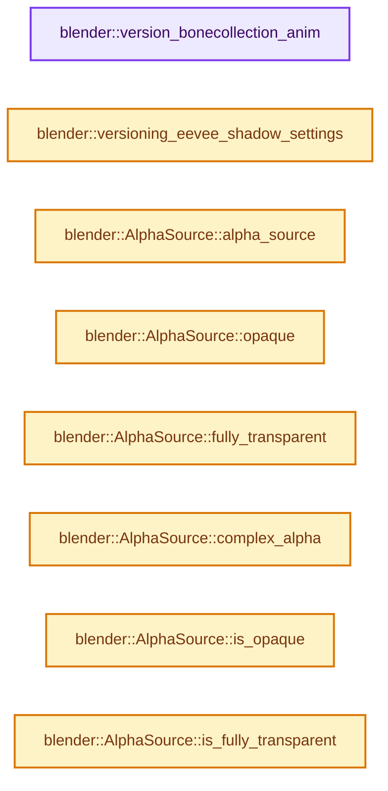

# 实现依赖专题：source/blender/blenloader/intern/versioning_402.cc

[实现依赖导航](../../../README.md) · [符号索引](../../../../00-课程指南/02-源码与提交索引/符号依赖与实现索引.md)

本专题从正文实际调用进入，集中保存共享实现。函数有稳定锚点，可从调用处直接跳到对应完整函数；递归与互相调用通过回链组织。

## 本文件的实现关系




## 完整成员与函数实现

<a id="f-a042b924911ba619"></a>

### `blender::version_bonecollection_anim`

实现位置：[source/blender/blenloader/intern/versioning_402.cc](../../../../../../../../source/blender/blenloader/intern/versioning_402.cc) · L61—L71。

接口参数：

- `FCurve *fcurve`

**教学注释版**

<!-- annotated:8cffa8f6142a3d -->

```cpp
static void version_bonecollection_anim(FCurve *fcurve)
{
  const StringRef rna_path = fcurve->rna_path();
  constexpr char const *rna_path_prefix = "collections[";
  if (!rna_path.startswith(rna_path_prefix)) {
    return;
  }

  const std::string path_remainder(rna_path.drop_known_prefix(rna_path_prefix));
  fcurve->rna_path_set_move(BLI_sprintfN("collections_all[%s", path_remainder.c_str()));
}
```

<details>
<summary>核对原始源码：source/blender/blenloader/intern/versioning_402.cc · L61—L71</summary>

<!-- original:8cffa8f6142a3d:source/blender/blenloader/intern/versioning_402.cc:61:71 -->

```cpp
static void version_bonecollection_anim(FCurve *fcurve)
{
  const StringRef rna_path = fcurve->rna_path();
  constexpr char const *rna_path_prefix = "collections[";
  if (!rna_path.startswith(rna_path_prefix)) {
    return;
  }

  const std::string path_remainder(rna_path.drop_known_prefix(rna_path_prefix));
  fcurve->rna_path_set_move(BLI_sprintfN("collections_all[%s", path_remainder.c_str()));
}
```

</details>

**继续追踪实现**

- `fcurve->rna_path` → [blender::FCurve::rna_path · L189](../../../02-BKE几何与数据/intern/fcurve.cc.md#f-b3be61588d36ab9c)。
- `rna_path.startswith` → [blender::StringRefBase::startswith · L269](../../../../01-基础容器与现代CPP/15-StringRef字符串视图.md#f-78237ccfe249bfa5)。
- `rna_path.drop_known_prefix` → [blender::StringRef::drop_known_prefix · L590](../../../../01-基础容器与现代CPP/15-StringRef字符串视图.md#f-4800aaabdc73488d)。
- `fcurve->rna_path_set_move` → [blender::FCurve::rna_path_set_move · L182](../../../02-BKE几何与数据/intern/fcurve.cc.md#f-feffe802a84cd660)。
- `BLI_sprintfN` → [blender::BLI_sprintfN · L296](../../../01-BLI基础库/intern/string.cc.md#f-bfbc2f7076298fc0)。
- `path_remainder.c_str` → [外部契约](https://eel.is/c++draft/)：这个边界按实际表达式及所属类型核对参数、返回值、寿命与失败行为。这里提供接口入口，不声称已解释该第三方版本的内部实现。

<a id="f-9a710ac49aed86f2"></a>

### `blender::versioning_eevee_shadow_settings`

实现位置：[source/blender/blenloader/intern/versioning_402.cc](../../../../../../../../source/blender/blenloader/intern/versioning_402.cc) · L73—L93。

接口参数：

- `Object *object`

**教学注释版**

<!-- annotated:24583a074b05b0 -->

```cpp
static void versioning_eevee_shadow_settings(Object *object)
{
  /* EEVEE no longer uses the Material::blend_shadow property.
   * Instead, it uses Object::visibility_flag for disabling shadow casting. */

  short *material_len = BKE_object_material_len_p(object);
  if (!material_len) {
    return;
  }

  bool hide_shadows = *material_len > 0;
  for (int i : IndexRange(*material_len)) {
    Material *material = BKE_object_material_get(object, i + 1);
    if (!material || material->blend_shadow != MA_BS_NONE) {
      hide_shadows = false;
    }
  }

  /* Enable the hide_shadow flag only if there's not any shadow casting material. */
  SET_FLAG_FROM_TEST(object->visibility_flag, hide_shadows, OB_HIDE_SHADOW);
}
```

<details>
<summary>核对原始源码：source/blender/blenloader/intern/versioning_402.cc · L73—L93</summary>

<!-- original:24583a074b05b0:source/blender/blenloader/intern/versioning_402.cc:73:93 -->

```cpp
static void versioning_eevee_shadow_settings(Object *object)
{
  /* EEVEE no longer uses the Material::blend_shadow property.
   * Instead, it uses Object::visibility_flag for disabling shadow casting. */

  short *material_len = BKE_object_material_len_p(object);
  if (!material_len) {
    return;
  }

  bool hide_shadows = *material_len > 0;
  for (int i : IndexRange(*material_len)) {
    Material *material = BKE_object_material_get(object, i + 1);
    if (!material || material->blend_shadow != MA_BS_NONE) {
      hide_shadows = false;
    }
  }

  /* Enable the hide_shadow flag only if there's not any shadow casting material. */
  SET_FLAG_FROM_TEST(object->visibility_flag, hide_shadows, OB_HIDE_SHADOW);
}
```

</details>

**沿实际写入检查状态**

- `hide_shadows = false;`

**继续追踪实现**

- `BKE_object_material_len_p` → [blender::BKE_object_material_len_p · L405](../../../02-BKE几何与数据/intern/material.cc.md#f-4bef3241c966494d)。
- `IndexRange` → [blender::IndexRange](../../../01-BLI基础库/BLI_index_range.hh.md#t-caa3466d6776)；[blender::gpu::shader::parser::IndexRange](../../gpu/shader_tool/utils.hh.md#t-82d2bd4ea71c)；[blender::IndexRange](../../makesdna/DNA_node_types.h.md#t-0448cc889d39)。
- `BKE_object_material_get` → [blender::BKE_object_material_get · L759](../../../02-BKE几何与数据/intern/material.cc.md#f-9e9ad276ccef84b3)。
- `SET_FLAG_FROM_TEST` → [SET_FLAG_FROM_TEST · L557](../../../01-BLI基础库/BLI_utildefines.hh.md#m-8e0dc83e01a8)。宏定义由构建条件选择。

<a id="f-ded261d8893270ca"></a>

### `blender::AlphaSource::alpha_source`

实现位置：[source/blender/blenloader/intern/versioning_402.cc](../../../../../../../../source/blender/blenloader/intern/versioning_402.cc) · L120—L123。

接口参数：

- `bNodeSocket *fac`
- `bool inverted = false`

**教学注释版**

<!-- annotated:9f6209ab3a8f2d -->

```cpp
  static AlphaSource alpha_source(bNodeSocket *fac, bool inverted = false)
  {
    return {fac, ALPHA_SEMI_TRANSPARENT, inverted};
  }
```

<details>
<summary>核对原始源码：source/blender/blenloader/intern/versioning_402.cc · L120—L123</summary>

<!-- original:9f6209ab3a8f2d:source/blender/blenloader/intern/versioning_402.cc:120:123 -->

```cpp
  static AlphaSource alpha_source(bNodeSocket *fac, bool inverted = false)
  {
    return {fac, ALPHA_SEMI_TRANSPARENT, inverted};
  }
```

</details>

**结果出口**

- `return {fac, ALPHA_SEMI_TRANSPARENT, inverted};`

**继续追踪实现**

本实现没有需要继续展开的显式调用；检查返回表达式、对象转换和调用者前置条件。

<a id="f-1a8ada4ac6428552"></a>

### `blender::AlphaSource::opaque`

实现位置：[source/blender/blenloader/intern/versioning_402.cc](../../../../../../../../source/blender/blenloader/intern/versioning_402.cc) · L124—L127。

**教学注释版**

<!-- annotated:901f065ad5c0de -->

```cpp
  static AlphaSource opaque()
  {
    return {nullptr, ALPHA_OPAQUE, false};
  }
```

<details>
<summary>核对原始源码：source/blender/blenloader/intern/versioning_402.cc · L124—L127</summary>

<!-- original:901f065ad5c0de:source/blender/blenloader/intern/versioning_402.cc:124:127 -->

```cpp
  static AlphaSource opaque()
  {
    return {nullptr, ALPHA_OPAQUE, false};
  }
```

</details>

**结果出口**

- `return {nullptr, ALPHA_OPAQUE, false};`

**继续追踪实现**

本实现没有需要继续展开的显式调用；检查返回表达式、对象转换和调用者前置条件。

<a id="f-6eb0764edaae8c0e"></a>

### `blender::AlphaSource::fully_transparent`

实现位置：[source/blender/blenloader/intern/versioning_402.cc](../../../../../../../../source/blender/blenloader/intern/versioning_402.cc) · L128—L131。

接口参数：

- `bNodeSocket *socket = nullptr`
- `bool inverted = false`

**教学注释版**

<!-- annotated:67fc0ed7dd6408 -->

```cpp
  static AlphaSource fully_transparent(bNodeSocket *socket = nullptr, bool inverted = false)
  {
    return {socket, ALPHA_FULLY_TRANSPARENT, inverted};
  }
```

<details>
<summary>核对原始源码：source/blender/blenloader/intern/versioning_402.cc · L128—L131</summary>

<!-- original:67fc0ed7dd6408:source/blender/blenloader/intern/versioning_402.cc:128:131 -->

```cpp
  static AlphaSource fully_transparent(bNodeSocket *socket = nullptr, bool inverted = false)
  {
    return {socket, ALPHA_FULLY_TRANSPARENT, inverted};
  }
```

</details>

**结果出口**

- `return {socket, ALPHA_FULLY_TRANSPARENT, inverted};`

**继续追踪实现**

本实现没有需要继续展开的显式调用；检查返回表达式、对象转换和调用者前置条件。

<a id="f-a31499ad1bdbee8b"></a>

### `blender::AlphaSource::complex_alpha`

实现位置：[source/blender/blenloader/intern/versioning_402.cc](../../../../../../../../source/blender/blenloader/intern/versioning_402.cc) · L132—L135。

**教学注释版**

<!-- annotated:10093799fcab64 -->

```cpp
  static AlphaSource complex_alpha()
  {
    return {nullptr, ALPHA_COMPLEX_MIX, false};
  }
```

<details>
<summary>核对原始源码：source/blender/blenloader/intern/versioning_402.cc · L132—L135</summary>

<!-- original:10093799fcab64:source/blender/blenloader/intern/versioning_402.cc:132:135 -->

```cpp
  static AlphaSource complex_alpha()
  {
    return {nullptr, ALPHA_COMPLEX_MIX, false};
  }
```

</details>

**结果出口**

- `return {nullptr, ALPHA_COMPLEX_MIX, false};`

**继续追踪实现**

本实现没有需要继续展开的显式调用；检查返回表达式、对象转换和调用者前置条件。

<a id="f-1cc4bd39d7bf822a"></a>

### `blender::AlphaSource::is_opaque`

实现位置：[source/blender/blenloader/intern/versioning_402.cc](../../../../../../../../source/blender/blenloader/intern/versioning_402.cc) · L137—L140。

**教学注释版**

<!-- annotated:6648f79f0fbb94 -->

```cpp
  bool is_opaque() const
  {
    return state == ALPHA_OPAQUE;
  }
```

<details>
<summary>核对原始源码：source/blender/blenloader/intern/versioning_402.cc · L137—L140</summary>

<!-- original:6648f79f0fbb94:source/blender/blenloader/intern/versioning_402.cc:137:140 -->

```cpp
  bool is_opaque() const
  {
    return state == ALPHA_OPAQUE;
  }
```

</details>

**结果出口**

- `return state == ALPHA_OPAQUE;`

**继续追踪实现**

本实现没有需要继续展开的显式调用；检查返回表达式、对象转换和调用者前置条件。

<a id="f-b3830f1016fd3d2b"></a>

### `blender::AlphaSource::is_fully_transparent`

实现位置：[source/blender/blenloader/intern/versioning_402.cc](../../../../../../../../source/blender/blenloader/intern/versioning_402.cc) · L141—L144。

**教学注释版**

<!-- annotated:492e5a7e2a9ec1 -->

```cpp
  bool is_fully_transparent() const
  {
    return state == ALPHA_FULLY_TRANSPARENT;
  }
```

<details>
<summary>核对原始源码：source/blender/blenloader/intern/versioning_402.cc · L141—L144</summary>

<!-- original:492e5a7e2a9ec1:source/blender/blenloader/intern/versioning_402.cc:141:144 -->

```cpp
  bool is_fully_transparent() const
  {
    return state == ALPHA_FULLY_TRANSPARENT;
  }
```

</details>

**结果出口**

- `return state == ALPHA_FULLY_TRANSPARENT;`

**继续追踪实现**

本实现没有需要继续展开的显式调用；检查返回表达式、对象转换和调用者前置条件。

<a id="f-1b598a7617d07dcd"></a>

### `blender::AlphaSource::is_transparent`

实现位置：[source/blender/blenloader/intern/versioning_402.cc](../../../../../../../../source/blender/blenloader/intern/versioning_402.cc) · L145—L148。

**教学注释版**

<!-- annotated:186f4120285c54 -->

```cpp
  bool is_transparent() const
  {
    return state != ALPHA_OPAQUE;
  }
```

<details>
<summary>核对原始源码：source/blender/blenloader/intern/versioning_402.cc · L145—L148</summary>

<!-- original:186f4120285c54:source/blender/blenloader/intern/versioning_402.cc:145:148 -->

```cpp
  bool is_transparent() const
  {
    return state != ALPHA_OPAQUE;
  }
```

</details>

**结果出口**

- `return state != ALPHA_OPAQUE;`

**继续追踪实现**

本实现没有需要继续展开的显式调用；检查返回表达式、对象转换和调用者前置条件。

<a id="f-dc267a4a2ca5aa66"></a>

### `blender::AlphaSource::is_semi_transparent`

实现位置：[source/blender/blenloader/intern/versioning_402.cc](../../../../../../../../source/blender/blenloader/intern/versioning_402.cc) · L149—L152。

**教学注释版**

<!-- annotated:403d2727f560ea -->

```cpp
  bool is_semi_transparent() const
  {
    return state == ALPHA_SEMI_TRANSPARENT;
  }
```

<details>
<summary>核对原始源码：source/blender/blenloader/intern/versioning_402.cc · L149—L152</summary>

<!-- original:403d2727f560ea:source/blender/blenloader/intern/versioning_402.cc:149:152 -->

```cpp
  bool is_semi_transparent() const
  {
    return state == ALPHA_SEMI_TRANSPARENT;
  }
```

</details>

**结果出口**

- `return state == ALPHA_SEMI_TRANSPARENT;`

**继续追踪实现**

本实现没有需要继续展开的显式调用；检查返回表达式、对象转换和调用者前置条件。

<a id="f-40e3a4817a5dd1df"></a>

### `blender::AlphaSource::is_complex`

实现位置：[source/blender/blenloader/intern/versioning_402.cc](../../../../../../../../source/blender/blenloader/intern/versioning_402.cc) · L153—L156。

**教学注释版**

<!-- annotated:6daa69f863001f -->

```cpp
  bool is_complex() const
  {
    return state == ALPHA_COMPLEX_MIX;
  }
```

<details>
<summary>核对原始源码：source/blender/blenloader/intern/versioning_402.cc · L153—L156</summary>

<!-- original:6daa69f863001f:source/blender/blenloader/intern/versioning_402.cc:153:156 -->

```cpp
  bool is_complex() const
  {
    return state == ALPHA_COMPLEX_MIX;
  }
```

</details>

**结果出口**

- `return state == ALPHA_COMPLEX_MIX;`

**继续追踪实现**

本实现没有需要继续展开的显式调用；检查返回表达式、对象转换和调用者前置条件。

<a id="f-dad271ef9d1bbfaa"></a>

### `blender::AlphaSource::mix`

实现位置：[source/blender/blenloader/intern/versioning_402.cc](../../../../../../../../source/blender/blenloader/intern/versioning_402.cc) · L159—L175。

接口参数：

- `const AlphaSource &a`
- `const AlphaSource &b`
- `bNodeSocket *fac`

**教学注释版**

<!-- annotated:7dbcefbbafbc00 -->

```cpp
  static AlphaSource mix(const AlphaSource &a, const AlphaSource &b, bNodeSocket *fac)
  {
    if (a.is_complex() || b.is_complex()) {
      return complex_alpha();
    }
    if (a.is_semi_transparent() || b.is_semi_transparent()) {
      return complex_alpha();
    }
    if (a.is_fully_transparent() && b.is_fully_transparent()) {
      return fully_transparent();
    }
    if (a.is_opaque() && b.is_opaque()) {
      return opaque();
    }
    /* Only one of them is fully transparent. */
    return alpha_source(fac, !a.is_transparent());
  }
```

<details>
<summary>核对原始源码：source/blender/blenloader/intern/versioning_402.cc · L159—L175</summary>

<!-- original:7dbcefbbafbc00:source/blender/blenloader/intern/versioning_402.cc:159:175 -->

```cpp
  static AlphaSource mix(const AlphaSource &a, const AlphaSource &b, bNodeSocket *fac)
  {
    if (a.is_complex() || b.is_complex()) {
      return complex_alpha();
    }
    if (a.is_semi_transparent() || b.is_semi_transparent()) {
      return complex_alpha();
    }
    if (a.is_fully_transparent() && b.is_fully_transparent()) {
      return fully_transparent();
    }
    if (a.is_opaque() && b.is_opaque()) {
      return opaque();
    }
    /* Only one of them is fully transparent. */
    return alpha_source(fac, !a.is_transparent());
  }
```

</details>

**结果出口**

- `return complex_alpha();`
- `return fully_transparent();`
- `return opaque();`
- `return alpha_source(fac, !a.is_transparent());`

**继续追踪实现**

- `a.is_complex` → [blender::AlphaSource::is_complex · L153](versioning_402.cc.md#f-40e3a4817a5dd1df)。
- `b.is_complex` → [blender::AlphaSource::is_complex · L153](versioning_402.cc.md#f-40e3a4817a5dd1df)。
- `complex_alpha` → [blender::AlphaSource::complex_alpha · L132](versioning_402.cc.md#f-a31499ad1bdbee8b)。
- `a.is_semi_transparent` → [blender::AlphaSource::is_semi_transparent · L149](versioning_402.cc.md#f-dc267a4a2ca5aa66)。
- `b.is_semi_transparent` → [blender::AlphaSource::is_semi_transparent · L149](versioning_402.cc.md#f-dc267a4a2ca5aa66)。
- `a.is_fully_transparent` → [blender::AlphaSource::is_fully_transparent · L141](versioning_402.cc.md#f-b3830f1016fd3d2b)。
- `b.is_fully_transparent` → [blender::AlphaSource::is_fully_transparent · L141](versioning_402.cc.md#f-b3830f1016fd3d2b)。
- `fully_transparent` → [blender::AlphaSource::fully_transparent · L128](versioning_402.cc.md#f-6eb0764edaae8c0e)。
- `a.is_opaque` → [blender::AlphaSource::is_opaque · L137](versioning_402.cc.md#f-1cc4bd39d7bf822a)。
- `b.is_opaque` → [blender::AlphaSource::is_opaque · L137](versioning_402.cc.md#f-1cc4bd39d7bf822a)。
- `opaque` → [blender::AlphaSource::opaque · L124](versioning_402.cc.md#f-1a8ada4ac6428552)。
- `alpha_source` → [blender::AlphaSource::alpha_source · L120](versioning_402.cc.md#f-ded261d8893270ca)。
- `a.is_transparent` → [blender::AlphaSource::is_transparent · L145](versioning_402.cc.md#f-1b598a7617d07dcd)。

<a id="f-3fabfa8871f07350"></a>

### `blender::AlphaSource::add`

实现位置：[source/blender/blenloader/intern/versioning_402.cc](../../../../../../../../source/blender/blenloader/intern/versioning_402.cc) · L178—L191。

接口参数：

- `const AlphaSource &a`
- `const AlphaSource &b`

**教学注释版**

<!-- annotated:4c2c75b50d3893 -->

```cpp
  static AlphaSource add(const AlphaSource &a, const AlphaSource &b)
  {
    if (a.is_complex() || b.is_complex()) {
      return complex_alpha();
    }
    if (a.is_semi_transparent() && b.is_transparent()) {
      return complex_alpha();
    }
    if (a.is_transparent() && b.is_semi_transparent()) {
      return complex_alpha();
    }
    /* Either one of them is opaque or they are both opaque. */
    return a.is_transparent() ? a : b;
  }
```

<details>
<summary>核对原始源码：source/blender/blenloader/intern/versioning_402.cc · L178—L191</summary>

<!-- original:4c2c75b50d3893:source/blender/blenloader/intern/versioning_402.cc:178:191 -->

```cpp
  static AlphaSource add(const AlphaSource &a, const AlphaSource &b)
  {
    if (a.is_complex() || b.is_complex()) {
      return complex_alpha();
    }
    if (a.is_semi_transparent() && b.is_transparent()) {
      return complex_alpha();
    }
    if (a.is_transparent() && b.is_semi_transparent()) {
      return complex_alpha();
    }
    /* Either one of them is opaque or they are both opaque. */
    return a.is_transparent() ? a : b;
  }
```

</details>

**结果出口**

- `return complex_alpha();`
- `return a.is_transparent() ? a : b;`

**继续追踪实现**

- `a.is_complex` → [blender::AlphaSource::is_complex · L153](versioning_402.cc.md#f-40e3a4817a5dd1df)。
- `b.is_complex` → [blender::AlphaSource::is_complex · L153](versioning_402.cc.md#f-40e3a4817a5dd1df)。
- `complex_alpha` → [blender::AlphaSource::complex_alpha · L132](versioning_402.cc.md#f-a31499ad1bdbee8b)。
- `a.is_semi_transparent` → [blender::AlphaSource::is_semi_transparent · L149](versioning_402.cc.md#f-dc267a4a2ca5aa66)。
- `b.is_transparent` → [blender::AlphaSource::is_transparent · L145](versioning_402.cc.md#f-1b598a7617d07dcd)。
- `a.is_transparent` → [blender::AlphaSource::is_transparent · L145](versioning_402.cc.md#f-1b598a7617d07dcd)。
- `b.is_semi_transparent` → [blender::AlphaSource::is_semi_transparent · L149](versioning_402.cc.md#f-dc267a4a2ca5aa66)。

<a id="f-5ec0dceb2c90491d"></a>

### `blender::versioning_eevee_alpha_source_get`

实现位置：[source/blender/blenloader/intern/versioning_402.cc](../../../../../../../../source/blender/blenloader/intern/versioning_402.cc) · L197—L298。

接口参数：

- `bNodeSocket *socket`
- `int depth = 0`

**教学注释版**

<!-- annotated:1377949a3c5f2e -->

```cpp
static AlphaSource versioning_eevee_alpha_source_get(bNodeSocket *socket, int depth = 0)
{
  if (depth > 100) {
    /* Protection against infinite / very long recursion.
     * Also a node-tree with that much depth is likely to not be compatible. */
    return AlphaSource::complex_alpha();
  }

  if (socket->link == nullptr) {
    /* Unconnected closure socket is always opaque black. */
    return AlphaSource::opaque();
  }

  bNode *node = socket->link->fromnode;

  switch (node->type_legacy) {
    case NODE_REROUTE: {
      return versioning_eevee_alpha_source_get(
          static_cast<bNodeSocket *>(BLI_findlink(&node->inputs, 0)), depth + 1);
    }

    case NODE_GROUP: {
      return AlphaSource::complex_alpha();
    }

    case SH_NODE_BSDF_TRANSPARENT: {
      bNodeSocket *socket = bke::node_find_socket(*node, SOCK_IN, "Color"_ustr);
      if (socket->link == nullptr) {
        float *socket_color_value = version_cycles_node_socket_rgba_value(socket);
        if ((socket_color_value[0] == 0.0f) && (socket_color_value[1] == 0.0f) &&
            (socket_color_value[2] == 0.0f))
        {
          return AlphaSource::opaque();
        }
        if ((socket_color_value[0] == 1.0f) && (socket_color_value[1] == 1.0f) &&
            (socket_color_value[2] == 1.0f))
        {
          return AlphaSource::fully_transparent(socket, true);
        }
      }
      return AlphaSource::alpha_source(socket, true);
    }

    case SH_NODE_MIX_SHADER: {
      bNodeSocket *socket = bke::node_find_socket(*node, SOCK_IN, "Fac"_ustr);
      AlphaSource src0 = versioning_eevee_alpha_source_get(
          static_cast<bNodeSocket *>(BLI_findlink(&node->inputs, 1)), depth + 1);
      AlphaSource src1 = versioning_eevee_alpha_source_get(
          static_cast<bNodeSocket *>(BLI_findlink(&node->inputs, 2)), depth + 1);

      if (socket->link == nullptr) {
        float socket_float_value = *version_cycles_node_socket_float_value(socket);
        if (socket_float_value == 0.0f) {
          return src0;
        }
        if (socket_float_value == 1.0f) {
          return src1;
        }
      }
      return AlphaSource::mix(src0, src1, socket);
    }

    case SH_NODE_ADD_SHADER: {
      AlphaSource src0 = versioning_eevee_alpha_source_get(
          static_cast<bNodeSocket *>(BLI_findlink(&node->inputs, 0)), depth + 1);
      AlphaSource src1 = versioning_eevee_alpha_source_get(
          static_cast<bNodeSocket *>(BLI_findlink(&node->inputs, 1)), depth + 1);
      return AlphaSource::add(src0, src1);
    }

    case SH_NODE_BSDF_PRINCIPLED: {
      bNodeSocket *socket = bke::node_find_socket(*node, SOCK_IN, "Alpha"_ustr);
      if (socket->link == nullptr) {
        float socket_value = *version_cycles_node_socket_float_value(socket);
        if (socket_value == 0.0f) {
          return AlphaSource::fully_transparent(socket);
        }
        if (socket_value == 1.0f) {
          return AlphaSource::opaque();
        }
      }
      return AlphaSource::alpha_source(socket);
    }

    case SH_NODE_EEVEE_SPECULAR: {
      bNodeSocket *socket = bke::node_find_socket(*node, SOCK_IN, "Transparency"_ustr);
      if (socket->link == nullptr) {
        float socket_value = *version_cycles_node_socket_float_value(socket);
        if (socket_value == 0.0f) {
          return AlphaSource::fully_transparent(socket, true);
        }
        if (socket_value == 1.0f) {
          return AlphaSource::opaque();
        }
      }
      return AlphaSource::alpha_source(socket, true);
    }

    default:
      return AlphaSource::opaque();
  }
}
```

<details>
<summary>核对原始源码：source/blender/blenloader/intern/versioning_402.cc · L197—L298</summary>

<!-- original:1377949a3c5f2e:source/blender/blenloader/intern/versioning_402.cc:197:298 -->

```cpp
static AlphaSource versioning_eevee_alpha_source_get(bNodeSocket *socket, int depth = 0)
{
  if (depth > 100) {
    /* Protection against infinite / very long recursion.
     * Also a node-tree with that much depth is likely to not be compatible. */
    return AlphaSource::complex_alpha();
  }

  if (socket->link == nullptr) {
    /* Unconnected closure socket is always opaque black. */
    return AlphaSource::opaque();
  }

  bNode *node = socket->link->fromnode;

  switch (node->type_legacy) {
    case NODE_REROUTE: {
      return versioning_eevee_alpha_source_get(
          static_cast<bNodeSocket *>(BLI_findlink(&node->inputs, 0)), depth + 1);
    }

    case NODE_GROUP: {
      return AlphaSource::complex_alpha();
    }

    case SH_NODE_BSDF_TRANSPARENT: {
      bNodeSocket *socket = bke::node_find_socket(*node, SOCK_IN, "Color"_ustr);
      if (socket->link == nullptr) {
        float *socket_color_value = version_cycles_node_socket_rgba_value(socket);
        if ((socket_color_value[0] == 0.0f) && (socket_color_value[1] == 0.0f) &&
            (socket_color_value[2] == 0.0f))
        {
          return AlphaSource::opaque();
        }
        if ((socket_color_value[0] == 1.0f) && (socket_color_value[1] == 1.0f) &&
            (socket_color_value[2] == 1.0f))
        {
          return AlphaSource::fully_transparent(socket, true);
        }
      }
      return AlphaSource::alpha_source(socket, true);
    }

    case SH_NODE_MIX_SHADER: {
      bNodeSocket *socket = bke::node_find_socket(*node, SOCK_IN, "Fac"_ustr);
      AlphaSource src0 = versioning_eevee_alpha_source_get(
          static_cast<bNodeSocket *>(BLI_findlink(&node->inputs, 1)), depth + 1);
      AlphaSource src1 = versioning_eevee_alpha_source_get(
          static_cast<bNodeSocket *>(BLI_findlink(&node->inputs, 2)), depth + 1);

      if (socket->link == nullptr) {
        float socket_float_value = *version_cycles_node_socket_float_value(socket);
        if (socket_float_value == 0.0f) {
          return src0;
        }
        if (socket_float_value == 1.0f) {
          return src1;
        }
      }
      return AlphaSource::mix(src0, src1, socket);
    }

    case SH_NODE_ADD_SHADER: {
      AlphaSource src0 = versioning_eevee_alpha_source_get(
          static_cast<bNodeSocket *>(BLI_findlink(&node->inputs, 0)), depth + 1);
      AlphaSource src1 = versioning_eevee_alpha_source_get(
          static_cast<bNodeSocket *>(BLI_findlink(&node->inputs, 1)), depth + 1);
      return AlphaSource::add(src0, src1);
    }

    case SH_NODE_BSDF_PRINCIPLED: {
      bNodeSocket *socket = bke::node_find_socket(*node, SOCK_IN, "Alpha"_ustr);
      if (socket->link == nullptr) {
        float socket_value = *version_cycles_node_socket_float_value(socket);
        if (socket_value == 0.0f) {
          return AlphaSource::fully_transparent(socket);
        }
        if (socket_value == 1.0f) {
          return AlphaSource::opaque();
        }
      }
      return AlphaSource::alpha_source(socket);
    }

    case SH_NODE_EEVEE_SPECULAR: {
      bNodeSocket *socket = bke::node_find_socket(*node, SOCK_IN, "Transparency"_ustr);
      if (socket->link == nullptr) {
        float socket_value = *version_cycles_node_socket_float_value(socket);
        if (socket_value == 0.0f) {
          return AlphaSource::fully_transparent(socket, true);
        }
        if (socket_value == 1.0f) {
          return AlphaSource::opaque();
        }
      }
      return AlphaSource::alpha_source(socket, true);
    }

    default:
      return AlphaSource::opaque();
  }
}
```

</details>

**结果出口**

- `return AlphaSource::complex_alpha();`
- `return AlphaSource::opaque();`
- `return versioning_eevee_alpha_source_get(`
- `return AlphaSource::fully_transparent(socket, true);`
- `return AlphaSource::alpha_source(socket, true);`
- `return src0;`
- `return src1;`
- `return AlphaSource::mix(src0, src1, socket);`
- `return AlphaSource::add(src0, src1);`
- `return AlphaSource::fully_transparent(socket);`
- `return AlphaSource::alpha_source(socket);`

**继续追踪实现**

- `AlphaSource::complex_alpha` → [blender::AlphaSource::complex_alpha · L132](versioning_402.cc.md#f-a31499ad1bdbee8b)。
- `AlphaSource::opaque` → [blender::AlphaSource::opaque · L124](versioning_402.cc.md#f-1a8ada4ac6428552)。
- `versioning_eevee_alpha_source_get` → [blender::versioning_eevee_alpha_source_get · L197](versioning_402.cc.md#f-5ec0dceb2c90491d)。
- `BLI_findlink` → [blender::BLI_findlink · L541](../../../01-BLI基础库/intern/listbase.cc.md#f-6d3fd65974b4e808)。
- `bke::node_find_socket` → [blender::bke::node_find_socket · L3036](../../../02-BKE几何与数据/intern/node.cc.md#f-cbf9dec71aff5b59)；[blender::bke::node_find_socket · L3047](../../../02-BKE几何与数据/intern/node.cc.md#f-4a7a677634b7fbd1)。同名重载需按实参类型选择。
- `version_cycles_node_socket_rgba_value` → [blender::version_cycles_node_socket_rgba_value · L613](versioning_common.cc.md#f-b5e614b56bf64978)。
- `AlphaSource::fully_transparent` → [blender::AlphaSource::fully_transparent · L128](versioning_402.cc.md#f-6eb0764edaae8c0e)。
- `AlphaSource::alpha_source` → [blender::AlphaSource::alpha_source · L120](versioning_402.cc.md#f-ded261d8893270ca)。
- `version_cycles_node_socket_float_value` → [blender::version_cycles_node_socket_float_value · L607](versioning_common.cc.md#f-3809c86da7c876d6)。
- `AlphaSource::mix` → [blender::AlphaSource::mix · L159](versioning_402.cc.md#f-dad271ef9d1bbfaa)。
- `AlphaSource::add` → [blender::AlphaSource::add · L178](versioning_402.cc.md#f-3fabfa8871f07350)。

<a id="f-d12958e076bc7141"></a>

### `blender::versioning_eevee_material_blend_mode_settings`

实现位置：[source/blender/blenloader/intern/versioning_402.cc](../../../../../../../../source/blender/blenloader/intern/versioning_402.cc) · L308—L391。

接口参数：

- `bNodeTree *ntree`
- `float threshold`

**教学注释版**

<!-- annotated:da4c02e5b45a95 -->

```cpp
static bool versioning_eevee_material_blend_mode_settings(bNodeTree *ntree, float threshold)
{
  bNode *output_node = version_eevee_output_node_get(ntree, SH_NODE_OUTPUT_MATERIAL);
  if (output_node == nullptr) {
    return true;
  }
  bNodeSocket *surface_socket = bke::node_find_socket(*output_node, SOCK_IN, "Surface"_ustr);

  AlphaSource alpha = versioning_eevee_alpha_source_get(surface_socket);

  if (alpha.is_complex()) {
    return false;
  }
  if (alpha.socket == nullptr) {
    return true;
  }

  bool is_opaque = (threshold == 2.0f);
  if (is_opaque) {
    if (alpha.socket->link != nullptr) {
      bke::node_remove_link(ntree, *alpha.socket->link);
    }

    float value = (alpha.is_transparency) ? 0.0f : 1.0f;
    float values[4] = {value, value, value, 1.0f};

    /* Set default value to opaque. */
    if (alpha.socket->type == SOCK_RGBA) {
      copy_v4_v4(version_cycles_node_socket_rgba_value(alpha.socket), values);
    }
    else {
      *version_cycles_node_socket_float_value(alpha.socket) = value;
    }
  }
  else {
    if (alpha.socket->link != nullptr) {
      /* Insert math node. */
      bNode *to_node = alpha.socket->link->tonode;
      bNode *from_node = alpha.socket->link->fromnode;
      bNodeSocket *to_socket = alpha.socket->link->tosock;
      bNodeSocket *from_socket = alpha.socket->link->fromsock;
      bke::node_remove_link(ntree, *alpha.socket->link);

      bNode *math_node = bke::node_add_node(nullptr, *ntree, "ShaderNodeMath"_ustr);
      math_node->custom1 = NODE_MATH_GREATER_THAN;
      math_node->flag |= NODE_COLLAPSED;
      math_node->parent = to_node->parent;
      math_node->locx_legacy = to_node->locx_legacy - math_node->width - 30;
      math_node->locy_legacy = min_ff(to_node->locy_legacy, from_node->locy_legacy);

      bNodeSocket *input_1 = static_cast<bNodeSocket *>(BLI_findlink(&math_node->inputs, 0));
      bNodeSocket *input_2 = static_cast<bNodeSocket *>(BLI_findlink(&math_node->inputs, 1));
      bNodeSocket *output = math_node->outputs.first();
      bNodeSocket *alpha_sock = input_1;
      bNodeSocket *threshold_sock = input_2;

      bke::node_add_link(*ntree, *from_node, *from_socket, *math_node, *alpha_sock);
      bke::node_add_link(*ntree, *math_node, *output, *to_node, *to_socket);

      *version_cycles_node_socket_float_value(threshold_sock) = alpha.is_transparency ?
                                                                    1.0f - threshold :
                                                                    threshold;
    }
    else {
      /* Modify alpha value directly. */
      if (alpha.socket->type == SOCK_RGBA) {
        float *default_value = version_cycles_node_socket_rgba_value(alpha.socket);
        float sum = default_value[0] + default_value[1] + default_value[2];
        /* Don't do the division if possible to avoid float imprecision. */
        float avg = (sum >= 3.0f) ? 1.0f : (sum / 3.0f);
        float value = float((alpha.is_transparency) ? (avg > 1.0f - threshold) :
                                                      (avg > threshold));
        float values[4] = {value, value, value, 1.0f};
        copy_v4_v4(default_value, values);
      }
      else {
        float *default_value = version_cycles_node_socket_float_value(alpha.socket);
        *default_value = float((alpha.is_transparency) ? (*default_value > 1.0f - threshold) :
                                                         (*default_value > threshold));
      }
    }
  }
  return true;
}
```

<details>
<summary>核对原始源码：source/blender/blenloader/intern/versioning_402.cc · L308—L391</summary>

<!-- original:da4c02e5b45a95:source/blender/blenloader/intern/versioning_402.cc:308:391 -->

```cpp
static bool versioning_eevee_material_blend_mode_settings(bNodeTree *ntree, float threshold)
{
  bNode *output_node = version_eevee_output_node_get(ntree, SH_NODE_OUTPUT_MATERIAL);
  if (output_node == nullptr) {
    return true;
  }
  bNodeSocket *surface_socket = bke::node_find_socket(*output_node, SOCK_IN, "Surface"_ustr);

  AlphaSource alpha = versioning_eevee_alpha_source_get(surface_socket);

  if (alpha.is_complex()) {
    return false;
  }
  if (alpha.socket == nullptr) {
    return true;
  }

  bool is_opaque = (threshold == 2.0f);
  if (is_opaque) {
    if (alpha.socket->link != nullptr) {
      bke::node_remove_link(ntree, *alpha.socket->link);
    }

    float value = (alpha.is_transparency) ? 0.0f : 1.0f;
    float values[4] = {value, value, value, 1.0f};

    /* Set default value to opaque. */
    if (alpha.socket->type == SOCK_RGBA) {
      copy_v4_v4(version_cycles_node_socket_rgba_value(alpha.socket), values);
    }
    else {
      *version_cycles_node_socket_float_value(alpha.socket) = value;
    }
  }
  else {
    if (alpha.socket->link != nullptr) {
      /* Insert math node. */
      bNode *to_node = alpha.socket->link->tonode;
      bNode *from_node = alpha.socket->link->fromnode;
      bNodeSocket *to_socket = alpha.socket->link->tosock;
      bNodeSocket *from_socket = alpha.socket->link->fromsock;
      bke::node_remove_link(ntree, *alpha.socket->link);

      bNode *math_node = bke::node_add_node(nullptr, *ntree, "ShaderNodeMath"_ustr);
      math_node->custom1 = NODE_MATH_GREATER_THAN;
      math_node->flag |= NODE_COLLAPSED;
      math_node->parent = to_node->parent;
      math_node->locx_legacy = to_node->locx_legacy - math_node->width - 30;
      math_node->locy_legacy = min_ff(to_node->locy_legacy, from_node->locy_legacy);

      bNodeSocket *input_1 = static_cast<bNodeSocket *>(BLI_findlink(&math_node->inputs, 0));
      bNodeSocket *input_2 = static_cast<bNodeSocket *>(BLI_findlink(&math_node->inputs, 1));
      bNodeSocket *output = math_node->outputs.first();
      bNodeSocket *alpha_sock = input_1;
      bNodeSocket *threshold_sock = input_2;

      bke::node_add_link(*ntree, *from_node, *from_socket, *math_node, *alpha_sock);
      bke::node_add_link(*ntree, *math_node, *output, *to_node, *to_socket);

      *version_cycles_node_socket_float_value(threshold_sock) = alpha.is_transparency ?
                                                                    1.0f - threshold :
                                                                    threshold;
    }
    else {
      /* Modify alpha value directly. */
      if (alpha.socket->type == SOCK_RGBA) {
        float *default_value = version_cycles_node_socket_rgba_value(alpha.socket);
        float sum = default_value[0] + default_value[1] + default_value[2];
        /* Don't do the division if possible to avoid float imprecision. */
        float avg = (sum >= 3.0f) ? 1.0f : (sum / 3.0f);
        float value = float((alpha.is_transparency) ? (avg > 1.0f - threshold) :
                                                      (avg > threshold));
        float values[4] = {value, value, value, 1.0f};
        copy_v4_v4(default_value, values);
      }
      else {
        float *default_value = version_cycles_node_socket_float_value(alpha.socket);
        *default_value = float((alpha.is_transparency) ? (*default_value > 1.0f - threshold) :
                                                         (*default_value > threshold));
      }
    }
  }
  return true;
}
```

</details>

**沿实际写入检查状态**

- `math_node->custom1 = NODE_MATH_GREATER_THAN;`
- `math_node->flag |= NODE_COLLAPSED;`
- `math_node->parent = to_node->parent;`
- `math_node->locx_legacy = to_node->locx_legacy - math_node->width - 30;`
- `math_node->locy_legacy = min_ff(to_node->locy_legacy, from_node->locy_legacy);`

**结果出口**

- `return true;`
- `return false;`

**继续追踪实现**

- `version_eevee_output_node_get` → [blender::version_eevee_output_node_get · L727](versioning_common.cc.md#f-be7ef6120cb7931a)。
- `bke::node_find_socket` → [blender::bke::node_find_socket · L3036](../../../02-BKE几何与数据/intern/node.cc.md#f-cbf9dec71aff5b59)；[blender::bke::node_find_socket · L3047](../../../02-BKE几何与数据/intern/node.cc.md#f-4a7a677634b7fbd1)。同名重载需按实参类型选择。
- `versioning_eevee_alpha_source_get` → [blender::versioning_eevee_alpha_source_get · L197](versioning_402.cc.md#f-5ec0dceb2c90491d)。
- `alpha.is_complex` → [blender::AlphaSource::is_complex · L153](versioning_402.cc.md#f-40e3a4817a5dd1df)。
- `bke::node_remove_link` → [blender::bke::node_remove_link · L4676](../../../02-BKE几何与数据/intern/node.cc.md#f-3cf1faf3e4cf3dd2)。
- `copy_v4_v4` → [blender::copy_v4_v4 · L54](../../../01-BLI基础库/intern/math_vector_inline.cc.md#f-0cf225fc326edf4a)。
- `version_cycles_node_socket_rgba_value` → [blender::version_cycles_node_socket_rgba_value · L613](versioning_common.cc.md#f-b5e614b56bf64978)。
- `version_cycles_node_socket_float_value` → [blender::version_cycles_node_socket_float_value · L607](versioning_common.cc.md#f-3809c86da7c876d6)。
- `bke::node_add_node` → [blender::bke::node_add_node · L4260](../../../02-BKE几何与数据/intern/node.cc.md#f-3ffbb7b6b6d5b74c)。
- `min_ff` → [blender::min_ff · L321](../../../01-BLI基础库/intern/math_base_inline.cc.md#f-5b8d83d6f191be1a)。
- `BLI_findlink` → [blender::BLI_findlink · L541](../../../01-BLI基础库/intern/listbase.cc.md#f-6d3fd65974b4e808)。
- `math_node->outputs.first` → [调用协议](../../../../00-课程指南/01-路线与规范/模板宏与动态分派协议.md)：接收对象类型依赖auto、返回值或模板实例；不按同名猜测目标。调用位置L360。
- `bke::node_add_link` → [blender::bke::node_add_link · L4638](../../../02-BKE几何与数据/intern/node.cc.md#f-e4b0f883348f0d24)。

<a id="f-ab17eabb223e74e5"></a>

### `blender::versioning_eevee_material_shadow_none`

实现位置：[source/blender/blenloader/intern/versioning_402.cc](../../../../../../../../source/blender/blenloader/intern/versioning_402.cc) · L393—L490。

接口参数：

- `Material *material`

**教学注释版**

<!-- annotated:034f1fbfdce4fd -->

```cpp
static void versioning_eevee_material_shadow_none(Material *material)
{
  if (!material->use_nodes || material->nodetree == nullptr) {
    return;
  }
  bNodeTree *ntree = material->nodetree;

  bNode *output_node = version_eevee_output_node_get(ntree, SH_NODE_OUTPUT_MATERIAL);
  bNode *old_output_node = version_eevee_output_node_get(ntree, SH_NODE_OUTPUT_MATERIAL);
  if (output_node == nullptr) {
    return;
  }

  bNodeSocket *existing_out_sock = bke::node_find_socket(*output_node, SOCK_IN, "Surface"_ustr);
  bNodeSocket *volume_sock = bke::node_find_socket(*output_node, SOCK_IN, "Volume"_ustr);
  if (existing_out_sock->link == nullptr && volume_sock->link) {
    /* Don't apply versioning to a material that only has a volumetric input as this makes the
     * object surface opaque to the camera, hiding the volume inside. */
    return;
  }

  if (output_node->custom1 == SHD_OUTPUT_ALL) {
    /* We do not want to affect Cycles. So we split the output into two specific outputs. */
    output_node->custom1 = SHD_OUTPUT_CYCLES;

    bNode *new_output = bke::node_add_node(nullptr, *ntree, "ShaderNodeOutputMaterial"_ustr);
    new_output->custom1 = SHD_OUTPUT_EEVEE;
    new_output->parent = output_node->parent;
    new_output->locx_legacy = output_node->locx_legacy;
    new_output->locy_legacy = output_node->locy_legacy - output_node->height - 120;

    auto copy_link = [&](const char *socket_name) {
      bNodeSocket *sock = bke::node_find_socket(*output_node, SOCK_IN, UString(socket_name));
      if (sock && sock->link) {
        bNodeLink *link = sock->link;
        bNodeSocket *to_sock = bke::node_find_socket(*new_output, SOCK_IN, UString(socket_name));
        bke::node_add_link(*ntree, *link->fromnode, *link->fromsock, *new_output, *to_sock);
      }
    };

    /* Don't copy surface as that is handled later */
    copy_link("Volume");
    copy_link("Displacement");
    copy_link("Thickness");

    output_node = new_output;
  }

  bNodeSocket *out_sock = bke::node_find_socket(*output_node, SOCK_IN, "Surface"_ustr);
  bNodeSocket *old_out_sock = bke::node_find_socket(*old_output_node, SOCK_IN, "Surface"_ustr);

  /* Add mix node for mixing between original material, and transparent BSDF for shadows */
  bNode *mix_node = bke::node_add_node(nullptr, *ntree, "ShaderNodeMixShader"_ustr);
  STRNCPY(mix_node->label, "Disable Shadow");
  mix_node->flag |= NODE_COLLAPSED;
  mix_node->parent = output_node->parent;
  mix_node->locx_legacy = output_node->locx_legacy;
  mix_node->locy_legacy = output_node->locy_legacy - output_node->height - 120;
  bNodeSocket *mix_fac = static_cast<bNodeSocket *>(BLI_findlink(&mix_node->inputs, 0));
  bNodeSocket *mix_in_1 = static_cast<bNodeSocket *>(BLI_findlink(&mix_node->inputs, 1));
  bNodeSocket *mix_in_2 = static_cast<bNodeSocket *>(BLI_findlink(&mix_node->inputs, 2));
  bNodeSocket *mix_out = static_cast<bNodeSocket *>(BLI_findlink(&mix_node->outputs, 0));
  if (old_out_sock->link != nullptr) {
    bke::node_add_link(*ntree,
                       *old_out_sock->link->fromnode,
                       *old_out_sock->link->fromsock,
                       *mix_node,
                       *mix_in_1);
    if (out_sock->link != nullptr) {
      bke::node_remove_link(ntree, *out_sock->link);
    }
  }
  bke::node_add_link(*ntree, *mix_node, *mix_out, *output_node, *out_sock);

  /* Add light path node to control shadow visibility */
  bNode *lp_node = bke::node_add_node(nullptr, *ntree, "ShaderNodeLightPath"_ustr);
  lp_node->flag |= NODE_COLLAPSED;
  lp_node->parent = output_node->parent;
  lp_node->locx_legacy = output_node->locx_legacy;
  lp_node->locy_legacy = mix_node->locy_legacy + 35;
  bNodeSocket *is_shadow = bke::node_find_socket(*lp_node, SOCK_OUT, "Is Shadow Ray"_ustr);
  bke::node_add_link(*ntree, *lp_node, *is_shadow, *mix_node, *mix_fac);
  /* Hide unconnected sockets for cleaner look. */
  for (bNodeSocket &sock : lp_node->outputs) {
    if (&sock != is_shadow) {
      sock.flag |= SOCK_HIDDEN;
    }
  }

  /* Add transparent BSDF to make shadows transparent. */
  bNode *bsdf_node = bke::node_add_node(nullptr, *ntree, "ShaderNodeBsdfTransparent"_ustr);
  bsdf_node->flag |= NODE_COLLAPSED;
  bsdf_node->parent = output_node->parent;
  bsdf_node->locx_legacy = output_node->locx_legacy;
  bsdf_node->locy_legacy = mix_node->locy_legacy - 35;
  bNodeSocket *bsdf_out = bke::node_find_socket(*bsdf_node, SOCK_OUT, "BSDF"_ustr);
  bke::node_add_link(*ntree, *bsdf_node, *bsdf_out, *mix_node, *mix_in_2);
}
```

<details>
<summary>核对原始源码：source/blender/blenloader/intern/versioning_402.cc · L393—L490</summary>

<!-- original:034f1fbfdce4fd:source/blender/blenloader/intern/versioning_402.cc:393:490 -->

```cpp
static void versioning_eevee_material_shadow_none(Material *material)
{
  if (!material->use_nodes || material->nodetree == nullptr) {
    return;
  }
  bNodeTree *ntree = material->nodetree;

  bNode *output_node = version_eevee_output_node_get(ntree, SH_NODE_OUTPUT_MATERIAL);
  bNode *old_output_node = version_eevee_output_node_get(ntree, SH_NODE_OUTPUT_MATERIAL);
  if (output_node == nullptr) {
    return;
  }

  bNodeSocket *existing_out_sock = bke::node_find_socket(*output_node, SOCK_IN, "Surface"_ustr);
  bNodeSocket *volume_sock = bke::node_find_socket(*output_node, SOCK_IN, "Volume"_ustr);
  if (existing_out_sock->link == nullptr && volume_sock->link) {
    /* Don't apply versioning to a material that only has a volumetric input as this makes the
     * object surface opaque to the camera, hiding the volume inside. */
    return;
  }

  if (output_node->custom1 == SHD_OUTPUT_ALL) {
    /* We do not want to affect Cycles. So we split the output into two specific outputs. */
    output_node->custom1 = SHD_OUTPUT_CYCLES;

    bNode *new_output = bke::node_add_node(nullptr, *ntree, "ShaderNodeOutputMaterial"_ustr);
    new_output->custom1 = SHD_OUTPUT_EEVEE;
    new_output->parent = output_node->parent;
    new_output->locx_legacy = output_node->locx_legacy;
    new_output->locy_legacy = output_node->locy_legacy - output_node->height - 120;

    auto copy_link = [&](const char *socket_name) {
      bNodeSocket *sock = bke::node_find_socket(*output_node, SOCK_IN, UString(socket_name));
      if (sock && sock->link) {
        bNodeLink *link = sock->link;
        bNodeSocket *to_sock = bke::node_find_socket(*new_output, SOCK_IN, UString(socket_name));
        bke::node_add_link(*ntree, *link->fromnode, *link->fromsock, *new_output, *to_sock);
      }
    };

    /* Don't copy surface as that is handled later */
    copy_link("Volume");
    copy_link("Displacement");
    copy_link("Thickness");

    output_node = new_output;
  }

  bNodeSocket *out_sock = bke::node_find_socket(*output_node, SOCK_IN, "Surface"_ustr);
  bNodeSocket *old_out_sock = bke::node_find_socket(*old_output_node, SOCK_IN, "Surface"_ustr);

  /* Add mix node for mixing between original material, and transparent BSDF for shadows */
  bNode *mix_node = bke::node_add_node(nullptr, *ntree, "ShaderNodeMixShader"_ustr);
  STRNCPY(mix_node->label, "Disable Shadow");
  mix_node->flag |= NODE_COLLAPSED;
  mix_node->parent = output_node->parent;
  mix_node->locx_legacy = output_node->locx_legacy;
  mix_node->locy_legacy = output_node->locy_legacy - output_node->height - 120;
  bNodeSocket *mix_fac = static_cast<bNodeSocket *>(BLI_findlink(&mix_node->inputs, 0));
  bNodeSocket *mix_in_1 = static_cast<bNodeSocket *>(BLI_findlink(&mix_node->inputs, 1));
  bNodeSocket *mix_in_2 = static_cast<bNodeSocket *>(BLI_findlink(&mix_node->inputs, 2));
  bNodeSocket *mix_out = static_cast<bNodeSocket *>(BLI_findlink(&mix_node->outputs, 0));
  if (old_out_sock->link != nullptr) {
    bke::node_add_link(*ntree,
                       *old_out_sock->link->fromnode,
                       *old_out_sock->link->fromsock,
                       *mix_node,
                       *mix_in_1);
    if (out_sock->link != nullptr) {
      bke::node_remove_link(ntree, *out_sock->link);
    }
  }
  bke::node_add_link(*ntree, *mix_node, *mix_out, *output_node, *out_sock);

  /* Add light path node to control shadow visibility */
  bNode *lp_node = bke::node_add_node(nullptr, *ntree, "ShaderNodeLightPath"_ustr);
  lp_node->flag |= NODE_COLLAPSED;
  lp_node->parent = output_node->parent;
  lp_node->locx_legacy = output_node->locx_legacy;
  lp_node->locy_legacy = mix_node->locy_legacy + 35;
  bNodeSocket *is_shadow = bke::node_find_socket(*lp_node, SOCK_OUT, "Is Shadow Ray"_ustr);
  bke::node_add_link(*ntree, *lp_node, *is_shadow, *mix_node, *mix_fac);
  /* Hide unconnected sockets for cleaner look. */
  for (bNodeSocket &sock : lp_node->outputs) {
    if (&sock != is_shadow) {
      sock.flag |= SOCK_HIDDEN;
    }
  }

  /* Add transparent BSDF to make shadows transparent. */
  bNode *bsdf_node = bke::node_add_node(nullptr, *ntree, "ShaderNodeBsdfTransparent"_ustr);
  bsdf_node->flag |= NODE_COLLAPSED;
  bsdf_node->parent = output_node->parent;
  bsdf_node->locx_legacy = output_node->locx_legacy;
  bsdf_node->locy_legacy = mix_node->locy_legacy - 35;
  bNodeSocket *bsdf_out = bke::node_find_socket(*bsdf_node, SOCK_OUT, "BSDF"_ustr);
  bke::node_add_link(*ntree, *bsdf_node, *bsdf_out, *mix_node, *mix_in_2);
}
```

</details>

**沿实际写入检查状态**

- `output_node->custom1 = SHD_OUTPUT_CYCLES;`
- `new_output->custom1 = SHD_OUTPUT_EEVEE;`
- `new_output->parent = output_node->parent;`
- `new_output->locx_legacy = output_node->locx_legacy;`
- `new_output->locy_legacy = output_node->locy_legacy - output_node->height - 120;`
- `output_node = new_output;`
- `mix_node->flag |= NODE_COLLAPSED;`
- `mix_node->parent = output_node->parent;`
- `mix_node->locx_legacy = output_node->locx_legacy;`
- `mix_node->locy_legacy = output_node->locy_legacy - output_node->height - 120;`
- `lp_node->flag |= NODE_COLLAPSED;`
- `lp_node->parent = output_node->parent;`
- `lp_node->locx_legacy = output_node->locx_legacy;`
- `lp_node->locy_legacy = mix_node->locy_legacy + 35;`
- `sock.flag |= SOCK_HIDDEN;`
- `bsdf_node->flag |= NODE_COLLAPSED;`
- `bsdf_node->parent = output_node->parent;`
- `bsdf_node->locx_legacy = output_node->locx_legacy;`
- `bsdf_node->locy_legacy = mix_node->locy_legacy - 35;`

**继续追踪实现**

- `version_eevee_output_node_get` → [blender::version_eevee_output_node_get · L727](versioning_common.cc.md#f-be7ef6120cb7931a)。
- `bke::node_find_socket` → [blender::bke::node_find_socket · L3036](../../../02-BKE几何与数据/intern/node.cc.md#f-cbf9dec71aff5b59)；[blender::bke::node_find_socket · L3047](../../../02-BKE几何与数据/intern/node.cc.md#f-4a7a677634b7fbd1)。同名重载需按实参类型选择。
- `bke::node_add_node` → [blender::bke::node_add_node · L4260](../../../02-BKE几何与数据/intern/node.cc.md#f-3ffbb7b6b6d5b74c)。
- `UString` → [blender::UString::UString · L65](../../../01-BLI基础库/BLI_ustring.hh.md#f-af044c001f6ab696)；[blender::UString::UString · L68](../../../01-BLI基础库/BLI_ustring.hh.md#f-acdd59bd65bf3333)；[blender::UString::UString · L69](../../../01-BLI基础库/BLI_ustring.hh.md#f-bc4cac73ffd771a5)。同名重载需按实参类型选择。
- `bke::node_add_link` → [blender::bke::node_add_link · L4638](../../../02-BKE几何与数据/intern/node.cc.md#f-e4b0f883348f0d24)。
- `copy_link` → [调用协议](../../../../00-课程指南/01-路线与规范/模板宏与动态分派协议.md)：局部可调用对象，须结合其初始化与捕获环境。调用位置L434。
- `STRNCPY` → [blender::STRNCPY · L690](../../../01-BLI基础库/BLI_string.hh.md#f-6b2d861724026be6)。
- `BLI_findlink` → [blender::BLI_findlink · L541](../../../01-BLI基础库/intern/listbase.cc.md#f-6d3fd65974b4e808)。
- `bke::node_remove_link` → [blender::bke::node_remove_link · L4676](../../../02-BKE几何与数据/intern/node.cc.md#f-3cf1faf3e4cf3dd2)。

<a id="f-2929e43ec546eb32"></a>

### `blender::do_versions_after_linking_402`

实现位置：[source/blender/blenloader/intern/versioning_402.cc](../../../../../../../../source/blender/blenloader/intern/versioning_402.cc) · L492—L581。

接口参数：

- `FileData *fd`
- `Main *bmain`

**教学注释版**

<!-- annotated:0d735f00432698 -->

```cpp
void do_versions_after_linking_402(FileData *fd, Main *bmain)
{
  if (!MAIN_VERSION_FILE_ATLEAST(bmain, 402, 15)) {
    /* Change drivers and animation on "armature.collections" to
     * ".collections_all", so that they are drawn correctly in the tree view,
     * and keep working when the collection is moved around in the hierarchy. */
    for (bArmature &arm : bmain->armatures) {
      AnimData *adt = BKE_animdata_from_id(&arm.id);
      if (!adt) {
        continue;
      }

      for (FCurve &fcurve : adt->drivers) {
        version_bonecollection_anim(&fcurve);
      }
      if (adt->action) {
        for (FCurve &fcurve : adt->action->curves) {
          version_bonecollection_anim(&fcurve);
        }
      }
    }
  }

  if (!MAIN_VERSION_FILE_ATLEAST(bmain, 402, 23)) {
    /* Shift animation data to accommodate the new Roughness input. */
    version_node_socket_index_animdata(
        bmain, NTREE_SHADER, SH_NODE_SUBSURFACE_SCATTERING, 4, 1, 5);
  }

  if (!MAIN_VERSION_FILE_ATLEAST(bmain, 402, 50)) {
    if (all_scenes_use(bmain, {RE_engine_id_BLENDER_EEVEE})) {
      for (Object &object : bmain->objects) {
        versioning_eevee_shadow_settings(&object);
      }
    }
  }

  if (!MAIN_VERSION_FILE_ATLEAST(bmain, 402, 51)) {
    /* Convert blend method to math nodes. */
    if (all_scenes_use(bmain, {RE_engine_id_BLENDER_EEVEE})) {
      for (Material &material : bmain->materials) {
        if (!material.use_nodes || material.nodetree == nullptr) {
          /* Nothing to version. */
        }
        else if (ELEM(material.blend_method, MA_BM_HASHED, MA_BM_BLEND)) {
          /* Compatible modes. Nothing to change. */
        }
        else if (material.blend_shadow == MA_BS_NONE) {
          /* No need to match the surface since shadows are disabled. */
        }
        else if (material.blend_shadow == MA_BS_SOLID) {
          /* This is already versioned an transferred to `transparent_shadows`. */
        }
        else if ((material.blend_shadow == MA_BS_CLIP && material.blend_method != MA_BM_CLIP) ||
                 (material.blend_shadow == MA_BS_HASHED))
        {
          BLO_reportf_wrap(
              fd->reports,
              RPT_WARNING,
              RPT_("Material %s could not be converted because of different Blend Mode "
                   "and Shadow Mode (need manual adjustment)\n"),
              material.id.name + 2);
        }
        else {
          /* TODO(fclem): Check if threshold is driven or has animation. Bail out if needed? */

          float threshold = (material.blend_method == MA_BM_CLIP) ? material.alpha_threshold :
                                                                    2.0f;

          if (!versioning_eevee_material_blend_mode_settings(material.nodetree, threshold)) {
            BLO_reportf_wrap(fd->reports,
                             RPT_WARNING,
                             RPT_("Material %s could not be converted because of non-trivial "
                                  "alpha blending (need manual adjustment)\n"),
                             material.id.name + 2);
          }
        }

        if (material.blend_shadow == MA_BS_NONE) {
          versioning_eevee_material_shadow_none(&material);
        }
        /* Set blend_mode & blend_shadow for forward compatibility. */
        material.blend_method = (material.blend_method != MA_BM_BLEND) ? MA_BM_HASHED :
                                                                         MA_BM_BLEND;
        material.blend_shadow = (material.blend_shadow == MA_BS_SOLID) ? MA_BS_SOLID :
                                                                         MA_BS_HASHED;
      }
    }
  }
}
```

<details>
<summary>核对原始源码：source/blender/blenloader/intern/versioning_402.cc · L492—L581</summary>

<!-- original:0d735f00432698:source/blender/blenloader/intern/versioning_402.cc:492:581 -->

```cpp
void do_versions_after_linking_402(FileData *fd, Main *bmain)
{
  if (!MAIN_VERSION_FILE_ATLEAST(bmain, 402, 15)) {
    /* Change drivers and animation on "armature.collections" to
     * ".collections_all", so that they are drawn correctly in the tree view,
     * and keep working when the collection is moved around in the hierarchy. */
    for (bArmature &arm : bmain->armatures) {
      AnimData *adt = BKE_animdata_from_id(&arm.id);
      if (!adt) {
        continue;
      }

      for (FCurve &fcurve : adt->drivers) {
        version_bonecollection_anim(&fcurve);
      }
      if (adt->action) {
        for (FCurve &fcurve : adt->action->curves) {
          version_bonecollection_anim(&fcurve);
        }
      }
    }
  }

  if (!MAIN_VERSION_FILE_ATLEAST(bmain, 402, 23)) {
    /* Shift animation data to accommodate the new Roughness input. */
    version_node_socket_index_animdata(
        bmain, NTREE_SHADER, SH_NODE_SUBSURFACE_SCATTERING, 4, 1, 5);
  }

  if (!MAIN_VERSION_FILE_ATLEAST(bmain, 402, 50)) {
    if (all_scenes_use(bmain, {RE_engine_id_BLENDER_EEVEE})) {
      for (Object &object : bmain->objects) {
        versioning_eevee_shadow_settings(&object);
      }
    }
  }

  if (!MAIN_VERSION_FILE_ATLEAST(bmain, 402, 51)) {
    /* Convert blend method to math nodes. */
    if (all_scenes_use(bmain, {RE_engine_id_BLENDER_EEVEE})) {
      for (Material &material : bmain->materials) {
        if (!material.use_nodes || material.nodetree == nullptr) {
          /* Nothing to version. */
        }
        else if (ELEM(material.blend_method, MA_BM_HASHED, MA_BM_BLEND)) {
          /* Compatible modes. Nothing to change. */
        }
        else if (material.blend_shadow == MA_BS_NONE) {
          /* No need to match the surface since shadows are disabled. */
        }
        else if (material.blend_shadow == MA_BS_SOLID) {
          /* This is already versioned an transferred to `transparent_shadows`. */
        }
        else if ((material.blend_shadow == MA_BS_CLIP && material.blend_method != MA_BM_CLIP) ||
                 (material.blend_shadow == MA_BS_HASHED))
        {
          BLO_reportf_wrap(
              fd->reports,
              RPT_WARNING,
              RPT_("Material %s could not be converted because of different Blend Mode "
                   "and Shadow Mode (need manual adjustment)\n"),
              material.id.name + 2);
        }
        else {
          /* TODO(fclem): Check if threshold is driven or has animation. Bail out if needed? */

          float threshold = (material.blend_method == MA_BM_CLIP) ? material.alpha_threshold :
                                                                    2.0f;

          if (!versioning_eevee_material_blend_mode_settings(material.nodetree, threshold)) {
            BLO_reportf_wrap(fd->reports,
                             RPT_WARNING,
                             RPT_("Material %s could not be converted because of non-trivial "
                                  "alpha blending (need manual adjustment)\n"),
                             material.id.name + 2);
          }
        }

        if (material.blend_shadow == MA_BS_NONE) {
          versioning_eevee_material_shadow_none(&material);
        }
        /* Set blend_mode & blend_shadow for forward compatibility. */
        material.blend_method = (material.blend_method != MA_BM_BLEND) ? MA_BM_HASHED :
                                                                         MA_BM_BLEND;
        material.blend_shadow = (material.blend_shadow == MA_BS_SOLID) ? MA_BS_SOLID :
                                                                         MA_BS_HASHED;
      }
    }
  }
}
```

</details>

**沿实际写入检查状态**

- `material.blend_method = (material.blend_method != MA_BM_BLEND) ? MA_BM_HASHED :`
- `material.blend_shadow = (material.blend_shadow == MA_BS_SOLID) ? MA_BS_SOLID :`

**继续追踪实现**

- `MAIN_VERSION_FILE_ATLEAST` → [MAIN_VERSION_FILE_ATLEAST · L946](../../../02-BKE几何与数据/BKE_main.hh.md#m-f0c0a8da9411)。宏定义由构建条件选择。
- `BKE_animdata_from_id` → [blender::BKE_animdata_from_id · L93](../../../02-BKE几何与数据/intern/anim_data.cc.md#f-354e5421ff0a6c96)。
- `version_bonecollection_anim` → [blender::version_bonecollection_anim · L61](versioning_402.cc.md#f-a042b924911ba619)。
- `version_node_socket_index_animdata` → [blender::version_node_socket_index_animdata · L484](versioning_common.cc.md#f-27c2e2a91a515631)；[blender::version_node_socket_index_animdata · L500](versioning_common.cc.md#f-522ccbf91978b798)。同名重载需按实参类型选择。
- `all_scenes_use` → [blender::all_scenes_use · L759](versioning_common.cc.md#f-c1a76d8ca5c25279)。
- `versioning_eevee_shadow_settings` → [blender::versioning_eevee_shadow_settings · L73](versioning_402.cc.md#f-9a710ac49aed86f2)。
- `ELEM` → [ELEM · L88](../../../07-Intern运行时与平台/ghost/intern/GHOST_utildefines.hh.md#m-d28724a15928)；[ELEM · L135](../../../01-BLI基础库/BLI_utildefines.hh.md#m-d6572de7cae0)。宏定义由构建条件选择。
- `BLO_reportf_wrap` → [blender::BLO_reportf_wrap · L228](readfile.cc.md#f-404ef4f090c5be59)。
- `RPT_` → [RPT_ · L51](../../blentranslation/BLT_translation.hh.md#m-c13f94a1a934)。宏定义由构建条件选择。
- `versioning_eevee_material_blend_mode_settings` → [blender::versioning_eevee_material_blend_mode_settings · L308](versioning_402.cc.md#f-d12958e076bc7141)。
- `versioning_eevee_material_shadow_none` → [blender::versioning_eevee_material_shadow_none · L393](versioning_402.cc.md#f-ab17eabb223e74e5)。

<a id="f-db13f50264ffa737"></a>

### `blender::image_settings_avi_to_ffmpeg`

实现位置：[source/blender/blenloader/intern/versioning_402.cc](../../../../../../../../source/blender/blenloader/intern/versioning_402.cc) · L583—L591。

接口参数：

- `Scene *scene`

**教学注释版**

<!-- annotated:7ff68cfa973c84 -->

```cpp
static void image_settings_avi_to_ffmpeg(Scene *scene)
{
  /* R_IMF_IMTYPE_AVIRAW and R_IMF_IMTYPE_AVIJPEG. */
  constexpr char deprecated_avi_raw_imtype = 15;
  constexpr char deprecated_avi_jpeg_imtype = 16;
  if (ELEM(scene->r.im_format.imtype, deprecated_avi_raw_imtype, deprecated_avi_jpeg_imtype)) {
    scene->r.im_format.imtype = R_IMF_IMTYPE_FFMPEG;
  }
}
```

<details>
<summary>核对原始源码：source/blender/blenloader/intern/versioning_402.cc · L583—L591</summary>

<!-- original:7ff68cfa973c84:source/blender/blenloader/intern/versioning_402.cc:583:591 -->

```cpp
static void image_settings_avi_to_ffmpeg(Scene *scene)
{
  /* R_IMF_IMTYPE_AVIRAW and R_IMF_IMTYPE_AVIJPEG. */
  constexpr char deprecated_avi_raw_imtype = 15;
  constexpr char deprecated_avi_jpeg_imtype = 16;
  if (ELEM(scene->r.im_format.imtype, deprecated_avi_raw_imtype, deprecated_avi_jpeg_imtype)) {
    scene->r.im_format.imtype = R_IMF_IMTYPE_FFMPEG;
  }
}
```

</details>

**沿实际写入检查状态**

- `scene->r.im_format.imtype = R_IMF_IMTYPE_FFMPEG;`

**继续追踪实现**

- `ELEM` → [ELEM · L88](../../../07-Intern运行时与平台/ghost/intern/GHOST_utildefines.hh.md#m-d28724a15928)；[ELEM · L135](../../../01-BLI基础库/BLI_utildefines.hh.md#m-d6572de7cae0)。宏定义由构建条件选择。

<a id="f-2f66982efcd27ed6"></a>

### `blender::hue_correct_set_wrapping`

实现位置：[source/blender/blenloader/intern/versioning_402.cc](../../../../../../../../source/blender/blenloader/intern/versioning_402.cc) · L596—L610。

接口参数：

- `CurveMapping *curve_mapping`

**教学注释版**

<!-- annotated:761e64210a6d11 -->

```cpp
static void hue_correct_set_wrapping(CurveMapping *curve_mapping)
{
  curve_mapping->flag |= CUMA_DO_CLIP;
  curve_mapping->flag |= CUMA_USE_WRAPPING;

  curve_mapping->clipr.xmin = 0.0f;
  curve_mapping->clipr.xmax = 1.0f;
  curve_mapping->clipr.ymin = 0.0f;
  curve_mapping->clipr.ymax = 1.0f;

  curve_mapping->curr.xmin = 0.0f;
  curve_mapping->curr.xmax = 1.0f;
  curve_mapping->curr.ymin = 0.0f;
  curve_mapping->curr.ymax = 1.0f;
}
```

<details>
<summary>核对原始源码：source/blender/blenloader/intern/versioning_402.cc · L596—L610</summary>

<!-- original:761e64210a6d11:source/blender/blenloader/intern/versioning_402.cc:596:610 -->

```cpp
static void hue_correct_set_wrapping(CurveMapping *curve_mapping)
{
  curve_mapping->flag |= CUMA_DO_CLIP;
  curve_mapping->flag |= CUMA_USE_WRAPPING;

  curve_mapping->clipr.xmin = 0.0f;
  curve_mapping->clipr.xmax = 1.0f;
  curve_mapping->clipr.ymin = 0.0f;
  curve_mapping->clipr.ymax = 1.0f;

  curve_mapping->curr.xmin = 0.0f;
  curve_mapping->curr.xmax = 1.0f;
  curve_mapping->curr.ymin = 0.0f;
  curve_mapping->curr.ymax = 1.0f;
}
```

</details>

**沿实际写入检查状态**

- `curve_mapping->flag |= CUMA_DO_CLIP;`
- `curve_mapping->flag |= CUMA_USE_WRAPPING;`
- `curve_mapping->clipr.xmin = 0.0f;`
- `curve_mapping->clipr.xmax = 1.0f;`
- `curve_mapping->clipr.ymin = 0.0f;`
- `curve_mapping->clipr.ymax = 1.0f;`
- `curve_mapping->curr.xmin = 0.0f;`
- `curve_mapping->curr.xmax = 1.0f;`
- `curve_mapping->curr.ymin = 0.0f;`
- `curve_mapping->curr.ymax = 1.0f;`

**继续追踪实现**

本实现没有需要继续展开的显式调用；检查返回表达式、对象转换和调用者前置条件。

<a id="f-bb88ad40444b56dc"></a>

### `blender::versioning_node_hue_correct_set_wrappng`

实现位置：[source/blender/blenloader/intern/versioning_402.cc](../../../../../../../../source/blender/blenloader/intern/versioning_402.cc) · L624—L637。

接口参数：

- `bNodeTree *ntree`

**教学注释版**

<!-- annotated:a942ae46ee0959 -->

```cpp
static void versioning_node_hue_correct_set_wrappng(bNodeTree *ntree)
{
  if (ntree->type == NTREE_COMPOSIT) {
    for (bNode &node : ntree->nodes.items_mutable()) {

      if (node.type_legacy == CMP_NODE_HUECORRECT) {
        if (version_node_ensure_storage_or_invalidate(node)) {
          CurveMapping *cumap = static_cast<CurveMapping *>(node.storage);
          hue_correct_set_wrapping(cumap);
        }
      }
    }
  }
}
```

<details>
<summary>核对原始源码：source/blender/blenloader/intern/versioning_402.cc · L624—L637</summary>

<!-- original:a942ae46ee0959:source/blender/blenloader/intern/versioning_402.cc:624:637 -->

```cpp
static void versioning_node_hue_correct_set_wrappng(bNodeTree *ntree)
{
  if (ntree->type == NTREE_COMPOSIT) {
    for (bNode &node : ntree->nodes.items_mutable()) {

      if (node.type_legacy == CMP_NODE_HUECORRECT) {
        if (version_node_ensure_storage_or_invalidate(node)) {
          CurveMapping *cumap = static_cast<CurveMapping *>(node.storage);
          hue_correct_set_wrapping(cumap);
        }
      }
    }
  }
}
```

</details>

**继续追踪实现**

- `ntree->nodes.items_mutable` → [调用协议](../../../../00-课程指南/01-路线与规范/模板宏与动态分派协议.md)：接收对象类型依赖auto、返回值或模板实例；不按同名猜测目标。调用位置L627。
- `version_node_ensure_storage_or_invalidate` → [blender::version_node_ensure_storage_or_invalidate · L389](versioning_common.cc.md#f-72131ae3b96134c2)。
- `hue_correct_set_wrapping` → [blender::hue_correct_set_wrapping · L596](versioning_402.cc.md#f-2f66982efcd27ed6)。

<a id="f-24631b08b23acc2e"></a>

### `blender::add_image_editor_asset_shelf`

实现位置：[source/blender/blenloader/intern/versioning_402.cc](../../../../../../../../source/blender/blenloader/intern/versioning_402.cc) · L639—L666。

接口参数：

- `Main &bmain`

**教学注释版**

<!-- annotated:f28f638647e4a3 -->

```cpp
static void add_image_editor_asset_shelf(Main &bmain)
{
  for (bScreen &screen : bmain.screens) {
    for (ScrArea &area : screen.areabase) {
      for (SpaceLink &sl : area.spacedata) {
        if (sl.spacetype != SPACE_IMAGE) {
          continue;
        }

        ListBaseT<ARegion> *regionbase = (&sl == area.spacedata.first_) ? &area.regionbase :
                                                                          &sl.regionbase;

        if (ARegion *new_shelf_region = do_versions_add_region_if_not_found(
                regionbase, RGN_TYPE_ASSET_SHELF, __func__, RGN_TYPE_TOOL_HEADER))
        {
          new_shelf_region->regiondata = MEM_new<RegionAssetShelf>(__func__);
          new_shelf_region->alignment = RGN_ALIGN_BOTTOM;
          new_shelf_region->flag |= RGN_FLAG_HIDDEN;
        }
        if (ARegion *new_shelf_header = do_versions_add_region_if_not_found(
                regionbase, RGN_TYPE_ASSET_SHELF_HEADER, __func__, RGN_TYPE_ASSET_SHELF))
        {
          new_shelf_header->alignment = RGN_ALIGN_BOTTOM | RGN_ALIGN_HIDE_WITH_PREV;
        }
      }
    }
  }
}
```

<details>
<summary>核对原始源码：source/blender/blenloader/intern/versioning_402.cc · L639—L666</summary>

<!-- original:f28f638647e4a3:source/blender/blenloader/intern/versioning_402.cc:639:666 -->

```cpp
static void add_image_editor_asset_shelf(Main &bmain)
{
  for (bScreen &screen : bmain.screens) {
    for (ScrArea &area : screen.areabase) {
      for (SpaceLink &sl : area.spacedata) {
        if (sl.spacetype != SPACE_IMAGE) {
          continue;
        }

        ListBaseT<ARegion> *regionbase = (&sl == area.spacedata.first_) ? &area.regionbase :
                                                                          &sl.regionbase;

        if (ARegion *new_shelf_region = do_versions_add_region_if_not_found(
                regionbase, RGN_TYPE_ASSET_SHELF, __func__, RGN_TYPE_TOOL_HEADER))
        {
          new_shelf_region->regiondata = MEM_new<RegionAssetShelf>(__func__);
          new_shelf_region->alignment = RGN_ALIGN_BOTTOM;
          new_shelf_region->flag |= RGN_FLAG_HIDDEN;
        }
        if (ARegion *new_shelf_header = do_versions_add_region_if_not_found(
                regionbase, RGN_TYPE_ASSET_SHELF_HEADER, __func__, RGN_TYPE_ASSET_SHELF))
        {
          new_shelf_header->alignment = RGN_ALIGN_BOTTOM | RGN_ALIGN_HIDE_WITH_PREV;
        }
      }
    }
  }
}
```

</details>

**沿实际写入检查状态**

- `new_shelf_region->regiondata = MEM_new<RegionAssetShelf>(__func__);`
- `new_shelf_region->alignment = RGN_ALIGN_BOTTOM;`
- `new_shelf_region->flag |= RGN_FLAG_HIDDEN;`
- `new_shelf_header->alignment = RGN_ALIGN_BOTTOM | RGN_ALIGN_HIDE_WITH_PREV;`

**继续追踪实现**

- `do_versions_add_region_if_not_found` → [blender::do_versions_add_region_if_not_found · L71](versioning_common.cc.md#f-c439e80c0eaf4554)。
- `MEM_new<RegionAssetShelf>` → [MEM_new · L351](../../../07-Intern运行时与平台/guardedalloc/MEM_guardedalloc.h.md#f-115f9b6784f89912)。

<a id="f-7931724ba058ed0d"></a>

### `blender::version_refraction_depth_to_thickness_value`

实现位置：[source/blender/blenloader/intern/versioning_402.cc](../../../../../../../../source/blender/blenloader/intern/versioning_402.cc) · L669—L704。

接口参数：

- `bNodeTree *ntree`
- `float thickness`

**教学注释版**

<!-- annotated:e9d2a330b83dbd -->

```cpp
static void version_refraction_depth_to_thickness_value(bNodeTree *ntree, float thickness)
{
  for (bNode &node : ntree->nodes) {
    if (node.type_legacy != SH_NODE_OUTPUT_MATERIAL) {
      continue;
    }

    bNodeSocket *thickness_socket = bke::node_find_socket(node, SOCK_IN, "Thickness"_ustr);
    if (thickness_socket == nullptr) {
      continue;
    }

    bool has_link = false;
    for (bNodeLink &link : ntree->links) {
      if (link.tosock == thickness_socket) {
        /* Something is already plugged in. Don't modify anything. */
        has_link = true;
      }
    }

    if (has_link) {
      continue;
    }
    bNode *value_node = bke::node_add_static_node(nullptr, *ntree, SH_NODE_VALUE);
    value_node->parent = node.parent;
    value_node->locx_legacy = node.locx_legacy;
    value_node->locy_legacy = node.locy_legacy - 160.0f;
    bNodeSocket *socket_value = bke::node_find_socket(*value_node, SOCK_OUT, "Value"_ustr);

    *version_cycles_node_socket_float_value(socket_value) = thickness;

    bke::node_add_link(*ntree, *value_node, *socket_value, node, *thickness_socket);
  }

  version_socket_update_is_used(ntree);
}
```

<details>
<summary>核对原始源码：source/blender/blenloader/intern/versioning_402.cc · L669—L704</summary>

<!-- original:e9d2a330b83dbd:source/blender/blenloader/intern/versioning_402.cc:669:704 -->

```cpp
static void version_refraction_depth_to_thickness_value(bNodeTree *ntree, float thickness)
{
  for (bNode &node : ntree->nodes) {
    if (node.type_legacy != SH_NODE_OUTPUT_MATERIAL) {
      continue;
    }

    bNodeSocket *thickness_socket = bke::node_find_socket(node, SOCK_IN, "Thickness"_ustr);
    if (thickness_socket == nullptr) {
      continue;
    }

    bool has_link = false;
    for (bNodeLink &link : ntree->links) {
      if (link.tosock == thickness_socket) {
        /* Something is already plugged in. Don't modify anything. */
        has_link = true;
      }
    }

    if (has_link) {
      continue;
    }
    bNode *value_node = bke::node_add_static_node(nullptr, *ntree, SH_NODE_VALUE);
    value_node->parent = node.parent;
    value_node->locx_legacy = node.locx_legacy;
    value_node->locy_legacy = node.locy_legacy - 160.0f;
    bNodeSocket *socket_value = bke::node_find_socket(*value_node, SOCK_OUT, "Value"_ustr);

    *version_cycles_node_socket_float_value(socket_value) = thickness;

    bke::node_add_link(*ntree, *value_node, *socket_value, node, *thickness_socket);
  }

  version_socket_update_is_used(ntree);
}
```

</details>

**沿实际写入检查状态**

- `has_link = true;`
- `value_node->parent = node.parent;`
- `value_node->locx_legacy = node.locx_legacy;`
- `value_node->locy_legacy = node.locy_legacy - 160.0f;`

**继续追踪实现**

- `bke::node_find_socket` → [blender::bke::node_find_socket · L3036](../../../02-BKE几何与数据/intern/node.cc.md#f-cbf9dec71aff5b59)；[blender::bke::node_find_socket · L3047](../../../02-BKE几何与数据/intern/node.cc.md#f-4a7a677634b7fbd1)。同名重载需按实参类型选择。
- `bke::node_add_static_node` → [blender::bke::node_add_static_node · L4283](../../../02-BKE几何与数据/intern/node.cc.md#f-aaa71011c0fa550b)。
- `version_cycles_node_socket_float_value` → [blender::version_cycles_node_socket_float_value · L607](versioning_common.cc.md#f-3809c86da7c876d6)。
- `bke::node_add_link` → [blender::bke::node_add_link · L4638](../../../02-BKE几何与数据/intern/node.cc.md#f-e4b0f883348f0d24)。
- `version_socket_update_is_used` → [blender::version_socket_update_is_used · L517](versioning_common.cc.md#f-6809d6759769c2c4)。

<a id="f-f6688ee0ca569888"></a>

### `blender::convert_grease_pencil_stroke_hardness_to_softness`

实现位置：[source/blender/blenloader/intern/versioning_402.cc](../../../../../../../../source/blender/blenloader/intern/versioning_402.cc) · L725—L748。

接口参数：

- `GreasePencil *grease_pencil`

**教学注释版**

<!-- annotated:e0d76cdaf5c0aa -->

```cpp
static void convert_grease_pencil_stroke_hardness_to_softness(GreasePencil *grease_pencil)
{
  for (GreasePencilDrawingBase *base : grease_pencil->drawings()) {
    if (base->type != GP_DRAWING) {
      continue;
    }
    bke::greasepencil::Drawing &drawing = reinterpret_cast<GreasePencilDrawing *>(base)->wrap();
    const int layer_index = CustomData_get_named_layer_index(
        &drawing.geometry.curve_data_legacy, CD_PROP_FLOAT, "hardness");
    if (layer_index == -1) {
      continue;
    }
    float *data = static_cast<float *>(
        CustomData_get_layer_named_for_write(&drawing.geometry.curve_data_legacy,
                                             CD_PROP_FLOAT,
                                             "hardness",
                                             drawing.geometry.curve_num));
    for (const int i : IndexRange(drawing.geometry.curve_num)) {
      data[i] = 1.0f - data[i];
    }
    /* Rename the layer. */
    STRNCPY_UTF8(drawing.geometry.curve_data_legacy.layers[layer_index].name, "softness");
  }
}
```

<details>
<summary>核对原始源码：source/blender/blenloader/intern/versioning_402.cc · L725—L748</summary>

<!-- original:e0d76cdaf5c0aa:source/blender/blenloader/intern/versioning_402.cc:725:748 -->

```cpp
static void convert_grease_pencil_stroke_hardness_to_softness(GreasePencil *grease_pencil)
{
  for (GreasePencilDrawingBase *base : grease_pencil->drawings()) {
    if (base->type != GP_DRAWING) {
      continue;
    }
    bke::greasepencil::Drawing &drawing = reinterpret_cast<GreasePencilDrawing *>(base)->wrap();
    const int layer_index = CustomData_get_named_layer_index(
        &drawing.geometry.curve_data_legacy, CD_PROP_FLOAT, "hardness");
    if (layer_index == -1) {
      continue;
    }
    float *data = static_cast<float *>(
        CustomData_get_layer_named_for_write(&drawing.geometry.curve_data_legacy,
                                             CD_PROP_FLOAT,
                                             "hardness",
                                             drawing.geometry.curve_num));
    for (const int i : IndexRange(drawing.geometry.curve_num)) {
      data[i] = 1.0f - data[i];
    }
    /* Rename the layer. */
    STRNCPY_UTF8(drawing.geometry.curve_data_legacy.layers[layer_index].name, "softness");
  }
}
```

</details>

**沿实际写入检查状态**

- `data[i] = 1.0f - data[i];`

**继续追踪实现**

- `grease_pencil->drawings` → [blender::GreasePencil::drawings · L3338](../../../02-BKE几何与数据/intern/grease_pencil.cc.md#f-4a9381efc430533a)；[blender::GreasePencil::drawings · L3343](../../../02-BKE几何与数据/intern/grease_pencil.cc.md#f-75a528a69126428b)。同名重载需按实参类型选择。
- `reinterpret_cast<GreasePencilDrawing *>(base)->wrap` → [调用协议](../../../../00-课程指南/01-路线与规范/模板宏与动态分派协议.md)：接收对象类型依赖auto、返回值或模板实例；不按同名猜测目标。调用位置L731。
- `CustomData_get_named_layer_index` → [blender::CustomData_get_named_layer_index · L2575](../../../02-BKE几何与数据/intern/customdata.cc.md#f-73565438765aba60)。
- `CustomData_get_layer_named_for_write` → [blender::CustomData_get_layer_named_for_write · L3365](../../../02-BKE几何与数据/intern/customdata.cc.md#f-705c2eebfa5f1f86)。
- `IndexRange` → [blender::IndexRange](../../../01-BLI基础库/BLI_index_range.hh.md#t-caa3466d6776)；[blender::gpu::shader::parser::IndexRange](../../gpu/shader_tool/utils.hh.md#t-82d2bd4ea71c)；[blender::IndexRange](../../makesdna/DNA_node_types.h.md#t-0448cc889d39)。
- `STRNCPY_UTF8` → [STRNCPY_UTF8 · L335](../../../01-BLI基础库/BLI_string_utf8.hh.md#m-222967f0ab6a)。宏定义由构建条件选择。

<a id="f-dc0620d6a5042da0"></a>

### `blender::blo_do_versions_402`

实现位置：[source/blender/blenloader/intern/versioning_402.cc](../../../../../../../../source/blender/blenloader/intern/versioning_402.cc) · L750—L1383。

接口参数：

- `FileData *fd`
- `Library *`
- `Main *bmain`

**教学注释版**

<!-- annotated:2f9046237e98a7 -->

```cpp
void blo_do_versions_402(FileData *fd, Library * /*lib*/, Main *bmain)
{
  /* Keep point/spot light soft falloff for files created before 4.0. */
  if (!MAIN_VERSION_FILE_ATLEAST(bmain, 400, 0)) {
    for (Light &light : bmain->lights) {
      if (ELEM(light.type, LA_LOCAL, LA_SPOT)) {
        light.mode |= LA_USE_SOFT_FALLOFF;
      }
    }
  }

  if (!MAIN_VERSION_FILE_ATLEAST(bmain, 402, 1)) {
    using namespace blender::bke::greasepencil;
    /* Initialize newly added scale layer transform to one. */
    for (GreasePencil &grease_pencil : bmain->grease_pencils) {
      for (Layer *layer : grease_pencil.layers_for_write()) {
        copy_v3_fl(layer->scale, 1.0f);
      }
    }
  }

  if (!MAIN_VERSION_FILE_ATLEAST(bmain, 402, 2)) {
    for (Scene &scene : bmain->scenes) {
      bool is_cycles = STREQ(scene.r.engine, RE_engine_id_CYCLES);
      if (is_cycles) {
        if (IDProperty *cscene = version_cycles_properties_from_ID(&scene.id)) {
          int cposition = version_cycles_property_int(cscene, "motion_blur_position", 1);
          BLI_assert(cposition >= 0 && cposition < 3);
          int order_conversion[3] = {SCE_MB_START, SCE_MB_CENTER, SCE_MB_END};
          scene.r.motion_blur_position = order_conversion[std::clamp(cposition, 0, 2)];
        }
      }
      else {
        SET_FLAG_FROM_TEST(
            scene.r.mode, scene.eevee.flag & SCE_EEVEE_MOTION_BLUR_ENABLED_DEPRECATED, R_MBLUR);
        scene.r.motion_blur_position = scene.eevee.motion_blur_position_deprecated;
        scene.r.motion_blur_shutter = scene.eevee.motion_blur_shutter_deprecated;
      }
    }
  }

  if (!MAIN_VERSION_FILE_ATLEAST(bmain, 402, 3)) {
    constexpr int NTREE_EXECUTION_MODE_CPU = 0;
    constexpr int NTREE_EXECUTION_MODE_FULL_FRAME = 1;

    constexpr eNodeTree_Flag NTREE_COM_GROUPNODE_BUFFER = eNodeTree_Flag(1 << 3);
    constexpr eNodeTree_Flag NTREE_COM_OPENCL = eNodeTree_Flag(1 << 1);

    FOREACH_NODETREE_BEGIN (bmain, ntree, id) {
      if (ntree->type != NTREE_COMPOSIT) {
        continue;
      }

      ntree->flag &= ~(NTREE_COM_GROUPNODE_BUFFER | NTREE_COM_OPENCL);

      if (ntree->execution_mode == NTREE_EXECUTION_MODE_FULL_FRAME) {
        ntree->execution_mode = NTREE_EXECUTION_MODE_CPU;
      }
    }
    FOREACH_NODETREE_END;
  }

  if (!MAIN_VERSION_FILE_ATLEAST(bmain, 402, 4)) {
    if (!DNA_struct_member_exists(fd->filesdna, "SpaceImage", "float", "stretch_opacity")) {
      for (bScreen &screen : bmain->screens) {
        for (ScrArea &area : screen.areabase) {
          for (SpaceLink &sl : area.spacedata) {
            if (sl.spacetype == SPACE_IMAGE) {
              SpaceImage *sima = reinterpret_cast<SpaceImage *>(&sl);
              sima->stretch_opacity = 0.9f;
            }
          }
        }
      }
    }
  }

  if (!MAIN_VERSION_FILE_ATLEAST(bmain, 402, 5)) {
    for (Scene &scene : bmain->scenes) {
      image_settings_avi_to_ffmpeg(&scene);
    }
  }

  if (!MAIN_VERSION_FILE_ATLEAST(bmain, 402, 6)) {
    for (Brush &brush : bmain->brushes) {
      if (BrushCurvesSculptSettings *settings = brush.curves_sculpt_settings) {
        settings->flag |= BRUSH_CURVES_SCULPT_FLAG_INTERPOLATE_RADIUS;
        settings->curve_radius = 0.01f;
      }
    }
  }

  if (!MAIN_VERSION_FILE_ATLEAST(bmain, 402, 8)) {
    for (Light &light : bmain->lights) {
      light.shadow_filter_radius = 1.0f;
    }
  }

  if (!MAIN_VERSION_FILE_ATLEAST(bmain, 402, 9)) {
    const float default_snap_angle_increment = DEG2RADF(5.0f);
    const float default_snap_angle_increment_precision = DEG2RADF(1.0f);
    for (Scene &scene : bmain->scenes) {
      scene.toolsettings->snap_angle_increment_2d = default_snap_angle_increment;
      scene.toolsettings->snap_angle_increment_3d = default_snap_angle_increment;
      scene.toolsettings->snap_angle_increment_2d_precision =
          default_snap_angle_increment_precision;
      scene.toolsettings->snap_angle_increment_3d_precision =
          default_snap_angle_increment_precision;
    }
  }

  if (!MAIN_VERSION_FILE_ATLEAST(bmain, 402, 10)) {
    if (!DNA_struct_member_exists(fd->filesdna, "SceneEEVEE", "int", "gtao_resolution")) {
      for (Scene &scene : bmain->scenes) {
        scene.eevee.fast_gi_resolution = 2;
      }
    }
  }

  if (!MAIN_VERSION_FILE_ATLEAST(bmain, 402, 12)) {
    FOREACH_NODETREE_BEGIN (bmain, ntree, id) {
      versioning_node_hue_correct_set_wrappng(ntree);
    }
    FOREACH_NODETREE_END;

    for (Scene &scene : bmain->scenes) {
      if (scene.ed != nullptr) {
        seq::foreach_strip(&scene.ed->seqbase, strip_hue_correct_set_wrapping, nullptr);
      }
    }
  }

  if (!MAIN_VERSION_FILE_ATLEAST(bmain, 402, 14)) {
    for (Object &ob : bmain->objects) {
      if (bMotionPath *mpath = ob.mpath) {
        mpath->color_post[0] = 0.1f;
        mpath->color_post[1] = 1.0f;
        mpath->color_post[2] = 0.1f;
      }
      if (!ob.pose) {
        continue;
      }
      for (bPoseChannel &pchan : ob.pose->chanbase) {
        if (bMotionPath *mpath = pchan.mpath) {
          mpath->color_post[0] = 0.1f;
          mpath->color_post[1] = 1.0f;
          mpath->color_post[2] = 0.1f;
        }
      }
    }
  }

  if (!MAIN_VERSION_FILE_ATLEAST(bmain, 402, 18)) {
    if (!DNA_struct_member_exists(fd->filesdna, "Light", "float", "transmission_fac")) {
      for (Light &light : bmain->lights) {
        /* Refracted light was not supported in legacy EEVEE. Set it to zero for compatibility with
         * older files. */
        light.transmission_fac = 0.0f;
      }
    }
  }

  if (!MAIN_VERSION_FILE_ATLEAST(bmain, 402, 19)) {
    for (Scene &scene : bmain->scenes) {
      /* Keep legacy EEVEE old behavior. */
      scene.eevee.flag |= SCE_EEVEE_VOLUME_CUSTOM_RANGE;
    }

    for (Scene &scene : bmain->scenes) {
      scene.eevee.clamp_surface_indirect = 10.0f;
      /* Make contribution of indirect lighting very small (but non-null) to avoid world lighting
       * and volume lightprobe changing the appearance of volume objects. */
      scene.eevee.clamp_volume_indirect = 1e-8f;
    }
  }

  if (!MAIN_VERSION_FILE_ATLEAST(bmain, 402, 20)) {
    for (Scene &scene : bmain->scenes) {
      SequencerToolSettings *sequencer_tool_settings = seq::tool_settings_ensure(&scene);
      sequencer_tool_settings->snap_mode |= SEQ_SNAP_TO_MARKERS;
    }
  }

  if (!MAIN_VERSION_FILE_ATLEAST(bmain, 402, 21)) {
    add_image_editor_asset_shelf(*bmain);
  }

  if (!MAIN_VERSION_FILE_ATLEAST(bmain, 402, 22)) {
    /* Display missing media in sequencer by default. */
    for (Scene &scene : bmain->scenes) {
      if (scene.ed != nullptr) {
        scene.ed->show_missing_media_flag |= SEQ_EDIT_SHOW_MISSING_MEDIA;
      }
    }
  }

  if (!MAIN_VERSION_FILE_ATLEAST(bmain, 402, 24)) {
    if (!DNA_struct_member_exists(fd->filesdna, "Material", "char", "thickness_mode")) {
      for (Material &material : bmain->materials) {
        if (material.blend_flag & MA_BL_TRANSLUCENCY) {
          /* EEVEE Legacy used thickness from shadow map when translucency was on. */
          material.blend_flag |= MA_BL_THICKNESS_FROM_SHADOW;
        }
        if ((material.blend_flag & MA_BL_SS_REFRACTION) && material.use_nodes && material.nodetree)
        {
          /* EEVEE Legacy used slab assumption. */
          material.thickness_mode = MA_THICKNESS_SLAB;
          version_refraction_depth_to_thickness_value(material.nodetree, material.refract_depth);
        }
      }
    }
  }

  if (!MAIN_VERSION_FILE_ATLEAST(bmain, 402, 25)) {
    FOREACH_NODETREE_BEGIN (bmain, ntree, id) {
      if (ntree->type != NTREE_COMPOSIT) {
        continue;
      }
      for (bNode &node : ntree->nodes) {
        if (node.type_legacy != CMP_NODE_BLUR) {
          continue;
        }
        if (!version_node_ensure_storage_or_invalidate(node)) {
          continue;
        }

        NodeBlurData &blur_data = *static_cast<NodeBlurData *>(node.storage);

        if (blur_data.filtertype != CMP_NODE_BLUR_TYPE_FAST_GAUSS) {
          continue;
        }

        /* The size of the Fast Gaussian mode of blur decreased by the following factor to match
         * other blur sizes. So increase it back. */
        const float size_factor = 3.0f / 2.0f;
        blur_data.sizex *= size_factor;
        blur_data.sizey *= size_factor;
        blur_data.percentx *= size_factor;
        blur_data.percenty *= size_factor;
      }
    }
    FOREACH_NODETREE_END;
  }

  if (!MAIN_VERSION_FILE_ATLEAST(bmain, 402, 26)) {
    if (!DNA_struct_member_exists(fd->filesdna, "SceneEEVEE", "float", "shadow_resolution_scale"))
    {
      SceneEEVEE default_scene_eevee;
      for (Scene &scene : bmain->scenes) {
        scene.eevee.shadow_resolution_scale = default_scene_eevee.shadow_resolution_scale;
      }
    }
  }

  if (!MAIN_VERSION_FILE_ATLEAST(bmain, 402, 27)) {
    for (Scene &scene : bmain->scenes) {
      if (scene.ed != nullptr) {
        scene.ed->cache_flag &= ~(SEQ_CACHE_UNUSED_5 | SEQ_CACHE_UNUSED_6 | SEQ_CACHE_UNUSED_7 |
                                  SEQ_CACHE_UNUSED_8 | SEQ_CACHE_UNUSED_9);
      }
    }
    for (bScreen &screen : bmain->screens) {
      for (ScrArea &area : screen.areabase) {
        for (SpaceLink &sl : area.spacedata) {
          if (sl.spacetype == SPACE_SEQ) {
            SpaceSeq *sseq = reinterpret_cast<SpaceSeq *>(&sl);
            sseq->cache_overlay.flag |= SEQ_CACHE_SHOW_FINAL_OUT;
          }
        }
      }
    }
  }

  if (!MAIN_VERSION_FILE_ATLEAST(bmain, 402, 29)) {
    for (Scene &scene : bmain->scenes) {
      if (scene.ed) {
        seq::foreach_strip(&scene.ed->seqbase, strip_text_data_update, nullptr);
      }
    }
  }

  if (!MAIN_VERSION_FILE_ATLEAST(bmain, 402, 30)) {
    for (Scene &scene : bmain->scenes) {
      if (scene.nodetree) {
        scene.nodetree->flag &= ~NTREE_UNUSED_2;
      }
    }
  }

  if (!MAIN_VERSION_FILE_ATLEAST(bmain, 402, 31)) {
    for (LightProbe &lightprobe : bmain->lightprobes) {
      /* Guess a somewhat correct density given the resolution. But very low resolution need
       * a decent enough density to work. */
      lightprobe.grid_surfel_density = max_ii(20,
                                              // [讲解] std::max：按比较关系选取较大值。本讲解中的增长公式同时满足最低请求和几何增长；若保存返回引用，还需注意实参寿命。
                                              2 * std::max({lightprobe.grid_resolution_x,
                                                            lightprobe.grid_resolution_y,
                                                            lightprobe.grid_resolution_z}));
    }
  }

  if (!MAIN_VERSION_FILE_ATLEAST(bmain, 402, 31)) {
    bool only_uses_eevee_legacy_or_workbench = true;
    for (Scene &scene : bmain->scenes) {
      if (!STR_ELEM(scene.r.engine, RE_engine_id_BLENDER_EEVEE, RE_engine_id_BLENDER_WORKBENCH)) {
        only_uses_eevee_legacy_or_workbench = false;
      }
    }
    /* Mark old EEVEE world volumes for showing conversion operator. */
    for (World &world : bmain->worlds) {
      if (world.nodetree) {
        bNode *output_node = version_eevee_output_node_get(world.nodetree, SH_NODE_OUTPUT_WORLD);
        if (output_node) {
          bNodeSocket *volume_input_socket = static_cast<bNodeSocket *>(
              BLI_findlink(&output_node->inputs, 1));
          if (volume_input_socket) {
            for (bNodeLink &node_link : world.nodetree->links) {
              if (node_link.tonode == output_node && node_link.tosock == volume_input_socket) {
                world.flag |= WO_USE_EEVEE_FINITE_VOLUME;
                /* Only display a warning message if we are sure this can be used by EEVEE. */
                if (only_uses_eevee_legacy_or_workbench) {
                  BLO_reportf_wrap(fd->reports,
                                   RPT_WARNING,
                                   RPT_("%s contains a volume shader that might need to be "
                                        "converted to object (see world volume panel)\n"),
                                   world.id.name + 2);
                }
              }
            }
          }
        }
      }
    }
  }

  if (!MAIN_VERSION_FILE_ATLEAST(bmain, 402, 33)) {
    constexpr int NTREE_EXECUTION_MODE_GPU = 2;

    for (Scene &scene : bmain->scenes) {
      if (scene.nodetree) {
        if (scene.nodetree->execution_mode == NTREE_EXECUTION_MODE_GPU) {
          scene.r.compositor_device = SCE_COMPOSITOR_DEVICE_GPU;
        }
        scene.r.compositor_precision = eCompositorPrecision(scene.nodetree->precision);
      }
    }
  }

  if (!MAIN_VERSION_FILE_ATLEAST(bmain, 402, 34)) {
    float shadow_max_res_sun = 0.001f;
    float shadow_max_res_local = 0.001f;
    bool shadow_resolution_absolute = false;
    /* Try to get default resolution from scene setting. */
    for (Scene &scene : bmain->scenes) {
      shadow_max_res_local = (2.0f * M_SQRT2) / scene.eevee.shadow_cube_size_deprecated;
      /* Round to avoid weird numbers in the UI. */
      shadow_max_res_local = ceil(shadow_max_res_local * 1000.0f) / 1000.0f;
      shadow_resolution_absolute = true;
      break;
    }

    for (Light &light : bmain->lights) {
      if (light.type == LA_SUN) {
        /* Sun are too complex to convert. Need user interaction. */
        light.shadow_maximum_resolution = shadow_max_res_sun;
        SET_FLAG_FROM_TEST(light.mode, false, LA_SHAD_RES_ABSOLUTE);
      }
      else {
        light.shadow_maximum_resolution = shadow_max_res_local;
        SET_FLAG_FROM_TEST(light.mode, shadow_resolution_absolute, LA_SHAD_RES_ABSOLUTE);
      }
    }
  }

  if (!MAIN_VERSION_FILE_ATLEAST(bmain, 402, 36)) {
    for (Brush &brush : bmain->brushes) {
      /* Only for grease pencil brushes. */
      if (brush.gpencil_settings) {
        /* Use the `Scene` radius unit by default (confusingly named `BRUSH_LOCK_SIZE`).
         * Convert the radius to be the same visual size as in GPv2. */
        brush.flag |= BRUSH_LOCK_SIZE;
        brush.unprojected_size = brush.size * bke::greasepencil::LEGACY_RADIUS_CONVERSION_FACTOR;
      }
    }
  }

  if (!MAIN_VERSION_FILE_ATLEAST(bmain, 402, 37)) {
    const World default_world;
    for (World &world : bmain->worlds) {
      world.sun_threshold = default_world.sun_threshold;
      world.sun_angle = default_world.sun_angle;
      world.sun_shadow_maximum_resolution = default_world.sun_shadow_maximum_resolution;
      /* Having the sun extracted is mandatory to keep the same look and avoid too much light
       * leaking compared to EEVEE-Legacy. But adding shadows might create performance overhead and
       * change the result in a very different way. So we disable shadows in older file. */
      world.flag &= ~WO_USE_SUN_SHADOW;
    }
  }

  if (!MAIN_VERSION_FILE_ATLEAST(bmain, 402, 38)) {
    for (GreasePencil &grease_pencil : bmain->grease_pencils) {
      convert_grease_pencil_stroke_hardness_to_softness(&grease_pencil);
    }
  }

  if (!MAIN_VERSION_FILE_ATLEAST(bmain, 402, 39)) {
    /* Unify cast shadow property with Cycles. */
    if (!all_scenes_use(bmain, {RE_engine_id_BLENDER_EEVEE})) {
      const Light default_light;
      for (Light &light : bmain->lights) {
        IDProperty *clight = version_cycles_properties_from_ID(&light.id);
        if (clight) {
          bool value = version_cycles_property_boolean(
              clight, "cast_shadow", default_light.mode & LA_SHADOW);
          SET_FLAG_FROM_TEST(light.mode, value, LA_SHADOW);
        }
      }
    }
  }

  if (!MAIN_VERSION_FILE_ATLEAST(bmain, 402, 40)) {
    for (bNodeTree &ntree : bmain->nodetrees) {
      version_node_input_socket_name(&ntree, FN_NODE_COMBINE_TRANSFORM, "Location", "Translation");
      version_node_output_socket_name(
          &ntree, FN_NODE_SEPARATE_TRANSFORM, "Location", "Translation");
    }
  }

  if (!MAIN_VERSION_FILE_ATLEAST(bmain, 402, 41)) {
    const Light default_light;
    for (Light &light : bmain->lights) {
      light.shadow_jitter_overblur = default_light.shadow_jitter_overblur;
    }
  }

  if (!MAIN_VERSION_FILE_ATLEAST(bmain, 402, 43)) {
    const World default_world;
    for (World &world : bmain->worlds) {
      world.sun_shadow_maximum_resolution = default_world.sun_shadow_maximum_resolution;
      world.sun_shadow_filter_radius = default_world.sun_shadow_filter_radius;
    }
  }

  if (!MAIN_VERSION_FILE_ATLEAST(bmain, 402, 44)) {
    const Scene default_scene;
    for (Scene &scene : bmain->scenes) {
      scene.eevee.fast_gi_step_count = default_scene.eevee.fast_gi_step_count;
      scene.eevee.fast_gi_ray_count = default_scene.eevee.fast_gi_ray_count;
    }
  }

  if (!MAIN_VERSION_FILE_ATLEAST(bmain, 402, 45)) {
    for (bScreen &screen : bmain->screens) {
      for (ScrArea &area : screen.areabase) {
        for (SpaceLink &sl : area.spacedata) {
          if (sl.spacetype == SPACE_VIEW3D) {
            View3D *v3d = reinterpret_cast<View3D *>(&sl);
            v3d->flag2 |= V3D_SHOW_CAMERA_GUIDES;
          }
        }
      }
    }
  }

  if (!MAIN_VERSION_FILE_ATLEAST(bmain, 402, 46)) {
    const Scene default_scene;
    for (Scene &scene : bmain->scenes) {
      scene.eevee.fast_gi_thickness_near = default_scene.eevee.fast_gi_thickness_near;
    }
  }
  if (!MAIN_VERSION_FILE_ATLEAST(bmain, 402, 48)) {
    for (Object &ob : bmain->objects) {
      if (!ob.pose) {
        continue;
      }
      for (bPoseChannel &pchan : ob.pose->chanbase) {
        pchan.custom_shape_wire_width = 1.0;
      }
    }
  }

  if (!MAIN_VERSION_FILE_ATLEAST(bmain, 402, 49)) {
    for (bScreen &screen : bmain->screens) {
      for (ScrArea &area : screen.areabase) {
        for (SpaceLink &sl : area.spacedata) {
          if (sl.spacetype == SPACE_VIEW3D) {
            View3D *v3d = reinterpret_cast<View3D *>(&sl);
            v3d->flag2 |= V3D_SHOW_CAMERA_PASSEPARTOUT;
          }
        }
      }
    }
  }

  if (!MAIN_VERSION_FILE_ATLEAST(bmain, 402, 50)) {
    for (bNodeTree &ntree : bmain->nodetrees) {
      if (ntree.type != NTREE_GEOMETRY) {
        continue;
      }
      for (bNode &node : ntree.nodes) {
        if (node.type_legacy != GEO_NODE_CAPTURE_ATTRIBUTE) {
          continue;
        }
        if (!version_node_ensure_storage_or_invalidate(node)) {
          continue;
        }
        NodeGeometryAttributeCapture *storage = static_cast<NodeGeometryAttributeCapture *>(
            node.storage);
        if (storage->next_identifier > 0) {
          continue;
        }
        storage->capture_items_num = 1;
        storage->capture_items = MEM_new_array<NodeGeometryAttributeCaptureItem>(
            storage->capture_items_num, __func__);
        NodeGeometryAttributeCaptureItem &item = storage->capture_items[0];
        item.data_type = storage->data_type_legacy;
        item.identifier = storage->next_identifier++;
        item.name = BLI_strdup("Value");
      }
    }
  }

  if (!MAIN_VERSION_FILE_ATLEAST(bmain, 402, 53)) {
    for (bScreen &screen : bmain->screens) {
      for (ScrArea &area : screen.areabase) {
        for (SpaceLink &sl : area.spacedata) {
          if (sl.spacetype == SPACE_NODE) {
            SpaceNode *snode = reinterpret_cast<SpaceNode *>(&sl);
            snode->overlay.flag |= SN_OVERLAY_SHOW_REROUTE_AUTO_LABELS;
          }
        }
      }
    }
  }

  if (!MAIN_VERSION_FILE_ATLEAST(bmain, 402, 55)) {
    FOREACH_NODETREE_BEGIN (bmain, ntree, id) {
      if (ntree->type != NTREE_COMPOSIT) {
        continue;
      }
      for (bNode &node : ntree->nodes) {
        if (node.type_legacy != CMP_NODE_CURVE_RGB) {
          continue;
        }
        if (!version_node_ensure_storage_or_invalidate(node)) {
          continue;
        }

        CurveMapping &curve_mapping = *static_cast<CurveMapping *>(node.storage);

        /* Film-like tone only works with the combined curve, which is the fourth curve, so make
         * the combined curve current, as we now hide the rest of the curves since they no longer
         * have an effect. */
        if (curve_mapping.tone == CURVE_TONE_FILMLIKE) {
          curve_mapping.cur = 3;
        }
      }
    }
    FOREACH_NODETREE_END;
  }

  if (!MAIN_VERSION_FILE_ATLEAST(bmain, 402, 60) ||
      (bmain->versionfile == 403 && !MAIN_VERSION_FILE_ATLEAST(bmain, 403, 3)))
  {
    /* Limit Rotation constraints from old files should use the legacy Limit
     * Rotation behavior. */
    for (Object &obj : bmain->objects) {
      for (bConstraint &constraint : obj.constraints) {
        if (constraint.type != CONSTRAINT_TYPE_ROTLIMIT) {
          continue;
        }
        static_cast<bRotLimitConstraint *>(constraint.data)->flag |= LIMIT_ROT_LEGACY_BEHAVIOR;
      }

      if (!obj.pose) {
        continue;
      }
      for (bPoseChannel &pbone : obj.pose->chanbase) {
        for (bConstraint &constraint : pbone.constraints) {
          if (constraint.type != CONSTRAINT_TYPE_ROTLIMIT) {
            continue;
          }
          static_cast<bRotLimitConstraint *>(constraint.data)->flag |= LIMIT_ROT_LEGACY_BEHAVIOR;
        }
      }
    }
  }

  if (!MAIN_VERSION_FILE_ATLEAST(bmain, 402, 61)) {
    /* LIGHT_PROBE_RESOLUTION_64 has been removed in EEVEE-Next as the tedrahedral mapping is to
     * low res to be usable. */
    for (Scene &scene : bmain->scenes) {
      scene.eevee.gi_cubemap_resolution = std::max(scene.eevee.gi_cubemap_resolution, 128);
    }
  }

  if (!MAIN_VERSION_FILE_ATLEAST(bmain, 402, 64)) {
    if (all_scenes_use(bmain, {RE_engine_id_BLENDER_EEVEE})) {
      /* Re-apply versioning made for EEVEE-Next in 4.1 before it got delayed. */
      for (Material &material : bmain->materials) {
        bool transparent_shadows = material.blend_shadow != MA_BS_SOLID;
        SET_FLAG_FROM_TEST(material.blend_flag, transparent_shadows, MA_BL_TRANSPARENT_SHADOW);
      }
      for (Material &mat : bmain->materials) {
        mat.surface_render_method = (mat.blend_method == MA_BM_BLEND) ? MA_SURFACE_METHOD_FORWARD :
                                                                        MA_SURFACE_METHOD_DEFERRED;
      }
    }
  }

  if (!MAIN_VERSION_FILE_ATLEAST(bmain, 402, 65)) {
    FOREACH_NODETREE_BEGIN (bmain, node_tree, id) {
      if (node_tree->type != NTREE_COMPOSIT) {
        continue;
      }
      for (bNode &node : node_tree->nodes) {
        if (node.type_legacy == CMP_NODE_DENOISE) {
          if (node.storage == nullptr) {
            /* Some known files were saved without a valid storage. These are likely corrupt files
             * that have been produced by a non official blender release. The node type will be set
             * to Undefined during linking, see #ntree_set_typeinfo. However, a valid storage might
             * be needed for future versioning (before linking), see
             * #do_version_denoise_menus_to_inputs so we set a valid storage at this stage such
             * that the node becomes well defined. */
            NodeDenoise *ndg = MEM_new<NodeDenoise>(__func__);
            ndg->hdr = true;
            ndg->prefilter = CMP_NODE_DENOISE_PREFILTER_ACCURATE;
            node.storage = ndg;
          }
        }
      }
    }
    FOREACH_NODETREE_END;
  }
}
```

<details>
<summary>核对原始源码：source/blender/blenloader/intern/versioning_402.cc · L750—L1383</summary>

<!-- original:2f9046237e98a7:source/blender/blenloader/intern/versioning_402.cc:750:1383 -->

```cpp
void blo_do_versions_402(FileData *fd, Library * /*lib*/, Main *bmain)
{
  /* Keep point/spot light soft falloff for files created before 4.0. */
  if (!MAIN_VERSION_FILE_ATLEAST(bmain, 400, 0)) {
    for (Light &light : bmain->lights) {
      if (ELEM(light.type, LA_LOCAL, LA_SPOT)) {
        light.mode |= LA_USE_SOFT_FALLOFF;
      }
    }
  }

  if (!MAIN_VERSION_FILE_ATLEAST(bmain, 402, 1)) {
    using namespace blender::bke::greasepencil;
    /* Initialize newly added scale layer transform to one. */
    for (GreasePencil &grease_pencil : bmain->grease_pencils) {
      for (Layer *layer : grease_pencil.layers_for_write()) {
        copy_v3_fl(layer->scale, 1.0f);
      }
    }
  }

  if (!MAIN_VERSION_FILE_ATLEAST(bmain, 402, 2)) {
    for (Scene &scene : bmain->scenes) {
      bool is_cycles = STREQ(scene.r.engine, RE_engine_id_CYCLES);
      if (is_cycles) {
        if (IDProperty *cscene = version_cycles_properties_from_ID(&scene.id)) {
          int cposition = version_cycles_property_int(cscene, "motion_blur_position", 1);
          BLI_assert(cposition >= 0 && cposition < 3);
          int order_conversion[3] = {SCE_MB_START, SCE_MB_CENTER, SCE_MB_END};
          scene.r.motion_blur_position = order_conversion[std::clamp(cposition, 0, 2)];
        }
      }
      else {
        SET_FLAG_FROM_TEST(
            scene.r.mode, scene.eevee.flag & SCE_EEVEE_MOTION_BLUR_ENABLED_DEPRECATED, R_MBLUR);
        scene.r.motion_blur_position = scene.eevee.motion_blur_position_deprecated;
        scene.r.motion_blur_shutter = scene.eevee.motion_blur_shutter_deprecated;
      }
    }
  }

  if (!MAIN_VERSION_FILE_ATLEAST(bmain, 402, 3)) {
    constexpr int NTREE_EXECUTION_MODE_CPU = 0;
    constexpr int NTREE_EXECUTION_MODE_FULL_FRAME = 1;

    constexpr eNodeTree_Flag NTREE_COM_GROUPNODE_BUFFER = eNodeTree_Flag(1 << 3);
    constexpr eNodeTree_Flag NTREE_COM_OPENCL = eNodeTree_Flag(1 << 1);

    FOREACH_NODETREE_BEGIN (bmain, ntree, id) {
      if (ntree->type != NTREE_COMPOSIT) {
        continue;
      }

      ntree->flag &= ~(NTREE_COM_GROUPNODE_BUFFER | NTREE_COM_OPENCL);

      if (ntree->execution_mode == NTREE_EXECUTION_MODE_FULL_FRAME) {
        ntree->execution_mode = NTREE_EXECUTION_MODE_CPU;
      }
    }
    FOREACH_NODETREE_END;
  }

  if (!MAIN_VERSION_FILE_ATLEAST(bmain, 402, 4)) {
    if (!DNA_struct_member_exists(fd->filesdna, "SpaceImage", "float", "stretch_opacity")) {
      for (bScreen &screen : bmain->screens) {
        for (ScrArea &area : screen.areabase) {
          for (SpaceLink &sl : area.spacedata) {
            if (sl.spacetype == SPACE_IMAGE) {
              SpaceImage *sima = reinterpret_cast<SpaceImage *>(&sl);
              sima->stretch_opacity = 0.9f;
            }
          }
        }
      }
    }
  }

  if (!MAIN_VERSION_FILE_ATLEAST(bmain, 402, 5)) {
    for (Scene &scene : bmain->scenes) {
      image_settings_avi_to_ffmpeg(&scene);
    }
  }

  if (!MAIN_VERSION_FILE_ATLEAST(bmain, 402, 6)) {
    for (Brush &brush : bmain->brushes) {
      if (BrushCurvesSculptSettings *settings = brush.curves_sculpt_settings) {
        settings->flag |= BRUSH_CURVES_SCULPT_FLAG_INTERPOLATE_RADIUS;
        settings->curve_radius = 0.01f;
      }
    }
  }

  if (!MAIN_VERSION_FILE_ATLEAST(bmain, 402, 8)) {
    for (Light &light : bmain->lights) {
      light.shadow_filter_radius = 1.0f;
    }
  }

  if (!MAIN_VERSION_FILE_ATLEAST(bmain, 402, 9)) {
    const float default_snap_angle_increment = DEG2RADF(5.0f);
    const float default_snap_angle_increment_precision = DEG2RADF(1.0f);
    for (Scene &scene : bmain->scenes) {
      scene.toolsettings->snap_angle_increment_2d = default_snap_angle_increment;
      scene.toolsettings->snap_angle_increment_3d = default_snap_angle_increment;
      scene.toolsettings->snap_angle_increment_2d_precision =
          default_snap_angle_increment_precision;
      scene.toolsettings->snap_angle_increment_3d_precision =
          default_snap_angle_increment_precision;
    }
  }

  if (!MAIN_VERSION_FILE_ATLEAST(bmain, 402, 10)) {
    if (!DNA_struct_member_exists(fd->filesdna, "SceneEEVEE", "int", "gtao_resolution")) {
      for (Scene &scene : bmain->scenes) {
        scene.eevee.fast_gi_resolution = 2;
      }
    }
  }

  if (!MAIN_VERSION_FILE_ATLEAST(bmain, 402, 12)) {
    FOREACH_NODETREE_BEGIN (bmain, ntree, id) {
      versioning_node_hue_correct_set_wrappng(ntree);
    }
    FOREACH_NODETREE_END;

    for (Scene &scene : bmain->scenes) {
      if (scene.ed != nullptr) {
        seq::foreach_strip(&scene.ed->seqbase, strip_hue_correct_set_wrapping, nullptr);
      }
    }
  }

  if (!MAIN_VERSION_FILE_ATLEAST(bmain, 402, 14)) {
    for (Object &ob : bmain->objects) {
      if (bMotionPath *mpath = ob.mpath) {
        mpath->color_post[0] = 0.1f;
        mpath->color_post[1] = 1.0f;
        mpath->color_post[2] = 0.1f;
      }
      if (!ob.pose) {
        continue;
      }
      for (bPoseChannel &pchan : ob.pose->chanbase) {
        if (bMotionPath *mpath = pchan.mpath) {
          mpath->color_post[0] = 0.1f;
          mpath->color_post[1] = 1.0f;
          mpath->color_post[2] = 0.1f;
        }
      }
    }
  }

  if (!MAIN_VERSION_FILE_ATLEAST(bmain, 402, 18)) {
    if (!DNA_struct_member_exists(fd->filesdna, "Light", "float", "transmission_fac")) {
      for (Light &light : bmain->lights) {
        /* Refracted light was not supported in legacy EEVEE. Set it to zero for compatibility with
         * older files. */
        light.transmission_fac = 0.0f;
      }
    }
  }

  if (!MAIN_VERSION_FILE_ATLEAST(bmain, 402, 19)) {
    for (Scene &scene : bmain->scenes) {
      /* Keep legacy EEVEE old behavior. */
      scene.eevee.flag |= SCE_EEVEE_VOLUME_CUSTOM_RANGE;
    }

    for (Scene &scene : bmain->scenes) {
      scene.eevee.clamp_surface_indirect = 10.0f;
      /* Make contribution of indirect lighting very small (but non-null) to avoid world lighting
       * and volume lightprobe changing the appearance of volume objects. */
      scene.eevee.clamp_volume_indirect = 1e-8f;
    }
  }

  if (!MAIN_VERSION_FILE_ATLEAST(bmain, 402, 20)) {
    for (Scene &scene : bmain->scenes) {
      SequencerToolSettings *sequencer_tool_settings = seq::tool_settings_ensure(&scene);
      sequencer_tool_settings->snap_mode |= SEQ_SNAP_TO_MARKERS;
    }
  }

  if (!MAIN_VERSION_FILE_ATLEAST(bmain, 402, 21)) {
    add_image_editor_asset_shelf(*bmain);
  }

  if (!MAIN_VERSION_FILE_ATLEAST(bmain, 402, 22)) {
    /* Display missing media in sequencer by default. */
    for (Scene &scene : bmain->scenes) {
      if (scene.ed != nullptr) {
        scene.ed->show_missing_media_flag |= SEQ_EDIT_SHOW_MISSING_MEDIA;
      }
    }
  }

  if (!MAIN_VERSION_FILE_ATLEAST(bmain, 402, 24)) {
    if (!DNA_struct_member_exists(fd->filesdna, "Material", "char", "thickness_mode")) {
      for (Material &material : bmain->materials) {
        if (material.blend_flag & MA_BL_TRANSLUCENCY) {
          /* EEVEE Legacy used thickness from shadow map when translucency was on. */
          material.blend_flag |= MA_BL_THICKNESS_FROM_SHADOW;
        }
        if ((material.blend_flag & MA_BL_SS_REFRACTION) && material.use_nodes && material.nodetree)
        {
          /* EEVEE Legacy used slab assumption. */
          material.thickness_mode = MA_THICKNESS_SLAB;
          version_refraction_depth_to_thickness_value(material.nodetree, material.refract_depth);
        }
      }
    }
  }

  if (!MAIN_VERSION_FILE_ATLEAST(bmain, 402, 25)) {
    FOREACH_NODETREE_BEGIN (bmain, ntree, id) {
      if (ntree->type != NTREE_COMPOSIT) {
        continue;
      }
      for (bNode &node : ntree->nodes) {
        if (node.type_legacy != CMP_NODE_BLUR) {
          continue;
        }
        if (!version_node_ensure_storage_or_invalidate(node)) {
          continue;
        }

        NodeBlurData &blur_data = *static_cast<NodeBlurData *>(node.storage);

        if (blur_data.filtertype != CMP_NODE_BLUR_TYPE_FAST_GAUSS) {
          continue;
        }

        /* The size of the Fast Gaussian mode of blur decreased by the following factor to match
         * other blur sizes. So increase it back. */
        const float size_factor = 3.0f / 2.0f;
        blur_data.sizex *= size_factor;
        blur_data.sizey *= size_factor;
        blur_data.percentx *= size_factor;
        blur_data.percenty *= size_factor;
      }
    }
    FOREACH_NODETREE_END;
  }

  if (!MAIN_VERSION_FILE_ATLEAST(bmain, 402, 26)) {
    if (!DNA_struct_member_exists(fd->filesdna, "SceneEEVEE", "float", "shadow_resolution_scale"))
    {
      SceneEEVEE default_scene_eevee;
      for (Scene &scene : bmain->scenes) {
        scene.eevee.shadow_resolution_scale = default_scene_eevee.shadow_resolution_scale;
      }
    }
  }

  if (!MAIN_VERSION_FILE_ATLEAST(bmain, 402, 27)) {
    for (Scene &scene : bmain->scenes) {
      if (scene.ed != nullptr) {
        scene.ed->cache_flag &= ~(SEQ_CACHE_UNUSED_5 | SEQ_CACHE_UNUSED_6 | SEQ_CACHE_UNUSED_7 |
                                  SEQ_CACHE_UNUSED_8 | SEQ_CACHE_UNUSED_9);
      }
    }
    for (bScreen &screen : bmain->screens) {
      for (ScrArea &area : screen.areabase) {
        for (SpaceLink &sl : area.spacedata) {
          if (sl.spacetype == SPACE_SEQ) {
            SpaceSeq *sseq = reinterpret_cast<SpaceSeq *>(&sl);
            sseq->cache_overlay.flag |= SEQ_CACHE_SHOW_FINAL_OUT;
          }
        }
      }
    }
  }

  if (!MAIN_VERSION_FILE_ATLEAST(bmain, 402, 29)) {
    for (Scene &scene : bmain->scenes) {
      if (scene.ed) {
        seq::foreach_strip(&scene.ed->seqbase, strip_text_data_update, nullptr);
      }
    }
  }

  if (!MAIN_VERSION_FILE_ATLEAST(bmain, 402, 30)) {
    for (Scene &scene : bmain->scenes) {
      if (scene.nodetree) {
        scene.nodetree->flag &= ~NTREE_UNUSED_2;
      }
    }
  }

  if (!MAIN_VERSION_FILE_ATLEAST(bmain, 402, 31)) {
    for (LightProbe &lightprobe : bmain->lightprobes) {
      /* Guess a somewhat correct density given the resolution. But very low resolution need
       * a decent enough density to work. */
      lightprobe.grid_surfel_density = max_ii(20,
                                              2 * std::max({lightprobe.grid_resolution_x,
                                                            lightprobe.grid_resolution_y,
                                                            lightprobe.grid_resolution_z}));
    }
  }

  if (!MAIN_VERSION_FILE_ATLEAST(bmain, 402, 31)) {
    bool only_uses_eevee_legacy_or_workbench = true;
    for (Scene &scene : bmain->scenes) {
      if (!STR_ELEM(scene.r.engine, RE_engine_id_BLENDER_EEVEE, RE_engine_id_BLENDER_WORKBENCH)) {
        only_uses_eevee_legacy_or_workbench = false;
      }
    }
    /* Mark old EEVEE world volumes for showing conversion operator. */
    for (World &world : bmain->worlds) {
      if (world.nodetree) {
        bNode *output_node = version_eevee_output_node_get(world.nodetree, SH_NODE_OUTPUT_WORLD);
        if (output_node) {
          bNodeSocket *volume_input_socket = static_cast<bNodeSocket *>(
              BLI_findlink(&output_node->inputs, 1));
          if (volume_input_socket) {
            for (bNodeLink &node_link : world.nodetree->links) {
              if (node_link.tonode == output_node && node_link.tosock == volume_input_socket) {
                world.flag |= WO_USE_EEVEE_FINITE_VOLUME;
                /* Only display a warning message if we are sure this can be used by EEVEE. */
                if (only_uses_eevee_legacy_or_workbench) {
                  BLO_reportf_wrap(fd->reports,
                                   RPT_WARNING,
                                   RPT_("%s contains a volume shader that might need to be "
                                        "converted to object (see world volume panel)\n"),
                                   world.id.name + 2);
                }
              }
            }
          }
        }
      }
    }
  }

  if (!MAIN_VERSION_FILE_ATLEAST(bmain, 402, 33)) {
    constexpr int NTREE_EXECUTION_MODE_GPU = 2;

    for (Scene &scene : bmain->scenes) {
      if (scene.nodetree) {
        if (scene.nodetree->execution_mode == NTREE_EXECUTION_MODE_GPU) {
          scene.r.compositor_device = SCE_COMPOSITOR_DEVICE_GPU;
        }
        scene.r.compositor_precision = eCompositorPrecision(scene.nodetree->precision);
      }
    }
  }

  if (!MAIN_VERSION_FILE_ATLEAST(bmain, 402, 34)) {
    float shadow_max_res_sun = 0.001f;
    float shadow_max_res_local = 0.001f;
    bool shadow_resolution_absolute = false;
    /* Try to get default resolution from scene setting. */
    for (Scene &scene : bmain->scenes) {
      shadow_max_res_local = (2.0f * M_SQRT2) / scene.eevee.shadow_cube_size_deprecated;
      /* Round to avoid weird numbers in the UI. */
      shadow_max_res_local = ceil(shadow_max_res_local * 1000.0f) / 1000.0f;
      shadow_resolution_absolute = true;
      break;
    }

    for (Light &light : bmain->lights) {
      if (light.type == LA_SUN) {
        /* Sun are too complex to convert. Need user interaction. */
        light.shadow_maximum_resolution = shadow_max_res_sun;
        SET_FLAG_FROM_TEST(light.mode, false, LA_SHAD_RES_ABSOLUTE);
      }
      else {
        light.shadow_maximum_resolution = shadow_max_res_local;
        SET_FLAG_FROM_TEST(light.mode, shadow_resolution_absolute, LA_SHAD_RES_ABSOLUTE);
      }
    }
  }

  if (!MAIN_VERSION_FILE_ATLEAST(bmain, 402, 36)) {
    for (Brush &brush : bmain->brushes) {
      /* Only for grease pencil brushes. */
      if (brush.gpencil_settings) {
        /* Use the `Scene` radius unit by default (confusingly named `BRUSH_LOCK_SIZE`).
         * Convert the radius to be the same visual size as in GPv2. */
        brush.flag |= BRUSH_LOCK_SIZE;
        brush.unprojected_size = brush.size * bke::greasepencil::LEGACY_RADIUS_CONVERSION_FACTOR;
      }
    }
  }

  if (!MAIN_VERSION_FILE_ATLEAST(bmain, 402, 37)) {
    const World default_world;
    for (World &world : bmain->worlds) {
      world.sun_threshold = default_world.sun_threshold;
      world.sun_angle = default_world.sun_angle;
      world.sun_shadow_maximum_resolution = default_world.sun_shadow_maximum_resolution;
      /* Having the sun extracted is mandatory to keep the same look and avoid too much light
       * leaking compared to EEVEE-Legacy. But adding shadows might create performance overhead and
       * change the result in a very different way. So we disable shadows in older file. */
      world.flag &= ~WO_USE_SUN_SHADOW;
    }
  }

  if (!MAIN_VERSION_FILE_ATLEAST(bmain, 402, 38)) {
    for (GreasePencil &grease_pencil : bmain->grease_pencils) {
      convert_grease_pencil_stroke_hardness_to_softness(&grease_pencil);
    }
  }

  if (!MAIN_VERSION_FILE_ATLEAST(bmain, 402, 39)) {
    /* Unify cast shadow property with Cycles. */
    if (!all_scenes_use(bmain, {RE_engine_id_BLENDER_EEVEE})) {
      const Light default_light;
      for (Light &light : bmain->lights) {
        IDProperty *clight = version_cycles_properties_from_ID(&light.id);
        if (clight) {
          bool value = version_cycles_property_boolean(
              clight, "cast_shadow", default_light.mode & LA_SHADOW);
          SET_FLAG_FROM_TEST(light.mode, value, LA_SHADOW);
        }
      }
    }
  }

  if (!MAIN_VERSION_FILE_ATLEAST(bmain, 402, 40)) {
    for (bNodeTree &ntree : bmain->nodetrees) {
      version_node_input_socket_name(&ntree, FN_NODE_COMBINE_TRANSFORM, "Location", "Translation");
      version_node_output_socket_name(
          &ntree, FN_NODE_SEPARATE_TRANSFORM, "Location", "Translation");
    }
  }

  if (!MAIN_VERSION_FILE_ATLEAST(bmain, 402, 41)) {
    const Light default_light;
    for (Light &light : bmain->lights) {
      light.shadow_jitter_overblur = default_light.shadow_jitter_overblur;
    }
  }

  if (!MAIN_VERSION_FILE_ATLEAST(bmain, 402, 43)) {
    const World default_world;
    for (World &world : bmain->worlds) {
      world.sun_shadow_maximum_resolution = default_world.sun_shadow_maximum_resolution;
      world.sun_shadow_filter_radius = default_world.sun_shadow_filter_radius;
    }
  }

  if (!MAIN_VERSION_FILE_ATLEAST(bmain, 402, 44)) {
    const Scene default_scene;
    for (Scene &scene : bmain->scenes) {
      scene.eevee.fast_gi_step_count = default_scene.eevee.fast_gi_step_count;
      scene.eevee.fast_gi_ray_count = default_scene.eevee.fast_gi_ray_count;
    }
  }

  if (!MAIN_VERSION_FILE_ATLEAST(bmain, 402, 45)) {
    for (bScreen &screen : bmain->screens) {
      for (ScrArea &area : screen.areabase) {
        for (SpaceLink &sl : area.spacedata) {
          if (sl.spacetype == SPACE_VIEW3D) {
            View3D *v3d = reinterpret_cast<View3D *>(&sl);
            v3d->flag2 |= V3D_SHOW_CAMERA_GUIDES;
          }
        }
      }
    }
  }

  if (!MAIN_VERSION_FILE_ATLEAST(bmain, 402, 46)) {
    const Scene default_scene;
    for (Scene &scene : bmain->scenes) {
      scene.eevee.fast_gi_thickness_near = default_scene.eevee.fast_gi_thickness_near;
    }
  }
  if (!MAIN_VERSION_FILE_ATLEAST(bmain, 402, 48)) {
    for (Object &ob : bmain->objects) {
      if (!ob.pose) {
        continue;
      }
      for (bPoseChannel &pchan : ob.pose->chanbase) {
        pchan.custom_shape_wire_width = 1.0;
      }
    }
  }

  if (!MAIN_VERSION_FILE_ATLEAST(bmain, 402, 49)) {
    for (bScreen &screen : bmain->screens) {
      for (ScrArea &area : screen.areabase) {
        for (SpaceLink &sl : area.spacedata) {
          if (sl.spacetype == SPACE_VIEW3D) {
            View3D *v3d = reinterpret_cast<View3D *>(&sl);
            v3d->flag2 |= V3D_SHOW_CAMERA_PASSEPARTOUT;
          }
        }
      }
    }
  }

  if (!MAIN_VERSION_FILE_ATLEAST(bmain, 402, 50)) {
    for (bNodeTree &ntree : bmain->nodetrees) {
      if (ntree.type != NTREE_GEOMETRY) {
        continue;
      }
      for (bNode &node : ntree.nodes) {
        if (node.type_legacy != GEO_NODE_CAPTURE_ATTRIBUTE) {
          continue;
        }
        if (!version_node_ensure_storage_or_invalidate(node)) {
          continue;
        }
        NodeGeometryAttributeCapture *storage = static_cast<NodeGeometryAttributeCapture *>(
            node.storage);
        if (storage->next_identifier > 0) {
          continue;
        }
        storage->capture_items_num = 1;
        storage->capture_items = MEM_new_array<NodeGeometryAttributeCaptureItem>(
            storage->capture_items_num, __func__);
        NodeGeometryAttributeCaptureItem &item = storage->capture_items[0];
        item.data_type = storage->data_type_legacy;
        item.identifier = storage->next_identifier++;
        item.name = BLI_strdup("Value");
      }
    }
  }

  if (!MAIN_VERSION_FILE_ATLEAST(bmain, 402, 53)) {
    for (bScreen &screen : bmain->screens) {
      for (ScrArea &area : screen.areabase) {
        for (SpaceLink &sl : area.spacedata) {
          if (sl.spacetype == SPACE_NODE) {
            SpaceNode *snode = reinterpret_cast<SpaceNode *>(&sl);
            snode->overlay.flag |= SN_OVERLAY_SHOW_REROUTE_AUTO_LABELS;
          }
        }
      }
    }
  }

  if (!MAIN_VERSION_FILE_ATLEAST(bmain, 402, 55)) {
    FOREACH_NODETREE_BEGIN (bmain, ntree, id) {
      if (ntree->type != NTREE_COMPOSIT) {
        continue;
      }
      for (bNode &node : ntree->nodes) {
        if (node.type_legacy != CMP_NODE_CURVE_RGB) {
          continue;
        }
        if (!version_node_ensure_storage_or_invalidate(node)) {
          continue;
        }

        CurveMapping &curve_mapping = *static_cast<CurveMapping *>(node.storage);

        /* Film-like tone only works with the combined curve, which is the fourth curve, so make
         * the combined curve current, as we now hide the rest of the curves since they no longer
         * have an effect. */
        if (curve_mapping.tone == CURVE_TONE_FILMLIKE) {
          curve_mapping.cur = 3;
        }
      }
    }
    FOREACH_NODETREE_END;
  }

  if (!MAIN_VERSION_FILE_ATLEAST(bmain, 402, 60) ||
      (bmain->versionfile == 403 && !MAIN_VERSION_FILE_ATLEAST(bmain, 403, 3)))
  {
    /* Limit Rotation constraints from old files should use the legacy Limit
     * Rotation behavior. */
    for (Object &obj : bmain->objects) {
      for (bConstraint &constraint : obj.constraints) {
        if (constraint.type != CONSTRAINT_TYPE_ROTLIMIT) {
          continue;
        }
        static_cast<bRotLimitConstraint *>(constraint.data)->flag |= LIMIT_ROT_LEGACY_BEHAVIOR;
      }

      if (!obj.pose) {
        continue;
      }
      for (bPoseChannel &pbone : obj.pose->chanbase) {
        for (bConstraint &constraint : pbone.constraints) {
          if (constraint.type != CONSTRAINT_TYPE_ROTLIMIT) {
            continue;
          }
          static_cast<bRotLimitConstraint *>(constraint.data)->flag |= LIMIT_ROT_LEGACY_BEHAVIOR;
        }
      }
    }
  }

  if (!MAIN_VERSION_FILE_ATLEAST(bmain, 402, 61)) {
    /* LIGHT_PROBE_RESOLUTION_64 has been removed in EEVEE-Next as the tedrahedral mapping is to
     * low res to be usable. */
    for (Scene &scene : bmain->scenes) {
      scene.eevee.gi_cubemap_resolution = std::max(scene.eevee.gi_cubemap_resolution, 128);
    }
  }

  if (!MAIN_VERSION_FILE_ATLEAST(bmain, 402, 64)) {
    if (all_scenes_use(bmain, {RE_engine_id_BLENDER_EEVEE})) {
      /* Re-apply versioning made for EEVEE-Next in 4.1 before it got delayed. */
      for (Material &material : bmain->materials) {
        bool transparent_shadows = material.blend_shadow != MA_BS_SOLID;
        SET_FLAG_FROM_TEST(material.blend_flag, transparent_shadows, MA_BL_TRANSPARENT_SHADOW);
      }
      for (Material &mat : bmain->materials) {
        mat.surface_render_method = (mat.blend_method == MA_BM_BLEND) ? MA_SURFACE_METHOD_FORWARD :
                                                                        MA_SURFACE_METHOD_DEFERRED;
      }
    }
  }

  if (!MAIN_VERSION_FILE_ATLEAST(bmain, 402, 65)) {
    FOREACH_NODETREE_BEGIN (bmain, node_tree, id) {
      if (node_tree->type != NTREE_COMPOSIT) {
        continue;
      }
      for (bNode &node : node_tree->nodes) {
        if (node.type_legacy == CMP_NODE_DENOISE) {
          if (node.storage == nullptr) {
            /* Some known files were saved without a valid storage. These are likely corrupt files
             * that have been produced by a non official blender release. The node type will be set
             * to Undefined during linking, see #ntree_set_typeinfo. However, a valid storage might
             * be needed for future versioning (before linking), see
             * #do_version_denoise_menus_to_inputs so we set a valid storage at this stage such
             * that the node becomes well defined. */
            NodeDenoise *ndg = MEM_new<NodeDenoise>(__func__);
            ndg->hdr = true;
            ndg->prefilter = CMP_NODE_DENOISE_PREFILTER_ACCURATE;
            node.storage = ndg;
          }
        }
      }
    }
    FOREACH_NODETREE_END;
  }
}
```

</details>

**沿实际写入检查状态**

- `light.mode |= LA_USE_SOFT_FALLOFF;`
- `scene.r.motion_blur_position = order_conversion[std::clamp(cposition, 0, 2)];`
- `scene.r.motion_blur_position = scene.eevee.motion_blur_position_deprecated;`
- `scene.r.motion_blur_shutter = scene.eevee.motion_blur_shutter_deprecated;`
- `ntree->flag &= ~(NTREE_COM_GROUPNODE_BUFFER | NTREE_COM_OPENCL);`
- `ntree->execution_mode = NTREE_EXECUTION_MODE_CPU;`
- `sima->stretch_opacity = 0.9f;`
- `settings->flag |= BRUSH_CURVES_SCULPT_FLAG_INTERPOLATE_RADIUS;`
- `settings->curve_radius = 0.01f;`
- `light.shadow_filter_radius = 1.0f;`
- `scene.toolsettings->snap_angle_increment_2d = default_snap_angle_increment;`
- `scene.toolsettings->snap_angle_increment_3d = default_snap_angle_increment;`
- `scene.toolsettings->snap_angle_increment_2d_precision =`
- `scene.toolsettings->snap_angle_increment_3d_precision =`
- `scene.eevee.fast_gi_resolution = 2;`
- `mpath->color_post[0] = 0.1f;`
- `mpath->color_post[1] = 1.0f;`
- `mpath->color_post[2] = 0.1f;`
- `light.transmission_fac = 0.0f;`
- `scene.eevee.flag |= SCE_EEVEE_VOLUME_CUSTOM_RANGE;`
- `scene.eevee.clamp_surface_indirect = 10.0f;`
- `scene.eevee.clamp_volume_indirect = 1e-8f;`
- `sequencer_tool_settings->snap_mode |= SEQ_SNAP_TO_MARKERS;`
- `scene.ed->show_missing_media_flag |= SEQ_EDIT_SHOW_MISSING_MEDIA;`
- `material.blend_flag |= MA_BL_THICKNESS_FROM_SHADOW;`
- `material.thickness_mode = MA_THICKNESS_SLAB;`
- `blur_data.sizex *= size_factor;`
- `blur_data.sizey *= size_factor;`
- `blur_data.percentx *= size_factor;`
- `blur_data.percenty *= size_factor;`
- `scene.eevee.shadow_resolution_scale = default_scene_eevee.shadow_resolution_scale;`
- `scene.ed->cache_flag &= ~(SEQ_CACHE_UNUSED_5 | SEQ_CACHE_UNUSED_6 | SEQ_CACHE_UNUSED_7 |`
- `sseq->cache_overlay.flag |= SEQ_CACHE_SHOW_FINAL_OUT;`
- `scene.nodetree->flag &= ~NTREE_UNUSED_2;`
- `lightprobe.grid_surfel_density = max_ii(20,`
- `only_uses_eevee_legacy_or_workbench = false;`
- `world.flag |= WO_USE_EEVEE_FINITE_VOLUME;`
- `scene.r.compositor_device = SCE_COMPOSITOR_DEVICE_GPU;`
- `scene.r.compositor_precision = eCompositorPrecision(scene.nodetree->precision);`
- `shadow_max_res_local = (2.0f * M_SQRT2) / scene.eevee.shadow_cube_size_deprecated;`
- `shadow_max_res_local = ceil(shadow_max_res_local * 1000.0f) / 1000.0f;`
- `shadow_resolution_absolute = true;`
- `light.shadow_maximum_resolution = shadow_max_res_sun;`
- `light.shadow_maximum_resolution = shadow_max_res_local;`
- `brush.flag |= BRUSH_LOCK_SIZE;`
- `brush.unprojected_size = brush.size * bke::greasepencil::LEGACY_RADIUS_CONVERSION_FACTOR;`
- `world.sun_threshold = default_world.sun_threshold;`
- `world.sun_angle = default_world.sun_angle;`
- `world.sun_shadow_maximum_resolution = default_world.sun_shadow_maximum_resolution;`
- `world.flag &= ~WO_USE_SUN_SHADOW;`
- `light.shadow_jitter_overblur = default_light.shadow_jitter_overblur;`
- `world.sun_shadow_filter_radius = default_world.sun_shadow_filter_radius;`
- `scene.eevee.fast_gi_step_count = default_scene.eevee.fast_gi_step_count;`
- `scene.eevee.fast_gi_ray_count = default_scene.eevee.fast_gi_ray_count;`
- `v3d->flag2 |= V3D_SHOW_CAMERA_GUIDES;`
- `scene.eevee.fast_gi_thickness_near = default_scene.eevee.fast_gi_thickness_near;`
- `pchan.custom_shape_wire_width = 1.0;`
- `v3d->flag2 |= V3D_SHOW_CAMERA_PASSEPARTOUT;`
- `storage->capture_items_num = 1;`
- `storage->capture_items = MEM_new_array<NodeGeometryAttributeCaptureItem>(`
- `item.data_type = storage->data_type_legacy;`
- `item.identifier = storage->next_identifier++;`
- `item.name = BLI_strdup("Value");`
- `snode->overlay.flag |= SN_OVERLAY_SHOW_REROUTE_AUTO_LABELS;`
- `curve_mapping.cur = 3;`
- `scene.eevee.gi_cubemap_resolution = std::max(scene.eevee.gi_cubemap_resolution, 128);`
- `mat.surface_render_method = (mat.blend_method == MA_BM_BLEND) ? MA_SURFACE_METHOD_FORWARD :`
- `ndg->hdr = true;`
- `ndg->prefilter = CMP_NODE_DENOISE_PREFILTER_ACCURATE;`
- `node.storage = ndg;`

**继续追踪实现**

- `MAIN_VERSION_FILE_ATLEAST` → [MAIN_VERSION_FILE_ATLEAST · L946](../../../02-BKE几何与数据/BKE_main.hh.md#m-f0c0a8da9411)。宏定义由构建条件选择。
- `ELEM` → [ELEM · L88](../../../07-Intern运行时与平台/ghost/intern/GHOST_utildefines.hh.md#m-d28724a15928)；[ELEM · L135](../../../01-BLI基础库/BLI_utildefines.hh.md#m-d6572de7cae0)。宏定义由构建条件选择。
- `grease_pencil.layers_for_write` → [调用协议](../../../../00-课程指南/01-路线与规范/模板宏与动态分派协议.md)：接收对象类型依赖auto、返回值或模板实例；不按同名猜测目标。调用位置L765。
- `copy_v3_fl` → [blender::copy_v3_fl · L68](../../../01-BLI基础库/intern/math_vector_inline.cc.md#f-18676f3d43803485)。
- `STREQ` → [STREQ · L112](../../../07-Intern运行时与平台/ghost/intern/GHOST_utildefines.hh.md#m-9549fb6aafd2)；[STREQ · L451](../../../01-BLI基础库/BLI_utildefines.hh.md#m-c7b745bcfad2)；[STREQ · L55](../../../07-Intern运行时与平台/clog/clog.cc.md#m-96e78f386894)。宏定义由构建条件选择。
- `version_cycles_properties_from_ID` → [blender::version_cycles_properties_from_ID · L626](versioning_common.cc.md#f-000ad58fb3c87ef2)。
- `version_cycles_property_int` → [blender::version_cycles_property_int · L650](versioning_common.cc.md#f-c64b6c87ad9a7d3e)。
- `BLI_assert` → [BLI_assert · L48](../../../01-BLI基础库/BLI_assert.hh.md#m-57a88495704d)；[BLI_assert · L63](../../../01-BLI基础库/BLI_assert.hh.md#m-d07050020cb5)。宏定义由构建条件选择。
- `std::clamp` → [外部契约](https://eel.is/c++draft/)：这个边界按实际表达式及所属类型核对参数、返回值、寿命与失败行为。这里提供接口入口，不声称已解释该第三方版本的内部实现。
- `SET_FLAG_FROM_TEST` → [SET_FLAG_FROM_TEST · L557](../../../01-BLI基础库/BLI_utildefines.hh.md#m-8e0dc83e01a8)。宏定义由构建条件选择。
- `eNodeTree_Flag` → [blender::eNodeTree_Flag](../../makesdna/DNA_node_types.h.md#t-bfb6c9947d85)。
- `DNA_struct_member_exists` → [DNA_struct_member_exists · L236](../../makesdna/DNA_genfile.h.md#m-b937e198178a)。宏定义由构建条件选择。
- `image_settings_avi_to_ffmpeg` → [blender::image_settings_avi_to_ffmpeg · L583](versioning_402.cc.md#f-db13f50264ffa737)。
- `DEG2RADF` → [DEG2RADF · L75](../../../01-BLI基础库/BLI_math_constants.hh.md#m-b7feaa4acbdb)；[DEG2RADF · L17](../../../07-Intern运行时与平台/cycles/app/cycles_xml.h.md#m-de839cbb85d5)。宏定义由构建条件选择。
- `versioning_node_hue_correct_set_wrappng` → [blender::versioning_node_hue_correct_set_wrappng · L624](versioning_402.cc.md#f-bb88ad40444b56dc)。
- `seq::foreach_strip` → [blender::seq::foreach_strip · L60](../../sequencer/intern/iterator.cc.md#f-86cee6cf86eb707c)；[blender::seq::foreach_strip · L65](../../sequencer/intern/iterator.cc.md#f-f628b6218602a592)。同名重载需按实参类型选择。
- `seq::tool_settings_ensure` → [blender::seq::tool_settings_ensure · L393](../../sequencer/intern/sequencer.cc.md#f-af1a4d92b8dd56b2)。
- `add_image_editor_asset_shelf` → [blender::add_image_editor_asset_shelf · L639](versioning_402.cc.md#f-24631b08b23acc2e)。
- `version_refraction_depth_to_thickness_value` → [blender::version_refraction_depth_to_thickness_value · L669](versioning_402.cc.md#f-7931724ba058ed0d)。
- `version_node_ensure_storage_or_invalidate` → [blender::version_node_ensure_storage_or_invalidate · L389](versioning_common.cc.md#f-72131ae3b96134c2)。
- `max_ii` → [blender::max_ii · L368](../../../01-BLI基础库/intern/math_base_inline.cc.md#f-c45aa7b373adb94c)。
- `std::max` → [外部契约](https://eel.is/c++draft/alg.min.max)：按比较关系选取较大值。本讲解中的增长公式同时满足最低请求和几何增长；若保存返回引用，还需注意实参寿命。
- `STR_ELEM` → [STR_ELEM · L658](../../../01-BLI基础库/BLI_string.hh.md#m-101109e97582)。宏定义由构建条件选择。
- `version_eevee_output_node_get` → [blender::version_eevee_output_node_get · L727](versioning_common.cc.md#f-be7ef6120cb7931a)。
- `BLI_findlink` → [blender::BLI_findlink · L541](../../../01-BLI基础库/intern/listbase.cc.md#f-6d3fd65974b4e808)。
- `BLO_reportf_wrap` → [blender::BLO_reportf_wrap · L228](readfile.cc.md#f-404ef4f090c5be59)。
- `RPT_` → [RPT_ · L51](../../blentranslation/BLT_translation.hh.md#m-c13f94a1a934)。宏定义由构建条件选择。
- `eCompositorPrecision` → [blender::eCompositorPrecision](../../makesdna/DNA_scene_types.h.md#t-f974f3611c98)。
- `ceil` → [外部契约](https://eel.is/c++draft/)：这个边界按实际表达式及所属类型核对参数、返回值、寿命与失败行为。这里提供接口入口，不声称已解释该第三方版本的内部实现。
- `convert_grease_pencil_stroke_hardness_to_softness` → [blender::convert_grease_pencil_stroke_hardness_to_softness · L725](versioning_402.cc.md#f-f6688ee0ca569888)。
- `all_scenes_use` → [blender::all_scenes_use · L759](versioning_common.cc.md#f-c1a76d8ca5c25279)。
- `version_cycles_property_boolean` → [blender::version_cycles_property_boolean · L666](versioning_common.cc.md#f-c0d65d30569da9e3)。
- `version_node_input_socket_name` → [blender::version_node_input_socket_name · L198](versioning_common.cc.md#f-7bc10a617bce857b)。
- `version_node_output_socket_name` → [blender::version_node_output_socket_name · L210](versioning_common.cc.md#f-e7964084381ccf06)。
- `MEM_new_array<NodeGeometryAttributeCaptureItem>` → [MEM_new_array · L372](../../../07-Intern运行时与平台/guardedalloc/MEM_guardedalloc.h.md#f-56b8fe3d391af460)。
- `BLI_strdup` → [blender::BLI_strdup · L43](../../../01-BLI基础库/intern/string.cc.md#f-7e6d5c696c20c0e1)。
- `MEM_new<NodeDenoise>` → [MEM_new · L351](../../../07-Intern运行时与平台/guardedalloc/MEM_guardedalloc.h.md#f-115f9b6784f89912)。
