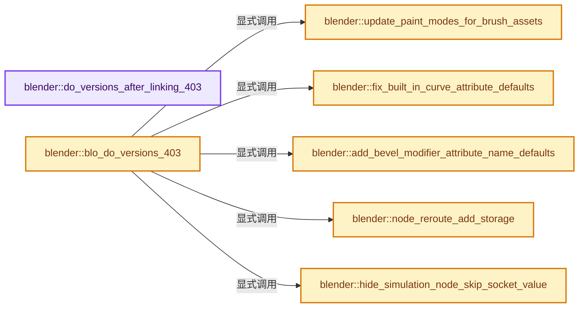
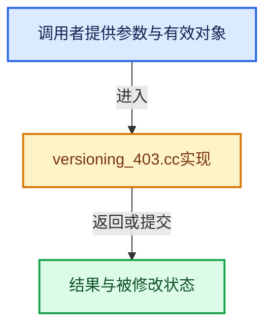

# 实现依赖专题：source/blender/blenloader/intern/versioning_403.cc

[实现依赖导航](../../../README.md) · [符号索引](../../../../00-课程指南/02-源码与提交索引/符号依赖与实现索引.md)

本专题从正文实际调用进入，集中保存共享实现。函数有稳定锚点，可从调用处直接跳到对应完整函数；递归与互相调用通过回链组织。

## 本文件的实现关系






## 完整成员与函数实现

<a id="f-5d1538456abf413a"></a>

### `blender::do_versions_after_linking_403`

实现位置：[source/blender/blenloader/intern/versioning_403.cc](../../../../../../../../source/blender/blenloader/intern/versioning_403.cc) · L46—L52。

接口参数：

- `FileData *`
- `Main *bmain`

**教学注释版**

<!-- annotated:b34a5165daac06 -->

```cpp
void do_versions_after_linking_403(FileData * /*fd*/, Main *bmain)
{
  if (!MAIN_VERSION_FILE_ATLEAST(bmain, 403, 6)) {
    /* Shift animation data to accommodate the new Diffuse Roughness input. */
    version_node_socket_index_animdata(bmain, NTREE_SHADER, SH_NODE_BSDF_PRINCIPLED, 7, 1, 30);
  }
}
```

<details>
<summary>核对原始源码：source/blender/blenloader/intern/versioning_403.cc · L46—L52</summary>

<!-- original:b34a5165daac06:source/blender/blenloader/intern/versioning_403.cc:46:52 -->

```cpp
void do_versions_after_linking_403(FileData * /*fd*/, Main *bmain)
{
  if (!MAIN_VERSION_FILE_ATLEAST(bmain, 403, 6)) {
    /* Shift animation data to accommodate the new Diffuse Roughness input. */
    version_node_socket_index_animdata(bmain, NTREE_SHADER, SH_NODE_BSDF_PRINCIPLED, 7, 1, 30);
  }
}
```

</details>

**继续追踪实现**

- `MAIN_VERSION_FILE_ATLEAST` → [MAIN_VERSION_FILE_ATLEAST · L946](../../../02-BKE几何与数据/BKE_main.hh.md#m-f0c0a8da9411)。宏定义由构建条件选择。
- `version_node_socket_index_animdata` → [blender::version_node_socket_index_animdata · L484](versioning_common.cc.md#f-27c2e2a91a515631)；[blender::version_node_socket_index_animdata · L500](versioning_common.cc.md#f-522ccbf91978b798)。同名重载需按实参类型选择。

<a id="f-f0ca860eba9912e9"></a>

### `blender::update_paint_modes_for_brush_assets`

实现位置：[source/blender/blenloader/intern/versioning_403.cc](../../../../../../../../source/blender/blenloader/intern/versioning_403.cc) · L54—L91。

接口参数：

- `Main &bmain`

**教学注释版**

<!-- annotated:44da06ab606cb5 -->

```cpp
static void update_paint_modes_for_brush_assets(Main &bmain)
{
  /* Replace paint brushes with a reference to the default brush asset for that mode. */
  for (Scene &scene : bmain.scenes) {
    BKE_paint_brushes_set_default_references(scene.toolsettings);
  }

  /* Replace persistent tool references with the new single builtin brush tool. */
  for (WorkSpace &workspace : bmain.workspaces) {
    for (bToolRef &tref : workspace.tools) {
      if (tref.space_type == SPACE_IMAGE && tref.mode == SI_MODE_PAINT) {
        STRNCPY_UTF8(tref.idname, "builtin.brush");
        continue;
      }
      if (tref.space_type != SPACE_VIEW3D) {
        continue;
      }
      if (!ELEM(tref.mode,
                CTX_MODE_SCULPT,
                CTX_MODE_PAINT_VERTEX,
                CTX_MODE_PAINT_WEIGHT,
                CTX_MODE_PAINT_TEXTURE,
                CTX_MODE_PAINT_GPENCIL_LEGACY,
                CTX_MODE_PAINT_GREASE_PENCIL,
                CTX_MODE_SCULPT_GPENCIL_LEGACY,
                CTX_MODE_SCULPT_GREASE_PENCIL,
                CTX_MODE_WEIGHT_GPENCIL_LEGACY,
                CTX_MODE_WEIGHT_GREASE_PENCIL,
                CTX_MODE_VERTEX_GREASE_PENCIL,
                CTX_MODE_VERTEX_GPENCIL_LEGACY,
                CTX_MODE_SCULPT_CURVES))
      {
        continue;
      }
      STRNCPY_UTF8(tref.idname, "builtin.brush");
    }
  }
}
```

<details>
<summary>核对原始源码：source/blender/blenloader/intern/versioning_403.cc · L54—L91</summary>

<!-- original:44da06ab606cb5:source/blender/blenloader/intern/versioning_403.cc:54:91 -->

```cpp
static void update_paint_modes_for_brush_assets(Main &bmain)
{
  /* Replace paint brushes with a reference to the default brush asset for that mode. */
  for (Scene &scene : bmain.scenes) {
    BKE_paint_brushes_set_default_references(scene.toolsettings);
  }

  /* Replace persistent tool references with the new single builtin brush tool. */
  for (WorkSpace &workspace : bmain.workspaces) {
    for (bToolRef &tref : workspace.tools) {
      if (tref.space_type == SPACE_IMAGE && tref.mode == SI_MODE_PAINT) {
        STRNCPY_UTF8(tref.idname, "builtin.brush");
        continue;
      }
      if (tref.space_type != SPACE_VIEW3D) {
        continue;
      }
      if (!ELEM(tref.mode,
                CTX_MODE_SCULPT,
                CTX_MODE_PAINT_VERTEX,
                CTX_MODE_PAINT_WEIGHT,
                CTX_MODE_PAINT_TEXTURE,
                CTX_MODE_PAINT_GPENCIL_LEGACY,
                CTX_MODE_PAINT_GREASE_PENCIL,
                CTX_MODE_SCULPT_GPENCIL_LEGACY,
                CTX_MODE_SCULPT_GREASE_PENCIL,
                CTX_MODE_WEIGHT_GPENCIL_LEGACY,
                CTX_MODE_WEIGHT_GREASE_PENCIL,
                CTX_MODE_VERTEX_GREASE_PENCIL,
                CTX_MODE_VERTEX_GPENCIL_LEGACY,
                CTX_MODE_SCULPT_CURVES))
      {
        continue;
      }
      STRNCPY_UTF8(tref.idname, "builtin.brush");
    }
  }
}
```

</details>

**继续追踪实现**

- `BKE_paint_brushes_set_default_references` → [blender::BKE_paint_brushes_set_default_references · L1069](../../../02-BKE几何与数据/intern/paint.cc.md#f-691ed56f9f773c11)。
- `STRNCPY_UTF8` → [STRNCPY_UTF8 · L335](../../../01-BLI基础库/BLI_string_utf8.hh.md#m-222967f0ab6a)。宏定义由构建条件选择。
- `ELEM` → [ELEM · L88](../../../07-Intern运行时与平台/ghost/intern/GHOST_utildefines.hh.md#m-d28724a15928)；[ELEM · L135](../../../01-BLI基础库/BLI_utildefines.hh.md#m-d6572de7cae0)。宏定义由构建条件选择。

<a id="f-6486d85b572cb953"></a>

### `blender::fix_built_in_curve_attribute_defaults`

实现位置：[source/blender/blenloader/intern/versioning_403.cc](../../../../../../../../source/blender/blenloader/intern/versioning_403.cc) · L97—L116。

接口参数：

- `Main *bmain`

**教学注释版**

<!-- annotated:b3fb20a3f85303 -->

```cpp
static void fix_built_in_curve_attribute_defaults(Main *bmain)
{
  for (Curves &curves : bmain->hair_curves) {
    const int curves_num = curves.geometry.curve_num;
    if (int *resolutions = static_cast<int *>(CustomData_get_layer_named_for_write(
            &curves.geometry.curve_data_legacy, CD_PROP_INT32, "resolution", curves_num)))
    {
      for (int &resolution : MutableSpan{resolutions, curves_num}) {
        // [讲解] std::max：按比较关系选取较大值。本讲解中的增长公式同时满足最低请求和几何增长；若保存返回引用，还需注意实参寿命。
        resolution = std::max(resolution, 1);
      }
    }
    if (int8_t *nurb_orders = static_cast<int8_t *>(CustomData_get_layer_named_for_write(
            &curves.geometry.curve_data_legacy, CD_PROP_INT8, "nurbs_order", curves_num)))
    {
      for (int8_t &nurbs_order : MutableSpan{nurb_orders, curves_num}) {
        nurbs_order = std::max<int8_t>(nurbs_order, 1);
      }
    }
  }
}
```

<details>
<summary>核对原始源码：source/blender/blenloader/intern/versioning_403.cc · L97—L116</summary>

<!-- original:b3fb20a3f85303:source/blender/blenloader/intern/versioning_403.cc:97:116 -->

```cpp
static void fix_built_in_curve_attribute_defaults(Main *bmain)
{
  for (Curves &curves : bmain->hair_curves) {
    const int curves_num = curves.geometry.curve_num;
    if (int *resolutions = static_cast<int *>(CustomData_get_layer_named_for_write(
            &curves.geometry.curve_data_legacy, CD_PROP_INT32, "resolution", curves_num)))
    {
      for (int &resolution : MutableSpan{resolutions, curves_num}) {
        resolution = std::max(resolution, 1);
      }
    }
    if (int8_t *nurb_orders = static_cast<int8_t *>(CustomData_get_layer_named_for_write(
            &curves.geometry.curve_data_legacy, CD_PROP_INT8, "nurbs_order", curves_num)))
    {
      for (int8_t &nurbs_order : MutableSpan{nurb_orders, curves_num}) {
        nurbs_order = std::max<int8_t>(nurbs_order, 1);
      }
    }
  }
}
```

</details>

**沿实际写入检查状态**

- `resolution = std::max(resolution, 1);`
- `nurbs_order = std::max<int8_t>(nurbs_order, 1);`

**继续追踪实现**

- `CustomData_get_layer_named_for_write` → [blender::CustomData_get_layer_named_for_write · L3365](../../../02-BKE几何与数据/intern/customdata.cc.md#f-705c2eebfa5f1f86)。
- `std::max` → [外部契约](https://eel.is/c++draft/alg.min.max)：按比较关系选取较大值。本讲解中的增长公式同时满足最低请求和几何增长；若保存返回引用，还需注意实参寿命。
- `std::max<int8_t>` → [外部契约](https://eel.is/c++draft/alg.min.max)：按比较关系选取较大值。本讲解中的增长公式同时满足最低请求和几何增长；若保存返回引用，还需注意实参寿命。

<a id="f-9d8b951c0f80c93d"></a>

### `blender::node_reroute_add_storage`

实现位置：[source/blender/blenloader/intern/versioning_403.cc](../../../../../../../../source/blender/blenloader/intern/versioning_403.cc) · L118—L141。

接口参数：

- `bNodeTree &tree`

**教学注释版**

<!-- annotated:39c83776d1de22 -->

```cpp
static void node_reroute_add_storage(bNodeTree &tree)
{
  for (bNode *node : tree.all_nodes()) {
    if (node->is_reroute()) {
      if (node->storage != nullptr) {
        continue;
      }

      bNodeSocket &input = *node->inputs.first();
      bNodeSocket &output = *node->outputs.first();

      /* Use uniform identifier for sockets. In old Blender versions (<=2021, up to af0b7925), the
       * identifiers were sometimes all lower case. Fixing those wrong socket identifiers is
       * important because otherwise they loose links now that the reroute node also uses node
       * declarations. */
      version_node_socket_identifier_set(input, "Input");
      version_node_socket_identifier_set(output, "Output");

      NodeReroute *data = MEM_new<NodeReroute>(__func__);
      STRNCPY_UTF8(data->type_idname, input.idname);
      node->storage = data;
    }
  }
}
```

<details>
<summary>核对原始源码：source/blender/blenloader/intern/versioning_403.cc · L118—L141</summary>

<!-- original:39c83776d1de22:source/blender/blenloader/intern/versioning_403.cc:118:141 -->

```cpp
static void node_reroute_add_storage(bNodeTree &tree)
{
  for (bNode *node : tree.all_nodes()) {
    if (node->is_reroute()) {
      if (node->storage != nullptr) {
        continue;
      }

      bNodeSocket &input = *node->inputs.first();
      bNodeSocket &output = *node->outputs.first();

      /* Use uniform identifier for sockets. In old Blender versions (<=2021, up to af0b7925), the
       * identifiers were sometimes all lower case. Fixing those wrong socket identifiers is
       * important because otherwise they loose links now that the reroute node also uses node
       * declarations. */
      version_node_socket_identifier_set(input, "Input");
      version_node_socket_identifier_set(output, "Output");

      NodeReroute *data = MEM_new<NodeReroute>(__func__);
      STRNCPY_UTF8(data->type_idname, input.idname);
      node->storage = data;
    }
  }
}
```

</details>

**沿实际写入检查状态**

- `node->storage = data;`

**继续追踪实现**

- `tree.all_nodes` → [blender::bNodeTree::all_nodes · L500](../../../02-BKE几何与数据/BKE_node_runtime.hh.md#f-cda455cbcc6c7f36)；[blender::bNodeTree::all_nodes · L505](../../../02-BKE几何与数据/BKE_node_runtime.hh.md#f-358b65e5678f8a32)。同名重载需按实参类型选择。
- `node->is_reroute` → [调用协议](../../../../00-课程指南/01-路线与规范/模板宏与动态分派协议.md)：接收对象类型依赖auto、返回值或模板实例；不按同名猜测目标。调用位置L121。
- `node->inputs.first` → [调用协议](../../../../00-课程指南/01-路线与规范/模板宏与动态分派协议.md)：接收对象类型依赖auto、返回值或模板实例；不按同名猜测目标。调用位置L126。
- `node->outputs.first` → [调用协议](../../../../00-课程指南/01-路线与规范/模板宏与动态分派协议.md)：接收对象类型依赖auto、返回值或模板实例；不按同名猜测目标。调用位置L127。
- `version_node_socket_identifier_set` → [blender::version_node_socket_identifier_set · L179](versioning_common.cc.md#f-15a2cb7eae2868c2)。
- `MEM_new<NodeReroute>` → [MEM_new · L351](../../../07-Intern运行时与平台/guardedalloc/MEM_guardedalloc.h.md#f-115f9b6784f89912)。
- `STRNCPY_UTF8` → [STRNCPY_UTF8 · L335](../../../01-BLI基础库/BLI_string_utf8.hh.md#m-222967f0ab6a)。宏定义由构建条件选择。

<a id="f-4d13cd8a58fc77f5"></a>

### `blender::add_bevel_modifier_attribute_name_defaults`

实现位置：[source/blender/blenloader/intern/versioning_403.cc](../../../../../../../../source/blender/blenloader/intern/versioning_403.cc) · L143—L161。

接口参数：

- `Main &bmain`

**教学注释版**

<!-- annotated:e789c0bbe14100 -->

```cpp
static void add_bevel_modifier_attribute_name_defaults(Main &bmain)
{
  for (Object &ob : bmain.objects) {
    if (ob.type != OB_MESH) {
      continue;
    }
    for (ModifierData &md : ob.modifiers) {
      if (md.type == eModifierType_Bevel) {
        BevelModifierData *bmd = reinterpret_cast<BevelModifierData *>(&md);
        if (bmd->vertex_weight_name[0] == '\0') {
          STRNCPY(bmd->vertex_weight_name, "bevel_weight_vert");
        }
        if (bmd->edge_weight_name[0] == '\0') {
          STRNCPY(bmd->edge_weight_name, "bevel_weight_edge");
        }
      }
    }
  }
}
```

<details>
<summary>核对原始源码：source/blender/blenloader/intern/versioning_403.cc · L143—L161</summary>

<!-- original:e789c0bbe14100:source/blender/blenloader/intern/versioning_403.cc:143:161 -->

```cpp
static void add_bevel_modifier_attribute_name_defaults(Main &bmain)
{
  for (Object &ob : bmain.objects) {
    if (ob.type != OB_MESH) {
      continue;
    }
    for (ModifierData &md : ob.modifiers) {
      if (md.type == eModifierType_Bevel) {
        BevelModifierData *bmd = reinterpret_cast<BevelModifierData *>(&md);
        if (bmd->vertex_weight_name[0] == '\0') {
          STRNCPY(bmd->vertex_weight_name, "bevel_weight_vert");
        }
        if (bmd->edge_weight_name[0] == '\0') {
          STRNCPY(bmd->edge_weight_name, "bevel_weight_edge");
        }
      }
    }
  }
}
```

</details>

**继续追踪实现**

- `STRNCPY` → [blender::STRNCPY · L690](../../../01-BLI基础库/BLI_string.hh.md#f-6b2d861724026be6)。

<a id="f-940ed934c66605e2"></a>

### `blender::hide_simulation_node_skip_socket_value`

实现位置：[source/blender/blenloader/intern/versioning_403.cc](../../../../../../../../source/blender/blenloader/intern/versioning_403.cc) · L163—L206。

接口参数：

- `Main &bmain`

**教学注释版**

<!-- annotated:a3e8448fbb6c55 -->

```cpp
static void hide_simulation_node_skip_socket_value(Main &bmain)
{
  for (bNodeTree &tree : bmain.nodetrees) {
    for (bNode &node : tree.nodes) {
      if (node.type_legacy != GEO_NODE_SIMULATION_OUTPUT) {
        continue;
      }
      bNodeSocket *skip_input = node.inputs.first();
      if (!skip_input || !STREQ(skip_input->identifier, "Skip")) {
        continue;
      }
      auto *default_value = static_cast<bNodeSocketValueBoolean *>(skip_input->default_value);
      if (!default_value->value) {
        continue;
      }
      bool is_linked = false;
      for (bNodeLink &link : tree.links) {
        if (link.tosock == skip_input) {
          is_linked = true;
        }
      }
      if (is_linked) {
        continue;
      }

      bNode &input_node = version_node_add_empty(tree, "FunctionNodeInputBool");
      input_node.parent = node.parent;
      input_node.locx_legacy = node.locx_legacy - 25;
      input_node.locy_legacy = node.locy_legacy;

      NodeInputBool *input_node_storage = MEM_new<NodeInputBool>(__func__);
      input_node.storage = input_node_storage;
      input_node_storage->boolean = true;

      bNodeSocket &input_node_socket = version_node_add_socket(
          tree, input_node, SOCK_OUT, "NodeSocketBool", "Boolean");

      version_node_add_link(tree, input_node, input_node_socket, node, *skip_input);

      /* Change the old socket value so that the versioning code is not run again. */
      default_value->value = false;
    }
  }
}
```

<details>
<summary>核对原始源码：source/blender/blenloader/intern/versioning_403.cc · L163—L206</summary>

<!-- original:a3e8448fbb6c55:source/blender/blenloader/intern/versioning_403.cc:163:206 -->

```cpp
static void hide_simulation_node_skip_socket_value(Main &bmain)
{
  for (bNodeTree &tree : bmain.nodetrees) {
    for (bNode &node : tree.nodes) {
      if (node.type_legacy != GEO_NODE_SIMULATION_OUTPUT) {
        continue;
      }
      bNodeSocket *skip_input = node.inputs.first();
      if (!skip_input || !STREQ(skip_input->identifier, "Skip")) {
        continue;
      }
      auto *default_value = static_cast<bNodeSocketValueBoolean *>(skip_input->default_value);
      if (!default_value->value) {
        continue;
      }
      bool is_linked = false;
      for (bNodeLink &link : tree.links) {
        if (link.tosock == skip_input) {
          is_linked = true;
        }
      }
      if (is_linked) {
        continue;
      }

      bNode &input_node = version_node_add_empty(tree, "FunctionNodeInputBool");
      input_node.parent = node.parent;
      input_node.locx_legacy = node.locx_legacy - 25;
      input_node.locy_legacy = node.locy_legacy;

      NodeInputBool *input_node_storage = MEM_new<NodeInputBool>(__func__);
      input_node.storage = input_node_storage;
      input_node_storage->boolean = true;

      bNodeSocket &input_node_socket = version_node_add_socket(
          tree, input_node, SOCK_OUT, "NodeSocketBool", "Boolean");

      version_node_add_link(tree, input_node, input_node_socket, node, *skip_input);

      /* Change the old socket value so that the versioning code is not run again. */
      default_value->value = false;
    }
  }
}
```

</details>

**沿实际写入检查状态**

- `is_linked = true;`
- `input_node.parent = node.parent;`
- `input_node.locx_legacy = node.locx_legacy - 25;`
- `input_node.locy_legacy = node.locy_legacy;`
- `input_node.storage = input_node_storage;`
- `input_node_storage->boolean = true;`
- `default_value->value = false;`

**继续追踪实现**

- `node.inputs.first` → [调用协议](../../../../00-课程指南/01-路线与规范/模板宏与动态分派协议.md)：接收对象类型依赖auto、返回值或模板实例；不按同名猜测目标。调用位置L170。
- `STREQ` → [STREQ · L112](../../../07-Intern运行时与平台/ghost/intern/GHOST_utildefines.hh.md#m-9549fb6aafd2)；[STREQ · L451](../../../01-BLI基础库/BLI_utildefines.hh.md#m-c7b745bcfad2)；[STREQ · L55](../../../07-Intern运行时与平台/clog/clog.cc.md#m-96e78f386894)。宏定义由构建条件选择。
- `version_node_add_empty` → [blender::version_node_add_empty · L250](versioning_common.cc.md#f-5f6c9b1704901087)。
- `MEM_new<NodeInputBool>` → [MEM_new · L351](../../../07-Intern运行时与平台/guardedalloc/MEM_guardedalloc.h.md#f-115f9b6784f89912)。
- `version_node_add_socket` → [blender::version_node_add_socket · L332](versioning_common.cc.md#f-846a4268eff6ea5d)。
- `version_node_add_link` → [blender::version_node_add_link · L365](versioning_common.cc.md#f-93b7d089bdf6807c)。

<a id="f-940974cdaa1cae88"></a>

### `blender::blo_do_versions_403`

实现位置：[source/blender/blenloader/intern/versioning_403.cc](../../../../../../../../source/blender/blenloader/intern/versioning_403.cc) · L208—L519。

接口参数：

- `FileData *`
- `Library *`
- `Main *bmain`

**教学注释版**

<!-- annotated:d3ccb3f7bf2a5e -->

```cpp
void blo_do_versions_403(FileData * /*fd*/, Library * /*lib*/, Main *bmain)
{
  if (!MAIN_VERSION_FILE_ATLEAST(bmain, 403, 2)) {
    for (bScreen &screen : bmain->screens) {
      for (ScrArea &area : screen.areabase) {
        for (SpaceLink &space_link : area.spacedata) {
          if (space_link.spacetype == SPACE_NODE) {
            SpaceNode *space_node = reinterpret_cast<SpaceNode *>(&space_link);
            space_node->flag &= ~SNODE_FLAG_UNUSED_5;
          }
        }
      }
    }
  }

  if (!MAIN_VERSION_FILE_ATLEAST(bmain, 403, 3)) {
    for (Brush &brush : bmain->brushes) {
      if (BrushGpencilSettings *settings = brush.gpencil_settings) {
        /* Copy the `draw_strength` value to the `alpha` value. */
        brush.alpha = settings->draw_strength;

        /* We approximate the simplify pixel threshold by taking the previous threshold (world
         * space) and dividing by the legacy radius conversion factor. This should generally give
         * reasonable "pixel" threshold values, at least for previous GPv2 defaults. */
        settings->simplify_px = settings->simplify_f /
                                bke::greasepencil::LEGACY_RADIUS_CONVERSION_FACTOR * 0.1f;
      }
    }
  }

  if (!MAIN_VERSION_FILE_ATLEAST(bmain, 403, 4)) {
    for (Scene &scene : bmain->scenes) {
      scene.view_settings.temperature = 6500.0f;
      scene.view_settings.tint = 10.0f;
    }
  }

  if (!MAIN_VERSION_FILE_ATLEAST(bmain, 403, 7)) {
    for (Scene &scene : bmain->scenes) {
      SequencerToolSettings *sequencer_tool_settings = seq::tool_settings_ensure(&scene);
      sequencer_tool_settings->snap_mode |= SEQ_SNAP_TO_PREVIEW_BORDERS |
                                            SEQ_SNAP_TO_PREVIEW_CENTER |
                                            SEQ_SNAP_TO_STRIPS_PREVIEW;
    }
  }

  if (!MAIN_VERSION_FILE_ATLEAST(bmain, 403, 8)) {
    update_paint_modes_for_brush_assets(*bmain);
  }

  if (!MAIN_VERSION_FILE_ATLEAST(bmain, 403, 9)) {
    fix_built_in_curve_attribute_defaults(bmain);
  }

  if (!MAIN_VERSION_FILE_ATLEAST(bmain, 403, 10)) {
    /* Initialize Color Balance node white point settings. */
    FOREACH_NODETREE_BEGIN (bmain, ntree, id) {
      if (ntree->type != NTREE_CUSTOM) {
        for (bNode &node : ntree->nodes) {
          if (node.type_legacy == CMP_NODE_COLORBALANCE) {
            if (version_node_ensure_storage_or_invalidate(node)) {
              NodeColorBalance *n = static_cast<NodeColorBalance *>(node.storage);
              n->input_temperature = n->output_temperature = 6500.0f;
              n->input_tint = n->output_tint = 10.0f;
            }
          }
        }
      }
    }
    FOREACH_NODETREE_END;
  }

  if (!MAIN_VERSION_FILE_ATLEAST(bmain, 403, 11)) {
    for (Curves &curves : bmain->hair_curves) {
      curves.geometry.attributes_active_index = curves.attributes_active_index_legacy;
    }
  }

  if (!MAIN_VERSION_FILE_ATLEAST(bmain, 403, 13)) {
    Camera default_cam;
    for (Camera &camera : bmain->cameras) {
      camera.central_cylindrical_range_u_min = default_cam.central_cylindrical_range_u_min;
      camera.central_cylindrical_range_u_max = default_cam.central_cylindrical_range_u_max;
      camera.central_cylindrical_range_v_min = default_cam.central_cylindrical_range_v_min;
      camera.central_cylindrical_range_v_max = default_cam.central_cylindrical_range_v_max;
      camera.central_cylindrical_radius = default_cam.central_cylindrical_radius;
    }
  }

  /* The File Output node now uses the linear color space setting of its stored image formats. So
   * we need to ensure the color space value is initialized to some sane default based on the image
   * type. Furthermore, the node now gained a new Save As Render option that is global to the node,
   * which will be used if Use Node Format is enabled for each input, so we potentially need to
   * disable Use Node Format in case inputs had different Save As render options. */
  if (!MAIN_VERSION_FILE_ATLEAST(bmain, 403, 14)) {
    FOREACH_NODETREE_BEGIN (bmain, ntree, id) {
      if (ntree->type != NTREE_COMPOSIT) {
        continue;
      }

      for (bNode &node : ntree->nodes) {
        if (node.type_legacy != CMP_NODE_OUTPUT_FILE) {
          continue;
        }
        if (!version_node_ensure_storage_or_invalidate(node)) {
          continue;
        }

        /* Initialize node format color space if it is not set. */
        NodeCompositorFileOutput *storage = static_cast<NodeCompositorFileOutput *>(node.storage);
        if (storage->format.linear_colorspace_settings.name[0] == '\0') {
          BKE_image_format_update_color_space_for_type(&storage->format);
        }

        if (node.inputs.is_empty()) {
          continue;
        }

        /* Initialize input formats color space if it is not set. */
        for (const bNodeSocket &input : node.inputs) {
          NodeImageMultiFileSocket *input_storage = static_cast<NodeImageMultiFileSocket *>(
              input.storage);
          if (input_storage->format.linear_colorspace_settings.name[0] == '\0') {
            BKE_image_format_update_color_space_for_type(&input_storage->format);
          }
        }

        /* EXR images don't use Save As Render. */
        if (ELEM(storage->format.imtype, R_IMF_IMTYPE_OPENEXR, R_IMF_IMTYPE_MULTILAYER)) {
          continue;
        }

        /* Find out if all inputs have the same Save As Render option. */
        const bNodeSocket *first_input = node.inputs.first();
        const NodeImageMultiFileSocket *first_input_storage =
            static_cast<NodeImageMultiFileSocket *>(first_input->storage);
        const bool first_save_as_render = first_input_storage->save_as_render;
        bool all_inputs_have_same_save_as_render = true;
        for (const bNodeSocket &input : node.inputs) {
          const NodeImageMultiFileSocket *input_storage = static_cast<NodeImageMultiFileSocket *>(
              input.storage);
          if (bool(input_storage->save_as_render) != first_save_as_render) {
            all_inputs_have_same_save_as_render = false;
            break;
          }
        }

        /* All inputs have the same save as render option, so we set the node Save As Render option
         * to that value, and we leave inputs as is. */
        if (all_inputs_have_same_save_as_render) {
          storage->save_as_render = first_save_as_render;
          continue;
        }

        /* For inputs that have Use Node Format enabled, we need to disabled it because otherwise
         * they will use the node's Save As Render option. It follows that we need to copy the
         * node's format to the input format. */
        for (const bNodeSocket &input : node.inputs) {
          NodeImageMultiFileSocket *input_storage = static_cast<NodeImageMultiFileSocket *>(
              input.storage);

          if (!input_storage->use_node_format) {
            continue;
          }

          input_storage->use_node_format = false;
          input_storage->format = storage->format;
        }
      }
    }
    FOREACH_NODETREE_END;
  }

  if (!MAIN_VERSION_FILE_ATLEAST(bmain, 403, 15)) {
    for (Collection &collection : bmain->collections) {
      const ListBaseT<CollectionExport> *exporters = &collection.exporters;
      for (CollectionExport &data : *exporters) {
        /* The name field should be empty at this point. */
        BLI_assert(data.name[0] == '\0');

        bke::FileHandlerType *fh = bke::file_handler_find(data.fh_idname);
        BKE_collection_exporter_name_set(exporters, &data, fh ? fh->label : DATA_("Undefined"));
      }
    }
  }

  if (!MAIN_VERSION_FILE_ATLEAST(bmain, 403, 16)) {
    for (Scene &scene : bmain->scenes) {
      scene.eevee.flag |= SCE_EEVEE_FAST_GI_ENABLED;
    }
  }

  if (!MAIN_VERSION_FILE_ATLEAST(bmain, 403, 17)) {
    FOREACH_NODETREE_BEGIN (bmain, tree, id) {
      if (tree->default_group_node_width == 0) {
        tree->default_group_node_width = bke::NodeWidth::Default;
      }
    }
    FOREACH_NODETREE_END;
  }

  if (!MAIN_VERSION_FILE_ATLEAST(bmain, 403, 20)) {
    for (bScreen &screen : bmain->screens) {
      for (ScrArea &area : screen.areabase) {
        for (SpaceLink &sl : area.spacedata) {
          if (sl.spacetype == SPACE_SEQ) {
            ARegion *region = BKE_area_find_region_type(&area, RGN_TYPE_TOOLS);
            if (region != nullptr) {
              region->flag &= ~RGN_FLAG_HIDDEN;
            }
          }
        }
      }
    }
  }

  if (!MAIN_VERSION_FILE_ATLEAST(bmain, 403, 21)) {
    for (bScreen &screen : bmain->screens) {
      for (ScrArea &area : screen.areabase) {
        for (SpaceLink &sl : area.spacedata) {
          if (sl.spacetype == SPACE_CLIP) {
            ARegion *region = BKE_area_find_region_type(&area, RGN_TYPE_WINDOW);
            if (region != nullptr) {
              View2D *v2d = &region->v2d;
              v2d->flag &= ~V2D_VIEWSYNC_SCREEN_TIME;
            }
          }
        }
      }
    }
  }

  if (!MAIN_VERSION_FILE_ATLEAST(bmain, 403, 22)) {
    add_bevel_modifier_attribute_name_defaults(*bmain);
  }

  if (!MAIN_VERSION_FILE_ATLEAST(bmain, 403, 23)) {
    for (Object &object : bmain->objects) {
      for (ModifierData &md : object.modifiers) {
        if (md.type != eModifierType_Nodes) {
          continue;
        }
        NodesModifierData &nmd = *reinterpret_cast<NodesModifierData *>(&md);
        if (nmd.bake_target == NODES_MODIFIER_BAKE_TARGET_INHERIT) {
          /* Use disk target for existing modifiers to avoid changing behavior. */
          nmd.bake_target = NODES_MODIFIER_BAKE_TARGET_DISK;
        }
      }
    }
  }

  if (!MAIN_VERSION_FILE_ATLEAST(bmain, 403, 24)) {
    FOREACH_NODETREE_BEGIN (bmain, ntree, id) {
      node_reroute_add_storage(*ntree);
    }
    FOREACH_NODETREE_END;
  }

  if (!MAIN_VERSION_FILE_ATLEAST(bmain, 403, 26)) {
    hide_simulation_node_skip_socket_value(*bmain);
  }

  if (!MAIN_VERSION_FILE_ATLEAST(bmain, 403, 28)) {
    for (bScreen &screen : bmain->screens) {
      for (ScrArea &area : screen.areabase) {
        for (SpaceLink &sl : area.spacedata) {
          if (sl.spacetype == SPACE_VIEW3D) {
            View3D *v3d = reinterpret_cast<View3D *>(&sl);
            copy_v3_fl(v3d->overlay.gpencil_grid_color, 0.5f);
            copy_v2_fl(v3d->overlay.gpencil_grid_scale, 1.0f);
            copy_v2_fl(v3d->overlay.gpencil_grid_offset, 0.0f);
            v3d->overlay.gpencil_grid_subdivisions = 4;
          }
        }
      }
    }

    FOREACH_NODETREE_BEGIN (bmain, ntree, id) {
      if (ntree->type != NTREE_COMPOSIT) {
        continue;
      }
      for (bNode &node : ntree->nodes.items_mutable()) {
        if (ELEM(node.type_legacy, CMP_NODE_VIEWER, CMP_NODE_COMPOSITE_DEPRECATED)) {
          node.flag &= ~NODE_PREVIEW;
        }
      }
    }
    FOREACH_NODETREE_END;
  }

  if (!MAIN_VERSION_FILE_ATLEAST(bmain, 403, 29)) {
    /* Open warnings panel by default. */
    for (Object &object : bmain->objects) {
      for (ModifierData &md : object.modifiers) {
        if (md.type == eModifierType_Nodes) {
          md.layout_panel_open_flag |= 1 << NODES_MODIFIER_PANEL_WARNINGS;
        }
      }
    }
  }

  if (!MAIN_VERSION_FILE_ATLEAST(bmain, 403, 31)) {
    for (WorkSpace &workspace : bmain->workspaces) {
      for (bToolRef &tref : workspace.tools) {
        if (tref.space_type != SPACE_SEQ) {
          continue;
        }
        STRNCPY_UTF8(tref.idname, "builtin.select_box");
      }
    }
  }
}
```

<details>
<summary>核对原始源码：source/blender/blenloader/intern/versioning_403.cc · L208—L519</summary>

<!-- original:d3ccb3f7bf2a5e:source/blender/blenloader/intern/versioning_403.cc:208:519 -->

```cpp
void blo_do_versions_403(FileData * /*fd*/, Library * /*lib*/, Main *bmain)
{
  if (!MAIN_VERSION_FILE_ATLEAST(bmain, 403, 2)) {
    for (bScreen &screen : bmain->screens) {
      for (ScrArea &area : screen.areabase) {
        for (SpaceLink &space_link : area.spacedata) {
          if (space_link.spacetype == SPACE_NODE) {
            SpaceNode *space_node = reinterpret_cast<SpaceNode *>(&space_link);
            space_node->flag &= ~SNODE_FLAG_UNUSED_5;
          }
        }
      }
    }
  }

  if (!MAIN_VERSION_FILE_ATLEAST(bmain, 403, 3)) {
    for (Brush &brush : bmain->brushes) {
      if (BrushGpencilSettings *settings = brush.gpencil_settings) {
        /* Copy the `draw_strength` value to the `alpha` value. */
        brush.alpha = settings->draw_strength;

        /* We approximate the simplify pixel threshold by taking the previous threshold (world
         * space) and dividing by the legacy radius conversion factor. This should generally give
         * reasonable "pixel" threshold values, at least for previous GPv2 defaults. */
        settings->simplify_px = settings->simplify_f /
                                bke::greasepencil::LEGACY_RADIUS_CONVERSION_FACTOR * 0.1f;
      }
    }
  }

  if (!MAIN_VERSION_FILE_ATLEAST(bmain, 403, 4)) {
    for (Scene &scene : bmain->scenes) {
      scene.view_settings.temperature = 6500.0f;
      scene.view_settings.tint = 10.0f;
    }
  }

  if (!MAIN_VERSION_FILE_ATLEAST(bmain, 403, 7)) {
    for (Scene &scene : bmain->scenes) {
      SequencerToolSettings *sequencer_tool_settings = seq::tool_settings_ensure(&scene);
      sequencer_tool_settings->snap_mode |= SEQ_SNAP_TO_PREVIEW_BORDERS |
                                            SEQ_SNAP_TO_PREVIEW_CENTER |
                                            SEQ_SNAP_TO_STRIPS_PREVIEW;
    }
  }

  if (!MAIN_VERSION_FILE_ATLEAST(bmain, 403, 8)) {
    update_paint_modes_for_brush_assets(*bmain);
  }

  if (!MAIN_VERSION_FILE_ATLEAST(bmain, 403, 9)) {
    fix_built_in_curve_attribute_defaults(bmain);
  }

  if (!MAIN_VERSION_FILE_ATLEAST(bmain, 403, 10)) {
    /* Initialize Color Balance node white point settings. */
    FOREACH_NODETREE_BEGIN (bmain, ntree, id) {
      if (ntree->type != NTREE_CUSTOM) {
        for (bNode &node : ntree->nodes) {
          if (node.type_legacy == CMP_NODE_COLORBALANCE) {
            if (version_node_ensure_storage_or_invalidate(node)) {
              NodeColorBalance *n = static_cast<NodeColorBalance *>(node.storage);
              n->input_temperature = n->output_temperature = 6500.0f;
              n->input_tint = n->output_tint = 10.0f;
            }
          }
        }
      }
    }
    FOREACH_NODETREE_END;
  }

  if (!MAIN_VERSION_FILE_ATLEAST(bmain, 403, 11)) {
    for (Curves &curves : bmain->hair_curves) {
      curves.geometry.attributes_active_index = curves.attributes_active_index_legacy;
    }
  }

  if (!MAIN_VERSION_FILE_ATLEAST(bmain, 403, 13)) {
    Camera default_cam;
    for (Camera &camera : bmain->cameras) {
      camera.central_cylindrical_range_u_min = default_cam.central_cylindrical_range_u_min;
      camera.central_cylindrical_range_u_max = default_cam.central_cylindrical_range_u_max;
      camera.central_cylindrical_range_v_min = default_cam.central_cylindrical_range_v_min;
      camera.central_cylindrical_range_v_max = default_cam.central_cylindrical_range_v_max;
      camera.central_cylindrical_radius = default_cam.central_cylindrical_radius;
    }
  }

  /* The File Output node now uses the linear color space setting of its stored image formats. So
   * we need to ensure the color space value is initialized to some sane default based on the image
   * type. Furthermore, the node now gained a new Save As Render option that is global to the node,
   * which will be used if Use Node Format is enabled for each input, so we potentially need to
   * disable Use Node Format in case inputs had different Save As render options. */
  if (!MAIN_VERSION_FILE_ATLEAST(bmain, 403, 14)) {
    FOREACH_NODETREE_BEGIN (bmain, ntree, id) {
      if (ntree->type != NTREE_COMPOSIT) {
        continue;
      }

      for (bNode &node : ntree->nodes) {
        if (node.type_legacy != CMP_NODE_OUTPUT_FILE) {
          continue;
        }
        if (!version_node_ensure_storage_or_invalidate(node)) {
          continue;
        }

        /* Initialize node format color space if it is not set. */
        NodeCompositorFileOutput *storage = static_cast<NodeCompositorFileOutput *>(node.storage);
        if (storage->format.linear_colorspace_settings.name[0] == '\0') {
          BKE_image_format_update_color_space_for_type(&storage->format);
        }

        if (node.inputs.is_empty()) {
          continue;
        }

        /* Initialize input formats color space if it is not set. */
        for (const bNodeSocket &input : node.inputs) {
          NodeImageMultiFileSocket *input_storage = static_cast<NodeImageMultiFileSocket *>(
              input.storage);
          if (input_storage->format.linear_colorspace_settings.name[0] == '\0') {
            BKE_image_format_update_color_space_for_type(&input_storage->format);
          }
        }

        /* EXR images don't use Save As Render. */
        if (ELEM(storage->format.imtype, R_IMF_IMTYPE_OPENEXR, R_IMF_IMTYPE_MULTILAYER)) {
          continue;
        }

        /* Find out if all inputs have the same Save As Render option. */
        const bNodeSocket *first_input = node.inputs.first();
        const NodeImageMultiFileSocket *first_input_storage =
            static_cast<NodeImageMultiFileSocket *>(first_input->storage);
        const bool first_save_as_render = first_input_storage->save_as_render;
        bool all_inputs_have_same_save_as_render = true;
        for (const bNodeSocket &input : node.inputs) {
          const NodeImageMultiFileSocket *input_storage = static_cast<NodeImageMultiFileSocket *>(
              input.storage);
          if (bool(input_storage->save_as_render) != first_save_as_render) {
            all_inputs_have_same_save_as_render = false;
            break;
          }
        }

        /* All inputs have the same save as render option, so we set the node Save As Render option
         * to that value, and we leave inputs as is. */
        if (all_inputs_have_same_save_as_render) {
          storage->save_as_render = first_save_as_render;
          continue;
        }

        /* For inputs that have Use Node Format enabled, we need to disabled it because otherwise
         * they will use the node's Save As Render option. It follows that we need to copy the
         * node's format to the input format. */
        for (const bNodeSocket &input : node.inputs) {
          NodeImageMultiFileSocket *input_storage = static_cast<NodeImageMultiFileSocket *>(
              input.storage);

          if (!input_storage->use_node_format) {
            continue;
          }

          input_storage->use_node_format = false;
          input_storage->format = storage->format;
        }
      }
    }
    FOREACH_NODETREE_END;
  }

  if (!MAIN_VERSION_FILE_ATLEAST(bmain, 403, 15)) {
    for (Collection &collection : bmain->collections) {
      const ListBaseT<CollectionExport> *exporters = &collection.exporters;
      for (CollectionExport &data : *exporters) {
        /* The name field should be empty at this point. */
        BLI_assert(data.name[0] == '\0');

        bke::FileHandlerType *fh = bke::file_handler_find(data.fh_idname);
        BKE_collection_exporter_name_set(exporters, &data, fh ? fh->label : DATA_("Undefined"));
      }
    }
  }

  if (!MAIN_VERSION_FILE_ATLEAST(bmain, 403, 16)) {
    for (Scene &scene : bmain->scenes) {
      scene.eevee.flag |= SCE_EEVEE_FAST_GI_ENABLED;
    }
  }

  if (!MAIN_VERSION_FILE_ATLEAST(bmain, 403, 17)) {
    FOREACH_NODETREE_BEGIN (bmain, tree, id) {
      if (tree->default_group_node_width == 0) {
        tree->default_group_node_width = bke::NodeWidth::Default;
      }
    }
    FOREACH_NODETREE_END;
  }

  if (!MAIN_VERSION_FILE_ATLEAST(bmain, 403, 20)) {
    for (bScreen &screen : bmain->screens) {
      for (ScrArea &area : screen.areabase) {
        for (SpaceLink &sl : area.spacedata) {
          if (sl.spacetype == SPACE_SEQ) {
            ARegion *region = BKE_area_find_region_type(&area, RGN_TYPE_TOOLS);
            if (region != nullptr) {
              region->flag &= ~RGN_FLAG_HIDDEN;
            }
          }
        }
      }
    }
  }

  if (!MAIN_VERSION_FILE_ATLEAST(bmain, 403, 21)) {
    for (bScreen &screen : bmain->screens) {
      for (ScrArea &area : screen.areabase) {
        for (SpaceLink &sl : area.spacedata) {
          if (sl.spacetype == SPACE_CLIP) {
            ARegion *region = BKE_area_find_region_type(&area, RGN_TYPE_WINDOW);
            if (region != nullptr) {
              View2D *v2d = &region->v2d;
              v2d->flag &= ~V2D_VIEWSYNC_SCREEN_TIME;
            }
          }
        }
      }
    }
  }

  if (!MAIN_VERSION_FILE_ATLEAST(bmain, 403, 22)) {
    add_bevel_modifier_attribute_name_defaults(*bmain);
  }

  if (!MAIN_VERSION_FILE_ATLEAST(bmain, 403, 23)) {
    for (Object &object : bmain->objects) {
      for (ModifierData &md : object.modifiers) {
        if (md.type != eModifierType_Nodes) {
          continue;
        }
        NodesModifierData &nmd = *reinterpret_cast<NodesModifierData *>(&md);
        if (nmd.bake_target == NODES_MODIFIER_BAKE_TARGET_INHERIT) {
          /* Use disk target for existing modifiers to avoid changing behavior. */
          nmd.bake_target = NODES_MODIFIER_BAKE_TARGET_DISK;
        }
      }
    }
  }

  if (!MAIN_VERSION_FILE_ATLEAST(bmain, 403, 24)) {
    FOREACH_NODETREE_BEGIN (bmain, ntree, id) {
      node_reroute_add_storage(*ntree);
    }
    FOREACH_NODETREE_END;
  }

  if (!MAIN_VERSION_FILE_ATLEAST(bmain, 403, 26)) {
    hide_simulation_node_skip_socket_value(*bmain);
  }

  if (!MAIN_VERSION_FILE_ATLEAST(bmain, 403, 28)) {
    for (bScreen &screen : bmain->screens) {
      for (ScrArea &area : screen.areabase) {
        for (SpaceLink &sl : area.spacedata) {
          if (sl.spacetype == SPACE_VIEW3D) {
            View3D *v3d = reinterpret_cast<View3D *>(&sl);
            copy_v3_fl(v3d->overlay.gpencil_grid_color, 0.5f);
            copy_v2_fl(v3d->overlay.gpencil_grid_scale, 1.0f);
            copy_v2_fl(v3d->overlay.gpencil_grid_offset, 0.0f);
            v3d->overlay.gpencil_grid_subdivisions = 4;
          }
        }
      }
    }

    FOREACH_NODETREE_BEGIN (bmain, ntree, id) {
      if (ntree->type != NTREE_COMPOSIT) {
        continue;
      }
      for (bNode &node : ntree->nodes.items_mutable()) {
        if (ELEM(node.type_legacy, CMP_NODE_VIEWER, CMP_NODE_COMPOSITE_DEPRECATED)) {
          node.flag &= ~NODE_PREVIEW;
        }
      }
    }
    FOREACH_NODETREE_END;
  }

  if (!MAIN_VERSION_FILE_ATLEAST(bmain, 403, 29)) {
    /* Open warnings panel by default. */
    for (Object &object : bmain->objects) {
      for (ModifierData &md : object.modifiers) {
        if (md.type == eModifierType_Nodes) {
          md.layout_panel_open_flag |= 1 << NODES_MODIFIER_PANEL_WARNINGS;
        }
      }
    }
  }

  if (!MAIN_VERSION_FILE_ATLEAST(bmain, 403, 31)) {
    for (WorkSpace &workspace : bmain->workspaces) {
      for (bToolRef &tref : workspace.tools) {
        if (tref.space_type != SPACE_SEQ) {
          continue;
        }
        STRNCPY_UTF8(tref.idname, "builtin.select_box");
      }
    }
  }
}
```

</details>

**沿实际写入检查状态**

- `space_node->flag &= ~SNODE_FLAG_UNUSED_5;`
- `brush.alpha = settings->draw_strength;`
- `settings->simplify_px = settings->simplify_f /`
- `scene.view_settings.temperature = 6500.0f;`
- `scene.view_settings.tint = 10.0f;`
- `sequencer_tool_settings->snap_mode |= SEQ_SNAP_TO_PREVIEW_BORDERS |`
- `n->input_temperature = n->output_temperature = 6500.0f;`
- `n->input_tint = n->output_tint = 10.0f;`
- `curves.geometry.attributes_active_index = curves.attributes_active_index_legacy;`
- `camera.central_cylindrical_range_u_min = default_cam.central_cylindrical_range_u_min;`
- `camera.central_cylindrical_range_u_max = default_cam.central_cylindrical_range_u_max;`
- `camera.central_cylindrical_range_v_min = default_cam.central_cylindrical_range_v_min;`
- `camera.central_cylindrical_range_v_max = default_cam.central_cylindrical_range_v_max;`
- `camera.central_cylindrical_radius = default_cam.central_cylindrical_radius;`
- `all_inputs_have_same_save_as_render = false;`
- `storage->save_as_render = first_save_as_render;`
- `input_storage->use_node_format = false;`
- `input_storage->format = storage->format;`
- `scene.eevee.flag |= SCE_EEVEE_FAST_GI_ENABLED;`
- `tree->default_group_node_width = bke::NodeWidth::Default;`
- `region->flag &= ~RGN_FLAG_HIDDEN;`
- `v2d->flag &= ~V2D_VIEWSYNC_SCREEN_TIME;`
- `nmd.bake_target = NODES_MODIFIER_BAKE_TARGET_DISK;`
- `v3d->overlay.gpencil_grid_subdivisions = 4;`
- `node.flag &= ~NODE_PREVIEW;`
- `md.layout_panel_open_flag |= 1 << NODES_MODIFIER_PANEL_WARNINGS;`

**继续追踪实现**

- `MAIN_VERSION_FILE_ATLEAST` → [MAIN_VERSION_FILE_ATLEAST · L946](../../../02-BKE几何与数据/BKE_main.hh.md#m-f0c0a8da9411)。宏定义由构建条件选择。
- `seq::tool_settings_ensure` → [blender::seq::tool_settings_ensure · L393](../../sequencer/intern/sequencer.cc.md#f-af1a4d92b8dd56b2)。
- `update_paint_modes_for_brush_assets` → [blender::update_paint_modes_for_brush_assets · L54](versioning_403.cc.md#f-f0ca860eba9912e9)。
- `fix_built_in_curve_attribute_defaults` → [blender::fix_built_in_curve_attribute_defaults · L97](versioning_403.cc.md#f-6486d85b572cb953)。
- `version_node_ensure_storage_or_invalidate` → [blender::version_node_ensure_storage_or_invalidate · L389](versioning_common.cc.md#f-72131ae3b96134c2)。
- `BKE_image_format_update_color_space_for_type` → [blender::BKE_image_format_update_color_space_for_type · L59](../../../02-BKE几何与数据/intern/image_format.cc.md#f-d2fe00aa0f1c8f46)。
- `node.inputs.is_empty` → [调用协议](../../../../00-课程指南/01-路线与规范/模板宏与动态分派协议.md)：接收对象类型依赖auto、返回值或模板实例；不按同名猜测目标。调用位置L322。
- `ELEM` → [ELEM · L88](../../../07-Intern运行时与平台/ghost/intern/GHOST_utildefines.hh.md#m-d28724a15928)；[ELEM · L135](../../../01-BLI基础库/BLI_utildefines.hh.md#m-d6572de7cae0)。宏定义由构建条件选择。
- `node.inputs.first` → [调用协议](../../../../00-课程指南/01-路线与规范/模板宏与动态分派协议.md)：接收对象类型依赖auto、返回值或模板实例；不按同名猜测目标。调用位置L341。
- `BLI_assert` → [BLI_assert · L48](../../../01-BLI基础库/BLI_assert.hh.md#m-57a88495704d)；[BLI_assert · L63](../../../01-BLI基础库/BLI_assert.hh.md#m-d07050020cb5)。宏定义由构建条件选择。
- `bke::file_handler_find` → [blender::bke::file_handler_find · L31](../../../02-BKE几何与数据/intern/file_handler.cc.md#f-7fda21f28d9b0f1a)。
- `BKE_collection_exporter_name_set` → [blender::BKE_collection_exporter_name_set · L570](../../../02-BKE几何与数据/intern/collection.cc.md#f-eb880465a2d9b572)。
- `DATA_` → [DATA_ · L52](../../blentranslation/BLT_translation.hh.md#m-178736083f83)。宏定义由构建条件选择。
- `BKE_area_find_region_type` → [blender::BKE_area_find_region_type · L1022](../../../02-BKE几何与数据/intern/screen.cc.md#f-0196b501297e2f5c)。
- `add_bevel_modifier_attribute_name_defaults` → [blender::add_bevel_modifier_attribute_name_defaults · L143](versioning_403.cc.md#f-4d13cd8a58fc77f5)。
- `node_reroute_add_storage` → [blender::node_reroute_add_storage · L118](versioning_403.cc.md#f-9d8b951c0f80c93d)。
- `hide_simulation_node_skip_socket_value` → [blender::hide_simulation_node_skip_socket_value · L163](versioning_403.cc.md#f-940ed934c66605e2)。
- `copy_v3_fl` → [blender::copy_v3_fl · L68](../../../01-BLI基础库/intern/math_vector_inline.cc.md#f-18676f3d43803485)。
- `copy_v2_fl` → [blender::copy_v2_fl · L62](../../../01-BLI基础库/intern/math_vector_inline.cc.md#f-cf07ce4f241d3a3c)。
- `ntree->nodes.items_mutable` → [调用协议](../../../../00-课程指南/01-路线与规范/模板宏与动态分派协议.md)：接收对象类型依赖auto、返回值或模板实例；不按同名猜测目标。调用位置L489。
- `STRNCPY_UTF8` → [STRNCPY_UTF8 · L335](../../../01-BLI基础库/BLI_string_utf8.hh.md#m-222967f0ab6a)。宏定义由构建条件选择。
