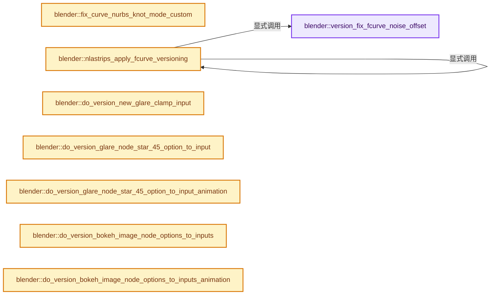
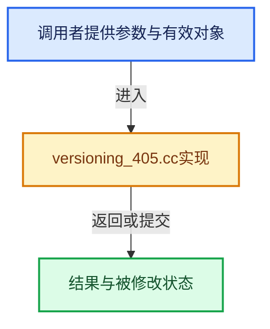

# 实现依赖专题：source/blender/blenloader/intern/versioning_405.cc

[实现依赖导航](../../../README.md) · [符号索引](../../../../00-课程指南/02-源码与提交索引/符号依赖与实现索引.md)

本专题从正文实际调用进入，集中保存共享实现。函数有稳定锚点，可从调用处直接跳到对应完整函数；递归与互相调用通过回链组织。

## 本文件的实现关系






## 完整成员与函数实现

<a id="f-c1b74b0b198d76e6"></a>

### `blender::version_fix_fcurve_noise_offset`

实现位置：[source/blender/blenloader/intern/versioning_405.cc](../../../../../../../../source/blender/blenloader/intern/versioning_405.cc) · L65—L79。

接口参数：

- `FCurve &fcurve`

**教学注释版**

<!-- annotated:24472fad6d4514 -->

```cpp
static void version_fix_fcurve_noise_offset(FCurve &fcurve)
{
  for (FModifier &fcurve_modifier : fcurve.modifiers) {
    if (fcurve_modifier.type != FMODIFIER_TYPE_NOISE) {
      continue;
    }
    FMod_Noise *data = static_cast<FMod_Noise *>(fcurve_modifier.data);
    if (data->legacy_noise) {
      /* We don't want to modify anything if the noise is set to legacy, because the issue only
       * occurred on the new style noise. */
      continue;
    }
    data->offset *= data->size;
  }
}
```

<details>
<summary>核对原始源码：source/blender/blenloader/intern/versioning_405.cc · L65—L79</summary>

<!-- original:24472fad6d4514:source/blender/blenloader/intern/versioning_405.cc:65:79 -->

```cpp
static void version_fix_fcurve_noise_offset(FCurve &fcurve)
{
  for (FModifier &fcurve_modifier : fcurve.modifiers) {
    if (fcurve_modifier.type != FMODIFIER_TYPE_NOISE) {
      continue;
    }
    FMod_Noise *data = static_cast<FMod_Noise *>(fcurve_modifier.data);
    if (data->legacy_noise) {
      /* We don't want to modify anything if the noise is set to legacy, because the issue only
       * occurred on the new style noise. */
      continue;
    }
    data->offset *= data->size;
  }
}
```

</details>

**沿实际写入检查状态**

- `data->offset *= data->size;`

**继续追踪实现**

本实现没有需要继续展开的显式调用；检查返回表达式、对象转换和调用者前置条件。

<a id="f-5df7e831cf8a8a02"></a>

### `blender::fix_curve_nurbs_knot_mode_custom`

实现位置：[source/blender/blenloader/intern/versioning_405.cc](../../../../../../../../source/blender/blenloader/intern/versioning_405.cc) · L85—L121。

接口参数：

- `Main *bmain`

**教学注释版**

<!-- annotated:1ad60de0b0ff6d -->

```cpp
static void fix_curve_nurbs_knot_mode_custom(Main *bmain)
{
  auto fix_curves = [](bke::CurvesGeometry &curves) {
    if (curves.custom_knots != nullptr) {
      return;
    }

    int8_t *knot_modes = static_cast<int8_t *>(CustomData_get_layer_named_for_write(
        &curves.curve_data_legacy, CD_PROP_INT8, "knots_mode", curves.curve_num));
    if (knot_modes == nullptr) {
      return;
    }

    for (const int curve : curves.curves_range()) {
      int8_t &knot_mode = knot_modes[curve];
      if (knot_mode == NURBS_KNOT_MODE_CUSTOM) {
        knot_mode = NURBS_KNOT_MODE_NORMAL;
      }
    }
    curves.nurbs_custom_knots_update_size();
  };

  for (Curves &curves_id : bmain->hair_curves) {
    bke::CurvesGeometry &curves = curves_id.geometry.wrap();
    fix_curves(curves);
  }

  for (GreasePencil &grease_pencil : bmain->grease_pencils) {
    for (GreasePencilDrawingBase *base : grease_pencil.drawings()) {
      if (base->type != GP_DRAWING) {
        continue;
      }
      bke::greasepencil::Drawing &drawing = reinterpret_cast<GreasePencilDrawing *>(base)->wrap();
      fix_curves(drawing.strokes_for_write());
    }
  }
}
```

<details>
<summary>核对原始源码：source/blender/blenloader/intern/versioning_405.cc · L85—L121</summary>

<!-- original:1ad60de0b0ff6d:source/blender/blenloader/intern/versioning_405.cc:85:121 -->

```cpp
static void fix_curve_nurbs_knot_mode_custom(Main *bmain)
{
  auto fix_curves = [](bke::CurvesGeometry &curves) {
    if (curves.custom_knots != nullptr) {
      return;
    }

    int8_t *knot_modes = static_cast<int8_t *>(CustomData_get_layer_named_for_write(
        &curves.curve_data_legacy, CD_PROP_INT8, "knots_mode", curves.curve_num));
    if (knot_modes == nullptr) {
      return;
    }

    for (const int curve : curves.curves_range()) {
      int8_t &knot_mode = knot_modes[curve];
      if (knot_mode == NURBS_KNOT_MODE_CUSTOM) {
        knot_mode = NURBS_KNOT_MODE_NORMAL;
      }
    }
    curves.nurbs_custom_knots_update_size();
  };

  for (Curves &curves_id : bmain->hair_curves) {
    bke::CurvesGeometry &curves = curves_id.geometry.wrap();
    fix_curves(curves);
  }

  for (GreasePencil &grease_pencil : bmain->grease_pencils) {
    for (GreasePencilDrawingBase *base : grease_pencil.drawings()) {
      if (base->type != GP_DRAWING) {
        continue;
      }
      bke::greasepencil::Drawing &drawing = reinterpret_cast<GreasePencilDrawing *>(base)->wrap();
      fix_curves(drawing.strokes_for_write());
    }
  }
}
```

</details>

**沿实际写入检查状态**

- `knot_mode = NURBS_KNOT_MODE_NORMAL;`

**继续追踪实现**

- `CustomData_get_layer_named_for_write` → [blender::CustomData_get_layer_named_for_write · L3365](../../../02-BKE几何与数据/intern/customdata.cc.md#f-705c2eebfa5f1f86)。
- `curves.curves_range` → [blender::bke::CurvesGeometry::curves_range · L1023](../../../../05-几何存储与拓扑映射/04-CurvesGeometry存储.md#f-9aedfb1afc5ebcfb)。
- `curves.nurbs_custom_knots_update_size` → [blender::bke::CurvesGeometry::nurbs_custom_knots_update_size · L587](../../../02-BKE几何与数据/intern/curves_geometry.cc.md#f-d445d63e7e1b4649)。
- `curves_id.geometry.wrap` → [调用协议](../../../../00-课程指南/01-路线与规范/模板宏与动态分派协议.md)：接收对象类型依赖auto、返回值或模板实例；不按同名猜测目标。调用位置L108。
- `fix_curves` → [调用协议](../../../../00-课程指南/01-路线与规范/模板宏与动态分派协议.md)：局部可调用对象，须结合其初始化与捕获环境。调用位置L109。
- `grease_pencil.drawings` → [调用协议](../../../../00-课程指南/01-路线与规范/模板宏与动态分派协议.md)：接收对象类型依赖auto、返回值或模板实例；不按同名猜测目标。调用位置L113。
- `reinterpret_cast<GreasePencilDrawing *>(base)->wrap` → [调用协议](../../../../00-课程指南/01-路线与规范/模板宏与动态分派协议.md)：接收对象类型依赖auto、返回值或模板实例；不按同名猜测目标。调用位置L117。
- `drawing.strokes_for_write` → [blender::bke::greasepencil::Drawing::strokes_for_write · L1012](../../../02-BKE几何与数据/intern/grease_pencil.cc.md#f-0649333785d0aa95)。

<a id="f-f51c553ddff64187"></a>

### `blender::nlastrips_apply_fcurve_versioning`

实现位置：[source/blender/blenloader/intern/versioning_405.cc](../../../../../../../../source/blender/blenloader/intern/versioning_405.cc) · L123—L133。

接口参数：

- `ListBaseT<NlaStrip> &strips`

**教学注释版**

<!-- annotated:6c86812e3c856a -->

```cpp
static void nlastrips_apply_fcurve_versioning(ListBaseT<NlaStrip> &strips)
{
  for (NlaStrip &strip : strips) {
    for (FCurve &fcurve : strip.fcurves) {
      version_fix_fcurve_noise_offset(fcurve);
    }

    /* Check sub-strips (if meta-strips). */
    nlastrips_apply_fcurve_versioning(strip.strips);
  }
}
```

<details>
<summary>核对原始源码：source/blender/blenloader/intern/versioning_405.cc · L123—L133</summary>

<!-- original:6c86812e3c856a:source/blender/blenloader/intern/versioning_405.cc:123:133 -->

```cpp
static void nlastrips_apply_fcurve_versioning(ListBaseT<NlaStrip> &strips)
{
  for (NlaStrip &strip : strips) {
    for (FCurve &fcurve : strip.fcurves) {
      version_fix_fcurve_noise_offset(fcurve);
    }

    /* Check sub-strips (if meta-strips). */
    nlastrips_apply_fcurve_versioning(strip.strips);
  }
}
```

</details>

**继续追踪实现**

- `version_fix_fcurve_noise_offset` → [blender::version_fix_fcurve_noise_offset · L65](versioning_405.cc.md#f-c1b74b0b198d76e6)。
- `nlastrips_apply_fcurve_versioning` → [blender::nlastrips_apply_fcurve_versioning · L123](versioning_405.cc.md#f-f51c553ddff64187)。

<a id="f-070e5acca3f62aee"></a>

### `blender::do_version_new_glare_clamp_input`

实现位置：[source/blender/blenloader/intern/versioning_405.cc](../../../../../../../../source/blender/blenloader/intern/versioning_405.cc) · L138—L153。

接口参数：

- `bNodeTree *node_tree`

**教学注释版**

<!-- annotated:039bf6bf3e7a88 -->

```cpp
static void do_version_new_glare_clamp_input(bNodeTree *node_tree)
{
  for (bNode &node : node_tree->nodes) {
    if (node.type_legacy != CMP_NODE_GLARE) {
      continue;
    }

    bNodeSocket *clamp_input = bke::node_find_socket(node, SOCK_IN, "Clamp Highlights"_ustr);
    bNodeSocket *maximum_input = bke::node_find_socket(node, SOCK_IN, "Maximum Highlights"_ustr);

    const float maximum = maximum_input->default_value_typed<bNodeSocketValueFloat>()->value;
    if (version_node_socket_is_used(maximum_input) || maximum != 0.0) {
      clamp_input->default_value_typed<bNodeSocketValueBoolean>()->value = true;
    }
  }
}
```

<details>
<summary>核对原始源码：source/blender/blenloader/intern/versioning_405.cc · L138—L153</summary>

<!-- original:039bf6bf3e7a88:source/blender/blenloader/intern/versioning_405.cc:138:153 -->

```cpp
static void do_version_new_glare_clamp_input(bNodeTree *node_tree)
{
  for (bNode &node : node_tree->nodes) {
    if (node.type_legacy != CMP_NODE_GLARE) {
      continue;
    }

    bNodeSocket *clamp_input = bke::node_find_socket(node, SOCK_IN, "Clamp Highlights"_ustr);
    bNodeSocket *maximum_input = bke::node_find_socket(node, SOCK_IN, "Maximum Highlights"_ustr);

    const float maximum = maximum_input->default_value_typed<bNodeSocketValueFloat>()->value;
    if (version_node_socket_is_used(maximum_input) || maximum != 0.0) {
      clamp_input->default_value_typed<bNodeSocketValueBoolean>()->value = true;
    }
  }
}
```

</details>

**继续追踪实现**

- `bke::node_find_socket` → [blender::bke::node_find_socket · L3036](../../../02-BKE几何与数据/intern/node.cc.md#f-cbf9dec71aff5b59)；[blender::bke::node_find_socket · L3047](../../../02-BKE几何与数据/intern/node.cc.md#f-4a7a677634b7fbd1)。同名重载需按实参类型选择。
- `maximum_input->default_value_typed<bNodeSocketValueFloat>` → [blender::bNodeSocket::default_value_typed · L1134](../../../02-BKE几何与数据/BKE_node_runtime.hh.md#f-ce490d0e5a28d98d)；[blender::bNodeSocket::default_value_typed · L1139](../../../02-BKE几何与数据/BKE_node_runtime.hh.md#f-392726ff93a0389d)。同名重载需按实参类型选择。
- `version_node_socket_is_used` → [blender::version_node_socket_is_used · L151](versioning_common.cc.md#f-e68671c3ba22c902)。
- `clamp_input->default_value_typed<bNodeSocketValueBoolean>` → [blender::bNodeSocket::default_value_typed · L1134](../../../02-BKE几何与数据/BKE_node_runtime.hh.md#f-ce490d0e5a28d98d)；[blender::bNodeSocket::default_value_typed · L1139](../../../02-BKE几何与数据/BKE_node_runtime.hh.md#f-392726ff93a0389d)。同名重载需按实参类型选择。

<a id="f-17ee9649b97fb87a"></a>

### `blender::do_version_glare_node_star_45_option_to_input`

实现位置：[source/blender/blenloader/intern/versioning_405.cc](../../../../../../../../source/blender/blenloader/intern/versioning_405.cc) · L156—L171。

接口参数：

- `bNodeTree *node_tree`
- `bNode *node`

**教学注释版**

<!-- annotated:d2f8fc6112401a -->

```cpp
static void do_version_glare_node_star_45_option_to_input(bNodeTree *node_tree, bNode *node)
{
  NodeGlare *storage = static_cast<NodeGlare *>(node->storage);
  if (!storage) {
    return;
  }

  /* Input already exists, was already versioned. */
  if (bke::node_find_socket(*node, SOCK_IN, "Diagonal Star"_ustr)) {
    return;
  }

  bNodeSocket *diagonal_star_input = bke::node_add_static_socket(
      *node_tree, *node, SOCK_IN, SOCK_BOOLEAN, PROP_NONE, "Diagonal Star", "Diagonal");
  diagonal_star_input->default_value_typed<bNodeSocketValueBoolean>()->value = storage->star_45;
}
```

<details>
<summary>核对原始源码：source/blender/blenloader/intern/versioning_405.cc · L156—L171</summary>

<!-- original:d2f8fc6112401a:source/blender/blenloader/intern/versioning_405.cc:156:171 -->

```cpp
static void do_version_glare_node_star_45_option_to_input(bNodeTree *node_tree, bNode *node)
{
  NodeGlare *storage = static_cast<NodeGlare *>(node->storage);
  if (!storage) {
    return;
  }

  /* Input already exists, was already versioned. */
  if (bke::node_find_socket(*node, SOCK_IN, "Diagonal Star"_ustr)) {
    return;
  }

  bNodeSocket *diagonal_star_input = bke::node_add_static_socket(
      *node_tree, *node, SOCK_IN, SOCK_BOOLEAN, PROP_NONE, "Diagonal Star", "Diagonal");
  diagonal_star_input->default_value_typed<bNodeSocketValueBoolean>()->value = storage->star_45;
}
```

</details>

**继续追踪实现**

- `bke::node_find_socket` → [blender::bke::node_find_socket · L3036](../../../02-BKE几何与数据/intern/node.cc.md#f-cbf9dec71aff5b59)；[blender::bke::node_find_socket · L3047](../../../02-BKE几何与数据/intern/node.cc.md#f-4a7a677634b7fbd1)。同名重载需按实参类型选择。
- `bke::node_add_static_socket` → [blender::bke::node_add_static_socket · L3980](../../../02-BKE几何与数据/intern/node.cc.md#f-d6d2fde9e1919837)。
- `diagonal_star_input->default_value_typed<bNodeSocketValueBoolean>` → [blender::bNodeSocket::default_value_typed · L1134](../../../02-BKE几何与数据/BKE_node_runtime.hh.md#f-ce490d0e5a28d98d)；[blender::bNodeSocket::default_value_typed · L1139](../../../02-BKE几何与数据/BKE_node_runtime.hh.md#f-392726ff93a0389d)。同名重载需按实参类型选择。

<a id="f-97df773c07ca5000"></a>

### `blender::do_version_glare_node_star_45_option_to_input_animation`

实现位置：[source/blender/blenloader/intern/versioning_405.cc](../../../../../../../../source/blender/blenloader/intern/versioning_405.cc) · L174—L195。

接口参数：

- `bNodeTree *node_tree`
- `bNode *node`

**教学注释版**

<!-- annotated:0d266fc79da9c5 -->

```cpp
static void do_version_glare_node_star_45_option_to_input_animation(bNodeTree *node_tree,
                                                                    bNode *node)
{
  /* Compute the RNA path of the node. */
  char escaped_node_name[sizeof(node->name) * 2 + 1];
  BLI_str_escape(escaped_node_name, node->name, sizeof(escaped_node_name));
  const std::string node_rna_path = fmt::format("nodes[\"{}\"]", escaped_node_name);

  BKE_fcurves_id_cb(&node_tree->id, [&](ID * /*id*/, FCurve *fcurve) {
    /* The FCurve does not belong to the node since its RNA path doesn't start with the node's RNA
     * path. */
    if (!fcurve->rna_path().startswith(node_rna_path)) {
      return;
    }

    /* Change the RNA path of the FCurve from the old property to the new input. */
    if (BLI_str_endswith(fcurve->rna_path().c_str(), "use_rotate_45")) {
      fcurve->rna_path_set_move(
          BLI_sprintfN("%s.%s", node_rna_path.c_str(), "inputs[14].default_value"));
    }
  });
}
```

<details>
<summary>核对原始源码：source/blender/blenloader/intern/versioning_405.cc · L174—L195</summary>

<!-- original:0d266fc79da9c5:source/blender/blenloader/intern/versioning_405.cc:174:195 -->

```cpp
static void do_version_glare_node_star_45_option_to_input_animation(bNodeTree *node_tree,
                                                                    bNode *node)
{
  /* Compute the RNA path of the node. */
  char escaped_node_name[sizeof(node->name) * 2 + 1];
  BLI_str_escape(escaped_node_name, node->name, sizeof(escaped_node_name));
  const std::string node_rna_path = fmt::format("nodes[\"{}\"]", escaped_node_name);

  BKE_fcurves_id_cb(&node_tree->id, [&](ID * /*id*/, FCurve *fcurve) {
    /* The FCurve does not belong to the node since its RNA path doesn't start with the node's RNA
     * path. */
    if (!fcurve->rna_path().startswith(node_rna_path)) {
      return;
    }

    /* Change the RNA path of the FCurve from the old property to the new input. */
    if (BLI_str_endswith(fcurve->rna_path().c_str(), "use_rotate_45")) {
      fcurve->rna_path_set_move(
          BLI_sprintfN("%s.%s", node_rna_path.c_str(), "inputs[14].default_value"));
    }
  });
}
```

</details>

**继续追踪实现**

- `BLI_str_escape` → [blender::BLI_str_escape · L335](../../../01-BLI基础库/intern/string.cc.md#f-ade392f6fb397ef6)；[blender::BLI_str_escape · L366](../../../01-BLI基础库/intern/string.cc.md#f-56725a2c129075c6)。同名重载需按实参类型选择。
- `fmt::format` → [外部契约](https://fmt.dev/latest/api/)：按fmt接口的格式字符串与参数类型契约使用，格式化不改变被格式化对象的拥有关系。
- `BKE_fcurves_id_cb` → [blender::BKE_fcurves_id_cb · L1249](../../../02-BKE几何与数据/intern/anim_data.cc.md#f-fd9dec54d9a0bd30)。
- `fcurve->rna_path().startswith` → [调用协议](../../../../00-课程指南/01-路线与规范/模板宏与动态分派协议.md)：接收对象类型依赖auto、返回值或模板实例；不按同名猜测目标。调用位置L185。
- `fcurve->rna_path` → [blender::FCurve::rna_path · L189](../../../02-BKE几何与数据/intern/fcurve.cc.md#f-b3be61588d36ab9c)。
- `BLI_str_endswith` → [blender::BLI_str_endswith · L907](../../../01-BLI基础库/intern/string.cc.md#f-2bf007208258ff88)。
- `fcurve->rna_path().c_str` → [调用协议](../../../../00-课程指南/01-路线与规范/模板宏与动态分派协议.md)：接收对象类型依赖auto、返回值或模板实例；不按同名猜测目标。调用位置L190。
- `fcurve->rna_path_set_move` → [blender::FCurve::rna_path_set_move · L182](../../../02-BKE几何与数据/intern/fcurve.cc.md#f-feffe802a84cd660)。
- `BLI_sprintfN` → [blender::BLI_sprintfN · L296](../../../01-BLI基础库/intern/string.cc.md#f-bfbc2f7076298fc0)。
- `node_rna_path.c_str` → [外部契约](https://eel.is/c++draft/)：这个边界按实际表达式及所属类型核对参数、返回值、寿命与失败行为。这里提供接口入口，不声称已解释该第三方版本的内部实现。

<a id="f-464b7ad17ac8e171"></a>

### `blender::do_version_bokeh_image_node_options_to_inputs`

实现位置：[source/blender/blenloader/intern/versioning_405.cc](../../../../../../../../source/blender/blenloader/intern/versioning_405.cc) · L198—L242。

接口参数：

- `bNodeTree *node_tree`
- `bNode *node`

**教学注释版**

<!-- annotated:f3a83ea8e860da -->

```cpp
static void do_version_bokeh_image_node_options_to_inputs(bNodeTree *node_tree, bNode *node)
{
  NodeBokehImage *storage = static_cast<NodeBokehImage *>(node->storage);
  if (!storage) {
    return;
  }

  if (!bke::node_find_socket(*node, SOCK_IN, "Flaps"_ustr)) {
    bNodeSocket *input = bke::node_add_static_socket(
        *node_tree, *node, SOCK_IN, SOCK_INT, PROP_NONE, "Flaps", "Flaps");
    input->default_value_typed<bNodeSocketValueInt>()->value = storage->flaps;
  }

  if (!bke::node_find_socket(*node, SOCK_IN, "Angle"_ustr)) {
    bNodeSocket *input = bke::node_add_static_socket(
        *node_tree, *node, SOCK_IN, SOCK_FLOAT, PROP_ANGLE, "Angle", "Angle");
    input->default_value_typed<bNodeSocketValueFloat>()->value = storage->angle;
  }

  if (!bke::node_find_socket(*node, SOCK_IN, "Roundness"_ustr)) {
    bNodeSocket *input = bke::node_add_static_socket(
        *node_tree, *node, SOCK_IN, SOCK_FLOAT, PROP_FACTOR, "Roundness", "Roundness");
    input->default_value_typed<bNodeSocketValueFloat>()->value = storage->rounding;
  }

  if (!bke::node_find_socket(*node, SOCK_IN, "Catadioptric Size"_ustr)) {
    bNodeSocket *input = bke::node_add_static_socket(*node_tree,
                                                     *node,
                                                     SOCK_IN,
                                                     SOCK_FLOAT,
                                                     PROP_FACTOR,
                                                     "Catadioptric Size",
                                                     "Catadioptric Size");
    input->default_value_typed<bNodeSocketValueFloat>()->value = storage->catadioptric;
  }

  if (!bke::node_find_socket(*node, SOCK_IN, "Color Shift"_ustr)) {
    bNodeSocket *input = bke::node_add_static_socket(
        *node_tree, *node, SOCK_IN, SOCK_FLOAT, PROP_FACTOR, "Color Shift", "Color Shift");
    input->default_value_typed<bNodeSocketValueFloat>()->value = storage->lensshift;
  }

  MEM_delete(storage);
  node->storage = nullptr;
}
```

<details>
<summary>核对原始源码：source/blender/blenloader/intern/versioning_405.cc · L198—L242</summary>

<!-- original:f3a83ea8e860da:source/blender/blenloader/intern/versioning_405.cc:198:242 -->

```cpp
static void do_version_bokeh_image_node_options_to_inputs(bNodeTree *node_tree, bNode *node)
{
  NodeBokehImage *storage = static_cast<NodeBokehImage *>(node->storage);
  if (!storage) {
    return;
  }

  if (!bke::node_find_socket(*node, SOCK_IN, "Flaps"_ustr)) {
    bNodeSocket *input = bke::node_add_static_socket(
        *node_tree, *node, SOCK_IN, SOCK_INT, PROP_NONE, "Flaps", "Flaps");
    input->default_value_typed<bNodeSocketValueInt>()->value = storage->flaps;
  }

  if (!bke::node_find_socket(*node, SOCK_IN, "Angle"_ustr)) {
    bNodeSocket *input = bke::node_add_static_socket(
        *node_tree, *node, SOCK_IN, SOCK_FLOAT, PROP_ANGLE, "Angle", "Angle");
    input->default_value_typed<bNodeSocketValueFloat>()->value = storage->angle;
  }

  if (!bke::node_find_socket(*node, SOCK_IN, "Roundness"_ustr)) {
    bNodeSocket *input = bke::node_add_static_socket(
        *node_tree, *node, SOCK_IN, SOCK_FLOAT, PROP_FACTOR, "Roundness", "Roundness");
    input->default_value_typed<bNodeSocketValueFloat>()->value = storage->rounding;
  }

  if (!bke::node_find_socket(*node, SOCK_IN, "Catadioptric Size"_ustr)) {
    bNodeSocket *input = bke::node_add_static_socket(*node_tree,
                                                     *node,
                                                     SOCK_IN,
                                                     SOCK_FLOAT,
                                                     PROP_FACTOR,
                                                     "Catadioptric Size",
                                                     "Catadioptric Size");
    input->default_value_typed<bNodeSocketValueFloat>()->value = storage->catadioptric;
  }

  if (!bke::node_find_socket(*node, SOCK_IN, "Color Shift"_ustr)) {
    bNodeSocket *input = bke::node_add_static_socket(
        *node_tree, *node, SOCK_IN, SOCK_FLOAT, PROP_FACTOR, "Color Shift", "Color Shift");
    input->default_value_typed<bNodeSocketValueFloat>()->value = storage->lensshift;
  }

  MEM_delete(storage);
  node->storage = nullptr;
}
```

</details>

**沿实际写入检查状态**

- `node->storage = nullptr;`

**继续追踪实现**

- `bke::node_find_socket` → [blender::bke::node_find_socket · L3036](../../../02-BKE几何与数据/intern/node.cc.md#f-cbf9dec71aff5b59)；[blender::bke::node_find_socket · L3047](../../../02-BKE几何与数据/intern/node.cc.md#f-4a7a677634b7fbd1)。同名重载需按实参类型选择。
- `bke::node_add_static_socket` → [blender::bke::node_add_static_socket · L3980](../../../02-BKE几何与数据/intern/node.cc.md#f-d6d2fde9e1919837)。
- `input->default_value_typed<bNodeSocketValueInt>` → [blender::bNodeSocket::default_value_typed · L1134](../../../02-BKE几何与数据/BKE_node_runtime.hh.md#f-ce490d0e5a28d98d)；[blender::bNodeSocket::default_value_typed · L1139](../../../02-BKE几何与数据/BKE_node_runtime.hh.md#f-392726ff93a0389d)。同名重载需按实参类型选择。
- `input->default_value_typed<bNodeSocketValueFloat>` → [blender::bNodeSocket::default_value_typed · L1134](../../../02-BKE几何与数据/BKE_node_runtime.hh.md#f-ce490d0e5a28d98d)；[blender::bNodeSocket::default_value_typed · L1139](../../../02-BKE几何与数据/BKE_node_runtime.hh.md#f-392726ff93a0389d)。同名重载需按实参类型选择。
- `MEM_delete` → [MEM_delete · L400](../../../07-Intern运行时与平台/guardedalloc/MEM_guardedalloc.h.md#f-9049ffdd1682887c)。

<a id="f-f636b38ca0336c16"></a>

### `blender::do_version_bokeh_image_node_options_to_inputs_animation`

实现位置：[source/blender/blenloader/intern/versioning_405.cc](../../../../../../../../source/blender/blenloader/intern/versioning_405.cc) · L245—L283。

接口参数：

- `bNodeTree *node_tree`
- `bNode *node`

**教学注释版**

<!-- annotated:094c0ec8fde717 -->

```cpp
static void do_version_bokeh_image_node_options_to_inputs_animation(bNodeTree *node_tree,
                                                                    bNode *node)
{
  /* Compute the RNA path of the node. */
  char escaped_node_name[sizeof(node->name) * 2 + 1];
  BLI_str_escape(escaped_node_name, node->name, sizeof(escaped_node_name));
  const std::string node_rna_path = fmt::format("nodes[\"{}\"]", escaped_node_name);

  BKE_fcurves_id_cb(&node_tree->id, [&](ID * /*id*/, FCurve *fcurve) {
    /* The FCurve does not belong to the node since its RNA path doesn't start with the node's RNA
     * path. */
    if (!fcurve->rna_path().startswith(node_rna_path)) {
      return;
    }

    /* Change the RNA path of the FCurve from the old properties to the new inputs, adjusting the
     * values of the FCurves frames when needed. */
    if (BLI_str_endswith(fcurve->rna_path().c_str(), "flaps")) {
      fcurve->rna_path_set_move(
          BLI_sprintfN("%s.%s", node_rna_path.c_str(), "inputs[0].default_value"));
    }
    else if (BLI_str_endswith(fcurve->rna_path().c_str(), "angle")) {
      fcurve->rna_path_set_move(
          BLI_sprintfN("%s.%s", node_rna_path.c_str(), "inputs[1].default_value"));
    }
    else if (BLI_str_endswith(fcurve->rna_path().c_str(), "rounding")) {
      fcurve->rna_path_set_move(
          BLI_sprintfN("%s.%s", node_rna_path.c_str(), "inputs[2].default_value"));
    }
    else if (BLI_str_endswith(fcurve->rna_path().c_str(), "catadioptric")) {
      fcurve->rna_path_set_move(
          BLI_sprintfN("%s.%s", node_rna_path.c_str(), "inputs[3].default_value"));
    }
    else if (BLI_str_endswith(fcurve->rna_path().c_str(), "shift")) {
      fcurve->rna_path_set_move(
          BLI_sprintfN("%s.%s", node_rna_path.c_str(), "inputs[4].default_value"));
    }
  });
}
```

<details>
<summary>核对原始源码：source/blender/blenloader/intern/versioning_405.cc · L245—L283</summary>

<!-- original:094c0ec8fde717:source/blender/blenloader/intern/versioning_405.cc:245:283 -->

```cpp
static void do_version_bokeh_image_node_options_to_inputs_animation(bNodeTree *node_tree,
                                                                    bNode *node)
{
  /* Compute the RNA path of the node. */
  char escaped_node_name[sizeof(node->name) * 2 + 1];
  BLI_str_escape(escaped_node_name, node->name, sizeof(escaped_node_name));
  const std::string node_rna_path = fmt::format("nodes[\"{}\"]", escaped_node_name);

  BKE_fcurves_id_cb(&node_tree->id, [&](ID * /*id*/, FCurve *fcurve) {
    /* The FCurve does not belong to the node since its RNA path doesn't start with the node's RNA
     * path. */
    if (!fcurve->rna_path().startswith(node_rna_path)) {
      return;
    }

    /* Change the RNA path of the FCurve from the old properties to the new inputs, adjusting the
     * values of the FCurves frames when needed. */
    if (BLI_str_endswith(fcurve->rna_path().c_str(), "flaps")) {
      fcurve->rna_path_set_move(
          BLI_sprintfN("%s.%s", node_rna_path.c_str(), "inputs[0].default_value"));
    }
    else if (BLI_str_endswith(fcurve->rna_path().c_str(), "angle")) {
      fcurve->rna_path_set_move(
          BLI_sprintfN("%s.%s", node_rna_path.c_str(), "inputs[1].default_value"));
    }
    else if (BLI_str_endswith(fcurve->rna_path().c_str(), "rounding")) {
      fcurve->rna_path_set_move(
          BLI_sprintfN("%s.%s", node_rna_path.c_str(), "inputs[2].default_value"));
    }
    else if (BLI_str_endswith(fcurve->rna_path().c_str(), "catadioptric")) {
      fcurve->rna_path_set_move(
          BLI_sprintfN("%s.%s", node_rna_path.c_str(), "inputs[3].default_value"));
    }
    else if (BLI_str_endswith(fcurve->rna_path().c_str(), "shift")) {
      fcurve->rna_path_set_move(
          BLI_sprintfN("%s.%s", node_rna_path.c_str(), "inputs[4].default_value"));
    }
  });
}
```

</details>

**继续追踪实现**

- `BLI_str_escape` → [blender::BLI_str_escape · L335](../../../01-BLI基础库/intern/string.cc.md#f-ade392f6fb397ef6)；[blender::BLI_str_escape · L366](../../../01-BLI基础库/intern/string.cc.md#f-56725a2c129075c6)。同名重载需按实参类型选择。
- `fmt::format` → [外部契约](https://fmt.dev/latest/api/)：按fmt接口的格式字符串与参数类型契约使用，格式化不改变被格式化对象的拥有关系。
- `BKE_fcurves_id_cb` → [blender::BKE_fcurves_id_cb · L1249](../../../02-BKE几何与数据/intern/anim_data.cc.md#f-fd9dec54d9a0bd30)。
- `fcurve->rna_path().startswith` → [调用协议](../../../../00-课程指南/01-路线与规范/模板宏与动态分派协议.md)：接收对象类型依赖auto、返回值或模板实例；不按同名猜测目标。调用位置L256。
- `fcurve->rna_path` → [blender::FCurve::rna_path · L189](../../../02-BKE几何与数据/intern/fcurve.cc.md#f-b3be61588d36ab9c)。
- `BLI_str_endswith` → [blender::BLI_str_endswith · L907](../../../01-BLI基础库/intern/string.cc.md#f-2bf007208258ff88)。
- `fcurve->rna_path().c_str` → [调用协议](../../../../00-课程指南/01-路线与规范/模板宏与动态分派协议.md)：接收对象类型依赖auto、返回值或模板实例；不按同名猜测目标。调用位置L262。
- `fcurve->rna_path_set_move` → [blender::FCurve::rna_path_set_move · L182](../../../02-BKE几何与数据/intern/fcurve.cc.md#f-feffe802a84cd660)。
- `BLI_sprintfN` → [blender::BLI_sprintfN · L296](../../../01-BLI基础库/intern/string.cc.md#f-bfbc2f7076298fc0)。
- `node_rna_path.c_str` → [外部契约](https://eel.is/c++draft/)：这个边界按实际表达式及所属类型核对参数、返回值、寿命与失败行为。这里提供接口入口，不声称已解释该第三方版本的内部实现。

<a id="f-eb346f09fc657139"></a>

### `blender::do_version_time_curve_node_options_to_inputs`

实现位置：[source/blender/blenloader/intern/versioning_405.cc](../../../../../../../../source/blender/blenloader/intern/versioning_405.cc) · L286—L299。

接口参数：

- `bNodeTree *node_tree`
- `bNode *node`

**教学注释版**

<!-- annotated:bc187c2cea5e8c -->

```cpp
static void do_version_time_curve_node_options_to_inputs(bNodeTree *node_tree, bNode *node)
{
  if (!bke::node_find_socket(*node, SOCK_IN, "Start Frame"_ustr)) {
    bNodeSocket *input = bke::node_add_static_socket(
        *node_tree, *node, SOCK_IN, SOCK_INT, PROP_NONE, "Start Frame", "Start Frame");
    input->default_value_typed<bNodeSocketValueInt>()->value = node->custom1;
  }

  if (!bke::node_find_socket(*node, SOCK_IN, "End Frame"_ustr)) {
    bNodeSocket *input = bke::node_add_static_socket(
        *node_tree, *node, SOCK_IN, SOCK_INT, PROP_NONE, "End Frame", "End Frame");
    input->default_value_typed<bNodeSocketValueInt>()->value = node->custom2;
  }
}
```

<details>
<summary>核对原始源码：source/blender/blenloader/intern/versioning_405.cc · L286—L299</summary>

<!-- original:bc187c2cea5e8c:source/blender/blenloader/intern/versioning_405.cc:286:299 -->

```cpp
static void do_version_time_curve_node_options_to_inputs(bNodeTree *node_tree, bNode *node)
{
  if (!bke::node_find_socket(*node, SOCK_IN, "Start Frame"_ustr)) {
    bNodeSocket *input = bke::node_add_static_socket(
        *node_tree, *node, SOCK_IN, SOCK_INT, PROP_NONE, "Start Frame", "Start Frame");
    input->default_value_typed<bNodeSocketValueInt>()->value = node->custom1;
  }

  if (!bke::node_find_socket(*node, SOCK_IN, "End Frame"_ustr)) {
    bNodeSocket *input = bke::node_add_static_socket(
        *node_tree, *node, SOCK_IN, SOCK_INT, PROP_NONE, "End Frame", "End Frame");
    input->default_value_typed<bNodeSocketValueInt>()->value = node->custom2;
  }
}
```

</details>

**继续追踪实现**

- `bke::node_find_socket` → [blender::bke::node_find_socket · L3036](../../../02-BKE几何与数据/intern/node.cc.md#f-cbf9dec71aff5b59)；[blender::bke::node_find_socket · L3047](../../../02-BKE几何与数据/intern/node.cc.md#f-4a7a677634b7fbd1)。同名重载需按实参类型选择。
- `bke::node_add_static_socket` → [blender::bke::node_add_static_socket · L3980](../../../02-BKE几何与数据/intern/node.cc.md#f-d6d2fde9e1919837)。
- `input->default_value_typed<bNodeSocketValueInt>` → [blender::bNodeSocket::default_value_typed · L1134](../../../02-BKE几何与数据/BKE_node_runtime.hh.md#f-ce490d0e5a28d98d)；[blender::bNodeSocket::default_value_typed · L1139](../../../02-BKE几何与数据/BKE_node_runtime.hh.md#f-392726ff93a0389d)。同名重载需按实参类型选择。

<a id="f-7853928d08b057e6"></a>

### `blender::do_version_time_curve_node_options_to_inputs_animation`

实现位置：[source/blender/blenloader/intern/versioning_405.cc](../../../../../../../../source/blender/blenloader/intern/versioning_405.cc) · L302—L328。

接口参数：

- `bNodeTree *node_tree`
- `bNode *node`

**教学注释版**

<!-- annotated:216dddf9540569 -->

```cpp
static void do_version_time_curve_node_options_to_inputs_animation(bNodeTree *node_tree,
                                                                   bNode *node)
{
  /* Compute the RNA path of the node. */
  char escaped_node_name[sizeof(node->name) * 2 + 1];
  BLI_str_escape(escaped_node_name, node->name, sizeof(escaped_node_name));
  const std::string node_rna_path = fmt::format("nodes[\"{}\"]", escaped_node_name);

  BKE_fcurves_id_cb(&node_tree->id, [&](ID * /*id*/, FCurve *fcurve) {
    /* The FCurve does not belong to the node since its RNA path doesn't start with the node's RNA
     * path. */
    if (!fcurve->rna_path().startswith(node_rna_path)) {
      return;
    }

    /* Change the RNA path of the FCurve from the old properties to the new inputs, adjusting the
     * values of the FCurves frames when needed. */
    if (BLI_str_endswith(fcurve->rna_path().c_str(), "frame_start")) {
      fcurve->rna_path_set_move(
          BLI_sprintfN("%s.%s", node_rna_path.c_str(), "inputs[0].default_value"));
    }
    else if (BLI_str_endswith(fcurve->rna_path().c_str(), "frame_end")) {
      fcurve->rna_path_set_move(
          BLI_sprintfN("%s.%s", node_rna_path.c_str(), "inputs[1].default_value"));
    }
  });
}
```

<details>
<summary>核对原始源码：source/blender/blenloader/intern/versioning_405.cc · L302—L328</summary>

<!-- original:216dddf9540569:source/blender/blenloader/intern/versioning_405.cc:302:328 -->

```cpp
static void do_version_time_curve_node_options_to_inputs_animation(bNodeTree *node_tree,
                                                                   bNode *node)
{
  /* Compute the RNA path of the node. */
  char escaped_node_name[sizeof(node->name) * 2 + 1];
  BLI_str_escape(escaped_node_name, node->name, sizeof(escaped_node_name));
  const std::string node_rna_path = fmt::format("nodes[\"{}\"]", escaped_node_name);

  BKE_fcurves_id_cb(&node_tree->id, [&](ID * /*id*/, FCurve *fcurve) {
    /* The FCurve does not belong to the node since its RNA path doesn't start with the node's RNA
     * path. */
    if (!fcurve->rna_path().startswith(node_rna_path)) {
      return;
    }

    /* Change the RNA path of the FCurve from the old properties to the new inputs, adjusting the
     * values of the FCurves frames when needed. */
    if (BLI_str_endswith(fcurve->rna_path().c_str(), "frame_start")) {
      fcurve->rna_path_set_move(
          BLI_sprintfN("%s.%s", node_rna_path.c_str(), "inputs[0].default_value"));
    }
    else if (BLI_str_endswith(fcurve->rna_path().c_str(), "frame_end")) {
      fcurve->rna_path_set_move(
          BLI_sprintfN("%s.%s", node_rna_path.c_str(), "inputs[1].default_value"));
    }
  });
}
```

</details>

**继续追踪实现**

- `BLI_str_escape` → [blender::BLI_str_escape · L335](../../../01-BLI基础库/intern/string.cc.md#f-ade392f6fb397ef6)；[blender::BLI_str_escape · L366](../../../01-BLI基础库/intern/string.cc.md#f-56725a2c129075c6)。同名重载需按实参类型选择。
- `fmt::format` → [外部契约](https://fmt.dev/latest/api/)：按fmt接口的格式字符串与参数类型契约使用，格式化不改变被格式化对象的拥有关系。
- `BKE_fcurves_id_cb` → [blender::BKE_fcurves_id_cb · L1249](../../../02-BKE几何与数据/intern/anim_data.cc.md#f-fd9dec54d9a0bd30)。
- `fcurve->rna_path().startswith` → [调用协议](../../../../00-课程指南/01-路线与规范/模板宏与动态分派协议.md)：接收对象类型依赖auto、返回值或模板实例；不按同名猜测目标。调用位置L313。
- `fcurve->rna_path` → [blender::FCurve::rna_path · L189](../../../02-BKE几何与数据/intern/fcurve.cc.md#f-b3be61588d36ab9c)。
- `BLI_str_endswith` → [blender::BLI_str_endswith · L907](../../../01-BLI基础库/intern/string.cc.md#f-2bf007208258ff88)。
- `fcurve->rna_path().c_str` → [调用协议](../../../../00-课程指南/01-路线与规范/模板宏与动态分派协议.md)：接收对象类型依赖auto、返回值或模板实例；不按同名猜测目标。调用位置L319。
- `fcurve->rna_path_set_move` → [blender::FCurve::rna_path_set_move · L182](../../../02-BKE几何与数据/intern/fcurve.cc.md#f-feffe802a84cd660)。
- `BLI_sprintfN` → [blender::BLI_sprintfN · L296](../../../01-BLI基础库/intern/string.cc.md#f-bfbc2f7076298fc0)。
- `node_rna_path.c_str` → [外部契约](https://eel.is/c++draft/)：这个边界按实际表达式及所属类型核对参数、返回值、寿命与失败行为。这里提供接口入口，不声称已解释该第三方版本的内部实现。

<a id="f-83b0433ac7628235"></a>

### `blender::do_version_mask_node_options_to_inputs`

实现位置：[source/blender/blenloader/intern/versioning_405.cc](../../../../../../../../source/blender/blenloader/intern/versioning_405.cc) · L331—L378。

接口参数：

- `bNodeTree *node_tree`
- `bNode *node`

**教学注释版**

<!-- annotated:85a1acb6956f55 -->

```cpp
static void do_version_mask_node_options_to_inputs(bNodeTree *node_tree, bNode *node)
{
  NodeMask *storage = static_cast<NodeMask *>(node->storage);
  if (!storage) {
    return;
  }

  if (!bke::node_find_socket(*node, SOCK_IN, "Size X"_ustr)) {
    bNodeSocket *input = bke::node_add_static_socket(
        *node_tree, *node, SOCK_IN, SOCK_INT, PROP_NONE, "Size X", "Size X");
    input->default_value_typed<bNodeSocketValueInt>()->value = storage->size_x;
  }

  if (!bke::node_find_socket(*node, SOCK_IN, "Size Y"_ustr)) {
    bNodeSocket *input = bke::node_add_static_socket(
        *node_tree, *node, SOCK_IN, SOCK_INT, PROP_NONE, "Size Y", "Size Y");
    input->default_value_typed<bNodeSocketValueInt>()->value = storage->size_y;
  }

  if (!bke::node_find_socket(*node, SOCK_IN, "Feather"_ustr)) {
    bNodeSocket *input = bke::node_add_static_socket(
        *node_tree, *node, SOCK_IN, SOCK_BOOLEAN, PROP_NONE, "Feather", "Feather");
    input->default_value_typed<bNodeSocketValueBoolean>()->value = !(
        node->custom1 & CMP_NODE_MASK_FLAG_NO_FEATHER);
  }

  if (!bke::node_find_socket(*node, SOCK_IN, "Motion Blur"_ustr)) {
    bNodeSocket *input = bke::node_add_static_socket(
        *node_tree, *node, SOCK_IN, SOCK_BOOLEAN, PROP_NONE, "Motion Blur", "Motion Blur");
    input->default_value_typed<bNodeSocketValueBoolean>()->value = bool(
        node->custom1 & CMP_NODE_MASK_FLAG_MOTION_BLUR);
  }

  if (!bke::node_find_socket(*node, SOCK_IN, "Motion Blur Samples"_ustr)) {
    bNodeSocket *input = bke::node_add_static_socket(
        *node_tree, *node, SOCK_IN, SOCK_INT, PROP_NONE, "Motion Blur Samples", "Samples");
    input->default_value_typed<bNodeSocketValueInt>()->value = node->custom2;
  }

  if (!bke::node_find_socket(*node, SOCK_IN, "Motion Blur Shutter"_ustr)) {
    bNodeSocket *input = bke::node_add_static_socket(
        *node_tree, *node, SOCK_IN, SOCK_FLOAT, PROP_FACTOR, "Motion Blur Shutter", "Shutter");
    input->default_value_typed<bNodeSocketValueFloat>()->value = node->custom3;
  }

  MEM_delete(storage);
  node->storage = nullptr;
}
```

<details>
<summary>核对原始源码：source/blender/blenloader/intern/versioning_405.cc · L331—L378</summary>

<!-- original:85a1acb6956f55:source/blender/blenloader/intern/versioning_405.cc:331:378 -->

```cpp
static void do_version_mask_node_options_to_inputs(bNodeTree *node_tree, bNode *node)
{
  NodeMask *storage = static_cast<NodeMask *>(node->storage);
  if (!storage) {
    return;
  }

  if (!bke::node_find_socket(*node, SOCK_IN, "Size X"_ustr)) {
    bNodeSocket *input = bke::node_add_static_socket(
        *node_tree, *node, SOCK_IN, SOCK_INT, PROP_NONE, "Size X", "Size X");
    input->default_value_typed<bNodeSocketValueInt>()->value = storage->size_x;
  }

  if (!bke::node_find_socket(*node, SOCK_IN, "Size Y"_ustr)) {
    bNodeSocket *input = bke::node_add_static_socket(
        *node_tree, *node, SOCK_IN, SOCK_INT, PROP_NONE, "Size Y", "Size Y");
    input->default_value_typed<bNodeSocketValueInt>()->value = storage->size_y;
  }

  if (!bke::node_find_socket(*node, SOCK_IN, "Feather"_ustr)) {
    bNodeSocket *input = bke::node_add_static_socket(
        *node_tree, *node, SOCK_IN, SOCK_BOOLEAN, PROP_NONE, "Feather", "Feather");
    input->default_value_typed<bNodeSocketValueBoolean>()->value = !(
        node->custom1 & CMP_NODE_MASK_FLAG_NO_FEATHER);
  }

  if (!bke::node_find_socket(*node, SOCK_IN, "Motion Blur"_ustr)) {
    bNodeSocket *input = bke::node_add_static_socket(
        *node_tree, *node, SOCK_IN, SOCK_BOOLEAN, PROP_NONE, "Motion Blur", "Motion Blur");
    input->default_value_typed<bNodeSocketValueBoolean>()->value = bool(
        node->custom1 & CMP_NODE_MASK_FLAG_MOTION_BLUR);
  }

  if (!bke::node_find_socket(*node, SOCK_IN, "Motion Blur Samples"_ustr)) {
    bNodeSocket *input = bke::node_add_static_socket(
        *node_tree, *node, SOCK_IN, SOCK_INT, PROP_NONE, "Motion Blur Samples", "Samples");
    input->default_value_typed<bNodeSocketValueInt>()->value = node->custom2;
  }

  if (!bke::node_find_socket(*node, SOCK_IN, "Motion Blur Shutter"_ustr)) {
    bNodeSocket *input = bke::node_add_static_socket(
        *node_tree, *node, SOCK_IN, SOCK_FLOAT, PROP_FACTOR, "Motion Blur Shutter", "Shutter");
    input->default_value_typed<bNodeSocketValueFloat>()->value = node->custom3;
  }

  MEM_delete(storage);
  node->storage = nullptr;
}
```

</details>

**沿实际写入检查状态**

- `node->storage = nullptr;`

**继续追踪实现**

- `bke::node_find_socket` → [blender::bke::node_find_socket · L3036](../../../02-BKE几何与数据/intern/node.cc.md#f-cbf9dec71aff5b59)；[blender::bke::node_find_socket · L3047](../../../02-BKE几何与数据/intern/node.cc.md#f-4a7a677634b7fbd1)。同名重载需按实参类型选择。
- `bke::node_add_static_socket` → [blender::bke::node_add_static_socket · L3980](../../../02-BKE几何与数据/intern/node.cc.md#f-d6d2fde9e1919837)。
- `input->default_value_typed<bNodeSocketValueInt>` → [blender::bNodeSocket::default_value_typed · L1134](../../../02-BKE几何与数据/BKE_node_runtime.hh.md#f-ce490d0e5a28d98d)；[blender::bNodeSocket::default_value_typed · L1139](../../../02-BKE几何与数据/BKE_node_runtime.hh.md#f-392726ff93a0389d)。同名重载需按实参类型选择。
- `input->default_value_typed<bNodeSocketValueBoolean>` → [blender::bNodeSocket::default_value_typed · L1134](../../../02-BKE几何与数据/BKE_node_runtime.hh.md#f-ce490d0e5a28d98d)；[blender::bNodeSocket::default_value_typed · L1139](../../../02-BKE几何与数据/BKE_node_runtime.hh.md#f-392726ff93a0389d)。同名重载需按实参类型选择。
- `input->default_value_typed<bNodeSocketValueFloat>` → [blender::bNodeSocket::default_value_typed · L1134](../../../02-BKE几何与数据/BKE_node_runtime.hh.md#f-ce490d0e5a28d98d)；[blender::bNodeSocket::default_value_typed · L1139](../../../02-BKE几何与数据/BKE_node_runtime.hh.md#f-392726ff93a0389d)。同名重载需按实参类型选择。
- `MEM_delete` → [MEM_delete · L400](../../../07-Intern运行时与平台/guardedalloc/MEM_guardedalloc.h.md#f-9049ffdd1682887c)。

<a id="f-8c6c55c30afc8e80"></a>

### `blender::do_version_mask_node_options_to_inputs_animation`

实现位置：[source/blender/blenloader/intern/versioning_405.cc](../../../../../../../../source/blender/blenloader/intern/versioning_405.cc) · L381—L422。

接口参数：

- `bNodeTree *node_tree`
- `bNode *node`

**教学注释版**

<!-- annotated:a757571b3e84b5 -->

```cpp
static void do_version_mask_node_options_to_inputs_animation(bNodeTree *node_tree, bNode *node)
{
  /* Compute the RNA path of the node. */
  char escaped_node_name[sizeof(node->name) * 2 + 1];
  BLI_str_escape(escaped_node_name, node->name, sizeof(escaped_node_name));
  const std::string node_rna_path = fmt::format("nodes[\"{}\"]", escaped_node_name);

  BKE_fcurves_id_cb(&node_tree->id, [&](ID * /*id*/, FCurve *fcurve) {
    /* The FCurve does not belong to the node since its RNA path doesn't start with the node's RNA
     * path. */
    if (!fcurve->rna_path().startswith(node_rna_path)) {
      return;
    }

    /* Change the RNA path of the FCurve from the old properties to the new inputs, adjusting the
     * values of the FCurves frames when needed. */
    if (BLI_str_endswith(fcurve->rna_path().c_str(), "size_x")) {
      fcurve->rna_path_set_move(
          BLI_sprintfN("%s.%s", node_rna_path.c_str(), "inputs[0].default_value"));
    }
    else if (BLI_str_endswith(fcurve->rna_path().c_str(), "size_y")) {
      fcurve->rna_path_set_move(
          BLI_sprintfN("%s.%s", node_rna_path.c_str(), "inputs[1].default_value"));
    }
    else if (BLI_str_endswith(fcurve->rna_path().c_str(), "use_feather")) {
      fcurve->rna_path_set_move(
          BLI_sprintfN("%s.%s", node_rna_path.c_str(), "inputs[2].default_value"));
    }
    else if (BLI_str_endswith(fcurve->rna_path().c_str(), "use_motion_blur")) {
      fcurve->rna_path_set_move(
          BLI_sprintfN("%s.%s", node_rna_path.c_str(), "inputs[3].default_value"));
    }
    else if (BLI_str_endswith(fcurve->rna_path().c_str(), "motion_blur_samples")) {
      fcurve->rna_path_set_move(
          BLI_sprintfN("%s.%s", node_rna_path.c_str(), "inputs[4].default_value"));
    }
    else if (BLI_str_endswith(fcurve->rna_path().c_str(), "motion_blur_shutter")) {
      fcurve->rna_path_set_move(
          BLI_sprintfN("%s.%s", node_rna_path.c_str(), "inputs[5].default_value"));
    }
  });
}
```

<details>
<summary>核对原始源码：source/blender/blenloader/intern/versioning_405.cc · L381—L422</summary>

<!-- original:a757571b3e84b5:source/blender/blenloader/intern/versioning_405.cc:381:422 -->

```cpp
static void do_version_mask_node_options_to_inputs_animation(bNodeTree *node_tree, bNode *node)
{
  /* Compute the RNA path of the node. */
  char escaped_node_name[sizeof(node->name) * 2 + 1];
  BLI_str_escape(escaped_node_name, node->name, sizeof(escaped_node_name));
  const std::string node_rna_path = fmt::format("nodes[\"{}\"]", escaped_node_name);

  BKE_fcurves_id_cb(&node_tree->id, [&](ID * /*id*/, FCurve *fcurve) {
    /* The FCurve does not belong to the node since its RNA path doesn't start with the node's RNA
     * path. */
    if (!fcurve->rna_path().startswith(node_rna_path)) {
      return;
    }

    /* Change the RNA path of the FCurve from the old properties to the new inputs, adjusting the
     * values of the FCurves frames when needed. */
    if (BLI_str_endswith(fcurve->rna_path().c_str(), "size_x")) {
      fcurve->rna_path_set_move(
          BLI_sprintfN("%s.%s", node_rna_path.c_str(), "inputs[0].default_value"));
    }
    else if (BLI_str_endswith(fcurve->rna_path().c_str(), "size_y")) {
      fcurve->rna_path_set_move(
          BLI_sprintfN("%s.%s", node_rna_path.c_str(), "inputs[1].default_value"));
    }
    else if (BLI_str_endswith(fcurve->rna_path().c_str(), "use_feather")) {
      fcurve->rna_path_set_move(
          BLI_sprintfN("%s.%s", node_rna_path.c_str(), "inputs[2].default_value"));
    }
    else if (BLI_str_endswith(fcurve->rna_path().c_str(), "use_motion_blur")) {
      fcurve->rna_path_set_move(
          BLI_sprintfN("%s.%s", node_rna_path.c_str(), "inputs[3].default_value"));
    }
    else if (BLI_str_endswith(fcurve->rna_path().c_str(), "motion_blur_samples")) {
      fcurve->rna_path_set_move(
          BLI_sprintfN("%s.%s", node_rna_path.c_str(), "inputs[4].default_value"));
    }
    else if (BLI_str_endswith(fcurve->rna_path().c_str(), "motion_blur_shutter")) {
      fcurve->rna_path_set_move(
          BLI_sprintfN("%s.%s", node_rna_path.c_str(), "inputs[5].default_value"));
    }
  });
}
```

</details>

**继续追踪实现**

- `BLI_str_escape` → [blender::BLI_str_escape · L335](../../../01-BLI基础库/intern/string.cc.md#f-ade392f6fb397ef6)；[blender::BLI_str_escape · L366](../../../01-BLI基础库/intern/string.cc.md#f-56725a2c129075c6)。同名重载需按实参类型选择。
- `fmt::format` → [外部契约](https://fmt.dev/latest/api/)：按fmt接口的格式字符串与参数类型契约使用，格式化不改变被格式化对象的拥有关系。
- `BKE_fcurves_id_cb` → [blender::BKE_fcurves_id_cb · L1249](../../../02-BKE几何与数据/intern/anim_data.cc.md#f-fd9dec54d9a0bd30)。
- `fcurve->rna_path().startswith` → [调用协议](../../../../00-课程指南/01-路线与规范/模板宏与动态分派协议.md)：接收对象类型依赖auto、返回值或模板实例；不按同名猜测目标。调用位置L391。
- `fcurve->rna_path` → [blender::FCurve::rna_path · L189](../../../02-BKE几何与数据/intern/fcurve.cc.md#f-b3be61588d36ab9c)。
- `BLI_str_endswith` → [blender::BLI_str_endswith · L907](../../../01-BLI基础库/intern/string.cc.md#f-2bf007208258ff88)。
- `fcurve->rna_path().c_str` → [调用协议](../../../../00-课程指南/01-路线与规范/模板宏与动态分派协议.md)：接收对象类型依赖auto、返回值或模板实例；不按同名猜测目标。调用位置L397。
- `fcurve->rna_path_set_move` → [blender::FCurve::rna_path_set_move · L182](../../../02-BKE几何与数据/intern/fcurve.cc.md#f-feffe802a84cd660)。
- `BLI_sprintfN` → [blender::BLI_sprintfN · L296](../../../01-BLI基础库/intern/string.cc.md#f-bfbc2f7076298fc0)。
- `node_rna_path.c_str` → [外部契约](https://eel.is/c++draft/)：这个边界按实际表达式及所属类型核对参数、返回值、寿命与失败行为。这里提供接口入口，不声称已解释该第三方版本的内部实现。

<a id="f-b2814a3aaea74457"></a>

### `blender::do_version_switch_node_options_to_inputs`

实现位置：[source/blender/blenloader/intern/versioning_405.cc](../../../../../../../../source/blender/blenloader/intern/versioning_405.cc) · L425—L432。

接口参数：

- `bNodeTree *node_tree`
- `bNode *node`

**教学注释版**

<!-- annotated:c4d08699c09a35 -->

```cpp
static void do_version_switch_node_options_to_inputs(bNodeTree *node_tree, bNode *node)
{
  if (!bke::node_find_socket(*node, SOCK_IN, "Switch"_ustr)) {
    bNodeSocket *input = bke::node_add_static_socket(
        *node_tree, *node, SOCK_IN, SOCK_BOOLEAN, PROP_NONE, "Switch", "Switch");
    input->default_value_typed<bNodeSocketValueBoolean>()->value = bool(node->custom1);
  }
}
```

<details>
<summary>核对原始源码：source/blender/blenloader/intern/versioning_405.cc · L425—L432</summary>

<!-- original:c4d08699c09a35:source/blender/blenloader/intern/versioning_405.cc:425:432 -->

```cpp
static void do_version_switch_node_options_to_inputs(bNodeTree *node_tree, bNode *node)
{
  if (!bke::node_find_socket(*node, SOCK_IN, "Switch"_ustr)) {
    bNodeSocket *input = bke::node_add_static_socket(
        *node_tree, *node, SOCK_IN, SOCK_BOOLEAN, PROP_NONE, "Switch", "Switch");
    input->default_value_typed<bNodeSocketValueBoolean>()->value = bool(node->custom1);
  }
}
```

</details>

**继续追踪实现**

- `bke::node_find_socket` → [blender::bke::node_find_socket · L3036](../../../02-BKE几何与数据/intern/node.cc.md#f-cbf9dec71aff5b59)；[blender::bke::node_find_socket · L3047](../../../02-BKE几何与数据/intern/node.cc.md#f-4a7a677634b7fbd1)。同名重载需按实参类型选择。
- `bke::node_add_static_socket` → [blender::bke::node_add_static_socket · L3980](../../../02-BKE几何与数据/intern/node.cc.md#f-d6d2fde9e1919837)。
- `input->default_value_typed<bNodeSocketValueBoolean>` → [blender::bNodeSocket::default_value_typed · L1134](../../../02-BKE几何与数据/BKE_node_runtime.hh.md#f-ce490d0e5a28d98d)；[blender::bNodeSocket::default_value_typed · L1139](../../../02-BKE几何与数据/BKE_node_runtime.hh.md#f-392726ff93a0389d)。同名重载需按实参类型选择。

<a id="f-81d93455bc34741d"></a>

### `blender::do_version_switch_node_options_to_inputs_animation`

实现位置：[source/blender/blenloader/intern/versioning_405.cc](../../../../../../../../source/blender/blenloader/intern/versioning_405.cc) · L435—L465。

接口参数：

- `bNodeTree *node_tree`
- `bNode *node`

**教学注释版**

<!-- annotated:42d9a8264d53b6 -->

```cpp
static void do_version_switch_node_options_to_inputs_animation(bNodeTree *node_tree, bNode *node)
{
  /* Compute the RNA path of the node. */
  char escaped_node_name[sizeof(node->name) * 2 + 1];
  BLI_str_escape(escaped_node_name, node->name, sizeof(escaped_node_name));
  const std::string node_rna_path = fmt::format("nodes[\"{}\"]", escaped_node_name);

  BKE_fcurves_id_cb(&node_tree->id, [&](ID * /*id*/, FCurve *fcurve) {
    /* The FCurve does not belong to the node since its RNA path doesn't start with the node's RNA
     * path. */
    if (!fcurve->rna_path().startswith(node_rna_path)) {
      return;
    }

    /* Change the RNA path of the FCurve from the old properties to the new inputs, adjusting the
     * values of the FCurves frames when needed. */
    if (BLI_str_endswith(fcurve->rna_path().c_str(), "check")) {
      fcurve->rna_path_set_move(
          BLI_sprintfN("%s.%s", node_rna_path.c_str(), "inputs[0].default_value"));
    }
    else if (BLI_str_endswith(fcurve->rna_path().c_str(), "inputs[0].default_value")) {
      /* The new input was added at the start, so offset the animation indices by 1. */
      fcurve->rna_path_set_move(
          BLI_sprintfN("%s.%s", node_rna_path.c_str(), "inputs[1].default_value"));
    }
    else if (BLI_str_endswith(fcurve->rna_path().c_str(), "inputs[1].default_value")) {
      fcurve->rna_path_set_move(
          BLI_sprintfN("%s.%s", node_rna_path.c_str(), "inputs[2].default_value"));
    }
  });
}
```

<details>
<summary>核对原始源码：source/blender/blenloader/intern/versioning_405.cc · L435—L465</summary>

<!-- original:42d9a8264d53b6:source/blender/blenloader/intern/versioning_405.cc:435:465 -->

```cpp
static void do_version_switch_node_options_to_inputs_animation(bNodeTree *node_tree, bNode *node)
{
  /* Compute the RNA path of the node. */
  char escaped_node_name[sizeof(node->name) * 2 + 1];
  BLI_str_escape(escaped_node_name, node->name, sizeof(escaped_node_name));
  const std::string node_rna_path = fmt::format("nodes[\"{}\"]", escaped_node_name);

  BKE_fcurves_id_cb(&node_tree->id, [&](ID * /*id*/, FCurve *fcurve) {
    /* The FCurve does not belong to the node since its RNA path doesn't start with the node's RNA
     * path. */
    if (!fcurve->rna_path().startswith(node_rna_path)) {
      return;
    }

    /* Change the RNA path of the FCurve from the old properties to the new inputs, adjusting the
     * values of the FCurves frames when needed. */
    if (BLI_str_endswith(fcurve->rna_path().c_str(), "check")) {
      fcurve->rna_path_set_move(
          BLI_sprintfN("%s.%s", node_rna_path.c_str(), "inputs[0].default_value"));
    }
    else if (BLI_str_endswith(fcurve->rna_path().c_str(), "inputs[0].default_value")) {
      /* The new input was added at the start, so offset the animation indices by 1. */
      fcurve->rna_path_set_move(
          BLI_sprintfN("%s.%s", node_rna_path.c_str(), "inputs[1].default_value"));
    }
    else if (BLI_str_endswith(fcurve->rna_path().c_str(), "inputs[1].default_value")) {
      fcurve->rna_path_set_move(
          BLI_sprintfN("%s.%s", node_rna_path.c_str(), "inputs[2].default_value"));
    }
  });
}
```

</details>

**继续追踪实现**

- `BLI_str_escape` → [blender::BLI_str_escape · L335](../../../01-BLI基础库/intern/string.cc.md#f-ade392f6fb397ef6)；[blender::BLI_str_escape · L366](../../../01-BLI基础库/intern/string.cc.md#f-56725a2c129075c6)。同名重载需按实参类型选择。
- `fmt::format` → [外部契约](https://fmt.dev/latest/api/)：按fmt接口的格式字符串与参数类型契约使用，格式化不改变被格式化对象的拥有关系。
- `BKE_fcurves_id_cb` → [blender::BKE_fcurves_id_cb · L1249](../../../02-BKE几何与数据/intern/anim_data.cc.md#f-fd9dec54d9a0bd30)。
- `fcurve->rna_path().startswith` → [调用协议](../../../../00-课程指南/01-路线与规范/模板宏与动态分派协议.md)：接收对象类型依赖auto、返回值或模板实例；不按同名猜测目标。调用位置L445。
- `fcurve->rna_path` → [blender::FCurve::rna_path · L189](../../../02-BKE几何与数据/intern/fcurve.cc.md#f-b3be61588d36ab9c)。
- `BLI_str_endswith` → [blender::BLI_str_endswith · L907](../../../01-BLI基础库/intern/string.cc.md#f-2bf007208258ff88)。
- `fcurve->rna_path().c_str` → [调用协议](../../../../00-课程指南/01-路线与规范/模板宏与动态分派协议.md)：接收对象类型依赖auto、返回值或模板实例；不按同名猜测目标。调用位置L451。
- `fcurve->rna_path_set_move` → [blender::FCurve::rna_path_set_move · L182](../../../02-BKE几何与数据/intern/fcurve.cc.md#f-feffe802a84cd660)。
- `BLI_sprintfN` → [blender::BLI_sprintfN · L296](../../../01-BLI基础库/intern/string.cc.md#f-bfbc2f7076298fc0)。
- `node_rna_path.c_str` → [外部契约](https://eel.is/c++draft/)：这个边界按实际表达式及所属类型核对参数、返回值、寿命与失败行为。这里提供接口入口，不声称已解释该第三方版本的内部实现。

<a id="f-e6bfc06f7160acb4"></a>

### `blender::do_version_split_node_options_to_inputs`

实现位置：[source/blender/blenloader/intern/versioning_405.cc](../../../../../../../../source/blender/blenloader/intern/versioning_405.cc) · L468—L475。

接口参数：

- `bNodeTree *node_tree`
- `bNode *node`

**教学注释版**

<!-- annotated:31798a3a9e7cb7 -->

```cpp
static void do_version_split_node_options_to_inputs(bNodeTree *node_tree, bNode *node)
{
  if (!bke::node_find_socket(*node, SOCK_IN, "Factor"_ustr)) {
    bNodeSocket *input = bke::node_add_static_socket(
        *node_tree, *node, SOCK_IN, SOCK_FLOAT, PROP_FACTOR, "Factor", "Factor");
    input->default_value_typed<bNodeSocketValueFloat>()->value = node->custom1 / 100.0f;
  }
}
```

<details>
<summary>核对原始源码：source/blender/blenloader/intern/versioning_405.cc · L468—L475</summary>

<!-- original:31798a3a9e7cb7:source/blender/blenloader/intern/versioning_405.cc:468:475 -->

```cpp
static void do_version_split_node_options_to_inputs(bNodeTree *node_tree, bNode *node)
{
  if (!bke::node_find_socket(*node, SOCK_IN, "Factor"_ustr)) {
    bNodeSocket *input = bke::node_add_static_socket(
        *node_tree, *node, SOCK_IN, SOCK_FLOAT, PROP_FACTOR, "Factor", "Factor");
    input->default_value_typed<bNodeSocketValueFloat>()->value = node->custom1 / 100.0f;
  }
}
```

</details>

**继续追踪实现**

- `bke::node_find_socket` → [blender::bke::node_find_socket · L3036](../../../02-BKE几何与数据/intern/node.cc.md#f-cbf9dec71aff5b59)；[blender::bke::node_find_socket · L3047](../../../02-BKE几何与数据/intern/node.cc.md#f-4a7a677634b7fbd1)。同名重载需按实参类型选择。
- `bke::node_add_static_socket` → [blender::bke::node_add_static_socket · L3980](../../../02-BKE几何与数据/intern/node.cc.md#f-d6d2fde9e1919837)。
- `input->default_value_typed<bNodeSocketValueFloat>` → [blender::bNodeSocket::default_value_typed · L1134](../../../02-BKE几何与数据/BKE_node_runtime.hh.md#f-ce490d0e5a28d98d)；[blender::bNodeSocket::default_value_typed · L1139](../../../02-BKE几何与数据/BKE_node_runtime.hh.md#f-392726ff93a0389d)。同名重载需按实参类型选择。

<a id="f-25c9d3f36b0551d7"></a>

### `blender::do_version_split_node_options_to_inputs_animation`

实现位置：[source/blender/blenloader/intern/versioning_405.cc](../../../../../../../../source/blender/blenloader/intern/versioning_405.cc) · L478—L510。

接口参数：

- `bNodeTree *node_tree`
- `bNode *node`

**教学注释版**

<!-- annotated:38c8e599760407 -->

```cpp
static void do_version_split_node_options_to_inputs_animation(bNodeTree *node_tree, bNode *node)
{
  /* Compute the RNA path of the node. */
  char escaped_node_name[sizeof(node->name) * 2 + 1];
  BLI_str_escape(escaped_node_name, node->name, sizeof(escaped_node_name));
  const std::string node_rna_path = fmt::format("nodes[\"{}\"]", escaped_node_name);

  BKE_fcurves_id_cb(&node_tree->id, [&](ID * /*id*/, FCurve *fcurve) {
    /* The FCurve does not belong to the node since its RNA path doesn't start with the node's RNA
     * path. */
    if (!fcurve->rna_path().startswith(node_rna_path)) {
      return;
    }

    /* Change the RNA path of the FCurve from the old properties to the new inputs, adjusting the
     * values of the FCurves frames when needed. */
    if (BLI_str_endswith(fcurve->rna_path().c_str(), "factor")) {
      fcurve->rna_path_set_move(
          BLI_sprintfN("%s.%s", node_rna_path.c_str(), "inputs[0].default_value"));
      adjust_fcurve_key_frame_values(
          fcurve, PROP_FLOAT, [&](const float value) { return value / 100.0f; });
    }
    else if (BLI_str_endswith(fcurve->rna_path().c_str(), "inputs[0].default_value")) {
      /* The new input was added at the start, so offset the animation indices by 1. */
      fcurve->rna_path_set_move(
          BLI_sprintfN("%s.%s", node_rna_path.c_str(), "inputs[1].default_value"));
    }
    else if (BLI_str_endswith(fcurve->rna_path().c_str(), "inputs[1].default_value")) {
      fcurve->rna_path_set_move(
          BLI_sprintfN("%s.%s", node_rna_path.c_str(), "inputs[2].default_value"));
    }
  });
}
```

<details>
<summary>核对原始源码：source/blender/blenloader/intern/versioning_405.cc · L478—L510</summary>

<!-- original:38c8e599760407:source/blender/blenloader/intern/versioning_405.cc:478:510 -->

```cpp
static void do_version_split_node_options_to_inputs_animation(bNodeTree *node_tree, bNode *node)
{
  /* Compute the RNA path of the node. */
  char escaped_node_name[sizeof(node->name) * 2 + 1];
  BLI_str_escape(escaped_node_name, node->name, sizeof(escaped_node_name));
  const std::string node_rna_path = fmt::format("nodes[\"{}\"]", escaped_node_name);

  BKE_fcurves_id_cb(&node_tree->id, [&](ID * /*id*/, FCurve *fcurve) {
    /* The FCurve does not belong to the node since its RNA path doesn't start with the node's RNA
     * path. */
    if (!fcurve->rna_path().startswith(node_rna_path)) {
      return;
    }

    /* Change the RNA path of the FCurve from the old properties to the new inputs, adjusting the
     * values of the FCurves frames when needed. */
    if (BLI_str_endswith(fcurve->rna_path().c_str(), "factor")) {
      fcurve->rna_path_set_move(
          BLI_sprintfN("%s.%s", node_rna_path.c_str(), "inputs[0].default_value"));
      adjust_fcurve_key_frame_values(
          fcurve, PROP_FLOAT, [&](const float value) { return value / 100.0f; });
    }
    else if (BLI_str_endswith(fcurve->rna_path().c_str(), "inputs[0].default_value")) {
      /* The new input was added at the start, so offset the animation indices by 1. */
      fcurve->rna_path_set_move(
          BLI_sprintfN("%s.%s", node_rna_path.c_str(), "inputs[1].default_value"));
    }
    else if (BLI_str_endswith(fcurve->rna_path().c_str(), "inputs[1].default_value")) {
      fcurve->rna_path_set_move(
          BLI_sprintfN("%s.%s", node_rna_path.c_str(), "inputs[2].default_value"));
    }
  });
}
```

</details>

**继续追踪实现**

- `BLI_str_escape` → [blender::BLI_str_escape · L335](../../../01-BLI基础库/intern/string.cc.md#f-ade392f6fb397ef6)；[blender::BLI_str_escape · L366](../../../01-BLI基础库/intern/string.cc.md#f-56725a2c129075c6)。同名重载需按实参类型选择。
- `fmt::format` → [外部契约](https://fmt.dev/latest/api/)：按fmt接口的格式字符串与参数类型契约使用，格式化不改变被格式化对象的拥有关系。
- `BKE_fcurves_id_cb` → [blender::BKE_fcurves_id_cb · L1249](../../../02-BKE几何与数据/intern/anim_data.cc.md#f-fd9dec54d9a0bd30)。
- `fcurve->rna_path().startswith` → [调用协议](../../../../00-课程指南/01-路线与规范/模板宏与动态分派协议.md)：接收对象类型依赖auto、返回值或模板实例；不按同名猜测目标。调用位置L488。
- `fcurve->rna_path` → [blender::FCurve::rna_path · L189](../../../02-BKE几何与数据/intern/fcurve.cc.md#f-b3be61588d36ab9c)。
- `BLI_str_endswith` → [blender::BLI_str_endswith · L907](../../../01-BLI基础库/intern/string.cc.md#f-2bf007208258ff88)。
- `fcurve->rna_path().c_str` → [调用协议](../../../../00-课程指南/01-路线与规范/模板宏与动态分派协议.md)：接收对象类型依赖auto、返回值或模板实例；不按同名猜测目标。调用位置L494。
- `fcurve->rna_path_set_move` → [blender::FCurve::rna_path_set_move · L182](../../../02-BKE几何与数据/intern/fcurve.cc.md#f-feffe802a84cd660)。
- `BLI_sprintfN` → [blender::BLI_sprintfN · L296](../../../01-BLI基础库/intern/string.cc.md#f-bfbc2f7076298fc0)。
- `node_rna_path.c_str` → [外部契约](https://eel.is/c++draft/)：这个边界按实际表达式及所属类型核对参数、返回值、寿命与失败行为。这里提供接口入口，不声称已解释该第三方版本的内部实现。
- `adjust_fcurve_key_frame_values` → [blender::adjust_fcurve_key_frame_values · L283](../versioning_common.hh.md#f-534a6e48783f59f7)。

<a id="f-acc1476e4387deae"></a>

### `blender::do_version_invert_node_options_to_inputs`

实现位置：[source/blender/blenloader/intern/versioning_405.cc](../../../../../../../../source/blender/blenloader/intern/versioning_405.cc) · L513—L528。

接口参数：

- `bNodeTree *node_tree`
- `bNode *node`

**教学注释版**

<!-- annotated:c5c482584d9d89 -->

```cpp
static void do_version_invert_node_options_to_inputs(bNodeTree *node_tree, bNode *node)
{
  if (!bke::node_find_socket(*node, SOCK_IN, "Invert Color"_ustr)) {
    bNodeSocket *input = bke::node_add_static_socket(
        *node_tree, *node, SOCK_IN, SOCK_BOOLEAN, PROP_NONE, "Invert Color", "Invert Color");
    input->default_value_typed<bNodeSocketValueBoolean>()->value = bool(node->custom1 &
                                                                        CMP_CHAN_RGB);
  }

  if (!bke::node_find_socket(*node, SOCK_IN, "Invert Alpha"_ustr)) {
    bNodeSocket *input = bke::node_add_static_socket(
        *node_tree, *node, SOCK_IN, SOCK_BOOLEAN, PROP_NONE, "Invert Alpha", "Invert Alpha");
    input->default_value_typed<bNodeSocketValueBoolean>()->value = bool(node->custom1 &
                                                                        CMP_CHAN_A);
  }
}
```

<details>
<summary>核对原始源码：source/blender/blenloader/intern/versioning_405.cc · L513—L528</summary>

<!-- original:c5c482584d9d89:source/blender/blenloader/intern/versioning_405.cc:513:528 -->

```cpp
static void do_version_invert_node_options_to_inputs(bNodeTree *node_tree, bNode *node)
{
  if (!bke::node_find_socket(*node, SOCK_IN, "Invert Color"_ustr)) {
    bNodeSocket *input = bke::node_add_static_socket(
        *node_tree, *node, SOCK_IN, SOCK_BOOLEAN, PROP_NONE, "Invert Color", "Invert Color");
    input->default_value_typed<bNodeSocketValueBoolean>()->value = bool(node->custom1 &
                                                                        CMP_CHAN_RGB);
  }

  if (!bke::node_find_socket(*node, SOCK_IN, "Invert Alpha"_ustr)) {
    bNodeSocket *input = bke::node_add_static_socket(
        *node_tree, *node, SOCK_IN, SOCK_BOOLEAN, PROP_NONE, "Invert Alpha", "Invert Alpha");
    input->default_value_typed<bNodeSocketValueBoolean>()->value = bool(node->custom1 &
                                                                        CMP_CHAN_A);
  }
}
```

</details>

**继续追踪实现**

- `bke::node_find_socket` → [blender::bke::node_find_socket · L3036](../../../02-BKE几何与数据/intern/node.cc.md#f-cbf9dec71aff5b59)；[blender::bke::node_find_socket · L3047](../../../02-BKE几何与数据/intern/node.cc.md#f-4a7a677634b7fbd1)。同名重载需按实参类型选择。
- `bke::node_add_static_socket` → [blender::bke::node_add_static_socket · L3980](../../../02-BKE几何与数据/intern/node.cc.md#f-d6d2fde9e1919837)。
- `input->default_value_typed<bNodeSocketValueBoolean>` → [blender::bNodeSocket::default_value_typed · L1134](../../../02-BKE几何与数据/BKE_node_runtime.hh.md#f-ce490d0e5a28d98d)；[blender::bNodeSocket::default_value_typed · L1139](../../../02-BKE几何与数据/BKE_node_runtime.hh.md#f-392726ff93a0389d)。同名重载需按实参类型选择。

<a id="f-695c43c810237234"></a>

### `blender::do_version_invert_node_options_to_inputs_animation`

实现位置：[source/blender/blenloader/intern/versioning_405.cc](../../../../../../../../source/blender/blenloader/intern/versioning_405.cc) · L531—L556。

接口参数：

- `bNodeTree *node_tree`
- `bNode *node`

**教学注释版**

<!-- annotated:010160d09497b9 -->

```cpp
static void do_version_invert_node_options_to_inputs_animation(bNodeTree *node_tree, bNode *node)
{
  /* Compute the RNA path of the node. */
  char escaped_node_name[sizeof(node->name) * 2 + 1];
  BLI_str_escape(escaped_node_name, node->name, sizeof(escaped_node_name));
  const std::string node_rna_path = fmt::format("nodes[\"{}\"]", escaped_node_name);

  BKE_fcurves_id_cb(&node_tree->id, [&](ID * /*id*/, FCurve *fcurve) {
    /* The FCurve does not belong to the node since its RNA path doesn't start with the node's RNA
     * path. */
    if (!fcurve->rna_path().startswith(node_rna_path)) {
      return;
    }

    /* Change the RNA path of the FCurve from the old properties to the new inputs, adjusting the
     * values of the FCurves frames when needed. */
    if (BLI_str_endswith(fcurve->rna_path().c_str(), "invert_rgb")) {
      fcurve->rna_path_set_move(
          BLI_sprintfN("%s.%s", node_rna_path.c_str(), "inputs[2].default_value"));
    }
    else if (BLI_str_endswith(fcurve->rna_path().c_str(), "invert_alpha")) {
      fcurve->rna_path_set_move(
          BLI_sprintfN("%s.%s", node_rna_path.c_str(), "inputs[3].default_value"));
    }
  });
}
```

<details>
<summary>核对原始源码：source/blender/blenloader/intern/versioning_405.cc · L531—L556</summary>

<!-- original:010160d09497b9:source/blender/blenloader/intern/versioning_405.cc:531:556 -->

```cpp
static void do_version_invert_node_options_to_inputs_animation(bNodeTree *node_tree, bNode *node)
{
  /* Compute the RNA path of the node. */
  char escaped_node_name[sizeof(node->name) * 2 + 1];
  BLI_str_escape(escaped_node_name, node->name, sizeof(escaped_node_name));
  const std::string node_rna_path = fmt::format("nodes[\"{}\"]", escaped_node_name);

  BKE_fcurves_id_cb(&node_tree->id, [&](ID * /*id*/, FCurve *fcurve) {
    /* The FCurve does not belong to the node since its RNA path doesn't start with the node's RNA
     * path. */
    if (!fcurve->rna_path().startswith(node_rna_path)) {
      return;
    }

    /* Change the RNA path of the FCurve from the old properties to the new inputs, adjusting the
     * values of the FCurves frames when needed. */
    if (BLI_str_endswith(fcurve->rna_path().c_str(), "invert_rgb")) {
      fcurve->rna_path_set_move(
          BLI_sprintfN("%s.%s", node_rna_path.c_str(), "inputs[2].default_value"));
    }
    else if (BLI_str_endswith(fcurve->rna_path().c_str(), "invert_alpha")) {
      fcurve->rna_path_set_move(
          BLI_sprintfN("%s.%s", node_rna_path.c_str(), "inputs[3].default_value"));
    }
  });
}
```

</details>

**继续追踪实现**

- `BLI_str_escape` → [blender::BLI_str_escape · L335](../../../01-BLI基础库/intern/string.cc.md#f-ade392f6fb397ef6)；[blender::BLI_str_escape · L366](../../../01-BLI基础库/intern/string.cc.md#f-56725a2c129075c6)。同名重载需按实参类型选择。
- `fmt::format` → [外部契约](https://fmt.dev/latest/api/)：按fmt接口的格式字符串与参数类型契约使用，格式化不改变被格式化对象的拥有关系。
- `BKE_fcurves_id_cb` → [blender::BKE_fcurves_id_cb · L1249](../../../02-BKE几何与数据/intern/anim_data.cc.md#f-fd9dec54d9a0bd30)。
- `fcurve->rna_path().startswith` → [调用协议](../../../../00-课程指南/01-路线与规范/模板宏与动态分派协议.md)：接收对象类型依赖auto、返回值或模板实例；不按同名猜测目标。调用位置L541。
- `fcurve->rna_path` → [blender::FCurve::rna_path · L189](../../../02-BKE几何与数据/intern/fcurve.cc.md#f-b3be61588d36ab9c)。
- `BLI_str_endswith` → [blender::BLI_str_endswith · L907](../../../01-BLI基础库/intern/string.cc.md#f-2bf007208258ff88)。
- `fcurve->rna_path().c_str` → [调用协议](../../../../00-课程指南/01-路线与规范/模板宏与动态分派协议.md)：接收对象类型依赖auto、返回值或模板实例；不按同名猜测目标。调用位置L547。
- `fcurve->rna_path_set_move` → [blender::FCurve::rna_path_set_move · L182](../../../02-BKE几何与数据/intern/fcurve.cc.md#f-feffe802a84cd660)。
- `BLI_sprintfN` → [blender::BLI_sprintfN · L296](../../../01-BLI基础库/intern/string.cc.md#f-bfbc2f7076298fc0)。
- `node_rna_path.c_str` → [外部契约](https://eel.is/c++draft/)：这个边界按实际表达式及所属类型核对参数、返回值、寿命与失败行为。这里提供接口入口，不声称已解释该第三方版本的内部实现。

<a id="f-d66e1856a8df39ad"></a>

### `blender::do_version_z_combine_node_options_to_inputs`

实现位置：[source/blender/blenloader/intern/versioning_405.cc](../../../../../../../../source/blender/blenloader/intern/versioning_405.cc) · L559—L572。

接口参数：

- `bNodeTree *node_tree`
- `bNode *node`

**教学注释版**

<!-- annotated:1da94c46b3b2c5 -->

```cpp
static void do_version_z_combine_node_options_to_inputs(bNodeTree *node_tree, bNode *node)
{
  if (!bke::node_find_socket(*node, SOCK_IN, "Use Alpha"_ustr)) {
    bNodeSocket *input = bke::node_add_static_socket(
        *node_tree, *node, SOCK_IN, SOCK_BOOLEAN, PROP_NONE, "Use Alpha", "Use Alpha");
    input->default_value_typed<bNodeSocketValueBoolean>()->value = bool(node->custom1);
  }

  if (!bke::node_find_socket(*node, SOCK_IN, "Anti-Alias"_ustr)) {
    bNodeSocket *input = bke::node_add_static_socket(
        *node_tree, *node, SOCK_IN, SOCK_BOOLEAN, PROP_NONE, "Anti-Alias", "Anti-Alias");
    input->default_value_typed<bNodeSocketValueBoolean>()->value = !bool(node->custom2);
  }
}
```

<details>
<summary>核对原始源码：source/blender/blenloader/intern/versioning_405.cc · L559—L572</summary>

<!-- original:1da94c46b3b2c5:source/blender/blenloader/intern/versioning_405.cc:559:572 -->

```cpp
static void do_version_z_combine_node_options_to_inputs(bNodeTree *node_tree, bNode *node)
{
  if (!bke::node_find_socket(*node, SOCK_IN, "Use Alpha"_ustr)) {
    bNodeSocket *input = bke::node_add_static_socket(
        *node_tree, *node, SOCK_IN, SOCK_BOOLEAN, PROP_NONE, "Use Alpha", "Use Alpha");
    input->default_value_typed<bNodeSocketValueBoolean>()->value = bool(node->custom1);
  }

  if (!bke::node_find_socket(*node, SOCK_IN, "Anti-Alias"_ustr)) {
    bNodeSocket *input = bke::node_add_static_socket(
        *node_tree, *node, SOCK_IN, SOCK_BOOLEAN, PROP_NONE, "Anti-Alias", "Anti-Alias");
    input->default_value_typed<bNodeSocketValueBoolean>()->value = !bool(node->custom2);
  }
}
```

</details>

**继续追踪实现**

- `bke::node_find_socket` → [blender::bke::node_find_socket · L3036](../../../02-BKE几何与数据/intern/node.cc.md#f-cbf9dec71aff5b59)；[blender::bke::node_find_socket · L3047](../../../02-BKE几何与数据/intern/node.cc.md#f-4a7a677634b7fbd1)。同名重载需按实参类型选择。
- `bke::node_add_static_socket` → [blender::bke::node_add_static_socket · L3980](../../../02-BKE几何与数据/intern/node.cc.md#f-d6d2fde9e1919837)。
- `input->default_value_typed<bNodeSocketValueBoolean>` → [blender::bNodeSocket::default_value_typed · L1134](../../../02-BKE几何与数据/BKE_node_runtime.hh.md#f-ce490d0e5a28d98d)；[blender::bNodeSocket::default_value_typed · L1139](../../../02-BKE几何与数据/BKE_node_runtime.hh.md#f-392726ff93a0389d)。同名重载需按实参类型选择。

<a id="f-bfa1b760ef833275"></a>

### `blender::do_version_z_combine_node_options_to_inputs_animation`

实现位置：[source/blender/blenloader/intern/versioning_405.cc](../../../../../../../../source/blender/blenloader/intern/versioning_405.cc) · L575—L601。

接口参数：

- `bNodeTree *node_tree`
- `bNode *node`

**教学注释版**

<!-- annotated:e06a8267bb6e97 -->

```cpp
static void do_version_z_combine_node_options_to_inputs_animation(bNodeTree *node_tree,
                                                                  bNode *node)
{
  /* Compute the RNA path of the node. */
  char escaped_node_name[sizeof(node->name) * 2 + 1];
  BLI_str_escape(escaped_node_name, node->name, sizeof(escaped_node_name));
  const std::string node_rna_path = fmt::format("nodes[\"{}\"]", escaped_node_name);

  BKE_fcurves_id_cb(&node_tree->id, [&](ID * /*id*/, FCurve *fcurve) {
    /* The FCurve does not belong to the node since its RNA path doesn't start with the node's RNA
     * path. */
    if (!fcurve->rna_path().startswith(node_rna_path)) {
      return;
    }

    /* Change the RNA path of the FCurve from the old properties to the new inputs, adjusting the
     * values of the FCurves frames when needed. */
    if (BLI_str_endswith(fcurve->rna_path().c_str(), "use_alpha")) {
      fcurve->rna_path_set_move(
          BLI_sprintfN("%s.%s", node_rna_path.c_str(), "inputs[4].default_value"));
    }
    else if (BLI_str_endswith(fcurve->rna_path().c_str(), "use_antialias_z")) {
      fcurve->rna_path_set_move(
          BLI_sprintfN("%s.%s", node_rna_path.c_str(), "inputs[5].default_value"));
    }
  });
}
```

<details>
<summary>核对原始源码：source/blender/blenloader/intern/versioning_405.cc · L575—L601</summary>

<!-- original:e06a8267bb6e97:source/blender/blenloader/intern/versioning_405.cc:575:601 -->

```cpp
static void do_version_z_combine_node_options_to_inputs_animation(bNodeTree *node_tree,
                                                                  bNode *node)
{
  /* Compute the RNA path of the node. */
  char escaped_node_name[sizeof(node->name) * 2 + 1];
  BLI_str_escape(escaped_node_name, node->name, sizeof(escaped_node_name));
  const std::string node_rna_path = fmt::format("nodes[\"{}\"]", escaped_node_name);

  BKE_fcurves_id_cb(&node_tree->id, [&](ID * /*id*/, FCurve *fcurve) {
    /* The FCurve does not belong to the node since its RNA path doesn't start with the node's RNA
     * path. */
    if (!fcurve->rna_path().startswith(node_rna_path)) {
      return;
    }

    /* Change the RNA path of the FCurve from the old properties to the new inputs, adjusting the
     * values of the FCurves frames when needed. */
    if (BLI_str_endswith(fcurve->rna_path().c_str(), "use_alpha")) {
      fcurve->rna_path_set_move(
          BLI_sprintfN("%s.%s", node_rna_path.c_str(), "inputs[4].default_value"));
    }
    else if (BLI_str_endswith(fcurve->rna_path().c_str(), "use_antialias_z")) {
      fcurve->rna_path_set_move(
          BLI_sprintfN("%s.%s", node_rna_path.c_str(), "inputs[5].default_value"));
    }
  });
}
```

</details>

**继续追踪实现**

- `BLI_str_escape` → [blender::BLI_str_escape · L335](../../../01-BLI基础库/intern/string.cc.md#f-ade392f6fb397ef6)；[blender::BLI_str_escape · L366](../../../01-BLI基础库/intern/string.cc.md#f-56725a2c129075c6)。同名重载需按实参类型选择。
- `fmt::format` → [外部契约](https://fmt.dev/latest/api/)：按fmt接口的格式字符串与参数类型契约使用，格式化不改变被格式化对象的拥有关系。
- `BKE_fcurves_id_cb` → [blender::BKE_fcurves_id_cb · L1249](../../../02-BKE几何与数据/intern/anim_data.cc.md#f-fd9dec54d9a0bd30)。
- `fcurve->rna_path().startswith` → [调用协议](../../../../00-课程指南/01-路线与规范/模板宏与动态分派协议.md)：接收对象类型依赖auto、返回值或模板实例；不按同名猜测目标。调用位置L586。
- `fcurve->rna_path` → [blender::FCurve::rna_path · L189](../../../02-BKE几何与数据/intern/fcurve.cc.md#f-b3be61588d36ab9c)。
- `BLI_str_endswith` → [blender::BLI_str_endswith · L907](../../../01-BLI基础库/intern/string.cc.md#f-2bf007208258ff88)。
- `fcurve->rna_path().c_str` → [调用协议](../../../../00-课程指南/01-路线与规范/模板宏与动态分派协议.md)：接收对象类型依赖auto、返回值或模板实例；不按同名猜测目标。调用位置L592。
- `fcurve->rna_path_set_move` → [blender::FCurve::rna_path_set_move · L182](../../../02-BKE几何与数据/intern/fcurve.cc.md#f-feffe802a84cd660)。
- `BLI_sprintfN` → [blender::BLI_sprintfN · L296](../../../01-BLI基础库/intern/string.cc.md#f-bfbc2f7076298fc0)。
- `node_rna_path.c_str` → [外部契约](https://eel.is/c++draft/)：这个边界按实际表达式及所属类型核对参数、返回值、寿命与失败行为。这里提供接口入口，不声称已解释该第三方版本的内部实现。

<a id="f-5ba671fa75045f5f"></a>

### `blender::do_version_tone_map_node_options_to_inputs`

实现位置：[source/blender/blenloader/intern/versioning_405.cc](../../../../../../../../source/blender/blenloader/intern/versioning_405.cc) · L604—L662。

接口参数：

- `bNodeTree *node_tree`
- `bNode *node`

**教学注释版**

<!-- annotated:750fa5ed4afbb2 -->

```cpp
static void do_version_tone_map_node_options_to_inputs(bNodeTree *node_tree, bNode *node)
{
  NodeTonemap *storage = static_cast<NodeTonemap *>(node->storage);
  if (!storage) {
    return;
  }

  if (!bke::node_find_socket(*node, SOCK_IN, "Key"_ustr)) {
    bNodeSocket *input = bke::node_add_static_socket(
        *node_tree, *node, SOCK_IN, SOCK_FLOAT, PROP_NONE, "Key", "Key");
    input->default_value_typed<bNodeSocketValueFloat>()->value = storage->key;
  }

  if (!bke::node_find_socket(*node, SOCK_IN, "Balance"_ustr)) {
    bNodeSocket *input = bke::node_add_static_socket(
        *node_tree, *node, SOCK_IN, SOCK_FLOAT, PROP_NONE, "Balance", "Balance");
    input->default_value_typed<bNodeSocketValueFloat>()->value = storage->offset;
  }

  if (!bke::node_find_socket(*node, SOCK_IN, "Gamma"_ustr)) {
    bNodeSocket *input = bke::node_add_static_socket(
        *node_tree, *node, SOCK_IN, SOCK_FLOAT, PROP_NONE, "Gamma", "Gamma");
    input->default_value_typed<bNodeSocketValueFloat>()->value = storage->gamma;
  }

  if (!bke::node_find_socket(*node, SOCK_IN, "Intensity"_ustr)) {
    bNodeSocket *input = bke::node_add_static_socket(
        *node_tree, *node, SOCK_IN, SOCK_FLOAT, PROP_NONE, "Intensity", "Intensity");
    input->default_value_typed<bNodeSocketValueFloat>()->value = storage->f;
  }

  if (!bke::node_find_socket(*node, SOCK_IN, "Contrast"_ustr)) {
    bNodeSocket *input = bke::node_add_static_socket(
        *node_tree, *node, SOCK_IN, SOCK_FLOAT, PROP_NONE, "Contrast", "Contrast");
    input->default_value_typed<bNodeSocketValueFloat>()->value = storage->m;
  }

  if (!bke::node_find_socket(*node, SOCK_IN, "Light Adaptation"_ustr)) {
    bNodeSocket *input = bke::node_add_static_socket(*node_tree,
                                                     *node,
                                                     SOCK_IN,
                                                     SOCK_FLOAT,
                                                     PROP_FACTOR,
                                                     "Light Adaptation",
                                                     "Light Adaptation");
    input->default_value_typed<bNodeSocketValueFloat>()->value = storage->a;
  }

  if (!bke::node_find_socket(*node, SOCK_IN, "Chromatic Adaptation"_ustr)) {
    bNodeSocket *input = bke::node_add_static_socket(*node_tree,
                                                     *node,
                                                     SOCK_IN,
                                                     SOCK_FLOAT,
                                                     PROP_FACTOR,
                                                     "Chromatic Adaptation",
                                                     "Chromatic Adaptation");
    input->default_value_typed<bNodeSocketValueFloat>()->value = storage->c;
  }
}
```

<details>
<summary>核对原始源码：source/blender/blenloader/intern/versioning_405.cc · L604—L662</summary>

<!-- original:750fa5ed4afbb2:source/blender/blenloader/intern/versioning_405.cc:604:662 -->

```cpp
static void do_version_tone_map_node_options_to_inputs(bNodeTree *node_tree, bNode *node)
{
  NodeTonemap *storage = static_cast<NodeTonemap *>(node->storage);
  if (!storage) {
    return;
  }

  if (!bke::node_find_socket(*node, SOCK_IN, "Key"_ustr)) {
    bNodeSocket *input = bke::node_add_static_socket(
        *node_tree, *node, SOCK_IN, SOCK_FLOAT, PROP_NONE, "Key", "Key");
    input->default_value_typed<bNodeSocketValueFloat>()->value = storage->key;
  }

  if (!bke::node_find_socket(*node, SOCK_IN, "Balance"_ustr)) {
    bNodeSocket *input = bke::node_add_static_socket(
        *node_tree, *node, SOCK_IN, SOCK_FLOAT, PROP_NONE, "Balance", "Balance");
    input->default_value_typed<bNodeSocketValueFloat>()->value = storage->offset;
  }

  if (!bke::node_find_socket(*node, SOCK_IN, "Gamma"_ustr)) {
    bNodeSocket *input = bke::node_add_static_socket(
        *node_tree, *node, SOCK_IN, SOCK_FLOAT, PROP_NONE, "Gamma", "Gamma");
    input->default_value_typed<bNodeSocketValueFloat>()->value = storage->gamma;
  }

  if (!bke::node_find_socket(*node, SOCK_IN, "Intensity"_ustr)) {
    bNodeSocket *input = bke::node_add_static_socket(
        *node_tree, *node, SOCK_IN, SOCK_FLOAT, PROP_NONE, "Intensity", "Intensity");
    input->default_value_typed<bNodeSocketValueFloat>()->value = storage->f;
  }

  if (!bke::node_find_socket(*node, SOCK_IN, "Contrast"_ustr)) {
    bNodeSocket *input = bke::node_add_static_socket(
        *node_tree, *node, SOCK_IN, SOCK_FLOAT, PROP_NONE, "Contrast", "Contrast");
    input->default_value_typed<bNodeSocketValueFloat>()->value = storage->m;
  }

  if (!bke::node_find_socket(*node, SOCK_IN, "Light Adaptation"_ustr)) {
    bNodeSocket *input = bke::node_add_static_socket(*node_tree,
                                                     *node,
                                                     SOCK_IN,
                                                     SOCK_FLOAT,
                                                     PROP_FACTOR,
                                                     "Light Adaptation",
                                                     "Light Adaptation");
    input->default_value_typed<bNodeSocketValueFloat>()->value = storage->a;
  }

  if (!bke::node_find_socket(*node, SOCK_IN, "Chromatic Adaptation"_ustr)) {
    bNodeSocket *input = bke::node_add_static_socket(*node_tree,
                                                     *node,
                                                     SOCK_IN,
                                                     SOCK_FLOAT,
                                                     PROP_FACTOR,
                                                     "Chromatic Adaptation",
                                                     "Chromatic Adaptation");
    input->default_value_typed<bNodeSocketValueFloat>()->value = storage->c;
  }
}
```

</details>

**继续追踪实现**

- `bke::node_find_socket` → [blender::bke::node_find_socket · L3036](../../../02-BKE几何与数据/intern/node.cc.md#f-cbf9dec71aff5b59)；[blender::bke::node_find_socket · L3047](../../../02-BKE几何与数据/intern/node.cc.md#f-4a7a677634b7fbd1)。同名重载需按实参类型选择。
- `bke::node_add_static_socket` → [blender::bke::node_add_static_socket · L3980](../../../02-BKE几何与数据/intern/node.cc.md#f-d6d2fde9e1919837)。
- `input->default_value_typed<bNodeSocketValueFloat>` → [blender::bNodeSocket::default_value_typed · L1134](../../../02-BKE几何与数据/BKE_node_runtime.hh.md#f-ce490d0e5a28d98d)；[blender::bNodeSocket::default_value_typed · L1139](../../../02-BKE几何与数据/BKE_node_runtime.hh.md#f-392726ff93a0389d)。同名重载需按实参类型选择。

<a id="f-842ac356c4f86dcd"></a>

### `blender::do_version_tone_map_node_options_to_inputs_animation`

实现位置：[source/blender/blenloader/intern/versioning_405.cc](../../../../../../../../source/blender/blenloader/intern/versioning_405.cc) · L665—L710。

接口参数：

- `bNodeTree *node_tree`
- `bNode *node`

**教学注释版**

<!-- annotated:178c3e89706c4f -->

```cpp
static void do_version_tone_map_node_options_to_inputs_animation(bNodeTree *node_tree, bNode *node)
{
  /* Compute the RNA path of the node. */
  char escaped_node_name[sizeof(node->name) * 2 + 1];
  BLI_str_escape(escaped_node_name, node->name, sizeof(escaped_node_name));
  const std::string node_rna_path = fmt::format("nodes[\"{}\"]", escaped_node_name);

  BKE_fcurves_id_cb(&node_tree->id, [&](ID * /*id*/, FCurve *fcurve) {
    /* The FCurve does not belong to the node since its RNA path doesn't start with the node's RNA
     * path. */
    if (!fcurve->rna_path().startswith(node_rna_path)) {
      return;
    }

    /* Change the RNA path of the FCurve from the old properties to the new inputs, adjusting the
     * values of the FCurves frames when needed. */
    if (BLI_str_endswith(fcurve->rna_path().c_str(), "key")) {
      fcurve->rna_path_set_move(
          BLI_sprintfN("%s.%s", node_rna_path.c_str(), "inputs[1].default_value"));
    }
    else if (BLI_str_endswith(fcurve->rna_path().c_str(), "offset")) {
      fcurve->rna_path_set_move(
          BLI_sprintfN("%s.%s", node_rna_path.c_str(), "inputs[2].default_value"));
    }
    else if (BLI_str_endswith(fcurve->rna_path().c_str(), "gamma")) {
      fcurve->rna_path_set_move(
          BLI_sprintfN("%s.%s", node_rna_path.c_str(), "inputs[3].default_value"));
    }
    else if (BLI_str_endswith(fcurve->rna_path().c_str(), "intensity")) {
      fcurve->rna_path_set_move(
          BLI_sprintfN("%s.%s", node_rna_path.c_str(), "inputs[4].default_value"));
    }
    else if (BLI_str_endswith(fcurve->rna_path().c_str(), "contrast")) {
      fcurve->rna_path_set_move(
          BLI_sprintfN("%s.%s", node_rna_path.c_str(), "inputs[5].default_value"));
    }
    else if (BLI_str_endswith(fcurve->rna_path().c_str(), "adaptation")) {
      fcurve->rna_path_set_move(
          BLI_sprintfN("%s.%s", node_rna_path.c_str(), "inputs[6].default_value"));
    }
    else if (BLI_str_endswith(fcurve->rna_path().c_str(), "correction")) {
      fcurve->rna_path_set_move(
          BLI_sprintfN("%s.%s", node_rna_path.c_str(), "inputs[7].default_value"));
    }
  });
}
```

<details>
<summary>核对原始源码：source/blender/blenloader/intern/versioning_405.cc · L665—L710</summary>

<!-- original:178c3e89706c4f:source/blender/blenloader/intern/versioning_405.cc:665:710 -->

```cpp
static void do_version_tone_map_node_options_to_inputs_animation(bNodeTree *node_tree, bNode *node)
{
  /* Compute the RNA path of the node. */
  char escaped_node_name[sizeof(node->name) * 2 + 1];
  BLI_str_escape(escaped_node_name, node->name, sizeof(escaped_node_name));
  const std::string node_rna_path = fmt::format("nodes[\"{}\"]", escaped_node_name);

  BKE_fcurves_id_cb(&node_tree->id, [&](ID * /*id*/, FCurve *fcurve) {
    /* The FCurve does not belong to the node since its RNA path doesn't start with the node's RNA
     * path. */
    if (!fcurve->rna_path().startswith(node_rna_path)) {
      return;
    }

    /* Change the RNA path of the FCurve from the old properties to the new inputs, adjusting the
     * values of the FCurves frames when needed. */
    if (BLI_str_endswith(fcurve->rna_path().c_str(), "key")) {
      fcurve->rna_path_set_move(
          BLI_sprintfN("%s.%s", node_rna_path.c_str(), "inputs[1].default_value"));
    }
    else if (BLI_str_endswith(fcurve->rna_path().c_str(), "offset")) {
      fcurve->rna_path_set_move(
          BLI_sprintfN("%s.%s", node_rna_path.c_str(), "inputs[2].default_value"));
    }
    else if (BLI_str_endswith(fcurve->rna_path().c_str(), "gamma")) {
      fcurve->rna_path_set_move(
          BLI_sprintfN("%s.%s", node_rna_path.c_str(), "inputs[3].default_value"));
    }
    else if (BLI_str_endswith(fcurve->rna_path().c_str(), "intensity")) {
      fcurve->rna_path_set_move(
          BLI_sprintfN("%s.%s", node_rna_path.c_str(), "inputs[4].default_value"));
    }
    else if (BLI_str_endswith(fcurve->rna_path().c_str(), "contrast")) {
      fcurve->rna_path_set_move(
          BLI_sprintfN("%s.%s", node_rna_path.c_str(), "inputs[5].default_value"));
    }
    else if (BLI_str_endswith(fcurve->rna_path().c_str(), "adaptation")) {
      fcurve->rna_path_set_move(
          BLI_sprintfN("%s.%s", node_rna_path.c_str(), "inputs[6].default_value"));
    }
    else if (BLI_str_endswith(fcurve->rna_path().c_str(), "correction")) {
      fcurve->rna_path_set_move(
          BLI_sprintfN("%s.%s", node_rna_path.c_str(), "inputs[7].default_value"));
    }
  });
}
```

</details>

**继续追踪实现**

- `BLI_str_escape` → [blender::BLI_str_escape · L335](../../../01-BLI基础库/intern/string.cc.md#f-ade392f6fb397ef6)；[blender::BLI_str_escape · L366](../../../01-BLI基础库/intern/string.cc.md#f-56725a2c129075c6)。同名重载需按实参类型选择。
- `fmt::format` → [外部契约](https://fmt.dev/latest/api/)：按fmt接口的格式字符串与参数类型契约使用，格式化不改变被格式化对象的拥有关系。
- `BKE_fcurves_id_cb` → [blender::BKE_fcurves_id_cb · L1249](../../../02-BKE几何与数据/intern/anim_data.cc.md#f-fd9dec54d9a0bd30)。
- `fcurve->rna_path().startswith` → [调用协议](../../../../00-课程指南/01-路线与规范/模板宏与动态分派协议.md)：接收对象类型依赖auto、返回值或模板实例；不按同名猜测目标。调用位置L675。
- `fcurve->rna_path` → [blender::FCurve::rna_path · L189](../../../02-BKE几何与数据/intern/fcurve.cc.md#f-b3be61588d36ab9c)。
- `BLI_str_endswith` → [blender::BLI_str_endswith · L907](../../../01-BLI基础库/intern/string.cc.md#f-2bf007208258ff88)。
- `fcurve->rna_path().c_str` → [调用协议](../../../../00-课程指南/01-路线与规范/模板宏与动态分派协议.md)：接收对象类型依赖auto、返回值或模板实例；不按同名猜测目标。调用位置L681。
- `fcurve->rna_path_set_move` → [blender::FCurve::rna_path_set_move · L182](../../../02-BKE几何与数据/intern/fcurve.cc.md#f-feffe802a84cd660)。
- `BLI_sprintfN` → [blender::BLI_sprintfN · L296](../../../01-BLI基础库/intern/string.cc.md#f-bfbc2f7076298fc0)。
- `node_rna_path.c_str` → [外部契约](https://eel.is/c++draft/)：这个边界按实际表达式及所属类型核对参数、返回值、寿命与失败行为。这里提供接口入口，不声称已解释该第三方版本的内部实现。

<a id="f-31502b2278697881"></a>

### `blender::do_version_dilate_node_options_to_inputs`

实现位置：[source/blender/blenloader/intern/versioning_405.cc](../../../../../../../../source/blender/blenloader/intern/versioning_405.cc) · L713—L726。

接口参数：

- `bNodeTree *node_tree`
- `bNode *node`

**教学注释版**

<!-- annotated:a9ddb14e9df972 -->

```cpp
static void do_version_dilate_node_options_to_inputs(bNodeTree *node_tree, bNode *node)
{
  if (!bke::node_find_socket(*node, SOCK_IN, "Size"_ustr)) {
    bNodeSocket *input = bke::node_add_static_socket(
        *node_tree, *node, SOCK_IN, SOCK_INT, PROP_NONE, "Size", "Size");
    input->default_value_typed<bNodeSocketValueInt>()->value = node->custom2;
  }

  if (!bke::node_find_socket(*node, SOCK_IN, "Falloff Size"_ustr)) {
    bNodeSocket *input = bke::node_add_static_socket(
        *node_tree, *node, SOCK_IN, SOCK_FLOAT, PROP_NONE, "Falloff Size", "Falloff Size");
    input->default_value_typed<bNodeSocketValueFloat>()->value = node->custom3;
  }
}
```

<details>
<summary>核对原始源码：source/blender/blenloader/intern/versioning_405.cc · L713—L726</summary>

<!-- original:a9ddb14e9df972:source/blender/blenloader/intern/versioning_405.cc:713:726 -->

```cpp
static void do_version_dilate_node_options_to_inputs(bNodeTree *node_tree, bNode *node)
{
  if (!bke::node_find_socket(*node, SOCK_IN, "Size"_ustr)) {
    bNodeSocket *input = bke::node_add_static_socket(
        *node_tree, *node, SOCK_IN, SOCK_INT, PROP_NONE, "Size", "Size");
    input->default_value_typed<bNodeSocketValueInt>()->value = node->custom2;
  }

  if (!bke::node_find_socket(*node, SOCK_IN, "Falloff Size"_ustr)) {
    bNodeSocket *input = bke::node_add_static_socket(
        *node_tree, *node, SOCK_IN, SOCK_FLOAT, PROP_NONE, "Falloff Size", "Falloff Size");
    input->default_value_typed<bNodeSocketValueFloat>()->value = node->custom3;
  }
}
```

</details>

**继续追踪实现**

- `bke::node_find_socket` → [blender::bke::node_find_socket · L3036](../../../02-BKE几何与数据/intern/node.cc.md#f-cbf9dec71aff5b59)；[blender::bke::node_find_socket · L3047](../../../02-BKE几何与数据/intern/node.cc.md#f-4a7a677634b7fbd1)。同名重载需按实参类型选择。
- `bke::node_add_static_socket` → [blender::bke::node_add_static_socket · L3980](../../../02-BKE几何与数据/intern/node.cc.md#f-d6d2fde9e1919837)。
- `input->default_value_typed<bNodeSocketValueInt>` → [blender::bNodeSocket::default_value_typed · L1134](../../../02-BKE几何与数据/BKE_node_runtime.hh.md#f-ce490d0e5a28d98d)；[blender::bNodeSocket::default_value_typed · L1139](../../../02-BKE几何与数据/BKE_node_runtime.hh.md#f-392726ff93a0389d)。同名重载需按实参类型选择。
- `input->default_value_typed<bNodeSocketValueFloat>` → [blender::bNodeSocket::default_value_typed · L1134](../../../02-BKE几何与数据/BKE_node_runtime.hh.md#f-ce490d0e5a28d98d)；[blender::bNodeSocket::default_value_typed · L1139](../../../02-BKE几何与数据/BKE_node_runtime.hh.md#f-392726ff93a0389d)。同名重载需按实参类型选择。

<a id="f-6431d2cbc188ee2e"></a>

### `blender::do_version_dilate_node_options_to_inputs_animation`

实现位置：[source/blender/blenloader/intern/versioning_405.cc](../../../../../../../../source/blender/blenloader/intern/versioning_405.cc) · L729—L754。

接口参数：

- `bNodeTree *node_tree`
- `bNode *node`

**教学注释版**

<!-- annotated:6a783ffda0c9c3 -->

```cpp
static void do_version_dilate_node_options_to_inputs_animation(bNodeTree *node_tree, bNode *node)
{
  /* Compute the RNA path of the node. */
  char escaped_node_name[sizeof(node->name) * 2 + 1];
  BLI_str_escape(escaped_node_name, node->name, sizeof(escaped_node_name));
  const std::string node_rna_path = fmt::format("nodes[\"{}\"]", escaped_node_name);

  BKE_fcurves_id_cb(&node_tree->id, [&](ID * /*id*/, FCurve *fcurve) {
    /* The FCurve does not belong to the node since its RNA path doesn't start with the node's RNA
     * path. */
    if (!fcurve->rna_path().startswith(node_rna_path)) {
      return;
    }

    /* Change the RNA path of the FCurve from the old properties to the new inputs, adjusting the
     * values of the FCurves frames when needed. */
    if (BLI_str_endswith(fcurve->rna_path().c_str(), "distance")) {
      fcurve->rna_path_set_move(
          BLI_sprintfN("%s.%s", node_rna_path.c_str(), "inputs[1].default_value"));
    }
    else if (BLI_str_endswith(fcurve->rna_path().c_str(), "edge")) {
      fcurve->rna_path_set_move(
          BLI_sprintfN("%s.%s", node_rna_path.c_str(), "inputs[2].default_value"));
    }
  });
}
```

<details>
<summary>核对原始源码：source/blender/blenloader/intern/versioning_405.cc · L729—L754</summary>

<!-- original:6a783ffda0c9c3:source/blender/blenloader/intern/versioning_405.cc:729:754 -->

```cpp
static void do_version_dilate_node_options_to_inputs_animation(bNodeTree *node_tree, bNode *node)
{
  /* Compute the RNA path of the node. */
  char escaped_node_name[sizeof(node->name) * 2 + 1];
  BLI_str_escape(escaped_node_name, node->name, sizeof(escaped_node_name));
  const std::string node_rna_path = fmt::format("nodes[\"{}\"]", escaped_node_name);

  BKE_fcurves_id_cb(&node_tree->id, [&](ID * /*id*/, FCurve *fcurve) {
    /* The FCurve does not belong to the node since its RNA path doesn't start with the node's RNA
     * path. */
    if (!fcurve->rna_path().startswith(node_rna_path)) {
      return;
    }

    /* Change the RNA path of the FCurve from the old properties to the new inputs, adjusting the
     * values of the FCurves frames when needed. */
    if (BLI_str_endswith(fcurve->rna_path().c_str(), "distance")) {
      fcurve->rna_path_set_move(
          BLI_sprintfN("%s.%s", node_rna_path.c_str(), "inputs[1].default_value"));
    }
    else if (BLI_str_endswith(fcurve->rna_path().c_str(), "edge")) {
      fcurve->rna_path_set_move(
          BLI_sprintfN("%s.%s", node_rna_path.c_str(), "inputs[2].default_value"));
    }
  });
}
```

</details>

**继续追踪实现**

- `BLI_str_escape` → [blender::BLI_str_escape · L335](../../../01-BLI基础库/intern/string.cc.md#f-ade392f6fb397ef6)；[blender::BLI_str_escape · L366](../../../01-BLI基础库/intern/string.cc.md#f-56725a2c129075c6)。同名重载需按实参类型选择。
- `fmt::format` → [外部契约](https://fmt.dev/latest/api/)：按fmt接口的格式字符串与参数类型契约使用，格式化不改变被格式化对象的拥有关系。
- `BKE_fcurves_id_cb` → [blender::BKE_fcurves_id_cb · L1249](../../../02-BKE几何与数据/intern/anim_data.cc.md#f-fd9dec54d9a0bd30)。
- `fcurve->rna_path().startswith` → [调用协议](../../../../00-课程指南/01-路线与规范/模板宏与动态分派协议.md)：接收对象类型依赖auto、返回值或模板实例；不按同名猜测目标。调用位置L739。
- `fcurve->rna_path` → [blender::FCurve::rna_path · L189](../../../02-BKE几何与数据/intern/fcurve.cc.md#f-b3be61588d36ab9c)。
- `BLI_str_endswith` → [blender::BLI_str_endswith · L907](../../../01-BLI基础库/intern/string.cc.md#f-2bf007208258ff88)。
- `fcurve->rna_path().c_str` → [调用协议](../../../../00-课程指南/01-路线与规范/模板宏与动态分派协议.md)：接收对象类型依赖auto、返回值或模板实例；不按同名猜测目标。调用位置L745。
- `fcurve->rna_path_set_move` → [blender::FCurve::rna_path_set_move · L182](../../../02-BKE几何与数据/intern/fcurve.cc.md#f-feffe802a84cd660)。
- `BLI_sprintfN` → [blender::BLI_sprintfN · L296](../../../01-BLI基础库/intern/string.cc.md#f-bfbc2f7076298fc0)。
- `node_rna_path.c_str` → [外部契约](https://eel.is/c++draft/)：这个边界按实际表达式及所属类型核对参数、返回值、寿命与失败行为。这里提供接口入口，不声称已解释该第三方版本的内部实现。

<a id="f-ec34b75610d4df2e"></a>

### `blender::do_version_inpaint_node_options_to_inputs`

实现位置：[source/blender/blenloader/intern/versioning_405.cc](../../../../../../../../source/blender/blenloader/intern/versioning_405.cc) · L757—L764。

接口参数：

- `bNodeTree *node_tree`
- `bNode *node`

**教学注释版**

<!-- annotated:cc4af2ae464968 -->

```cpp
static void do_version_inpaint_node_options_to_inputs(bNodeTree *node_tree, bNode *node)
{
  if (!bke::node_find_socket(*node, SOCK_IN, "Size"_ustr)) {
    bNodeSocket *input = bke::node_add_static_socket(
        *node_tree, *node, SOCK_IN, SOCK_INT, PROP_NONE, "Size", "Size");
    input->default_value_typed<bNodeSocketValueInt>()->value = node->custom2;
  }
}
```

<details>
<summary>核对原始源码：source/blender/blenloader/intern/versioning_405.cc · L757—L764</summary>

<!-- original:cc4af2ae464968:source/blender/blenloader/intern/versioning_405.cc:757:764 -->

```cpp
static void do_version_inpaint_node_options_to_inputs(bNodeTree *node_tree, bNode *node)
{
  if (!bke::node_find_socket(*node, SOCK_IN, "Size"_ustr)) {
    bNodeSocket *input = bke::node_add_static_socket(
        *node_tree, *node, SOCK_IN, SOCK_INT, PROP_NONE, "Size", "Size");
    input->default_value_typed<bNodeSocketValueInt>()->value = node->custom2;
  }
}
```

</details>

**继续追踪实现**

- `bke::node_find_socket` → [blender::bke::node_find_socket · L3036](../../../02-BKE几何与数据/intern/node.cc.md#f-cbf9dec71aff5b59)；[blender::bke::node_find_socket · L3047](../../../02-BKE几何与数据/intern/node.cc.md#f-4a7a677634b7fbd1)。同名重载需按实参类型选择。
- `bke::node_add_static_socket` → [blender::bke::node_add_static_socket · L3980](../../../02-BKE几何与数据/intern/node.cc.md#f-d6d2fde9e1919837)。
- `input->default_value_typed<bNodeSocketValueInt>` → [blender::bNodeSocket::default_value_typed · L1134](../../../02-BKE几何与数据/BKE_node_runtime.hh.md#f-ce490d0e5a28d98d)；[blender::bNodeSocket::default_value_typed · L1139](../../../02-BKE几何与数据/BKE_node_runtime.hh.md#f-392726ff93a0389d)。同名重载需按实参类型选择。

<a id="f-9b8104f852db3565"></a>

### `blender::do_version_inpaint_node_options_to_inputs_animation`

实现位置：[source/blender/blenloader/intern/versioning_405.cc](../../../../../../../../source/blender/blenloader/intern/versioning_405.cc) · L767—L788。

接口参数：

- `bNodeTree *node_tree`
- `bNode *node`

**教学注释版**

<!-- annotated:fd4f882b5aa33a -->

```cpp
static void do_version_inpaint_node_options_to_inputs_animation(bNodeTree *node_tree, bNode *node)
{
  /* Compute the RNA path of the node. */
  char escaped_node_name[sizeof(node->name) * 2 + 1];
  BLI_str_escape(escaped_node_name, node->name, sizeof(escaped_node_name));
  const std::string node_rna_path = fmt::format("nodes[\"{}\"]", escaped_node_name);

  BKE_fcurves_id_cb(&node_tree->id, [&](ID * /*id*/, FCurve *fcurve) {
    /* The FCurve does not belong to the node since its RNA path doesn't start with the node's RNA
     * path. */
    if (!fcurve->rna_path().startswith(node_rna_path)) {
      return;
    }

    /* Change the RNA path of the FCurve from the old properties to the new inputs, adjusting the
     * values of the FCurves frames when needed. */
    if (BLI_str_endswith(fcurve->rna_path().c_str(), "distance")) {
      fcurve->rna_path_set_move(
          BLI_sprintfN("%s.%s", node_rna_path.c_str(), "inputs[1].default_value"));
    }
  });
}
```

<details>
<summary>核对原始源码：source/blender/blenloader/intern/versioning_405.cc · L767—L788</summary>

<!-- original:fd4f882b5aa33a:source/blender/blenloader/intern/versioning_405.cc:767:788 -->

```cpp
static void do_version_inpaint_node_options_to_inputs_animation(bNodeTree *node_tree, bNode *node)
{
  /* Compute the RNA path of the node. */
  char escaped_node_name[sizeof(node->name) * 2 + 1];
  BLI_str_escape(escaped_node_name, node->name, sizeof(escaped_node_name));
  const std::string node_rna_path = fmt::format("nodes[\"{}\"]", escaped_node_name);

  BKE_fcurves_id_cb(&node_tree->id, [&](ID * /*id*/, FCurve *fcurve) {
    /* The FCurve does not belong to the node since its RNA path doesn't start with the node's RNA
     * path. */
    if (!fcurve->rna_path().startswith(node_rna_path)) {
      return;
    }

    /* Change the RNA path of the FCurve from the old properties to the new inputs, adjusting the
     * values of the FCurves frames when needed. */
    if (BLI_str_endswith(fcurve->rna_path().c_str(), "distance")) {
      fcurve->rna_path_set_move(
          BLI_sprintfN("%s.%s", node_rna_path.c_str(), "inputs[1].default_value"));
    }
  });
}
```

</details>

**继续追踪实现**

- `BLI_str_escape` → [blender::BLI_str_escape · L335](../../../01-BLI基础库/intern/string.cc.md#f-ade392f6fb397ef6)；[blender::BLI_str_escape · L366](../../../01-BLI基础库/intern/string.cc.md#f-56725a2c129075c6)。同名重载需按实参类型选择。
- `fmt::format` → [外部契约](https://fmt.dev/latest/api/)：按fmt接口的格式字符串与参数类型契约使用，格式化不改变被格式化对象的拥有关系。
- `BKE_fcurves_id_cb` → [blender::BKE_fcurves_id_cb · L1249](../../../02-BKE几何与数据/intern/anim_data.cc.md#f-fd9dec54d9a0bd30)。
- `fcurve->rna_path().startswith` → [调用协议](../../../../00-课程指南/01-路线与规范/模板宏与动态分派协议.md)：接收对象类型依赖auto、返回值或模板实例；不按同名猜测目标。调用位置L777。
- `fcurve->rna_path` → [blender::FCurve::rna_path · L189](../../../02-BKE几何与数据/intern/fcurve.cc.md#f-b3be61588d36ab9c)。
- `BLI_str_endswith` → [blender::BLI_str_endswith · L907](../../../01-BLI基础库/intern/string.cc.md#f-2bf007208258ff88)。
- `fcurve->rna_path().c_str` → [调用协议](../../../../00-课程指南/01-路线与规范/模板宏与动态分派协议.md)：接收对象类型依赖auto、返回值或模板实例；不按同名猜测目标。调用位置L783。
- `fcurve->rna_path_set_move` → [blender::FCurve::rna_path_set_move · L182](../../../02-BKE几何与数据/intern/fcurve.cc.md#f-feffe802a84cd660)。
- `BLI_sprintfN` → [blender::BLI_sprintfN · L296](../../../01-BLI基础库/intern/string.cc.md#f-bfbc2f7076298fc0)。
- `node_rna_path.c_str` → [外部契约](https://eel.is/c++draft/)：这个边界按实际表达式及所属类型核对参数、返回值、寿命与失败行为。这里提供接口入口，不声称已解释该第三方版本的内部实现。

<a id="f-469c6c6e4232c693"></a>

### `blender::do_version_pixelate_node_options_to_inputs`

实现位置：[source/blender/blenloader/intern/versioning_405.cc](../../../../../../../../source/blender/blenloader/intern/versioning_405.cc) · L791—L798。

接口参数：

- `bNodeTree *node_tree`
- `bNode *node`

**教学注释版**

<!-- annotated:372f4375452e8c -->

```cpp
static void do_version_pixelate_node_options_to_inputs(bNodeTree *node_tree, bNode *node)
{
  if (!bke::node_find_socket(*node, SOCK_IN, "Size"_ustr)) {
    bNodeSocket *input = bke::node_add_static_socket(
        *node_tree, *node, SOCK_IN, SOCK_INT, PROP_NONE, "Size", "Size");
    input->default_value_typed<bNodeSocketValueInt>()->value = node->custom1;
  }
}
```

<details>
<summary>核对原始源码：source/blender/blenloader/intern/versioning_405.cc · L791—L798</summary>

<!-- original:372f4375452e8c:source/blender/blenloader/intern/versioning_405.cc:791:798 -->

```cpp
static void do_version_pixelate_node_options_to_inputs(bNodeTree *node_tree, bNode *node)
{
  if (!bke::node_find_socket(*node, SOCK_IN, "Size"_ustr)) {
    bNodeSocket *input = bke::node_add_static_socket(
        *node_tree, *node, SOCK_IN, SOCK_INT, PROP_NONE, "Size", "Size");
    input->default_value_typed<bNodeSocketValueInt>()->value = node->custom1;
  }
}
```

</details>

**继续追踪实现**

- `bke::node_find_socket` → [blender::bke::node_find_socket · L3036](../../../02-BKE几何与数据/intern/node.cc.md#f-cbf9dec71aff5b59)；[blender::bke::node_find_socket · L3047](../../../02-BKE几何与数据/intern/node.cc.md#f-4a7a677634b7fbd1)。同名重载需按实参类型选择。
- `bke::node_add_static_socket` → [blender::bke::node_add_static_socket · L3980](../../../02-BKE几何与数据/intern/node.cc.md#f-d6d2fde9e1919837)。
- `input->default_value_typed<bNodeSocketValueInt>` → [blender::bNodeSocket::default_value_typed · L1134](../../../02-BKE几何与数据/BKE_node_runtime.hh.md#f-ce490d0e5a28d98d)；[blender::bNodeSocket::default_value_typed · L1139](../../../02-BKE几何与数据/BKE_node_runtime.hh.md#f-392726ff93a0389d)。同名重载需按实参类型选择。

<a id="f-82ea880be2df84f9"></a>

### `blender::do_version_pixelate_node_options_to_inputs_animation`

实现位置：[source/blender/blenloader/intern/versioning_405.cc](../../../../../../../../source/blender/blenloader/intern/versioning_405.cc) · L801—L822。

接口参数：

- `bNodeTree *node_tree`
- `bNode *node`

**教学注释版**

<!-- annotated:e5333ed9b75059 -->

```cpp
static void do_version_pixelate_node_options_to_inputs_animation(bNodeTree *node_tree, bNode *node)
{
  /* Compute the RNA path of the node. */
  char escaped_node_name[sizeof(node->name) * 2 + 1];
  BLI_str_escape(escaped_node_name, node->name, sizeof(escaped_node_name));
  const std::string node_rna_path = fmt::format("nodes[\"{}\"]", escaped_node_name);

  BKE_fcurves_id_cb(&node_tree->id, [&](ID * /*id*/, FCurve *fcurve) {
    /* The FCurve does not belong to the node since its RNA path doesn't start with the node's RNA
     * path. */
    if (!fcurve->rna_path().startswith(node_rna_path)) {
      return;
    }

    /* Change the RNA path of the FCurve from the old properties to the new inputs, adjusting the
     * values of the FCurves frames when needed. */
    if (BLI_str_endswith(fcurve->rna_path().c_str(), "pixel_size")) {
      fcurve->rna_path_set_move(
          BLI_sprintfN("%s.%s", node_rna_path.c_str(), "inputs[1].default_value"));
    }
  });
}
```

<details>
<summary>核对原始源码：source/blender/blenloader/intern/versioning_405.cc · L801—L822</summary>

<!-- original:e5333ed9b75059:source/blender/blenloader/intern/versioning_405.cc:801:822 -->

```cpp
static void do_version_pixelate_node_options_to_inputs_animation(bNodeTree *node_tree, bNode *node)
{
  /* Compute the RNA path of the node. */
  char escaped_node_name[sizeof(node->name) * 2 + 1];
  BLI_str_escape(escaped_node_name, node->name, sizeof(escaped_node_name));
  const std::string node_rna_path = fmt::format("nodes[\"{}\"]", escaped_node_name);

  BKE_fcurves_id_cb(&node_tree->id, [&](ID * /*id*/, FCurve *fcurve) {
    /* The FCurve does not belong to the node since its RNA path doesn't start with the node's RNA
     * path. */
    if (!fcurve->rna_path().startswith(node_rna_path)) {
      return;
    }

    /* Change the RNA path of the FCurve from the old properties to the new inputs, adjusting the
     * values of the FCurves frames when needed. */
    if (BLI_str_endswith(fcurve->rna_path().c_str(), "pixel_size")) {
      fcurve->rna_path_set_move(
          BLI_sprintfN("%s.%s", node_rna_path.c_str(), "inputs[1].default_value"));
    }
  });
}
```

</details>

**继续追踪实现**

- `BLI_str_escape` → [blender::BLI_str_escape · L335](../../../01-BLI基础库/intern/string.cc.md#f-ade392f6fb397ef6)；[blender::BLI_str_escape · L366](../../../01-BLI基础库/intern/string.cc.md#f-56725a2c129075c6)。同名重载需按实参类型选择。
- `fmt::format` → [外部契约](https://fmt.dev/latest/api/)：按fmt接口的格式字符串与参数类型契约使用，格式化不改变被格式化对象的拥有关系。
- `BKE_fcurves_id_cb` → [blender::BKE_fcurves_id_cb · L1249](../../../02-BKE几何与数据/intern/anim_data.cc.md#f-fd9dec54d9a0bd30)。
- `fcurve->rna_path().startswith` → [调用协议](../../../../00-课程指南/01-路线与规范/模板宏与动态分派协议.md)：接收对象类型依赖auto、返回值或模板实例；不按同名猜测目标。调用位置L811。
- `fcurve->rna_path` → [blender::FCurve::rna_path · L189](../../../02-BKE几何与数据/intern/fcurve.cc.md#f-b3be61588d36ab9c)。
- `BLI_str_endswith` → [blender::BLI_str_endswith · L907](../../../01-BLI基础库/intern/string.cc.md#f-2bf007208258ff88)。
- `fcurve->rna_path().c_str` → [调用协议](../../../../00-课程指南/01-路线与规范/模板宏与动态分派协议.md)：接收对象类型依赖auto、返回值或模板实例；不按同名猜测目标。调用位置L817。
- `fcurve->rna_path_set_move` → [blender::FCurve::rna_path_set_move · L182](../../../02-BKE几何与数据/intern/fcurve.cc.md#f-feffe802a84cd660)。
- `BLI_sprintfN` → [blender::BLI_sprintfN · L296](../../../01-BLI基础库/intern/string.cc.md#f-bfbc2f7076298fc0)。
- `node_rna_path.c_str` → [外部契约](https://eel.is/c++draft/)：这个边界按实际表达式及所属类型核对参数、返回值、寿命与失败行为。这里提供接口入口，不声称已解释该第三方版本的内部实现。

<a id="f-7ec1f0009dec5a44"></a>

### `blender::do_version_kuwahara_node_options_to_inputs`

实现位置：[source/blender/blenloader/intern/versioning_405.cc](../../../../../../../../source/blender/blenloader/intern/versioning_405.cc) · L825—L855。

接口参数：

- `bNodeTree *node_tree`
- `bNode *node`

**教学注释版**

<!-- annotated:4c183b6f399ede -->

```cpp
static void do_version_kuwahara_node_options_to_inputs(bNodeTree *node_tree, bNode *node)
{
  NodeKuwaharaData *storage = static_cast<NodeKuwaharaData *>(node->storage);
  if (!storage) {
    return;
  }

  if (!bke::node_find_socket(*node, SOCK_IN, "Uniformity"_ustr)) {
    bNodeSocket *input = bke::node_add_static_socket(
        *node_tree, *node, SOCK_IN, SOCK_INT, PROP_NONE, "Uniformity", "Uniformity");
    input->default_value_typed<bNodeSocketValueInt>()->value = storage->uniformity;
  }

  if (!bke::node_find_socket(*node, SOCK_IN, "Sharpness"_ustr)) {
    bNodeSocket *input = bke::node_add_static_socket(
        *node_tree, *node, SOCK_IN, SOCK_FLOAT, PROP_FACTOR, "Sharpness", "Sharpness");
    input->default_value_typed<bNodeSocketValueFloat>()->value = storage->sharpness;
  }

  if (!bke::node_find_socket(*node, SOCK_IN, "Eccentricity"_ustr)) {
    bNodeSocket *input = bke::node_add_static_socket(
        *node_tree, *node, SOCK_IN, SOCK_FLOAT, PROP_FACTOR, "Eccentricity", "Eccentricity");
    input->default_value_typed<bNodeSocketValueFloat>()->value = storage->eccentricity;
  }

  if (!bke::node_find_socket(*node, SOCK_IN, "High Precision"_ustr)) {
    bNodeSocket *input = bke::node_add_static_socket(
        *node_tree, *node, SOCK_IN, SOCK_BOOLEAN, PROP_NONE, "High Precision", "High Precision");
    input->default_value_typed<bNodeSocketValueBoolean>()->value = storage->high_precision;
  }
}
```

<details>
<summary>核对原始源码：source/blender/blenloader/intern/versioning_405.cc · L825—L855</summary>

<!-- original:4c183b6f399ede:source/blender/blenloader/intern/versioning_405.cc:825:855 -->

```cpp
static void do_version_kuwahara_node_options_to_inputs(bNodeTree *node_tree, bNode *node)
{
  NodeKuwaharaData *storage = static_cast<NodeKuwaharaData *>(node->storage);
  if (!storage) {
    return;
  }

  if (!bke::node_find_socket(*node, SOCK_IN, "Uniformity"_ustr)) {
    bNodeSocket *input = bke::node_add_static_socket(
        *node_tree, *node, SOCK_IN, SOCK_INT, PROP_NONE, "Uniformity", "Uniformity");
    input->default_value_typed<bNodeSocketValueInt>()->value = storage->uniformity;
  }

  if (!bke::node_find_socket(*node, SOCK_IN, "Sharpness"_ustr)) {
    bNodeSocket *input = bke::node_add_static_socket(
        *node_tree, *node, SOCK_IN, SOCK_FLOAT, PROP_FACTOR, "Sharpness", "Sharpness");
    input->default_value_typed<bNodeSocketValueFloat>()->value = storage->sharpness;
  }

  if (!bke::node_find_socket(*node, SOCK_IN, "Eccentricity"_ustr)) {
    bNodeSocket *input = bke::node_add_static_socket(
        *node_tree, *node, SOCK_IN, SOCK_FLOAT, PROP_FACTOR, "Eccentricity", "Eccentricity");
    input->default_value_typed<bNodeSocketValueFloat>()->value = storage->eccentricity;
  }

  if (!bke::node_find_socket(*node, SOCK_IN, "High Precision"_ustr)) {
    bNodeSocket *input = bke::node_add_static_socket(
        *node_tree, *node, SOCK_IN, SOCK_BOOLEAN, PROP_NONE, "High Precision", "High Precision");
    input->default_value_typed<bNodeSocketValueBoolean>()->value = storage->high_precision;
  }
}
```

</details>

**继续追踪实现**

- `bke::node_find_socket` → [blender::bke::node_find_socket · L3036](../../../02-BKE几何与数据/intern/node.cc.md#f-cbf9dec71aff5b59)；[blender::bke::node_find_socket · L3047](../../../02-BKE几何与数据/intern/node.cc.md#f-4a7a677634b7fbd1)。同名重载需按实参类型选择。
- `bke::node_add_static_socket` → [blender::bke::node_add_static_socket · L3980](../../../02-BKE几何与数据/intern/node.cc.md#f-d6d2fde9e1919837)。
- `input->default_value_typed<bNodeSocketValueInt>` → [blender::bNodeSocket::default_value_typed · L1134](../../../02-BKE几何与数据/BKE_node_runtime.hh.md#f-ce490d0e5a28d98d)；[blender::bNodeSocket::default_value_typed · L1139](../../../02-BKE几何与数据/BKE_node_runtime.hh.md#f-392726ff93a0389d)。同名重载需按实参类型选择。
- `input->default_value_typed<bNodeSocketValueFloat>` → [blender::bNodeSocket::default_value_typed · L1134](../../../02-BKE几何与数据/BKE_node_runtime.hh.md#f-ce490d0e5a28d98d)；[blender::bNodeSocket::default_value_typed · L1139](../../../02-BKE几何与数据/BKE_node_runtime.hh.md#f-392726ff93a0389d)。同名重载需按实参类型选择。
- `input->default_value_typed<bNodeSocketValueBoolean>` → [blender::bNodeSocket::default_value_typed · L1134](../../../02-BKE几何与数据/BKE_node_runtime.hh.md#f-ce490d0e5a28d98d)；[blender::bNodeSocket::default_value_typed · L1139](../../../02-BKE几何与数据/BKE_node_runtime.hh.md#f-392726ff93a0389d)。同名重载需按实参类型选择。

<a id="f-f5815ed0ff8d2af5"></a>

### `blender::do_version_kuwahara_node_options_to_inputs_animation`

实现位置：[source/blender/blenloader/intern/versioning_405.cc](../../../../../../../../source/blender/blenloader/intern/versioning_405.cc) · L858—L891。

接口参数：

- `bNodeTree *node_tree`
- `bNode *node`

**教学注释版**

<!-- annotated:0c227a8ae83226 -->

```cpp
static void do_version_kuwahara_node_options_to_inputs_animation(bNodeTree *node_tree, bNode *node)
{
  /* Compute the RNA path of the node. */
  char escaped_node_name[sizeof(node->name) * 2 + 1];
  BLI_str_escape(escaped_node_name, node->name, sizeof(escaped_node_name));
  const std::string node_rna_path = fmt::format("nodes[\"{}\"]", escaped_node_name);

  BKE_fcurves_id_cb(&node_tree->id, [&](ID * /*id*/, FCurve *fcurve) {
    /* The FCurve does not belong to the node since its RNA path doesn't start with the node's RNA
     * path. */
    if (!fcurve->rna_path().startswith(node_rna_path)) {
      return;
    }

    /* Change the RNA path of the FCurve from the old properties to the new inputs, adjusting the
     * values of the FCurves frames when needed. */
    if (BLI_str_endswith(fcurve->rna_path().c_str(), "uniformity")) {
      fcurve->rna_path_set_move(
          BLI_sprintfN("%s.%s", node_rna_path.c_str(), "inputs[2].default_value"));
    }
    else if (BLI_str_endswith(fcurve->rna_path().c_str(), "sharpness")) {
      fcurve->rna_path_set_move(
          BLI_sprintfN("%s.%s", node_rna_path.c_str(), "inputs[3].default_value"));
    }
    else if (BLI_str_endswith(fcurve->rna_path().c_str(), "eccentricity")) {
      fcurve->rna_path_set_move(
          BLI_sprintfN("%s.%s", node_rna_path.c_str(), "inputs[4].default_value"));
    }
    else if (BLI_str_endswith(fcurve->rna_path().c_str(), "high_precision")) {
      fcurve->rna_path_set_move(
          BLI_sprintfN("%s.%s", node_rna_path.c_str(), "inputs[5].default_value"));
    }
  });
}
```

<details>
<summary>核对原始源码：source/blender/blenloader/intern/versioning_405.cc · L858—L891</summary>

<!-- original:0c227a8ae83226:source/blender/blenloader/intern/versioning_405.cc:858:891 -->

```cpp
static void do_version_kuwahara_node_options_to_inputs_animation(bNodeTree *node_tree, bNode *node)
{
  /* Compute the RNA path of the node. */
  char escaped_node_name[sizeof(node->name) * 2 + 1];
  BLI_str_escape(escaped_node_name, node->name, sizeof(escaped_node_name));
  const std::string node_rna_path = fmt::format("nodes[\"{}\"]", escaped_node_name);

  BKE_fcurves_id_cb(&node_tree->id, [&](ID * /*id*/, FCurve *fcurve) {
    /* The FCurve does not belong to the node since its RNA path doesn't start with the node's RNA
     * path. */
    if (!fcurve->rna_path().startswith(node_rna_path)) {
      return;
    }

    /* Change the RNA path of the FCurve from the old properties to the new inputs, adjusting the
     * values of the FCurves frames when needed. */
    if (BLI_str_endswith(fcurve->rna_path().c_str(), "uniformity")) {
      fcurve->rna_path_set_move(
          BLI_sprintfN("%s.%s", node_rna_path.c_str(), "inputs[2].default_value"));
    }
    else if (BLI_str_endswith(fcurve->rna_path().c_str(), "sharpness")) {
      fcurve->rna_path_set_move(
          BLI_sprintfN("%s.%s", node_rna_path.c_str(), "inputs[3].default_value"));
    }
    else if (BLI_str_endswith(fcurve->rna_path().c_str(), "eccentricity")) {
      fcurve->rna_path_set_move(
          BLI_sprintfN("%s.%s", node_rna_path.c_str(), "inputs[4].default_value"));
    }
    else if (BLI_str_endswith(fcurve->rna_path().c_str(), "high_precision")) {
      fcurve->rna_path_set_move(
          BLI_sprintfN("%s.%s", node_rna_path.c_str(), "inputs[5].default_value"));
    }
  });
}
```

</details>

**继续追踪实现**

- `BLI_str_escape` → [blender::BLI_str_escape · L335](../../../01-BLI基础库/intern/string.cc.md#f-ade392f6fb397ef6)；[blender::BLI_str_escape · L366](../../../01-BLI基础库/intern/string.cc.md#f-56725a2c129075c6)。同名重载需按实参类型选择。
- `fmt::format` → [外部契约](https://fmt.dev/latest/api/)：按fmt接口的格式字符串与参数类型契约使用，格式化不改变被格式化对象的拥有关系。
- `BKE_fcurves_id_cb` → [blender::BKE_fcurves_id_cb · L1249](../../../02-BKE几何与数据/intern/anim_data.cc.md#f-fd9dec54d9a0bd30)。
- `fcurve->rna_path().startswith` → [调用协议](../../../../00-课程指南/01-路线与规范/模板宏与动态分派协议.md)：接收对象类型依赖auto、返回值或模板实例；不按同名猜测目标。调用位置L868。
- `fcurve->rna_path` → [blender::FCurve::rna_path · L189](../../../02-BKE几何与数据/intern/fcurve.cc.md#f-b3be61588d36ab9c)。
- `BLI_str_endswith` → [blender::BLI_str_endswith · L907](../../../01-BLI基础库/intern/string.cc.md#f-2bf007208258ff88)。
- `fcurve->rna_path().c_str` → [调用协议](../../../../00-课程指南/01-路线与规范/模板宏与动态分派协议.md)：接收对象类型依赖auto、返回值或模板实例；不按同名猜测目标。调用位置L874。
- `fcurve->rna_path_set_move` → [blender::FCurve::rna_path_set_move · L182](../../../02-BKE几何与数据/intern/fcurve.cc.md#f-feffe802a84cd660)。
- `BLI_sprintfN` → [blender::BLI_sprintfN · L296](../../../01-BLI基础库/intern/string.cc.md#f-bfbc2f7076298fc0)。
- `node_rna_path.c_str` → [外部契约](https://eel.is/c++draft/)：这个边界按实际表达式及所属类型核对参数、返回值、寿命与失败行为。这里提供接口入口，不声称已解释该第三方版本的内部实现。

<a id="f-06be60e46e335b04"></a>

### `blender::do_version_despeckle_node_options_to_inputs`

实现位置：[source/blender/blenloader/intern/versioning_405.cc](../../../../../../../../source/blender/blenloader/intern/versioning_405.cc) · L894—L912。

接口参数：

- `bNodeTree *node_tree`
- `bNode *node`

**教学注释版**

<!-- annotated:341c8f6bc0c536 -->

```cpp
static void do_version_despeckle_node_options_to_inputs(bNodeTree *node_tree, bNode *node)
{
  if (!bke::node_find_socket(*node, SOCK_IN, "Color Threshold"_ustr)) {
    bNodeSocket *input = bke::node_add_static_socket(
        *node_tree, *node, SOCK_IN, SOCK_FLOAT, PROP_NONE, "Color Threshold", "Color Threshold");
    input->default_value_typed<bNodeSocketValueFloat>()->value = node->custom3;
  }

  if (!bke::node_find_socket(*node, SOCK_IN, "Neighbor Threshold"_ustr)) {
    bNodeSocket *input = bke::node_add_static_socket(*node_tree,
                                                     *node,
                                                     SOCK_IN,
                                                     SOCK_FLOAT,
                                                     PROP_FACTOR,
                                                     "Neighbor Threshold",
                                                     "Neighbor Threshold");
    input->default_value_typed<bNodeSocketValueFloat>()->value = node->custom4;
  }
}
```

<details>
<summary>核对原始源码：source/blender/blenloader/intern/versioning_405.cc · L894—L912</summary>

<!-- original:341c8f6bc0c536:source/blender/blenloader/intern/versioning_405.cc:894:912 -->

```cpp
static void do_version_despeckle_node_options_to_inputs(bNodeTree *node_tree, bNode *node)
{
  if (!bke::node_find_socket(*node, SOCK_IN, "Color Threshold"_ustr)) {
    bNodeSocket *input = bke::node_add_static_socket(
        *node_tree, *node, SOCK_IN, SOCK_FLOAT, PROP_NONE, "Color Threshold", "Color Threshold");
    input->default_value_typed<bNodeSocketValueFloat>()->value = node->custom3;
  }

  if (!bke::node_find_socket(*node, SOCK_IN, "Neighbor Threshold"_ustr)) {
    bNodeSocket *input = bke::node_add_static_socket(*node_tree,
                                                     *node,
                                                     SOCK_IN,
                                                     SOCK_FLOAT,
                                                     PROP_FACTOR,
                                                     "Neighbor Threshold",
                                                     "Neighbor Threshold");
    input->default_value_typed<bNodeSocketValueFloat>()->value = node->custom4;
  }
}
```

</details>

**继续追踪实现**

- `bke::node_find_socket` → [blender::bke::node_find_socket · L3036](../../../02-BKE几何与数据/intern/node.cc.md#f-cbf9dec71aff5b59)；[blender::bke::node_find_socket · L3047](../../../02-BKE几何与数据/intern/node.cc.md#f-4a7a677634b7fbd1)。同名重载需按实参类型选择。
- `bke::node_add_static_socket` → [blender::bke::node_add_static_socket · L3980](../../../02-BKE几何与数据/intern/node.cc.md#f-d6d2fde9e1919837)。
- `input->default_value_typed<bNodeSocketValueFloat>` → [blender::bNodeSocket::default_value_typed · L1134](../../../02-BKE几何与数据/BKE_node_runtime.hh.md#f-ce490d0e5a28d98d)；[blender::bNodeSocket::default_value_typed · L1139](../../../02-BKE几何与数据/BKE_node_runtime.hh.md#f-392726ff93a0389d)。同名重载需按实参类型选择。

<a id="f-66796b826191268a"></a>

### `blender::do_version_despeckle_node_options_to_inputs_animation`

实现位置：[source/blender/blenloader/intern/versioning_405.cc](../../../../../../../../source/blender/blenloader/intern/versioning_405.cc) · L915—L941。

接口参数：

- `bNodeTree *node_tree`
- `bNode *node`

**教学注释版**

<!-- annotated:ce2d5b16579afa -->

```cpp
static void do_version_despeckle_node_options_to_inputs_animation(bNodeTree *node_tree,
                                                                  bNode *node)
{
  /* Compute the RNA path of the node. */
  char escaped_node_name[sizeof(node->name) * 2 + 1];
  BLI_str_escape(escaped_node_name, node->name, sizeof(escaped_node_name));
  const std::string node_rna_path = fmt::format("nodes[\"{}\"]", escaped_node_name);

  BKE_fcurves_id_cb(&node_tree->id, [&](ID * /*id*/, FCurve *fcurve) {
    /* The FCurve does not belong to the node since its RNA path doesn't start with the node's RNA
     * path. */
    if (!fcurve->rna_path().startswith(node_rna_path)) {
      return;
    }

    /* Change the RNA path of the FCurve from the old properties to the new inputs, adjusting the
     * values of the FCurves frames when needed. */
    if (BLI_str_endswith(fcurve->rna_path().c_str(), "threshold")) {
      fcurve->rna_path_set_move(
          BLI_sprintfN("%s.%s", node_rna_path.c_str(), "inputs[2].default_value"));
    }
    else if (BLI_str_endswith(fcurve->rna_path().c_str(), "threshold_neighbor")) {
      fcurve->rna_path_set_move(
          BLI_sprintfN("%s.%s", node_rna_path.c_str(), "inputs[3].default_value"));
    }
  });
}
```

<details>
<summary>核对原始源码：source/blender/blenloader/intern/versioning_405.cc · L915—L941</summary>

<!-- original:ce2d5b16579afa:source/blender/blenloader/intern/versioning_405.cc:915:941 -->

```cpp
static void do_version_despeckle_node_options_to_inputs_animation(bNodeTree *node_tree,
                                                                  bNode *node)
{
  /* Compute the RNA path of the node. */
  char escaped_node_name[sizeof(node->name) * 2 + 1];
  BLI_str_escape(escaped_node_name, node->name, sizeof(escaped_node_name));
  const std::string node_rna_path = fmt::format("nodes[\"{}\"]", escaped_node_name);

  BKE_fcurves_id_cb(&node_tree->id, [&](ID * /*id*/, FCurve *fcurve) {
    /* The FCurve does not belong to the node since its RNA path doesn't start with the node's RNA
     * path. */
    if (!fcurve->rna_path().startswith(node_rna_path)) {
      return;
    }

    /* Change the RNA path of the FCurve from the old properties to the new inputs, adjusting the
     * values of the FCurves frames when needed. */
    if (BLI_str_endswith(fcurve->rna_path().c_str(), "threshold")) {
      fcurve->rna_path_set_move(
          BLI_sprintfN("%s.%s", node_rna_path.c_str(), "inputs[2].default_value"));
    }
    else if (BLI_str_endswith(fcurve->rna_path().c_str(), "threshold_neighbor")) {
      fcurve->rna_path_set_move(
          BLI_sprintfN("%s.%s", node_rna_path.c_str(), "inputs[3].default_value"));
    }
  });
}
```

</details>

**继续追踪实现**

- `BLI_str_escape` → [blender::BLI_str_escape · L335](../../../01-BLI基础库/intern/string.cc.md#f-ade392f6fb397ef6)；[blender::BLI_str_escape · L366](../../../01-BLI基础库/intern/string.cc.md#f-56725a2c129075c6)。同名重载需按实参类型选择。
- `fmt::format` → [外部契约](https://fmt.dev/latest/api/)：按fmt接口的格式字符串与参数类型契约使用，格式化不改变被格式化对象的拥有关系。
- `BKE_fcurves_id_cb` → [blender::BKE_fcurves_id_cb · L1249](../../../02-BKE几何与数据/intern/anim_data.cc.md#f-fd9dec54d9a0bd30)。
- `fcurve->rna_path().startswith` → [调用协议](../../../../00-课程指南/01-路线与规范/模板宏与动态分派协议.md)：接收对象类型依赖auto、返回值或模板实例；不按同名猜测目标。调用位置L926。
- `fcurve->rna_path` → [blender::FCurve::rna_path · L189](../../../02-BKE几何与数据/intern/fcurve.cc.md#f-b3be61588d36ab9c)。
- `BLI_str_endswith` → [blender::BLI_str_endswith · L907](../../../01-BLI基础库/intern/string.cc.md#f-2bf007208258ff88)。
- `fcurve->rna_path().c_str` → [调用协议](../../../../00-课程指南/01-路线与规范/模板宏与动态分派协议.md)：接收对象类型依赖auto、返回值或模板实例；不按同名猜测目标。调用位置L932。
- `fcurve->rna_path_set_move` → [blender::FCurve::rna_path_set_move · L182](../../../02-BKE几何与数据/intern/fcurve.cc.md#f-feffe802a84cd660)。
- `BLI_sprintfN` → [blender::BLI_sprintfN · L296](../../../01-BLI基础库/intern/string.cc.md#f-bfbc2f7076298fc0)。
- `node_rna_path.c_str` → [外部契约](https://eel.is/c++draft/)：这个边界按实际表达式及所属类型核对参数、返回值、寿命与失败行为。这里提供接口入口，不声称已解释该第三方版本的内部实现。

<a id="f-3c92f96a8605b71c"></a>

### `blender::do_version_denoise_node_options_to_inputs`

实现位置：[source/blender/blenloader/intern/versioning_405.cc](../../../../../../../../source/blender/blenloader/intern/versioning_405.cc) · L944—L956。

接口参数：

- `bNodeTree *node_tree`
- `bNode *node`

**教学注释版**

<!-- annotated:c1a3901cc23ae4 -->

```cpp
static void do_version_denoise_node_options_to_inputs(bNodeTree *node_tree, bNode *node)
{
  NodeDenoise *storage = static_cast<NodeDenoise *>(node->storage);
  if (!storage) {
    return;
  }

  if (!bke::node_find_socket(*node, SOCK_IN, "HDR"_ustr)) {
    bNodeSocket *input = bke::node_add_static_socket(
        *node_tree, *node, SOCK_IN, SOCK_BOOLEAN, PROP_NONE, "HDR", "HDR");
    input->default_value_typed<bNodeSocketValueBoolean>()->value = storage->hdr;
  }
}
```

<details>
<summary>核对原始源码：source/blender/blenloader/intern/versioning_405.cc · L944—L956</summary>

<!-- original:c1a3901cc23ae4:source/blender/blenloader/intern/versioning_405.cc:944:956 -->

```cpp
static void do_version_denoise_node_options_to_inputs(bNodeTree *node_tree, bNode *node)
{
  NodeDenoise *storage = static_cast<NodeDenoise *>(node->storage);
  if (!storage) {
    return;
  }

  if (!bke::node_find_socket(*node, SOCK_IN, "HDR"_ustr)) {
    bNodeSocket *input = bke::node_add_static_socket(
        *node_tree, *node, SOCK_IN, SOCK_BOOLEAN, PROP_NONE, "HDR", "HDR");
    input->default_value_typed<bNodeSocketValueBoolean>()->value = storage->hdr;
  }
}
```

</details>

**继续追踪实现**

- `bke::node_find_socket` → [blender::bke::node_find_socket · L3036](../../../02-BKE几何与数据/intern/node.cc.md#f-cbf9dec71aff5b59)；[blender::bke::node_find_socket · L3047](../../../02-BKE几何与数据/intern/node.cc.md#f-4a7a677634b7fbd1)。同名重载需按实参类型选择。
- `bke::node_add_static_socket` → [blender::bke::node_add_static_socket · L3980](../../../02-BKE几何与数据/intern/node.cc.md#f-d6d2fde9e1919837)。
- `input->default_value_typed<bNodeSocketValueBoolean>` → [blender::bNodeSocket::default_value_typed · L1134](../../../02-BKE几何与数据/BKE_node_runtime.hh.md#f-ce490d0e5a28d98d)；[blender::bNodeSocket::default_value_typed · L1139](../../../02-BKE几何与数据/BKE_node_runtime.hh.md#f-392726ff93a0389d)。同名重载需按实参类型选择。

<a id="f-626866c9408f5a39"></a>

### `blender::do_version_denoise_node_options_to_inputs_animation`

实现位置：[source/blender/blenloader/intern/versioning_405.cc](../../../../../../../../source/blender/blenloader/intern/versioning_405.cc) · L959—L980。

接口参数：

- `bNodeTree *node_tree`
- `bNode *node`

**教学注释版**

<!-- annotated:8bdb0c6529d611 -->

```cpp
static void do_version_denoise_node_options_to_inputs_animation(bNodeTree *node_tree, bNode *node)
{
  /* Compute the RNA path of the node. */
  char escaped_node_name[sizeof(node->name) * 2 + 1];
  BLI_str_escape(escaped_node_name, node->name, sizeof(escaped_node_name));
  const std::string node_rna_path = fmt::format("nodes[\"{}\"]", escaped_node_name);

  BKE_fcurves_id_cb(&node_tree->id, [&](ID * /*id*/, FCurve *fcurve) {
    /* The FCurve does not belong to the node since its RNA path doesn't start with the node's RNA
     * path. */
    if (!fcurve->rna_path().startswith(node_rna_path)) {
      return;
    }

    /* Change the RNA path of the FCurve from the old properties to the new inputs, adjusting the
     * values of the FCurves frames when needed. */
    if (BLI_str_endswith(fcurve->rna_path().c_str(), "use_hdr")) {
      fcurve->rna_path_set_move(
          BLI_sprintfN("%s.%s", node_rna_path.c_str(), "inputs[3].default_value"));
    }
  });
}
```

<details>
<summary>核对原始源码：source/blender/blenloader/intern/versioning_405.cc · L959—L980</summary>

<!-- original:8bdb0c6529d611:source/blender/blenloader/intern/versioning_405.cc:959:980 -->

```cpp
static void do_version_denoise_node_options_to_inputs_animation(bNodeTree *node_tree, bNode *node)
{
  /* Compute the RNA path of the node. */
  char escaped_node_name[sizeof(node->name) * 2 + 1];
  BLI_str_escape(escaped_node_name, node->name, sizeof(escaped_node_name));
  const std::string node_rna_path = fmt::format("nodes[\"{}\"]", escaped_node_name);

  BKE_fcurves_id_cb(&node_tree->id, [&](ID * /*id*/, FCurve *fcurve) {
    /* The FCurve does not belong to the node since its RNA path doesn't start with the node's RNA
     * path. */
    if (!fcurve->rna_path().startswith(node_rna_path)) {
      return;
    }

    /* Change the RNA path of the FCurve from the old properties to the new inputs, adjusting the
     * values of the FCurves frames when needed. */
    if (BLI_str_endswith(fcurve->rna_path().c_str(), "use_hdr")) {
      fcurve->rna_path_set_move(
          BLI_sprintfN("%s.%s", node_rna_path.c_str(), "inputs[3].default_value"));
    }
  });
}
```

</details>

**继续追踪实现**

- `BLI_str_escape` → [blender::BLI_str_escape · L335](../../../01-BLI基础库/intern/string.cc.md#f-ade392f6fb397ef6)；[blender::BLI_str_escape · L366](../../../01-BLI基础库/intern/string.cc.md#f-56725a2c129075c6)。同名重载需按实参类型选择。
- `fmt::format` → [外部契约](https://fmt.dev/latest/api/)：按fmt接口的格式字符串与参数类型契约使用，格式化不改变被格式化对象的拥有关系。
- `BKE_fcurves_id_cb` → [blender::BKE_fcurves_id_cb · L1249](../../../02-BKE几何与数据/intern/anim_data.cc.md#f-fd9dec54d9a0bd30)。
- `fcurve->rna_path().startswith` → [调用协议](../../../../00-课程指南/01-路线与规范/模板宏与动态分派协议.md)：接收对象类型依赖auto、返回值或模板实例；不按同名猜测目标。调用位置L969。
- `fcurve->rna_path` → [blender::FCurve::rna_path · L189](../../../02-BKE几何与数据/intern/fcurve.cc.md#f-b3be61588d36ab9c)。
- `BLI_str_endswith` → [blender::BLI_str_endswith · L907](../../../01-BLI基础库/intern/string.cc.md#f-2bf007208258ff88)。
- `fcurve->rna_path().c_str` → [调用协议](../../../../00-课程指南/01-路线与规范/模板宏与动态分派协议.md)：接收对象类型依赖auto、返回值或模板实例；不按同名猜测目标。调用位置L975。
- `fcurve->rna_path_set_move` → [blender::FCurve::rna_path_set_move · L182](../../../02-BKE几何与数据/intern/fcurve.cc.md#f-feffe802a84cd660)。
- `BLI_sprintfN` → [blender::BLI_sprintfN · L296](../../../01-BLI基础库/intern/string.cc.md#f-bfbc2f7076298fc0)。
- `node_rna_path.c_str` → [外部契约](https://eel.is/c++draft/)：这个边界按实际表达式及所属类型核对参数、返回值、寿命与失败行为。这里提供接口入口，不声称已解释该第三方版本的内部实现。

<a id="f-4d47c1de23888cd4"></a>

### `blender::do_version_anti_alias_node_options_to_inputs`

实现位置：[source/blender/blenloader/intern/versioning_405.cc](../../../../../../../../source/blender/blenloader/intern/versioning_405.cc) · L983—L1011。

接口参数：

- `bNodeTree *node_tree`
- `bNode *node`

**教学注释版**

<!-- annotated:9d5cd25c539616 -->

```cpp
static void do_version_anti_alias_node_options_to_inputs(bNodeTree *node_tree, bNode *node)
{
  NodeAntiAliasingData *storage = static_cast<NodeAntiAliasingData *>(node->storage);
  if (!storage) {
    return;
  }

  if (!bke::node_find_socket(*node, SOCK_IN, "Threshold"_ustr)) {
    bNodeSocket *input = bke::node_add_static_socket(
        *node_tree, *node, SOCK_IN, SOCK_FLOAT, PROP_FACTOR, "Threshold", "Threshold");
    input->default_value_typed<bNodeSocketValueFloat>()->value = storage->threshold;
  }

  if (!bke::node_find_socket(*node, SOCK_IN, "Contrast Limit"_ustr)) {
    bNodeSocket *input = bke::node_add_static_socket(
        *node_tree, *node, SOCK_IN, SOCK_FLOAT, PROP_NONE, "Contrast Limit", "Contrast Limit");
    /* Contrast limit was previously divided by 10. */
    input->default_value_typed<bNodeSocketValueFloat>()->value = storage->contrast_limit * 10.0f;
  }

  if (!bke::node_find_socket(*node, SOCK_IN, "Corner Rounding"_ustr)) {
    bNodeSocket *input = bke::node_add_static_socket(
        *node_tree, *node, SOCK_IN, SOCK_FLOAT, PROP_FACTOR, "Corner Rounding", "Corner Rounding");
    input->default_value_typed<bNodeSocketValueFloat>()->value = storage->corner_rounding;
  }

  MEM_delete(storage);
  node->storage = nullptr;
}
```

<details>
<summary>核对原始源码：source/blender/blenloader/intern/versioning_405.cc · L983—L1011</summary>

<!-- original:9d5cd25c539616:source/blender/blenloader/intern/versioning_405.cc:983:1011 -->

```cpp
static void do_version_anti_alias_node_options_to_inputs(bNodeTree *node_tree, bNode *node)
{
  NodeAntiAliasingData *storage = static_cast<NodeAntiAliasingData *>(node->storage);
  if (!storage) {
    return;
  }

  if (!bke::node_find_socket(*node, SOCK_IN, "Threshold"_ustr)) {
    bNodeSocket *input = bke::node_add_static_socket(
        *node_tree, *node, SOCK_IN, SOCK_FLOAT, PROP_FACTOR, "Threshold", "Threshold");
    input->default_value_typed<bNodeSocketValueFloat>()->value = storage->threshold;
  }

  if (!bke::node_find_socket(*node, SOCK_IN, "Contrast Limit"_ustr)) {
    bNodeSocket *input = bke::node_add_static_socket(
        *node_tree, *node, SOCK_IN, SOCK_FLOAT, PROP_NONE, "Contrast Limit", "Contrast Limit");
    /* Contrast limit was previously divided by 10. */
    input->default_value_typed<bNodeSocketValueFloat>()->value = storage->contrast_limit * 10.0f;
  }

  if (!bke::node_find_socket(*node, SOCK_IN, "Corner Rounding"_ustr)) {
    bNodeSocket *input = bke::node_add_static_socket(
        *node_tree, *node, SOCK_IN, SOCK_FLOAT, PROP_FACTOR, "Corner Rounding", "Corner Rounding");
    input->default_value_typed<bNodeSocketValueFloat>()->value = storage->corner_rounding;
  }

  MEM_delete(storage);
  node->storage = nullptr;
}
```

</details>

**沿实际写入检查状态**

- `node->storage = nullptr;`

**继续追踪实现**

- `bke::node_find_socket` → [blender::bke::node_find_socket · L3036](../../../02-BKE几何与数据/intern/node.cc.md#f-cbf9dec71aff5b59)；[blender::bke::node_find_socket · L3047](../../../02-BKE几何与数据/intern/node.cc.md#f-4a7a677634b7fbd1)。同名重载需按实参类型选择。
- `bke::node_add_static_socket` → [blender::bke::node_add_static_socket · L3980](../../../02-BKE几何与数据/intern/node.cc.md#f-d6d2fde9e1919837)。
- `input->default_value_typed<bNodeSocketValueFloat>` → [blender::bNodeSocket::default_value_typed · L1134](../../../02-BKE几何与数据/BKE_node_runtime.hh.md#f-ce490d0e5a28d98d)；[blender::bNodeSocket::default_value_typed · L1139](../../../02-BKE几何与数据/BKE_node_runtime.hh.md#f-392726ff93a0389d)。同名重载需按实参类型选择。
- `MEM_delete` → [MEM_delete · L400](../../../07-Intern运行时与平台/guardedalloc/MEM_guardedalloc.h.md#f-9049ffdd1682887c)。

<a id="f-590dde5fa098310f"></a>

### `blender::do_version_anti_alias_node_options_to_inputs_animation`

实现位置：[source/blender/blenloader/intern/versioning_405.cc](../../../../../../../../source/blender/blenloader/intern/versioning_405.cc) · L1014—L1047。

接口参数：

- `bNodeTree *node_tree`
- `bNode *node`

**教学注释版**

<!-- annotated:840c7f240a46e6 -->

```cpp
static void do_version_anti_alias_node_options_to_inputs_animation(bNodeTree *node_tree,
                                                                   bNode *node)
{
  /* Compute the RNA path of the node. */
  char escaped_node_name[sizeof(node->name) * 2 + 1];
  BLI_str_escape(escaped_node_name, node->name, sizeof(escaped_node_name));
  const std::string node_rna_path = fmt::format("nodes[\"{}\"]", escaped_node_name);

  BKE_fcurves_id_cb(&node_tree->id, [&](ID * /*id*/, FCurve *fcurve) {
    /* The FCurve does not belong to the node since its RNA path doesn't start with the node's RNA
     * path. */
    if (!fcurve->rna_path().startswith(node_rna_path)) {
      return;
    }

    /* Change the RNA path of the FCurve from the old properties to the new inputs, adjusting the
     * values of the FCurves frames when needed. */
    if (BLI_str_endswith(fcurve->rna_path().c_str(), "threshold")) {
      fcurve->rna_path_set_move(
          BLI_sprintfN("%s.%s", node_rna_path.c_str(), "inputs[1].default_value"));
    }
    else if (BLI_str_endswith(fcurve->rna_path().c_str(), "contrast_limit")) {
      fcurve->rna_path_set_move(
          BLI_sprintfN("%s.%s", node_rna_path.c_str(), "inputs[2].default_value"));
      /* Contrast limit was previously divided by 10. */
      adjust_fcurve_key_frame_values(
          fcurve, PROP_FLOAT, [&](const float value) { return value * 10.0f; });
    }
    else if (BLI_str_endswith(fcurve->rna_path().c_str(), "corner_rounding")) {
      fcurve->rna_path_set_move(
          BLI_sprintfN("%s.%s", node_rna_path.c_str(), "inputs[3].default_value"));
    }
  });
}
```

<details>
<summary>核对原始源码：source/blender/blenloader/intern/versioning_405.cc · L1014—L1047</summary>

<!-- original:840c7f240a46e6:source/blender/blenloader/intern/versioning_405.cc:1014:1047 -->

```cpp
static void do_version_anti_alias_node_options_to_inputs_animation(bNodeTree *node_tree,
                                                                   bNode *node)
{
  /* Compute the RNA path of the node. */
  char escaped_node_name[sizeof(node->name) * 2 + 1];
  BLI_str_escape(escaped_node_name, node->name, sizeof(escaped_node_name));
  const std::string node_rna_path = fmt::format("nodes[\"{}\"]", escaped_node_name);

  BKE_fcurves_id_cb(&node_tree->id, [&](ID * /*id*/, FCurve *fcurve) {
    /* The FCurve does not belong to the node since its RNA path doesn't start with the node's RNA
     * path. */
    if (!fcurve->rna_path().startswith(node_rna_path)) {
      return;
    }

    /* Change the RNA path of the FCurve from the old properties to the new inputs, adjusting the
     * values of the FCurves frames when needed. */
    if (BLI_str_endswith(fcurve->rna_path().c_str(), "threshold")) {
      fcurve->rna_path_set_move(
          BLI_sprintfN("%s.%s", node_rna_path.c_str(), "inputs[1].default_value"));
    }
    else if (BLI_str_endswith(fcurve->rna_path().c_str(), "contrast_limit")) {
      fcurve->rna_path_set_move(
          BLI_sprintfN("%s.%s", node_rna_path.c_str(), "inputs[2].default_value"));
      /* Contrast limit was previously divided by 10. */
      adjust_fcurve_key_frame_values(
          fcurve, PROP_FLOAT, [&](const float value) { return value * 10.0f; });
    }
    else if (BLI_str_endswith(fcurve->rna_path().c_str(), "corner_rounding")) {
      fcurve->rna_path_set_move(
          BLI_sprintfN("%s.%s", node_rna_path.c_str(), "inputs[3].default_value"));
    }
  });
}
```

</details>

**继续追踪实现**

- `BLI_str_escape` → [blender::BLI_str_escape · L335](../../../01-BLI基础库/intern/string.cc.md#f-ade392f6fb397ef6)；[blender::BLI_str_escape · L366](../../../01-BLI基础库/intern/string.cc.md#f-56725a2c129075c6)。同名重载需按实参类型选择。
- `fmt::format` → [外部契约](https://fmt.dev/latest/api/)：按fmt接口的格式字符串与参数类型契约使用，格式化不改变被格式化对象的拥有关系。
- `BKE_fcurves_id_cb` → [blender::BKE_fcurves_id_cb · L1249](../../../02-BKE几何与数据/intern/anim_data.cc.md#f-fd9dec54d9a0bd30)。
- `fcurve->rna_path().startswith` → [调用协议](../../../../00-课程指南/01-路线与规范/模板宏与动态分派协议.md)：接收对象类型依赖auto、返回值或模板实例；不按同名猜测目标。调用位置L1025。
- `fcurve->rna_path` → [blender::FCurve::rna_path · L189](../../../02-BKE几何与数据/intern/fcurve.cc.md#f-b3be61588d36ab9c)。
- `BLI_str_endswith` → [blender::BLI_str_endswith · L907](../../../01-BLI基础库/intern/string.cc.md#f-2bf007208258ff88)。
- `fcurve->rna_path().c_str` → [调用协议](../../../../00-课程指南/01-路线与规范/模板宏与动态分派协议.md)：接收对象类型依赖auto、返回值或模板实例；不按同名猜测目标。调用位置L1031。
- `fcurve->rna_path_set_move` → [blender::FCurve::rna_path_set_move · L182](../../../02-BKE几何与数据/intern/fcurve.cc.md#f-feffe802a84cd660)。
- `BLI_sprintfN` → [blender::BLI_sprintfN · L296](../../../01-BLI基础库/intern/string.cc.md#f-bfbc2f7076298fc0)。
- `node_rna_path.c_str` → [外部契约](https://eel.is/c++draft/)：这个边界按实际表达式及所属类型核对参数、返回值、寿命与失败行为。这里提供接口入口，不声称已解释该第三方版本的内部实现。
- `adjust_fcurve_key_frame_values` → [blender::adjust_fcurve_key_frame_values · L283](../versioning_common.hh.md#f-534a6e48783f59f7)。

<a id="f-594875448dfc58a0"></a>

### `blender::do_version_vector_blur_node_options_to_inputs`

实现位置：[source/blender/blenloader/intern/versioning_405.cc](../../../../../../../../source/blender/blenloader/intern/versioning_405.cc) · L1050—L1072。

接口参数：

- `bNodeTree *node_tree`
- `bNode *node`

**教学注释版**

<!-- annotated:04213ad36fe6c4 -->

```cpp
static void do_version_vector_blur_node_options_to_inputs(bNodeTree *node_tree, bNode *node)
{
  NodeBlurData *storage = static_cast<NodeBlurData *>(node->storage);
  if (!storage) {
    return;
  }

  if (!bke::node_find_socket(*node, SOCK_IN, "Samples"_ustr)) {
    bNodeSocket *input = bke::node_add_static_socket(
        *node_tree, *node, SOCK_IN, SOCK_INT, PROP_NONE, "Samples", "Samples");
    input->default_value_typed<bNodeSocketValueInt>()->value = storage->samples;
  }

  if (!bke::node_find_socket(*node, SOCK_IN, "Shutter"_ustr)) {
    bNodeSocket *input = bke::node_add_static_socket(
        *node_tree, *node, SOCK_IN, SOCK_FLOAT, PROP_NONE, "Shutter", "Shutter");
    /* Shutter was previously divided by 2. */
    input->default_value_typed<bNodeSocketValueFloat>()->value = storage->fac * 2.0f;
  }

  MEM_delete(storage);
  node->storage = nullptr;
}
```

<details>
<summary>核对原始源码：source/blender/blenloader/intern/versioning_405.cc · L1050—L1072</summary>

<!-- original:04213ad36fe6c4:source/blender/blenloader/intern/versioning_405.cc:1050:1072 -->

```cpp
static void do_version_vector_blur_node_options_to_inputs(bNodeTree *node_tree, bNode *node)
{
  NodeBlurData *storage = static_cast<NodeBlurData *>(node->storage);
  if (!storage) {
    return;
  }

  if (!bke::node_find_socket(*node, SOCK_IN, "Samples"_ustr)) {
    bNodeSocket *input = bke::node_add_static_socket(
        *node_tree, *node, SOCK_IN, SOCK_INT, PROP_NONE, "Samples", "Samples");
    input->default_value_typed<bNodeSocketValueInt>()->value = storage->samples;
  }

  if (!bke::node_find_socket(*node, SOCK_IN, "Shutter"_ustr)) {
    bNodeSocket *input = bke::node_add_static_socket(
        *node_tree, *node, SOCK_IN, SOCK_FLOAT, PROP_NONE, "Shutter", "Shutter");
    /* Shutter was previously divided by 2. */
    input->default_value_typed<bNodeSocketValueFloat>()->value = storage->fac * 2.0f;
  }

  MEM_delete(storage);
  node->storage = nullptr;
}
```

</details>

**沿实际写入检查状态**

- `node->storage = nullptr;`

**继续追踪实现**

- `bke::node_find_socket` → [blender::bke::node_find_socket · L3036](../../../02-BKE几何与数据/intern/node.cc.md#f-cbf9dec71aff5b59)；[blender::bke::node_find_socket · L3047](../../../02-BKE几何与数据/intern/node.cc.md#f-4a7a677634b7fbd1)。同名重载需按实参类型选择。
- `bke::node_add_static_socket` → [blender::bke::node_add_static_socket · L3980](../../../02-BKE几何与数据/intern/node.cc.md#f-d6d2fde9e1919837)。
- `input->default_value_typed<bNodeSocketValueInt>` → [blender::bNodeSocket::default_value_typed · L1134](../../../02-BKE几何与数据/BKE_node_runtime.hh.md#f-ce490d0e5a28d98d)；[blender::bNodeSocket::default_value_typed · L1139](../../../02-BKE几何与数据/BKE_node_runtime.hh.md#f-392726ff93a0389d)。同名重载需按实参类型选择。
- `input->default_value_typed<bNodeSocketValueFloat>` → [blender::bNodeSocket::default_value_typed · L1134](../../../02-BKE几何与数据/BKE_node_runtime.hh.md#f-ce490d0e5a28d98d)；[blender::bNodeSocket::default_value_typed · L1139](../../../02-BKE几何与数据/BKE_node_runtime.hh.md#f-392726ff93a0389d)。同名重载需按实参类型选择。
- `MEM_delete` → [MEM_delete · L400](../../../07-Intern运行时与平台/guardedalloc/MEM_guardedalloc.h.md#f-9049ffdd1682887c)。

<a id="f-ab03dc057b9540bc"></a>

### `blender::do_version_vector_blur_node_options_to_inputs_animation`

实现位置：[source/blender/blenloader/intern/versioning_405.cc](../../../../../../../../source/blender/blenloader/intern/versioning_405.cc) · L1075—L1104。

接口参数：

- `bNodeTree *node_tree`
- `bNode *node`

**教学注释版**

<!-- annotated:6ec38ef40bcef3 -->

```cpp
static void do_version_vector_blur_node_options_to_inputs_animation(bNodeTree *node_tree,
                                                                    bNode *node)
{
  /* Compute the RNA path of the node. */
  char escaped_node_name[sizeof(node->name) * 2 + 1];
  BLI_str_escape(escaped_node_name, node->name, sizeof(escaped_node_name));
  const std::string node_rna_path = fmt::format("nodes[\"{}\"]", escaped_node_name);

  BKE_fcurves_id_cb(&node_tree->id, [&](ID * /*id*/, FCurve *fcurve) {
    /* The FCurve does not belong to the node since its RNA path doesn't start with the node's RNA
     * path. */
    if (!fcurve->rna_path().startswith(node_rna_path)) {
      return;
    }

    /* Change the RNA path of the FCurve from the old properties to the new inputs, adjusting the
     * values of the FCurves frames when needed. */
    if (BLI_str_endswith(fcurve->rna_path().c_str(), "samples")) {
      fcurve->rna_path_set_move(
          BLI_sprintfN("%s.%s", node_rna_path.c_str(), "inputs[3].default_value"));
    }
    else if (BLI_str_endswith(fcurve->rna_path().c_str(), "factor")) {
      fcurve->rna_path_set_move(
          BLI_sprintfN("%s.%s", node_rna_path.c_str(), "inputs[4].default_value"));
      /* Shutter was previously divided by 2. */
      adjust_fcurve_key_frame_values(
          fcurve, PROP_FLOAT, [&](const float value) { return value * 2.0f; });
    }
  });
}
```

<details>
<summary>核对原始源码：source/blender/blenloader/intern/versioning_405.cc · L1075—L1104</summary>

<!-- original:6ec38ef40bcef3:source/blender/blenloader/intern/versioning_405.cc:1075:1104 -->

```cpp
static void do_version_vector_blur_node_options_to_inputs_animation(bNodeTree *node_tree,
                                                                    bNode *node)
{
  /* Compute the RNA path of the node. */
  char escaped_node_name[sizeof(node->name) * 2 + 1];
  BLI_str_escape(escaped_node_name, node->name, sizeof(escaped_node_name));
  const std::string node_rna_path = fmt::format("nodes[\"{}\"]", escaped_node_name);

  BKE_fcurves_id_cb(&node_tree->id, [&](ID * /*id*/, FCurve *fcurve) {
    /* The FCurve does not belong to the node since its RNA path doesn't start with the node's RNA
     * path. */
    if (!fcurve->rna_path().startswith(node_rna_path)) {
      return;
    }

    /* Change the RNA path of the FCurve from the old properties to the new inputs, adjusting the
     * values of the FCurves frames when needed. */
    if (BLI_str_endswith(fcurve->rna_path().c_str(), "samples")) {
      fcurve->rna_path_set_move(
          BLI_sprintfN("%s.%s", node_rna_path.c_str(), "inputs[3].default_value"));
    }
    else if (BLI_str_endswith(fcurve->rna_path().c_str(), "factor")) {
      fcurve->rna_path_set_move(
          BLI_sprintfN("%s.%s", node_rna_path.c_str(), "inputs[4].default_value"));
      /* Shutter was previously divided by 2. */
      adjust_fcurve_key_frame_values(
          fcurve, PROP_FLOAT, [&](const float value) { return value * 2.0f; });
    }
  });
}
```

</details>

**继续追踪实现**

- `BLI_str_escape` → [blender::BLI_str_escape · L335](../../../01-BLI基础库/intern/string.cc.md#f-ade392f6fb397ef6)；[blender::BLI_str_escape · L366](../../../01-BLI基础库/intern/string.cc.md#f-56725a2c129075c6)。同名重载需按实参类型选择。
- `fmt::format` → [外部契约](https://fmt.dev/latest/api/)：按fmt接口的格式字符串与参数类型契约使用，格式化不改变被格式化对象的拥有关系。
- `BKE_fcurves_id_cb` → [blender::BKE_fcurves_id_cb · L1249](../../../02-BKE几何与数据/intern/anim_data.cc.md#f-fd9dec54d9a0bd30)。
- `fcurve->rna_path().startswith` → [调用协议](../../../../00-课程指南/01-路线与规范/模板宏与动态分派协议.md)：接收对象类型依赖auto、返回值或模板实例；不按同名猜测目标。调用位置L1086。
- `fcurve->rna_path` → [blender::FCurve::rna_path · L189](../../../02-BKE几何与数据/intern/fcurve.cc.md#f-b3be61588d36ab9c)。
- `BLI_str_endswith` → [blender::BLI_str_endswith · L907](../../../01-BLI基础库/intern/string.cc.md#f-2bf007208258ff88)。
- `fcurve->rna_path().c_str` → [调用协议](../../../../00-课程指南/01-路线与规范/模板宏与动态分派协议.md)：接收对象类型依赖auto、返回值或模板实例；不按同名猜测目标。调用位置L1092。
- `fcurve->rna_path_set_move` → [blender::FCurve::rna_path_set_move · L182](../../../02-BKE几何与数据/intern/fcurve.cc.md#f-feffe802a84cd660)。
- `BLI_sprintfN` → [blender::BLI_sprintfN · L296](../../../01-BLI基础库/intern/string.cc.md#f-bfbc2f7076298fc0)。
- `node_rna_path.c_str` → [外部契约](https://eel.is/c++draft/)：这个边界按实际表达式及所属类型核对参数、返回值、寿命与失败行为。这里提供接口入口，不声称已解释该第三方版本的内部实现。
- `adjust_fcurve_key_frame_values` → [blender::adjust_fcurve_key_frame_values · L283](../versioning_common.hh.md#f-534a6e48783f59f7)。

<a id="f-a88fe29ff72eba75"></a>

### `blender::do_version_channel_matte_node_options_to_inputs`

实现位置：[source/blender/blenloader/intern/versioning_405.cc](../../../../../../../../source/blender/blenloader/intern/versioning_405.cc) · L1107—L1125。

接口参数：

- `bNodeTree *node_tree`
- `bNode *node`

**教学注释版**

<!-- annotated:4379929be253bf -->

```cpp
static void do_version_channel_matte_node_options_to_inputs(bNodeTree *node_tree, bNode *node)
{
  NodeChroma *storage = static_cast<NodeChroma *>(node->storage);
  if (!storage) {
    return;
  }

  if (!bke::node_find_socket(*node, SOCK_IN, "Minimum"_ustr)) {
    bNodeSocket *input = bke::node_add_static_socket(
        *node_tree, *node, SOCK_IN, SOCK_FLOAT, PROP_FACTOR, "Minimum", "Minimum");
    input->default_value_typed<bNodeSocketValueFloat>()->value = storage->t2;
  }

  if (!bke::node_find_socket(*node, SOCK_IN, "Maximum"_ustr)) {
    bNodeSocket *input = bke::node_add_static_socket(
        *node_tree, *node, SOCK_IN, SOCK_FLOAT, PROP_FACTOR, "Maximum", "Maximum");
    input->default_value_typed<bNodeSocketValueFloat>()->value = storage->t1;
  }
}
```

<details>
<summary>核对原始源码：source/blender/blenloader/intern/versioning_405.cc · L1107—L1125</summary>

<!-- original:4379929be253bf:source/blender/blenloader/intern/versioning_405.cc:1107:1125 -->

```cpp
static void do_version_channel_matte_node_options_to_inputs(bNodeTree *node_tree, bNode *node)
{
  NodeChroma *storage = static_cast<NodeChroma *>(node->storage);
  if (!storage) {
    return;
  }

  if (!bke::node_find_socket(*node, SOCK_IN, "Minimum"_ustr)) {
    bNodeSocket *input = bke::node_add_static_socket(
        *node_tree, *node, SOCK_IN, SOCK_FLOAT, PROP_FACTOR, "Minimum", "Minimum");
    input->default_value_typed<bNodeSocketValueFloat>()->value = storage->t2;
  }

  if (!bke::node_find_socket(*node, SOCK_IN, "Maximum"_ustr)) {
    bNodeSocket *input = bke::node_add_static_socket(
        *node_tree, *node, SOCK_IN, SOCK_FLOAT, PROP_FACTOR, "Maximum", "Maximum");
    input->default_value_typed<bNodeSocketValueFloat>()->value = storage->t1;
  }
}
```

</details>

**继续追踪实现**

- `bke::node_find_socket` → [blender::bke::node_find_socket · L3036](../../../02-BKE几何与数据/intern/node.cc.md#f-cbf9dec71aff5b59)；[blender::bke::node_find_socket · L3047](../../../02-BKE几何与数据/intern/node.cc.md#f-4a7a677634b7fbd1)。同名重载需按实参类型选择。
- `bke::node_add_static_socket` → [blender::bke::node_add_static_socket · L3980](../../../02-BKE几何与数据/intern/node.cc.md#f-d6d2fde9e1919837)。
- `input->default_value_typed<bNodeSocketValueFloat>` → [blender::bNodeSocket::default_value_typed · L1134](../../../02-BKE几何与数据/BKE_node_runtime.hh.md#f-ce490d0e5a28d98d)；[blender::bNodeSocket::default_value_typed · L1139](../../../02-BKE几何与数据/BKE_node_runtime.hh.md#f-392726ff93a0389d)。同名重载需按实参类型选择。

<a id="f-f98e1672fc3e1be0"></a>

### `blender::do_version_channel_matte_node_options_to_inputs_animation`

实现位置：[source/blender/blenloader/intern/versioning_405.cc](../../../../../../../../source/blender/blenloader/intern/versioning_405.cc) · L1128—L1154。

接口参数：

- `bNodeTree *node_tree`
- `bNode *node`

**教学注释版**

<!-- annotated:8637ba5e88bf24 -->

```cpp
static void do_version_channel_matte_node_options_to_inputs_animation(bNodeTree *node_tree,
                                                                      bNode *node)
{
  /* Compute the RNA path of the node. */
  char escaped_node_name[sizeof(node->name) * 2 + 1];
  BLI_str_escape(escaped_node_name, node->name, sizeof(escaped_node_name));
  const std::string node_rna_path = fmt::format("nodes[\"{}\"]", escaped_node_name);

  BKE_fcurves_id_cb(&node_tree->id, [&](ID * /*id*/, FCurve *fcurve) {
    /* The FCurve does not belong to the node since its RNA path doesn't start with the node's RNA
     * path. */
    if (!fcurve->rna_path().startswith(node_rna_path)) {
      return;
    }

    /* Change the RNA path of the FCurve from the old properties to the new inputs, adjusting the
     * values of the FCurves frames when needed. */
    if (BLI_str_endswith(fcurve->rna_path().c_str(), "limit_min")) {
      fcurve->rna_path_set_move(
          BLI_sprintfN("%s.%s", node_rna_path.c_str(), "inputs[1].default_value"));
    }
    else if (BLI_str_endswith(fcurve->rna_path().c_str(), "limit_max")) {
      fcurve->rna_path_set_move(
          BLI_sprintfN("%s.%s", node_rna_path.c_str(), "inputs[2].default_value"));
    }
  });
}
```

<details>
<summary>核对原始源码：source/blender/blenloader/intern/versioning_405.cc · L1128—L1154</summary>

<!-- original:8637ba5e88bf24:source/blender/blenloader/intern/versioning_405.cc:1128:1154 -->

```cpp
static void do_version_channel_matte_node_options_to_inputs_animation(bNodeTree *node_tree,
                                                                      bNode *node)
{
  /* Compute the RNA path of the node. */
  char escaped_node_name[sizeof(node->name) * 2 + 1];
  BLI_str_escape(escaped_node_name, node->name, sizeof(escaped_node_name));
  const std::string node_rna_path = fmt::format("nodes[\"{}\"]", escaped_node_name);

  BKE_fcurves_id_cb(&node_tree->id, [&](ID * /*id*/, FCurve *fcurve) {
    /* The FCurve does not belong to the node since its RNA path doesn't start with the node's RNA
     * path. */
    if (!fcurve->rna_path().startswith(node_rna_path)) {
      return;
    }

    /* Change the RNA path of the FCurve from the old properties to the new inputs, adjusting the
     * values of the FCurves frames when needed. */
    if (BLI_str_endswith(fcurve->rna_path().c_str(), "limit_min")) {
      fcurve->rna_path_set_move(
          BLI_sprintfN("%s.%s", node_rna_path.c_str(), "inputs[1].default_value"));
    }
    else if (BLI_str_endswith(fcurve->rna_path().c_str(), "limit_max")) {
      fcurve->rna_path_set_move(
          BLI_sprintfN("%s.%s", node_rna_path.c_str(), "inputs[2].default_value"));
    }
  });
}
```

</details>

**继续追踪实现**

- `BLI_str_escape` → [blender::BLI_str_escape · L335](../../../01-BLI基础库/intern/string.cc.md#f-ade392f6fb397ef6)；[blender::BLI_str_escape · L366](../../../01-BLI基础库/intern/string.cc.md#f-56725a2c129075c6)。同名重载需按实参类型选择。
- `fmt::format` → [外部契约](https://fmt.dev/latest/api/)：按fmt接口的格式字符串与参数类型契约使用，格式化不改变被格式化对象的拥有关系。
- `BKE_fcurves_id_cb` → [blender::BKE_fcurves_id_cb · L1249](../../../02-BKE几何与数据/intern/anim_data.cc.md#f-fd9dec54d9a0bd30)。
- `fcurve->rna_path().startswith` → [调用协议](../../../../00-课程指南/01-路线与规范/模板宏与动态分派协议.md)：接收对象类型依赖auto、返回值或模板实例；不按同名猜测目标。调用位置L1139。
- `fcurve->rna_path` → [blender::FCurve::rna_path · L189](../../../02-BKE几何与数据/intern/fcurve.cc.md#f-b3be61588d36ab9c)。
- `BLI_str_endswith` → [blender::BLI_str_endswith · L907](../../../01-BLI基础库/intern/string.cc.md#f-2bf007208258ff88)。
- `fcurve->rna_path().c_str` → [调用协议](../../../../00-课程指南/01-路线与规范/模板宏与动态分派协议.md)：接收对象类型依赖auto、返回值或模板实例；不按同名猜测目标。调用位置L1145。
- `fcurve->rna_path_set_move` → [blender::FCurve::rna_path_set_move · L182](../../../02-BKE几何与数据/intern/fcurve.cc.md#f-feffe802a84cd660)。
- `BLI_sprintfN` → [blender::BLI_sprintfN · L296](../../../01-BLI基础库/intern/string.cc.md#f-bfbc2f7076298fc0)。
- `node_rna_path.c_str` → [外部契约](https://eel.is/c++draft/)：这个边界按实际表达式及所属类型核对参数、返回值、寿命与失败行为。这里提供接口入口，不声称已解释该第三方版本的内部实现。

<a id="f-3d4c9fdfb4d7d020"></a>

### `blender::do_version_chroma_matte_node_options_to_inputs`

实现位置：[source/blender/blenloader/intern/versioning_405.cc](../../../../../../../../source/blender/blenloader/intern/versioning_405.cc) · L1157—L1184。

接口参数：

- `bNodeTree *node_tree`
- `bNode *node`

**教学注释版**

<!-- annotated:be84f0dd0f62af -->

```cpp
static void do_version_chroma_matte_node_options_to_inputs(bNodeTree *node_tree, bNode *node)
{
  NodeChroma *storage = static_cast<NodeChroma *>(node->storage);
  if (!storage) {
    return;
  }

  if (!bke::node_find_socket(*node, SOCK_IN, "Minimum"_ustr)) {
    bNodeSocket *input = bke::node_add_static_socket(
        *node_tree, *node, SOCK_IN, SOCK_FLOAT, PROP_ANGLE, "Minimum", "Minimum");
    input->default_value_typed<bNodeSocketValueFloat>()->value = storage->t2;
  }

  if (!bke::node_find_socket(*node, SOCK_IN, "Maximum"_ustr)) {
    bNodeSocket *input = bke::node_add_static_socket(
        *node_tree, *node, SOCK_IN, SOCK_FLOAT, PROP_ANGLE, "Maximum", "Maximum");
    input->default_value_typed<bNodeSocketValueFloat>()->value = storage->t1;
  }

  if (!bke::node_find_socket(*node, SOCK_IN, "Falloff"_ustr)) {
    bNodeSocket *input = bke::node_add_static_socket(
        *node_tree, *node, SOCK_IN, SOCK_FLOAT, PROP_FACTOR, "Falloff", "Falloff");
    input->default_value_typed<bNodeSocketValueFloat>()->value = storage->fstrength;
  }

  MEM_delete(storage);
  node->storage = nullptr;
}
```

<details>
<summary>核对原始源码：source/blender/blenloader/intern/versioning_405.cc · L1157—L1184</summary>

<!-- original:be84f0dd0f62af:source/blender/blenloader/intern/versioning_405.cc:1157:1184 -->

```cpp
static void do_version_chroma_matte_node_options_to_inputs(bNodeTree *node_tree, bNode *node)
{
  NodeChroma *storage = static_cast<NodeChroma *>(node->storage);
  if (!storage) {
    return;
  }

  if (!bke::node_find_socket(*node, SOCK_IN, "Minimum"_ustr)) {
    bNodeSocket *input = bke::node_add_static_socket(
        *node_tree, *node, SOCK_IN, SOCK_FLOAT, PROP_ANGLE, "Minimum", "Minimum");
    input->default_value_typed<bNodeSocketValueFloat>()->value = storage->t2;
  }

  if (!bke::node_find_socket(*node, SOCK_IN, "Maximum"_ustr)) {
    bNodeSocket *input = bke::node_add_static_socket(
        *node_tree, *node, SOCK_IN, SOCK_FLOAT, PROP_ANGLE, "Maximum", "Maximum");
    input->default_value_typed<bNodeSocketValueFloat>()->value = storage->t1;
  }

  if (!bke::node_find_socket(*node, SOCK_IN, "Falloff"_ustr)) {
    bNodeSocket *input = bke::node_add_static_socket(
        *node_tree, *node, SOCK_IN, SOCK_FLOAT, PROP_FACTOR, "Falloff", "Falloff");
    input->default_value_typed<bNodeSocketValueFloat>()->value = storage->fstrength;
  }

  MEM_delete(storage);
  node->storage = nullptr;
}
```

</details>

**沿实际写入检查状态**

- `node->storage = nullptr;`

**继续追踪实现**

- `bke::node_find_socket` → [blender::bke::node_find_socket · L3036](../../../02-BKE几何与数据/intern/node.cc.md#f-cbf9dec71aff5b59)；[blender::bke::node_find_socket · L3047](../../../02-BKE几何与数据/intern/node.cc.md#f-4a7a677634b7fbd1)。同名重载需按实参类型选择。
- `bke::node_add_static_socket` → [blender::bke::node_add_static_socket · L3980](../../../02-BKE几何与数据/intern/node.cc.md#f-d6d2fde9e1919837)。
- `input->default_value_typed<bNodeSocketValueFloat>` → [blender::bNodeSocket::default_value_typed · L1134](../../../02-BKE几何与数据/BKE_node_runtime.hh.md#f-ce490d0e5a28d98d)；[blender::bNodeSocket::default_value_typed · L1139](../../../02-BKE几何与数据/BKE_node_runtime.hh.md#f-392726ff93a0389d)。同名重载需按实参类型选择。
- `MEM_delete` → [MEM_delete · L400](../../../07-Intern运行时与平台/guardedalloc/MEM_guardedalloc.h.md#f-9049ffdd1682887c)。

<a id="f-5284a3faf6659210"></a>

### `blender::do_version_chroma_matte_node_options_to_inputs_animation`

实现位置：[source/blender/blenloader/intern/versioning_405.cc](../../../../../../../../source/blender/blenloader/intern/versioning_405.cc) · L1187—L1217。

接口参数：

- `bNodeTree *node_tree`
- `bNode *node`

**教学注释版**

<!-- annotated:1e9a06590e0ac2 -->

```cpp
static void do_version_chroma_matte_node_options_to_inputs_animation(bNodeTree *node_tree,
                                                                     bNode *node)
{
  /* Compute the RNA path of the node. */
  char escaped_node_name[sizeof(node->name) * 2 + 1];
  BLI_str_escape(escaped_node_name, node->name, sizeof(escaped_node_name));
  const std::string node_rna_path = fmt::format("nodes[\"{}\"]", escaped_node_name);

  BKE_fcurves_id_cb(&node_tree->id, [&](ID * /*id*/, FCurve *fcurve) {
    /* The FCurve does not belong to the node since its RNA path doesn't start with the node's RNA
     * path. */
    if (!fcurve->rna_path().startswith(node_rna_path)) {
      return;
    }

    /* Change the RNA path of the FCurve from the old properties to the new inputs, adjusting the
     * values of the FCurves frames when needed. */
    if (BLI_str_endswith(fcurve->rna_path().c_str(), "threshold")) {
      fcurve->rna_path_set_move(
          BLI_sprintfN("%s.%s", node_rna_path.c_str(), "inputs[2].default_value"));
    }
    else if (BLI_str_endswith(fcurve->rna_path().c_str(), "tolerance")) {
      fcurve->rna_path_set_move(
          BLI_sprintfN("%s.%s", node_rna_path.c_str(), "inputs[3].default_value"));
    }
    else if (BLI_str_endswith(fcurve->rna_path().c_str(), "gain")) {
      fcurve->rna_path_set_move(
          BLI_sprintfN("%s.%s", node_rna_path.c_str(), "inputs[4].default_value"));
    }
  });
}
```

<details>
<summary>核对原始源码：source/blender/blenloader/intern/versioning_405.cc · L1187—L1217</summary>

<!-- original:1e9a06590e0ac2:source/blender/blenloader/intern/versioning_405.cc:1187:1217 -->

```cpp
static void do_version_chroma_matte_node_options_to_inputs_animation(bNodeTree *node_tree,
                                                                     bNode *node)
{
  /* Compute the RNA path of the node. */
  char escaped_node_name[sizeof(node->name) * 2 + 1];
  BLI_str_escape(escaped_node_name, node->name, sizeof(escaped_node_name));
  const std::string node_rna_path = fmt::format("nodes[\"{}\"]", escaped_node_name);

  BKE_fcurves_id_cb(&node_tree->id, [&](ID * /*id*/, FCurve *fcurve) {
    /* The FCurve does not belong to the node since its RNA path doesn't start with the node's RNA
     * path. */
    if (!fcurve->rna_path().startswith(node_rna_path)) {
      return;
    }

    /* Change the RNA path of the FCurve from the old properties to the new inputs, adjusting the
     * values of the FCurves frames when needed. */
    if (BLI_str_endswith(fcurve->rna_path().c_str(), "threshold")) {
      fcurve->rna_path_set_move(
          BLI_sprintfN("%s.%s", node_rna_path.c_str(), "inputs[2].default_value"));
    }
    else if (BLI_str_endswith(fcurve->rna_path().c_str(), "tolerance")) {
      fcurve->rna_path_set_move(
          BLI_sprintfN("%s.%s", node_rna_path.c_str(), "inputs[3].default_value"));
    }
    else if (BLI_str_endswith(fcurve->rna_path().c_str(), "gain")) {
      fcurve->rna_path_set_move(
          BLI_sprintfN("%s.%s", node_rna_path.c_str(), "inputs[4].default_value"));
    }
  });
}
```

</details>

**继续追踪实现**

- `BLI_str_escape` → [blender::BLI_str_escape · L335](../../../01-BLI基础库/intern/string.cc.md#f-ade392f6fb397ef6)；[blender::BLI_str_escape · L366](../../../01-BLI基础库/intern/string.cc.md#f-56725a2c129075c6)。同名重载需按实参类型选择。
- `fmt::format` → [外部契约](https://fmt.dev/latest/api/)：按fmt接口的格式字符串与参数类型契约使用，格式化不改变被格式化对象的拥有关系。
- `BKE_fcurves_id_cb` → [blender::BKE_fcurves_id_cb · L1249](../../../02-BKE几何与数据/intern/anim_data.cc.md#f-fd9dec54d9a0bd30)。
- `fcurve->rna_path().startswith` → [调用协议](../../../../00-课程指南/01-路线与规范/模板宏与动态分派协议.md)：接收对象类型依赖auto、返回值或模板实例；不按同名猜测目标。调用位置L1198。
- `fcurve->rna_path` → [blender::FCurve::rna_path · L189](../../../02-BKE几何与数据/intern/fcurve.cc.md#f-b3be61588d36ab9c)。
- `BLI_str_endswith` → [blender::BLI_str_endswith · L907](../../../01-BLI基础库/intern/string.cc.md#f-2bf007208258ff88)。
- `fcurve->rna_path().c_str` → [调用协议](../../../../00-课程指南/01-路线与规范/模板宏与动态分派协议.md)：接收对象类型依赖auto、返回值或模板实例；不按同名猜测目标。调用位置L1204。
- `fcurve->rna_path_set_move` → [blender::FCurve::rna_path_set_move · L182](../../../02-BKE几何与数据/intern/fcurve.cc.md#f-feffe802a84cd660)。
- `BLI_sprintfN` → [blender::BLI_sprintfN · L296](../../../01-BLI基础库/intern/string.cc.md#f-bfbc2f7076298fc0)。
- `node_rna_path.c_str` → [外部契约](https://eel.is/c++draft/)：这个边界按实际表达式及所属类型核对参数、返回值、寿命与失败行为。这里提供接口入口，不声称已解释该第三方版本的内部实现。

<a id="f-d988fb9d4caea233"></a>

### `blender::do_version_color_matte_node_options_to_inputs`

实现位置：[source/blender/blenloader/intern/versioning_405.cc](../../../../../../../../source/blender/blenloader/intern/versioning_405.cc) · L1220—L1247。

接口参数：

- `bNodeTree *node_tree`
- `bNode *node`

**教学注释版**

<!-- annotated:615d68ba52f21c -->

```cpp
static void do_version_color_matte_node_options_to_inputs(bNodeTree *node_tree, bNode *node)
{
  NodeChroma *storage = static_cast<NodeChroma *>(node->storage);
  if (!storage) {
    return;
  }

  if (!bke::node_find_socket(*node, SOCK_IN, "Hue"_ustr)) {
    bNodeSocket *input = bke::node_add_static_socket(
        *node_tree, *node, SOCK_IN, SOCK_FLOAT, PROP_FACTOR, "Hue", "Hue");
    input->default_value_typed<bNodeSocketValueFloat>()->value = storage->t1;
  }

  if (!bke::node_find_socket(*node, SOCK_IN, "Saturation"_ustr)) {
    bNodeSocket *input = bke::node_add_static_socket(
        *node_tree, *node, SOCK_IN, SOCK_FLOAT, PROP_FACTOR, "Saturation", "Saturation");
    input->default_value_typed<bNodeSocketValueFloat>()->value = storage->t2;
  }

  if (!bke::node_find_socket(*node, SOCK_IN, "Value"_ustr)) {
    bNodeSocket *input = bke::node_add_static_socket(
        *node_tree, *node, SOCK_IN, SOCK_FLOAT, PROP_FACTOR, "Value", "Value");
    input->default_value_typed<bNodeSocketValueFloat>()->value = storage->t3;
  }

  MEM_delete(storage);
  node->storage = nullptr;
}
```

<details>
<summary>核对原始源码：source/blender/blenloader/intern/versioning_405.cc · L1220—L1247</summary>

<!-- original:615d68ba52f21c:source/blender/blenloader/intern/versioning_405.cc:1220:1247 -->

```cpp
static void do_version_color_matte_node_options_to_inputs(bNodeTree *node_tree, bNode *node)
{
  NodeChroma *storage = static_cast<NodeChroma *>(node->storage);
  if (!storage) {
    return;
  }

  if (!bke::node_find_socket(*node, SOCK_IN, "Hue"_ustr)) {
    bNodeSocket *input = bke::node_add_static_socket(
        *node_tree, *node, SOCK_IN, SOCK_FLOAT, PROP_FACTOR, "Hue", "Hue");
    input->default_value_typed<bNodeSocketValueFloat>()->value = storage->t1;
  }

  if (!bke::node_find_socket(*node, SOCK_IN, "Saturation"_ustr)) {
    bNodeSocket *input = bke::node_add_static_socket(
        *node_tree, *node, SOCK_IN, SOCK_FLOAT, PROP_FACTOR, "Saturation", "Saturation");
    input->default_value_typed<bNodeSocketValueFloat>()->value = storage->t2;
  }

  if (!bke::node_find_socket(*node, SOCK_IN, "Value"_ustr)) {
    bNodeSocket *input = bke::node_add_static_socket(
        *node_tree, *node, SOCK_IN, SOCK_FLOAT, PROP_FACTOR, "Value", "Value");
    input->default_value_typed<bNodeSocketValueFloat>()->value = storage->t3;
  }

  MEM_delete(storage);
  node->storage = nullptr;
}
```

</details>

**沿实际写入检查状态**

- `node->storage = nullptr;`

**继续追踪实现**

- `bke::node_find_socket` → [blender::bke::node_find_socket · L3036](../../../02-BKE几何与数据/intern/node.cc.md#f-cbf9dec71aff5b59)；[blender::bke::node_find_socket · L3047](../../../02-BKE几何与数据/intern/node.cc.md#f-4a7a677634b7fbd1)。同名重载需按实参类型选择。
- `bke::node_add_static_socket` → [blender::bke::node_add_static_socket · L3980](../../../02-BKE几何与数据/intern/node.cc.md#f-d6d2fde9e1919837)。
- `input->default_value_typed<bNodeSocketValueFloat>` → [blender::bNodeSocket::default_value_typed · L1134](../../../02-BKE几何与数据/BKE_node_runtime.hh.md#f-ce490d0e5a28d98d)；[blender::bNodeSocket::default_value_typed · L1139](../../../02-BKE几何与数据/BKE_node_runtime.hh.md#f-392726ff93a0389d)。同名重载需按实参类型选择。
- `MEM_delete` → [MEM_delete · L400](../../../07-Intern运行时与平台/guardedalloc/MEM_guardedalloc.h.md#f-9049ffdd1682887c)。

<a id="f-2e11e1695f505fc6"></a>

### `blender::do_version_color_matte_node_options_to_inputs_animation`

实现位置：[source/blender/blenloader/intern/versioning_405.cc](../../../../../../../../source/blender/blenloader/intern/versioning_405.cc) · L1250—L1280。

接口参数：

- `bNodeTree *node_tree`
- `bNode *node`

**教学注释版**

<!-- annotated:105cad1103b165 -->

```cpp
static void do_version_color_matte_node_options_to_inputs_animation(bNodeTree *node_tree,
                                                                    bNode *node)
{
  /* Compute the RNA path of the node. */
  char escaped_node_name[sizeof(node->name) * 2 + 1];
  BLI_str_escape(escaped_node_name, node->name, sizeof(escaped_node_name));
  const std::string node_rna_path = fmt::format("nodes[\"{}\"]", escaped_node_name);

  BKE_fcurves_id_cb(&node_tree->id, [&](ID * /*id*/, FCurve *fcurve) {
    /* The FCurve does not belong to the node since its RNA path doesn't start with the node's RNA
     * path. */
    if (!fcurve->rna_path().startswith(node_rna_path)) {
      return;
    }

    /* Change the RNA path of the FCurve from the old properties to the new inputs, adjusting the
     * values of the FCurves frames when needed. */
    if (BLI_str_endswith(fcurve->rna_path().c_str(), "color_hue")) {
      fcurve->rna_path_set_move(
          BLI_sprintfN("%s.%s", node_rna_path.c_str(), "inputs[2].default_value"));
    }
    else if (BLI_str_endswith(fcurve->rna_path().c_str(), "color_saturation")) {
      fcurve->rna_path_set_move(
          BLI_sprintfN("%s.%s", node_rna_path.c_str(), "inputs[3].default_value"));
    }
    else if (BLI_str_endswith(fcurve->rna_path().c_str(), "color_value")) {
      fcurve->rna_path_set_move(
          BLI_sprintfN("%s.%s", node_rna_path.c_str(), "inputs[4].default_value"));
    }
  });
}
```

<details>
<summary>核对原始源码：source/blender/blenloader/intern/versioning_405.cc · L1250—L1280</summary>

<!-- original:105cad1103b165:source/blender/blenloader/intern/versioning_405.cc:1250:1280 -->

```cpp
static void do_version_color_matte_node_options_to_inputs_animation(bNodeTree *node_tree,
                                                                    bNode *node)
{
  /* Compute the RNA path of the node. */
  char escaped_node_name[sizeof(node->name) * 2 + 1];
  BLI_str_escape(escaped_node_name, node->name, sizeof(escaped_node_name));
  const std::string node_rna_path = fmt::format("nodes[\"{}\"]", escaped_node_name);

  BKE_fcurves_id_cb(&node_tree->id, [&](ID * /*id*/, FCurve *fcurve) {
    /* The FCurve does not belong to the node since its RNA path doesn't start with the node's RNA
     * path. */
    if (!fcurve->rna_path().startswith(node_rna_path)) {
      return;
    }

    /* Change the RNA path of the FCurve from the old properties to the new inputs, adjusting the
     * values of the FCurves frames when needed. */
    if (BLI_str_endswith(fcurve->rna_path().c_str(), "color_hue")) {
      fcurve->rna_path_set_move(
          BLI_sprintfN("%s.%s", node_rna_path.c_str(), "inputs[2].default_value"));
    }
    else if (BLI_str_endswith(fcurve->rna_path().c_str(), "color_saturation")) {
      fcurve->rna_path_set_move(
          BLI_sprintfN("%s.%s", node_rna_path.c_str(), "inputs[3].default_value"));
    }
    else if (BLI_str_endswith(fcurve->rna_path().c_str(), "color_value")) {
      fcurve->rna_path_set_move(
          BLI_sprintfN("%s.%s", node_rna_path.c_str(), "inputs[4].default_value"));
    }
  });
}
```

</details>

**继续追踪实现**

- `BLI_str_escape` → [blender::BLI_str_escape · L335](../../../01-BLI基础库/intern/string.cc.md#f-ade392f6fb397ef6)；[blender::BLI_str_escape · L366](../../../01-BLI基础库/intern/string.cc.md#f-56725a2c129075c6)。同名重载需按实参类型选择。
- `fmt::format` → [外部契约](https://fmt.dev/latest/api/)：按fmt接口的格式字符串与参数类型契约使用，格式化不改变被格式化对象的拥有关系。
- `BKE_fcurves_id_cb` → [blender::BKE_fcurves_id_cb · L1249](../../../02-BKE几何与数据/intern/anim_data.cc.md#f-fd9dec54d9a0bd30)。
- `fcurve->rna_path().startswith` → [调用协议](../../../../00-课程指南/01-路线与规范/模板宏与动态分派协议.md)：接收对象类型依赖auto、返回值或模板实例；不按同名猜测目标。调用位置L1261。
- `fcurve->rna_path` → [blender::FCurve::rna_path · L189](../../../02-BKE几何与数据/intern/fcurve.cc.md#f-b3be61588d36ab9c)。
- `BLI_str_endswith` → [blender::BLI_str_endswith · L907](../../../01-BLI基础库/intern/string.cc.md#f-2bf007208258ff88)。
- `fcurve->rna_path().c_str` → [调用协议](../../../../00-课程指南/01-路线与规范/模板宏与动态分派协议.md)：接收对象类型依赖auto、返回值或模板实例；不按同名猜测目标。调用位置L1267。
- `fcurve->rna_path_set_move` → [blender::FCurve::rna_path_set_move · L182](../../../02-BKE几何与数据/intern/fcurve.cc.md#f-feffe802a84cd660)。
- `BLI_sprintfN` → [blender::BLI_sprintfN · L296](../../../01-BLI基础库/intern/string.cc.md#f-bfbc2f7076298fc0)。
- `node_rna_path.c_str` → [外部契约](https://eel.is/c++draft/)：这个边界按实际表达式及所属类型核对参数、返回值、寿命与失败行为。这里提供接口入口，不声称已解释该第三方版本的内部实现。

<a id="f-cbb20577e7f69daf"></a>

### `blender::do_version_difference_matte_node_options_to_inputs`

实现位置：[source/blender/blenloader/intern/versioning_405.cc](../../../../../../../../source/blender/blenloader/intern/versioning_405.cc) · L1283—L1304。

接口参数：

- `bNodeTree *node_tree`
- `bNode *node`

**教学注释版**

<!-- annotated:95131911d7d07a -->

```cpp
static void do_version_difference_matte_node_options_to_inputs(bNodeTree *node_tree, bNode *node)
{
  NodeChroma *storage = static_cast<NodeChroma *>(node->storage);
  if (!storage) {
    return;
  }

  if (!bke::node_find_socket(*node, SOCK_IN, "Tolerance"_ustr)) {
    bNodeSocket *input = bke::node_add_static_socket(
        *node_tree, *node, SOCK_IN, SOCK_FLOAT, PROP_FACTOR, "Tolerance", "Tolerance");
    input->default_value_typed<bNodeSocketValueFloat>()->value = storage->t1;
  }

  if (!bke::node_find_socket(*node, SOCK_IN, "Falloff"_ustr)) {
    bNodeSocket *input = bke::node_add_static_socket(
        *node_tree, *node, SOCK_IN, SOCK_FLOAT, PROP_FACTOR, "Falloff", "Falloff");
    input->default_value_typed<bNodeSocketValueFloat>()->value = storage->t2;
  }

  MEM_delete(storage);
  node->storage = nullptr;
}
```

<details>
<summary>核对原始源码：source/blender/blenloader/intern/versioning_405.cc · L1283—L1304</summary>

<!-- original:95131911d7d07a:source/blender/blenloader/intern/versioning_405.cc:1283:1304 -->

```cpp
static void do_version_difference_matte_node_options_to_inputs(bNodeTree *node_tree, bNode *node)
{
  NodeChroma *storage = static_cast<NodeChroma *>(node->storage);
  if (!storage) {
    return;
  }

  if (!bke::node_find_socket(*node, SOCK_IN, "Tolerance"_ustr)) {
    bNodeSocket *input = bke::node_add_static_socket(
        *node_tree, *node, SOCK_IN, SOCK_FLOAT, PROP_FACTOR, "Tolerance", "Tolerance");
    input->default_value_typed<bNodeSocketValueFloat>()->value = storage->t1;
  }

  if (!bke::node_find_socket(*node, SOCK_IN, "Falloff"_ustr)) {
    bNodeSocket *input = bke::node_add_static_socket(
        *node_tree, *node, SOCK_IN, SOCK_FLOAT, PROP_FACTOR, "Falloff", "Falloff");
    input->default_value_typed<bNodeSocketValueFloat>()->value = storage->t2;
  }

  MEM_delete(storage);
  node->storage = nullptr;
}
```

</details>

**沿实际写入检查状态**

- `node->storage = nullptr;`

**继续追踪实现**

- `bke::node_find_socket` → [blender::bke::node_find_socket · L3036](../../../02-BKE几何与数据/intern/node.cc.md#f-cbf9dec71aff5b59)；[blender::bke::node_find_socket · L3047](../../../02-BKE几何与数据/intern/node.cc.md#f-4a7a677634b7fbd1)。同名重载需按实参类型选择。
- `bke::node_add_static_socket` → [blender::bke::node_add_static_socket · L3980](../../../02-BKE几何与数据/intern/node.cc.md#f-d6d2fde9e1919837)。
- `input->default_value_typed<bNodeSocketValueFloat>` → [blender::bNodeSocket::default_value_typed · L1134](../../../02-BKE几何与数据/BKE_node_runtime.hh.md#f-ce490d0e5a28d98d)；[blender::bNodeSocket::default_value_typed · L1139](../../../02-BKE几何与数据/BKE_node_runtime.hh.md#f-392726ff93a0389d)。同名重载需按实参类型选择。
- `MEM_delete` → [MEM_delete · L400](../../../07-Intern运行时与平台/guardedalloc/MEM_guardedalloc.h.md#f-9049ffdd1682887c)。

<a id="f-46d919255399ce84"></a>

### `blender::do_version_difference_matte_node_options_to_inputs_animation`

实现位置：[source/blender/blenloader/intern/versioning_405.cc](../../../../../../../../source/blender/blenloader/intern/versioning_405.cc) · L1307—L1333。

接口参数：

- `bNodeTree *node_tree`
- `bNode *node`

**教学注释版**

<!-- annotated:1536cfbc6da474 -->

```cpp
static void do_version_difference_matte_node_options_to_inputs_animation(bNodeTree *node_tree,
                                                                         bNode *node)
{
  /* Compute the RNA path of the node. */
  char escaped_node_name[sizeof(node->name) * 2 + 1];
  BLI_str_escape(escaped_node_name, node->name, sizeof(escaped_node_name));
  const std::string node_rna_path = fmt::format("nodes[\"{}\"]", escaped_node_name);

  BKE_fcurves_id_cb(&node_tree->id, [&](ID * /*id*/, FCurve *fcurve) {
    /* The FCurve does not belong to the node since its RNA path doesn't start with the node's RNA
     * path. */
    if (!fcurve->rna_path().startswith(node_rna_path)) {
      return;
    }

    /* Change the RNA path of the FCurve from the old properties to the new inputs, adjusting the
     * values of the FCurves frames when needed. */
    if (BLI_str_endswith(fcurve->rna_path().c_str(), "tolerance")) {
      fcurve->rna_path_set_move(
          BLI_sprintfN("%s.%s", node_rna_path.c_str(), "inputs[2].default_value"));
    }
    else if (BLI_str_endswith(fcurve->rna_path().c_str(), "falloff")) {
      fcurve->rna_path_set_move(
          BLI_sprintfN("%s.%s", node_rna_path.c_str(), "inputs[3].default_value"));
    }
  });
}
```

<details>
<summary>核对原始源码：source/blender/blenloader/intern/versioning_405.cc · L1307—L1333</summary>

<!-- original:1536cfbc6da474:source/blender/blenloader/intern/versioning_405.cc:1307:1333 -->

```cpp
static void do_version_difference_matte_node_options_to_inputs_animation(bNodeTree *node_tree,
                                                                         bNode *node)
{
  /* Compute the RNA path of the node. */
  char escaped_node_name[sizeof(node->name) * 2 + 1];
  BLI_str_escape(escaped_node_name, node->name, sizeof(escaped_node_name));
  const std::string node_rna_path = fmt::format("nodes[\"{}\"]", escaped_node_name);

  BKE_fcurves_id_cb(&node_tree->id, [&](ID * /*id*/, FCurve *fcurve) {
    /* The FCurve does not belong to the node since its RNA path doesn't start with the node's RNA
     * path. */
    if (!fcurve->rna_path().startswith(node_rna_path)) {
      return;
    }

    /* Change the RNA path of the FCurve from the old properties to the new inputs, adjusting the
     * values of the FCurves frames when needed. */
    if (BLI_str_endswith(fcurve->rna_path().c_str(), "tolerance")) {
      fcurve->rna_path_set_move(
          BLI_sprintfN("%s.%s", node_rna_path.c_str(), "inputs[2].default_value"));
    }
    else if (BLI_str_endswith(fcurve->rna_path().c_str(), "falloff")) {
      fcurve->rna_path_set_move(
          BLI_sprintfN("%s.%s", node_rna_path.c_str(), "inputs[3].default_value"));
    }
  });
}
```

</details>

**继续追踪实现**

- `BLI_str_escape` → [blender::BLI_str_escape · L335](../../../01-BLI基础库/intern/string.cc.md#f-ade392f6fb397ef6)；[blender::BLI_str_escape · L366](../../../01-BLI基础库/intern/string.cc.md#f-56725a2c129075c6)。同名重载需按实参类型选择。
- `fmt::format` → [外部契约](https://fmt.dev/latest/api/)：按fmt接口的格式字符串与参数类型契约使用，格式化不改变被格式化对象的拥有关系。
- `BKE_fcurves_id_cb` → [blender::BKE_fcurves_id_cb · L1249](../../../02-BKE几何与数据/intern/anim_data.cc.md#f-fd9dec54d9a0bd30)。
- `fcurve->rna_path().startswith` → [调用协议](../../../../00-课程指南/01-路线与规范/模板宏与动态分派协议.md)：接收对象类型依赖auto、返回值或模板实例；不按同名猜测目标。调用位置L1318。
- `fcurve->rna_path` → [blender::FCurve::rna_path · L189](../../../02-BKE几何与数据/intern/fcurve.cc.md#f-b3be61588d36ab9c)。
- `BLI_str_endswith` → [blender::BLI_str_endswith · L907](../../../01-BLI基础库/intern/string.cc.md#f-2bf007208258ff88)。
- `fcurve->rna_path().c_str` → [调用协议](../../../../00-课程指南/01-路线与规范/模板宏与动态分派协议.md)：接收对象类型依赖auto、返回值或模板实例；不按同名猜测目标。调用位置L1324。
- `fcurve->rna_path_set_move` → [blender::FCurve::rna_path_set_move · L182](../../../02-BKE几何与数据/intern/fcurve.cc.md#f-feffe802a84cd660)。
- `BLI_sprintfN` → [blender::BLI_sprintfN · L296](../../../01-BLI基础库/intern/string.cc.md#f-bfbc2f7076298fc0)。
- `node_rna_path.c_str` → [外部契约](https://eel.is/c++draft/)：这个边界按实际表达式及所属类型核对参数、返回值、寿命与失败行为。这里提供接口入口，不声称已解释该第三方版本的内部实现。

<a id="f-d7260004498e4519"></a>

### `blender::do_version_distance_matte_node_options_to_inputs`

实现位置：[source/blender/blenloader/intern/versioning_405.cc](../../../../../../../../source/blender/blenloader/intern/versioning_405.cc) · L1336—L1354。

接口参数：

- `bNodeTree *node_tree`
- `bNode *node`

**教学注释版**

<!-- annotated:6dce2f25aecb77 -->

```cpp
static void do_version_distance_matte_node_options_to_inputs(bNodeTree *node_tree, bNode *node)
{
  NodeChroma *storage = static_cast<NodeChroma *>(node->storage);
  if (!storage) {
    return;
  }

  if (!bke::node_find_socket(*node, SOCK_IN, "Tolerance"_ustr)) {
    bNodeSocket *input = bke::node_add_static_socket(
        *node_tree, *node, SOCK_IN, SOCK_FLOAT, PROP_FACTOR, "Tolerance", "Tolerance");
    input->default_value_typed<bNodeSocketValueFloat>()->value = storage->t1;
  }

  if (!bke::node_find_socket(*node, SOCK_IN, "Falloff"_ustr)) {
    bNodeSocket *input = bke::node_add_static_socket(
        *node_tree, *node, SOCK_IN, SOCK_FLOAT, PROP_FACTOR, "Falloff", "Falloff");
    input->default_value_typed<bNodeSocketValueFloat>()->value = storage->t2;
  }
}
```

<details>
<summary>核对原始源码：source/blender/blenloader/intern/versioning_405.cc · L1336—L1354</summary>

<!-- original:6dce2f25aecb77:source/blender/blenloader/intern/versioning_405.cc:1336:1354 -->

```cpp
static void do_version_distance_matte_node_options_to_inputs(bNodeTree *node_tree, bNode *node)
{
  NodeChroma *storage = static_cast<NodeChroma *>(node->storage);
  if (!storage) {
    return;
  }

  if (!bke::node_find_socket(*node, SOCK_IN, "Tolerance"_ustr)) {
    bNodeSocket *input = bke::node_add_static_socket(
        *node_tree, *node, SOCK_IN, SOCK_FLOAT, PROP_FACTOR, "Tolerance", "Tolerance");
    input->default_value_typed<bNodeSocketValueFloat>()->value = storage->t1;
  }

  if (!bke::node_find_socket(*node, SOCK_IN, "Falloff"_ustr)) {
    bNodeSocket *input = bke::node_add_static_socket(
        *node_tree, *node, SOCK_IN, SOCK_FLOAT, PROP_FACTOR, "Falloff", "Falloff");
    input->default_value_typed<bNodeSocketValueFloat>()->value = storage->t2;
  }
}
```

</details>

**继续追踪实现**

- `bke::node_find_socket` → [blender::bke::node_find_socket · L3036](../../../02-BKE几何与数据/intern/node.cc.md#f-cbf9dec71aff5b59)；[blender::bke::node_find_socket · L3047](../../../02-BKE几何与数据/intern/node.cc.md#f-4a7a677634b7fbd1)。同名重载需按实参类型选择。
- `bke::node_add_static_socket` → [blender::bke::node_add_static_socket · L3980](../../../02-BKE几何与数据/intern/node.cc.md#f-d6d2fde9e1919837)。
- `input->default_value_typed<bNodeSocketValueFloat>` → [blender::bNodeSocket::default_value_typed · L1134](../../../02-BKE几何与数据/BKE_node_runtime.hh.md#f-ce490d0e5a28d98d)；[blender::bNodeSocket::default_value_typed · L1139](../../../02-BKE几何与数据/BKE_node_runtime.hh.md#f-392726ff93a0389d)。同名重载需按实参类型选择。

<a id="f-8bf443b673e4a45f"></a>

### `blender::do_version_distance_matte_node_options_to_inputs_animation`

实现位置：[source/blender/blenloader/intern/versioning_405.cc](../../../../../../../../source/blender/blenloader/intern/versioning_405.cc) · L1357—L1383。

接口参数：

- `bNodeTree *node_tree`
- `bNode *node`

**教学注释版**

<!-- annotated:2a5199950e79ab -->

```cpp
static void do_version_distance_matte_node_options_to_inputs_animation(bNodeTree *node_tree,
                                                                       bNode *node)
{
  /* Compute the RNA path of the node. */
  char escaped_node_name[sizeof(node->name) * 2 + 1];
  BLI_str_escape(escaped_node_name, node->name, sizeof(escaped_node_name));
  const std::string node_rna_path = fmt::format("nodes[\"{}\"]", escaped_node_name);

  BKE_fcurves_id_cb(&node_tree->id, [&](ID * /*id*/, FCurve *fcurve) {
    /* The FCurve does not belong to the node since its RNA path doesn't start with the node's RNA
     * path. */
    if (!fcurve->rna_path().startswith(node_rna_path)) {
      return;
    }

    /* Change the RNA path of the FCurve from the old properties to the new inputs, adjusting the
     * values of the FCurves frames when needed. */
    if (BLI_str_endswith(fcurve->rna_path().c_str(), "tolerance")) {
      fcurve->rna_path_set_move(
          BLI_sprintfN("%s.%s", node_rna_path.c_str(), "inputs[2].default_value"));
    }
    else if (BLI_str_endswith(fcurve->rna_path().c_str(), "falloff")) {
      fcurve->rna_path_set_move(
          BLI_sprintfN("%s.%s", node_rna_path.c_str(), "inputs[3].default_value"));
    }
  });
}
```

<details>
<summary>核对原始源码：source/blender/blenloader/intern/versioning_405.cc · L1357—L1383</summary>

<!-- original:2a5199950e79ab:source/blender/blenloader/intern/versioning_405.cc:1357:1383 -->

```cpp
static void do_version_distance_matte_node_options_to_inputs_animation(bNodeTree *node_tree,
                                                                       bNode *node)
{
  /* Compute the RNA path of the node. */
  char escaped_node_name[sizeof(node->name) * 2 + 1];
  BLI_str_escape(escaped_node_name, node->name, sizeof(escaped_node_name));
  const std::string node_rna_path = fmt::format("nodes[\"{}\"]", escaped_node_name);

  BKE_fcurves_id_cb(&node_tree->id, [&](ID * /*id*/, FCurve *fcurve) {
    /* The FCurve does not belong to the node since its RNA path doesn't start with the node's RNA
     * path. */
    if (!fcurve->rna_path().startswith(node_rna_path)) {
      return;
    }

    /* Change the RNA path of the FCurve from the old properties to the new inputs, adjusting the
     * values of the FCurves frames when needed. */
    if (BLI_str_endswith(fcurve->rna_path().c_str(), "tolerance")) {
      fcurve->rna_path_set_move(
          BLI_sprintfN("%s.%s", node_rna_path.c_str(), "inputs[2].default_value"));
    }
    else if (BLI_str_endswith(fcurve->rna_path().c_str(), "falloff")) {
      fcurve->rna_path_set_move(
          BLI_sprintfN("%s.%s", node_rna_path.c_str(), "inputs[3].default_value"));
    }
  });
}
```

</details>

**继续追踪实现**

- `BLI_str_escape` → [blender::BLI_str_escape · L335](../../../01-BLI基础库/intern/string.cc.md#f-ade392f6fb397ef6)；[blender::BLI_str_escape · L366](../../../01-BLI基础库/intern/string.cc.md#f-56725a2c129075c6)。同名重载需按实参类型选择。
- `fmt::format` → [外部契约](https://fmt.dev/latest/api/)：按fmt接口的格式字符串与参数类型契约使用，格式化不改变被格式化对象的拥有关系。
- `BKE_fcurves_id_cb` → [blender::BKE_fcurves_id_cb · L1249](../../../02-BKE几何与数据/intern/anim_data.cc.md#f-fd9dec54d9a0bd30)。
- `fcurve->rna_path().startswith` → [调用协议](../../../../00-课程指南/01-路线与规范/模板宏与动态分派协议.md)：接收对象类型依赖auto、返回值或模板实例；不按同名猜测目标。调用位置L1368。
- `fcurve->rna_path` → [blender::FCurve::rna_path · L189](../../../02-BKE几何与数据/intern/fcurve.cc.md#f-b3be61588d36ab9c)。
- `BLI_str_endswith` → [blender::BLI_str_endswith · L907](../../../01-BLI基础库/intern/string.cc.md#f-2bf007208258ff88)。
- `fcurve->rna_path().c_str` → [调用协议](../../../../00-课程指南/01-路线与规范/模板宏与动态分派协议.md)：接收对象类型依赖auto、返回值或模板实例；不按同名猜测目标。调用位置L1374。
- `fcurve->rna_path_set_move` → [blender::FCurve::rna_path_set_move · L182](../../../02-BKE几何与数据/intern/fcurve.cc.md#f-feffe802a84cd660)。
- `BLI_sprintfN` → [blender::BLI_sprintfN · L296](../../../01-BLI基础库/intern/string.cc.md#f-bfbc2f7076298fc0)。
- `node_rna_path.c_str` → [外部契约](https://eel.is/c++draft/)：这个边界按实际表达式及所属类型核对参数、返回值、寿命与失败行为。这里提供接口入口，不声称已解释该第三方版本的内部实现。

<a id="f-d8da1791ee9d4c08"></a>

### `blender::do_version_luminance_matte_node_options_to_inputs`

实现位置：[source/blender/blenloader/intern/versioning_405.cc](../../../../../../../../source/blender/blenloader/intern/versioning_405.cc) · L1386—L1407。

接口参数：

- `bNodeTree *node_tree`
- `bNode *node`

**教学注释版**

<!-- annotated:63bd99dc497259 -->

```cpp
static void do_version_luminance_matte_node_options_to_inputs(bNodeTree *node_tree, bNode *node)
{
  NodeChroma *storage = static_cast<NodeChroma *>(node->storage);
  if (!storage) {
    return;
  }

  if (!bke::node_find_socket(*node, SOCK_IN, "Minimum"_ustr)) {
    bNodeSocket *input = bke::node_add_static_socket(
        *node_tree, *node, SOCK_IN, SOCK_FLOAT, PROP_FACTOR, "Minimum", "Minimum");
    input->default_value_typed<bNodeSocketValueFloat>()->value = storage->t2;
  }

  if (!bke::node_find_socket(*node, SOCK_IN, "Maximum"_ustr)) {
    bNodeSocket *input = bke::node_add_static_socket(
        *node_tree, *node, SOCK_IN, SOCK_FLOAT, PROP_FACTOR, "Maximum", "Maximum");
    input->default_value_typed<bNodeSocketValueFloat>()->value = storage->t1;
  }

  MEM_delete(storage);
  node->storage = nullptr;
}
```

<details>
<summary>核对原始源码：source/blender/blenloader/intern/versioning_405.cc · L1386—L1407</summary>

<!-- original:63bd99dc497259:source/blender/blenloader/intern/versioning_405.cc:1386:1407 -->

```cpp
static void do_version_luminance_matte_node_options_to_inputs(bNodeTree *node_tree, bNode *node)
{
  NodeChroma *storage = static_cast<NodeChroma *>(node->storage);
  if (!storage) {
    return;
  }

  if (!bke::node_find_socket(*node, SOCK_IN, "Minimum"_ustr)) {
    bNodeSocket *input = bke::node_add_static_socket(
        *node_tree, *node, SOCK_IN, SOCK_FLOAT, PROP_FACTOR, "Minimum", "Minimum");
    input->default_value_typed<bNodeSocketValueFloat>()->value = storage->t2;
  }

  if (!bke::node_find_socket(*node, SOCK_IN, "Maximum"_ustr)) {
    bNodeSocket *input = bke::node_add_static_socket(
        *node_tree, *node, SOCK_IN, SOCK_FLOAT, PROP_FACTOR, "Maximum", "Maximum");
    input->default_value_typed<bNodeSocketValueFloat>()->value = storage->t1;
  }

  MEM_delete(storage);
  node->storage = nullptr;
}
```

</details>

**沿实际写入检查状态**

- `node->storage = nullptr;`

**继续追踪实现**

- `bke::node_find_socket` → [blender::bke::node_find_socket · L3036](../../../02-BKE几何与数据/intern/node.cc.md#f-cbf9dec71aff5b59)；[blender::bke::node_find_socket · L3047](../../../02-BKE几何与数据/intern/node.cc.md#f-4a7a677634b7fbd1)。同名重载需按实参类型选择。
- `bke::node_add_static_socket` → [blender::bke::node_add_static_socket · L3980](../../../02-BKE几何与数据/intern/node.cc.md#f-d6d2fde9e1919837)。
- `input->default_value_typed<bNodeSocketValueFloat>` → [blender::bNodeSocket::default_value_typed · L1134](../../../02-BKE几何与数据/BKE_node_runtime.hh.md#f-ce490d0e5a28d98d)；[blender::bNodeSocket::default_value_typed · L1139](../../../02-BKE几何与数据/BKE_node_runtime.hh.md#f-392726ff93a0389d)。同名重载需按实参类型选择。
- `MEM_delete` → [MEM_delete · L400](../../../07-Intern运行时与平台/guardedalloc/MEM_guardedalloc.h.md#f-9049ffdd1682887c)。

<a id="f-0e88f4f4b22d33b6"></a>

### `blender::do_version_luminance_matte_node_options_to_inputs_animation`

实现位置：[source/blender/blenloader/intern/versioning_405.cc](../../../../../../../../source/blender/blenloader/intern/versioning_405.cc) · L1410—L1436。

接口参数：

- `bNodeTree *node_tree`
- `bNode *node`

**教学注释版**

<!-- annotated:6b1e9600e11df8 -->

```cpp
static void do_version_luminance_matte_node_options_to_inputs_animation(bNodeTree *node_tree,
                                                                        bNode *node)
{
  /* Compute the RNA path of the node. */
  char escaped_node_name[sizeof(node->name) * 2 + 1];
  BLI_str_escape(escaped_node_name, node->name, sizeof(escaped_node_name));
  const std::string node_rna_path = fmt::format("nodes[\"{}\"]", escaped_node_name);

  BKE_fcurves_id_cb(&node_tree->id, [&](ID * /*id*/, FCurve *fcurve) {
    /* The FCurve does not belong to the node since its RNA path doesn't start with the node's RNA
     * path. */
    if (!fcurve->rna_path().startswith(node_rna_path)) {
      return;
    }

    /* Change the RNA path of the FCurve from the old properties to the new inputs, adjusting the
     * values of the FCurves frames when needed. */
    if (BLI_str_endswith(fcurve->rna_path().c_str(), "limit_min")) {
      fcurve->rna_path_set_move(
          BLI_sprintfN("%s.%s", node_rna_path.c_str(), "inputs[1].default_value"));
    }
    else if (BLI_str_endswith(fcurve->rna_path().c_str(), "limit_max")) {
      fcurve->rna_path_set_move(
          BLI_sprintfN("%s.%s", node_rna_path.c_str(), "inputs[2].default_value"));
    }
  });
}
```

<details>
<summary>核对原始源码：source/blender/blenloader/intern/versioning_405.cc · L1410—L1436</summary>

<!-- original:6b1e9600e11df8:source/blender/blenloader/intern/versioning_405.cc:1410:1436 -->

```cpp
static void do_version_luminance_matte_node_options_to_inputs_animation(bNodeTree *node_tree,
                                                                        bNode *node)
{
  /* Compute the RNA path of the node. */
  char escaped_node_name[sizeof(node->name) * 2 + 1];
  BLI_str_escape(escaped_node_name, node->name, sizeof(escaped_node_name));
  const std::string node_rna_path = fmt::format("nodes[\"{}\"]", escaped_node_name);

  BKE_fcurves_id_cb(&node_tree->id, [&](ID * /*id*/, FCurve *fcurve) {
    /* The FCurve does not belong to the node since its RNA path doesn't start with the node's RNA
     * path. */
    if (!fcurve->rna_path().startswith(node_rna_path)) {
      return;
    }

    /* Change the RNA path of the FCurve from the old properties to the new inputs, adjusting the
     * values of the FCurves frames when needed. */
    if (BLI_str_endswith(fcurve->rna_path().c_str(), "limit_min")) {
      fcurve->rna_path_set_move(
          BLI_sprintfN("%s.%s", node_rna_path.c_str(), "inputs[1].default_value"));
    }
    else if (BLI_str_endswith(fcurve->rna_path().c_str(), "limit_max")) {
      fcurve->rna_path_set_move(
          BLI_sprintfN("%s.%s", node_rna_path.c_str(), "inputs[2].default_value"));
    }
  });
}
```

</details>

**继续追踪实现**

- `BLI_str_escape` → [blender::BLI_str_escape · L335](../../../01-BLI基础库/intern/string.cc.md#f-ade392f6fb397ef6)；[blender::BLI_str_escape · L366](../../../01-BLI基础库/intern/string.cc.md#f-56725a2c129075c6)。同名重载需按实参类型选择。
- `fmt::format` → [外部契约](https://fmt.dev/latest/api/)：按fmt接口的格式字符串与参数类型契约使用，格式化不改变被格式化对象的拥有关系。
- `BKE_fcurves_id_cb` → [blender::BKE_fcurves_id_cb · L1249](../../../02-BKE几何与数据/intern/anim_data.cc.md#f-fd9dec54d9a0bd30)。
- `fcurve->rna_path().startswith` → [调用协议](../../../../00-课程指南/01-路线与规范/模板宏与动态分派协议.md)：接收对象类型依赖auto、返回值或模板实例；不按同名猜测目标。调用位置L1421。
- `fcurve->rna_path` → [blender::FCurve::rna_path · L189](../../../02-BKE几何与数据/intern/fcurve.cc.md#f-b3be61588d36ab9c)。
- `BLI_str_endswith` → [blender::BLI_str_endswith · L907](../../../01-BLI基础库/intern/string.cc.md#f-2bf007208258ff88)。
- `fcurve->rna_path().c_str` → [调用协议](../../../../00-课程指南/01-路线与规范/模板宏与动态分派协议.md)：接收对象类型依赖auto、返回值或模板实例；不按同名猜测目标。调用位置L1427。
- `fcurve->rna_path_set_move` → [blender::FCurve::rna_path_set_move · L182](../../../02-BKE几何与数据/intern/fcurve.cc.md#f-feffe802a84cd660)。
- `BLI_sprintfN` → [blender::BLI_sprintfN · L296](../../../01-BLI基础库/intern/string.cc.md#f-bfbc2f7076298fc0)。
- `node_rna_path.c_str` → [外部契约](https://eel.is/c++draft/)：这个边界按实际表达式及所属类型核对参数、返回值、寿命与失败行为。这里提供接口入口，不声称已解释该第三方版本的内部实现。

<a id="f-a2ea8555d9f55c41"></a>

### `blender::do_version_color_spill_node_options_to_inputs`

实现位置：[source/blender/blenloader/intern/versioning_405.cc](../../../../../../../../source/blender/blenloader/intern/versioning_405.cc) · L1439—L1470。

接口参数：

- `bNodeTree *node_tree`
- `bNode *node`

**教学注释版**

<!-- annotated:e7bc5027ad27df -->

```cpp
static void do_version_color_spill_node_options_to_inputs(bNodeTree *node_tree, bNode *node)
{
  NodeColorspill *storage = static_cast<NodeColorspill *>(node->storage);
  if (!storage) {
    return;
  }

  if (!bke::node_find_socket(*node, SOCK_IN, "Limit Strength"_ustr)) {
    bNodeSocket *input = bke::node_add_static_socket(
        *node_tree, *node, SOCK_IN, SOCK_FLOAT, PROP_FACTOR, "Limit Strength", "Limit Strength");
    input->default_value_typed<bNodeSocketValueFloat>()->value = storage->limscale;
  }

  if (!bke::node_find_socket(*node, SOCK_IN, "Use Spill Strength"_ustr)) {
    bNodeSocket *input = bke::node_add_static_socket(*node_tree,
                                                     *node,
                                                     SOCK_IN,
                                                     SOCK_BOOLEAN,
                                                     PROP_NONE,
                                                     "Use Spill Strength",
                                                     "Use Spill Strength");
    input->default_value_typed<bNodeSocketValueBoolean>()->value = bool(storage->unspill);
  }

  if (!bke::node_find_socket(*node, SOCK_IN, "Spill Strength"_ustr)) {
    bNodeSocket *input = bke::node_add_static_socket(
        *node_tree, *node, SOCK_IN, SOCK_RGBA, PROP_NONE, "Spill Strength", "Spill Strength");
    input->default_value_typed<bNodeSocketValueRGBA>()->value[0] = storage->uspillr;
    input->default_value_typed<bNodeSocketValueRGBA>()->value[1] = storage->uspillg;
    input->default_value_typed<bNodeSocketValueRGBA>()->value[2] = storage->uspillb;
  }
}
```

<details>
<summary>核对原始源码：source/blender/blenloader/intern/versioning_405.cc · L1439—L1470</summary>

<!-- original:e7bc5027ad27df:source/blender/blenloader/intern/versioning_405.cc:1439:1470 -->

```cpp
static void do_version_color_spill_node_options_to_inputs(bNodeTree *node_tree, bNode *node)
{
  NodeColorspill *storage = static_cast<NodeColorspill *>(node->storage);
  if (!storage) {
    return;
  }

  if (!bke::node_find_socket(*node, SOCK_IN, "Limit Strength"_ustr)) {
    bNodeSocket *input = bke::node_add_static_socket(
        *node_tree, *node, SOCK_IN, SOCK_FLOAT, PROP_FACTOR, "Limit Strength", "Limit Strength");
    input->default_value_typed<bNodeSocketValueFloat>()->value = storage->limscale;
  }

  if (!bke::node_find_socket(*node, SOCK_IN, "Use Spill Strength"_ustr)) {
    bNodeSocket *input = bke::node_add_static_socket(*node_tree,
                                                     *node,
                                                     SOCK_IN,
                                                     SOCK_BOOLEAN,
                                                     PROP_NONE,
                                                     "Use Spill Strength",
                                                     "Use Spill Strength");
    input->default_value_typed<bNodeSocketValueBoolean>()->value = bool(storage->unspill);
  }

  if (!bke::node_find_socket(*node, SOCK_IN, "Spill Strength"_ustr)) {
    bNodeSocket *input = bke::node_add_static_socket(
        *node_tree, *node, SOCK_IN, SOCK_RGBA, PROP_NONE, "Spill Strength", "Spill Strength");
    input->default_value_typed<bNodeSocketValueRGBA>()->value[0] = storage->uspillr;
    input->default_value_typed<bNodeSocketValueRGBA>()->value[1] = storage->uspillg;
    input->default_value_typed<bNodeSocketValueRGBA>()->value[2] = storage->uspillb;
  }
}
```

</details>

**继续追踪实现**

- `bke::node_find_socket` → [blender::bke::node_find_socket · L3036](../../../02-BKE几何与数据/intern/node.cc.md#f-cbf9dec71aff5b59)；[blender::bke::node_find_socket · L3047](../../../02-BKE几何与数据/intern/node.cc.md#f-4a7a677634b7fbd1)。同名重载需按实参类型选择。
- `bke::node_add_static_socket` → [blender::bke::node_add_static_socket · L3980](../../../02-BKE几何与数据/intern/node.cc.md#f-d6d2fde9e1919837)。
- `input->default_value_typed<bNodeSocketValueFloat>` → [blender::bNodeSocket::default_value_typed · L1134](../../../02-BKE几何与数据/BKE_node_runtime.hh.md#f-ce490d0e5a28d98d)；[blender::bNodeSocket::default_value_typed · L1139](../../../02-BKE几何与数据/BKE_node_runtime.hh.md#f-392726ff93a0389d)。同名重载需按实参类型选择。
- `input->default_value_typed<bNodeSocketValueBoolean>` → [blender::bNodeSocket::default_value_typed · L1134](../../../02-BKE几何与数据/BKE_node_runtime.hh.md#f-ce490d0e5a28d98d)；[blender::bNodeSocket::default_value_typed · L1139](../../../02-BKE几何与数据/BKE_node_runtime.hh.md#f-392726ff93a0389d)。同名重载需按实参类型选择。
- `input->default_value_typed<bNodeSocketValueRGBA>` → [blender::bNodeSocket::default_value_typed · L1134](../../../02-BKE几何与数据/BKE_node_runtime.hh.md#f-ce490d0e5a28d98d)；[blender::bNodeSocket::default_value_typed · L1139](../../../02-BKE几何与数据/BKE_node_runtime.hh.md#f-392726ff93a0389d)。同名重载需按实参类型选择。

<a id="f-4fa7db3bd27d63ed"></a>

### `blender::do_version_color_spill_node_options_to_inputs_animation`

实现位置：[source/blender/blenloader/intern/versioning_405.cc](../../../../../../../../source/blender/blenloader/intern/versioning_405.cc) · L1473—L1514。

接口参数：

- `bNodeTree *node_tree`
- `bNode *node`

**教学注释版**

<!-- annotated:86165f6ef7d37b -->

```cpp
static void do_version_color_spill_node_options_to_inputs_animation(bNodeTree *node_tree,
                                                                    bNode *node)
{
  /* Compute the RNA path of the node. */
  char escaped_node_name[sizeof(node->name) * 2 + 1];
  BLI_str_escape(escaped_node_name, node->name, sizeof(escaped_node_name));
  const std::string node_rna_path = fmt::format("nodes[\"{}\"]", escaped_node_name);

  BKE_fcurves_id_cb(&node_tree->id, [&](ID * /*id*/, FCurve *fcurve) {
    /* The FCurve does not belong to the node since its RNA path doesn't start with the node's RNA
     * path. */
    if (!fcurve->rna_path().startswith(node_rna_path)) {
      return;
    }

    /* Change the RNA path of the FCurve from the old properties to the new inputs, adjusting the
     * values of the FCurves frames when needed. */
    if (BLI_str_endswith(fcurve->rna_path().c_str(), "ratio")) {
      fcurve->rna_path_set_move(
          BLI_sprintfN("%s.%s", node_rna_path.c_str(), "inputs[2].default_value"));
    }
    else if (BLI_str_endswith(fcurve->rna_path().c_str(), "use_unspill")) {
      fcurve->rna_path_set_move(
          BLI_sprintfN("%s.%s", node_rna_path.c_str(), "inputs[3].default_value"));
    }
    else if (BLI_str_endswith(fcurve->rna_path().c_str(), "unspill_red")) {
      fcurve->rna_path_set_move(
          BLI_sprintfN("%s.%s", node_rna_path.c_str(), "inputs[4].default_value"));
      fcurve->array_index = 0;
    }
    else if (BLI_str_endswith(fcurve->rna_path().c_str(), "unspill_green")) {
      fcurve->rna_path_set_move(
          BLI_sprintfN("%s.%s", node_rna_path.c_str(), "inputs[4].default_value"));
      fcurve->array_index = 1;
    }
    else if (BLI_str_endswith(fcurve->rna_path().c_str(), "unspill_blue")) {
      fcurve->rna_path_set_move(
          BLI_sprintfN("%s.%s", node_rna_path.c_str(), "inputs[4].default_value"));
      fcurve->array_index = 2;
    }
  });
}
```

<details>
<summary>核对原始源码：source/blender/blenloader/intern/versioning_405.cc · L1473—L1514</summary>

<!-- original:86165f6ef7d37b:source/blender/blenloader/intern/versioning_405.cc:1473:1514 -->

```cpp
static void do_version_color_spill_node_options_to_inputs_animation(bNodeTree *node_tree,
                                                                    bNode *node)
{
  /* Compute the RNA path of the node. */
  char escaped_node_name[sizeof(node->name) * 2 + 1];
  BLI_str_escape(escaped_node_name, node->name, sizeof(escaped_node_name));
  const std::string node_rna_path = fmt::format("nodes[\"{}\"]", escaped_node_name);

  BKE_fcurves_id_cb(&node_tree->id, [&](ID * /*id*/, FCurve *fcurve) {
    /* The FCurve does not belong to the node since its RNA path doesn't start with the node's RNA
     * path. */
    if (!fcurve->rna_path().startswith(node_rna_path)) {
      return;
    }

    /* Change the RNA path of the FCurve from the old properties to the new inputs, adjusting the
     * values of the FCurves frames when needed. */
    if (BLI_str_endswith(fcurve->rna_path().c_str(), "ratio")) {
      fcurve->rna_path_set_move(
          BLI_sprintfN("%s.%s", node_rna_path.c_str(), "inputs[2].default_value"));
    }
    else if (BLI_str_endswith(fcurve->rna_path().c_str(), "use_unspill")) {
      fcurve->rna_path_set_move(
          BLI_sprintfN("%s.%s", node_rna_path.c_str(), "inputs[3].default_value"));
    }
    else if (BLI_str_endswith(fcurve->rna_path().c_str(), "unspill_red")) {
      fcurve->rna_path_set_move(
          BLI_sprintfN("%s.%s", node_rna_path.c_str(), "inputs[4].default_value"));
      fcurve->array_index = 0;
    }
    else if (BLI_str_endswith(fcurve->rna_path().c_str(), "unspill_green")) {
      fcurve->rna_path_set_move(
          BLI_sprintfN("%s.%s", node_rna_path.c_str(), "inputs[4].default_value"));
      fcurve->array_index = 1;
    }
    else if (BLI_str_endswith(fcurve->rna_path().c_str(), "unspill_blue")) {
      fcurve->rna_path_set_move(
          BLI_sprintfN("%s.%s", node_rna_path.c_str(), "inputs[4].default_value"));
      fcurve->array_index = 2;
    }
  });
}
```

</details>

**沿实际写入检查状态**

- `fcurve->array_index = 0;`
- `fcurve->array_index = 1;`
- `fcurve->array_index = 2;`

**继续追踪实现**

- `BLI_str_escape` → [blender::BLI_str_escape · L335](../../../01-BLI基础库/intern/string.cc.md#f-ade392f6fb397ef6)；[blender::BLI_str_escape · L366](../../../01-BLI基础库/intern/string.cc.md#f-56725a2c129075c6)。同名重载需按实参类型选择。
- `fmt::format` → [外部契约](https://fmt.dev/latest/api/)：按fmt接口的格式字符串与参数类型契约使用，格式化不改变被格式化对象的拥有关系。
- `BKE_fcurves_id_cb` → [blender::BKE_fcurves_id_cb · L1249](../../../02-BKE几何与数据/intern/anim_data.cc.md#f-fd9dec54d9a0bd30)。
- `fcurve->rna_path().startswith` → [调用协议](../../../../00-课程指南/01-路线与规范/模板宏与动态分派协议.md)：接收对象类型依赖auto、返回值或模板实例；不按同名猜测目标。调用位置L1484。
- `fcurve->rna_path` → [blender::FCurve::rna_path · L189](../../../02-BKE几何与数据/intern/fcurve.cc.md#f-b3be61588d36ab9c)。
- `BLI_str_endswith` → [blender::BLI_str_endswith · L907](../../../01-BLI基础库/intern/string.cc.md#f-2bf007208258ff88)。
- `fcurve->rna_path().c_str` → [调用协议](../../../../00-课程指南/01-路线与规范/模板宏与动态分派协议.md)：接收对象类型依赖auto、返回值或模板实例；不按同名猜测目标。调用位置L1490。
- `fcurve->rna_path_set_move` → [blender::FCurve::rna_path_set_move · L182](../../../02-BKE几何与数据/intern/fcurve.cc.md#f-feffe802a84cd660)。
- `BLI_sprintfN` → [blender::BLI_sprintfN · L296](../../../01-BLI基础库/intern/string.cc.md#f-bfbc2f7076298fc0)。
- `node_rna_path.c_str` → [外部契约](https://eel.is/c++draft/)：这个边界按实际表达式及所属类型核对参数、返回值、寿命与失败行为。这里提供接口入口，不声称已解释该第三方版本的内部实现。

<a id="f-2535d5d9348728e9"></a>

### `blender::do_version_keying_screen_node_options_to_inputs`

实现位置：[source/blender/blenloader/intern/versioning_405.cc](../../../../../../../../source/blender/blenloader/intern/versioning_405.cc) · L1517—L1529。

接口参数：

- `bNodeTree *node_tree`
- `bNode *node`

**教学注释版**

<!-- annotated:81d630e2b307f0 -->

```cpp
static void do_version_keying_screen_node_options_to_inputs(bNodeTree *node_tree, bNode *node)
{
  NodeKeyingScreenData *storage = static_cast<NodeKeyingScreenData *>(node->storage);
  if (!storage) {
    return;
  }

  if (!bke::node_find_socket(*node, SOCK_IN, "Smoothness"_ustr)) {
    bNodeSocket *input = bke::node_add_static_socket(
        *node_tree, *node, SOCK_IN, SOCK_FLOAT, PROP_FACTOR, "Smoothness", "Smoothness");
    input->default_value_typed<bNodeSocketValueFloat>()->value = storage->smoothness;
  }
}
```

<details>
<summary>核对原始源码：source/blender/blenloader/intern/versioning_405.cc · L1517—L1529</summary>

<!-- original:81d630e2b307f0:source/blender/blenloader/intern/versioning_405.cc:1517:1529 -->

```cpp
static void do_version_keying_screen_node_options_to_inputs(bNodeTree *node_tree, bNode *node)
{
  NodeKeyingScreenData *storage = static_cast<NodeKeyingScreenData *>(node->storage);
  if (!storage) {
    return;
  }

  if (!bke::node_find_socket(*node, SOCK_IN, "Smoothness"_ustr)) {
    bNodeSocket *input = bke::node_add_static_socket(
        *node_tree, *node, SOCK_IN, SOCK_FLOAT, PROP_FACTOR, "Smoothness", "Smoothness");
    input->default_value_typed<bNodeSocketValueFloat>()->value = storage->smoothness;
  }
}
```

</details>

**继续追踪实现**

- `bke::node_find_socket` → [blender::bke::node_find_socket · L3036](../../../02-BKE几何与数据/intern/node.cc.md#f-cbf9dec71aff5b59)；[blender::bke::node_find_socket · L3047](../../../02-BKE几何与数据/intern/node.cc.md#f-4a7a677634b7fbd1)。同名重载需按实参类型选择。
- `bke::node_add_static_socket` → [blender::bke::node_add_static_socket · L3980](../../../02-BKE几何与数据/intern/node.cc.md#f-d6d2fde9e1919837)。
- `input->default_value_typed<bNodeSocketValueFloat>` → [blender::bNodeSocket::default_value_typed · L1134](../../../02-BKE几何与数据/BKE_node_runtime.hh.md#f-ce490d0e5a28d98d)；[blender::bNodeSocket::default_value_typed · L1139](../../../02-BKE几何与数据/BKE_node_runtime.hh.md#f-392726ff93a0389d)。同名重载需按实参类型选择。

<a id="f-e741390501d49432"></a>

### `blender::do_version_keying_screen_node_options_to_inputs_animation`

实现位置：[source/blender/blenloader/intern/versioning_405.cc](../../../../../../../../source/blender/blenloader/intern/versioning_405.cc) · L1532—L1554。

接口参数：

- `bNodeTree *node_tree`
- `bNode *node`

**教学注释版**

<!-- annotated:f5c84e5cd79478 -->

```cpp
static void do_version_keying_screen_node_options_to_inputs_animation(bNodeTree *node_tree,
                                                                      bNode *node)
{
  /* Compute the RNA path of the node. */
  char escaped_node_name[sizeof(node->name) * 2 + 1];
  BLI_str_escape(escaped_node_name, node->name, sizeof(escaped_node_name));
  const std::string node_rna_path = fmt::format("nodes[\"{}\"]", escaped_node_name);

  BKE_fcurves_id_cb(&node_tree->id, [&](ID * /*id*/, FCurve *fcurve) {
    /* The FCurve does not belong to the node since its RNA path doesn't start with the node's RNA
     * path. */
    if (!fcurve->rna_path().startswith(node_rna_path)) {
      return;
    }

    /* Change the RNA path of the FCurve from the old properties to the new inputs, adjusting the
     * values of the FCurves frames when needed. */
    if (BLI_str_endswith(fcurve->rna_path().c_str(), "smoothness")) {
      fcurve->rna_path_set_move(
          BLI_sprintfN("%s.%s", node_rna_path.c_str(), "inputs[0].default_value"));
    }
  });
}
```

<details>
<summary>核对原始源码：source/blender/blenloader/intern/versioning_405.cc · L1532—L1554</summary>

<!-- original:f5c84e5cd79478:source/blender/blenloader/intern/versioning_405.cc:1532:1554 -->

```cpp
static void do_version_keying_screen_node_options_to_inputs_animation(bNodeTree *node_tree,
                                                                      bNode *node)
{
  /* Compute the RNA path of the node. */
  char escaped_node_name[sizeof(node->name) * 2 + 1];
  BLI_str_escape(escaped_node_name, node->name, sizeof(escaped_node_name));
  const std::string node_rna_path = fmt::format("nodes[\"{}\"]", escaped_node_name);

  BKE_fcurves_id_cb(&node_tree->id, [&](ID * /*id*/, FCurve *fcurve) {
    /* The FCurve does not belong to the node since its RNA path doesn't start with the node's RNA
     * path. */
    if (!fcurve->rna_path().startswith(node_rna_path)) {
      return;
    }

    /* Change the RNA path of the FCurve from the old properties to the new inputs, adjusting the
     * values of the FCurves frames when needed. */
    if (BLI_str_endswith(fcurve->rna_path().c_str(), "smoothness")) {
      fcurve->rna_path_set_move(
          BLI_sprintfN("%s.%s", node_rna_path.c_str(), "inputs[0].default_value"));
    }
  });
}
```

</details>

**继续追踪实现**

- `BLI_str_escape` → [blender::BLI_str_escape · L335](../../../01-BLI基础库/intern/string.cc.md#f-ade392f6fb397ef6)；[blender::BLI_str_escape · L366](../../../01-BLI基础库/intern/string.cc.md#f-56725a2c129075c6)。同名重载需按实参类型选择。
- `fmt::format` → [外部契约](https://fmt.dev/latest/api/)：按fmt接口的格式字符串与参数类型契约使用，格式化不改变被格式化对象的拥有关系。
- `BKE_fcurves_id_cb` → [blender::BKE_fcurves_id_cb · L1249](../../../02-BKE几何与数据/intern/anim_data.cc.md#f-fd9dec54d9a0bd30)。
- `fcurve->rna_path().startswith` → [调用协议](../../../../00-课程指南/01-路线与规范/模板宏与动态分派协议.md)：接收对象类型依赖auto、返回值或模板实例；不按同名猜测目标。调用位置L1543。
- `fcurve->rna_path` → [blender::FCurve::rna_path · L189](../../../02-BKE几何与数据/intern/fcurve.cc.md#f-b3be61588d36ab9c)。
- `BLI_str_endswith` → [blender::BLI_str_endswith · L907](../../../01-BLI基础库/intern/string.cc.md#f-2bf007208258ff88)。
- `fcurve->rna_path().c_str` → [调用协议](../../../../00-课程指南/01-路线与规范/模板宏与动态分派协议.md)：接收对象类型依赖auto、返回值或模板实例；不按同名猜测目标。调用位置L1549。
- `fcurve->rna_path_set_move` → [blender::FCurve::rna_path_set_move · L182](../../../02-BKE几何与数据/intern/fcurve.cc.md#f-feffe802a84cd660)。
- `BLI_sprintfN` → [blender::BLI_sprintfN · L296](../../../01-BLI基础库/intern/string.cc.md#f-bfbc2f7076298fc0)。
- `node_rna_path.c_str` → [外部契约](https://eel.is/c++draft/)：这个边界按实际表达式及所属类型核对参数、返回值、寿命与失败行为。这里提供接口入口，不声称已解释该第三方版本的内部实现。

<a id="f-78d6c08a8955e0c5"></a>

### `blender::do_version_keying_node_options_to_inputs`

实现位置：[source/blender/blenloader/intern/versioning_405.cc](../../../../../../../../source/blender/blenloader/intern/versioning_405.cc) · L1557—L1654。

接口参数：

- `bNodeTree *node_tree`
- `bNode *node`

**教学注释版**

<!-- annotated:66b2dc14f84f28 -->

```cpp
static void do_version_keying_node_options_to_inputs(bNodeTree *node_tree, bNode *node)
{
  NodeKeyingData *storage = static_cast<NodeKeyingData *>(node->storage);
  if (!storage) {
    return;
  }

  if (!bke::node_find_socket(*node, SOCK_IN, "Preprocess Blur Size"_ustr)) {
    bNodeSocket *input = bke::node_add_static_socket(*node_tree,
                                                     *node,
                                                     SOCK_IN,
                                                     SOCK_INT,
                                                     PROP_NONE,
                                                     "Preprocess Blur Size",
                                                     "Preprocess Blur Size");
    input->default_value_typed<bNodeSocketValueInt>()->value = storage->blur_pre;
  }

  if (!bke::node_find_socket(*node, SOCK_IN, "Key Balance"_ustr)) {
    bNodeSocket *input = bke::node_add_static_socket(
        *node_tree, *node, SOCK_IN, SOCK_FLOAT, PROP_FACTOR, "Key Balance", "Key Balance");
    input->default_value_typed<bNodeSocketValueFloat>()->value = storage->screen_balance;
  }

  if (!bke::node_find_socket(*node, SOCK_IN, "Edge Search Size"_ustr)) {
    bNodeSocket *input = bke::node_add_static_socket(
        *node_tree, *node, SOCK_IN, SOCK_INT, PROP_NONE, "Edge Search Size", "Edge Search Size");
    input->default_value_typed<bNodeSocketValueInt>()->value = storage->edge_kernel_radius;
  }

  if (!bke::node_find_socket(*node, SOCK_IN, "Edge Tolerance"_ustr)) {
    bNodeSocket *input = bke::node_add_static_socket(
        *node_tree, *node, SOCK_IN, SOCK_FLOAT, PROP_FACTOR, "Edge Tolerance", "Edge Tolerance");
    input->default_value_typed<bNodeSocketValueFloat>()->value = storage->edge_kernel_tolerance;
  }

  if (!bke::node_find_socket(*node, SOCK_IN, "Black Level"_ustr)) {
    bNodeSocket *input = bke::node_add_static_socket(
        *node_tree, *node, SOCK_IN, SOCK_FLOAT, PROP_FACTOR, "Black Level", "Black Level");
    input->default_value_typed<bNodeSocketValueFloat>()->value = storage->clip_black;
  }

  if (!bke::node_find_socket(*node, SOCK_IN, "White Level"_ustr)) {
    bNodeSocket *input = bke::node_add_static_socket(
        *node_tree, *node, SOCK_IN, SOCK_FLOAT, PROP_FACTOR, "White Level", "White Level");
    input->default_value_typed<bNodeSocketValueFloat>()->value = storage->clip_white;
  }

  if (!bke::node_find_socket(*node, SOCK_IN, "Postprocess Blur Size"_ustr)) {
    bNodeSocket *input = bke::node_add_static_socket(*node_tree,
                                                     *node,
                                                     SOCK_IN,
                                                     SOCK_INT,
                                                     PROP_NONE,
                                                     "Postprocess Blur Size",
                                                     "Postprocess Blur Size");
    input->default_value_typed<bNodeSocketValueInt>()->value = storage->blur_post;
  }

  if (!bke::node_find_socket(*node, SOCK_IN, "Postprocess Dilate Size"_ustr)) {
    bNodeSocket *input = bke::node_add_static_socket(*node_tree,
                                                     *node,
                                                     SOCK_IN,
                                                     SOCK_INT,
                                                     PROP_NONE,
                                                     "Postprocess Dilate Size",
                                                     "Postprocess Dilate Size");
    input->default_value_typed<bNodeSocketValueInt>()->value = storage->dilate_distance;
  }

  if (!bke::node_find_socket(*node, SOCK_IN, "Postprocess Feather Size"_ustr)) {
    bNodeSocket *input = bke::node_add_static_socket(*node_tree,
                                                     *node,
                                                     SOCK_IN,
                                                     SOCK_INT,
                                                     PROP_NONE,
                                                     "Postprocess Feather Size",
                                                     "Postprocess Feather Size");
    input->default_value_typed<bNodeSocketValueInt>()->value = storage->feather_distance;
  }

  if (!bke::node_find_socket(*node, SOCK_IN, "Despill Strength"_ustr)) {
    bNodeSocket *input = bke::node_add_static_socket(*node_tree,
                                                     *node,
                                                     SOCK_IN,
                                                     SOCK_FLOAT,
                                                     PROP_FACTOR,
                                                     "Despill Strength",
                                                     "Despill Strength");
    input->default_value_typed<bNodeSocketValueFloat>()->value = storage->despill_factor;
  }

  if (!bke::node_find_socket(*node, SOCK_IN, "Despill Balance"_ustr)) {
    bNodeSocket *input = bke::node_add_static_socket(
        *node_tree, *node, SOCK_IN, SOCK_FLOAT, PROP_FACTOR, "Despill Balance", "Despill Balance");
    input->default_value_typed<bNodeSocketValueFloat>()->value = storage->despill_balance;
  }
}
```

<details>
<summary>核对原始源码：source/blender/blenloader/intern/versioning_405.cc · L1557—L1654</summary>

<!-- original:66b2dc14f84f28:source/blender/blenloader/intern/versioning_405.cc:1557:1654 -->

```cpp
static void do_version_keying_node_options_to_inputs(bNodeTree *node_tree, bNode *node)
{
  NodeKeyingData *storage = static_cast<NodeKeyingData *>(node->storage);
  if (!storage) {
    return;
  }

  if (!bke::node_find_socket(*node, SOCK_IN, "Preprocess Blur Size"_ustr)) {
    bNodeSocket *input = bke::node_add_static_socket(*node_tree,
                                                     *node,
                                                     SOCK_IN,
                                                     SOCK_INT,
                                                     PROP_NONE,
                                                     "Preprocess Blur Size",
                                                     "Preprocess Blur Size");
    input->default_value_typed<bNodeSocketValueInt>()->value = storage->blur_pre;
  }

  if (!bke::node_find_socket(*node, SOCK_IN, "Key Balance"_ustr)) {
    bNodeSocket *input = bke::node_add_static_socket(
        *node_tree, *node, SOCK_IN, SOCK_FLOAT, PROP_FACTOR, "Key Balance", "Key Balance");
    input->default_value_typed<bNodeSocketValueFloat>()->value = storage->screen_balance;
  }

  if (!bke::node_find_socket(*node, SOCK_IN, "Edge Search Size"_ustr)) {
    bNodeSocket *input = bke::node_add_static_socket(
        *node_tree, *node, SOCK_IN, SOCK_INT, PROP_NONE, "Edge Search Size", "Edge Search Size");
    input->default_value_typed<bNodeSocketValueInt>()->value = storage->edge_kernel_radius;
  }

  if (!bke::node_find_socket(*node, SOCK_IN, "Edge Tolerance"_ustr)) {
    bNodeSocket *input = bke::node_add_static_socket(
        *node_tree, *node, SOCK_IN, SOCK_FLOAT, PROP_FACTOR, "Edge Tolerance", "Edge Tolerance");
    input->default_value_typed<bNodeSocketValueFloat>()->value = storage->edge_kernel_tolerance;
  }

  if (!bke::node_find_socket(*node, SOCK_IN, "Black Level"_ustr)) {
    bNodeSocket *input = bke::node_add_static_socket(
        *node_tree, *node, SOCK_IN, SOCK_FLOAT, PROP_FACTOR, "Black Level", "Black Level");
    input->default_value_typed<bNodeSocketValueFloat>()->value = storage->clip_black;
  }

  if (!bke::node_find_socket(*node, SOCK_IN, "White Level"_ustr)) {
    bNodeSocket *input = bke::node_add_static_socket(
        *node_tree, *node, SOCK_IN, SOCK_FLOAT, PROP_FACTOR, "White Level", "White Level");
    input->default_value_typed<bNodeSocketValueFloat>()->value = storage->clip_white;
  }

  if (!bke::node_find_socket(*node, SOCK_IN, "Postprocess Blur Size"_ustr)) {
    bNodeSocket *input = bke::node_add_static_socket(*node_tree,
                                                     *node,
                                                     SOCK_IN,
                                                     SOCK_INT,
                                                     PROP_NONE,
                                                     "Postprocess Blur Size",
                                                     "Postprocess Blur Size");
    input->default_value_typed<bNodeSocketValueInt>()->value = storage->blur_post;
  }

  if (!bke::node_find_socket(*node, SOCK_IN, "Postprocess Dilate Size"_ustr)) {
    bNodeSocket *input = bke::node_add_static_socket(*node_tree,
                                                     *node,
                                                     SOCK_IN,
                                                     SOCK_INT,
                                                     PROP_NONE,
                                                     "Postprocess Dilate Size",
                                                     "Postprocess Dilate Size");
    input->default_value_typed<bNodeSocketValueInt>()->value = storage->dilate_distance;
  }

  if (!bke::node_find_socket(*node, SOCK_IN, "Postprocess Feather Size"_ustr)) {
    bNodeSocket *input = bke::node_add_static_socket(*node_tree,
                                                     *node,
                                                     SOCK_IN,
                                                     SOCK_INT,
                                                     PROP_NONE,
                                                     "Postprocess Feather Size",
                                                     "Postprocess Feather Size");
    input->default_value_typed<bNodeSocketValueInt>()->value = storage->feather_distance;
  }

  if (!bke::node_find_socket(*node, SOCK_IN, "Despill Strength"_ustr)) {
    bNodeSocket *input = bke::node_add_static_socket(*node_tree,
                                                     *node,
                                                     SOCK_IN,
                                                     SOCK_FLOAT,
                                                     PROP_FACTOR,
                                                     "Despill Strength",
                                                     "Despill Strength");
    input->default_value_typed<bNodeSocketValueFloat>()->value = storage->despill_factor;
  }

  if (!bke::node_find_socket(*node, SOCK_IN, "Despill Balance"_ustr)) {
    bNodeSocket *input = bke::node_add_static_socket(
        *node_tree, *node, SOCK_IN, SOCK_FLOAT, PROP_FACTOR, "Despill Balance", "Despill Balance");
    input->default_value_typed<bNodeSocketValueFloat>()->value = storage->despill_balance;
  }
}
```

</details>

**继续追踪实现**

- `bke::node_find_socket` → [blender::bke::node_find_socket · L3036](../../../02-BKE几何与数据/intern/node.cc.md#f-cbf9dec71aff5b59)；[blender::bke::node_find_socket · L3047](../../../02-BKE几何与数据/intern/node.cc.md#f-4a7a677634b7fbd1)。同名重载需按实参类型选择。
- `bke::node_add_static_socket` → [blender::bke::node_add_static_socket · L3980](../../../02-BKE几何与数据/intern/node.cc.md#f-d6d2fde9e1919837)。
- `input->default_value_typed<bNodeSocketValueInt>` → [blender::bNodeSocket::default_value_typed · L1134](../../../02-BKE几何与数据/BKE_node_runtime.hh.md#f-ce490d0e5a28d98d)；[blender::bNodeSocket::default_value_typed · L1139](../../../02-BKE几何与数据/BKE_node_runtime.hh.md#f-392726ff93a0389d)。同名重载需按实参类型选择。
- `input->default_value_typed<bNodeSocketValueFloat>` → [blender::bNodeSocket::default_value_typed · L1134](../../../02-BKE几何与数据/BKE_node_runtime.hh.md#f-ce490d0e5a28d98d)；[blender::bNodeSocket::default_value_typed · L1139](../../../02-BKE几何与数据/BKE_node_runtime.hh.md#f-392726ff93a0389d)。同名重载需按实参类型选择。

<a id="f-e3335e5e1e0470c1"></a>

### `blender::do_version_keying_node_options_to_inputs_animation`

实现位置：[source/blender/blenloader/intern/versioning_405.cc](../../../../../../../../source/blender/blenloader/intern/versioning_405.cc) · L1657—L1718。

接口参数：

- `bNodeTree *node_tree`
- `bNode *node`

**教学注释版**

<!-- annotated:1658b35d911b58 -->

```cpp
static void do_version_keying_node_options_to_inputs_animation(bNodeTree *node_tree, bNode *node)
{
  /* Compute the RNA path of the node. */
  char escaped_node_name[sizeof(node->name) * 2 + 1];
  BLI_str_escape(escaped_node_name, node->name, sizeof(escaped_node_name));
  const std::string node_rna_path = fmt::format("nodes[\"{}\"]", escaped_node_name);

  BKE_fcurves_id_cb(&node_tree->id, [&](ID * /*id*/, FCurve *fcurve) {
    /* The FCurve does not belong to the node since its RNA path doesn't start with the node's RNA
     * path. */
    if (!fcurve->rna_path().startswith(node_rna_path)) {
      return;
    }

    /* Change the RNA path of the FCurve from the old properties to the new inputs, adjusting the
     * values of the FCurves frames when needed. */
    if (BLI_str_endswith(fcurve->rna_path().c_str(), "blur_pre")) {
      fcurve->rna_path_set_move(
          BLI_sprintfN("%s.%s", node_rna_path.c_str(), "inputs[2].default_value"));
    }
    else if (BLI_str_endswith(fcurve->rna_path().c_str(), "screen_balance")) {
      fcurve->rna_path_set_move(
          BLI_sprintfN("%s.%s", node_rna_path.c_str(), "inputs[3].default_value"));
    }
    else if (BLI_str_endswith(fcurve->rna_path().c_str(), "clip_black")) {
      fcurve->rna_path_set_move(
          BLI_sprintfN("%s.%s", node_rna_path.c_str(), "inputs[4].default_value"));
    }
    else if (BLI_str_endswith(fcurve->rna_path().c_str(), "clip_white")) {
      fcurve->rna_path_set_move(
          BLI_sprintfN("%s.%s", node_rna_path.c_str(), "inputs[5].default_value"));
    }
    else if (BLI_str_endswith(fcurve->rna_path().c_str(), "edge_kernel_radius")) {
      fcurve->rna_path_set_move(
          BLI_sprintfN("%s.%s", node_rna_path.c_str(), "inputs[6].default_value"));
    }
    else if (BLI_str_endswith(fcurve->rna_path().c_str(), "edge_kernel_tolerance")) {
      fcurve->rna_path_set_move(
          BLI_sprintfN("%s.%s", node_rna_path.c_str(), "inputs[7].default_value"));
    }
    else if (BLI_str_endswith(fcurve->rna_path().c_str(), "blur_post")) {
      fcurve->rna_path_set_move(
          BLI_sprintfN("%s.%s", node_rna_path.c_str(), "inputs[10].default_value"));
    }
    else if (BLI_str_endswith(fcurve->rna_path().c_str(), "dilate_distance")) {
      fcurve->rna_path_set_move(
          BLI_sprintfN("%s.%s", node_rna_path.c_str(), "inputs[11].default_value"));
    }
    else if (BLI_str_endswith(fcurve->rna_path().c_str(), "feather_distance")) {
      fcurve->rna_path_set_move(
          BLI_sprintfN("%s.%s", node_rna_path.c_str(), "inputs[12].default_value"));
    }
    else if (BLI_str_endswith(fcurve->rna_path().c_str(), "despill_factor")) {
      fcurve->rna_path_set_move(
          BLI_sprintfN("%s.%s", node_rna_path.c_str(), "inputs[13].default_value"));
    }
    else if (BLI_str_endswith(fcurve->rna_path().c_str(), "despill_balance")) {
      fcurve->rna_path_set_move(
          BLI_sprintfN("%s.%s", node_rna_path.c_str(), "inputs[14].default_value"));
    }
  });
}
```

<details>
<summary>核对原始源码：source/blender/blenloader/intern/versioning_405.cc · L1657—L1718</summary>

<!-- original:1658b35d911b58:source/blender/blenloader/intern/versioning_405.cc:1657:1718 -->

```cpp
static void do_version_keying_node_options_to_inputs_animation(bNodeTree *node_tree, bNode *node)
{
  /* Compute the RNA path of the node. */
  char escaped_node_name[sizeof(node->name) * 2 + 1];
  BLI_str_escape(escaped_node_name, node->name, sizeof(escaped_node_name));
  const std::string node_rna_path = fmt::format("nodes[\"{}\"]", escaped_node_name);

  BKE_fcurves_id_cb(&node_tree->id, [&](ID * /*id*/, FCurve *fcurve) {
    /* The FCurve does not belong to the node since its RNA path doesn't start with the node's RNA
     * path. */
    if (!fcurve->rna_path().startswith(node_rna_path)) {
      return;
    }

    /* Change the RNA path of the FCurve from the old properties to the new inputs, adjusting the
     * values of the FCurves frames when needed. */
    if (BLI_str_endswith(fcurve->rna_path().c_str(), "blur_pre")) {
      fcurve->rna_path_set_move(
          BLI_sprintfN("%s.%s", node_rna_path.c_str(), "inputs[2].default_value"));
    }
    else if (BLI_str_endswith(fcurve->rna_path().c_str(), "screen_balance")) {
      fcurve->rna_path_set_move(
          BLI_sprintfN("%s.%s", node_rna_path.c_str(), "inputs[3].default_value"));
    }
    else if (BLI_str_endswith(fcurve->rna_path().c_str(), "clip_black")) {
      fcurve->rna_path_set_move(
          BLI_sprintfN("%s.%s", node_rna_path.c_str(), "inputs[4].default_value"));
    }
    else if (BLI_str_endswith(fcurve->rna_path().c_str(), "clip_white")) {
      fcurve->rna_path_set_move(
          BLI_sprintfN("%s.%s", node_rna_path.c_str(), "inputs[5].default_value"));
    }
    else if (BLI_str_endswith(fcurve->rna_path().c_str(), "edge_kernel_radius")) {
      fcurve->rna_path_set_move(
          BLI_sprintfN("%s.%s", node_rna_path.c_str(), "inputs[6].default_value"));
    }
    else if (BLI_str_endswith(fcurve->rna_path().c_str(), "edge_kernel_tolerance")) {
      fcurve->rna_path_set_move(
          BLI_sprintfN("%s.%s", node_rna_path.c_str(), "inputs[7].default_value"));
    }
    else if (BLI_str_endswith(fcurve->rna_path().c_str(), "blur_post")) {
      fcurve->rna_path_set_move(
          BLI_sprintfN("%s.%s", node_rna_path.c_str(), "inputs[10].default_value"));
    }
    else if (BLI_str_endswith(fcurve->rna_path().c_str(), "dilate_distance")) {
      fcurve->rna_path_set_move(
          BLI_sprintfN("%s.%s", node_rna_path.c_str(), "inputs[11].default_value"));
    }
    else if (BLI_str_endswith(fcurve->rna_path().c_str(), "feather_distance")) {
      fcurve->rna_path_set_move(
          BLI_sprintfN("%s.%s", node_rna_path.c_str(), "inputs[12].default_value"));
    }
    else if (BLI_str_endswith(fcurve->rna_path().c_str(), "despill_factor")) {
      fcurve->rna_path_set_move(
          BLI_sprintfN("%s.%s", node_rna_path.c_str(), "inputs[13].default_value"));
    }
    else if (BLI_str_endswith(fcurve->rna_path().c_str(), "despill_balance")) {
      fcurve->rna_path_set_move(
          BLI_sprintfN("%s.%s", node_rna_path.c_str(), "inputs[14].default_value"));
    }
  });
}
```

</details>

**继续追踪实现**

- `BLI_str_escape` → [blender::BLI_str_escape · L335](../../../01-BLI基础库/intern/string.cc.md#f-ade392f6fb397ef6)；[blender::BLI_str_escape · L366](../../../01-BLI基础库/intern/string.cc.md#f-56725a2c129075c6)。同名重载需按实参类型选择。
- `fmt::format` → [外部契约](https://fmt.dev/latest/api/)：按fmt接口的格式字符串与参数类型契约使用，格式化不改变被格式化对象的拥有关系。
- `BKE_fcurves_id_cb` → [blender::BKE_fcurves_id_cb · L1249](../../../02-BKE几何与数据/intern/anim_data.cc.md#f-fd9dec54d9a0bd30)。
- `fcurve->rna_path().startswith` → [调用协议](../../../../00-课程指南/01-路线与规范/模板宏与动态分派协议.md)：接收对象类型依赖auto、返回值或模板实例；不按同名猜测目标。调用位置L1667。
- `fcurve->rna_path` → [blender::FCurve::rna_path · L189](../../../02-BKE几何与数据/intern/fcurve.cc.md#f-b3be61588d36ab9c)。
- `BLI_str_endswith` → [blender::BLI_str_endswith · L907](../../../01-BLI基础库/intern/string.cc.md#f-2bf007208258ff88)。
- `fcurve->rna_path().c_str` → [调用协议](../../../../00-课程指南/01-路线与规范/模板宏与动态分派协议.md)：接收对象类型依赖auto、返回值或模板实例；不按同名猜测目标。调用位置L1673。
- `fcurve->rna_path_set_move` → [blender::FCurve::rna_path_set_move · L182](../../../02-BKE几何与数据/intern/fcurve.cc.md#f-feffe802a84cd660)。
- `BLI_sprintfN` → [blender::BLI_sprintfN · L296](../../../01-BLI基础库/intern/string.cc.md#f-bfbc2f7076298fc0)。
- `node_rna_path.c_str` → [外部契约](https://eel.is/c++draft/)：这个边界按实际表达式及所属类型核对参数、返回值、寿命与失败行为。这里提供接口入口，不声称已解释该第三方版本的内部实现。

<a id="f-85d45903b54d1a34"></a>

### `blender::do_version_id_mask_node_options_to_inputs`

实现位置：[source/blender/blenloader/intern/versioning_405.cc](../../../../../../../../source/blender/blenloader/intern/versioning_405.cc) · L1721—L1734。

接口参数：

- `bNodeTree *node_tree`
- `bNode *node`

**教学注释版**

<!-- annotated:b37d7e5e48433f -->

```cpp
static void do_version_id_mask_node_options_to_inputs(bNodeTree *node_tree, bNode *node)
{
  if (!bke::node_find_socket(*node, SOCK_IN, "Index"_ustr)) {
    bNodeSocket *input = bke::node_add_static_socket(
        *node_tree, *node, SOCK_IN, SOCK_INT, PROP_NONE, "Index", "Index");
    input->default_value_typed<bNodeSocketValueInt>()->value = node->custom1;
  }

  if (!bke::node_find_socket(*node, SOCK_IN, "Anti-Alias"_ustr)) {
    bNodeSocket *input = bke::node_add_static_socket(
        *node_tree, *node, SOCK_IN, SOCK_BOOLEAN, PROP_NONE, "Anti-Alias", "Anti-Alias");
    input->default_value_typed<bNodeSocketValueBoolean>()->value = bool(node->custom2);
  }
}
```

<details>
<summary>核对原始源码：source/blender/blenloader/intern/versioning_405.cc · L1721—L1734</summary>

<!-- original:b37d7e5e48433f:source/blender/blenloader/intern/versioning_405.cc:1721:1734 -->

```cpp
static void do_version_id_mask_node_options_to_inputs(bNodeTree *node_tree, bNode *node)
{
  if (!bke::node_find_socket(*node, SOCK_IN, "Index"_ustr)) {
    bNodeSocket *input = bke::node_add_static_socket(
        *node_tree, *node, SOCK_IN, SOCK_INT, PROP_NONE, "Index", "Index");
    input->default_value_typed<bNodeSocketValueInt>()->value = node->custom1;
  }

  if (!bke::node_find_socket(*node, SOCK_IN, "Anti-Alias"_ustr)) {
    bNodeSocket *input = bke::node_add_static_socket(
        *node_tree, *node, SOCK_IN, SOCK_BOOLEAN, PROP_NONE, "Anti-Alias", "Anti-Alias");
    input->default_value_typed<bNodeSocketValueBoolean>()->value = bool(node->custom2);
  }
}
```

</details>

**继续追踪实现**

- `bke::node_find_socket` → [blender::bke::node_find_socket · L3036](../../../02-BKE几何与数据/intern/node.cc.md#f-cbf9dec71aff5b59)；[blender::bke::node_find_socket · L3047](../../../02-BKE几何与数据/intern/node.cc.md#f-4a7a677634b7fbd1)。同名重载需按实参类型选择。
- `bke::node_add_static_socket` → [blender::bke::node_add_static_socket · L3980](../../../02-BKE几何与数据/intern/node.cc.md#f-d6d2fde9e1919837)。
- `input->default_value_typed<bNodeSocketValueInt>` → [blender::bNodeSocket::default_value_typed · L1134](../../../02-BKE几何与数据/BKE_node_runtime.hh.md#f-ce490d0e5a28d98d)；[blender::bNodeSocket::default_value_typed · L1139](../../../02-BKE几何与数据/BKE_node_runtime.hh.md#f-392726ff93a0389d)。同名重载需按实参类型选择。
- `input->default_value_typed<bNodeSocketValueBoolean>` → [blender::bNodeSocket::default_value_typed · L1134](../../../02-BKE几何与数据/BKE_node_runtime.hh.md#f-ce490d0e5a28d98d)；[blender::bNodeSocket::default_value_typed · L1139](../../../02-BKE几何与数据/BKE_node_runtime.hh.md#f-392726ff93a0389d)。同名重载需按实参类型选择。

<a id="f-c128eeffe239542f"></a>

### `blender::do_version_id_mask_node_options_to_inputs_animation`

实现位置：[source/blender/blenloader/intern/versioning_405.cc](../../../../../../../../source/blender/blenloader/intern/versioning_405.cc) · L1737—L1762。

接口参数：

- `bNodeTree *node_tree`
- `bNode *node`

**教学注释版**

<!-- annotated:a11fc11b54491b -->

```cpp
static void do_version_id_mask_node_options_to_inputs_animation(bNodeTree *node_tree, bNode *node)
{
  /* Compute the RNA path of the node. */
  char escaped_node_name[sizeof(node->name) * 2 + 1];
  BLI_str_escape(escaped_node_name, node->name, sizeof(escaped_node_name));
  const std::string node_rna_path = fmt::format("nodes[\"{}\"]", escaped_node_name);

  BKE_fcurves_id_cb(&node_tree->id, [&](ID * /*id*/, FCurve *fcurve) {
    /* The FCurve does not belong to the node since its RNA path doesn't start with the node's RNA
     * path. */
    if (!fcurve->rna_path().startswith(node_rna_path)) {
      return;
    }

    /* Change the RNA path of the FCurve from the old properties to the new inputs, adjusting the
     * values of the FCurves frames when needed. */
    if (BLI_str_endswith(fcurve->rna_path().c_str(), "index")) {
      fcurve->rna_path_set_move(
          BLI_sprintfN("%s.%s", node_rna_path.c_str(), "inputs[1].default_value"));
    }
    else if (BLI_str_endswith(fcurve->rna_path().c_str(), "use_antialiasing")) {
      fcurve->rna_path_set_move(
          BLI_sprintfN("%s.%s", node_rna_path.c_str(), "inputs[2].default_value"));
    }
  });
}
```

<details>
<summary>核对原始源码：source/blender/blenloader/intern/versioning_405.cc · L1737—L1762</summary>

<!-- original:a11fc11b54491b:source/blender/blenloader/intern/versioning_405.cc:1737:1762 -->

```cpp
static void do_version_id_mask_node_options_to_inputs_animation(bNodeTree *node_tree, bNode *node)
{
  /* Compute the RNA path of the node. */
  char escaped_node_name[sizeof(node->name) * 2 + 1];
  BLI_str_escape(escaped_node_name, node->name, sizeof(escaped_node_name));
  const std::string node_rna_path = fmt::format("nodes[\"{}\"]", escaped_node_name);

  BKE_fcurves_id_cb(&node_tree->id, [&](ID * /*id*/, FCurve *fcurve) {
    /* The FCurve does not belong to the node since its RNA path doesn't start with the node's RNA
     * path. */
    if (!fcurve->rna_path().startswith(node_rna_path)) {
      return;
    }

    /* Change the RNA path of the FCurve from the old properties to the new inputs, adjusting the
     * values of the FCurves frames when needed. */
    if (BLI_str_endswith(fcurve->rna_path().c_str(), "index")) {
      fcurve->rna_path_set_move(
          BLI_sprintfN("%s.%s", node_rna_path.c_str(), "inputs[1].default_value"));
    }
    else if (BLI_str_endswith(fcurve->rna_path().c_str(), "use_antialiasing")) {
      fcurve->rna_path_set_move(
          BLI_sprintfN("%s.%s", node_rna_path.c_str(), "inputs[2].default_value"));
    }
  });
}
```

</details>

**继续追踪实现**

- `BLI_str_escape` → [blender::BLI_str_escape · L335](../../../01-BLI基础库/intern/string.cc.md#f-ade392f6fb397ef6)；[blender::BLI_str_escape · L366](../../../01-BLI基础库/intern/string.cc.md#f-56725a2c129075c6)。同名重载需按实参类型选择。
- `fmt::format` → [外部契约](https://fmt.dev/latest/api/)：按fmt接口的格式字符串与参数类型契约使用，格式化不改变被格式化对象的拥有关系。
- `BKE_fcurves_id_cb` → [blender::BKE_fcurves_id_cb · L1249](../../../02-BKE几何与数据/intern/anim_data.cc.md#f-fd9dec54d9a0bd30)。
- `fcurve->rna_path().startswith` → [调用协议](../../../../00-课程指南/01-路线与规范/模板宏与动态分派协议.md)：接收对象类型依赖auto、返回值或模板实例；不按同名猜测目标。调用位置L1747。
- `fcurve->rna_path` → [blender::FCurve::rna_path · L189](../../../02-BKE几何与数据/intern/fcurve.cc.md#f-b3be61588d36ab9c)。
- `BLI_str_endswith` → [blender::BLI_str_endswith · L907](../../../01-BLI基础库/intern/string.cc.md#f-2bf007208258ff88)。
- `fcurve->rna_path().c_str` → [调用协议](../../../../00-课程指南/01-路线与规范/模板宏与动态分派协议.md)：接收对象类型依赖auto、返回值或模板实例；不按同名猜测目标。调用位置L1753。
- `fcurve->rna_path_set_move` → [blender::FCurve::rna_path_set_move · L182](../../../02-BKE几何与数据/intern/fcurve.cc.md#f-feffe802a84cd660)。
- `BLI_sprintfN` → [blender::BLI_sprintfN · L296](../../../01-BLI基础库/intern/string.cc.md#f-bfbc2f7076298fc0)。
- `node_rna_path.c_str` → [外部契约](https://eel.is/c++draft/)：这个边界按实际表达式及所属类型核对参数、返回值、寿命与失败行为。这里提供接口入口，不声称已解释该第三方版本的内部实现。

<a id="f-cbd4edae55f4b9be"></a>

### `blender::do_version_stabilize_node_options_to_inputs`

实现位置：[source/blender/blenloader/intern/versioning_405.cc](../../../../../../../../source/blender/blenloader/intern/versioning_405.cc) · L1765—L1772。

接口参数：

- `bNodeTree *node_tree`
- `bNode *node`

**教学注释版**

<!-- annotated:c8ec606d695094 -->

```cpp
static void do_version_stabilize_node_options_to_inputs(bNodeTree *node_tree, bNode *node)
{
  if (!bke::node_find_socket(*node, SOCK_IN, "Invert"_ustr)) {
    bNodeSocket *input = bke::node_add_static_socket(
        *node_tree, *node, SOCK_IN, SOCK_BOOLEAN, PROP_NONE, "Invert", "Invert");
    input->default_value_typed<bNodeSocketValueBoolean>()->value = bool(node->custom2);
  }
}
```

<details>
<summary>核对原始源码：source/blender/blenloader/intern/versioning_405.cc · L1765—L1772</summary>

<!-- original:c8ec606d695094:source/blender/blenloader/intern/versioning_405.cc:1765:1772 -->

```cpp
static void do_version_stabilize_node_options_to_inputs(bNodeTree *node_tree, bNode *node)
{
  if (!bke::node_find_socket(*node, SOCK_IN, "Invert"_ustr)) {
    bNodeSocket *input = bke::node_add_static_socket(
        *node_tree, *node, SOCK_IN, SOCK_BOOLEAN, PROP_NONE, "Invert", "Invert");
    input->default_value_typed<bNodeSocketValueBoolean>()->value = bool(node->custom2);
  }
}
```

</details>

**继续追踪实现**

- `bke::node_find_socket` → [blender::bke::node_find_socket · L3036](../../../02-BKE几何与数据/intern/node.cc.md#f-cbf9dec71aff5b59)；[blender::bke::node_find_socket · L3047](../../../02-BKE几何与数据/intern/node.cc.md#f-4a7a677634b7fbd1)。同名重载需按实参类型选择。
- `bke::node_add_static_socket` → [blender::bke::node_add_static_socket · L3980](../../../02-BKE几何与数据/intern/node.cc.md#f-d6d2fde9e1919837)。
- `input->default_value_typed<bNodeSocketValueBoolean>` → [blender::bNodeSocket::default_value_typed · L1134](../../../02-BKE几何与数据/BKE_node_runtime.hh.md#f-ce490d0e5a28d98d)；[blender::bNodeSocket::default_value_typed · L1139](../../../02-BKE几何与数据/BKE_node_runtime.hh.md#f-392726ff93a0389d)。同名重载需按实参类型选择。

<a id="f-83532caa2776338c"></a>

### `blender::do_version_stabilize_node_options_to_inputs_animation`

实现位置：[source/blender/blenloader/intern/versioning_405.cc](../../../../../../../../source/blender/blenloader/intern/versioning_405.cc) · L1775—L1797。

接口参数：

- `bNodeTree *node_tree`
- `bNode *node`

**教学注释版**

<!-- annotated:2fb7ad0f70e8ae -->

```cpp
static void do_version_stabilize_node_options_to_inputs_animation(bNodeTree *node_tree,
                                                                  bNode *node)
{
  /* Compute the RNA path of the node. */
  char escaped_node_name[sizeof(node->name) * 2 + 1];
  BLI_str_escape(escaped_node_name, node->name, sizeof(escaped_node_name));
  const std::string node_rna_path = fmt::format("nodes[\"{}\"]", escaped_node_name);

  BKE_fcurves_id_cb(&node_tree->id, [&](ID * /*id*/, FCurve *fcurve) {
    /* The FCurve does not belong to the node since its RNA path doesn't start with the node's RNA
     * path. */
    if (!fcurve->rna_path().startswith(node_rna_path)) {
      return;
    }

    /* Change the RNA path of the FCurve from the old properties to the new inputs, adjusting the
     * values of the FCurves frames when needed. */
    if (BLI_str_endswith(fcurve->rna_path().c_str(), "invert")) {
      fcurve->rna_path_set_move(
          BLI_sprintfN("%s.%s", node_rna_path.c_str(), "inputs[1].default_value"));
    }
  });
}
```

<details>
<summary>核对原始源码：source/blender/blenloader/intern/versioning_405.cc · L1775—L1797</summary>

<!-- original:2fb7ad0f70e8ae:source/blender/blenloader/intern/versioning_405.cc:1775:1797 -->

```cpp
static void do_version_stabilize_node_options_to_inputs_animation(bNodeTree *node_tree,
                                                                  bNode *node)
{
  /* Compute the RNA path of the node. */
  char escaped_node_name[sizeof(node->name) * 2 + 1];
  BLI_str_escape(escaped_node_name, node->name, sizeof(escaped_node_name));
  const std::string node_rna_path = fmt::format("nodes[\"{}\"]", escaped_node_name);

  BKE_fcurves_id_cb(&node_tree->id, [&](ID * /*id*/, FCurve *fcurve) {
    /* The FCurve does not belong to the node since its RNA path doesn't start with the node's RNA
     * path. */
    if (!fcurve->rna_path().startswith(node_rna_path)) {
      return;
    }

    /* Change the RNA path of the FCurve from the old properties to the new inputs, adjusting the
     * values of the FCurves frames when needed. */
    if (BLI_str_endswith(fcurve->rna_path().c_str(), "invert")) {
      fcurve->rna_path_set_move(
          BLI_sprintfN("%s.%s", node_rna_path.c_str(), "inputs[1].default_value"));
    }
  });
}
```

</details>

**继续追踪实现**

- `BLI_str_escape` → [blender::BLI_str_escape · L335](../../../01-BLI基础库/intern/string.cc.md#f-ade392f6fb397ef6)；[blender::BLI_str_escape · L366](../../../01-BLI基础库/intern/string.cc.md#f-56725a2c129075c6)。同名重载需按实参类型选择。
- `fmt::format` → [外部契约](https://fmt.dev/latest/api/)：按fmt接口的格式字符串与参数类型契约使用，格式化不改变被格式化对象的拥有关系。
- `BKE_fcurves_id_cb` → [blender::BKE_fcurves_id_cb · L1249](../../../02-BKE几何与数据/intern/anim_data.cc.md#f-fd9dec54d9a0bd30)。
- `fcurve->rna_path().startswith` → [调用协议](../../../../00-课程指南/01-路线与规范/模板宏与动态分派协议.md)：接收对象类型依赖auto、返回值或模板实例；不按同名猜测目标。调用位置L1786。
- `fcurve->rna_path` → [blender::FCurve::rna_path · L189](../../../02-BKE几何与数据/intern/fcurve.cc.md#f-b3be61588d36ab9c)。
- `BLI_str_endswith` → [blender::BLI_str_endswith · L907](../../../01-BLI基础库/intern/string.cc.md#f-2bf007208258ff88)。
- `fcurve->rna_path().c_str` → [调用协议](../../../../00-课程指南/01-路线与规范/模板宏与动态分派协议.md)：接收对象类型依赖auto、返回值或模板实例；不按同名猜测目标。调用位置L1792。
- `fcurve->rna_path_set_move` → [blender::FCurve::rna_path_set_move · L182](../../../02-BKE几何与数据/intern/fcurve.cc.md#f-feffe802a84cd660)。
- `BLI_sprintfN` → [blender::BLI_sprintfN · L296](../../../01-BLI基础库/intern/string.cc.md#f-bfbc2f7076298fc0)。
- `node_rna_path.c_str` → [外部契约](https://eel.is/c++draft/)：这个边界按实际表达式及所属类型核对参数、返回值、寿命与失败行为。这里提供接口入口，不声称已解释该第三方版本的内部实现。

<a id="f-f55208baa8db1cd0"></a>

### `blender::do_version_plane_track_deform_node_options_to_inputs`

实现位置：[source/blender/blenloader/intern/versioning_405.cc](../../../../../../../../source/blender/blenloader/intern/versioning_405.cc) · L1800—L1824。

接口参数：

- `bNodeTree *node_tree`
- `bNode *node`

**教学注释版**

<!-- annotated:8ee636845c8ce9 -->

```cpp
static void do_version_plane_track_deform_node_options_to_inputs(bNodeTree *node_tree, bNode *node)
{
  NodePlaneTrackDeformData *storage = static_cast<NodePlaneTrackDeformData *>(node->storage);
  if (!storage) {
    return;
  }

  if (!bke::node_find_socket(*node, SOCK_IN, "Motion Blur"_ustr)) {
    bNodeSocket *input = bke::node_add_static_socket(
        *node_tree, *node, SOCK_IN, SOCK_BOOLEAN, PROP_NONE, "Motion Blur", "Motion Blur");
    input->default_value_typed<bNodeSocketValueBoolean>()->value = bool(storage->flag);
  }

  if (!bke::node_find_socket(*node, SOCK_IN, "Motion Blur Samples"_ustr)) {
    bNodeSocket *input = bke::node_add_static_socket(
        *node_tree, *node, SOCK_IN, SOCK_INT, PROP_NONE, "Motion Blur Samples", "Samples");
    input->default_value_typed<bNodeSocketValueInt>()->value = storage->motion_blur_samples;
  }

  if (!bke::node_find_socket(*node, SOCK_IN, "Motion Blur Shutter"_ustr)) {
    bNodeSocket *input = bke::node_add_static_socket(
        *node_tree, *node, SOCK_IN, SOCK_FLOAT, PROP_FACTOR, "Motion Blur Shutter", "Shutter");
    input->default_value_typed<bNodeSocketValueFloat>()->value = storage->motion_blur_shutter;
  }
}
```

<details>
<summary>核对原始源码：source/blender/blenloader/intern/versioning_405.cc · L1800—L1824</summary>

<!-- original:8ee636845c8ce9:source/blender/blenloader/intern/versioning_405.cc:1800:1824 -->

```cpp
static void do_version_plane_track_deform_node_options_to_inputs(bNodeTree *node_tree, bNode *node)
{
  NodePlaneTrackDeformData *storage = static_cast<NodePlaneTrackDeformData *>(node->storage);
  if (!storage) {
    return;
  }

  if (!bke::node_find_socket(*node, SOCK_IN, "Motion Blur"_ustr)) {
    bNodeSocket *input = bke::node_add_static_socket(
        *node_tree, *node, SOCK_IN, SOCK_BOOLEAN, PROP_NONE, "Motion Blur", "Motion Blur");
    input->default_value_typed<bNodeSocketValueBoolean>()->value = bool(storage->flag);
  }

  if (!bke::node_find_socket(*node, SOCK_IN, "Motion Blur Samples"_ustr)) {
    bNodeSocket *input = bke::node_add_static_socket(
        *node_tree, *node, SOCK_IN, SOCK_INT, PROP_NONE, "Motion Blur Samples", "Samples");
    input->default_value_typed<bNodeSocketValueInt>()->value = storage->motion_blur_samples;
  }

  if (!bke::node_find_socket(*node, SOCK_IN, "Motion Blur Shutter"_ustr)) {
    bNodeSocket *input = bke::node_add_static_socket(
        *node_tree, *node, SOCK_IN, SOCK_FLOAT, PROP_FACTOR, "Motion Blur Shutter", "Shutter");
    input->default_value_typed<bNodeSocketValueFloat>()->value = storage->motion_blur_shutter;
  }
}
```

</details>

**继续追踪实现**

- `bke::node_find_socket` → [blender::bke::node_find_socket · L3036](../../../02-BKE几何与数据/intern/node.cc.md#f-cbf9dec71aff5b59)；[blender::bke::node_find_socket · L3047](../../../02-BKE几何与数据/intern/node.cc.md#f-4a7a677634b7fbd1)。同名重载需按实参类型选择。
- `bke::node_add_static_socket` → [blender::bke::node_add_static_socket · L3980](../../../02-BKE几何与数据/intern/node.cc.md#f-d6d2fde9e1919837)。
- `input->default_value_typed<bNodeSocketValueBoolean>` → [blender::bNodeSocket::default_value_typed · L1134](../../../02-BKE几何与数据/BKE_node_runtime.hh.md#f-ce490d0e5a28d98d)；[blender::bNodeSocket::default_value_typed · L1139](../../../02-BKE几何与数据/BKE_node_runtime.hh.md#f-392726ff93a0389d)。同名重载需按实参类型选择。
- `input->default_value_typed<bNodeSocketValueInt>` → [blender::bNodeSocket::default_value_typed · L1134](../../../02-BKE几何与数据/BKE_node_runtime.hh.md#f-ce490d0e5a28d98d)；[blender::bNodeSocket::default_value_typed · L1139](../../../02-BKE几何与数据/BKE_node_runtime.hh.md#f-392726ff93a0389d)。同名重载需按实参类型选择。
- `input->default_value_typed<bNodeSocketValueFloat>` → [blender::bNodeSocket::default_value_typed · L1134](../../../02-BKE几何与数据/BKE_node_runtime.hh.md#f-ce490d0e5a28d98d)；[blender::bNodeSocket::default_value_typed · L1139](../../../02-BKE几何与数据/BKE_node_runtime.hh.md#f-392726ff93a0389d)。同名重载需按实参类型选择。

<a id="f-10784ae4ee558eb8"></a>

### `blender::do_version_plane_track_deform_node_options_to_inputs_animation`

实现位置：[source/blender/blenloader/intern/versioning_405.cc](../../../../../../../../source/blender/blenloader/intern/versioning_405.cc) · L1827—L1857。

接口参数：

- `bNodeTree *node_tree`
- `bNode *node`

**教学注释版**

<!-- annotated:67865500ed8594 -->

```cpp
static void do_version_plane_track_deform_node_options_to_inputs_animation(bNodeTree *node_tree,
                                                                           bNode *node)
{
  /* Compute the RNA path of the node. */
  char escaped_node_name[sizeof(node->name) * 2 + 1];
  BLI_str_escape(escaped_node_name, node->name, sizeof(escaped_node_name));
  const std::string node_rna_path = fmt::format("nodes[\"{}\"]", escaped_node_name);

  BKE_fcurves_id_cb(&node_tree->id, [&](ID * /*id*/, FCurve *fcurve) {
    /* The FCurve does not belong to the node since its RNA path doesn't start with the node's RNA
     * path. */
    if (!fcurve->rna_path().startswith(node_rna_path)) {
      return;
    }

    /* Change the RNA path of the FCurve from the old properties to the new inputs, adjusting the
     * values of the FCurves frames when needed. */
    if (BLI_str_endswith(fcurve->rna_path().c_str(), "use_motion_blur")) {
      fcurve->rna_path_set_move(
          BLI_sprintfN("%s.%s", node_rna_path.c_str(), "inputs[1].default_value"));
    }
    else if (BLI_str_endswith(fcurve->rna_path().c_str(), "motion_blur_samples")) {
      fcurve->rna_path_set_move(
          BLI_sprintfN("%s.%s", node_rna_path.c_str(), "inputs[2].default_value"));
    }
    else if (BLI_str_endswith(fcurve->rna_path().c_str(), "motion_blur_shutter")) {
      fcurve->rna_path_set_move(
          BLI_sprintfN("%s.%s", node_rna_path.c_str(), "inputs[3].default_value"));
    }
  });
}
```

<details>
<summary>核对原始源码：source/blender/blenloader/intern/versioning_405.cc · L1827—L1857</summary>

<!-- original:67865500ed8594:source/blender/blenloader/intern/versioning_405.cc:1827:1857 -->

```cpp
static void do_version_plane_track_deform_node_options_to_inputs_animation(bNodeTree *node_tree,
                                                                           bNode *node)
{
  /* Compute the RNA path of the node. */
  char escaped_node_name[sizeof(node->name) * 2 + 1];
  BLI_str_escape(escaped_node_name, node->name, sizeof(escaped_node_name));
  const std::string node_rna_path = fmt::format("nodes[\"{}\"]", escaped_node_name);

  BKE_fcurves_id_cb(&node_tree->id, [&](ID * /*id*/, FCurve *fcurve) {
    /* The FCurve does not belong to the node since its RNA path doesn't start with the node's RNA
     * path. */
    if (!fcurve->rna_path().startswith(node_rna_path)) {
      return;
    }

    /* Change the RNA path of the FCurve from the old properties to the new inputs, adjusting the
     * values of the FCurves frames when needed. */
    if (BLI_str_endswith(fcurve->rna_path().c_str(), "use_motion_blur")) {
      fcurve->rna_path_set_move(
          BLI_sprintfN("%s.%s", node_rna_path.c_str(), "inputs[1].default_value"));
    }
    else if (BLI_str_endswith(fcurve->rna_path().c_str(), "motion_blur_samples")) {
      fcurve->rna_path_set_move(
          BLI_sprintfN("%s.%s", node_rna_path.c_str(), "inputs[2].default_value"));
    }
    else if (BLI_str_endswith(fcurve->rna_path().c_str(), "motion_blur_shutter")) {
      fcurve->rna_path_set_move(
          BLI_sprintfN("%s.%s", node_rna_path.c_str(), "inputs[3].default_value"));
    }
  });
}
```

</details>

**继续追踪实现**

- `BLI_str_escape` → [blender::BLI_str_escape · L335](../../../01-BLI基础库/intern/string.cc.md#f-ade392f6fb397ef6)；[blender::BLI_str_escape · L366](../../../01-BLI基础库/intern/string.cc.md#f-56725a2c129075c6)。同名重载需按实参类型选择。
- `fmt::format` → [外部契约](https://fmt.dev/latest/api/)：按fmt接口的格式字符串与参数类型契约使用，格式化不改变被格式化对象的拥有关系。
- `BKE_fcurves_id_cb` → [blender::BKE_fcurves_id_cb · L1249](../../../02-BKE几何与数据/intern/anim_data.cc.md#f-fd9dec54d9a0bd30)。
- `fcurve->rna_path().startswith` → [调用协议](../../../../00-课程指南/01-路线与规范/模板宏与动态分派协议.md)：接收对象类型依赖auto、返回值或模板实例；不按同名猜测目标。调用位置L1838。
- `fcurve->rna_path` → [blender::FCurve::rna_path · L189](../../../02-BKE几何与数据/intern/fcurve.cc.md#f-b3be61588d36ab9c)。
- `BLI_str_endswith` → [blender::BLI_str_endswith · L907](../../../01-BLI基础库/intern/string.cc.md#f-2bf007208258ff88)。
- `fcurve->rna_path().c_str` → [调用协议](../../../../00-课程指南/01-路线与规范/模板宏与动态分派协议.md)：接收对象类型依赖auto、返回值或模板实例；不按同名猜测目标。调用位置L1844。
- `fcurve->rna_path_set_move` → [blender::FCurve::rna_path_set_move · L182](../../../02-BKE几何与数据/intern/fcurve.cc.md#f-feffe802a84cd660)。
- `BLI_sprintfN` → [blender::BLI_sprintfN · L296](../../../01-BLI基础库/intern/string.cc.md#f-bfbc2f7076298fc0)。
- `node_rna_path.c_str` → [外部契约](https://eel.is/c++draft/)：这个边界按实际表达式及所属类型核对参数、返回值、寿命与失败行为。这里提供接口入口，不声称已解释该第三方版本的内部实现。

<a id="f-e8e4fdc0768930a7"></a>

### `blender::do_version_color_correction_node_options_to_inputs`

实现位置：[source/blender/blenloader/intern/versioning_405.cc](../../../../../../../../source/blender/blenloader/intern/versioning_405.cc) · L1860—L2059。

接口参数：

- `bNodeTree *node_tree`
- `bNode *node`

**教学注释版**

<!-- annotated:b0e1e438f03d8b -->

```cpp
static void do_version_color_correction_node_options_to_inputs(bNodeTree *node_tree, bNode *node)
{
  NodeColorCorrection *storage = static_cast<NodeColorCorrection *>(node->storage);
  if (!storage) {
    return;
  }

  if (!bke::node_find_socket(*node, SOCK_IN, "Master Saturation"_ustr)) {
    bNodeSocket *input = bke::node_add_static_socket(*node_tree,
                                                     *node,
                                                     SOCK_IN,
                                                     SOCK_FLOAT,
                                                     PROP_FACTOR,
                                                     "Master Saturation",
                                                     "Master Saturation");
    input->default_value_typed<bNodeSocketValueFloat>()->value = storage->master.saturation;
  }

  if (!bke::node_find_socket(*node, SOCK_IN, "Master Contrast"_ustr)) {
    bNodeSocket *input = bke::node_add_static_socket(
        *node_tree, *node, SOCK_IN, SOCK_FLOAT, PROP_FACTOR, "Master Contrast", "Master Contrast");
    input->default_value_typed<bNodeSocketValueFloat>()->value = storage->master.contrast;
  }

  if (!bke::node_find_socket(*node, SOCK_IN, "Master Gamma"_ustr)) {
    bNodeSocket *input = bke::node_add_static_socket(
        *node_tree, *node, SOCK_IN, SOCK_FLOAT, PROP_FACTOR, "Master Gamma", "Master Gamma");
    input->default_value_typed<bNodeSocketValueFloat>()->value = storage->master.gamma;
  }

  if (!bke::node_find_socket(*node, SOCK_IN, "Master Gain"_ustr)) {
    bNodeSocket *input = bke::node_add_static_socket(
        *node_tree, *node, SOCK_IN, SOCK_FLOAT, PROP_FACTOR, "Master Gain", "Master Gain");
    input->default_value_typed<bNodeSocketValueFloat>()->value = storage->master.gain;
  }

  if (!bke::node_find_socket(*node, SOCK_IN, "Master Lift"_ustr)) {
    bNodeSocket *input = bke::node_add_static_socket(
        *node_tree, *node, SOCK_IN, SOCK_FLOAT, PROP_FACTOR, "Master Lift", "Master Lift");
    input->default_value_typed<bNodeSocketValueFloat>()->value = storage->master.lift;
  }

  if (!bke::node_find_socket(*node, SOCK_IN, "Shadows Saturation"_ustr)) {
    bNodeSocket *input = bke::node_add_static_socket(*node_tree,
                                                     *node,
                                                     SOCK_IN,
                                                     SOCK_FLOAT,
                                                     PROP_FACTOR,
                                                     "Shadows Saturation",
                                                     "Shadows Saturation");
    input->default_value_typed<bNodeSocketValueFloat>()->value = storage->shadows.saturation;
  }

  if (!bke::node_find_socket(*node, SOCK_IN, "Shadows Contrast"_ustr)) {
    bNodeSocket *input = bke::node_add_static_socket(*node_tree,
                                                     *node,
                                                     SOCK_IN,
                                                     SOCK_FLOAT,
                                                     PROP_FACTOR,
                                                     "Shadows Contrast",
                                                     "Shadows Contrast");
    input->default_value_typed<bNodeSocketValueFloat>()->value = storage->shadows.contrast;
  }

  if (!bke::node_find_socket(*node, SOCK_IN, "Shadows Gamma"_ustr)) {
    bNodeSocket *input = bke::node_add_static_socket(
        *node_tree, *node, SOCK_IN, SOCK_FLOAT, PROP_FACTOR, "Shadows Gamma", "Shadows Gamma");
    input->default_value_typed<bNodeSocketValueFloat>()->value = storage->shadows.gamma;
  }

  if (!bke::node_find_socket(*node, SOCK_IN, "Shadows Gain"_ustr)) {
    bNodeSocket *input = bke::node_add_static_socket(
        *node_tree, *node, SOCK_IN, SOCK_FLOAT, PROP_FACTOR, "Shadows Gain", "Shadows Gain");
    input->default_value_typed<bNodeSocketValueFloat>()->value = storage->shadows.gain;
  }

  if (!bke::node_find_socket(*node, SOCK_IN, "Shadows Lift"_ustr)) {
    bNodeSocket *input = bke::node_add_static_socket(
        *node_tree, *node, SOCK_IN, SOCK_FLOAT, PROP_FACTOR, "Shadows Lift", "Shadows Lift");
    input->default_value_typed<bNodeSocketValueFloat>()->value = storage->shadows.lift;
  }

  if (!bke::node_find_socket(*node, SOCK_IN, "Midtones Saturation"_ustr)) {
    bNodeSocket *input = bke::node_add_static_socket(*node_tree,
                                                     *node,
                                                     SOCK_IN,
                                                     SOCK_FLOAT,
                                                     PROP_FACTOR,
                                                     "Midtones Saturation",
                                                     "Midtones Saturation");
    input->default_value_typed<bNodeSocketValueFloat>()->value = storage->midtones.saturation;
  }

  if (!bke::node_find_socket(*node, SOCK_IN, "Midtones Contrast"_ustr)) {
    bNodeSocket *input = bke::node_add_static_socket(*node_tree,
                                                     *node,
                                                     SOCK_IN,
                                                     SOCK_FLOAT,
                                                     PROP_FACTOR,
                                                     "Midtones Contrast",
                                                     "Midtones Contrast");
    input->default_value_typed<bNodeSocketValueFloat>()->value = storage->midtones.contrast;
  }

  if (!bke::node_find_socket(*node, SOCK_IN, "Midtones Gamma"_ustr)) {
    bNodeSocket *input = bke::node_add_static_socket(
        *node_tree, *node, SOCK_IN, SOCK_FLOAT, PROP_FACTOR, "Midtones Gamma", "Midtones Gamma");
    input->default_value_typed<bNodeSocketValueFloat>()->value = storage->midtones.gamma;
  }

  if (!bke::node_find_socket(*node, SOCK_IN, "Midtones Gain"_ustr)) {
    bNodeSocket *input = bke::node_add_static_socket(
        *node_tree, *node, SOCK_IN, SOCK_FLOAT, PROP_FACTOR, "Midtones Gain", "Midtones Gain");
    input->default_value_typed<bNodeSocketValueFloat>()->value = storage->midtones.gain;
  }

  if (!bke::node_find_socket(*node, SOCK_IN, "Midtones Lift"_ustr)) {
    bNodeSocket *input = bke::node_add_static_socket(
        *node_tree, *node, SOCK_IN, SOCK_FLOAT, PROP_FACTOR, "Midtones Lift", "Midtones Lift");
    input->default_value_typed<bNodeSocketValueFloat>()->value = storage->midtones.lift;
  }

  if (!bke::node_find_socket(*node, SOCK_IN, "Highlights Saturation"_ustr)) {
    bNodeSocket *input = bke::node_add_static_socket(*node_tree,
                                                     *node,
                                                     SOCK_IN,
                                                     SOCK_FLOAT,
                                                     PROP_FACTOR,
                                                     "Highlights Saturation",
                                                     "Highlights Saturation");
    input->default_value_typed<bNodeSocketValueFloat>()->value = storage->highlights.saturation;
  }

  if (!bke::node_find_socket(*node, SOCK_IN, "Highlights Contrast"_ustr)) {
    bNodeSocket *input = bke::node_add_static_socket(*node_tree,
                                                     *node,
                                                     SOCK_IN,
                                                     SOCK_FLOAT,
                                                     PROP_FACTOR,
                                                     "Highlights Contrast",
                                                     "Highlights Contrast");
    input->default_value_typed<bNodeSocketValueFloat>()->value = storage->highlights.contrast;
  }

  if (!bke::node_find_socket(*node, SOCK_IN, "Highlights Gamma"_ustr)) {
    bNodeSocket *input = bke::node_add_static_socket(*node_tree,
                                                     *node,
                                                     SOCK_IN,
                                                     SOCK_FLOAT,
                                                     PROP_FACTOR,
                                                     "Highlights Gamma",
                                                     "Highlights Gamma");
    input->default_value_typed<bNodeSocketValueFloat>()->value = storage->highlights.gamma;
  }

  if (!bke::node_find_socket(*node, SOCK_IN, "Highlights Gain"_ustr)) {
    bNodeSocket *input = bke::node_add_static_socket(
        *node_tree, *node, SOCK_IN, SOCK_FLOAT, PROP_FACTOR, "Highlights Gain", "Highlights Gain");
    input->default_value_typed<bNodeSocketValueFloat>()->value = storage->highlights.gain;
  }

  if (!bke::node_find_socket(*node, SOCK_IN, "Highlights Lift"_ustr)) {
    bNodeSocket *input = bke::node_add_static_socket(
        *node_tree, *node, SOCK_IN, SOCK_FLOAT, PROP_FACTOR, "Highlights Lift", "Highlights Lift");
    input->default_value_typed<bNodeSocketValueFloat>()->value = storage->highlights.lift;
  }

  if (!bke::node_find_socket(*node, SOCK_IN, "Midtones Start"_ustr)) {
    bNodeSocket *input = bke::node_add_static_socket(
        *node_tree, *node, SOCK_IN, SOCK_FLOAT, PROP_FACTOR, "Midtones Start", "Midtones Start");
    input->default_value_typed<bNodeSocketValueFloat>()->value = storage->startmidtones;
  }

  if (!bke::node_find_socket(*node, SOCK_IN, "Midtones End"_ustr)) {
    bNodeSocket *input = bke::node_add_static_socket(
        *node_tree, *node, SOCK_IN, SOCK_FLOAT, PROP_FACTOR, "Midtones End", "Midtones End");
    input->default_value_typed<bNodeSocketValueFloat>()->value = storage->endmidtones;
  }

  if (!bke::node_find_socket(*node, SOCK_IN, "Apply On Red"_ustr)) {
    bNodeSocket *input = bke::node_add_static_socket(
        *node_tree, *node, SOCK_IN, SOCK_BOOLEAN, PROP_NONE, "Apply On Red", "Apply On Red");
    input->default_value_typed<bNodeSocketValueBoolean>()->value = bool(node->custom1 & (1 << 0));
  }

  if (!bke::node_find_socket(*node, SOCK_IN, "Apply On Green"_ustr)) {
    bNodeSocket *input = bke::node_add_static_socket(
        *node_tree, *node, SOCK_IN, SOCK_BOOLEAN, PROP_NONE, "Apply On Green", "Apply On Green");
    input->default_value_typed<bNodeSocketValueBoolean>()->value = bool(node->custom1 & (1 << 1));
  }

  if (!bke::node_find_socket(*node, SOCK_IN, "Apply On Blue"_ustr)) {
    bNodeSocket *input = bke::node_add_static_socket(
        *node_tree, *node, SOCK_IN, SOCK_BOOLEAN, PROP_NONE, "Apply On Blue", "Apply On Blue");
    input->default_value_typed<bNodeSocketValueBoolean>()->value = bool(node->custom1 & (1 << 2));
  }

  MEM_delete(storage);
  node->storage = nullptr;
}
```

<details>
<summary>核对原始源码：source/blender/blenloader/intern/versioning_405.cc · L1860—L2059</summary>

<!-- original:b0e1e438f03d8b:source/blender/blenloader/intern/versioning_405.cc:1860:2059 -->

```cpp
static void do_version_color_correction_node_options_to_inputs(bNodeTree *node_tree, bNode *node)
{
  NodeColorCorrection *storage = static_cast<NodeColorCorrection *>(node->storage);
  if (!storage) {
    return;
  }

  if (!bke::node_find_socket(*node, SOCK_IN, "Master Saturation"_ustr)) {
    bNodeSocket *input = bke::node_add_static_socket(*node_tree,
                                                     *node,
                                                     SOCK_IN,
                                                     SOCK_FLOAT,
                                                     PROP_FACTOR,
                                                     "Master Saturation",
                                                     "Master Saturation");
    input->default_value_typed<bNodeSocketValueFloat>()->value = storage->master.saturation;
  }

  if (!bke::node_find_socket(*node, SOCK_IN, "Master Contrast"_ustr)) {
    bNodeSocket *input = bke::node_add_static_socket(
        *node_tree, *node, SOCK_IN, SOCK_FLOAT, PROP_FACTOR, "Master Contrast", "Master Contrast");
    input->default_value_typed<bNodeSocketValueFloat>()->value = storage->master.contrast;
  }

  if (!bke::node_find_socket(*node, SOCK_IN, "Master Gamma"_ustr)) {
    bNodeSocket *input = bke::node_add_static_socket(
        *node_tree, *node, SOCK_IN, SOCK_FLOAT, PROP_FACTOR, "Master Gamma", "Master Gamma");
    input->default_value_typed<bNodeSocketValueFloat>()->value = storage->master.gamma;
  }

  if (!bke::node_find_socket(*node, SOCK_IN, "Master Gain"_ustr)) {
    bNodeSocket *input = bke::node_add_static_socket(
        *node_tree, *node, SOCK_IN, SOCK_FLOAT, PROP_FACTOR, "Master Gain", "Master Gain");
    input->default_value_typed<bNodeSocketValueFloat>()->value = storage->master.gain;
  }

  if (!bke::node_find_socket(*node, SOCK_IN, "Master Lift"_ustr)) {
    bNodeSocket *input = bke::node_add_static_socket(
        *node_tree, *node, SOCK_IN, SOCK_FLOAT, PROP_FACTOR, "Master Lift", "Master Lift");
    input->default_value_typed<bNodeSocketValueFloat>()->value = storage->master.lift;
  }

  if (!bke::node_find_socket(*node, SOCK_IN, "Shadows Saturation"_ustr)) {
    bNodeSocket *input = bke::node_add_static_socket(*node_tree,
                                                     *node,
                                                     SOCK_IN,
                                                     SOCK_FLOAT,
                                                     PROP_FACTOR,
                                                     "Shadows Saturation",
                                                     "Shadows Saturation");
    input->default_value_typed<bNodeSocketValueFloat>()->value = storage->shadows.saturation;
  }

  if (!bke::node_find_socket(*node, SOCK_IN, "Shadows Contrast"_ustr)) {
    bNodeSocket *input = bke::node_add_static_socket(*node_tree,
                                                     *node,
                                                     SOCK_IN,
                                                     SOCK_FLOAT,
                                                     PROP_FACTOR,
                                                     "Shadows Contrast",
                                                     "Shadows Contrast");
    input->default_value_typed<bNodeSocketValueFloat>()->value = storage->shadows.contrast;
  }

  if (!bke::node_find_socket(*node, SOCK_IN, "Shadows Gamma"_ustr)) {
    bNodeSocket *input = bke::node_add_static_socket(
        *node_tree, *node, SOCK_IN, SOCK_FLOAT, PROP_FACTOR, "Shadows Gamma", "Shadows Gamma");
    input->default_value_typed<bNodeSocketValueFloat>()->value = storage->shadows.gamma;
  }

  if (!bke::node_find_socket(*node, SOCK_IN, "Shadows Gain"_ustr)) {
    bNodeSocket *input = bke::node_add_static_socket(
        *node_tree, *node, SOCK_IN, SOCK_FLOAT, PROP_FACTOR, "Shadows Gain", "Shadows Gain");
    input->default_value_typed<bNodeSocketValueFloat>()->value = storage->shadows.gain;
  }

  if (!bke::node_find_socket(*node, SOCK_IN, "Shadows Lift"_ustr)) {
    bNodeSocket *input = bke::node_add_static_socket(
        *node_tree, *node, SOCK_IN, SOCK_FLOAT, PROP_FACTOR, "Shadows Lift", "Shadows Lift");
    input->default_value_typed<bNodeSocketValueFloat>()->value = storage->shadows.lift;
  }

  if (!bke::node_find_socket(*node, SOCK_IN, "Midtones Saturation"_ustr)) {
    bNodeSocket *input = bke::node_add_static_socket(*node_tree,
                                                     *node,
                                                     SOCK_IN,
                                                     SOCK_FLOAT,
                                                     PROP_FACTOR,
                                                     "Midtones Saturation",
                                                     "Midtones Saturation");
    input->default_value_typed<bNodeSocketValueFloat>()->value = storage->midtones.saturation;
  }

  if (!bke::node_find_socket(*node, SOCK_IN, "Midtones Contrast"_ustr)) {
    bNodeSocket *input = bke::node_add_static_socket(*node_tree,
                                                     *node,
                                                     SOCK_IN,
                                                     SOCK_FLOAT,
                                                     PROP_FACTOR,
                                                     "Midtones Contrast",
                                                     "Midtones Contrast");
    input->default_value_typed<bNodeSocketValueFloat>()->value = storage->midtones.contrast;
  }

  if (!bke::node_find_socket(*node, SOCK_IN, "Midtones Gamma"_ustr)) {
    bNodeSocket *input = bke::node_add_static_socket(
        *node_tree, *node, SOCK_IN, SOCK_FLOAT, PROP_FACTOR, "Midtones Gamma", "Midtones Gamma");
    input->default_value_typed<bNodeSocketValueFloat>()->value = storage->midtones.gamma;
  }

  if (!bke::node_find_socket(*node, SOCK_IN, "Midtones Gain"_ustr)) {
    bNodeSocket *input = bke::node_add_static_socket(
        *node_tree, *node, SOCK_IN, SOCK_FLOAT, PROP_FACTOR, "Midtones Gain", "Midtones Gain");
    input->default_value_typed<bNodeSocketValueFloat>()->value = storage->midtones.gain;
  }

  if (!bke::node_find_socket(*node, SOCK_IN, "Midtones Lift"_ustr)) {
    bNodeSocket *input = bke::node_add_static_socket(
        *node_tree, *node, SOCK_IN, SOCK_FLOAT, PROP_FACTOR, "Midtones Lift", "Midtones Lift");
    input->default_value_typed<bNodeSocketValueFloat>()->value = storage->midtones.lift;
  }

  if (!bke::node_find_socket(*node, SOCK_IN, "Highlights Saturation"_ustr)) {
    bNodeSocket *input = bke::node_add_static_socket(*node_tree,
                                                     *node,
                                                     SOCK_IN,
                                                     SOCK_FLOAT,
                                                     PROP_FACTOR,
                                                     "Highlights Saturation",
                                                     "Highlights Saturation");
    input->default_value_typed<bNodeSocketValueFloat>()->value = storage->highlights.saturation;
  }

  if (!bke::node_find_socket(*node, SOCK_IN, "Highlights Contrast"_ustr)) {
    bNodeSocket *input = bke::node_add_static_socket(*node_tree,
                                                     *node,
                                                     SOCK_IN,
                                                     SOCK_FLOAT,
                                                     PROP_FACTOR,
                                                     "Highlights Contrast",
                                                     "Highlights Contrast");
    input->default_value_typed<bNodeSocketValueFloat>()->value = storage->highlights.contrast;
  }

  if (!bke::node_find_socket(*node, SOCK_IN, "Highlights Gamma"_ustr)) {
    bNodeSocket *input = bke::node_add_static_socket(*node_tree,
                                                     *node,
                                                     SOCK_IN,
                                                     SOCK_FLOAT,
                                                     PROP_FACTOR,
                                                     "Highlights Gamma",
                                                     "Highlights Gamma");
    input->default_value_typed<bNodeSocketValueFloat>()->value = storage->highlights.gamma;
  }

  if (!bke::node_find_socket(*node, SOCK_IN, "Highlights Gain"_ustr)) {
    bNodeSocket *input = bke::node_add_static_socket(
        *node_tree, *node, SOCK_IN, SOCK_FLOAT, PROP_FACTOR, "Highlights Gain", "Highlights Gain");
    input->default_value_typed<bNodeSocketValueFloat>()->value = storage->highlights.gain;
  }

  if (!bke::node_find_socket(*node, SOCK_IN, "Highlights Lift"_ustr)) {
    bNodeSocket *input = bke::node_add_static_socket(
        *node_tree, *node, SOCK_IN, SOCK_FLOAT, PROP_FACTOR, "Highlights Lift", "Highlights Lift");
    input->default_value_typed<bNodeSocketValueFloat>()->value = storage->highlights.lift;
  }

  if (!bke::node_find_socket(*node, SOCK_IN, "Midtones Start"_ustr)) {
    bNodeSocket *input = bke::node_add_static_socket(
        *node_tree, *node, SOCK_IN, SOCK_FLOAT, PROP_FACTOR, "Midtones Start", "Midtones Start");
    input->default_value_typed<bNodeSocketValueFloat>()->value = storage->startmidtones;
  }

  if (!bke::node_find_socket(*node, SOCK_IN, "Midtones End"_ustr)) {
    bNodeSocket *input = bke::node_add_static_socket(
        *node_tree, *node, SOCK_IN, SOCK_FLOAT, PROP_FACTOR, "Midtones End", "Midtones End");
    input->default_value_typed<bNodeSocketValueFloat>()->value = storage->endmidtones;
  }

  if (!bke::node_find_socket(*node, SOCK_IN, "Apply On Red"_ustr)) {
    bNodeSocket *input = bke::node_add_static_socket(
        *node_tree, *node, SOCK_IN, SOCK_BOOLEAN, PROP_NONE, "Apply On Red", "Apply On Red");
    input->default_value_typed<bNodeSocketValueBoolean>()->value = bool(node->custom1 & (1 << 0));
  }

  if (!bke::node_find_socket(*node, SOCK_IN, "Apply On Green"_ustr)) {
    bNodeSocket *input = bke::node_add_static_socket(
        *node_tree, *node, SOCK_IN, SOCK_BOOLEAN, PROP_NONE, "Apply On Green", "Apply On Green");
    input->default_value_typed<bNodeSocketValueBoolean>()->value = bool(node->custom1 & (1 << 1));
  }

  if (!bke::node_find_socket(*node, SOCK_IN, "Apply On Blue"_ustr)) {
    bNodeSocket *input = bke::node_add_static_socket(
        *node_tree, *node, SOCK_IN, SOCK_BOOLEAN, PROP_NONE, "Apply On Blue", "Apply On Blue");
    input->default_value_typed<bNodeSocketValueBoolean>()->value = bool(node->custom1 & (1 << 2));
  }

  MEM_delete(storage);
  node->storage = nullptr;
}
```

</details>

**沿实际写入检查状态**

- `node->storage = nullptr;`

**继续追踪实现**

- `bke::node_find_socket` → [blender::bke::node_find_socket · L3036](../../../02-BKE几何与数据/intern/node.cc.md#f-cbf9dec71aff5b59)；[blender::bke::node_find_socket · L3047](../../../02-BKE几何与数据/intern/node.cc.md#f-4a7a677634b7fbd1)。同名重载需按实参类型选择。
- `bke::node_add_static_socket` → [blender::bke::node_add_static_socket · L3980](../../../02-BKE几何与数据/intern/node.cc.md#f-d6d2fde9e1919837)。
- `input->default_value_typed<bNodeSocketValueFloat>` → [blender::bNodeSocket::default_value_typed · L1134](../../../02-BKE几何与数据/BKE_node_runtime.hh.md#f-ce490d0e5a28d98d)；[blender::bNodeSocket::default_value_typed · L1139](../../../02-BKE几何与数据/BKE_node_runtime.hh.md#f-392726ff93a0389d)。同名重载需按实参类型选择。
- `input->default_value_typed<bNodeSocketValueBoolean>` → [blender::bNodeSocket::default_value_typed · L1134](../../../02-BKE几何与数据/BKE_node_runtime.hh.md#f-ce490d0e5a28d98d)；[blender::bNodeSocket::default_value_typed · L1139](../../../02-BKE几何与数据/BKE_node_runtime.hh.md#f-392726ff93a0389d)。同名重载需按实参类型选择。
- `MEM_delete` → [MEM_delete · L400](../../../07-Intern运行时与平台/guardedalloc/MEM_guardedalloc.h.md#f-9049ffdd1682887c)。

<a id="f-1648a64f06f3b6ba"></a>

### `blender::do_version_color_correction_node_options_to_inputs_animation`

实现位置：[source/blender/blenloader/intern/versioning_405.cc](../../../../../../../../source/blender/blenloader/intern/versioning_405.cc) · L2062—L2184。

接口参数：

- `bNodeTree *node_tree`
- `bNode *node`

**教学注释版**

<!-- annotated:517e3e265f522b -->

```cpp
static void do_version_color_correction_node_options_to_inputs_animation(bNodeTree *node_tree,
                                                                         bNode *node)
{
  /* Compute the RNA path of the node. */
  char escaped_node_name[sizeof(node->name) * 2 + 1];
  BLI_str_escape(escaped_node_name, node->name, sizeof(escaped_node_name));
  const std::string node_rna_path = fmt::format("nodes[\"{}\"]", escaped_node_name);

  BKE_fcurves_id_cb(&node_tree->id, [&](ID * /*id*/, FCurve *fcurve) {
    /* The FCurve does not belong to the node since its RNA path doesn't start with the node's RNA
     * path. */
    if (!fcurve->rna_path().startswith(node_rna_path)) {
      return;
    }

    /* Change the RNA path of the FCurve from the old properties to the new inputs, adjusting the
     * values of the FCurves frames when needed. */
    if (BLI_str_endswith(fcurve->rna_path().c_str(), "use_motion_blur")) {
      fcurve->rna_path_set_move(
          BLI_sprintfN("%s.%s", node_rna_path.c_str(), "inputs[1].default_value"));
    }
    else if (BLI_str_endswith(fcurve->rna_path().c_str(), "master_saturation")) {
      fcurve->rna_path_set_move(
          BLI_sprintfN("%s.%s", node_rna_path.c_str(), "inputs[2].default_value"));
    }
    else if (BLI_str_endswith(fcurve->rna_path().c_str(), "master_contrast")) {
      fcurve->rna_path_set_move(
          BLI_sprintfN("%s.%s", node_rna_path.c_str(), "inputs[3].default_value"));
    }
    else if (BLI_str_endswith(fcurve->rna_path().c_str(), "master_gamma")) {
      fcurve->rna_path_set_move(
          BLI_sprintfN("%s.%s", node_rna_path.c_str(), "inputs[4].default_value"));
    }
    else if (BLI_str_endswith(fcurve->rna_path().c_str(), "master_gain")) {
      fcurve->rna_path_set_move(
          BLI_sprintfN("%s.%s", node_rna_path.c_str(), "inputs[5].default_value"));
    }
    else if (BLI_str_endswith(fcurve->rna_path().c_str(), "master_lift")) {
      fcurve->rna_path_set_move(
          BLI_sprintfN("%s.%s", node_rna_path.c_str(), "inputs[6].default_value"));
    }
    else if (BLI_str_endswith(fcurve->rna_path().c_str(), "highlights_saturation")) {
      fcurve->rna_path_set_move(
          BLI_sprintfN("%s.%s", node_rna_path.c_str(), "inputs[7].default_value"));
    }
    else if (BLI_str_endswith(fcurve->rna_path().c_str(), "highlights_contrast")) {
      fcurve->rna_path_set_move(
          BLI_sprintfN("%s.%s", node_rna_path.c_str(), "inputs[8].default_value"));
    }
    else if (BLI_str_endswith(fcurve->rna_path().c_str(), "highlights_gamma")) {
      fcurve->rna_path_set_move(
          BLI_sprintfN("%s.%s", node_rna_path.c_str(), "inputs[9].default_value"));
    }
    else if (BLI_str_endswith(fcurve->rna_path().c_str(), "highlights_gain")) {
      fcurve->rna_path_set_move(
          BLI_sprintfN("%s.%s", node_rna_path.c_str(), "inputs[10].default_value"));
    }
    else if (BLI_str_endswith(fcurve->rna_path().c_str(), "highlights_lift")) {
      fcurve->rna_path_set_move(
          BLI_sprintfN("%s.%s", node_rna_path.c_str(), "inputs[11].default_value"));
    }
    else if (BLI_str_endswith(fcurve->rna_path().c_str(), "midtones_saturation")) {
      fcurve->rna_path_set_move(
          BLI_sprintfN("%s.%s", node_rna_path.c_str(), "inputs[12].default_value"));
    }
    else if (BLI_str_endswith(fcurve->rna_path().c_str(), "midtones_contrast")) {
      fcurve->rna_path_set_move(
          BLI_sprintfN("%s.%s", node_rna_path.c_str(), "inputs[13].default_value"));
    }
    else if (BLI_str_endswith(fcurve->rna_path().c_str(), "midtones_gamma")) {
      fcurve->rna_path_set_move(
          BLI_sprintfN("%s.%s", node_rna_path.c_str(), "inputs[14].default_value"));
    }
    else if (BLI_str_endswith(fcurve->rna_path().c_str(), "midtones_gain")) {
      fcurve->rna_path_set_move(
          BLI_sprintfN("%s.%s", node_rna_path.c_str(), "inputs[15].default_value"));
    }
    else if (BLI_str_endswith(fcurve->rna_path().c_str(), "midtones_lift")) {
      fcurve->rna_path_set_move(
          BLI_sprintfN("%s.%s", node_rna_path.c_str(), "inputs[16].default_value"));
    }
    else if (BLI_str_endswith(fcurve->rna_path().c_str(), "shadows_saturation")) {
      fcurve->rna_path_set_move(
          BLI_sprintfN("%s.%s", node_rna_path.c_str(), "inputs[17].default_value"));
    }
    else if (BLI_str_endswith(fcurve->rna_path().c_str(), "shadows_contrast")) {
      fcurve->rna_path_set_move(
          BLI_sprintfN("%s.%s", node_rna_path.c_str(), "inputs[18].default_value"));
    }
    else if (BLI_str_endswith(fcurve->rna_path().c_str(), "shadows_gamma")) {
      fcurve->rna_path_set_move(
          BLI_sprintfN("%s.%s", node_rna_path.c_str(), "inputs[19].default_value"));
    }
    else if (BLI_str_endswith(fcurve->rna_path().c_str(), "shadows_gain")) {
      fcurve->rna_path_set_move(
          BLI_sprintfN("%s.%s", node_rna_path.c_str(), "inputs[20].default_value"));
    }
    else if (BLI_str_endswith(fcurve->rna_path().c_str(), "shadows_lift")) {
      fcurve->rna_path_set_move(
          BLI_sprintfN("%s.%s", node_rna_path.c_str(), "inputs[21].default_value"));
    }
    else if (BLI_str_endswith(fcurve->rna_path().c_str(), "midtones_start")) {
      fcurve->rna_path_set_move(
          BLI_sprintfN("%s.%s", node_rna_path.c_str(), "inputs[22].default_value"));
    }
    else if (BLI_str_endswith(fcurve->rna_path().c_str(), "midtones_end")) {
      fcurve->rna_path_set_move(
          BLI_sprintfN("%s.%s", node_rna_path.c_str(), "inputs[23].default_value"));
    }
    else if (BLI_str_endswith(fcurve->rna_path().c_str(), "red")) {
      fcurve->rna_path_set_move(
          BLI_sprintfN("%s.%s", node_rna_path.c_str(), "inputs[24].default_value"));
    }
    else if (BLI_str_endswith(fcurve->rna_path().c_str(), "green")) {
      fcurve->rna_path_set_move(
          BLI_sprintfN("%s.%s", node_rna_path.c_str(), "inputs[25].default_value"));
    }
    else if (BLI_str_endswith(fcurve->rna_path().c_str(), "blue")) {
      fcurve->rna_path_set_move(
          BLI_sprintfN("%s.%s", node_rna_path.c_str(), "inputs[26].default_value"));
    }
  });
}
```

<details>
<summary>核对原始源码：source/blender/blenloader/intern/versioning_405.cc · L2062—L2184</summary>

<!-- original:517e3e265f522b:source/blender/blenloader/intern/versioning_405.cc:2062:2184 -->

```cpp
static void do_version_color_correction_node_options_to_inputs_animation(bNodeTree *node_tree,
                                                                         bNode *node)
{
  /* Compute the RNA path of the node. */
  char escaped_node_name[sizeof(node->name) * 2 + 1];
  BLI_str_escape(escaped_node_name, node->name, sizeof(escaped_node_name));
  const std::string node_rna_path = fmt::format("nodes[\"{}\"]", escaped_node_name);

  BKE_fcurves_id_cb(&node_tree->id, [&](ID * /*id*/, FCurve *fcurve) {
    /* The FCurve does not belong to the node since its RNA path doesn't start with the node's RNA
     * path. */
    if (!fcurve->rna_path().startswith(node_rna_path)) {
      return;
    }

    /* Change the RNA path of the FCurve from the old properties to the new inputs, adjusting the
     * values of the FCurves frames when needed. */
    if (BLI_str_endswith(fcurve->rna_path().c_str(), "use_motion_blur")) {
      fcurve->rna_path_set_move(
          BLI_sprintfN("%s.%s", node_rna_path.c_str(), "inputs[1].default_value"));
    }
    else if (BLI_str_endswith(fcurve->rna_path().c_str(), "master_saturation")) {
      fcurve->rna_path_set_move(
          BLI_sprintfN("%s.%s", node_rna_path.c_str(), "inputs[2].default_value"));
    }
    else if (BLI_str_endswith(fcurve->rna_path().c_str(), "master_contrast")) {
      fcurve->rna_path_set_move(
          BLI_sprintfN("%s.%s", node_rna_path.c_str(), "inputs[3].default_value"));
    }
    else if (BLI_str_endswith(fcurve->rna_path().c_str(), "master_gamma")) {
      fcurve->rna_path_set_move(
          BLI_sprintfN("%s.%s", node_rna_path.c_str(), "inputs[4].default_value"));
    }
    else if (BLI_str_endswith(fcurve->rna_path().c_str(), "master_gain")) {
      fcurve->rna_path_set_move(
          BLI_sprintfN("%s.%s", node_rna_path.c_str(), "inputs[5].default_value"));
    }
    else if (BLI_str_endswith(fcurve->rna_path().c_str(), "master_lift")) {
      fcurve->rna_path_set_move(
          BLI_sprintfN("%s.%s", node_rna_path.c_str(), "inputs[6].default_value"));
    }
    else if (BLI_str_endswith(fcurve->rna_path().c_str(), "highlights_saturation")) {
      fcurve->rna_path_set_move(
          BLI_sprintfN("%s.%s", node_rna_path.c_str(), "inputs[7].default_value"));
    }
    else if (BLI_str_endswith(fcurve->rna_path().c_str(), "highlights_contrast")) {
      fcurve->rna_path_set_move(
          BLI_sprintfN("%s.%s", node_rna_path.c_str(), "inputs[8].default_value"));
    }
    else if (BLI_str_endswith(fcurve->rna_path().c_str(), "highlights_gamma")) {
      fcurve->rna_path_set_move(
          BLI_sprintfN("%s.%s", node_rna_path.c_str(), "inputs[9].default_value"));
    }
    else if (BLI_str_endswith(fcurve->rna_path().c_str(), "highlights_gain")) {
      fcurve->rna_path_set_move(
          BLI_sprintfN("%s.%s", node_rna_path.c_str(), "inputs[10].default_value"));
    }
    else if (BLI_str_endswith(fcurve->rna_path().c_str(), "highlights_lift")) {
      fcurve->rna_path_set_move(
          BLI_sprintfN("%s.%s", node_rna_path.c_str(), "inputs[11].default_value"));
    }
    else if (BLI_str_endswith(fcurve->rna_path().c_str(), "midtones_saturation")) {
      fcurve->rna_path_set_move(
          BLI_sprintfN("%s.%s", node_rna_path.c_str(), "inputs[12].default_value"));
    }
    else if (BLI_str_endswith(fcurve->rna_path().c_str(), "midtones_contrast")) {
      fcurve->rna_path_set_move(
          BLI_sprintfN("%s.%s", node_rna_path.c_str(), "inputs[13].default_value"));
    }
    else if (BLI_str_endswith(fcurve->rna_path().c_str(), "midtones_gamma")) {
      fcurve->rna_path_set_move(
          BLI_sprintfN("%s.%s", node_rna_path.c_str(), "inputs[14].default_value"));
    }
    else if (BLI_str_endswith(fcurve->rna_path().c_str(), "midtones_gain")) {
      fcurve->rna_path_set_move(
          BLI_sprintfN("%s.%s", node_rna_path.c_str(), "inputs[15].default_value"));
    }
    else if (BLI_str_endswith(fcurve->rna_path().c_str(), "midtones_lift")) {
      fcurve->rna_path_set_move(
          BLI_sprintfN("%s.%s", node_rna_path.c_str(), "inputs[16].default_value"));
    }
    else if (BLI_str_endswith(fcurve->rna_path().c_str(), "shadows_saturation")) {
      fcurve->rna_path_set_move(
          BLI_sprintfN("%s.%s", node_rna_path.c_str(), "inputs[17].default_value"));
    }
    else if (BLI_str_endswith(fcurve->rna_path().c_str(), "shadows_contrast")) {
      fcurve->rna_path_set_move(
          BLI_sprintfN("%s.%s", node_rna_path.c_str(), "inputs[18].default_value"));
    }
    else if (BLI_str_endswith(fcurve->rna_path().c_str(), "shadows_gamma")) {
      fcurve->rna_path_set_move(
          BLI_sprintfN("%s.%s", node_rna_path.c_str(), "inputs[19].default_value"));
    }
    else if (BLI_str_endswith(fcurve->rna_path().c_str(), "shadows_gain")) {
      fcurve->rna_path_set_move(
          BLI_sprintfN("%s.%s", node_rna_path.c_str(), "inputs[20].default_value"));
    }
    else if (BLI_str_endswith(fcurve->rna_path().c_str(), "shadows_lift")) {
      fcurve->rna_path_set_move(
          BLI_sprintfN("%s.%s", node_rna_path.c_str(), "inputs[21].default_value"));
    }
    else if (BLI_str_endswith(fcurve->rna_path().c_str(), "midtones_start")) {
      fcurve->rna_path_set_move(
          BLI_sprintfN("%s.%s", node_rna_path.c_str(), "inputs[22].default_value"));
    }
    else if (BLI_str_endswith(fcurve->rna_path().c_str(), "midtones_end")) {
      fcurve->rna_path_set_move(
          BLI_sprintfN("%s.%s", node_rna_path.c_str(), "inputs[23].default_value"));
    }
    else if (BLI_str_endswith(fcurve->rna_path().c_str(), "red")) {
      fcurve->rna_path_set_move(
          BLI_sprintfN("%s.%s", node_rna_path.c_str(), "inputs[24].default_value"));
    }
    else if (BLI_str_endswith(fcurve->rna_path().c_str(), "green")) {
      fcurve->rna_path_set_move(
          BLI_sprintfN("%s.%s", node_rna_path.c_str(), "inputs[25].default_value"));
    }
    else if (BLI_str_endswith(fcurve->rna_path().c_str(), "blue")) {
      fcurve->rna_path_set_move(
          BLI_sprintfN("%s.%s", node_rna_path.c_str(), "inputs[26].default_value"));
    }
  });
}
```

</details>

**继续追踪实现**

- `BLI_str_escape` → [blender::BLI_str_escape · L335](../../../01-BLI基础库/intern/string.cc.md#f-ade392f6fb397ef6)；[blender::BLI_str_escape · L366](../../../01-BLI基础库/intern/string.cc.md#f-56725a2c129075c6)。同名重载需按实参类型选择。
- `fmt::format` → [外部契约](https://fmt.dev/latest/api/)：按fmt接口的格式字符串与参数类型契约使用，格式化不改变被格式化对象的拥有关系。
- `BKE_fcurves_id_cb` → [blender::BKE_fcurves_id_cb · L1249](../../../02-BKE几何与数据/intern/anim_data.cc.md#f-fd9dec54d9a0bd30)。
- `fcurve->rna_path().startswith` → [调用协议](../../../../00-课程指南/01-路线与规范/模板宏与动态分派协议.md)：接收对象类型依赖auto、返回值或模板实例；不按同名猜测目标。调用位置L2073。
- `fcurve->rna_path` → [blender::FCurve::rna_path · L189](../../../02-BKE几何与数据/intern/fcurve.cc.md#f-b3be61588d36ab9c)。
- `BLI_str_endswith` → [blender::BLI_str_endswith · L907](../../../01-BLI基础库/intern/string.cc.md#f-2bf007208258ff88)。
- `fcurve->rna_path().c_str` → [调用协议](../../../../00-课程指南/01-路线与规范/模板宏与动态分派协议.md)：接收对象类型依赖auto、返回值或模板实例；不按同名猜测目标。调用位置L2079。
- `fcurve->rna_path_set_move` → [blender::FCurve::rna_path_set_move · L182](../../../02-BKE几何与数据/intern/fcurve.cc.md#f-feffe802a84cd660)。
- `BLI_sprintfN` → [blender::BLI_sprintfN · L296](../../../01-BLI基础库/intern/string.cc.md#f-bfbc2f7076298fc0)。
- `node_rna_path.c_str` → [外部契约](https://eel.is/c++draft/)：这个边界按实际表达式及所属类型核对参数、返回值、寿命与失败行为。这里提供接口入口，不声称已解释该第三方版本的内部实现。

<a id="f-633c9262652cb7bb"></a>

### `blender::do_version_lens_distortion_node_options_to_inputs`

实现位置：[source/blender/blenloader/intern/versioning_405.cc](../../../../../../../../source/blender/blenloader/intern/versioning_405.cc) · L2187—L2209。

接口参数：

- `bNodeTree *node_tree`
- `bNode *node`

**教学注释版**

<!-- annotated:29949ee2ed00cb -->

```cpp
static void do_version_lens_distortion_node_options_to_inputs(bNodeTree *node_tree, bNode *node)
{
  NodeLensDist *storage = static_cast<NodeLensDist *>(node->storage);
  if (!storage) {
    return;
  }

  /* Use Projector boolean option is now an enum between two types. */
  storage->distortion_type = storage->proj ? CMP_NODE_LENS_DISTORTION_HORIZONTAL :
                                             CMP_NODE_LENS_DISTORTION_RADIAL;

  if (!bke::node_find_socket(*node, SOCK_IN, "Jitter"_ustr)) {
    bNodeSocket *input = bke::node_add_static_socket(
        *node_tree, *node, SOCK_IN, SOCK_BOOLEAN, PROP_NONE, "Jitter", "Jitter");
    input->default_value_typed<bNodeSocketValueBoolean>()->value = bool(storage->jit);
  }

  if (!bke::node_find_socket(*node, SOCK_IN, "Fit"_ustr)) {
    bNodeSocket *input = bke::node_add_static_socket(
        *node_tree, *node, SOCK_IN, SOCK_BOOLEAN, PROP_NONE, "Fit", "Fit");
    input->default_value_typed<bNodeSocketValueBoolean>()->value = bool(storage->fit);
  }
}
```

<details>
<summary>核对原始源码：source/blender/blenloader/intern/versioning_405.cc · L2187—L2209</summary>

<!-- original:29949ee2ed00cb:source/blender/blenloader/intern/versioning_405.cc:2187:2209 -->

```cpp
static void do_version_lens_distortion_node_options_to_inputs(bNodeTree *node_tree, bNode *node)
{
  NodeLensDist *storage = static_cast<NodeLensDist *>(node->storage);
  if (!storage) {
    return;
  }

  /* Use Projector boolean option is now an enum between two types. */
  storage->distortion_type = storage->proj ? CMP_NODE_LENS_DISTORTION_HORIZONTAL :
                                             CMP_NODE_LENS_DISTORTION_RADIAL;

  if (!bke::node_find_socket(*node, SOCK_IN, "Jitter"_ustr)) {
    bNodeSocket *input = bke::node_add_static_socket(
        *node_tree, *node, SOCK_IN, SOCK_BOOLEAN, PROP_NONE, "Jitter", "Jitter");
    input->default_value_typed<bNodeSocketValueBoolean>()->value = bool(storage->jit);
  }

  if (!bke::node_find_socket(*node, SOCK_IN, "Fit"_ustr)) {
    bNodeSocket *input = bke::node_add_static_socket(
        *node_tree, *node, SOCK_IN, SOCK_BOOLEAN, PROP_NONE, "Fit", "Fit");
    input->default_value_typed<bNodeSocketValueBoolean>()->value = bool(storage->fit);
  }
}
```

</details>

**沿实际写入检查状态**

- `storage->distortion_type = storage->proj ? CMP_NODE_LENS_DISTORTION_HORIZONTAL :`

**继续追踪实现**

- `bke::node_find_socket` → [blender::bke::node_find_socket · L3036](../../../02-BKE几何与数据/intern/node.cc.md#f-cbf9dec71aff5b59)；[blender::bke::node_find_socket · L3047](../../../02-BKE几何与数据/intern/node.cc.md#f-4a7a677634b7fbd1)。同名重载需按实参类型选择。
- `bke::node_add_static_socket` → [blender::bke::node_add_static_socket · L3980](../../../02-BKE几何与数据/intern/node.cc.md#f-d6d2fde9e1919837)。
- `input->default_value_typed<bNodeSocketValueBoolean>` → [blender::bNodeSocket::default_value_typed · L1134](../../../02-BKE几何与数据/BKE_node_runtime.hh.md#f-ce490d0e5a28d98d)；[blender::bNodeSocket::default_value_typed · L1139](../../../02-BKE几何与数据/BKE_node_runtime.hh.md#f-392726ff93a0389d)。同名重载需按实参类型选择。

<a id="f-2812dcd779f56e56"></a>

### `blender::do_version_lens_distortion_node_options_to_inputs_animation`

实现位置：[source/blender/blenloader/intern/versioning_405.cc](../../../../../../../../source/blender/blenloader/intern/versioning_405.cc) · L2212—L2241。

接口参数：

- `bNodeTree *node_tree`
- `bNode *node`

**教学注释版**

<!-- annotated:577ebe19153873 -->

```cpp
static void do_version_lens_distortion_node_options_to_inputs_animation(bNodeTree *node_tree,
                                                                        bNode *node)
{
  /* Compute the RNA path of the node. */
  char escaped_node_name[sizeof(node->name) * 2 + 1];
  BLI_str_escape(escaped_node_name, node->name, sizeof(escaped_node_name));
  const std::string node_rna_path = fmt::format("nodes[\"{}\"]", escaped_node_name);

  BKE_fcurves_id_cb(&node_tree->id, [&](ID * /*id*/, FCurve *fcurve) {
    /* The FCurve does not belong to the node since its RNA path doesn't start with the node's RNA
     * path. */
    if (!fcurve->rna_path().startswith(node_rna_path)) {
      return;
    }

    /* Change the RNA path of the FCurve from the old properties to the new inputs, adjusting the
     * values of the FCurves frames when needed. */
    if (BLI_str_endswith(fcurve->rna_path().c_str(), "use_jitter")) {
      fcurve->rna_path_set_move(
          BLI_sprintfN("%s.%s", node_rna_path.c_str(), "inputs[3].default_value"));
    }
    else if (BLI_str_endswith(fcurve->rna_path().c_str(), "use_fit")) {
      fcurve->rna_path_set_move(
          BLI_sprintfN("%s.%s", node_rna_path.c_str(), "inputs[4].default_value"));
    }
    else if (BLI_str_endswith(fcurve->rna_path().c_str(), "use_projector")) {
      fcurve->rna_path_set_move(BLI_sprintfN("%s.%s", node_rna_path.c_str(), "distortion_type"));
    }
  });
}
```

<details>
<summary>核对原始源码：source/blender/blenloader/intern/versioning_405.cc · L2212—L2241</summary>

<!-- original:577ebe19153873:source/blender/blenloader/intern/versioning_405.cc:2212:2241 -->

```cpp
static void do_version_lens_distortion_node_options_to_inputs_animation(bNodeTree *node_tree,
                                                                        bNode *node)
{
  /* Compute the RNA path of the node. */
  char escaped_node_name[sizeof(node->name) * 2 + 1];
  BLI_str_escape(escaped_node_name, node->name, sizeof(escaped_node_name));
  const std::string node_rna_path = fmt::format("nodes[\"{}\"]", escaped_node_name);

  BKE_fcurves_id_cb(&node_tree->id, [&](ID * /*id*/, FCurve *fcurve) {
    /* The FCurve does not belong to the node since its RNA path doesn't start with the node's RNA
     * path. */
    if (!fcurve->rna_path().startswith(node_rna_path)) {
      return;
    }

    /* Change the RNA path of the FCurve from the old properties to the new inputs, adjusting the
     * values of the FCurves frames when needed. */
    if (BLI_str_endswith(fcurve->rna_path().c_str(), "use_jitter")) {
      fcurve->rna_path_set_move(
          BLI_sprintfN("%s.%s", node_rna_path.c_str(), "inputs[3].default_value"));
    }
    else if (BLI_str_endswith(fcurve->rna_path().c_str(), "use_fit")) {
      fcurve->rna_path_set_move(
          BLI_sprintfN("%s.%s", node_rna_path.c_str(), "inputs[4].default_value"));
    }
    else if (BLI_str_endswith(fcurve->rna_path().c_str(), "use_projector")) {
      fcurve->rna_path_set_move(BLI_sprintfN("%s.%s", node_rna_path.c_str(), "distortion_type"));
    }
  });
}
```

</details>

**继续追踪实现**

- `BLI_str_escape` → [blender::BLI_str_escape · L335](../../../01-BLI基础库/intern/string.cc.md#f-ade392f6fb397ef6)；[blender::BLI_str_escape · L366](../../../01-BLI基础库/intern/string.cc.md#f-56725a2c129075c6)。同名重载需按实参类型选择。
- `fmt::format` → [外部契约](https://fmt.dev/latest/api/)：按fmt接口的格式字符串与参数类型契约使用，格式化不改变被格式化对象的拥有关系。
- `BKE_fcurves_id_cb` → [blender::BKE_fcurves_id_cb · L1249](../../../02-BKE几何与数据/intern/anim_data.cc.md#f-fd9dec54d9a0bd30)。
- `fcurve->rna_path().startswith` → [调用协议](../../../../00-课程指南/01-路线与规范/模板宏与动态分派协议.md)：接收对象类型依赖auto、返回值或模板实例；不按同名猜测目标。调用位置L2223。
- `fcurve->rna_path` → [blender::FCurve::rna_path · L189](../../../02-BKE几何与数据/intern/fcurve.cc.md#f-b3be61588d36ab9c)。
- `BLI_str_endswith` → [blender::BLI_str_endswith · L907](../../../01-BLI基础库/intern/string.cc.md#f-2bf007208258ff88)。
- `fcurve->rna_path().c_str` → [调用协议](../../../../00-课程指南/01-路线与规范/模板宏与动态分派协议.md)：接收对象类型依赖auto、返回值或模板实例；不按同名猜测目标。调用位置L2229。
- `fcurve->rna_path_set_move` → [blender::FCurve::rna_path_set_move · L182](../../../02-BKE几何与数据/intern/fcurve.cc.md#f-feffe802a84cd660)。
- `BLI_sprintfN` → [blender::BLI_sprintfN · L296](../../../01-BLI基础库/intern/string.cc.md#f-bfbc2f7076298fc0)。
- `node_rna_path.c_str` → [外部契约](https://eel.is/c++draft/)：这个边界按实际表达式及所属类型核对参数、返回值、寿命与失败行为。这里提供接口入口，不声称已解释该第三方版本的内部实现。

<a id="f-e7ea9cd825f7aa3a"></a>

### `blender::do_version_box_mask_node_options_to_inputs`

实现位置：[source/blender/blenloader/intern/versioning_405.cc](../../../../../../../../source/blender/blenloader/intern/versioning_405.cc) · L2244—L2273。

接口参数：

- `bNodeTree *node_tree`
- `bNode *node`

**教学注释版**

<!-- annotated:2f973080841529 -->

```cpp
static void do_version_box_mask_node_options_to_inputs(bNodeTree *node_tree, bNode *node)
{
  NodeBoxMask *storage = static_cast<NodeBoxMask *>(node->storage);
  if (!storage) {
    return;
  }

  if (!bke::node_find_socket(*node, SOCK_IN, "Position"_ustr)) {
    bNodeSocket *input = bke::node_add_static_socket(
        *node_tree, *node, SOCK_IN, SOCK_VECTOR, PROP_FACTOR, "Position", "Position");
    input->default_value_typed<bNodeSocketValueVector>()->value[0] = storage->x;
    input->default_value_typed<bNodeSocketValueVector>()->value[1] = storage->y;
  }

  if (!bke::node_find_socket(*node, SOCK_IN, "Size"_ustr)) {
    bNodeSocket *input = bke::node_add_static_socket(
        *node_tree, *node, SOCK_IN, SOCK_VECTOR, PROP_FACTOR, "Size", "Size");
    input->default_value_typed<bNodeSocketValueVector>()->value[0] = storage->width;
    input->default_value_typed<bNodeSocketValueVector>()->value[1] = storage->height;
  }

  if (!bke::node_find_socket(*node, SOCK_IN, "Rotation"_ustr)) {
    bNodeSocket *input = bke::node_add_static_socket(
        *node_tree, *node, SOCK_IN, SOCK_FLOAT, PROP_ANGLE, "Rotation", "Rotation");
    input->default_value_typed<bNodeSocketValueFloat>()->value = storage->rotation;
  }

  MEM_delete(storage);
  node->storage = nullptr;
}
```

<details>
<summary>核对原始源码：source/blender/blenloader/intern/versioning_405.cc · L2244—L2273</summary>

<!-- original:2f973080841529:source/blender/blenloader/intern/versioning_405.cc:2244:2273 -->

```cpp
static void do_version_box_mask_node_options_to_inputs(bNodeTree *node_tree, bNode *node)
{
  NodeBoxMask *storage = static_cast<NodeBoxMask *>(node->storage);
  if (!storage) {
    return;
  }

  if (!bke::node_find_socket(*node, SOCK_IN, "Position"_ustr)) {
    bNodeSocket *input = bke::node_add_static_socket(
        *node_tree, *node, SOCK_IN, SOCK_VECTOR, PROP_FACTOR, "Position", "Position");
    input->default_value_typed<bNodeSocketValueVector>()->value[0] = storage->x;
    input->default_value_typed<bNodeSocketValueVector>()->value[1] = storage->y;
  }

  if (!bke::node_find_socket(*node, SOCK_IN, "Size"_ustr)) {
    bNodeSocket *input = bke::node_add_static_socket(
        *node_tree, *node, SOCK_IN, SOCK_VECTOR, PROP_FACTOR, "Size", "Size");
    input->default_value_typed<bNodeSocketValueVector>()->value[0] = storage->width;
    input->default_value_typed<bNodeSocketValueVector>()->value[1] = storage->height;
  }

  if (!bke::node_find_socket(*node, SOCK_IN, "Rotation"_ustr)) {
    bNodeSocket *input = bke::node_add_static_socket(
        *node_tree, *node, SOCK_IN, SOCK_FLOAT, PROP_ANGLE, "Rotation", "Rotation");
    input->default_value_typed<bNodeSocketValueFloat>()->value = storage->rotation;
  }

  MEM_delete(storage);
  node->storage = nullptr;
}
```

</details>

**沿实际写入检查状态**

- `node->storage = nullptr;`

**继续追踪实现**

- `bke::node_find_socket` → [blender::bke::node_find_socket · L3036](../../../02-BKE几何与数据/intern/node.cc.md#f-cbf9dec71aff5b59)；[blender::bke::node_find_socket · L3047](../../../02-BKE几何与数据/intern/node.cc.md#f-4a7a677634b7fbd1)。同名重载需按实参类型选择。
- `bke::node_add_static_socket` → [blender::bke::node_add_static_socket · L3980](../../../02-BKE几何与数据/intern/node.cc.md#f-d6d2fde9e1919837)。
- `input->default_value_typed<bNodeSocketValueVector>` → [blender::bNodeSocket::default_value_typed · L1134](../../../02-BKE几何与数据/BKE_node_runtime.hh.md#f-ce490d0e5a28d98d)；[blender::bNodeSocket::default_value_typed · L1139](../../../02-BKE几何与数据/BKE_node_runtime.hh.md#f-392726ff93a0389d)。同名重载需按实参类型选择。
- `input->default_value_typed<bNodeSocketValueFloat>` → [blender::bNodeSocket::default_value_typed · L1134](../../../02-BKE几何与数据/BKE_node_runtime.hh.md#f-ce490d0e5a28d98d)；[blender::bNodeSocket::default_value_typed · L1139](../../../02-BKE几何与数据/BKE_node_runtime.hh.md#f-392726ff93a0389d)。同名重载需按实参类型选择。
- `MEM_delete` → [MEM_delete · L400](../../../07-Intern运行时与平台/guardedalloc/MEM_guardedalloc.h.md#f-9049ffdd1682887c)。

<a id="f-333e58bacd7897b5"></a>

### `blender::do_version_box_mask_node_options_to_inputs_animation`

实现位置：[source/blender/blenloader/intern/versioning_405.cc](../../../../../../../../source/blender/blenloader/intern/versioning_405.cc) · L2276—L2317。

接口参数：

- `bNodeTree *node_tree`
- `bNode *node`

**教学注释版**

<!-- annotated:2fa9f170bf0bef -->

```cpp
static void do_version_box_mask_node_options_to_inputs_animation(bNodeTree *node_tree, bNode *node)
{
  /* Compute the RNA path of the node. */
  char escaped_node_name[sizeof(node->name) * 2 + 1];
  BLI_str_escape(escaped_node_name, node->name, sizeof(escaped_node_name));
  const std::string node_rna_path = fmt::format("nodes[\"{}\"]", escaped_node_name);

  BKE_fcurves_id_cb(&node_tree->id, [&](ID * /*id*/, FCurve *fcurve) {
    /* The FCurve does not belong to the node since its RNA path doesn't start with the node's RNA
     * path. */
    if (!fcurve->rna_path().startswith(node_rna_path)) {
      return;
    }

    /* Change the RNA path of the FCurve from the old properties to the new inputs, adjusting the
     * values of the FCurves frames when needed. */
    if (BLI_str_endswith(fcurve->rna_path().c_str(), "x")) {
      fcurve->rna_path_set_move(
          BLI_sprintfN("%s.%s", node_rna_path.c_str(), "inputs[2].default_value"));
      fcurve->array_index = 0;
    }
    else if (BLI_str_endswith(fcurve->rna_path().c_str(), "y")) {
      fcurve->rna_path_set_move(
          BLI_sprintfN("%s.%s", node_rna_path.c_str(), "inputs[2].default_value"));
      fcurve->array_index = 1;
    }
    else if (BLI_str_endswith(fcurve->rna_path().c_str(), "mask_width")) {
      fcurve->rna_path_set_move(
          BLI_sprintfN("%s.%s", node_rna_path.c_str(), "inputs[3].default_value"));
      fcurve->array_index = 0;
    }
    else if (BLI_str_endswith(fcurve->rna_path().c_str(), "mask_height")) {
      fcurve->rna_path_set_move(
          BLI_sprintfN("%s.%s", node_rna_path.c_str(), "inputs[3].default_value"));
      fcurve->array_index = 1;
    }
    else if (BLI_str_endswith(fcurve->rna_path().c_str(), "rotation")) {
      fcurve->rna_path_set_move(
          BLI_sprintfN("%s.%s", node_rna_path.c_str(), "inputs[4].default_value"));
    }
  });
}
```

<details>
<summary>核对原始源码：source/blender/blenloader/intern/versioning_405.cc · L2276—L2317</summary>

<!-- original:2fa9f170bf0bef:source/blender/blenloader/intern/versioning_405.cc:2276:2317 -->

```cpp
static void do_version_box_mask_node_options_to_inputs_animation(bNodeTree *node_tree, bNode *node)
{
  /* Compute the RNA path of the node. */
  char escaped_node_name[sizeof(node->name) * 2 + 1];
  BLI_str_escape(escaped_node_name, node->name, sizeof(escaped_node_name));
  const std::string node_rna_path = fmt::format("nodes[\"{}\"]", escaped_node_name);

  BKE_fcurves_id_cb(&node_tree->id, [&](ID * /*id*/, FCurve *fcurve) {
    /* The FCurve does not belong to the node since its RNA path doesn't start with the node's RNA
     * path. */
    if (!fcurve->rna_path().startswith(node_rna_path)) {
      return;
    }

    /* Change the RNA path of the FCurve from the old properties to the new inputs, adjusting the
     * values of the FCurves frames when needed. */
    if (BLI_str_endswith(fcurve->rna_path().c_str(), "x")) {
      fcurve->rna_path_set_move(
          BLI_sprintfN("%s.%s", node_rna_path.c_str(), "inputs[2].default_value"));
      fcurve->array_index = 0;
    }
    else if (BLI_str_endswith(fcurve->rna_path().c_str(), "y")) {
      fcurve->rna_path_set_move(
          BLI_sprintfN("%s.%s", node_rna_path.c_str(), "inputs[2].default_value"));
      fcurve->array_index = 1;
    }
    else if (BLI_str_endswith(fcurve->rna_path().c_str(), "mask_width")) {
      fcurve->rna_path_set_move(
          BLI_sprintfN("%s.%s", node_rna_path.c_str(), "inputs[3].default_value"));
      fcurve->array_index = 0;
    }
    else if (BLI_str_endswith(fcurve->rna_path().c_str(), "mask_height")) {
      fcurve->rna_path_set_move(
          BLI_sprintfN("%s.%s", node_rna_path.c_str(), "inputs[3].default_value"));
      fcurve->array_index = 1;
    }
    else if (BLI_str_endswith(fcurve->rna_path().c_str(), "rotation")) {
      fcurve->rna_path_set_move(
          BLI_sprintfN("%s.%s", node_rna_path.c_str(), "inputs[4].default_value"));
    }
  });
}
```

</details>

**沿实际写入检查状态**

- `fcurve->array_index = 0;`
- `fcurve->array_index = 1;`

**继续追踪实现**

- `BLI_str_escape` → [blender::BLI_str_escape · L335](../../../01-BLI基础库/intern/string.cc.md#f-ade392f6fb397ef6)；[blender::BLI_str_escape · L366](../../../01-BLI基础库/intern/string.cc.md#f-56725a2c129075c6)。同名重载需按实参类型选择。
- `fmt::format` → [外部契约](https://fmt.dev/latest/api/)：按fmt接口的格式字符串与参数类型契约使用，格式化不改变被格式化对象的拥有关系。
- `BKE_fcurves_id_cb` → [blender::BKE_fcurves_id_cb · L1249](../../../02-BKE几何与数据/intern/anim_data.cc.md#f-fd9dec54d9a0bd30)。
- `fcurve->rna_path().startswith` → [调用协议](../../../../00-课程指南/01-路线与规范/模板宏与动态分派协议.md)：接收对象类型依赖auto、返回值或模板实例；不按同名猜测目标。调用位置L2286。
- `fcurve->rna_path` → [blender::FCurve::rna_path · L189](../../../02-BKE几何与数据/intern/fcurve.cc.md#f-b3be61588d36ab9c)。
- `BLI_str_endswith` → [blender::BLI_str_endswith · L907](../../../01-BLI基础库/intern/string.cc.md#f-2bf007208258ff88)。
- `fcurve->rna_path().c_str` → [调用协议](../../../../00-课程指南/01-路线与规范/模板宏与动态分派协议.md)：接收对象类型依赖auto、返回值或模板实例；不按同名猜测目标。调用位置L2292。
- `fcurve->rna_path_set_move` → [blender::FCurve::rna_path_set_move · L182](../../../02-BKE几何与数据/intern/fcurve.cc.md#f-feffe802a84cd660)。
- `BLI_sprintfN` → [blender::BLI_sprintfN · L296](../../../01-BLI基础库/intern/string.cc.md#f-bfbc2f7076298fc0)。
- `node_rna_path.c_str` → [外部契约](https://eel.is/c++draft/)：这个边界按实际表达式及所属类型核对参数、返回值、寿命与失败行为。这里提供接口入口，不声称已解释该第三方版本的内部实现。

<a id="f-f7d1a2e1ad50601c"></a>

### `blender::do_version_ellipse_mask_node_options_to_inputs`

实现位置：[source/blender/blenloader/intern/versioning_405.cc](../../../../../../../../source/blender/blenloader/intern/versioning_405.cc) · L2320—L2349。

接口参数：

- `bNodeTree *node_tree`
- `bNode *node`

**教学注释版**

<!-- annotated:2caa4e4333d360 -->

```cpp
static void do_version_ellipse_mask_node_options_to_inputs(bNodeTree *node_tree, bNode *node)
{
  NodeEllipseMask *storage = static_cast<NodeEllipseMask *>(node->storage);
  if (!storage) {
    return;
  }

  if (!bke::node_find_socket(*node, SOCK_IN, "Position"_ustr)) {
    bNodeSocket *input = bke::node_add_static_socket(
        *node_tree, *node, SOCK_IN, SOCK_VECTOR, PROP_FACTOR, "Position", "Position");
    input->default_value_typed<bNodeSocketValueVector>()->value[0] = storage->x;
    input->default_value_typed<bNodeSocketValueVector>()->value[1] = storage->y;
  }

  if (!bke::node_find_socket(*node, SOCK_IN, "Size"_ustr)) {
    bNodeSocket *input = bke::node_add_static_socket(
        *node_tree, *node, SOCK_IN, SOCK_VECTOR, PROP_FACTOR, "Size", "Size");
    input->default_value_typed<bNodeSocketValueVector>()->value[0] = storage->width;
    input->default_value_typed<bNodeSocketValueVector>()->value[1] = storage->height;
  }

  if (!bke::node_find_socket(*node, SOCK_IN, "Rotation"_ustr)) {
    bNodeSocket *input = bke::node_add_static_socket(
        *node_tree, *node, SOCK_IN, SOCK_FLOAT, PROP_ANGLE, "Rotation", "Rotation");
    input->default_value_typed<bNodeSocketValueFloat>()->value = storage->rotation;
  }

  MEM_delete(storage);
  node->storage = nullptr;
}
```

<details>
<summary>核对原始源码：source/blender/blenloader/intern/versioning_405.cc · L2320—L2349</summary>

<!-- original:2caa4e4333d360:source/blender/blenloader/intern/versioning_405.cc:2320:2349 -->

```cpp
static void do_version_ellipse_mask_node_options_to_inputs(bNodeTree *node_tree, bNode *node)
{
  NodeEllipseMask *storage = static_cast<NodeEllipseMask *>(node->storage);
  if (!storage) {
    return;
  }

  if (!bke::node_find_socket(*node, SOCK_IN, "Position"_ustr)) {
    bNodeSocket *input = bke::node_add_static_socket(
        *node_tree, *node, SOCK_IN, SOCK_VECTOR, PROP_FACTOR, "Position", "Position");
    input->default_value_typed<bNodeSocketValueVector>()->value[0] = storage->x;
    input->default_value_typed<bNodeSocketValueVector>()->value[1] = storage->y;
  }

  if (!bke::node_find_socket(*node, SOCK_IN, "Size"_ustr)) {
    bNodeSocket *input = bke::node_add_static_socket(
        *node_tree, *node, SOCK_IN, SOCK_VECTOR, PROP_FACTOR, "Size", "Size");
    input->default_value_typed<bNodeSocketValueVector>()->value[0] = storage->width;
    input->default_value_typed<bNodeSocketValueVector>()->value[1] = storage->height;
  }

  if (!bke::node_find_socket(*node, SOCK_IN, "Rotation"_ustr)) {
    bNodeSocket *input = bke::node_add_static_socket(
        *node_tree, *node, SOCK_IN, SOCK_FLOAT, PROP_ANGLE, "Rotation", "Rotation");
    input->default_value_typed<bNodeSocketValueFloat>()->value = storage->rotation;
  }

  MEM_delete(storage);
  node->storage = nullptr;
}
```

</details>

**沿实际写入检查状态**

- `node->storage = nullptr;`

**继续追踪实现**

- `bke::node_find_socket` → [blender::bke::node_find_socket · L3036](../../../02-BKE几何与数据/intern/node.cc.md#f-cbf9dec71aff5b59)；[blender::bke::node_find_socket · L3047](../../../02-BKE几何与数据/intern/node.cc.md#f-4a7a677634b7fbd1)。同名重载需按实参类型选择。
- `bke::node_add_static_socket` → [blender::bke::node_add_static_socket · L3980](../../../02-BKE几何与数据/intern/node.cc.md#f-d6d2fde9e1919837)。
- `input->default_value_typed<bNodeSocketValueVector>` → [blender::bNodeSocket::default_value_typed · L1134](../../../02-BKE几何与数据/BKE_node_runtime.hh.md#f-ce490d0e5a28d98d)；[blender::bNodeSocket::default_value_typed · L1139](../../../02-BKE几何与数据/BKE_node_runtime.hh.md#f-392726ff93a0389d)。同名重载需按实参类型选择。
- `input->default_value_typed<bNodeSocketValueFloat>` → [blender::bNodeSocket::default_value_typed · L1134](../../../02-BKE几何与数据/BKE_node_runtime.hh.md#f-ce490d0e5a28d98d)；[blender::bNodeSocket::default_value_typed · L1139](../../../02-BKE几何与数据/BKE_node_runtime.hh.md#f-392726ff93a0389d)。同名重载需按实参类型选择。
- `MEM_delete` → [MEM_delete · L400](../../../07-Intern运行时与平台/guardedalloc/MEM_guardedalloc.h.md#f-9049ffdd1682887c)。

<a id="f-07a0e14549819520"></a>

### `blender::do_version_ellipse_mask_node_options_to_inputs_animation`

实现位置：[source/blender/blenloader/intern/versioning_405.cc](../../../../../../../../source/blender/blenloader/intern/versioning_405.cc) · L2352—L2394。

接口参数：

- `bNodeTree *node_tree`
- `bNode *node`

**教学注释版**

<!-- annotated:219ea522f1fdda -->

```cpp
static void do_version_ellipse_mask_node_options_to_inputs_animation(bNodeTree *node_tree,
                                                                     bNode *node)
{
  /* Compute the RNA path of the node. */
  char escaped_node_name[sizeof(node->name) * 2 + 1];
  BLI_str_escape(escaped_node_name, node->name, sizeof(escaped_node_name));
  const std::string node_rna_path = fmt::format("nodes[\"{}\"]", escaped_node_name);

  BKE_fcurves_id_cb(&node_tree->id, [&](ID * /*id*/, FCurve *fcurve) {
    /* The FCurve does not belong to the node since its RNA path doesn't start with the node's RNA
     * path. */
    if (!fcurve->rna_path().startswith(node_rna_path)) {
      return;
    }

    /* Change the RNA path of the FCurve from the old properties to the new inputs, adjusting the
     * values of the FCurves frames when needed. */
    if (BLI_str_endswith(fcurve->rna_path().c_str(), "x")) {
      fcurve->rna_path_set_move(
          BLI_sprintfN("%s.%s", node_rna_path.c_str(), "inputs[2].default_value"));
      fcurve->array_index = 0;
    }
    else if (BLI_str_endswith(fcurve->rna_path().c_str(), "y")) {
      fcurve->rna_path_set_move(
          BLI_sprintfN("%s.%s", node_rna_path.c_str(), "inputs[2].default_value"));
      fcurve->array_index = 1;
    }
    else if (BLI_str_endswith(fcurve->rna_path().c_str(), "mask_width")) {
      fcurve->rna_path_set_move(
          BLI_sprintfN("%s.%s", node_rna_path.c_str(), "inputs[3].default_value"));
      fcurve->array_index = 0;
    }
    else if (BLI_str_endswith(fcurve->rna_path().c_str(), "mask_height")) {
      fcurve->rna_path_set_move(
          BLI_sprintfN("%s.%s", node_rna_path.c_str(), "inputs[3].default_value"));
      fcurve->array_index = 1;
    }
    else if (BLI_str_endswith(fcurve->rna_path().c_str(), "rotation")) {
      fcurve->rna_path_set_move(
          BLI_sprintfN("%s.%s", node_rna_path.c_str(), "inputs[4].default_value"));
    }
  });
}
```

<details>
<summary>核对原始源码：source/blender/blenloader/intern/versioning_405.cc · L2352—L2394</summary>

<!-- original:219ea522f1fdda:source/blender/blenloader/intern/versioning_405.cc:2352:2394 -->

```cpp
static void do_version_ellipse_mask_node_options_to_inputs_animation(bNodeTree *node_tree,
                                                                     bNode *node)
{
  /* Compute the RNA path of the node. */
  char escaped_node_name[sizeof(node->name) * 2 + 1];
  BLI_str_escape(escaped_node_name, node->name, sizeof(escaped_node_name));
  const std::string node_rna_path = fmt::format("nodes[\"{}\"]", escaped_node_name);

  BKE_fcurves_id_cb(&node_tree->id, [&](ID * /*id*/, FCurve *fcurve) {
    /* The FCurve does not belong to the node since its RNA path doesn't start with the node's RNA
     * path. */
    if (!fcurve->rna_path().startswith(node_rna_path)) {
      return;
    }

    /* Change the RNA path of the FCurve from the old properties to the new inputs, adjusting the
     * values of the FCurves frames when needed. */
    if (BLI_str_endswith(fcurve->rna_path().c_str(), "x")) {
      fcurve->rna_path_set_move(
          BLI_sprintfN("%s.%s", node_rna_path.c_str(), "inputs[2].default_value"));
      fcurve->array_index = 0;
    }
    else if (BLI_str_endswith(fcurve->rna_path().c_str(), "y")) {
      fcurve->rna_path_set_move(
          BLI_sprintfN("%s.%s", node_rna_path.c_str(), "inputs[2].default_value"));
      fcurve->array_index = 1;
    }
    else if (BLI_str_endswith(fcurve->rna_path().c_str(), "mask_width")) {
      fcurve->rna_path_set_move(
          BLI_sprintfN("%s.%s", node_rna_path.c_str(), "inputs[3].default_value"));
      fcurve->array_index = 0;
    }
    else if (BLI_str_endswith(fcurve->rna_path().c_str(), "mask_height")) {
      fcurve->rna_path_set_move(
          BLI_sprintfN("%s.%s", node_rna_path.c_str(), "inputs[3].default_value"));
      fcurve->array_index = 1;
    }
    else if (BLI_str_endswith(fcurve->rna_path().c_str(), "rotation")) {
      fcurve->rna_path_set_move(
          BLI_sprintfN("%s.%s", node_rna_path.c_str(), "inputs[4].default_value"));
    }
  });
}
```

</details>

**沿实际写入检查状态**

- `fcurve->array_index = 0;`
- `fcurve->array_index = 1;`

**继续追踪实现**

- `BLI_str_escape` → [blender::BLI_str_escape · L335](../../../01-BLI基础库/intern/string.cc.md#f-ade392f6fb397ef6)；[blender::BLI_str_escape · L366](../../../01-BLI基础库/intern/string.cc.md#f-56725a2c129075c6)。同名重载需按实参类型选择。
- `fmt::format` → [外部契约](https://fmt.dev/latest/api/)：按fmt接口的格式字符串与参数类型契约使用，格式化不改变被格式化对象的拥有关系。
- `BKE_fcurves_id_cb` → [blender::BKE_fcurves_id_cb · L1249](../../../02-BKE几何与数据/intern/anim_data.cc.md#f-fd9dec54d9a0bd30)。
- `fcurve->rna_path().startswith` → [调用协议](../../../../00-课程指南/01-路线与规范/模板宏与动态分派协议.md)：接收对象类型依赖auto、返回值或模板实例；不按同名猜测目标。调用位置L2363。
- `fcurve->rna_path` → [blender::FCurve::rna_path · L189](../../../02-BKE几何与数据/intern/fcurve.cc.md#f-b3be61588d36ab9c)。
- `BLI_str_endswith` → [blender::BLI_str_endswith · L907](../../../01-BLI基础库/intern/string.cc.md#f-2bf007208258ff88)。
- `fcurve->rna_path().c_str` → [调用协议](../../../../00-课程指南/01-路线与规范/模板宏与动态分派协议.md)：接收对象类型依赖auto、返回值或模板实例；不按同名猜测目标。调用位置L2369。
- `fcurve->rna_path_set_move` → [blender::FCurve::rna_path_set_move · L182](../../../02-BKE几何与数据/intern/fcurve.cc.md#f-feffe802a84cd660)。
- `BLI_sprintfN` → [blender::BLI_sprintfN · L296](../../../01-BLI基础库/intern/string.cc.md#f-bfbc2f7076298fc0)。
- `node_rna_path.c_str` → [外部契约](https://eel.is/c++draft/)：这个边界按实际表达式及所属类型核对参数、返回值、寿命与失败行为。这里提供接口入口，不声称已解释该第三方版本的内部实现。

<a id="f-555821e1089f3a6b"></a>

### `blender::do_version_sun_beams_node_options_to_inputs`

实现位置：[source/blender/blenloader/intern/versioning_405.cc](../../../../../../../../source/blender/blenloader/intern/versioning_405.cc) · L2397—L2419。

接口参数：

- `bNodeTree *node_tree`
- `bNode *node`

**教学注释版**

<!-- annotated:cb80dc1690f418 -->

```cpp
static void do_version_sun_beams_node_options_to_inputs(bNodeTree *node_tree, bNode *node)
{
  NodeSunBeams *storage = static_cast<NodeSunBeams *>(node->storage);
  if (!storage) {
    return;
  }

  if (!bke::node_find_socket(*node, SOCK_IN, "Source"_ustr)) {
    bNodeSocket *input = bke::node_add_static_socket(
        *node_tree, *node, SOCK_IN, SOCK_VECTOR, PROP_FACTOR, "Source", "Source");
    input->default_value_typed<bNodeSocketValueVector>()->value[0] = storage->source[0];
    input->default_value_typed<bNodeSocketValueVector>()->value[1] = storage->source[1];
  }

  if (!bke::node_find_socket(*node, SOCK_IN, "Length"_ustr)) {
    bNodeSocket *input = bke::node_add_static_socket(
        *node_tree, *node, SOCK_IN, SOCK_FLOAT, PROP_FACTOR, "Length", "Length");
    input->default_value_typed<bNodeSocketValueFloat>()->value = storage->ray_length;
  }

  MEM_delete(storage);
  node->storage = nullptr;
}
```

<details>
<summary>核对原始源码：source/blender/blenloader/intern/versioning_405.cc · L2397—L2419</summary>

<!-- original:cb80dc1690f418:source/blender/blenloader/intern/versioning_405.cc:2397:2419 -->

```cpp
static void do_version_sun_beams_node_options_to_inputs(bNodeTree *node_tree, bNode *node)
{
  NodeSunBeams *storage = static_cast<NodeSunBeams *>(node->storage);
  if (!storage) {
    return;
  }

  if (!bke::node_find_socket(*node, SOCK_IN, "Source"_ustr)) {
    bNodeSocket *input = bke::node_add_static_socket(
        *node_tree, *node, SOCK_IN, SOCK_VECTOR, PROP_FACTOR, "Source", "Source");
    input->default_value_typed<bNodeSocketValueVector>()->value[0] = storage->source[0];
    input->default_value_typed<bNodeSocketValueVector>()->value[1] = storage->source[1];
  }

  if (!bke::node_find_socket(*node, SOCK_IN, "Length"_ustr)) {
    bNodeSocket *input = bke::node_add_static_socket(
        *node_tree, *node, SOCK_IN, SOCK_FLOAT, PROP_FACTOR, "Length", "Length");
    input->default_value_typed<bNodeSocketValueFloat>()->value = storage->ray_length;
  }

  MEM_delete(storage);
  node->storage = nullptr;
}
```

</details>

**沿实际写入检查状态**

- `node->storage = nullptr;`

**继续追踪实现**

- `bke::node_find_socket` → [blender::bke::node_find_socket · L3036](../../../02-BKE几何与数据/intern/node.cc.md#f-cbf9dec71aff5b59)；[blender::bke::node_find_socket · L3047](../../../02-BKE几何与数据/intern/node.cc.md#f-4a7a677634b7fbd1)。同名重载需按实参类型选择。
- `bke::node_add_static_socket` → [blender::bke::node_add_static_socket · L3980](../../../02-BKE几何与数据/intern/node.cc.md#f-d6d2fde9e1919837)。
- `input->default_value_typed<bNodeSocketValueVector>` → [blender::bNodeSocket::default_value_typed · L1134](../../../02-BKE几何与数据/BKE_node_runtime.hh.md#f-ce490d0e5a28d98d)；[blender::bNodeSocket::default_value_typed · L1139](../../../02-BKE几何与数据/BKE_node_runtime.hh.md#f-392726ff93a0389d)。同名重载需按实参类型选择。
- `input->default_value_typed<bNodeSocketValueFloat>` → [blender::bNodeSocket::default_value_typed · L1134](../../../02-BKE几何与数据/BKE_node_runtime.hh.md#f-ce490d0e5a28d98d)；[blender::bNodeSocket::default_value_typed · L1139](../../../02-BKE几何与数据/BKE_node_runtime.hh.md#f-392726ff93a0389d)。同名重载需按实参类型选择。
- `MEM_delete` → [MEM_delete · L400](../../../07-Intern运行时与平台/guardedalloc/MEM_guardedalloc.h.md#f-9049ffdd1682887c)。

<a id="f-817005be42497964"></a>

### `blender::do_version_sun_beams_node_options_to_inputs_animation`

实现位置：[source/blender/blenloader/intern/versioning_405.cc](../../../../../../../../source/blender/blenloader/intern/versioning_405.cc) · L2422—L2448。

接口参数：

- `bNodeTree *node_tree`
- `bNode *node`

**教学注释版**

<!-- annotated:b57d88c9d7778b -->

```cpp
static void do_version_sun_beams_node_options_to_inputs_animation(bNodeTree *node_tree,
                                                                  bNode *node)
{
  /* Compute the RNA path of the node. */
  char escaped_node_name[sizeof(node->name) * 2 + 1];
  BLI_str_escape(escaped_node_name, node->name, sizeof(escaped_node_name));
  const std::string node_rna_path = fmt::format("nodes[\"{}\"]", escaped_node_name);

  BKE_fcurves_id_cb(&node_tree->id, [&](ID * /*id*/, FCurve *fcurve) {
    /* The FCurve does not belong to the node since its RNA path doesn't start with the node's RNA
     * path. */
    if (!fcurve->rna_path().startswith(node_rna_path)) {
      return;
    }

    /* Change the RNA path of the FCurve from the old properties to the new inputs, adjusting the
     * values of the FCurves frames when needed. */
    if (BLI_str_endswith(fcurve->rna_path().c_str(), "source")) {
      fcurve->rna_path_set_move(
          BLI_sprintfN("%s.%s", node_rna_path.c_str(), "inputs[1].default_value"));
    }
    else if (BLI_str_endswith(fcurve->rna_path().c_str(), "ray_length")) {
      fcurve->rna_path_set_move(
          BLI_sprintfN("%s.%s", node_rna_path.c_str(), "inputs[2].default_value"));
    }
  });
}
```

<details>
<summary>核对原始源码：source/blender/blenloader/intern/versioning_405.cc · L2422—L2448</summary>

<!-- original:b57d88c9d7778b:source/blender/blenloader/intern/versioning_405.cc:2422:2448 -->

```cpp
static void do_version_sun_beams_node_options_to_inputs_animation(bNodeTree *node_tree,
                                                                  bNode *node)
{
  /* Compute the RNA path of the node. */
  char escaped_node_name[sizeof(node->name) * 2 + 1];
  BLI_str_escape(escaped_node_name, node->name, sizeof(escaped_node_name));
  const std::string node_rna_path = fmt::format("nodes[\"{}\"]", escaped_node_name);

  BKE_fcurves_id_cb(&node_tree->id, [&](ID * /*id*/, FCurve *fcurve) {
    /* The FCurve does not belong to the node since its RNA path doesn't start with the node's RNA
     * path. */
    if (!fcurve->rna_path().startswith(node_rna_path)) {
      return;
    }

    /* Change the RNA path of the FCurve from the old properties to the new inputs, adjusting the
     * values of the FCurves frames when needed. */
    if (BLI_str_endswith(fcurve->rna_path().c_str(), "source")) {
      fcurve->rna_path_set_move(
          BLI_sprintfN("%s.%s", node_rna_path.c_str(), "inputs[1].default_value"));
    }
    else if (BLI_str_endswith(fcurve->rna_path().c_str(), "ray_length")) {
      fcurve->rna_path_set_move(
          BLI_sprintfN("%s.%s", node_rna_path.c_str(), "inputs[2].default_value"));
    }
  });
}
```

</details>

**继续追踪实现**

- `BLI_str_escape` → [blender::BLI_str_escape · L335](../../../01-BLI基础库/intern/string.cc.md#f-ade392f6fb397ef6)；[blender::BLI_str_escape · L366](../../../01-BLI基础库/intern/string.cc.md#f-56725a2c129075c6)。同名重载需按实参类型选择。
- `fmt::format` → [外部契约](https://fmt.dev/latest/api/)：按fmt接口的格式字符串与参数类型契约使用，格式化不改变被格式化对象的拥有关系。
- `BKE_fcurves_id_cb` → [blender::BKE_fcurves_id_cb · L1249](../../../02-BKE几何与数据/intern/anim_data.cc.md#f-fd9dec54d9a0bd30)。
- `fcurve->rna_path().startswith` → [调用协议](../../../../00-课程指南/01-路线与规范/模板宏与动态分派协议.md)：接收对象类型依赖auto、返回值或模板实例；不按同名猜测目标。调用位置L2433。
- `fcurve->rna_path` → [blender::FCurve::rna_path · L189](../../../02-BKE几何与数据/intern/fcurve.cc.md#f-b3be61588d36ab9c)。
- `BLI_str_endswith` → [blender::BLI_str_endswith · L907](../../../01-BLI基础库/intern/string.cc.md#f-2bf007208258ff88)。
- `fcurve->rna_path().c_str` → [调用协议](../../../../00-课程指南/01-路线与规范/模板宏与动态分派协议.md)：接收对象类型依赖auto、返回值或模板实例；不按同名猜测目标。调用位置L2439。
- `fcurve->rna_path_set_move` → [blender::FCurve::rna_path_set_move · L182](../../../02-BKE几何与数据/intern/fcurve.cc.md#f-feffe802a84cd660)。
- `BLI_sprintfN` → [blender::BLI_sprintfN · L296](../../../01-BLI基础库/intern/string.cc.md#f-bfbc2f7076298fc0)。
- `node_rna_path.c_str` → [外部契约](https://eel.is/c++draft/)：这个边界按实际表达式及所属类型核对参数、返回值、寿命与失败行为。这里提供接口入口，不声称已解释该第三方版本的内部实现。

<a id="f-e75e8f78ae8d149f"></a>

### `blender::do_version_directional_blur_node_options_to_inputs`

实现位置：[source/blender/blenloader/intern/versioning_405.cc](../../../../../../../../source/blender/blenloader/intern/versioning_405.cc) · L2451—L2498。

接口参数：

- `bNodeTree *node_tree`
- `bNode *node`

**教学注释版**

<!-- annotated:9f4e8f63b49ffe -->

```cpp
static void do_version_directional_blur_node_options_to_inputs(bNodeTree *node_tree, bNode *node)
{
  NodeDBlurData *storage = static_cast<NodeDBlurData *>(node->storage);
  if (!storage) {
    return;
  }

  if (!bke::node_find_socket(*node, SOCK_IN, "Samples"_ustr)) {
    bNodeSocket *input = bke::node_add_static_socket(
        *node_tree, *node, SOCK_IN, SOCK_INT, PROP_NONE, "Samples", "Samples");
    input->default_value_typed<bNodeSocketValueInt>()->value = storage->iter;
  }

  if (!bke::node_find_socket(*node, SOCK_IN, "Center"_ustr)) {
    bNodeSocket *input = bke::node_add_static_socket(
        *node_tree, *node, SOCK_IN, SOCK_VECTOR, PROP_FACTOR, "Center", "Center");
    input->default_value_typed<bNodeSocketValueVector>()->value[0] = storage->center_x;
    input->default_value_typed<bNodeSocketValueVector>()->value[1] = storage->center_y;
  }

  if (!bke::node_find_socket(*node, SOCK_IN, "Translation Amount"_ustr)) {
    bNodeSocket *input = bke::node_add_static_socket(
        *node_tree, *node, SOCK_IN, SOCK_FLOAT, PROP_FACTOR, "Translation Amount", "Amount");
    input->default_value_typed<bNodeSocketValueFloat>()->value = storage->distance;
  }

  if (!bke::node_find_socket(*node, SOCK_IN, "Translation Direction"_ustr)) {
    bNodeSocket *input = bke::node_add_static_socket(
        *node_tree, *node, SOCK_IN, SOCK_FLOAT, PROP_ANGLE, "Translation Direction", "Direction");
    input->default_value_typed<bNodeSocketValueFloat>()->value = storage->angle;
  }

  if (!bke::node_find_socket(*node, SOCK_IN, "Rotation"_ustr)) {
    bNodeSocket *input = bke::node_add_static_socket(
        *node_tree, *node, SOCK_IN, SOCK_FLOAT, PROP_ANGLE, "Rotation", "Rotation");
    input->default_value_typed<bNodeSocketValueFloat>()->value = storage->spin;
  }

  if (!bke::node_find_socket(*node, SOCK_IN, "Scale"_ustr)) {
    bNodeSocket *input = bke::node_add_static_socket(
        *node_tree, *node, SOCK_IN, SOCK_FLOAT, PROP_NONE, "Scale", "Scale");
    /* Scale was previously minus 1. */
    input->default_value_typed<bNodeSocketValueFloat>()->value = storage->zoom + 1.0f;
  }

  MEM_delete(storage);
  node->storage = nullptr;
}
```

<details>
<summary>核对原始源码：source/blender/blenloader/intern/versioning_405.cc · L2451—L2498</summary>

<!-- original:9f4e8f63b49ffe:source/blender/blenloader/intern/versioning_405.cc:2451:2498 -->

```cpp
static void do_version_directional_blur_node_options_to_inputs(bNodeTree *node_tree, bNode *node)
{
  NodeDBlurData *storage = static_cast<NodeDBlurData *>(node->storage);
  if (!storage) {
    return;
  }

  if (!bke::node_find_socket(*node, SOCK_IN, "Samples"_ustr)) {
    bNodeSocket *input = bke::node_add_static_socket(
        *node_tree, *node, SOCK_IN, SOCK_INT, PROP_NONE, "Samples", "Samples");
    input->default_value_typed<bNodeSocketValueInt>()->value = storage->iter;
  }

  if (!bke::node_find_socket(*node, SOCK_IN, "Center"_ustr)) {
    bNodeSocket *input = bke::node_add_static_socket(
        *node_tree, *node, SOCK_IN, SOCK_VECTOR, PROP_FACTOR, "Center", "Center");
    input->default_value_typed<bNodeSocketValueVector>()->value[0] = storage->center_x;
    input->default_value_typed<bNodeSocketValueVector>()->value[1] = storage->center_y;
  }

  if (!bke::node_find_socket(*node, SOCK_IN, "Translation Amount"_ustr)) {
    bNodeSocket *input = bke::node_add_static_socket(
        *node_tree, *node, SOCK_IN, SOCK_FLOAT, PROP_FACTOR, "Translation Amount", "Amount");
    input->default_value_typed<bNodeSocketValueFloat>()->value = storage->distance;
  }

  if (!bke::node_find_socket(*node, SOCK_IN, "Translation Direction"_ustr)) {
    bNodeSocket *input = bke::node_add_static_socket(
        *node_tree, *node, SOCK_IN, SOCK_FLOAT, PROP_ANGLE, "Translation Direction", "Direction");
    input->default_value_typed<bNodeSocketValueFloat>()->value = storage->angle;
  }

  if (!bke::node_find_socket(*node, SOCK_IN, "Rotation"_ustr)) {
    bNodeSocket *input = bke::node_add_static_socket(
        *node_tree, *node, SOCK_IN, SOCK_FLOAT, PROP_ANGLE, "Rotation", "Rotation");
    input->default_value_typed<bNodeSocketValueFloat>()->value = storage->spin;
  }

  if (!bke::node_find_socket(*node, SOCK_IN, "Scale"_ustr)) {
    bNodeSocket *input = bke::node_add_static_socket(
        *node_tree, *node, SOCK_IN, SOCK_FLOAT, PROP_NONE, "Scale", "Scale");
    /* Scale was previously minus 1. */
    input->default_value_typed<bNodeSocketValueFloat>()->value = storage->zoom + 1.0f;
  }

  MEM_delete(storage);
  node->storage = nullptr;
}
```

</details>

**沿实际写入检查状态**

- `node->storage = nullptr;`

**继续追踪实现**

- `bke::node_find_socket` → [blender::bke::node_find_socket · L3036](../../../02-BKE几何与数据/intern/node.cc.md#f-cbf9dec71aff5b59)；[blender::bke::node_find_socket · L3047](../../../02-BKE几何与数据/intern/node.cc.md#f-4a7a677634b7fbd1)。同名重载需按实参类型选择。
- `bke::node_add_static_socket` → [blender::bke::node_add_static_socket · L3980](../../../02-BKE几何与数据/intern/node.cc.md#f-d6d2fde9e1919837)。
- `input->default_value_typed<bNodeSocketValueInt>` → [blender::bNodeSocket::default_value_typed · L1134](../../../02-BKE几何与数据/BKE_node_runtime.hh.md#f-ce490d0e5a28d98d)；[blender::bNodeSocket::default_value_typed · L1139](../../../02-BKE几何与数据/BKE_node_runtime.hh.md#f-392726ff93a0389d)。同名重载需按实参类型选择。
- `input->default_value_typed<bNodeSocketValueVector>` → [blender::bNodeSocket::default_value_typed · L1134](../../../02-BKE几何与数据/BKE_node_runtime.hh.md#f-ce490d0e5a28d98d)；[blender::bNodeSocket::default_value_typed · L1139](../../../02-BKE几何与数据/BKE_node_runtime.hh.md#f-392726ff93a0389d)。同名重载需按实参类型选择。
- `input->default_value_typed<bNodeSocketValueFloat>` → [blender::bNodeSocket::default_value_typed · L1134](../../../02-BKE几何与数据/BKE_node_runtime.hh.md#f-ce490d0e5a28d98d)；[blender::bNodeSocket::default_value_typed · L1139](../../../02-BKE几何与数据/BKE_node_runtime.hh.md#f-392726ff93a0389d)。同名重载需按实参类型选择。
- `MEM_delete` → [MEM_delete · L400](../../../07-Intern运行时与平台/guardedalloc/MEM_guardedalloc.h.md#f-9049ffdd1682887c)。

<a id="f-160a460a72a67cac"></a>

### `blender::do_version_directional_blur_node_options_to_inputs_animation`

实现位置：[source/blender/blenloader/intern/versioning_405.cc](../../../../../../../../source/blender/blenloader/intern/versioning_405.cc) · L2501—L2552。

接口参数：

- `bNodeTree *node_tree`
- `bNode *node`

**教学注释版**

<!-- annotated:0eed9b82cfda9e -->

```cpp
static void do_version_directional_blur_node_options_to_inputs_animation(bNodeTree *node_tree,
                                                                         bNode *node)
{
  /* Compute the RNA path of the node. */
  char escaped_node_name[sizeof(node->name) * 2 + 1];
  BLI_str_escape(escaped_node_name, node->name, sizeof(escaped_node_name));
  const std::string node_rna_path = fmt::format("nodes[\"{}\"]", escaped_node_name);

  BKE_fcurves_id_cb(&node_tree->id, [&](ID * /*id*/, FCurve *fcurve) {
    /* The FCurve does not belong to the node since its RNA path doesn't start with the node's RNA
     * path. */
    if (!fcurve->rna_path().startswith(node_rna_path)) {
      return;
    }

    /* Change the RNA path of the FCurve from the old properties to the new inputs, adjusting the
     * values of the FCurves frames when needed. */
    if (BLI_str_endswith(fcurve->rna_path().c_str(), "iterations")) {
      fcurve->rna_path_set_move(
          BLI_sprintfN("%s.%s", node_rna_path.c_str(), "inputs[1].default_value"));
    }
    else if (BLI_str_endswith(fcurve->rna_path().c_str(), "center_x")) {
      fcurve->rna_path_set_move(
          BLI_sprintfN("%s.%s", node_rna_path.c_str(), "inputs[2].default_value"));
      fcurve->array_index = 0;
    }
    else if (BLI_str_endswith(fcurve->rna_path().c_str(), "center_y")) {
      fcurve->rna_path_set_move(
          BLI_sprintfN("%s.%s", node_rna_path.c_str(), "inputs[2].default_value"));
      fcurve->array_index = 1;
    }
    else if (BLI_str_endswith(fcurve->rna_path().c_str(), "spin")) {
      fcurve->rna_path_set_move(
          BLI_sprintfN("%s.%s", node_rna_path.c_str(), "inputs[3].default_value"));
    }
    else if (BLI_str_endswith(fcurve->rna_path().c_str(), "zoom")) {
      fcurve->rna_path_set_move(
          BLI_sprintfN("%s.%s", node_rna_path.c_str(), "inputs[4].default_value"));
      /* Scale was previously minus 1. */
      adjust_fcurve_key_frame_values(
          fcurve, PROP_FLOAT, [&](const float value) { return value + 1.0f; });
    }
    else if (BLI_str_endswith(fcurve->rna_path().c_str(), "distance")) {
      fcurve->rna_path_set_move(
          BLI_sprintfN("%s.%s", node_rna_path.c_str(), "inputs[5].default_value"));
    }
    else if (BLI_str_endswith(fcurve->rna_path().c_str(), "angle")) {
      fcurve->rna_path_set_move(
          BLI_sprintfN("%s.%s", node_rna_path.c_str(), "inputs[6].default_value"));
    }
  });
}
```

<details>
<summary>核对原始源码：source/blender/blenloader/intern/versioning_405.cc · L2501—L2552</summary>

<!-- original:0eed9b82cfda9e:source/blender/blenloader/intern/versioning_405.cc:2501:2552 -->

```cpp
static void do_version_directional_blur_node_options_to_inputs_animation(bNodeTree *node_tree,
                                                                         bNode *node)
{
  /* Compute the RNA path of the node. */
  char escaped_node_name[sizeof(node->name) * 2 + 1];
  BLI_str_escape(escaped_node_name, node->name, sizeof(escaped_node_name));
  const std::string node_rna_path = fmt::format("nodes[\"{}\"]", escaped_node_name);

  BKE_fcurves_id_cb(&node_tree->id, [&](ID * /*id*/, FCurve *fcurve) {
    /* The FCurve does not belong to the node since its RNA path doesn't start with the node's RNA
     * path. */
    if (!fcurve->rna_path().startswith(node_rna_path)) {
      return;
    }

    /* Change the RNA path of the FCurve from the old properties to the new inputs, adjusting the
     * values of the FCurves frames when needed. */
    if (BLI_str_endswith(fcurve->rna_path().c_str(), "iterations")) {
      fcurve->rna_path_set_move(
          BLI_sprintfN("%s.%s", node_rna_path.c_str(), "inputs[1].default_value"));
    }
    else if (BLI_str_endswith(fcurve->rna_path().c_str(), "center_x")) {
      fcurve->rna_path_set_move(
          BLI_sprintfN("%s.%s", node_rna_path.c_str(), "inputs[2].default_value"));
      fcurve->array_index = 0;
    }
    else if (BLI_str_endswith(fcurve->rna_path().c_str(), "center_y")) {
      fcurve->rna_path_set_move(
          BLI_sprintfN("%s.%s", node_rna_path.c_str(), "inputs[2].default_value"));
      fcurve->array_index = 1;
    }
    else if (BLI_str_endswith(fcurve->rna_path().c_str(), "spin")) {
      fcurve->rna_path_set_move(
          BLI_sprintfN("%s.%s", node_rna_path.c_str(), "inputs[3].default_value"));
    }
    else if (BLI_str_endswith(fcurve->rna_path().c_str(), "zoom")) {
      fcurve->rna_path_set_move(
          BLI_sprintfN("%s.%s", node_rna_path.c_str(), "inputs[4].default_value"));
      /* Scale was previously minus 1. */
      adjust_fcurve_key_frame_values(
          fcurve, PROP_FLOAT, [&](const float value) { return value + 1.0f; });
    }
    else if (BLI_str_endswith(fcurve->rna_path().c_str(), "distance")) {
      fcurve->rna_path_set_move(
          BLI_sprintfN("%s.%s", node_rna_path.c_str(), "inputs[5].default_value"));
    }
    else if (BLI_str_endswith(fcurve->rna_path().c_str(), "angle")) {
      fcurve->rna_path_set_move(
          BLI_sprintfN("%s.%s", node_rna_path.c_str(), "inputs[6].default_value"));
    }
  });
}
```

</details>

**沿实际写入检查状态**

- `fcurve->array_index = 0;`
- `fcurve->array_index = 1;`

**继续追踪实现**

- `BLI_str_escape` → [blender::BLI_str_escape · L335](../../../01-BLI基础库/intern/string.cc.md#f-ade392f6fb397ef6)；[blender::BLI_str_escape · L366](../../../01-BLI基础库/intern/string.cc.md#f-56725a2c129075c6)。同名重载需按实参类型选择。
- `fmt::format` → [外部契约](https://fmt.dev/latest/api/)：按fmt接口的格式字符串与参数类型契约使用，格式化不改变被格式化对象的拥有关系。
- `BKE_fcurves_id_cb` → [blender::BKE_fcurves_id_cb · L1249](../../../02-BKE几何与数据/intern/anim_data.cc.md#f-fd9dec54d9a0bd30)。
- `fcurve->rna_path().startswith` → [调用协议](../../../../00-课程指南/01-路线与规范/模板宏与动态分派协议.md)：接收对象类型依赖auto、返回值或模板实例；不按同名猜测目标。调用位置L2512。
- `fcurve->rna_path` → [blender::FCurve::rna_path · L189](../../../02-BKE几何与数据/intern/fcurve.cc.md#f-b3be61588d36ab9c)。
- `BLI_str_endswith` → [blender::BLI_str_endswith · L907](../../../01-BLI基础库/intern/string.cc.md#f-2bf007208258ff88)。
- `fcurve->rna_path().c_str` → [调用协议](../../../../00-课程指南/01-路线与规范/模板宏与动态分派协议.md)：接收对象类型依赖auto、返回值或模板实例；不按同名猜测目标。调用位置L2518。
- `fcurve->rna_path_set_move` → [blender::FCurve::rna_path_set_move · L182](../../../02-BKE几何与数据/intern/fcurve.cc.md#f-feffe802a84cd660)。
- `BLI_sprintfN` → [blender::BLI_sprintfN · L296](../../../01-BLI基础库/intern/string.cc.md#f-bfbc2f7076298fc0)。
- `node_rna_path.c_str` → [外部契约](https://eel.is/c++draft/)：这个边界按实际表达式及所属类型核对参数、返回值、寿命与失败行为。这里提供接口入口，不声称已解释该第三方版本的内部实现。
- `adjust_fcurve_key_frame_values` → [blender::adjust_fcurve_key_frame_values · L283](../versioning_common.hh.md#f-534a6e48783f59f7)。

<a id="f-3dd07438f9c5849e"></a>

### `blender::do_version_bilateral_blur_node_options_to_inputs`

实现位置：[source/blender/blenloader/intern/versioning_405.cc](../../../../../../../../source/blender/blenloader/intern/versioning_405.cc) · L2555—L2578。

接口参数：

- `bNodeTree *node_tree`
- `bNode *node`

**教学注释版**

<!-- annotated:b25056d77d11a5 -->

```cpp
static void do_version_bilateral_blur_node_options_to_inputs(bNodeTree *node_tree, bNode *node)
{
  NodeBilateralBlurData *storage = static_cast<NodeBilateralBlurData *>(node->storage);
  if (!storage) {
    return;
  }

  if (!bke::node_find_socket(*node, SOCK_IN, "Size"_ustr)) {
    bNodeSocket *input = bke::node_add_static_socket(
        *node_tree, *node, SOCK_IN, SOCK_INT, PROP_NONE, "Size", "Size");
    input->default_value_typed<bNodeSocketValueInt>()->value = std::ceil(storage->iter +
                                                                         storage->sigma_space);
  }

  if (!bke::node_find_socket(*node, SOCK_IN, "Threshold"_ustr)) {
    bNodeSocket *input = bke::node_add_static_socket(
        *node_tree, *node, SOCK_IN, SOCK_FLOAT, PROP_NONE, "Threshold", "Threshold");
    /* Threshold was previously multiplied by 3. */
    input->default_value_typed<bNodeSocketValueFloat>()->value = storage->sigma_color / 3.0f;
  }

  MEM_delete(storage);
  node->storage = nullptr;
}
```

<details>
<summary>核对原始源码：source/blender/blenloader/intern/versioning_405.cc · L2555—L2578</summary>

<!-- original:b25056d77d11a5:source/blender/blenloader/intern/versioning_405.cc:2555:2578 -->

```cpp
static void do_version_bilateral_blur_node_options_to_inputs(bNodeTree *node_tree, bNode *node)
{
  NodeBilateralBlurData *storage = static_cast<NodeBilateralBlurData *>(node->storage);
  if (!storage) {
    return;
  }

  if (!bke::node_find_socket(*node, SOCK_IN, "Size"_ustr)) {
    bNodeSocket *input = bke::node_add_static_socket(
        *node_tree, *node, SOCK_IN, SOCK_INT, PROP_NONE, "Size", "Size");
    input->default_value_typed<bNodeSocketValueInt>()->value = std::ceil(storage->iter +
                                                                         storage->sigma_space);
  }

  if (!bke::node_find_socket(*node, SOCK_IN, "Threshold"_ustr)) {
    bNodeSocket *input = bke::node_add_static_socket(
        *node_tree, *node, SOCK_IN, SOCK_FLOAT, PROP_NONE, "Threshold", "Threshold");
    /* Threshold was previously multiplied by 3. */
    input->default_value_typed<bNodeSocketValueFloat>()->value = storage->sigma_color / 3.0f;
  }

  MEM_delete(storage);
  node->storage = nullptr;
}
```

</details>

**沿实际写入检查状态**

- `node->storage = nullptr;`

**继续追踪实现**

- `bke::node_find_socket` → [blender::bke::node_find_socket · L3036](../../../02-BKE几何与数据/intern/node.cc.md#f-cbf9dec71aff5b59)；[blender::bke::node_find_socket · L3047](../../../02-BKE几何与数据/intern/node.cc.md#f-4a7a677634b7fbd1)。同名重载需按实参类型选择。
- `bke::node_add_static_socket` → [blender::bke::node_add_static_socket · L3980](../../../02-BKE几何与数据/intern/node.cc.md#f-d6d2fde9e1919837)。
- `input->default_value_typed<bNodeSocketValueInt>` → [blender::bNodeSocket::default_value_typed · L1134](../../../02-BKE几何与数据/BKE_node_runtime.hh.md#f-ce490d0e5a28d98d)；[blender::bNodeSocket::default_value_typed · L1139](../../../02-BKE几何与数据/BKE_node_runtime.hh.md#f-392726ff93a0389d)。同名重载需按实参类型选择。
- `std::ceil` → [外部契约](https://eel.is/c++draft/)：这个边界按实际表达式及所属类型核对参数、返回值、寿命与失败行为。这里提供接口入口，不声称已解释该第三方版本的内部实现。
- `input->default_value_typed<bNodeSocketValueFloat>` → [blender::bNodeSocket::default_value_typed · L1134](../../../02-BKE几何与数据/BKE_node_runtime.hh.md#f-ce490d0e5a28d98d)；[blender::bNodeSocket::default_value_typed · L1139](../../../02-BKE几何与数据/BKE_node_runtime.hh.md#f-392726ff93a0389d)。同名重载需按实参类型选择。
- `MEM_delete` → [MEM_delete · L400](../../../07-Intern运行时与平台/guardedalloc/MEM_guardedalloc.h.md#f-9049ffdd1682887c)。

<a id="f-9e13247efb1fd4ba"></a>

### `blender::do_version_bilateral_blur_node_options_to_inputs_animation`

实现位置：[source/blender/blenloader/intern/versioning_405.cc](../../../../../../../../source/blender/blenloader/intern/versioning_405.cc) · L2581—L2607。

接口参数：

- `bNodeTree *node_tree`
- `bNode *node`

**教学注释版**

<!-- annotated:df71123478d835 -->

```cpp
static void do_version_bilateral_blur_node_options_to_inputs_animation(bNodeTree *node_tree,
                                                                       bNode *node)
{
  /* Compute the RNA path of the node. */
  char escaped_node_name[sizeof(node->name) * 2 + 1];
  BLI_str_escape(escaped_node_name, node->name, sizeof(escaped_node_name));
  const std::string node_rna_path = fmt::format("nodes[\"{}\"]", escaped_node_name);

  BKE_fcurves_id_cb(&node_tree->id, [&](ID * /*id*/, FCurve *fcurve) {
    /* The FCurve does not belong to the node since its RNA path doesn't start with the node's RNA
     * path. */
    if (!fcurve->rna_path().startswith(node_rna_path)) {
      return;
    }

    /* Change the RNA path of the FCurve from the old properties to the new inputs, adjusting the
     * values of the FCurves frames when needed. */
    if (BLI_str_endswith(fcurve->rna_path().c_str(), "iterations")) {
      fcurve->rna_path_set_move(
          BLI_sprintfN("%s.%s", node_rna_path.c_str(), "inputs[2].default_value"));
    }
    else if (BLI_str_endswith(fcurve->rna_path().c_str(), "sigma_color")) {
      fcurve->rna_path_set_move(
          BLI_sprintfN("%s.%s", node_rna_path.c_str(), "inputs[3].default_value"));
    }
  });
}
```

<details>
<summary>核对原始源码：source/blender/blenloader/intern/versioning_405.cc · L2581—L2607</summary>

<!-- original:df71123478d835:source/blender/blenloader/intern/versioning_405.cc:2581:2607 -->

```cpp
static void do_version_bilateral_blur_node_options_to_inputs_animation(bNodeTree *node_tree,
                                                                       bNode *node)
{
  /* Compute the RNA path of the node. */
  char escaped_node_name[sizeof(node->name) * 2 + 1];
  BLI_str_escape(escaped_node_name, node->name, sizeof(escaped_node_name));
  const std::string node_rna_path = fmt::format("nodes[\"{}\"]", escaped_node_name);

  BKE_fcurves_id_cb(&node_tree->id, [&](ID * /*id*/, FCurve *fcurve) {
    /* The FCurve does not belong to the node since its RNA path doesn't start with the node's RNA
     * path. */
    if (!fcurve->rna_path().startswith(node_rna_path)) {
      return;
    }

    /* Change the RNA path of the FCurve from the old properties to the new inputs, adjusting the
     * values of the FCurves frames when needed. */
    if (BLI_str_endswith(fcurve->rna_path().c_str(), "iterations")) {
      fcurve->rna_path_set_move(
          BLI_sprintfN("%s.%s", node_rna_path.c_str(), "inputs[2].default_value"));
    }
    else if (BLI_str_endswith(fcurve->rna_path().c_str(), "sigma_color")) {
      fcurve->rna_path_set_move(
          BLI_sprintfN("%s.%s", node_rna_path.c_str(), "inputs[3].default_value"));
    }
  });
}
```

</details>

**继续追踪实现**

- `BLI_str_escape` → [blender::BLI_str_escape · L335](../../../01-BLI基础库/intern/string.cc.md#f-ade392f6fb397ef6)；[blender::BLI_str_escape · L366](../../../01-BLI基础库/intern/string.cc.md#f-56725a2c129075c6)。同名重载需按实参类型选择。
- `fmt::format` → [外部契约](https://fmt.dev/latest/api/)：按fmt接口的格式字符串与参数类型契约使用，格式化不改变被格式化对象的拥有关系。
- `BKE_fcurves_id_cb` → [blender::BKE_fcurves_id_cb · L1249](../../../02-BKE几何与数据/intern/anim_data.cc.md#f-fd9dec54d9a0bd30)。
- `fcurve->rna_path().startswith` → [调用协议](../../../../00-课程指南/01-路线与规范/模板宏与动态分派协议.md)：接收对象类型依赖auto、返回值或模板实例；不按同名猜测目标。调用位置L2592。
- `fcurve->rna_path` → [blender::FCurve::rna_path · L189](../../../02-BKE几何与数据/intern/fcurve.cc.md#f-b3be61588d36ab9c)。
- `BLI_str_endswith` → [blender::BLI_str_endswith · L907](../../../01-BLI基础库/intern/string.cc.md#f-2bf007208258ff88)。
- `fcurve->rna_path().c_str` → [调用协议](../../../../00-课程指南/01-路线与规范/模板宏与动态分派协议.md)：接收对象类型依赖auto、返回值或模板实例；不按同名猜测目标。调用位置L2598。
- `fcurve->rna_path_set_move` → [blender::FCurve::rna_path_set_move · L182](../../../02-BKE几何与数据/intern/fcurve.cc.md#f-feffe802a84cd660)。
- `BLI_sprintfN` → [blender::BLI_sprintfN · L296](../../../01-BLI基础库/intern/string.cc.md#f-bfbc2f7076298fc0)。
- `node_rna_path.c_str` → [外部契约](https://eel.is/c++draft/)：这个边界按实际表达式及所属类型核对参数、返回值、寿命与失败行为。这里提供接口入口，不声称已解释该第三方版本的内部实现。

<a id="f-1ad97b308210a67d"></a>

### `blender::do_version_composite_viewer_remove_alpha`

实现位置：[source/blender/blenloader/intern/versioning_405.cc](../../../../../../../../source/blender/blenloader/intern/versioning_405.cc) · L2612—L2719。

接口参数：

- `bNodeTree *node_tree`

**教学注释版**

<!-- annotated:1f1e1ab0083830 -->

```cpp
static void do_version_composite_viewer_remove_alpha(bNodeTree *node_tree)
{
  /* Maps the names of the viewer and composite nodes to the links going into their image and alpha
   * inputs. */
  Map<std::string, bNodeLink *> node_to_image_link_map;
  Map<std::string, bNodeLink *> node_to_alpha_link_map;

  /* Find links going into the composite and viewer nodes. */
  for (bNodeLink &link : node_tree->links) {
    if (!ELEM(link.tonode->type_legacy, CMP_NODE_COMPOSITE_DEPRECATED, CMP_NODE_VIEWER)) {
      continue;
    }

    if (StringRef(link.tosock->identifier) == "Image") {
      // [讲解] node_to_image_link_map.add_new：按哈希与相等关系加入键或键值。
      node_to_image_link_map.add_new(link.tonode->name, &link);
    }
    else if (StringRef(link.tosock->identifier) == "Alpha") {
      node_to_alpha_link_map.add_new(link.tonode->name, &link);
    }
  }

  for (bNode &node : node_tree->nodes) {
    if (!ELEM(node.type_legacy, CMP_NODE_COMPOSITE_DEPRECATED, CMP_NODE_VIEWER)) {
      continue;
    }

    bNodeSocket *image_input = bke::node_find_socket(node, SOCK_IN, "Image"_ustr);

    /* Use Alpha is disabled, so we need to set the alpha to 1. */
    if (node.custom2 & CMP_NODE_OUTPUT_IGNORE_ALPHA) {
      /* Nothing is connected to the image, just set the default value alpha to 1. */
      // [讲解] node_to_image_link_map.contains：查询活项数量或键是否存在。
      if (!node_to_image_link_map.contains(node.name)) {
        image_input->default_value_typed<bNodeSocketValueRGBA>()->value[3] = 1.0f;
        continue;
      }

      // [讲解] node_to_image_link_map.lookup：按键查找对应项。
      bNodeLink *image_link = node_to_image_link_map.lookup(node.name);

      /* Add a set alpha node and make the necessary connections. */
      bNode *set_alpha_node = bke::node_add_static_node(nullptr, *node_tree, CMP_NODE_SETALPHA);
      set_alpha_node->parent = node.parent;
      set_alpha_node->location[0] = node.location[0] - node.width - 20.0f;
      set_alpha_node->location[1] = node.location[1];

      bNodeSocket *set_alpha_input = bke::node_find_socket(*set_alpha_node, SOCK_IN, "Image"_ustr);
      bNodeSocket *set_alpha_type = bke::node_find_socket(*set_alpha_node, SOCK_IN, "Type"_ustr);
      bNodeSocket *set_alpha_output = bke::node_find_socket(
          *set_alpha_node, SOCK_OUT, "Image"_ustr);

      set_alpha_type->default_value_typed<bNodeSocketValueMenu>()->value =
          CMP_NODE_SETALPHA_MODE_REPLACE_ALPHA;

      version_node_add_link(*node_tree,
                            *image_link->fromnode,
                            *image_link->fromsock,
                            *set_alpha_node,
                            *set_alpha_input);
      version_node_add_link(*node_tree, *set_alpha_node, *set_alpha_output, node, *image_input);

      bke::node_remove_link(node_tree, *image_link);
      continue;
    }

    /* If we don't continue, the alpha input is connected and Use Alpha is enabled, so we need to
     * set the alpha using a Set Alpha node. */
    if (!node_to_alpha_link_map.contains(node.name)) {
      continue;
    }

    bNodeLink *alpha_link = node_to_alpha_link_map.lookup(node.name);

    /* Add a set alpha node and make the necessary connections. */
    bNode *set_alpha_node = bke::node_add_static_node(nullptr, *node_tree, CMP_NODE_SETALPHA);
    set_alpha_node->parent = node.parent;
    set_alpha_node->location[0] = node.location[0] - node.width - 20.0f;
    set_alpha_node->location[1] = node.location[1];

    bNodeSocket *set_alpha_input = bke::node_find_socket(*set_alpha_node, SOCK_IN, "Image"_ustr);
    bNodeSocket *set_alpha_alpha = bke::node_find_socket(*set_alpha_node, SOCK_IN, "Alpha"_ustr);
    bNodeSocket *set_alpha_type = bke::node_find_socket(*set_alpha_node, SOCK_IN, "Type"_ustr);
    bNodeSocket *set_alpha_output = bke::node_find_socket(*set_alpha_node, SOCK_OUT, "Image"_ustr);

    set_alpha_type->default_value_typed<bNodeSocketValueMenu>()->value =
        CMP_NODE_SETALPHA_MODE_REPLACE_ALPHA;

    version_node_add_link(*node_tree,
                          *alpha_link->fromnode,
                          *alpha_link->fromsock,
                          *set_alpha_node,
                          *set_alpha_alpha);
    version_node_add_link(*node_tree, *set_alpha_node, *set_alpha_output, node, *image_input);
    bke::node_remove_link(node_tree, *alpha_link);

    if (!node_to_image_link_map.contains(node.name)) {
      copy_v4_v4(set_alpha_input->default_value_typed<bNodeSocketValueRGBA>()->value,
                 image_input->default_value_typed<bNodeSocketValueRGBA>()->value);
    }
    else {
      bNodeLink *image_link = node_to_image_link_map.lookup(node.name);
      version_node_add_link(*node_tree,
                            *image_link->fromnode,
                            *image_link->fromsock,
                            *set_alpha_node,
                            *set_alpha_input);
      bke::node_remove_link(node_tree, *image_link);
    }
  }
}
```

<details>
<summary>核对原始源码：source/blender/blenloader/intern/versioning_405.cc · L2612—L2719</summary>

<!-- original:1f1e1ab0083830:source/blender/blenloader/intern/versioning_405.cc:2612:2719 -->

```cpp
static void do_version_composite_viewer_remove_alpha(bNodeTree *node_tree)
{
  /* Maps the names of the viewer and composite nodes to the links going into their image and alpha
   * inputs. */
  Map<std::string, bNodeLink *> node_to_image_link_map;
  Map<std::string, bNodeLink *> node_to_alpha_link_map;

  /* Find links going into the composite and viewer nodes. */
  for (bNodeLink &link : node_tree->links) {
    if (!ELEM(link.tonode->type_legacy, CMP_NODE_COMPOSITE_DEPRECATED, CMP_NODE_VIEWER)) {
      continue;
    }

    if (StringRef(link.tosock->identifier) == "Image") {
      node_to_image_link_map.add_new(link.tonode->name, &link);
    }
    else if (StringRef(link.tosock->identifier) == "Alpha") {
      node_to_alpha_link_map.add_new(link.tonode->name, &link);
    }
  }

  for (bNode &node : node_tree->nodes) {
    if (!ELEM(node.type_legacy, CMP_NODE_COMPOSITE_DEPRECATED, CMP_NODE_VIEWER)) {
      continue;
    }

    bNodeSocket *image_input = bke::node_find_socket(node, SOCK_IN, "Image"_ustr);

    /* Use Alpha is disabled, so we need to set the alpha to 1. */
    if (node.custom2 & CMP_NODE_OUTPUT_IGNORE_ALPHA) {
      /* Nothing is connected to the image, just set the default value alpha to 1. */
      if (!node_to_image_link_map.contains(node.name)) {
        image_input->default_value_typed<bNodeSocketValueRGBA>()->value[3] = 1.0f;
        continue;
      }

      bNodeLink *image_link = node_to_image_link_map.lookup(node.name);

      /* Add a set alpha node and make the necessary connections. */
      bNode *set_alpha_node = bke::node_add_static_node(nullptr, *node_tree, CMP_NODE_SETALPHA);
      set_alpha_node->parent = node.parent;
      set_alpha_node->location[0] = node.location[0] - node.width - 20.0f;
      set_alpha_node->location[1] = node.location[1];

      bNodeSocket *set_alpha_input = bke::node_find_socket(*set_alpha_node, SOCK_IN, "Image"_ustr);
      bNodeSocket *set_alpha_type = bke::node_find_socket(*set_alpha_node, SOCK_IN, "Type"_ustr);
      bNodeSocket *set_alpha_output = bke::node_find_socket(
          *set_alpha_node, SOCK_OUT, "Image"_ustr);

      set_alpha_type->default_value_typed<bNodeSocketValueMenu>()->value =
          CMP_NODE_SETALPHA_MODE_REPLACE_ALPHA;

      version_node_add_link(*node_tree,
                            *image_link->fromnode,
                            *image_link->fromsock,
                            *set_alpha_node,
                            *set_alpha_input);
      version_node_add_link(*node_tree, *set_alpha_node, *set_alpha_output, node, *image_input);

      bke::node_remove_link(node_tree, *image_link);
      continue;
    }

    /* If we don't continue, the alpha input is connected and Use Alpha is enabled, so we need to
     * set the alpha using a Set Alpha node. */
    if (!node_to_alpha_link_map.contains(node.name)) {
      continue;
    }

    bNodeLink *alpha_link = node_to_alpha_link_map.lookup(node.name);

    /* Add a set alpha node and make the necessary connections. */
    bNode *set_alpha_node = bke::node_add_static_node(nullptr, *node_tree, CMP_NODE_SETALPHA);
    set_alpha_node->parent = node.parent;
    set_alpha_node->location[0] = node.location[0] - node.width - 20.0f;
    set_alpha_node->location[1] = node.location[1];

    bNodeSocket *set_alpha_input = bke::node_find_socket(*set_alpha_node, SOCK_IN, "Image"_ustr);
    bNodeSocket *set_alpha_alpha = bke::node_find_socket(*set_alpha_node, SOCK_IN, "Alpha"_ustr);
    bNodeSocket *set_alpha_type = bke::node_find_socket(*set_alpha_node, SOCK_IN, "Type"_ustr);
    bNodeSocket *set_alpha_output = bke::node_find_socket(*set_alpha_node, SOCK_OUT, "Image"_ustr);

    set_alpha_type->default_value_typed<bNodeSocketValueMenu>()->value =
        CMP_NODE_SETALPHA_MODE_REPLACE_ALPHA;

    version_node_add_link(*node_tree,
                          *alpha_link->fromnode,
                          *alpha_link->fromsock,
                          *set_alpha_node,
                          *set_alpha_alpha);
    version_node_add_link(*node_tree, *set_alpha_node, *set_alpha_output, node, *image_input);
    bke::node_remove_link(node_tree, *alpha_link);

    if (!node_to_image_link_map.contains(node.name)) {
      copy_v4_v4(set_alpha_input->default_value_typed<bNodeSocketValueRGBA>()->value,
                 image_input->default_value_typed<bNodeSocketValueRGBA>()->value);
    }
    else {
      bNodeLink *image_link = node_to_image_link_map.lookup(node.name);
      version_node_add_link(*node_tree,
                            *image_link->fromnode,
                            *image_link->fromsock,
                            *set_alpha_node,
                            *set_alpha_input);
      bke::node_remove_link(node_tree, *image_link);
    }
  }
}
```

</details>

**沿实际写入检查状态**

- `set_alpha_node->parent = node.parent;`
- `set_alpha_node->location[0] = node.location[0] - node.width - 20.0f;`
- `set_alpha_node->location[1] = node.location[1];`

**继续追踪实现**

- `ELEM` → [ELEM · L88](../../../07-Intern运行时与平台/ghost/intern/GHOST_utildefines.hh.md#m-d28724a15928)；[ELEM · L135](../../../01-BLI基础库/BLI_utildefines.hh.md#m-d6572de7cae0)。宏定义由构建条件选择。
- `StringRef` → [blender::StringRef::StringRef · L555](../../../../01-基础容器与现代CPP/15-StringRef字符串视图.md#f-f6aca324a36faa7e)；[blender::StringRef::StringRef · L560](../../../../01-基础容器与现代CPP/15-StringRef字符串视图.md#f-ab9714781ca51bac)；[blender::StringRef::StringRef · L565](../../../../01-基础容器与现代CPP/15-StringRef字符串视图.md#f-95f0b483bbdd7739)；[blender::StringRef::StringRef · L570](../../../../01-基础容器与现代CPP/15-StringRef字符串视图.md#f-808d05699cb33334)；[blender::StringRef::StringRef · L631](../../../../01-基础容器与现代CPP/15-StringRef字符串视图.md#f-37788e5f3fa3b736)；[blender::StringRef::StringRef · L641](../../../../01-基础容器与现代CPP/15-StringRef字符串视图.md#f-11abd0510fb6b926)；[blender::StringRef::StringRef · L646](../../../../01-基础容器与现代CPP/15-StringRef字符串视图.md#f-8437dbd8a582eefd)；[blender::StringRef::StringRef · L651](../../../../01-基础容器与现代CPP/15-StringRef字符串视图.md#f-70bcb338de0db978)。同名重载需按实参类型选择。
- `node_to_image_link_map.add_new` → [blender::Map::add_new · L265](../../../../02-哈希表与关联数据结构/02-Map总体布局.md#f-521ff0865e8229d0)；[blender::Map::add_new · L269](../../../../02-哈希表与关联数据结构/02-Map总体布局.md#f-d89cee0e3d2848a0)；[blender::Map::add_new · L273](../../../../02-哈希表与关联数据结构/02-Map总体布局.md#f-c13142c32e703ebd)；[blender::Map::add_new · L277](../../../../02-哈希表与关联数据结构/04-Map查找与键访问.md#f-da1e537f229db040)。同名重载需按实参类型选择。
- `node_to_alpha_link_map.add_new` → [blender::Map::add_new · L265](../../../../02-哈希表与关联数据结构/02-Map总体布局.md#f-521ff0865e8229d0)；[blender::Map::add_new · L269](../../../../02-哈希表与关联数据结构/02-Map总体布局.md#f-d89cee0e3d2848a0)；[blender::Map::add_new · L273](../../../../02-哈希表与关联数据结构/02-Map总体布局.md#f-c13142c32e703ebd)；[blender::Map::add_new · L277](../../../../02-哈希表与关联数据结构/04-Map查找与键访问.md#f-da1e537f229db040)。同名重载需按实参类型选择。
- `bke::node_find_socket` → [blender::bke::node_find_socket · L3036](../../../02-BKE几何与数据/intern/node.cc.md#f-cbf9dec71aff5b59)；[blender::bke::node_find_socket · L3047](../../../02-BKE几何与数据/intern/node.cc.md#f-4a7a677634b7fbd1)。同名重载需按实参类型选择。
- `node_to_image_link_map.contains` → [blender::Map::contains · L353](../../../../02-哈希表与关联数据结构/04-Map查找与键访问.md#f-70237c86261ee04d)。
- `image_input->default_value_typed<bNodeSocketValueRGBA>` → [blender::bNodeSocket::default_value_typed · L1134](../../../02-BKE几何与数据/BKE_node_runtime.hh.md#f-ce490d0e5a28d98d)；[blender::bNodeSocket::default_value_typed · L1139](../../../02-BKE几何与数据/BKE_node_runtime.hh.md#f-392726ff93a0389d)。同名重载需按实参类型选择。
- `node_to_image_link_map.lookup` → [blender::Map::lookup · L545](../../../../02-哈希表与关联数据结构/04-Map查找与键访问.md#f-f25ef95f1454656d)；[blender::Map::lookup · L549](../../../../02-哈希表与关联数据结构/04-Map查找与键访问.md#f-742f9454fa7ea4b9)。同名重载需按实参类型选择。
- `bke::node_add_static_node` → [blender::bke::node_add_static_node · L4283](../../../02-BKE几何与数据/intern/node.cc.md#f-aaa71011c0fa550b)。
- `set_alpha_type->default_value_typed<bNodeSocketValueMenu>` → [blender::bNodeSocket::default_value_typed · L1134](../../../02-BKE几何与数据/BKE_node_runtime.hh.md#f-ce490d0e5a28d98d)；[blender::bNodeSocket::default_value_typed · L1139](../../../02-BKE几何与数据/BKE_node_runtime.hh.md#f-392726ff93a0389d)。同名重载需按实参类型选择。
- `version_node_add_link` → [blender::version_node_add_link · L365](versioning_common.cc.md#f-93b7d089bdf6807c)。
- `bke::node_remove_link` → [blender::bke::node_remove_link · L4676](../../../02-BKE几何与数据/intern/node.cc.md#f-3cf1faf3e4cf3dd2)。
- `node_to_alpha_link_map.contains` → [blender::Map::contains · L353](../../../../02-哈希表与关联数据结构/04-Map查找与键访问.md#f-70237c86261ee04d)。
- `node_to_alpha_link_map.lookup` → [blender::Map::lookup · L545](../../../../02-哈希表与关联数据结构/04-Map查找与键访问.md#f-f25ef95f1454656d)；[blender::Map::lookup · L549](../../../../02-哈希表与关联数据结构/04-Map查找与键访问.md#f-742f9454fa7ea4b9)。同名重载需按实参类型选择。
- `copy_v4_v4` → [blender::copy_v4_v4 · L54](../../../01-BLI基础库/intern/math_vector_inline.cc.md#f-0cf225fc326edf4a)。
- `set_alpha_input->default_value_typed<bNodeSocketValueRGBA>` → [blender::bNodeSocket::default_value_typed · L1134](../../../02-BKE几何与数据/BKE_node_runtime.hh.md#f-ce490d0e5a28d98d)；[blender::bNodeSocket::default_value_typed · L1139](../../../02-BKE几何与数据/BKE_node_runtime.hh.md#f-392726ff93a0389d)。同名重载需按实参类型选择。

<a id="f-afb214a5c8351791"></a>

### `blender::do_version_bright_contrast_remove_premultiplied`

实现位置：[source/blender/blenloader/intern/versioning_405.cc](../../../../../../../../source/blender/blenloader/intern/versioning_405.cc) · L2723—L2792。

接口参数：

- `bNodeTree *node_tree`

**教学注释版**

<!-- annotated:29f325aee600a6 -->

```cpp
static void do_version_bright_contrast_remove_premultiplied(bNodeTree *node_tree)
{
  for (bNodeLink &link : node_tree->links.items_reversed_mutable()) {
    if (link.tonode->type_legacy != CMP_NODE_BRIGHTCONTRAST) {
      continue;
    }

    if (!bool(link.tonode->custom1)) {
      continue;
    }

    if (StringRef(link.tosock->identifier) != "Image") {
      continue;
    }

    bNode *convert_alpha_node = bke::node_add_static_node(nullptr, *node_tree, CMP_NODE_PREMULKEY);
    convert_alpha_node->parent = link.tonode->parent;
    convert_alpha_node->location[0] = link.tonode->location[0] - link.tonode->width - 20.0f;
    convert_alpha_node->location[1] = link.tonode->location[1];

    bNodeSocket *convert_alpha_input = bke::node_find_socket(
        *convert_alpha_node, SOCK_IN, "Image"_ustr);
    bNodeSocket *convert_alpha_type = bke::node_find_socket(
        *convert_alpha_node, SOCK_IN, "Type"_ustr);
    bNodeSocket *convert_alpha_output = bke::node_find_socket(
        *convert_alpha_node, SOCK_OUT, "Image"_ustr);

    convert_alpha_type->default_value_typed<bNodeSocketValueMenu>()->value =
        CMP_NODE_ALPHA_CONVERT_UNPREMULTIPLY;

    version_node_add_link(
        *node_tree, *link.fromnode, *link.fromsock, *convert_alpha_node, *convert_alpha_input);
    version_node_add_link(
        *node_tree, *convert_alpha_node, *convert_alpha_output, *link.tonode, *link.tosock);

    bke::node_remove_link(node_tree, link);
  }

  for (bNodeLink &link : node_tree->links.items_reversed_mutable()) {
    if (link.fromnode->type_legacy != CMP_NODE_BRIGHTCONTRAST) {
      continue;
    }

    if (!bool(link.fromnode->custom1)) {
      continue;
    }

    bNode *convert_alpha_node = bke::node_add_static_node(nullptr, *node_tree, CMP_NODE_PREMULKEY);
    convert_alpha_node->parent = link.fromnode->parent;
    convert_alpha_node->location[0] = link.fromnode->location[0] + link.fromnode->width + 20.0f;
    convert_alpha_node->location[1] = link.fromnode->location[1];

    bNodeSocket *convert_alpha_input = bke::node_find_socket(
        *convert_alpha_node, SOCK_IN, "Image"_ustr);
    bNodeSocket *convert_alpha_type = bke::node_find_socket(
        *convert_alpha_node, SOCK_IN, "Type"_ustr);
    bNodeSocket *convert_alpha_output = bke::node_find_socket(
        *convert_alpha_node, SOCK_OUT, "Image"_ustr);

    convert_alpha_type->default_value_typed<bNodeSocketValueMenu>()->value =
        CMP_NODE_ALPHA_CONVERT_PREMULTIPLY;

    version_node_add_link(
        *node_tree, *link.fromnode, *link.fromsock, *convert_alpha_node, *convert_alpha_input);
    version_node_add_link(
        *node_tree, *convert_alpha_node, *convert_alpha_output, *link.tonode, *link.tosock);

    bke::node_remove_link(node_tree, link);
  }
}
```

<details>
<summary>核对原始源码：source/blender/blenloader/intern/versioning_405.cc · L2723—L2792</summary>

<!-- original:29f325aee600a6:source/blender/blenloader/intern/versioning_405.cc:2723:2792 -->

```cpp
static void do_version_bright_contrast_remove_premultiplied(bNodeTree *node_tree)
{
  for (bNodeLink &link : node_tree->links.items_reversed_mutable()) {
    if (link.tonode->type_legacy != CMP_NODE_BRIGHTCONTRAST) {
      continue;
    }

    if (!bool(link.tonode->custom1)) {
      continue;
    }

    if (StringRef(link.tosock->identifier) != "Image") {
      continue;
    }

    bNode *convert_alpha_node = bke::node_add_static_node(nullptr, *node_tree, CMP_NODE_PREMULKEY);
    convert_alpha_node->parent = link.tonode->parent;
    convert_alpha_node->location[0] = link.tonode->location[0] - link.tonode->width - 20.0f;
    convert_alpha_node->location[1] = link.tonode->location[1];

    bNodeSocket *convert_alpha_input = bke::node_find_socket(
        *convert_alpha_node, SOCK_IN, "Image"_ustr);
    bNodeSocket *convert_alpha_type = bke::node_find_socket(
        *convert_alpha_node, SOCK_IN, "Type"_ustr);
    bNodeSocket *convert_alpha_output = bke::node_find_socket(
        *convert_alpha_node, SOCK_OUT, "Image"_ustr);

    convert_alpha_type->default_value_typed<bNodeSocketValueMenu>()->value =
        CMP_NODE_ALPHA_CONVERT_UNPREMULTIPLY;

    version_node_add_link(
        *node_tree, *link.fromnode, *link.fromsock, *convert_alpha_node, *convert_alpha_input);
    version_node_add_link(
        *node_tree, *convert_alpha_node, *convert_alpha_output, *link.tonode, *link.tosock);

    bke::node_remove_link(node_tree, link);
  }

  for (bNodeLink &link : node_tree->links.items_reversed_mutable()) {
    if (link.fromnode->type_legacy != CMP_NODE_BRIGHTCONTRAST) {
      continue;
    }

    if (!bool(link.fromnode->custom1)) {
      continue;
    }

    bNode *convert_alpha_node = bke::node_add_static_node(nullptr, *node_tree, CMP_NODE_PREMULKEY);
    convert_alpha_node->parent = link.fromnode->parent;
    convert_alpha_node->location[0] = link.fromnode->location[0] + link.fromnode->width + 20.0f;
    convert_alpha_node->location[1] = link.fromnode->location[1];

    bNodeSocket *convert_alpha_input = bke::node_find_socket(
        *convert_alpha_node, SOCK_IN, "Image"_ustr);
    bNodeSocket *convert_alpha_type = bke::node_find_socket(
        *convert_alpha_node, SOCK_IN, "Type"_ustr);
    bNodeSocket *convert_alpha_output = bke::node_find_socket(
        *convert_alpha_node, SOCK_OUT, "Image"_ustr);

    convert_alpha_type->default_value_typed<bNodeSocketValueMenu>()->value =
        CMP_NODE_ALPHA_CONVERT_PREMULTIPLY;

    version_node_add_link(
        *node_tree, *link.fromnode, *link.fromsock, *convert_alpha_node, *convert_alpha_input);
    version_node_add_link(
        *node_tree, *convert_alpha_node, *convert_alpha_output, *link.tonode, *link.tosock);

    bke::node_remove_link(node_tree, link);
  }
}
```

</details>

**沿实际写入检查状态**

- `convert_alpha_node->parent = link.tonode->parent;`
- `convert_alpha_node->location[0] = link.tonode->location[0] - link.tonode->width - 20.0f;`
- `convert_alpha_node->location[1] = link.tonode->location[1];`
- `convert_alpha_node->parent = link.fromnode->parent;`
- `convert_alpha_node->location[0] = link.fromnode->location[0] + link.fromnode->width + 20.0f;`
- `convert_alpha_node->location[1] = link.fromnode->location[1];`

**继续追踪实现**

- `node_tree->links.items_reversed_mutable` → [调用协议](../../../../00-课程指南/01-路线与规范/模板宏与动态分派协议.md)：接收对象类型依赖auto、返回值或模板实例；不按同名猜测目标。调用位置L2725。
- `StringRef` → [blender::StringRef::StringRef · L555](../../../../01-基础容器与现代CPP/15-StringRef字符串视图.md#f-f6aca324a36faa7e)；[blender::StringRef::StringRef · L560](../../../../01-基础容器与现代CPP/15-StringRef字符串视图.md#f-ab9714781ca51bac)；[blender::StringRef::StringRef · L565](../../../../01-基础容器与现代CPP/15-StringRef字符串视图.md#f-95f0b483bbdd7739)；[blender::StringRef::StringRef · L570](../../../../01-基础容器与现代CPP/15-StringRef字符串视图.md#f-808d05699cb33334)；[blender::StringRef::StringRef · L631](../../../../01-基础容器与现代CPP/15-StringRef字符串视图.md#f-37788e5f3fa3b736)；[blender::StringRef::StringRef · L641](../../../../01-基础容器与现代CPP/15-StringRef字符串视图.md#f-11abd0510fb6b926)；[blender::StringRef::StringRef · L646](../../../../01-基础容器与现代CPP/15-StringRef字符串视图.md#f-8437dbd8a582eefd)；[blender::StringRef::StringRef · L651](../../../../01-基础容器与现代CPP/15-StringRef字符串视图.md#f-70bcb338de0db978)。同名重载需按实参类型选择。
- `bke::node_add_static_node` → [blender::bke::node_add_static_node · L4283](../../../02-BKE几何与数据/intern/node.cc.md#f-aaa71011c0fa550b)。
- `bke::node_find_socket` → [blender::bke::node_find_socket · L3036](../../../02-BKE几何与数据/intern/node.cc.md#f-cbf9dec71aff5b59)；[blender::bke::node_find_socket · L3047](../../../02-BKE几何与数据/intern/node.cc.md#f-4a7a677634b7fbd1)。同名重载需按实参类型选择。
- `convert_alpha_type->default_value_typed<bNodeSocketValueMenu>` → [blender::bNodeSocket::default_value_typed · L1134](../../../02-BKE几何与数据/BKE_node_runtime.hh.md#f-ce490d0e5a28d98d)；[blender::bNodeSocket::default_value_typed · L1139](../../../02-BKE几何与数据/BKE_node_runtime.hh.md#f-392726ff93a0389d)。同名重载需按实参类型选择。
- `version_node_add_link` → [blender::version_node_add_link · L365](versioning_common.cc.md#f-93b7d089bdf6807c)。
- `bke::node_remove_link` → [blender::bke::node_remove_link · L4676](../../../02-BKE几何与数据/intern/node.cc.md#f-3cf1faf3e4cf3dd2)。

<a id="f-b6752785b256039f"></a>

### `blender::do_version_alpha_over_remove_premultiply`

实现位置：[source/blender/blenloader/intern/versioning_405.cc](../../../../../../../../source/blender/blenloader/intern/versioning_405.cc) · L2796—L2887。

接口参数：

- `bNodeTree *node_tree`

**教学注释版**

<!-- annotated:0b046879e948a6 -->

```cpp
static void do_version_alpha_over_remove_premultiply(bNodeTree *node_tree)
{
  for (bNodeLink &link : node_tree->links.items_reversed_mutable()) {
    if (link.tonode->type_legacy != CMP_NODE_ALPHAOVER) {
      continue;
    }

    const float mix_factor = static_cast<NodeTwoFloats *>(link.tonode->storage)->x;
    if (mix_factor == 0.0f) {
      continue;
    }

    if (StringRef(link.tosock->identifier) != "Image_001") {
      continue;
    }

    /* Disable Convert Premultiplied option, since this will be done manually. */
    link.tonode->custom1 = false;

    bNode *mix_node = bke::node_add_static_node(nullptr, *node_tree, SH_NODE_MIX);
    mix_node->parent = link.tonode->parent;
    mix_node->location[0] = link.tonode->location[0] - link.tonode->width - 20.0f;
    mix_node->location[1] = link.tonode->location[1];
    static_cast<NodeShaderMix *>(mix_node->storage)->data_type = SOCK_RGBA;

    bNodeSocket *mix_a_input = bke::node_find_socket(*mix_node, SOCK_IN, "A_Color"_ustr);
    bNodeSocket *mix_b_input = bke::node_find_socket(*mix_node, SOCK_IN, "B_Color"_ustr);
    bNodeSocket *mix_factor_input = bke::node_find_socket(*mix_node, SOCK_IN, "Factor_Float"_ustr);
    bNodeSocket *mix_output = bke::node_find_socket(*mix_node, SOCK_OUT, "Result_Color"_ustr);

    mix_factor_input->default_value_typed<bNodeSocketValueFloat>()->value = mix_factor;

    bNode *to_straight_node = bke::node_add_static_node(nullptr, *node_tree, CMP_NODE_PREMULKEY);
    to_straight_node->parent = link.tonode->parent;
    to_straight_node->location[0] = mix_node->location[0] - mix_node->width - 20.0f;
    to_straight_node->location[1] = mix_node->location[1];

    bNodeSocket *to_straight_input = bke::node_find_socket(
        *to_straight_node, SOCK_IN, "Image"_ustr);
    bNodeSocket *to_straight_type = bke::node_find_socket(*to_straight_node, SOCK_IN, "Type"_ustr);
    bNodeSocket *to_straight_output = bke::node_find_socket(
        *to_straight_node, SOCK_OUT, "Image"_ustr);

    to_straight_type->default_value_typed<bNodeSocketValueMenu>()->value =
        CMP_NODE_ALPHA_CONVERT_UNPREMULTIPLY;

    bNode *to_premultiplied_node = bke::node_add_static_node(
        nullptr, *node_tree, CMP_NODE_PREMULKEY);
    to_premultiplied_node->parent = link.tonode->parent;
    to_premultiplied_node->location[0] = to_straight_node->location[0] - to_straight_node->width -
                                         20.0f;
    to_premultiplied_node->location[1] = to_straight_node->location[1];

    bNodeSocket *to_premultiplied_input = bke::node_find_socket(
        *to_premultiplied_node, SOCK_IN, "Image"_ustr);
    bNodeSocket *to_premultiplied_type = bke::node_find_socket(
        *to_premultiplied_node, SOCK_IN, "Type"_ustr);
    bNodeSocket *to_premultiplied_output = bke::node_find_socket(
        *to_premultiplied_node, SOCK_OUT, "Image"_ustr);

    to_premultiplied_type->default_value_typed<bNodeSocketValueMenu>()->value =
        CMP_NODE_ALPHA_CONVERT_PREMULTIPLY;

    version_node_add_link(*node_tree,
                          *link.fromnode,
                          *link.fromsock,
                          *to_premultiplied_node,
                          *to_premultiplied_input);
    version_node_add_link(*node_tree,
                          *to_premultiplied_node,
                          *to_premultiplied_output,
                          *to_straight_node,
                          *to_straight_input);
    version_node_add_link(
        *node_tree, *to_premultiplied_node, *to_premultiplied_output, *mix_node, *mix_b_input);
    version_node_add_link(
        *node_tree, *to_straight_node, *to_straight_output, *mix_node, *mix_a_input);
    version_node_add_link(*node_tree, *mix_node, *mix_output, *link.tonode, *link.tosock);

    bke::node_remove_link(node_tree, link);
  }

  for (bNode &node : node_tree->nodes) {
    if (node.type_legacy == CMP_NODE_ALPHAOVER) {
      if (version_node_ensure_storage_or_invalidate(node)) {
        NodeTwoFloats *storage = static_cast<NodeTwoFloats *>(node.storage);
        MEM_delete(storage);
        node.storage = nullptr;
      }
    }
  }
}
```

<details>
<summary>核对原始源码：source/blender/blenloader/intern/versioning_405.cc · L2796—L2887</summary>

<!-- original:0b046879e948a6:source/blender/blenloader/intern/versioning_405.cc:2796:2887 -->

```cpp
static void do_version_alpha_over_remove_premultiply(bNodeTree *node_tree)
{
  for (bNodeLink &link : node_tree->links.items_reversed_mutable()) {
    if (link.tonode->type_legacy != CMP_NODE_ALPHAOVER) {
      continue;
    }

    const float mix_factor = static_cast<NodeTwoFloats *>(link.tonode->storage)->x;
    if (mix_factor == 0.0f) {
      continue;
    }

    if (StringRef(link.tosock->identifier) != "Image_001") {
      continue;
    }

    /* Disable Convert Premultiplied option, since this will be done manually. */
    link.tonode->custom1 = false;

    bNode *mix_node = bke::node_add_static_node(nullptr, *node_tree, SH_NODE_MIX);
    mix_node->parent = link.tonode->parent;
    mix_node->location[0] = link.tonode->location[0] - link.tonode->width - 20.0f;
    mix_node->location[1] = link.tonode->location[1];
    static_cast<NodeShaderMix *>(mix_node->storage)->data_type = SOCK_RGBA;

    bNodeSocket *mix_a_input = bke::node_find_socket(*mix_node, SOCK_IN, "A_Color"_ustr);
    bNodeSocket *mix_b_input = bke::node_find_socket(*mix_node, SOCK_IN, "B_Color"_ustr);
    bNodeSocket *mix_factor_input = bke::node_find_socket(*mix_node, SOCK_IN, "Factor_Float"_ustr);
    bNodeSocket *mix_output = bke::node_find_socket(*mix_node, SOCK_OUT, "Result_Color"_ustr);

    mix_factor_input->default_value_typed<bNodeSocketValueFloat>()->value = mix_factor;

    bNode *to_straight_node = bke::node_add_static_node(nullptr, *node_tree, CMP_NODE_PREMULKEY);
    to_straight_node->parent = link.tonode->parent;
    to_straight_node->location[0] = mix_node->location[0] - mix_node->width - 20.0f;
    to_straight_node->location[1] = mix_node->location[1];

    bNodeSocket *to_straight_input = bke::node_find_socket(
        *to_straight_node, SOCK_IN, "Image"_ustr);
    bNodeSocket *to_straight_type = bke::node_find_socket(*to_straight_node, SOCK_IN, "Type"_ustr);
    bNodeSocket *to_straight_output = bke::node_find_socket(
        *to_straight_node, SOCK_OUT, "Image"_ustr);

    to_straight_type->default_value_typed<bNodeSocketValueMenu>()->value =
        CMP_NODE_ALPHA_CONVERT_UNPREMULTIPLY;

    bNode *to_premultiplied_node = bke::node_add_static_node(
        nullptr, *node_tree, CMP_NODE_PREMULKEY);
    to_premultiplied_node->parent = link.tonode->parent;
    to_premultiplied_node->location[0] = to_straight_node->location[0] - to_straight_node->width -
                                         20.0f;
    to_premultiplied_node->location[1] = to_straight_node->location[1];

    bNodeSocket *to_premultiplied_input = bke::node_find_socket(
        *to_premultiplied_node, SOCK_IN, "Image"_ustr);
    bNodeSocket *to_premultiplied_type = bke::node_find_socket(
        *to_premultiplied_node, SOCK_IN, "Type"_ustr);
    bNodeSocket *to_premultiplied_output = bke::node_find_socket(
        *to_premultiplied_node, SOCK_OUT, "Image"_ustr);

    to_premultiplied_type->default_value_typed<bNodeSocketValueMenu>()->value =
        CMP_NODE_ALPHA_CONVERT_PREMULTIPLY;

    version_node_add_link(*node_tree,
                          *link.fromnode,
                          *link.fromsock,
                          *to_premultiplied_node,
                          *to_premultiplied_input);
    version_node_add_link(*node_tree,
                          *to_premultiplied_node,
                          *to_premultiplied_output,
                          *to_straight_node,
                          *to_straight_input);
    version_node_add_link(
        *node_tree, *to_premultiplied_node, *to_premultiplied_output, *mix_node, *mix_b_input);
    version_node_add_link(
        *node_tree, *to_straight_node, *to_straight_output, *mix_node, *mix_a_input);
    version_node_add_link(*node_tree, *mix_node, *mix_output, *link.tonode, *link.tosock);

    bke::node_remove_link(node_tree, link);
  }

  for (bNode &node : node_tree->nodes) {
    if (node.type_legacy == CMP_NODE_ALPHAOVER) {
      if (version_node_ensure_storage_or_invalidate(node)) {
        NodeTwoFloats *storage = static_cast<NodeTwoFloats *>(node.storage);
        MEM_delete(storage);
        node.storage = nullptr;
      }
    }
  }
}
```

</details>

**沿实际写入检查状态**

- `link.tonode->custom1 = false;`
- `mix_node->parent = link.tonode->parent;`
- `mix_node->location[0] = link.tonode->location[0] - link.tonode->width - 20.0f;`
- `mix_node->location[1] = link.tonode->location[1];`
- `to_straight_node->parent = link.tonode->parent;`
- `to_straight_node->location[0] = mix_node->location[0] - mix_node->width - 20.0f;`
- `to_straight_node->location[1] = mix_node->location[1];`
- `to_premultiplied_node->parent = link.tonode->parent;`
- `to_premultiplied_node->location[0] = to_straight_node->location[0] - to_straight_node->width -`
- `to_premultiplied_node->location[1] = to_straight_node->location[1];`
- `node.storage = nullptr;`

**继续追踪实现**

- `node_tree->links.items_reversed_mutable` → [调用协议](../../../../00-课程指南/01-路线与规范/模板宏与动态分派协议.md)：接收对象类型依赖auto、返回值或模板实例；不按同名猜测目标。调用位置L2798。
- `StringRef` → [blender::StringRef::StringRef · L555](../../../../01-基础容器与现代CPP/15-StringRef字符串视图.md#f-f6aca324a36faa7e)；[blender::StringRef::StringRef · L560](../../../../01-基础容器与现代CPP/15-StringRef字符串视图.md#f-ab9714781ca51bac)；[blender::StringRef::StringRef · L565](../../../../01-基础容器与现代CPP/15-StringRef字符串视图.md#f-95f0b483bbdd7739)；[blender::StringRef::StringRef · L570](../../../../01-基础容器与现代CPP/15-StringRef字符串视图.md#f-808d05699cb33334)；[blender::StringRef::StringRef · L631](../../../../01-基础容器与现代CPP/15-StringRef字符串视图.md#f-37788e5f3fa3b736)；[blender::StringRef::StringRef · L641](../../../../01-基础容器与现代CPP/15-StringRef字符串视图.md#f-11abd0510fb6b926)；[blender::StringRef::StringRef · L646](../../../../01-基础容器与现代CPP/15-StringRef字符串视图.md#f-8437dbd8a582eefd)；[blender::StringRef::StringRef · L651](../../../../01-基础容器与现代CPP/15-StringRef字符串视图.md#f-70bcb338de0db978)。同名重载需按实参类型选择。
- `bke::node_add_static_node` → [blender::bke::node_add_static_node · L4283](../../../02-BKE几何与数据/intern/node.cc.md#f-aaa71011c0fa550b)。
- `bke::node_find_socket` → [blender::bke::node_find_socket · L3036](../../../02-BKE几何与数据/intern/node.cc.md#f-cbf9dec71aff5b59)；[blender::bke::node_find_socket · L3047](../../../02-BKE几何与数据/intern/node.cc.md#f-4a7a677634b7fbd1)。同名重载需按实参类型选择。
- `mix_factor_input->default_value_typed<bNodeSocketValueFloat>` → [blender::bNodeSocket::default_value_typed · L1134](../../../02-BKE几何与数据/BKE_node_runtime.hh.md#f-ce490d0e5a28d98d)；[blender::bNodeSocket::default_value_typed · L1139](../../../02-BKE几何与数据/BKE_node_runtime.hh.md#f-392726ff93a0389d)。同名重载需按实参类型选择。
- `to_straight_type->default_value_typed<bNodeSocketValueMenu>` → [blender::bNodeSocket::default_value_typed · L1134](../../../02-BKE几何与数据/BKE_node_runtime.hh.md#f-ce490d0e5a28d98d)；[blender::bNodeSocket::default_value_typed · L1139](../../../02-BKE几何与数据/BKE_node_runtime.hh.md#f-392726ff93a0389d)。同名重载需按实参类型选择。
- `to_premultiplied_type->default_value_typed<bNodeSocketValueMenu>` → [blender::bNodeSocket::default_value_typed · L1134](../../../02-BKE几何与数据/BKE_node_runtime.hh.md#f-ce490d0e5a28d98d)；[blender::bNodeSocket::default_value_typed · L1139](../../../02-BKE几何与数据/BKE_node_runtime.hh.md#f-392726ff93a0389d)。同名重载需按实参类型选择。
- `version_node_add_link` → [blender::version_node_add_link · L365](versioning_common.cc.md#f-93b7d089bdf6807c)。
- `bke::node_remove_link` → [blender::bke::node_remove_link · L4676](../../../02-BKE几何与数据/intern/node.cc.md#f-3cf1faf3e4cf3dd2)。
- `version_node_ensure_storage_or_invalidate` → [blender::version_node_ensure_storage_or_invalidate · L389](versioning_common.cc.md#f-72131ae3b96134c2)。
- `MEM_delete` → [MEM_delete · L400](../../../07-Intern运行时与平台/guardedalloc/MEM_guardedalloc.h.md#f-9049ffdd1682887c)。

<a id="f-ff5648b8b6b5fb5c"></a>

### `blender::do_version_alpha_over_node_options_to_inputs`

实现位置：[source/blender/blenloader/intern/versioning_405.cc](../../../../../../../../source/blender/blenloader/intern/versioning_405.cc) · L2890—L2897。

接口参数：

- `bNodeTree *node_tree`
- `bNode *node`

**教学注释版**

<!-- annotated:b9d0e0cd92a9ac -->

```cpp
static void do_version_alpha_over_node_options_to_inputs(bNodeTree *node_tree, bNode *node)
{
  if (!bke::node_find_socket(*node, SOCK_IN, "Straight Alpha"_ustr)) {
    bNodeSocket *input = bke::node_add_static_socket(
        *node_tree, *node, SOCK_IN, SOCK_BOOLEAN, PROP_NONE, "Straight Alpha", "Straight Alpha");
    input->default_value_typed<bNodeSocketValueBoolean>()->value = bool(node->custom1);
  }
}
```

<details>
<summary>核对原始源码：source/blender/blenloader/intern/versioning_405.cc · L2890—L2897</summary>

<!-- original:b9d0e0cd92a9ac:source/blender/blenloader/intern/versioning_405.cc:2890:2897 -->

```cpp
static void do_version_alpha_over_node_options_to_inputs(bNodeTree *node_tree, bNode *node)
{
  if (!bke::node_find_socket(*node, SOCK_IN, "Straight Alpha"_ustr)) {
    bNodeSocket *input = bke::node_add_static_socket(
        *node_tree, *node, SOCK_IN, SOCK_BOOLEAN, PROP_NONE, "Straight Alpha", "Straight Alpha");
    input->default_value_typed<bNodeSocketValueBoolean>()->value = bool(node->custom1);
  }
}
```

</details>

**继续追踪实现**

- `bke::node_find_socket` → [blender::bke::node_find_socket · L3036](../../../02-BKE几何与数据/intern/node.cc.md#f-cbf9dec71aff5b59)；[blender::bke::node_find_socket · L3047](../../../02-BKE几何与数据/intern/node.cc.md#f-4a7a677634b7fbd1)。同名重载需按实参类型选择。
- `bke::node_add_static_socket` → [blender::bke::node_add_static_socket · L3980](../../../02-BKE几何与数据/intern/node.cc.md#f-d6d2fde9e1919837)。
- `input->default_value_typed<bNodeSocketValueBoolean>` → [blender::bNodeSocket::default_value_typed · L1134](../../../02-BKE几何与数据/BKE_node_runtime.hh.md#f-ce490d0e5a28d98d)；[blender::bNodeSocket::default_value_typed · L1139](../../../02-BKE几何与数据/BKE_node_runtime.hh.md#f-392726ff93a0389d)。同名重载需按实参类型选择。

<a id="f-d9ed5785a1cefe85"></a>

### `blender::do_version_alpha_over_node_options_to_inputs_animation`

实现位置：[source/blender/blenloader/intern/versioning_405.cc](../../../../../../../../source/blender/blenloader/intern/versioning_405.cc) · L2900—L2922。

接口参数：

- `bNodeTree *node_tree`
- `bNode *node`

**教学注释版**

<!-- annotated:327cb922d36193 -->

```cpp
static void do_version_alpha_over_node_options_to_inputs_animation(bNodeTree *node_tree,
                                                                   bNode *node)
{
  /* Compute the RNA path of the node. */
  char escaped_node_name[sizeof(node->name) * 2 + 1];
  BLI_str_escape(escaped_node_name, node->name, sizeof(escaped_node_name));
  const std::string node_rna_path = fmt::format("nodes[\"{}\"]", escaped_node_name);

  BKE_fcurves_id_cb(&node_tree->id, [&](ID * /*id*/, FCurve *fcurve) {
    /* The FCurve does not belong to the node since its RNA path doesn't start with the node's RNA
     * path. */
    if (!fcurve->rna_path().startswith(node_rna_path)) {
      return;
    }

    /* Change the RNA path of the FCurve from the old properties to the new inputs, adjusting the
     * values of the FCurves frames when needed. */
    if (BLI_str_endswith(fcurve->rna_path().c_str(), "use_premultiply")) {
      fcurve->rna_path_set_move(
          BLI_sprintfN("%s.%s", node_rna_path.c_str(), "inputs[3].default_value"));
    }
  });
}
```

<details>
<summary>核对原始源码：source/blender/blenloader/intern/versioning_405.cc · L2900—L2922</summary>

<!-- original:327cb922d36193:source/blender/blenloader/intern/versioning_405.cc:2900:2922 -->

```cpp
static void do_version_alpha_over_node_options_to_inputs_animation(bNodeTree *node_tree,
                                                                   bNode *node)
{
  /* Compute the RNA path of the node. */
  char escaped_node_name[sizeof(node->name) * 2 + 1];
  BLI_str_escape(escaped_node_name, node->name, sizeof(escaped_node_name));
  const std::string node_rna_path = fmt::format("nodes[\"{}\"]", escaped_node_name);

  BKE_fcurves_id_cb(&node_tree->id, [&](ID * /*id*/, FCurve *fcurve) {
    /* The FCurve does not belong to the node since its RNA path doesn't start with the node's RNA
     * path. */
    if (!fcurve->rna_path().startswith(node_rna_path)) {
      return;
    }

    /* Change the RNA path of the FCurve from the old properties to the new inputs, adjusting the
     * values of the FCurves frames when needed. */
    if (BLI_str_endswith(fcurve->rna_path().c_str(), "use_premultiply")) {
      fcurve->rna_path_set_move(
          BLI_sprintfN("%s.%s", node_rna_path.c_str(), "inputs[3].default_value"));
    }
  });
}
```

</details>

**继续追踪实现**

- `BLI_str_escape` → [blender::BLI_str_escape · L335](../../../01-BLI基础库/intern/string.cc.md#f-ade392f6fb397ef6)；[blender::BLI_str_escape · L366](../../../01-BLI基础库/intern/string.cc.md#f-56725a2c129075c6)。同名重载需按实参类型选择。
- `fmt::format` → [外部契约](https://fmt.dev/latest/api/)：按fmt接口的格式字符串与参数类型契约使用，格式化不改变被格式化对象的拥有关系。
- `BKE_fcurves_id_cb` → [blender::BKE_fcurves_id_cb · L1249](../../../02-BKE几何与数据/intern/anim_data.cc.md#f-fd9dec54d9a0bd30)。
- `fcurve->rna_path().startswith` → [调用协议](../../../../00-课程指南/01-路线与规范/模板宏与动态分派协议.md)：接收对象类型依赖auto、返回值或模板实例；不按同名猜测目标。调用位置L2911。
- `fcurve->rna_path` → [blender::FCurve::rna_path · L189](../../../02-BKE几何与数据/intern/fcurve.cc.md#f-b3be61588d36ab9c)。
- `BLI_str_endswith` → [blender::BLI_str_endswith · L907](../../../01-BLI基础库/intern/string.cc.md#f-2bf007208258ff88)。
- `fcurve->rna_path().c_str` → [调用协议](../../../../00-课程指南/01-路线与规范/模板宏与动态分派协议.md)：接收对象类型依赖auto、返回值或模板实例；不按同名猜测目标。调用位置L2917。
- `fcurve->rna_path_set_move` → [blender::FCurve::rna_path_set_move · L182](../../../02-BKE几何与数据/intern/fcurve.cc.md#f-feffe802a84cd660)。
- `BLI_sprintfN` → [blender::BLI_sprintfN · L296](../../../01-BLI基础库/intern/string.cc.md#f-bfbc2f7076298fc0)。
- `node_rna_path.c_str` → [外部契约](https://eel.is/c++draft/)：这个边界按实际表达式及所属类型核对参数、返回值、寿命与失败行为。这里提供接口入口，不声称已解释该第三方版本的内部实现。

<a id="f-5d8b4dec06ae4bd3"></a>

### `blender::do_version_bokeh_blur_node_options_to_inputs`

实现位置：[source/blender/blenloader/intern/versioning_405.cc](../../../../../../../../source/blender/blenloader/intern/versioning_405.cc) · L2925—L2932。

接口参数：

- `bNodeTree *node_tree`
- `bNode *node`

**教学注释版**

<!-- annotated:d98baeffb3c8b9 -->

```cpp
static void do_version_bokeh_blur_node_options_to_inputs(bNodeTree *node_tree, bNode *node)
{
  if (!bke::node_find_socket(*node, SOCK_IN, "Extend Bounds"_ustr)) {
    bNodeSocket *input = bke::node_add_static_socket(
        *node_tree, *node, SOCK_IN, SOCK_BOOLEAN, PROP_NONE, "Extend Bounds", "Extend Bounds");
    input->default_value_typed<bNodeSocketValueBoolean>()->value = bool(node->custom1);
  }
}
```

<details>
<summary>核对原始源码：source/blender/blenloader/intern/versioning_405.cc · L2925—L2932</summary>

<!-- original:d98baeffb3c8b9:source/blender/blenloader/intern/versioning_405.cc:2925:2932 -->

```cpp
static void do_version_bokeh_blur_node_options_to_inputs(bNodeTree *node_tree, bNode *node)
{
  if (!bke::node_find_socket(*node, SOCK_IN, "Extend Bounds"_ustr)) {
    bNodeSocket *input = bke::node_add_static_socket(
        *node_tree, *node, SOCK_IN, SOCK_BOOLEAN, PROP_NONE, "Extend Bounds", "Extend Bounds");
    input->default_value_typed<bNodeSocketValueBoolean>()->value = bool(node->custom1);
  }
}
```

</details>

**继续追踪实现**

- `bke::node_find_socket` → [blender::bke::node_find_socket · L3036](../../../02-BKE几何与数据/intern/node.cc.md#f-cbf9dec71aff5b59)；[blender::bke::node_find_socket · L3047](../../../02-BKE几何与数据/intern/node.cc.md#f-4a7a677634b7fbd1)。同名重载需按实参类型选择。
- `bke::node_add_static_socket` → [blender::bke::node_add_static_socket · L3980](../../../02-BKE几何与数据/intern/node.cc.md#f-d6d2fde9e1919837)。
- `input->default_value_typed<bNodeSocketValueBoolean>` → [blender::bNodeSocket::default_value_typed · L1134](../../../02-BKE几何与数据/BKE_node_runtime.hh.md#f-ce490d0e5a28d98d)；[blender::bNodeSocket::default_value_typed · L1139](../../../02-BKE几何与数据/BKE_node_runtime.hh.md#f-392726ff93a0389d)。同名重载需按实参类型选择。

<a id="f-fa377518778e9397"></a>

### `blender::do_version_bokeh_blur_node_options_to_inputs_animation`

实现位置：[source/blender/blenloader/intern/versioning_405.cc](../../../../../../../../source/blender/blenloader/intern/versioning_405.cc) · L2935—L2957。

接口参数：

- `bNodeTree *node_tree`
- `bNode *node`

**教学注释版**

<!-- annotated:c169ec5b9675e7 -->

```cpp
static void do_version_bokeh_blur_node_options_to_inputs_animation(bNodeTree *node_tree,
                                                                   bNode *node)
{
  /* Compute the RNA path of the node. */
  char escaped_node_name[sizeof(node->name) * 2 + 1];
  BLI_str_escape(escaped_node_name, node->name, sizeof(escaped_node_name));
  const std::string node_rna_path = fmt::format("nodes[\"{}\"]", escaped_node_name);

  BKE_fcurves_id_cb(&node_tree->id, [&](ID * /*id*/, FCurve *fcurve) {
    /* The FCurve does not belong to the node since its RNA path doesn't start with the node's RNA
     * path. */
    if (!fcurve->rna_path().startswith(node_rna_path)) {
      return;
    }

    /* Change the RNA path of the FCurve from the old properties to the new inputs, adjusting the
     * values of the FCurves frames when needed. */
    if (BLI_str_endswith(fcurve->rna_path().c_str(), "use_extended_bounds")) {
      fcurve->rna_path_set_move(
          BLI_sprintfN("%s.%s", node_rna_path.c_str(), "inputs[4].default_value"));
    }
  });
}
```

<details>
<summary>核对原始源码：source/blender/blenloader/intern/versioning_405.cc · L2935—L2957</summary>

<!-- original:c169ec5b9675e7:source/blender/blenloader/intern/versioning_405.cc:2935:2957 -->

```cpp
static void do_version_bokeh_blur_node_options_to_inputs_animation(bNodeTree *node_tree,
                                                                   bNode *node)
{
  /* Compute the RNA path of the node. */
  char escaped_node_name[sizeof(node->name) * 2 + 1];
  BLI_str_escape(escaped_node_name, node->name, sizeof(escaped_node_name));
  const std::string node_rna_path = fmt::format("nodes[\"{}\"]", escaped_node_name);

  BKE_fcurves_id_cb(&node_tree->id, [&](ID * /*id*/, FCurve *fcurve) {
    /* The FCurve does not belong to the node since its RNA path doesn't start with the node's RNA
     * path. */
    if (!fcurve->rna_path().startswith(node_rna_path)) {
      return;
    }

    /* Change the RNA path of the FCurve from the old properties to the new inputs, adjusting the
     * values of the FCurves frames when needed. */
    if (BLI_str_endswith(fcurve->rna_path().c_str(), "use_extended_bounds")) {
      fcurve->rna_path_set_move(
          BLI_sprintfN("%s.%s", node_rna_path.c_str(), "inputs[4].default_value"));
    }
  });
}
```

</details>

**继续追踪实现**

- `BLI_str_escape` → [blender::BLI_str_escape · L335](../../../01-BLI基础库/intern/string.cc.md#f-ade392f6fb397ef6)；[blender::BLI_str_escape · L366](../../../01-BLI基础库/intern/string.cc.md#f-56725a2c129075c6)。同名重载需按实参类型选择。
- `fmt::format` → [外部契约](https://fmt.dev/latest/api/)：按fmt接口的格式字符串与参数类型契约使用，格式化不改变被格式化对象的拥有关系。
- `BKE_fcurves_id_cb` → [blender::BKE_fcurves_id_cb · L1249](../../../02-BKE几何与数据/intern/anim_data.cc.md#f-fd9dec54d9a0bd30)。
- `fcurve->rna_path().startswith` → [调用协议](../../../../00-课程指南/01-路线与规范/模板宏与动态分派协议.md)：接收对象类型依赖auto、返回值或模板实例；不按同名猜测目标。调用位置L2946。
- `fcurve->rna_path` → [blender::FCurve::rna_path · L189](../../../02-BKE几何与数据/intern/fcurve.cc.md#f-b3be61588d36ab9c)。
- `BLI_str_endswith` → [blender::BLI_str_endswith · L907](../../../01-BLI基础库/intern/string.cc.md#f-2bf007208258ff88)。
- `fcurve->rna_path().c_str` → [调用协议](../../../../00-课程指南/01-路线与规范/模板宏与动态分派协议.md)：接收对象类型依赖auto、返回值或模板实例；不按同名猜测目标。调用位置L2952。
- `fcurve->rna_path_set_move` → [blender::FCurve::rna_path_set_move · L182](../../../02-BKE几何与数据/intern/fcurve.cc.md#f-feffe802a84cd660)。
- `BLI_sprintfN` → [blender::BLI_sprintfN · L296](../../../01-BLI基础库/intern/string.cc.md#f-bfbc2f7076298fc0)。
- `node_rna_path.c_str` → [外部契约](https://eel.is/c++draft/)：这个边界按实际表达式及所属类型核对参数、返回值、寿命与失败行为。这里提供接口入口，不声称已解释该第三方版本的内部实现。

<a id="f-0170252faf0be00d"></a>

### `blender::do_version_scale_node_remove_translate`

实现位置：[source/blender/blenloader/intern/versioning_405.cc](../../../../../../../../source/blender/blenloader/intern/versioning_405.cc) · L2961—L3006。

接口参数：

- `bNodeTree *node_tree`

**教学注释版**

<!-- annotated:3a66253f55e5aa -->

```cpp
static void do_version_scale_node_remove_translate(bNodeTree *node_tree)
{
  for (bNodeLink &link : node_tree->links.items_reversed_mutable()) {
    if (link.fromnode->type_legacy != CMP_NODE_SCALE) {
      continue;
    }
    if (!version_node_ensure_storage_or_invalidate(*link.fromnode)) {
      continue;
    }

    if (link.fromnode->custom1 != CMP_NODE_SCALE_RENDER_SIZE) {
      continue;
    }

    const float x = link.fromnode->custom3;
    const float y = link.fromnode->custom4;
    if (x == 0.0f && y == 0.0f) {
      continue;
    }

    bNode *translate_node = bke::node_add_static_node(nullptr, *node_tree, CMP_NODE_TRANSLATE);
    translate_node->parent = link.fromnode->parent;
    translate_node->location[0] = link.fromnode->location[0] + link.fromnode->width + 20.0f;
    translate_node->location[1] = link.fromnode->location[1];
    static_cast<NodeTranslateData *>(translate_node->storage)->interpolation =
        static_cast<NodeScaleData *>(link.fromnode->storage)->interpolation;
    static_cast<NodeTranslateData *>(translate_node->storage)->relative = true;

    bNodeSocket *translate_image_input = bke::node_find_socket(
        *translate_node, SOCK_IN, "Image"_ustr);
    bNodeSocket *translate_x_input = bke::node_find_socket(*translate_node, SOCK_IN, "X"_ustr);
    bNodeSocket *translate_y_input = bke::node_find_socket(*translate_node, SOCK_IN, "Y"_ustr);
    bNodeSocket *translate_image_output = bke::node_find_socket(
        *translate_node, SOCK_OUT, "Image"_ustr);

    translate_x_input->default_value_typed<bNodeSocketValueFloat>()->value = x;
    translate_y_input->default_value_typed<bNodeSocketValueFloat>()->value = y;

    version_node_add_link(
        *node_tree, *link.fromnode, *link.fromsock, *translate_node, *translate_image_input);
    version_node_add_link(
        *node_tree, *translate_node, *translate_image_output, *link.tonode, *link.tosock);

    bke::node_remove_link(node_tree, link);
  }
}
```

<details>
<summary>核对原始源码：source/blender/blenloader/intern/versioning_405.cc · L2961—L3006</summary>

<!-- original:3a66253f55e5aa:source/blender/blenloader/intern/versioning_405.cc:2961:3006 -->

```cpp
static void do_version_scale_node_remove_translate(bNodeTree *node_tree)
{
  for (bNodeLink &link : node_tree->links.items_reversed_mutable()) {
    if (link.fromnode->type_legacy != CMP_NODE_SCALE) {
      continue;
    }
    if (!version_node_ensure_storage_or_invalidate(*link.fromnode)) {
      continue;
    }

    if (link.fromnode->custom1 != CMP_NODE_SCALE_RENDER_SIZE) {
      continue;
    }

    const float x = link.fromnode->custom3;
    const float y = link.fromnode->custom4;
    if (x == 0.0f && y == 0.0f) {
      continue;
    }

    bNode *translate_node = bke::node_add_static_node(nullptr, *node_tree, CMP_NODE_TRANSLATE);
    translate_node->parent = link.fromnode->parent;
    translate_node->location[0] = link.fromnode->location[0] + link.fromnode->width + 20.0f;
    translate_node->location[1] = link.fromnode->location[1];
    static_cast<NodeTranslateData *>(translate_node->storage)->interpolation =
        static_cast<NodeScaleData *>(link.fromnode->storage)->interpolation;
    static_cast<NodeTranslateData *>(translate_node->storage)->relative = true;

    bNodeSocket *translate_image_input = bke::node_find_socket(
        *translate_node, SOCK_IN, "Image"_ustr);
    bNodeSocket *translate_x_input = bke::node_find_socket(*translate_node, SOCK_IN, "X"_ustr);
    bNodeSocket *translate_y_input = bke::node_find_socket(*translate_node, SOCK_IN, "Y"_ustr);
    bNodeSocket *translate_image_output = bke::node_find_socket(
        *translate_node, SOCK_OUT, "Image"_ustr);

    translate_x_input->default_value_typed<bNodeSocketValueFloat>()->value = x;
    translate_y_input->default_value_typed<bNodeSocketValueFloat>()->value = y;

    version_node_add_link(
        *node_tree, *link.fromnode, *link.fromsock, *translate_node, *translate_image_input);
    version_node_add_link(
        *node_tree, *translate_node, *translate_image_output, *link.tonode, *link.tosock);

    bke::node_remove_link(node_tree, link);
  }
}
```

</details>

**沿实际写入检查状态**

- `translate_node->parent = link.fromnode->parent;`
- `translate_node->location[0] = link.fromnode->location[0] + link.fromnode->width + 20.0f;`
- `translate_node->location[1] = link.fromnode->location[1];`

**继续追踪实现**

- `node_tree->links.items_reversed_mutable` → [调用协议](../../../../00-课程指南/01-路线与规范/模板宏与动态分派协议.md)：接收对象类型依赖auto、返回值或模板实例；不按同名猜测目标。调用位置L2963。
- `version_node_ensure_storage_or_invalidate` → [blender::version_node_ensure_storage_or_invalidate · L389](versioning_common.cc.md#f-72131ae3b96134c2)。
- `bke::node_add_static_node` → [blender::bke::node_add_static_node · L4283](../../../02-BKE几何与数据/intern/node.cc.md#f-aaa71011c0fa550b)。
- `bke::node_find_socket` → [blender::bke::node_find_socket · L3036](../../../02-BKE几何与数据/intern/node.cc.md#f-cbf9dec71aff5b59)；[blender::bke::node_find_socket · L3047](../../../02-BKE几何与数据/intern/node.cc.md#f-4a7a677634b7fbd1)。同名重载需按实参类型选择。
- `translate_x_input->default_value_typed<bNodeSocketValueFloat>` → [blender::bNodeSocket::default_value_typed · L1134](../../../02-BKE几何与数据/BKE_node_runtime.hh.md#f-ce490d0e5a28d98d)；[blender::bNodeSocket::default_value_typed · L1139](../../../02-BKE几何与数据/BKE_node_runtime.hh.md#f-392726ff93a0389d)。同名重载需按实参类型选择。
- `translate_y_input->default_value_typed<bNodeSocketValueFloat>` → [blender::bNodeSocket::default_value_typed · L1134](../../../02-BKE几何与数据/BKE_node_runtime.hh.md#f-ce490d0e5a28d98d)；[blender::bNodeSocket::default_value_typed · L1139](../../../02-BKE几何与数据/BKE_node_runtime.hh.md#f-392726ff93a0389d)。同名重载需按实参类型选择。
- `version_node_add_link` → [blender::version_node_add_link · L365](versioning_common.cc.md#f-93b7d089bdf6807c)。
- `bke::node_remove_link` → [blender::bke::node_remove_link · L4676](../../../02-BKE几何与数据/intern/node.cc.md#f-3cf1faf3e4cf3dd2)。

<a id="f-b4f4b6806fa46385"></a>

### `blender::version_escape_curly_braces`

实现位置：[source/blender/blenloader/intern/versioning_405.cc](../../../../../../../../source/blender/blenloader/intern/versioning_405.cc) · L3013—L3031。

接口参数：

- `char string[]`
- `const int string_array_length`

**教学注释版**

<!-- annotated:157ae4d18be2ef -->

```cpp
static void version_escape_curly_braces(char string[], const int string_array_length)
{
  int bytes_processed = 0;
  while (bytes_processed < string_array_length && string[bytes_processed] != '\0') {
    if (string[bytes_processed] == '{') {
      BLI_string_replace_range(
          string, string_array_length, bytes_processed, bytes_processed + 1, "{{");
      bytes_processed += 2;
      continue;
    }
    if (string[bytes_processed] == '}') {
      BLI_string_replace_range(
          string, string_array_length, bytes_processed, bytes_processed + 1, "}}");
      bytes_processed += 2;
      continue;
    }
    bytes_processed++;
  }
}
```

<details>
<summary>核对原始源码：source/blender/blenloader/intern/versioning_405.cc · L3013—L3031</summary>

<!-- original:157ae4d18be2ef:source/blender/blenloader/intern/versioning_405.cc:3013:3031 -->

```cpp
static void version_escape_curly_braces(char string[], const int string_array_length)
{
  int bytes_processed = 0;
  while (bytes_processed < string_array_length && string[bytes_processed] != '\0') {
    if (string[bytes_processed] == '{') {
      BLI_string_replace_range(
          string, string_array_length, bytes_processed, bytes_processed + 1, "{{");
      bytes_processed += 2;
      continue;
    }
    if (string[bytes_processed] == '}') {
      BLI_string_replace_range(
          string, string_array_length, bytes_processed, bytes_processed + 1, "}}");
      bytes_processed += 2;
      continue;
    }
    bytes_processed++;
  }
}
```

</details>

**沿实际写入检查状态**

- `bytes_processed += 2;`

**继续追踪实现**

- `BLI_string_replace_range` → [blender::BLI_string_replace_range · L139](../../../01-BLI基础库/intern/string_utils.cc.md#f-7c2708998c2b1d3a)。

<a id="f-af5b82fd6c6031a2"></a>

### `blender::do_version_blur_defocus_nodes_remove_gamma`

实现位置：[source/blender/blenloader/intern/versioning_405.cc](../../../../../../../../source/blender/blenloader/intern/versioning_405.cc) · L3035—L3114。

接口参数：

- `bNodeTree *node_tree`

**教学注释版**

<!-- annotated:6a7e17c8938478 -->

```cpp
static void do_version_blur_defocus_nodes_remove_gamma(bNodeTree *node_tree)
{
  for (bNodeLink &link : node_tree->links.items_reversed_mutable()) {
    if (!ELEM(link.tonode->type_legacy, CMP_NODE_BLUR, CMP_NODE_DEFOCUS)) {
      continue;
    }
    if (!version_node_ensure_storage_or_invalidate(*link.tonode)) {
      continue;
    }

    if (link.tonode->type_legacy == CMP_NODE_BLUR &&
        !bool(static_cast<NodeBlurData *>(link.tonode->storage)->gamma))
    {
      continue;
    }

    if (link.tonode->type_legacy == CMP_NODE_DEFOCUS &&
        !bool(static_cast<NodeDefocus *>(link.tonode->storage)->gamco))
    {
      continue;
    }

    if (StringRef(link.tosock->identifier) != "Image") {
      continue;
    }

    bNode *gamma_node = bke::node_add_static_node(nullptr, *node_tree, SH_NODE_GAMMA);
    gamma_node->parent = link.tonode->parent;
    gamma_node->location[0] = link.tonode->location[0] - link.tonode->width - 20.0f;
    gamma_node->location[1] = link.tonode->location[1];

    bNodeSocket *color_input = bke::node_find_socket(*gamma_node, SOCK_IN, "Color"_ustr);
    bNodeSocket *color_output = bke::node_find_socket(*gamma_node, SOCK_OUT, "Color"_ustr);

    bNodeSocket *gamma_input = bke::node_find_socket(*gamma_node, SOCK_IN, "Gamma"_ustr);
    gamma_input->default_value_typed<bNodeSocketValueFloat>()->value = 2.0f;

    version_node_add_link(*node_tree, *link.fromnode, *link.fromsock, *gamma_node, *color_input);
    version_node_add_link(*node_tree, *gamma_node, *color_output, *link.tonode, *link.tosock);

    bke::node_remove_link(node_tree, link);
  }

  for (bNodeLink &link : node_tree->links.items_reversed_mutable()) {
    if (!ELEM(link.fromnode->type_legacy, CMP_NODE_BLUR, CMP_NODE_DEFOCUS)) {
      continue;
    }
    if (!version_node_ensure_storage_or_invalidate(*link.fromnode)) {
      continue;
    }

    if (link.fromnode->type_legacy == CMP_NODE_BLUR &&
        !bool(static_cast<NodeBlurData *>(link.fromnode->storage)->gamma))
    {
      continue;
    }

    if (link.fromnode->type_legacy == CMP_NODE_DEFOCUS &&
        !bool(static_cast<NodeDefocus *>(link.fromnode->storage)->gamco))
    {
      continue;
    }

    bNode *gamma_node = bke::node_add_static_node(nullptr, *node_tree, SH_NODE_GAMMA);
    gamma_node->parent = link.fromnode->parent;
    gamma_node->location[0] = link.fromnode->location[0] + link.fromnode->width + 20.0f;
    gamma_node->location[1] = link.fromnode->location[1];

    bNodeSocket *color_input = bke::node_find_socket(*gamma_node, SOCK_IN, "Color"_ustr);
    bNodeSocket *color_output = bke::node_find_socket(*gamma_node, SOCK_OUT, "Color"_ustr);

    bNodeSocket *gamma_input = bke::node_find_socket(*gamma_node, SOCK_IN, "Gamma"_ustr);
    gamma_input->default_value_typed<bNodeSocketValueFloat>()->value = 0.5f;

    version_node_add_link(*node_tree, *link.fromnode, *link.fromsock, *gamma_node, *color_input);
    version_node_add_link(*node_tree, *gamma_node, *color_output, *link.tonode, *link.tosock);

    bke::node_remove_link(node_tree, link);
  }
}
```

<details>
<summary>核对原始源码：source/blender/blenloader/intern/versioning_405.cc · L3035—L3114</summary>

<!-- original:6a7e17c8938478:source/blender/blenloader/intern/versioning_405.cc:3035:3114 -->

```cpp
static void do_version_blur_defocus_nodes_remove_gamma(bNodeTree *node_tree)
{
  for (bNodeLink &link : node_tree->links.items_reversed_mutable()) {
    if (!ELEM(link.tonode->type_legacy, CMP_NODE_BLUR, CMP_NODE_DEFOCUS)) {
      continue;
    }
    if (!version_node_ensure_storage_or_invalidate(*link.tonode)) {
      continue;
    }

    if (link.tonode->type_legacy == CMP_NODE_BLUR &&
        !bool(static_cast<NodeBlurData *>(link.tonode->storage)->gamma))
    {
      continue;
    }

    if (link.tonode->type_legacy == CMP_NODE_DEFOCUS &&
        !bool(static_cast<NodeDefocus *>(link.tonode->storage)->gamco))
    {
      continue;
    }

    if (StringRef(link.tosock->identifier) != "Image") {
      continue;
    }

    bNode *gamma_node = bke::node_add_static_node(nullptr, *node_tree, SH_NODE_GAMMA);
    gamma_node->parent = link.tonode->parent;
    gamma_node->location[0] = link.tonode->location[0] - link.tonode->width - 20.0f;
    gamma_node->location[1] = link.tonode->location[1];

    bNodeSocket *color_input = bke::node_find_socket(*gamma_node, SOCK_IN, "Color"_ustr);
    bNodeSocket *color_output = bke::node_find_socket(*gamma_node, SOCK_OUT, "Color"_ustr);

    bNodeSocket *gamma_input = bke::node_find_socket(*gamma_node, SOCK_IN, "Gamma"_ustr);
    gamma_input->default_value_typed<bNodeSocketValueFloat>()->value = 2.0f;

    version_node_add_link(*node_tree, *link.fromnode, *link.fromsock, *gamma_node, *color_input);
    version_node_add_link(*node_tree, *gamma_node, *color_output, *link.tonode, *link.tosock);

    bke::node_remove_link(node_tree, link);
  }

  for (bNodeLink &link : node_tree->links.items_reversed_mutable()) {
    if (!ELEM(link.fromnode->type_legacy, CMP_NODE_BLUR, CMP_NODE_DEFOCUS)) {
      continue;
    }
    if (!version_node_ensure_storage_or_invalidate(*link.fromnode)) {
      continue;
    }

    if (link.fromnode->type_legacy == CMP_NODE_BLUR &&
        !bool(static_cast<NodeBlurData *>(link.fromnode->storage)->gamma))
    {
      continue;
    }

    if (link.fromnode->type_legacy == CMP_NODE_DEFOCUS &&
        !bool(static_cast<NodeDefocus *>(link.fromnode->storage)->gamco))
    {
      continue;
    }

    bNode *gamma_node = bke::node_add_static_node(nullptr, *node_tree, SH_NODE_GAMMA);
    gamma_node->parent = link.fromnode->parent;
    gamma_node->location[0] = link.fromnode->location[0] + link.fromnode->width + 20.0f;
    gamma_node->location[1] = link.fromnode->location[1];

    bNodeSocket *color_input = bke::node_find_socket(*gamma_node, SOCK_IN, "Color"_ustr);
    bNodeSocket *color_output = bke::node_find_socket(*gamma_node, SOCK_OUT, "Color"_ustr);

    bNodeSocket *gamma_input = bke::node_find_socket(*gamma_node, SOCK_IN, "Gamma"_ustr);
    gamma_input->default_value_typed<bNodeSocketValueFloat>()->value = 0.5f;

    version_node_add_link(*node_tree, *link.fromnode, *link.fromsock, *gamma_node, *color_input);
    version_node_add_link(*node_tree, *gamma_node, *color_output, *link.tonode, *link.tosock);

    bke::node_remove_link(node_tree, link);
  }
}
```

</details>

**沿实际写入检查状态**

- `gamma_node->parent = link.tonode->parent;`
- `gamma_node->location[0] = link.tonode->location[0] - link.tonode->width - 20.0f;`
- `gamma_node->location[1] = link.tonode->location[1];`
- `gamma_node->parent = link.fromnode->parent;`
- `gamma_node->location[0] = link.fromnode->location[0] + link.fromnode->width + 20.0f;`
- `gamma_node->location[1] = link.fromnode->location[1];`

**继续追踪实现**

- `node_tree->links.items_reversed_mutable` → [调用协议](../../../../00-课程指南/01-路线与规范/模板宏与动态分派协议.md)：接收对象类型依赖auto、返回值或模板实例；不按同名猜测目标。调用位置L3037。
- `ELEM` → [ELEM · L88](../../../07-Intern运行时与平台/ghost/intern/GHOST_utildefines.hh.md#m-d28724a15928)；[ELEM · L135](../../../01-BLI基础库/BLI_utildefines.hh.md#m-d6572de7cae0)。宏定义由构建条件选择。
- `version_node_ensure_storage_or_invalidate` → [blender::version_node_ensure_storage_or_invalidate · L389](versioning_common.cc.md#f-72131ae3b96134c2)。
- `StringRef` → [blender::StringRef::StringRef · L555](../../../../01-基础容器与现代CPP/15-StringRef字符串视图.md#f-f6aca324a36faa7e)；[blender::StringRef::StringRef · L560](../../../../01-基础容器与现代CPP/15-StringRef字符串视图.md#f-ab9714781ca51bac)；[blender::StringRef::StringRef · L565](../../../../01-基础容器与现代CPP/15-StringRef字符串视图.md#f-95f0b483bbdd7739)；[blender::StringRef::StringRef · L570](../../../../01-基础容器与现代CPP/15-StringRef字符串视图.md#f-808d05699cb33334)；[blender::StringRef::StringRef · L631](../../../../01-基础容器与现代CPP/15-StringRef字符串视图.md#f-37788e5f3fa3b736)；[blender::StringRef::StringRef · L641](../../../../01-基础容器与现代CPP/15-StringRef字符串视图.md#f-11abd0510fb6b926)；[blender::StringRef::StringRef · L646](../../../../01-基础容器与现代CPP/15-StringRef字符串视图.md#f-8437dbd8a582eefd)；[blender::StringRef::StringRef · L651](../../../../01-基础容器与现代CPP/15-StringRef字符串视图.md#f-70bcb338de0db978)。同名重载需按实参类型选择。
- `bke::node_add_static_node` → [blender::bke::node_add_static_node · L4283](../../../02-BKE几何与数据/intern/node.cc.md#f-aaa71011c0fa550b)。
- `bke::node_find_socket` → [blender::bke::node_find_socket · L3036](../../../02-BKE几何与数据/intern/node.cc.md#f-cbf9dec71aff5b59)；[blender::bke::node_find_socket · L3047](../../../02-BKE几何与数据/intern/node.cc.md#f-4a7a677634b7fbd1)。同名重载需按实参类型选择。
- `gamma_input->default_value_typed<bNodeSocketValueFloat>` → [blender::bNodeSocket::default_value_typed · L1134](../../../02-BKE几何与数据/BKE_node_runtime.hh.md#f-ce490d0e5a28d98d)；[blender::bNodeSocket::default_value_typed · L1139](../../../02-BKE几何与数据/BKE_node_runtime.hh.md#f-392726ff93a0389d)。同名重载需按实参类型选择。
- `version_node_add_link` → [blender::version_node_add_link · L365](versioning_common.cc.md#f-93b7d089bdf6807c)。
- `bke::node_remove_link` → [blender::bke::node_remove_link · L4676](../../../02-BKE几何与数据/intern/node.cc.md#f-3cf1faf3e4cf3dd2)。

<a id="f-6c8afaf4739c0ca5"></a>

### `blender::version_escape_curly_braces_in_compositor_file_output_nodes`

实现位置：[source/blender/blenloader/intern/versioning_405.cc](../../../../../../../../source/blender/blenloader/intern/versioning_405.cc) · L3122—L3145。

接口参数：

- `bNodeTree &nodetree`

**教学注释版**

<!-- annotated:28cd0b6758871c -->

```cpp
static void version_escape_curly_braces_in_compositor_file_output_nodes(bNodeTree &nodetree)
{
  if (nodetree.type != NTREE_COMPOSIT) {
    return;
  }

  for (bNode &node : nodetree.nodes) {
    if (!STREQ(node.idname, "CompositorNodeOutputFile")) {
      continue;
    }
    if (!version_node_ensure_storage_or_invalidate(node)) {
      continue;
    }

    NodeCompositorFileOutput *node_data = static_cast<NodeCompositorFileOutput *>(node.storage);
    version_escape_curly_braces(node_data->directory, FILE_MAX);

    for (bNodeSocket &sock : node.inputs) {
      NodeImageMultiFileSocket *socket_data = static_cast<NodeImageMultiFileSocket *>(
          sock.storage);
      version_escape_curly_braces(socket_data->path, FILE_MAX);
    }
  }
}
```

<details>
<summary>核对原始源码：source/blender/blenloader/intern/versioning_405.cc · L3122—L3145</summary>

<!-- original:28cd0b6758871c:source/blender/blenloader/intern/versioning_405.cc:3122:3145 -->

```cpp
static void version_escape_curly_braces_in_compositor_file_output_nodes(bNodeTree &nodetree)
{
  if (nodetree.type != NTREE_COMPOSIT) {
    return;
  }

  for (bNode &node : nodetree.nodes) {
    if (!STREQ(node.idname, "CompositorNodeOutputFile")) {
      continue;
    }
    if (!version_node_ensure_storage_or_invalidate(node)) {
      continue;
    }

    NodeCompositorFileOutput *node_data = static_cast<NodeCompositorFileOutput *>(node.storage);
    version_escape_curly_braces(node_data->directory, FILE_MAX);

    for (bNodeSocket &sock : node.inputs) {
      NodeImageMultiFileSocket *socket_data = static_cast<NodeImageMultiFileSocket *>(
          sock.storage);
      version_escape_curly_braces(socket_data->path, FILE_MAX);
    }
  }
}
```

</details>

**继续追踪实现**

- `STREQ` → [STREQ · L112](../../../07-Intern运行时与平台/ghost/intern/GHOST_utildefines.hh.md#m-9549fb6aafd2)；[STREQ · L451](../../../01-BLI基础库/BLI_utildefines.hh.md#m-c7b745bcfad2)；[STREQ · L55](../../../07-Intern运行时与平台/clog/clog.cc.md#m-96e78f386894)。宏定义由构建条件选择。
- `version_node_ensure_storage_or_invalidate` → [blender::version_node_ensure_storage_or_invalidate · L389](versioning_common.cc.md#f-72131ae3b96134c2)。
- `version_escape_curly_braces` → [blender::version_escape_curly_braces · L3013](versioning_405.cc.md#f-b4f4b6806fa46385)。

<a id="f-0a8b329cb4e768cb"></a>

### `blender::do_version_translate_node_remove_relative`

实现位置：[source/blender/blenloader/intern/versioning_405.cc](../../../../../../../../source/blender/blenloader/intern/versioning_405.cc) · L3149—L3271。

接口参数：

- `bNodeTree *node_tree`

**教学注释版**

<!-- annotated:851ca740738e4b -->

```cpp
static void do_version_translate_node_remove_relative(bNodeTree *node_tree)
{
  for (bNode &node : node_tree->nodes) {
    if (!STREQ(node.idname, "CompositorNodeTranslate")) {
      continue;
    }
    if (!version_node_ensure_storage_or_invalidate(node)) {
      continue;
    }

    const NodeTranslateData *data = static_cast<NodeTranslateData *>(node.storage);
    if (!data) {
      continue;
    }

    if (!bool(data->relative)) {
      continue;
    }

    /* Find links going into the node. */
    bNodeLink *image_link = nullptr;
    bNodeLink *x_link = nullptr;
    bNodeLink *y_link = nullptr;
    for (bNodeLink &link : node_tree->links) {
      if (link.tonode != &node) {
        continue;
      }

      if (StringRef(link.tosock->identifier) == "Image") {
        image_link = &link;
      }

      if (StringRef(link.tosock->identifier) == "X") {
        x_link = &link;
      }

      if (StringRef(link.tosock->identifier) == "Y") {
        y_link = &link;
      }
    }

    /* Image input is unlinked, so the node does nothing. */
    if (!image_link) {
      continue;
    }

    /* Add a Relative To Pixel node, assign it the input of the X translation and connect it to the
     * X translation input. */
    bNode *x_relative_to_pixel_node = bke::node_add_node(
        nullptr, *node_tree, "CompositorNodeRelativeToPixel"_ustr);
    x_relative_to_pixel_node->parent = node.parent;
    x_relative_to_pixel_node->location[0] = node.location[0] - node.width - 20.0f;
    x_relative_to_pixel_node->location[1] = node.location[1];

    x_relative_to_pixel_node->custom1 = CMP_NODE_RELATIVE_TO_PIXEL_DATA_TYPE_FLOAT;
    x_relative_to_pixel_node->custom2 = CMP_NODE_RELATIVE_TO_PIXEL_REFERENCE_DIMENSION_X;

    bNodeSocket *x_image_input = bke::node_find_socket(
        *x_relative_to_pixel_node, SOCK_IN, "Image"_ustr);
    bNodeSocket *x_value_input = bke::node_find_socket(
        *x_relative_to_pixel_node, SOCK_IN, "Float Value"_ustr);
    bNodeSocket *x_value_output = bke::node_find_socket(
        *x_relative_to_pixel_node, SOCK_OUT, "Float Value"_ustr);

    bNodeSocket *x_input = bke::node_find_socket(node, SOCK_IN, "X"_ustr);
    x_value_input->default_value_typed<bNodeSocketValueFloat>()->value =
        x_input->default_value_typed<bNodeSocketValueFloat>()->value;

    version_node_add_link(*node_tree, *x_relative_to_pixel_node, *x_value_output, node, *x_input);
    version_node_add_link(*node_tree,
                          *image_link->fromnode,
                          *image_link->fromsock,
                          *x_relative_to_pixel_node,
                          *x_image_input);

    if (x_link) {
      version_node_add_link(*node_tree,
                            *x_link->fromnode,
                            *x_link->fromsock,
                            *x_relative_to_pixel_node,
                            *x_value_input);
      bke::node_remove_link(node_tree, *x_link);
    }

    /* Add a Relative To Pixel node, assign it the input of the Y translation and connect it to the
     * Y translation input. */
    bNode *y_relative_to_pixel_node = bke::node_add_node(
        nullptr, *node_tree, "CompositorNodeRelativeToPixel"_ustr);
    y_relative_to_pixel_node->parent = node.parent;
    y_relative_to_pixel_node->location[0] = node.location[0] - node.width - 20.0f;
    y_relative_to_pixel_node->location[1] = node.location[1] - 20.0f;

    y_relative_to_pixel_node->custom1 = CMP_NODE_RELATIVE_TO_PIXEL_DATA_TYPE_FLOAT;
    y_relative_to_pixel_node->custom2 = CMP_NODE_RELATIVE_TO_PIXEL_REFERENCE_DIMENSION_Y;

    bNodeSocket *y_image_input = bke::node_find_socket(
        *y_relative_to_pixel_node, SOCK_IN, "Image"_ustr);
    bNodeSocket *y_value_input = bke::node_find_socket(
        *y_relative_to_pixel_node, SOCK_IN, "Float Value"_ustr);
    bNodeSocket *y_value_output = bke::node_find_socket(
        *y_relative_to_pixel_node, SOCK_OUT, "Float Value"_ustr);

    bNodeSocket *y_input = bke::node_find_socket(node, SOCK_IN, "Y"_ustr);
    y_value_input->default_value_typed<bNodeSocketValueFloat>()->value =
        y_input->default_value_typed<bNodeSocketValueFloat>()->value;

    version_node_add_link(*node_tree, *y_relative_to_pixel_node, *y_value_output, node, *y_input);
    version_node_add_link(*node_tree,
                          *image_link->fromnode,
                          *image_link->fromsock,
                          *y_relative_to_pixel_node,
                          *y_image_input);

    if (y_link) {
      version_node_add_link(*node_tree,
                            *y_link->fromnode,
                            *y_link->fromsock,
                            *y_relative_to_pixel_node,
                            *y_value_input);
      bke::node_remove_link(node_tree, *y_link);
    }
  }
}
```

<details>
<summary>核对原始源码：source/blender/blenloader/intern/versioning_405.cc · L3149—L3271</summary>

<!-- original:851ca740738e4b:source/blender/blenloader/intern/versioning_405.cc:3149:3271 -->

```cpp
static void do_version_translate_node_remove_relative(bNodeTree *node_tree)
{
  for (bNode &node : node_tree->nodes) {
    if (!STREQ(node.idname, "CompositorNodeTranslate")) {
      continue;
    }
    if (!version_node_ensure_storage_or_invalidate(node)) {
      continue;
    }

    const NodeTranslateData *data = static_cast<NodeTranslateData *>(node.storage);
    if (!data) {
      continue;
    }

    if (!bool(data->relative)) {
      continue;
    }

    /* Find links going into the node. */
    bNodeLink *image_link = nullptr;
    bNodeLink *x_link = nullptr;
    bNodeLink *y_link = nullptr;
    for (bNodeLink &link : node_tree->links) {
      if (link.tonode != &node) {
        continue;
      }

      if (StringRef(link.tosock->identifier) == "Image") {
        image_link = &link;
      }

      if (StringRef(link.tosock->identifier) == "X") {
        x_link = &link;
      }

      if (StringRef(link.tosock->identifier) == "Y") {
        y_link = &link;
      }
    }

    /* Image input is unlinked, so the node does nothing. */
    if (!image_link) {
      continue;
    }

    /* Add a Relative To Pixel node, assign it the input of the X translation and connect it to the
     * X translation input. */
    bNode *x_relative_to_pixel_node = bke::node_add_node(
        nullptr, *node_tree, "CompositorNodeRelativeToPixel"_ustr);
    x_relative_to_pixel_node->parent = node.parent;
    x_relative_to_pixel_node->location[0] = node.location[0] - node.width - 20.0f;
    x_relative_to_pixel_node->location[1] = node.location[1];

    x_relative_to_pixel_node->custom1 = CMP_NODE_RELATIVE_TO_PIXEL_DATA_TYPE_FLOAT;
    x_relative_to_pixel_node->custom2 = CMP_NODE_RELATIVE_TO_PIXEL_REFERENCE_DIMENSION_X;

    bNodeSocket *x_image_input = bke::node_find_socket(
        *x_relative_to_pixel_node, SOCK_IN, "Image"_ustr);
    bNodeSocket *x_value_input = bke::node_find_socket(
        *x_relative_to_pixel_node, SOCK_IN, "Float Value"_ustr);
    bNodeSocket *x_value_output = bke::node_find_socket(
        *x_relative_to_pixel_node, SOCK_OUT, "Float Value"_ustr);

    bNodeSocket *x_input = bke::node_find_socket(node, SOCK_IN, "X"_ustr);
    x_value_input->default_value_typed<bNodeSocketValueFloat>()->value =
        x_input->default_value_typed<bNodeSocketValueFloat>()->value;

    version_node_add_link(*node_tree, *x_relative_to_pixel_node, *x_value_output, node, *x_input);
    version_node_add_link(*node_tree,
                          *image_link->fromnode,
                          *image_link->fromsock,
                          *x_relative_to_pixel_node,
                          *x_image_input);

    if (x_link) {
      version_node_add_link(*node_tree,
                            *x_link->fromnode,
                            *x_link->fromsock,
                            *x_relative_to_pixel_node,
                            *x_value_input);
      bke::node_remove_link(node_tree, *x_link);
    }

    /* Add a Relative To Pixel node, assign it the input of the Y translation and connect it to the
     * Y translation input. */
    bNode *y_relative_to_pixel_node = bke::node_add_node(
        nullptr, *node_tree, "CompositorNodeRelativeToPixel"_ustr);
    y_relative_to_pixel_node->parent = node.parent;
    y_relative_to_pixel_node->location[0] = node.location[0] - node.width - 20.0f;
    y_relative_to_pixel_node->location[1] = node.location[1] - 20.0f;

    y_relative_to_pixel_node->custom1 = CMP_NODE_RELATIVE_TO_PIXEL_DATA_TYPE_FLOAT;
    y_relative_to_pixel_node->custom2 = CMP_NODE_RELATIVE_TO_PIXEL_REFERENCE_DIMENSION_Y;

    bNodeSocket *y_image_input = bke::node_find_socket(
        *y_relative_to_pixel_node, SOCK_IN, "Image"_ustr);
    bNodeSocket *y_value_input = bke::node_find_socket(
        *y_relative_to_pixel_node, SOCK_IN, "Float Value"_ustr);
    bNodeSocket *y_value_output = bke::node_find_socket(
        *y_relative_to_pixel_node, SOCK_OUT, "Float Value"_ustr);

    bNodeSocket *y_input = bke::node_find_socket(node, SOCK_IN, "Y"_ustr);
    y_value_input->default_value_typed<bNodeSocketValueFloat>()->value =
        y_input->default_value_typed<bNodeSocketValueFloat>()->value;

    version_node_add_link(*node_tree, *y_relative_to_pixel_node, *y_value_output, node, *y_input);
    version_node_add_link(*node_tree,
                          *image_link->fromnode,
                          *image_link->fromsock,
                          *y_relative_to_pixel_node,
                          *y_image_input);

    if (y_link) {
      version_node_add_link(*node_tree,
                            *y_link->fromnode,
                            *y_link->fromsock,
                            *y_relative_to_pixel_node,
                            *y_value_input);
      bke::node_remove_link(node_tree, *y_link);
    }
  }
}
```

</details>

**沿实际写入检查状态**

- `image_link = &link;`
- `x_link = &link;`
- `y_link = &link;`
- `x_relative_to_pixel_node->parent = node.parent;`
- `x_relative_to_pixel_node->location[0] = node.location[0] - node.width - 20.0f;`
- `x_relative_to_pixel_node->location[1] = node.location[1];`
- `x_relative_to_pixel_node->custom1 = CMP_NODE_RELATIVE_TO_PIXEL_DATA_TYPE_FLOAT;`
- `x_relative_to_pixel_node->custom2 = CMP_NODE_RELATIVE_TO_PIXEL_REFERENCE_DIMENSION_X;`
- `y_relative_to_pixel_node->parent = node.parent;`
- `y_relative_to_pixel_node->location[0] = node.location[0] - node.width - 20.0f;`
- `y_relative_to_pixel_node->location[1] = node.location[1] - 20.0f;`
- `y_relative_to_pixel_node->custom1 = CMP_NODE_RELATIVE_TO_PIXEL_DATA_TYPE_FLOAT;`
- `y_relative_to_pixel_node->custom2 = CMP_NODE_RELATIVE_TO_PIXEL_REFERENCE_DIMENSION_Y;`

**继续追踪实现**

- `STREQ` → [STREQ · L112](../../../07-Intern运行时与平台/ghost/intern/GHOST_utildefines.hh.md#m-9549fb6aafd2)；[STREQ · L451](../../../01-BLI基础库/BLI_utildefines.hh.md#m-c7b745bcfad2)；[STREQ · L55](../../../07-Intern运行时与平台/clog/clog.cc.md#m-96e78f386894)。宏定义由构建条件选择。
- `version_node_ensure_storage_or_invalidate` → [blender::version_node_ensure_storage_or_invalidate · L389](versioning_common.cc.md#f-72131ae3b96134c2)。
- `StringRef` → [blender::StringRef::StringRef · L555](../../../../01-基础容器与现代CPP/15-StringRef字符串视图.md#f-f6aca324a36faa7e)；[blender::StringRef::StringRef · L560](../../../../01-基础容器与现代CPP/15-StringRef字符串视图.md#f-ab9714781ca51bac)；[blender::StringRef::StringRef · L565](../../../../01-基础容器与现代CPP/15-StringRef字符串视图.md#f-95f0b483bbdd7739)；[blender::StringRef::StringRef · L570](../../../../01-基础容器与现代CPP/15-StringRef字符串视图.md#f-808d05699cb33334)；[blender::StringRef::StringRef · L631](../../../../01-基础容器与现代CPP/15-StringRef字符串视图.md#f-37788e5f3fa3b736)；[blender::StringRef::StringRef · L641](../../../../01-基础容器与现代CPP/15-StringRef字符串视图.md#f-11abd0510fb6b926)；[blender::StringRef::StringRef · L646](../../../../01-基础容器与现代CPP/15-StringRef字符串视图.md#f-8437dbd8a582eefd)；[blender::StringRef::StringRef · L651](../../../../01-基础容器与现代CPP/15-StringRef字符串视图.md#f-70bcb338de0db978)。同名重载需按实参类型选择。
- `bke::node_add_node` → [blender::bke::node_add_node · L4260](../../../02-BKE几何与数据/intern/node.cc.md#f-3ffbb7b6b6d5b74c)。
- `bke::node_find_socket` → [blender::bke::node_find_socket · L3036](../../../02-BKE几何与数据/intern/node.cc.md#f-cbf9dec71aff5b59)；[blender::bke::node_find_socket · L3047](../../../02-BKE几何与数据/intern/node.cc.md#f-4a7a677634b7fbd1)。同名重载需按实参类型选择。
- `x_value_input->default_value_typed<bNodeSocketValueFloat>` → [blender::bNodeSocket::default_value_typed · L1134](../../../02-BKE几何与数据/BKE_node_runtime.hh.md#f-ce490d0e5a28d98d)；[blender::bNodeSocket::default_value_typed · L1139](../../../02-BKE几何与数据/BKE_node_runtime.hh.md#f-392726ff93a0389d)。同名重载需按实参类型选择。
- `x_input->default_value_typed<bNodeSocketValueFloat>` → [blender::bNodeSocket::default_value_typed · L1134](../../../02-BKE几何与数据/BKE_node_runtime.hh.md#f-ce490d0e5a28d98d)；[blender::bNodeSocket::default_value_typed · L1139](../../../02-BKE几何与数据/BKE_node_runtime.hh.md#f-392726ff93a0389d)。同名重载需按实参类型选择。
- `version_node_add_link` → [blender::version_node_add_link · L365](versioning_common.cc.md#f-93b7d089bdf6807c)。
- `bke::node_remove_link` → [blender::bke::node_remove_link · L4676](../../../02-BKE几何与数据/intern/node.cc.md#f-3cf1faf3e4cf3dd2)。
- `y_value_input->default_value_typed<bNodeSocketValueFloat>` → [blender::bNodeSocket::default_value_typed · L1134](../../../02-BKE几何与数据/BKE_node_runtime.hh.md#f-ce490d0e5a28d98d)；[blender::bNodeSocket::default_value_typed · L1139](../../../02-BKE几何与数据/BKE_node_runtime.hh.md#f-392726ff93a0389d)。同名重载需按实参类型选择。
- `y_input->default_value_typed<bNodeSocketValueFloat>` → [blender::bNodeSocket::default_value_typed · L1134](../../../02-BKE几何与数据/BKE_node_runtime.hh.md#f-ce490d0e5a28d98d)；[blender::bNodeSocket::default_value_typed · L1139](../../../02-BKE几何与数据/BKE_node_runtime.hh.md#f-392726ff93a0389d)。同名重载需按实参类型选择。

<a id="f-43d38595470575fa"></a>

### `blender::do_version_crop_node_options_to_inputs`

实现位置：[source/blender/blenloader/intern/versioning_405.cc](../../../../../../../../source/blender/blenloader/intern/versioning_405.cc) · L3275—L3441。

接口参数：

- `bNodeTree *node_tree`
- `bNode *node`

**教学注释版**

<!-- annotated:fb3c6fa49ae5ca -->

```cpp
static void do_version_crop_node_options_to_inputs(bNodeTree *node_tree, bNode *node)
{
  NodeTwoXYs *storage = static_cast<NodeTwoXYs *>(node->storage);
  if (!storage) {
    return;
  }

  if (!bke::node_find_socket(*node, SOCK_IN, "X"_ustr)) {
    bNodeSocket *input = bke::node_add_static_socket(
        *node_tree, *node, SOCK_IN, SOCK_INT, PROP_NONE, "X", "X");
    input->default_value_typed<bNodeSocketValueInt>()->value = storage->x1;
  }

  if (!bke::node_find_socket(*node, SOCK_IN, "Y"_ustr)) {
    bNodeSocket *input = bke::node_add_static_socket(
        *node_tree, *node, SOCK_IN, SOCK_INT, PROP_NONE, "Y", "Y");
    input->default_value_typed<bNodeSocketValueInt>()->value = storage->y2;
  }

  if (!bke::node_find_socket(*node, SOCK_IN, "Width"_ustr)) {
    bNodeSocket *input = bke::node_add_static_socket(
        *node_tree, *node, SOCK_IN, SOCK_INT, PROP_NONE, "Width", "Width");
    input->default_value_typed<bNodeSocketValueInt>()->value = storage->x2 - storage->x1;
  }

  if (!bke::node_find_socket(*node, SOCK_IN, "Height"_ustr)) {
    bNodeSocket *input = bke::node_add_static_socket(
        *node_tree, *node, SOCK_IN, SOCK_INT, PROP_NONE, "Height", "Height");
    input->default_value_typed<bNodeSocketValueInt>()->value = storage->y1 - storage->y2;
  }

  if (!bke::node_find_socket(*node, SOCK_IN, "Alpha Crop"_ustr)) {
    bNodeSocket *input = bke::node_add_static_socket(
        *node_tree, *node, SOCK_IN, SOCK_BOOLEAN, PROP_NONE, "Alpha Crop", "Alpha Crop");
    input->default_value_typed<bNodeSocketValueBoolean>()->value = !bool(node->custom1);
  }

  /* Find links going into the node. */
  bNodeLink *image_link = nullptr;
  for (bNodeLink &link : node_tree->links) {
    if (link.tonode != node) {
      continue;
    }

    if (StringRef(link.tosock->identifier) == "Image") {
      image_link = &link;
    }
  }

  /* If Relative is not enabled or no image is connected, nothing else to do. */
  if (!bool(node->custom2) || !image_link) {
    MEM_delete(storage);
    node->storage = nullptr;
    return;
  }

  bNode *x_relative_to_pixel_node = bke::node_add_node(
      nullptr, *node_tree, "CompositorNodeRelativeToPixel"_ustr);
  x_relative_to_pixel_node->parent = node->parent;
  x_relative_to_pixel_node->location[0] = node->location[0] - node->width - 20.0f;
  x_relative_to_pixel_node->location[1] = node->location[1];

  x_relative_to_pixel_node->custom1 = CMP_NODE_RELATIVE_TO_PIXEL_DATA_TYPE_FLOAT;
  x_relative_to_pixel_node->custom2 = CMP_NODE_RELATIVE_TO_PIXEL_REFERENCE_DIMENSION_X;

  bNodeSocket *x_image_input = bke::node_find_socket(
      *x_relative_to_pixel_node, SOCK_IN, "Image"_ustr);
  bNodeSocket *x_value_input = bke::node_find_socket(
      *x_relative_to_pixel_node, SOCK_IN, "Float Value"_ustr);
  bNodeSocket *x_value_output = bke::node_find_socket(
      *x_relative_to_pixel_node, SOCK_OUT, "Float Value"_ustr);

  x_value_input->default_value_typed<bNodeSocketValueFloat>()->value = storage->fac_x1;

  bNodeSocket *x_input = bke::node_find_socket(*node, SOCK_IN, "X"_ustr);
  version_node_add_link(*node_tree, *x_relative_to_pixel_node, *x_value_output, *node, *x_input);
  version_node_add_link(*node_tree,
                        *image_link->fromnode,
                        *image_link->fromsock,
                        *x_relative_to_pixel_node,
                        *x_image_input);

  bNode *y_relative_to_pixel_node = bke::node_add_node(
      nullptr, *node_tree, "CompositorNodeRelativeToPixel"_ustr);
  y_relative_to_pixel_node->parent = node->parent;
  y_relative_to_pixel_node->location[0] = node->location[0] - node->width - 20.0f;
  y_relative_to_pixel_node->location[1] = node->location[1] - 10;

  y_relative_to_pixel_node->custom1 = CMP_NODE_RELATIVE_TO_PIXEL_DATA_TYPE_FLOAT;
  y_relative_to_pixel_node->custom2 = CMP_NODE_RELATIVE_TO_PIXEL_REFERENCE_DIMENSION_Y;

  bNodeSocket *y_image_input = bke::node_find_socket(
      *y_relative_to_pixel_node, SOCK_IN, "Image"_ustr);
  bNodeSocket *y_value_input = bke::node_find_socket(
      *y_relative_to_pixel_node, SOCK_IN, "Float Value"_ustr);
  bNodeSocket *y_value_output = bke::node_find_socket(
      *y_relative_to_pixel_node, SOCK_OUT, "Float Value"_ustr);

  bNodeSocket *y_input = bke::node_find_socket(*node, SOCK_IN, "Y"_ustr);
  y_value_input->default_value_typed<bNodeSocketValueFloat>()->value = storage->fac_y2;

  version_node_add_link(*node_tree, *y_relative_to_pixel_node, *y_value_output, *node, *y_input);
  version_node_add_link(*node_tree,
                        *image_link->fromnode,
                        *image_link->fromsock,
                        *y_relative_to_pixel_node,
                        *y_image_input);

  bNode *width_relative_to_pixel_node = bke::node_add_node(
      nullptr, *node_tree, "CompositorNodeRelativeToPixel"_ustr);
  width_relative_to_pixel_node->parent = node->parent;
  width_relative_to_pixel_node->location[0] = node->location[0] - node->width - 20.0f;
  width_relative_to_pixel_node->location[1] = node->location[1] - 20;

  width_relative_to_pixel_node->custom1 = CMP_NODE_RELATIVE_TO_PIXEL_DATA_TYPE_FLOAT;
  width_relative_to_pixel_node->custom2 = CMP_NODE_RELATIVE_TO_PIXEL_REFERENCE_DIMENSION_X;

  bNodeSocket *width_image_input = bke::node_find_socket(
      *width_relative_to_pixel_node, SOCK_IN, "Image"_ustr);
  bNodeSocket *width_value_input = bke::node_find_socket(
      *width_relative_to_pixel_node, SOCK_IN, "Float Value"_ustr);
  bNodeSocket *width_value_output = bke::node_find_socket(
      *width_relative_to_pixel_node, SOCK_OUT, "Float Value"_ustr);

  bNodeSocket *width_input = bke::node_find_socket(*node, SOCK_IN, "Width"_ustr);
  width_value_input->default_value_typed<bNodeSocketValueFloat>()->value = storage->fac_x2 -
                                                                           storage->fac_x1;

  version_node_add_link(
      *node_tree, *width_relative_to_pixel_node, *width_value_output, *node, *width_input);
  version_node_add_link(*node_tree,
                        *image_link->fromnode,
                        *image_link->fromsock,
                        *width_relative_to_pixel_node,
                        *width_image_input);

  bNode *height_relative_to_pixel_node = bke::node_add_node(
      nullptr, *node_tree, "CompositorNodeRelativeToPixel"_ustr);
  height_relative_to_pixel_node->parent = node->parent;
  height_relative_to_pixel_node->location[0] = node->location[0] - node->width - 20.0f;
  height_relative_to_pixel_node->location[1] = node->location[1] - 30;

  height_relative_to_pixel_node->custom1 = CMP_NODE_RELATIVE_TO_PIXEL_DATA_TYPE_FLOAT;
  height_relative_to_pixel_node->custom2 = CMP_NODE_RELATIVE_TO_PIXEL_REFERENCE_DIMENSION_Y;

  bNodeSocket *height_image_input = bke::node_find_socket(
      *height_relative_to_pixel_node, SOCK_IN, "Image"_ustr);
  bNodeSocket *height_value_input = bke::node_find_socket(
      *height_relative_to_pixel_node, SOCK_IN, "Float Value"_ustr);
  bNodeSocket *height_value_output = bke::node_find_socket(
      *height_relative_to_pixel_node, SOCK_OUT, "Float Value"_ustr);

  bNodeSocket *height_input = bke::node_find_socket(*node, SOCK_IN, "Height"_ustr);
  height_value_input->default_value_typed<bNodeSocketValueFloat>()->value = storage->fac_y1 -
                                                                            storage->fac_y2;

  version_node_add_link(
      *node_tree, *height_relative_to_pixel_node, *height_value_output, *node, *height_input);
  version_node_add_link(*node_tree,
                        *image_link->fromnode,
                        *image_link->fromsock,
                        *height_relative_to_pixel_node,
                        *height_image_input);

  MEM_delete(storage);
  node->storage = nullptr;
}
```

<details>
<summary>核对原始源码：source/blender/blenloader/intern/versioning_405.cc · L3275—L3441</summary>

<!-- original:fb3c6fa49ae5ca:source/blender/blenloader/intern/versioning_405.cc:3275:3441 -->

```cpp
static void do_version_crop_node_options_to_inputs(bNodeTree *node_tree, bNode *node)
{
  NodeTwoXYs *storage = static_cast<NodeTwoXYs *>(node->storage);
  if (!storage) {
    return;
  }

  if (!bke::node_find_socket(*node, SOCK_IN, "X"_ustr)) {
    bNodeSocket *input = bke::node_add_static_socket(
        *node_tree, *node, SOCK_IN, SOCK_INT, PROP_NONE, "X", "X");
    input->default_value_typed<bNodeSocketValueInt>()->value = storage->x1;
  }

  if (!bke::node_find_socket(*node, SOCK_IN, "Y"_ustr)) {
    bNodeSocket *input = bke::node_add_static_socket(
        *node_tree, *node, SOCK_IN, SOCK_INT, PROP_NONE, "Y", "Y");
    input->default_value_typed<bNodeSocketValueInt>()->value = storage->y2;
  }

  if (!bke::node_find_socket(*node, SOCK_IN, "Width"_ustr)) {
    bNodeSocket *input = bke::node_add_static_socket(
        *node_tree, *node, SOCK_IN, SOCK_INT, PROP_NONE, "Width", "Width");
    input->default_value_typed<bNodeSocketValueInt>()->value = storage->x2 - storage->x1;
  }

  if (!bke::node_find_socket(*node, SOCK_IN, "Height"_ustr)) {
    bNodeSocket *input = bke::node_add_static_socket(
        *node_tree, *node, SOCK_IN, SOCK_INT, PROP_NONE, "Height", "Height");
    input->default_value_typed<bNodeSocketValueInt>()->value = storage->y1 - storage->y2;
  }

  if (!bke::node_find_socket(*node, SOCK_IN, "Alpha Crop"_ustr)) {
    bNodeSocket *input = bke::node_add_static_socket(
        *node_tree, *node, SOCK_IN, SOCK_BOOLEAN, PROP_NONE, "Alpha Crop", "Alpha Crop");
    input->default_value_typed<bNodeSocketValueBoolean>()->value = !bool(node->custom1);
  }

  /* Find links going into the node. */
  bNodeLink *image_link = nullptr;
  for (bNodeLink &link : node_tree->links) {
    if (link.tonode != node) {
      continue;
    }

    if (StringRef(link.tosock->identifier) == "Image") {
      image_link = &link;
    }
  }

  /* If Relative is not enabled or no image is connected, nothing else to do. */
  if (!bool(node->custom2) || !image_link) {
    MEM_delete(storage);
    node->storage = nullptr;
    return;
  }

  bNode *x_relative_to_pixel_node = bke::node_add_node(
      nullptr, *node_tree, "CompositorNodeRelativeToPixel"_ustr);
  x_relative_to_pixel_node->parent = node->parent;
  x_relative_to_pixel_node->location[0] = node->location[0] - node->width - 20.0f;
  x_relative_to_pixel_node->location[1] = node->location[1];

  x_relative_to_pixel_node->custom1 = CMP_NODE_RELATIVE_TO_PIXEL_DATA_TYPE_FLOAT;
  x_relative_to_pixel_node->custom2 = CMP_NODE_RELATIVE_TO_PIXEL_REFERENCE_DIMENSION_X;

  bNodeSocket *x_image_input = bke::node_find_socket(
      *x_relative_to_pixel_node, SOCK_IN, "Image"_ustr);
  bNodeSocket *x_value_input = bke::node_find_socket(
      *x_relative_to_pixel_node, SOCK_IN, "Float Value"_ustr);
  bNodeSocket *x_value_output = bke::node_find_socket(
      *x_relative_to_pixel_node, SOCK_OUT, "Float Value"_ustr);

  x_value_input->default_value_typed<bNodeSocketValueFloat>()->value = storage->fac_x1;

  bNodeSocket *x_input = bke::node_find_socket(*node, SOCK_IN, "X"_ustr);
  version_node_add_link(*node_tree, *x_relative_to_pixel_node, *x_value_output, *node, *x_input);
  version_node_add_link(*node_tree,
                        *image_link->fromnode,
                        *image_link->fromsock,
                        *x_relative_to_pixel_node,
                        *x_image_input);

  bNode *y_relative_to_pixel_node = bke::node_add_node(
      nullptr, *node_tree, "CompositorNodeRelativeToPixel"_ustr);
  y_relative_to_pixel_node->parent = node->parent;
  y_relative_to_pixel_node->location[0] = node->location[0] - node->width - 20.0f;
  y_relative_to_pixel_node->location[1] = node->location[1] - 10;

  y_relative_to_pixel_node->custom1 = CMP_NODE_RELATIVE_TO_PIXEL_DATA_TYPE_FLOAT;
  y_relative_to_pixel_node->custom2 = CMP_NODE_RELATIVE_TO_PIXEL_REFERENCE_DIMENSION_Y;

  bNodeSocket *y_image_input = bke::node_find_socket(
      *y_relative_to_pixel_node, SOCK_IN, "Image"_ustr);
  bNodeSocket *y_value_input = bke::node_find_socket(
      *y_relative_to_pixel_node, SOCK_IN, "Float Value"_ustr);
  bNodeSocket *y_value_output = bke::node_find_socket(
      *y_relative_to_pixel_node, SOCK_OUT, "Float Value"_ustr);

  bNodeSocket *y_input = bke::node_find_socket(*node, SOCK_IN, "Y"_ustr);
  y_value_input->default_value_typed<bNodeSocketValueFloat>()->value = storage->fac_y2;

  version_node_add_link(*node_tree, *y_relative_to_pixel_node, *y_value_output, *node, *y_input);
  version_node_add_link(*node_tree,
                        *image_link->fromnode,
                        *image_link->fromsock,
                        *y_relative_to_pixel_node,
                        *y_image_input);

  bNode *width_relative_to_pixel_node = bke::node_add_node(
      nullptr, *node_tree, "CompositorNodeRelativeToPixel"_ustr);
  width_relative_to_pixel_node->parent = node->parent;
  width_relative_to_pixel_node->location[0] = node->location[0] - node->width - 20.0f;
  width_relative_to_pixel_node->location[1] = node->location[1] - 20;

  width_relative_to_pixel_node->custom1 = CMP_NODE_RELATIVE_TO_PIXEL_DATA_TYPE_FLOAT;
  width_relative_to_pixel_node->custom2 = CMP_NODE_RELATIVE_TO_PIXEL_REFERENCE_DIMENSION_X;

  bNodeSocket *width_image_input = bke::node_find_socket(
      *width_relative_to_pixel_node, SOCK_IN, "Image"_ustr);
  bNodeSocket *width_value_input = bke::node_find_socket(
      *width_relative_to_pixel_node, SOCK_IN, "Float Value"_ustr);
  bNodeSocket *width_value_output = bke::node_find_socket(
      *width_relative_to_pixel_node, SOCK_OUT, "Float Value"_ustr);

  bNodeSocket *width_input = bke::node_find_socket(*node, SOCK_IN, "Width"_ustr);
  width_value_input->default_value_typed<bNodeSocketValueFloat>()->value = storage->fac_x2 -
                                                                           storage->fac_x1;

  version_node_add_link(
      *node_tree, *width_relative_to_pixel_node, *width_value_output, *node, *width_input);
  version_node_add_link(*node_tree,
                        *image_link->fromnode,
                        *image_link->fromsock,
                        *width_relative_to_pixel_node,
                        *width_image_input);

  bNode *height_relative_to_pixel_node = bke::node_add_node(
      nullptr, *node_tree, "CompositorNodeRelativeToPixel"_ustr);
  height_relative_to_pixel_node->parent = node->parent;
  height_relative_to_pixel_node->location[0] = node->location[0] - node->width - 20.0f;
  height_relative_to_pixel_node->location[1] = node->location[1] - 30;

  height_relative_to_pixel_node->custom1 = CMP_NODE_RELATIVE_TO_PIXEL_DATA_TYPE_FLOAT;
  height_relative_to_pixel_node->custom2 = CMP_NODE_RELATIVE_TO_PIXEL_REFERENCE_DIMENSION_Y;

  bNodeSocket *height_image_input = bke::node_find_socket(
      *height_relative_to_pixel_node, SOCK_IN, "Image"_ustr);
  bNodeSocket *height_value_input = bke::node_find_socket(
      *height_relative_to_pixel_node, SOCK_IN, "Float Value"_ustr);
  bNodeSocket *height_value_output = bke::node_find_socket(
      *height_relative_to_pixel_node, SOCK_OUT, "Float Value"_ustr);

  bNodeSocket *height_input = bke::node_find_socket(*node, SOCK_IN, "Height"_ustr);
  height_value_input->default_value_typed<bNodeSocketValueFloat>()->value = storage->fac_y1 -
                                                                            storage->fac_y2;

  version_node_add_link(
      *node_tree, *height_relative_to_pixel_node, *height_value_output, *node, *height_input);
  version_node_add_link(*node_tree,
                        *image_link->fromnode,
                        *image_link->fromsock,
                        *height_relative_to_pixel_node,
                        *height_image_input);

  MEM_delete(storage);
  node->storage = nullptr;
}
```

</details>

**沿实际写入检查状态**

- `image_link = &link;`
- `node->storage = nullptr;`
- `x_relative_to_pixel_node->parent = node->parent;`
- `x_relative_to_pixel_node->location[0] = node->location[0] - node->width - 20.0f;`
- `x_relative_to_pixel_node->location[1] = node->location[1];`
- `x_relative_to_pixel_node->custom1 = CMP_NODE_RELATIVE_TO_PIXEL_DATA_TYPE_FLOAT;`
- `x_relative_to_pixel_node->custom2 = CMP_NODE_RELATIVE_TO_PIXEL_REFERENCE_DIMENSION_X;`
- `y_relative_to_pixel_node->parent = node->parent;`
- `y_relative_to_pixel_node->location[0] = node->location[0] - node->width - 20.0f;`
- `y_relative_to_pixel_node->location[1] = node->location[1] - 10;`
- `y_relative_to_pixel_node->custom1 = CMP_NODE_RELATIVE_TO_PIXEL_DATA_TYPE_FLOAT;`
- `y_relative_to_pixel_node->custom2 = CMP_NODE_RELATIVE_TO_PIXEL_REFERENCE_DIMENSION_Y;`
- `width_relative_to_pixel_node->parent = node->parent;`
- `width_relative_to_pixel_node->location[0] = node->location[0] - node->width - 20.0f;`
- `width_relative_to_pixel_node->location[1] = node->location[1] - 20;`
- `width_relative_to_pixel_node->custom1 = CMP_NODE_RELATIVE_TO_PIXEL_DATA_TYPE_FLOAT;`
- `width_relative_to_pixel_node->custom2 = CMP_NODE_RELATIVE_TO_PIXEL_REFERENCE_DIMENSION_X;`
- `height_relative_to_pixel_node->parent = node->parent;`
- `height_relative_to_pixel_node->location[0] = node->location[0] - node->width - 20.0f;`
- `height_relative_to_pixel_node->location[1] = node->location[1] - 30;`
- `height_relative_to_pixel_node->custom1 = CMP_NODE_RELATIVE_TO_PIXEL_DATA_TYPE_FLOAT;`
- `height_relative_to_pixel_node->custom2 = CMP_NODE_RELATIVE_TO_PIXEL_REFERENCE_DIMENSION_Y;`

**继续追踪实现**

- `bke::node_find_socket` → [blender::bke::node_find_socket · L3036](../../../02-BKE几何与数据/intern/node.cc.md#f-cbf9dec71aff5b59)；[blender::bke::node_find_socket · L3047](../../../02-BKE几何与数据/intern/node.cc.md#f-4a7a677634b7fbd1)。同名重载需按实参类型选择。
- `bke::node_add_static_socket` → [blender::bke::node_add_static_socket · L3980](../../../02-BKE几何与数据/intern/node.cc.md#f-d6d2fde9e1919837)。
- `input->default_value_typed<bNodeSocketValueInt>` → [blender::bNodeSocket::default_value_typed · L1134](../../../02-BKE几何与数据/BKE_node_runtime.hh.md#f-ce490d0e5a28d98d)；[blender::bNodeSocket::default_value_typed · L1139](../../../02-BKE几何与数据/BKE_node_runtime.hh.md#f-392726ff93a0389d)。同名重载需按实参类型选择。
- `input->default_value_typed<bNodeSocketValueBoolean>` → [blender::bNodeSocket::default_value_typed · L1134](../../../02-BKE几何与数据/BKE_node_runtime.hh.md#f-ce490d0e5a28d98d)；[blender::bNodeSocket::default_value_typed · L1139](../../../02-BKE几何与数据/BKE_node_runtime.hh.md#f-392726ff93a0389d)。同名重载需按实参类型选择。
- `StringRef` → [blender::StringRef::StringRef · L555](../../../../01-基础容器与现代CPP/15-StringRef字符串视图.md#f-f6aca324a36faa7e)；[blender::StringRef::StringRef · L560](../../../../01-基础容器与现代CPP/15-StringRef字符串视图.md#f-ab9714781ca51bac)；[blender::StringRef::StringRef · L565](../../../../01-基础容器与现代CPP/15-StringRef字符串视图.md#f-95f0b483bbdd7739)；[blender::StringRef::StringRef · L570](../../../../01-基础容器与现代CPP/15-StringRef字符串视图.md#f-808d05699cb33334)；[blender::StringRef::StringRef · L631](../../../../01-基础容器与现代CPP/15-StringRef字符串视图.md#f-37788e5f3fa3b736)；[blender::StringRef::StringRef · L641](../../../../01-基础容器与现代CPP/15-StringRef字符串视图.md#f-11abd0510fb6b926)；[blender::StringRef::StringRef · L646](../../../../01-基础容器与现代CPP/15-StringRef字符串视图.md#f-8437dbd8a582eefd)；[blender::StringRef::StringRef · L651](../../../../01-基础容器与现代CPP/15-StringRef字符串视图.md#f-70bcb338de0db978)。同名重载需按实参类型选择。
- `MEM_delete` → [MEM_delete · L400](../../../07-Intern运行时与平台/guardedalloc/MEM_guardedalloc.h.md#f-9049ffdd1682887c)。
- `bke::node_add_node` → [blender::bke::node_add_node · L4260](../../../02-BKE几何与数据/intern/node.cc.md#f-3ffbb7b6b6d5b74c)。
- `x_value_input->default_value_typed<bNodeSocketValueFloat>` → [blender::bNodeSocket::default_value_typed · L1134](../../../02-BKE几何与数据/BKE_node_runtime.hh.md#f-ce490d0e5a28d98d)；[blender::bNodeSocket::default_value_typed · L1139](../../../02-BKE几何与数据/BKE_node_runtime.hh.md#f-392726ff93a0389d)。同名重载需按实参类型选择。
- `version_node_add_link` → [blender::version_node_add_link · L365](versioning_common.cc.md#f-93b7d089bdf6807c)。
- `y_value_input->default_value_typed<bNodeSocketValueFloat>` → [blender::bNodeSocket::default_value_typed · L1134](../../../02-BKE几何与数据/BKE_node_runtime.hh.md#f-ce490d0e5a28d98d)；[blender::bNodeSocket::default_value_typed · L1139](../../../02-BKE几何与数据/BKE_node_runtime.hh.md#f-392726ff93a0389d)。同名重载需按实参类型选择。
- `width_value_input->default_value_typed<bNodeSocketValueFloat>` → [blender::bNodeSocket::default_value_typed · L1134](../../../02-BKE几何与数据/BKE_node_runtime.hh.md#f-ce490d0e5a28d98d)；[blender::bNodeSocket::default_value_typed · L1139](../../../02-BKE几何与数据/BKE_node_runtime.hh.md#f-392726ff93a0389d)。同名重载需按实参类型选择。
- `height_value_input->default_value_typed<bNodeSocketValueFloat>` → [blender::bNodeSocket::default_value_typed · L1134](../../../02-BKE几何与数据/BKE_node_runtime.hh.md#f-ce490d0e5a28d98d)；[blender::bNodeSocket::default_value_typed · L1139](../../../02-BKE几何与数据/BKE_node_runtime.hh.md#f-392726ff93a0389d)。同名重载需按实参类型选择。

<a id="f-65c6d2068eae3c47"></a>

### `blender::do_version_crop_node_options_to_inputs_animation`

实现位置：[source/blender/blenloader/intern/versioning_405.cc](../../../../../../../../source/blender/blenloader/intern/versioning_405.cc) · L3444—L3483。

接口参数：

- `bNodeTree *node_tree`
- `bNode *node`

**教学注释版**

<!-- annotated:05225e43744244 -->

```cpp
static void do_version_crop_node_options_to_inputs_animation(bNodeTree *node_tree, bNode *node)
{
  /* Compute the RNA path of the node. */
  char escaped_node_name[sizeof(node->name) * 2 + 1];
  BLI_str_escape(escaped_node_name, node->name, sizeof(escaped_node_name));
  const std::string node_rna_path = fmt::format("nodes[\"{}\"]", escaped_node_name);

  BKE_fcurves_id_cb(&node_tree->id, [&](ID * /*id*/, FCurve *fcurve) {
    /* The FCurve does not belong to the node since its RNA path doesn't start with the node's RNA
     * path. */
    if (!fcurve->rna_path().startswith(node_rna_path)) {
      return;
    }

    /* Change the RNA path of the FCurve from the old properties to the new inputs, adjusting the
     * values of the FCurves frames when needed. */
    if (BLI_str_endswith(fcurve->rna_path().c_str(), "min_x")) {
      fcurve->rna_path_set_move(
          BLI_sprintfN("%s.%s", node_rna_path.c_str(), "inputs[1].default_value"));
    }
    else if (BLI_str_endswith(fcurve->rna_path().c_str(), "max_y")) {
      fcurve->rna_path_set_move(
          BLI_sprintfN("%s.%s", node_rna_path.c_str(), "inputs[2].default_value"));
    }
    else if (BLI_str_endswith(fcurve->rna_path().c_str(), "max_x")) {
      fcurve->rna_path_set_move(
          BLI_sprintfN("%s.%s", node_rna_path.c_str(), "inputs[3].default_value"));
    }
    else if (BLI_str_endswith(fcurve->rna_path().c_str(), "min_y")) {
      fcurve->rna_path_set_move(
          BLI_sprintfN("%s.%s", node_rna_path.c_str(), "inputs[4].default_value"));
    }
    else if (BLI_str_endswith(fcurve->rna_path().c_str(), "use_crop_size")) {
      fcurve->rna_path_set_move(
          BLI_sprintfN("%s.%s", node_rna_path.c_str(), "inputs[5].default_value"));
      adjust_fcurve_key_frame_values(
          fcurve, PROP_BOOLEAN, [&](const float value) { return 1.0f - value; });
    }
  });
}
```

<details>
<summary>核对原始源码：source/blender/blenloader/intern/versioning_405.cc · L3444—L3483</summary>

<!-- original:05225e43744244:source/blender/blenloader/intern/versioning_405.cc:3444:3483 -->

```cpp
static void do_version_crop_node_options_to_inputs_animation(bNodeTree *node_tree, bNode *node)
{
  /* Compute the RNA path of the node. */
  char escaped_node_name[sizeof(node->name) * 2 + 1];
  BLI_str_escape(escaped_node_name, node->name, sizeof(escaped_node_name));
  const std::string node_rna_path = fmt::format("nodes[\"{}\"]", escaped_node_name);

  BKE_fcurves_id_cb(&node_tree->id, [&](ID * /*id*/, FCurve *fcurve) {
    /* The FCurve does not belong to the node since its RNA path doesn't start with the node's RNA
     * path. */
    if (!fcurve->rna_path().startswith(node_rna_path)) {
      return;
    }

    /* Change the RNA path of the FCurve from the old properties to the new inputs, adjusting the
     * values of the FCurves frames when needed. */
    if (BLI_str_endswith(fcurve->rna_path().c_str(), "min_x")) {
      fcurve->rna_path_set_move(
          BLI_sprintfN("%s.%s", node_rna_path.c_str(), "inputs[1].default_value"));
    }
    else if (BLI_str_endswith(fcurve->rna_path().c_str(), "max_y")) {
      fcurve->rna_path_set_move(
          BLI_sprintfN("%s.%s", node_rna_path.c_str(), "inputs[2].default_value"));
    }
    else if (BLI_str_endswith(fcurve->rna_path().c_str(), "max_x")) {
      fcurve->rna_path_set_move(
          BLI_sprintfN("%s.%s", node_rna_path.c_str(), "inputs[3].default_value"));
    }
    else if (BLI_str_endswith(fcurve->rna_path().c_str(), "min_y")) {
      fcurve->rna_path_set_move(
          BLI_sprintfN("%s.%s", node_rna_path.c_str(), "inputs[4].default_value"));
    }
    else if (BLI_str_endswith(fcurve->rna_path().c_str(), "use_crop_size")) {
      fcurve->rna_path_set_move(
          BLI_sprintfN("%s.%s", node_rna_path.c_str(), "inputs[5].default_value"));
      adjust_fcurve_key_frame_values(
          fcurve, PROP_BOOLEAN, [&](const float value) { return 1.0f - value; });
    }
  });
}
```

</details>

**继续追踪实现**

- `BLI_str_escape` → [blender::BLI_str_escape · L335](../../../01-BLI基础库/intern/string.cc.md#f-ade392f6fb397ef6)；[blender::BLI_str_escape · L366](../../../01-BLI基础库/intern/string.cc.md#f-56725a2c129075c6)。同名重载需按实参类型选择。
- `fmt::format` → [外部契约](https://fmt.dev/latest/api/)：按fmt接口的格式字符串与参数类型契约使用，格式化不改变被格式化对象的拥有关系。
- `BKE_fcurves_id_cb` → [blender::BKE_fcurves_id_cb · L1249](../../../02-BKE几何与数据/intern/anim_data.cc.md#f-fd9dec54d9a0bd30)。
- `fcurve->rna_path().startswith` → [调用协议](../../../../00-课程指南/01-路线与规范/模板宏与动态分派协议.md)：接收对象类型依赖auto、返回值或模板实例；不按同名猜测目标。调用位置L3454。
- `fcurve->rna_path` → [blender::FCurve::rna_path · L189](../../../02-BKE几何与数据/intern/fcurve.cc.md#f-b3be61588d36ab9c)。
- `BLI_str_endswith` → [blender::BLI_str_endswith · L907](../../../01-BLI基础库/intern/string.cc.md#f-2bf007208258ff88)。
- `fcurve->rna_path().c_str` → [调用协议](../../../../00-课程指南/01-路线与规范/模板宏与动态分派协议.md)：接收对象类型依赖auto、返回值或模板实例；不按同名猜测目标。调用位置L3460。
- `fcurve->rna_path_set_move` → [blender::FCurve::rna_path_set_move · L182](../../../02-BKE几何与数据/intern/fcurve.cc.md#f-feffe802a84cd660)。
- `BLI_sprintfN` → [blender::BLI_sprintfN · L296](../../../01-BLI基础库/intern/string.cc.md#f-bfbc2f7076298fc0)。
- `node_rna_path.c_str` → [外部契约](https://eel.is/c++draft/)：这个边界按实际表达式及所属类型核对参数、返回值、寿命与失败行为。这里提供接口入口，不声称已解释该第三方版本的内部实现。
- `adjust_fcurve_key_frame_values` → [blender::adjust_fcurve_key_frame_values · L283](../versioning_common.hh.md#f-534a6e48783f59f7)。

<a id="f-24e51a09d8a80ef1"></a>

### `blender::do_version_color_balance_node_options_to_inputs`

实现位置：[source/blender/blenloader/intern/versioning_405.cc](../../../../../../../../source/blender/blenloader/intern/versioning_405.cc) · L3486—L3571。

接口参数：

- `bNodeTree *node_tree`
- `bNode *node`

**教学注释版**

<!-- annotated:861a5070943fd7 -->

```cpp
static void do_version_color_balance_node_options_to_inputs(bNodeTree *node_tree, bNode *node)
{
  NodeColorBalance *storage = static_cast<NodeColorBalance *>(node->storage);
  if (!storage) {
    return;
  }

  if (!bke::node_find_socket(*node, SOCK_IN, "Color Lift"_ustr)) {
    bNodeSocket *input = bke::node_add_static_socket(
        *node_tree, *node, SOCK_IN, SOCK_RGBA, PROP_NONE, "Color Lift", "Lift");
    copy_v3_v3(input->default_value_typed<bNodeSocketValueRGBA>()->value, storage->lift);
  }

  if (!bke::node_find_socket(*node, SOCK_IN, "Color Gamma"_ustr)) {
    bNodeSocket *input = bke::node_add_static_socket(
        *node_tree, *node, SOCK_IN, SOCK_RGBA, PROP_NONE, "Color Gamma", "Gamma");
    copy_v3_v3(input->default_value_typed<bNodeSocketValueRGBA>()->value, storage->gamma);
  }

  if (!bke::node_find_socket(*node, SOCK_IN, "Color Gain"_ustr)) {
    bNodeSocket *input = bke::node_add_static_socket(
        *node_tree, *node, SOCK_IN, SOCK_RGBA, PROP_NONE, "Color Gain", "Gain");
    copy_v3_v3(input->default_value_typed<bNodeSocketValueRGBA>()->value, storage->gain);
  }

  if (!bke::node_find_socket(*node, SOCK_IN, "Color Offset"_ustr)) {
    bNodeSocket *input = bke::node_add_static_socket(
        *node_tree, *node, SOCK_IN, SOCK_RGBA, PROP_NONE, "Color Offset", "Offset");
    copy_v3_v3(input->default_value_typed<bNodeSocketValueRGBA>()->value, storage->offset);
  }

  if (!bke::node_find_socket(*node, SOCK_IN, "Color Power"_ustr)) {
    bNodeSocket *input = bke::node_add_static_socket(
        *node_tree, *node, SOCK_IN, SOCK_RGBA, PROP_NONE, "Color Power", "Power");
    copy_v3_v3(input->default_value_typed<bNodeSocketValueRGBA>()->value, storage->power);
  }

  if (!bke::node_find_socket(*node, SOCK_IN, "Color Slope"_ustr)) {
    bNodeSocket *input = bke::node_add_static_socket(
        *node_tree, *node, SOCK_IN, SOCK_RGBA, PROP_NONE, "Color Slope", "Slope");
    copy_v3_v3(input->default_value_typed<bNodeSocketValueRGBA>()->value, storage->slope);
  }

  if (!bke::node_find_socket(*node, SOCK_IN, "Base Offset"_ustr)) {
    bNodeSocket *input = bke::node_add_static_socket(
        *node_tree, *node, SOCK_IN, SOCK_FLOAT, PROP_NONE, "Base Offset", "Offset");
    input->default_value_typed<bNodeSocketValueFloat>()->value = storage->offset_basis;
  }

  if (!bke::node_find_socket(*node, SOCK_IN, "Input Temperature"_ustr)) {
    bNodeSocket *input = bke::node_add_static_socket(*node_tree,
                                                     *node,
                                                     SOCK_IN,
                                                     SOCK_FLOAT,
                                                     PROP_COLOR_TEMPERATURE,
                                                     "Input Temperature",
                                                     "Temperature");
    input->default_value_typed<bNodeSocketValueFloat>()->value = storage->input_temperature;
  }

  if (!bke::node_find_socket(*node, SOCK_IN, "Input Tint"_ustr)) {
    bNodeSocket *input = bke::node_add_static_socket(
        *node_tree, *node, SOCK_IN, SOCK_FLOAT, PROP_NONE, "Input Tint", "Tint");
    input->default_value_typed<bNodeSocketValueFloat>()->value = storage->input_tint;
  }

  if (!bke::node_find_socket(*node, SOCK_IN, "Output Temperature"_ustr)) {
    bNodeSocket *input = bke::node_add_static_socket(*node_tree,
                                                     *node,
                                                     SOCK_IN,
                                                     SOCK_FLOAT,
                                                     PROP_COLOR_TEMPERATURE,
                                                     "Output Temperature",
                                                     "Temperature");
    input->default_value_typed<bNodeSocketValueFloat>()->value = storage->output_temperature;
  }

  if (!bke::node_find_socket(*node, SOCK_IN, "Output Tint"_ustr)) {
    bNodeSocket *input = bke::node_add_static_socket(
        *node_tree, *node, SOCK_IN, SOCK_FLOAT, PROP_NONE, "Output Tint", "Tint");
    input->default_value_typed<bNodeSocketValueFloat>()->value = storage->output_tint;
  }

  MEM_delete(storage);
  node->storage = nullptr;
}
```

<details>
<summary>核对原始源码：source/blender/blenloader/intern/versioning_405.cc · L3486—L3571</summary>

<!-- original:861a5070943fd7:source/blender/blenloader/intern/versioning_405.cc:3486:3571 -->

```cpp
static void do_version_color_balance_node_options_to_inputs(bNodeTree *node_tree, bNode *node)
{
  NodeColorBalance *storage = static_cast<NodeColorBalance *>(node->storage);
  if (!storage) {
    return;
  }

  if (!bke::node_find_socket(*node, SOCK_IN, "Color Lift"_ustr)) {
    bNodeSocket *input = bke::node_add_static_socket(
        *node_tree, *node, SOCK_IN, SOCK_RGBA, PROP_NONE, "Color Lift", "Lift");
    copy_v3_v3(input->default_value_typed<bNodeSocketValueRGBA>()->value, storage->lift);
  }

  if (!bke::node_find_socket(*node, SOCK_IN, "Color Gamma"_ustr)) {
    bNodeSocket *input = bke::node_add_static_socket(
        *node_tree, *node, SOCK_IN, SOCK_RGBA, PROP_NONE, "Color Gamma", "Gamma");
    copy_v3_v3(input->default_value_typed<bNodeSocketValueRGBA>()->value, storage->gamma);
  }

  if (!bke::node_find_socket(*node, SOCK_IN, "Color Gain"_ustr)) {
    bNodeSocket *input = bke::node_add_static_socket(
        *node_tree, *node, SOCK_IN, SOCK_RGBA, PROP_NONE, "Color Gain", "Gain");
    copy_v3_v3(input->default_value_typed<bNodeSocketValueRGBA>()->value, storage->gain);
  }

  if (!bke::node_find_socket(*node, SOCK_IN, "Color Offset"_ustr)) {
    bNodeSocket *input = bke::node_add_static_socket(
        *node_tree, *node, SOCK_IN, SOCK_RGBA, PROP_NONE, "Color Offset", "Offset");
    copy_v3_v3(input->default_value_typed<bNodeSocketValueRGBA>()->value, storage->offset);
  }

  if (!bke::node_find_socket(*node, SOCK_IN, "Color Power"_ustr)) {
    bNodeSocket *input = bke::node_add_static_socket(
        *node_tree, *node, SOCK_IN, SOCK_RGBA, PROP_NONE, "Color Power", "Power");
    copy_v3_v3(input->default_value_typed<bNodeSocketValueRGBA>()->value, storage->power);
  }

  if (!bke::node_find_socket(*node, SOCK_IN, "Color Slope"_ustr)) {
    bNodeSocket *input = bke::node_add_static_socket(
        *node_tree, *node, SOCK_IN, SOCK_RGBA, PROP_NONE, "Color Slope", "Slope");
    copy_v3_v3(input->default_value_typed<bNodeSocketValueRGBA>()->value, storage->slope);
  }

  if (!bke::node_find_socket(*node, SOCK_IN, "Base Offset"_ustr)) {
    bNodeSocket *input = bke::node_add_static_socket(
        *node_tree, *node, SOCK_IN, SOCK_FLOAT, PROP_NONE, "Base Offset", "Offset");
    input->default_value_typed<bNodeSocketValueFloat>()->value = storage->offset_basis;
  }

  if (!bke::node_find_socket(*node, SOCK_IN, "Input Temperature"_ustr)) {
    bNodeSocket *input = bke::node_add_static_socket(*node_tree,
                                                     *node,
                                                     SOCK_IN,
                                                     SOCK_FLOAT,
                                                     PROP_COLOR_TEMPERATURE,
                                                     "Input Temperature",
                                                     "Temperature");
    input->default_value_typed<bNodeSocketValueFloat>()->value = storage->input_temperature;
  }

  if (!bke::node_find_socket(*node, SOCK_IN, "Input Tint"_ustr)) {
    bNodeSocket *input = bke::node_add_static_socket(
        *node_tree, *node, SOCK_IN, SOCK_FLOAT, PROP_NONE, "Input Tint", "Tint");
    input->default_value_typed<bNodeSocketValueFloat>()->value = storage->input_tint;
  }

  if (!bke::node_find_socket(*node, SOCK_IN, "Output Temperature"_ustr)) {
    bNodeSocket *input = bke::node_add_static_socket(*node_tree,
                                                     *node,
                                                     SOCK_IN,
                                                     SOCK_FLOAT,
                                                     PROP_COLOR_TEMPERATURE,
                                                     "Output Temperature",
                                                     "Temperature");
    input->default_value_typed<bNodeSocketValueFloat>()->value = storage->output_temperature;
  }

  if (!bke::node_find_socket(*node, SOCK_IN, "Output Tint"_ustr)) {
    bNodeSocket *input = bke::node_add_static_socket(
        *node_tree, *node, SOCK_IN, SOCK_FLOAT, PROP_NONE, "Output Tint", "Tint");
    input->default_value_typed<bNodeSocketValueFloat>()->value = storage->output_tint;
  }

  MEM_delete(storage);
  node->storage = nullptr;
}
```

</details>

**沿实际写入检查状态**

- `node->storage = nullptr;`

**继续追踪实现**

- `bke::node_find_socket` → [blender::bke::node_find_socket · L3036](../../../02-BKE几何与数据/intern/node.cc.md#f-cbf9dec71aff5b59)；[blender::bke::node_find_socket · L3047](../../../02-BKE几何与数据/intern/node.cc.md#f-4a7a677634b7fbd1)。同名重载需按实参类型选择。
- `bke::node_add_static_socket` → [blender::bke::node_add_static_socket · L3980](../../../02-BKE几何与数据/intern/node.cc.md#f-d6d2fde9e1919837)。
- `copy_v3_v3` → [blender::copy_v3_v3 · L47](../../../01-BLI基础库/intern/math_vector_inline.cc.md#f-037a0d5fa5060bd6)。
- `input->default_value_typed<bNodeSocketValueRGBA>` → [blender::bNodeSocket::default_value_typed · L1134](../../../02-BKE几何与数据/BKE_node_runtime.hh.md#f-ce490d0e5a28d98d)；[blender::bNodeSocket::default_value_typed · L1139](../../../02-BKE几何与数据/BKE_node_runtime.hh.md#f-392726ff93a0389d)。同名重载需按实参类型选择。
- `input->default_value_typed<bNodeSocketValueFloat>` → [blender::bNodeSocket::default_value_typed · L1134](../../../02-BKE几何与数据/BKE_node_runtime.hh.md#f-ce490d0e5a28d98d)；[blender::bNodeSocket::default_value_typed · L1139](../../../02-BKE几何与数据/BKE_node_runtime.hh.md#f-392726ff93a0389d)。同名重载需按实参类型选择。
- `MEM_delete` → [MEM_delete · L400](../../../07-Intern运行时与平台/guardedalloc/MEM_guardedalloc.h.md#f-9049ffdd1682887c)。

<a id="f-0c6ddfeccc7c8dde"></a>

### `blender::do_version_color_balance_node_options_to_inputs_animation`

实现位置：[source/blender/blenloader/intern/versioning_405.cc](../../../../../../../../source/blender/blenloader/intern/versioning_405.cc) · L3574—L3636。

接口参数：

- `bNodeTree *node_tree`
- `bNode *node`

**教学注释版**

<!-- annotated:6a8fc7c241c8e9 -->

```cpp
static void do_version_color_balance_node_options_to_inputs_animation(bNodeTree *node_tree,
                                                                      bNode *node)
{
  /* Compute the RNA path of the node. */
  char escaped_node_name[sizeof(node->name) * 2 + 1];
  BLI_str_escape(escaped_node_name, node->name, sizeof(escaped_node_name));
  const std::string node_rna_path = fmt::format("nodes[\"{}\"]", escaped_node_name);

  BKE_fcurves_id_cb(&node_tree->id, [&](ID * /*id*/, FCurve *fcurve) {
    /* The FCurve does not belong to the node since its RNA path doesn't start with the node's RNA
     * path. */
    if (!fcurve->rna_path().startswith(node_rna_path)) {
      return;
    }

    /* Change the RNA path of the FCurve from the old properties to the new inputs, adjusting the
     * values of the FCurves frames when needed. */
    if (BLI_str_endswith(fcurve->rna_path().c_str(), "lift")) {
      fcurve->rna_path_set_move(
          BLI_sprintfN("%s.%s", node_rna_path.c_str(), "inputs[3].default_value"));
    }
    else if (BLI_str_endswith(fcurve->rna_path().c_str(), "gamma")) {
      fcurve->rna_path_set_move(
          BLI_sprintfN("%s.%s", node_rna_path.c_str(), "inputs[5].default_value"));
    }
    else if (BLI_str_endswith(fcurve->rna_path().c_str(), "gain")) {
      fcurve->rna_path_set_move(
          BLI_sprintfN("%s.%s", node_rna_path.c_str(), "inputs[7].default_value"));
    }
    else if (BLI_str_endswith(fcurve->rna_path().c_str(), "offset_basis")) {
      fcurve->rna_path_set_move(
          BLI_sprintfN("%s.%s", node_rna_path.c_str(), "inputs[8].default_value"));
    }
    else if (BLI_str_endswith(fcurve->rna_path().c_str(), "offset")) {
      fcurve->rna_path_set_move(
          BLI_sprintfN("%s.%s", node_rna_path.c_str(), "inputs[9].default_value"));
    }
    else if (BLI_str_endswith(fcurve->rna_path().c_str(), "power")) {
      fcurve->rna_path_set_move(
          BLI_sprintfN("%s.%s", node_rna_path.c_str(), "inputs[11].default_value"));
    }
    else if (BLI_str_endswith(fcurve->rna_path().c_str(), "slope")) {
      fcurve->rna_path_set_move(
          BLI_sprintfN("%s.%s", node_rna_path.c_str(), "inputs[13].default_value"));
    }
    else if (BLI_str_endswith(fcurve->rna_path().c_str(), "input_temperature")) {
      fcurve->rna_path_set_move(
          BLI_sprintfN("%s.%s", node_rna_path.c_str(), "inputs[14].default_value"));
    }
    else if (BLI_str_endswith(fcurve->rna_path().c_str(), "input_tint")) {
      fcurve->rna_path_set_move(
          BLI_sprintfN("%s.%s", node_rna_path.c_str(), "inputs[15].default_value"));
    }
    else if (BLI_str_endswith(fcurve->rna_path().c_str(), "output_temperature")) {
      fcurve->rna_path_set_move(
          BLI_sprintfN("%s.%s", node_rna_path.c_str(), "inputs[16].default_value"));
    }
    else if (BLI_str_endswith(fcurve->rna_path().c_str(), "output_tint")) {
      fcurve->rna_path_set_move(
          BLI_sprintfN("%s.%s", node_rna_path.c_str(), "inputs[17].default_value"));
    }
  });
}
```

<details>
<summary>核对原始源码：source/blender/blenloader/intern/versioning_405.cc · L3574—L3636</summary>

<!-- original:6a8fc7c241c8e9:source/blender/blenloader/intern/versioning_405.cc:3574:3636 -->

```cpp
static void do_version_color_balance_node_options_to_inputs_animation(bNodeTree *node_tree,
                                                                      bNode *node)
{
  /* Compute the RNA path of the node. */
  char escaped_node_name[sizeof(node->name) * 2 + 1];
  BLI_str_escape(escaped_node_name, node->name, sizeof(escaped_node_name));
  const std::string node_rna_path = fmt::format("nodes[\"{}\"]", escaped_node_name);

  BKE_fcurves_id_cb(&node_tree->id, [&](ID * /*id*/, FCurve *fcurve) {
    /* The FCurve does not belong to the node since its RNA path doesn't start with the node's RNA
     * path. */
    if (!fcurve->rna_path().startswith(node_rna_path)) {
      return;
    }

    /* Change the RNA path of the FCurve from the old properties to the new inputs, adjusting the
     * values of the FCurves frames when needed. */
    if (BLI_str_endswith(fcurve->rna_path().c_str(), "lift")) {
      fcurve->rna_path_set_move(
          BLI_sprintfN("%s.%s", node_rna_path.c_str(), "inputs[3].default_value"));
    }
    else if (BLI_str_endswith(fcurve->rna_path().c_str(), "gamma")) {
      fcurve->rna_path_set_move(
          BLI_sprintfN("%s.%s", node_rna_path.c_str(), "inputs[5].default_value"));
    }
    else if (BLI_str_endswith(fcurve->rna_path().c_str(), "gain")) {
      fcurve->rna_path_set_move(
          BLI_sprintfN("%s.%s", node_rna_path.c_str(), "inputs[7].default_value"));
    }
    else if (BLI_str_endswith(fcurve->rna_path().c_str(), "offset_basis")) {
      fcurve->rna_path_set_move(
          BLI_sprintfN("%s.%s", node_rna_path.c_str(), "inputs[8].default_value"));
    }
    else if (BLI_str_endswith(fcurve->rna_path().c_str(), "offset")) {
      fcurve->rna_path_set_move(
          BLI_sprintfN("%s.%s", node_rna_path.c_str(), "inputs[9].default_value"));
    }
    else if (BLI_str_endswith(fcurve->rna_path().c_str(), "power")) {
      fcurve->rna_path_set_move(
          BLI_sprintfN("%s.%s", node_rna_path.c_str(), "inputs[11].default_value"));
    }
    else if (BLI_str_endswith(fcurve->rna_path().c_str(), "slope")) {
      fcurve->rna_path_set_move(
          BLI_sprintfN("%s.%s", node_rna_path.c_str(), "inputs[13].default_value"));
    }
    else if (BLI_str_endswith(fcurve->rna_path().c_str(), "input_temperature")) {
      fcurve->rna_path_set_move(
          BLI_sprintfN("%s.%s", node_rna_path.c_str(), "inputs[14].default_value"));
    }
    else if (BLI_str_endswith(fcurve->rna_path().c_str(), "input_tint")) {
      fcurve->rna_path_set_move(
          BLI_sprintfN("%s.%s", node_rna_path.c_str(), "inputs[15].default_value"));
    }
    else if (BLI_str_endswith(fcurve->rna_path().c_str(), "output_temperature")) {
      fcurve->rna_path_set_move(
          BLI_sprintfN("%s.%s", node_rna_path.c_str(), "inputs[16].default_value"));
    }
    else if (BLI_str_endswith(fcurve->rna_path().c_str(), "output_tint")) {
      fcurve->rna_path_set_move(
          BLI_sprintfN("%s.%s", node_rna_path.c_str(), "inputs[17].default_value"));
    }
  });
}
```

</details>

**继续追踪实现**

- `BLI_str_escape` → [blender::BLI_str_escape · L335](../../../01-BLI基础库/intern/string.cc.md#f-ade392f6fb397ef6)；[blender::BLI_str_escape · L366](../../../01-BLI基础库/intern/string.cc.md#f-56725a2c129075c6)。同名重载需按实参类型选择。
- `fmt::format` → [外部契约](https://fmt.dev/latest/api/)：按fmt接口的格式字符串与参数类型契约使用，格式化不改变被格式化对象的拥有关系。
- `BKE_fcurves_id_cb` → [blender::BKE_fcurves_id_cb · L1249](../../../02-BKE几何与数据/intern/anim_data.cc.md#f-fd9dec54d9a0bd30)。
- `fcurve->rna_path().startswith` → [调用协议](../../../../00-课程指南/01-路线与规范/模板宏与动态分派协议.md)：接收对象类型依赖auto、返回值或模板实例；不按同名猜测目标。调用位置L3585。
- `fcurve->rna_path` → [blender::FCurve::rna_path · L189](../../../02-BKE几何与数据/intern/fcurve.cc.md#f-b3be61588d36ab9c)。
- `BLI_str_endswith` → [blender::BLI_str_endswith · L907](../../../01-BLI基础库/intern/string.cc.md#f-2bf007208258ff88)。
- `fcurve->rna_path().c_str` → [调用协议](../../../../00-课程指南/01-路线与规范/模板宏与动态分派协议.md)：接收对象类型依赖auto、返回值或模板实例；不按同名猜测目标。调用位置L3591。
- `fcurve->rna_path_set_move` → [blender::FCurve::rna_path_set_move · L182](../../../02-BKE几何与数据/intern/fcurve.cc.md#f-feffe802a84cd660)。
- `BLI_sprintfN` → [blender::BLI_sprintfN · L296](../../../01-BLI基础库/intern/string.cc.md#f-bfbc2f7076298fc0)。
- `node_rna_path.c_str` → [外部契约](https://eel.is/c++draft/)：这个边界按实际表达式及所属类型核对参数、返回值、寿命与失败行为。这里提供接口入口，不声称已解释该第三方版本的内部实现。

<a id="f-d84e1d233a5b7067"></a>

### `blender::do_version_replace_image_info_node_coordinates`

实现位置：[source/blender/blenloader/intern/versioning_405.cc](../../../../../../../../source/blender/blenloader/intern/versioning_405.cc) · L3640—L3707。

接口参数：

- `bNodeTree *node_tree`

**教学注释版**

<!-- annotated:55091c3df056a2 -->

```cpp
static void do_version_replace_image_info_node_coordinates(bNodeTree *node_tree)
{
  for (bNode &node : node_tree->nodes) {
    if (!STREQ(node.idname, "CompositorNodeImageInfo")) {
      continue;
    }

    bNodeLink *input_link = nullptr;
    bNodeLink *output_texture_link = nullptr;
    bNodeLink *output_pixel_link = nullptr;
    for (bNodeLink &link : node_tree->links) {
      if (link.tonode == &node) {
        input_link = &link;
      }

      if (link.fromnode == &node && StringRef(link.fromsock->identifier) == "Texture Coordinates")
      {
        output_texture_link = &link;
      }

      if (link.fromnode == &node && StringRef(link.fromsock->identifier) == "Pixel Coordinates") {
        output_pixel_link = &link;
      }
    }

    if (!output_texture_link && !output_pixel_link) {
      continue;
    }

    bNode *image_coordinates_node = bke::node_add_node(
        nullptr, *node_tree, "CompositorNodeImageCoordinates"_ustr);
    image_coordinates_node->parent = node.parent;
    image_coordinates_node->location[0] = node.location[0];
    image_coordinates_node->location[1] = node.location[1] - node.height - 10.0f;

    if (input_link) {
      bNodeSocket *image_input = bke::node_find_socket(
          *image_coordinates_node, SOCK_IN, "Image"_ustr);
      version_node_add_link(*node_tree,
                            *input_link->fromnode,
                            *input_link->fromsock,
                            *image_coordinates_node,
                            *image_input);
    }

    if (output_texture_link) {
      bNodeSocket *uniform_output = bke::node_find_socket(
          *image_coordinates_node, SOCK_OUT, "Uniform"_ustr);
      version_node_add_link(*node_tree,
                            *image_coordinates_node,
                            *uniform_output,
                            *output_texture_link->tonode,
                            *output_texture_link->tosock);
      bke::node_remove_link(node_tree, *output_texture_link);
    }

    if (output_pixel_link) {
      bNodeSocket *pixel_output = bke::node_find_socket(
          *image_coordinates_node, SOCK_OUT, "Pixel"_ustr);
      version_node_add_link(*node_tree,
                            *image_coordinates_node,
                            *pixel_output,
                            *output_pixel_link->tonode,
                            *output_pixel_link->tosock);
      bke::node_remove_link(node_tree, *output_pixel_link);
    }
  }
}
```

<details>
<summary>核对原始源码：source/blender/blenloader/intern/versioning_405.cc · L3640—L3707</summary>

<!-- original:55091c3df056a2:source/blender/blenloader/intern/versioning_405.cc:3640:3707 -->

```cpp
static void do_version_replace_image_info_node_coordinates(bNodeTree *node_tree)
{
  for (bNode &node : node_tree->nodes) {
    if (!STREQ(node.idname, "CompositorNodeImageInfo")) {
      continue;
    }

    bNodeLink *input_link = nullptr;
    bNodeLink *output_texture_link = nullptr;
    bNodeLink *output_pixel_link = nullptr;
    for (bNodeLink &link : node_tree->links) {
      if (link.tonode == &node) {
        input_link = &link;
      }

      if (link.fromnode == &node && StringRef(link.fromsock->identifier) == "Texture Coordinates")
      {
        output_texture_link = &link;
      }

      if (link.fromnode == &node && StringRef(link.fromsock->identifier) == "Pixel Coordinates") {
        output_pixel_link = &link;
      }
    }

    if (!output_texture_link && !output_pixel_link) {
      continue;
    }

    bNode *image_coordinates_node = bke::node_add_node(
        nullptr, *node_tree, "CompositorNodeImageCoordinates"_ustr);
    image_coordinates_node->parent = node.parent;
    image_coordinates_node->location[0] = node.location[0];
    image_coordinates_node->location[1] = node.location[1] - node.height - 10.0f;

    if (input_link) {
      bNodeSocket *image_input = bke::node_find_socket(
          *image_coordinates_node, SOCK_IN, "Image"_ustr);
      version_node_add_link(*node_tree,
                            *input_link->fromnode,
                            *input_link->fromsock,
                            *image_coordinates_node,
                            *image_input);
    }

    if (output_texture_link) {
      bNodeSocket *uniform_output = bke::node_find_socket(
          *image_coordinates_node, SOCK_OUT, "Uniform"_ustr);
      version_node_add_link(*node_tree,
                            *image_coordinates_node,
                            *uniform_output,
                            *output_texture_link->tonode,
                            *output_texture_link->tosock);
      bke::node_remove_link(node_tree, *output_texture_link);
    }

    if (output_pixel_link) {
      bNodeSocket *pixel_output = bke::node_find_socket(
          *image_coordinates_node, SOCK_OUT, "Pixel"_ustr);
      version_node_add_link(*node_tree,
                            *image_coordinates_node,
                            *pixel_output,
                            *output_pixel_link->tonode,
                            *output_pixel_link->tosock);
      bke::node_remove_link(node_tree, *output_pixel_link);
    }
  }
}
```

</details>

**沿实际写入检查状态**

- `input_link = &link;`
- `output_texture_link = &link;`
- `output_pixel_link = &link;`
- `image_coordinates_node->parent = node.parent;`
- `image_coordinates_node->location[0] = node.location[0];`
- `image_coordinates_node->location[1] = node.location[1] - node.height - 10.0f;`

**继续追踪实现**

- `STREQ` → [STREQ · L112](../../../07-Intern运行时与平台/ghost/intern/GHOST_utildefines.hh.md#m-9549fb6aafd2)；[STREQ · L451](../../../01-BLI基础库/BLI_utildefines.hh.md#m-c7b745bcfad2)；[STREQ · L55](../../../07-Intern运行时与平台/clog/clog.cc.md#m-96e78f386894)。宏定义由构建条件选择。
- `StringRef` → [blender::StringRef::StringRef · L555](../../../../01-基础容器与现代CPP/15-StringRef字符串视图.md#f-f6aca324a36faa7e)；[blender::StringRef::StringRef · L560](../../../../01-基础容器与现代CPP/15-StringRef字符串视图.md#f-ab9714781ca51bac)；[blender::StringRef::StringRef · L565](../../../../01-基础容器与现代CPP/15-StringRef字符串视图.md#f-95f0b483bbdd7739)；[blender::StringRef::StringRef · L570](../../../../01-基础容器与现代CPP/15-StringRef字符串视图.md#f-808d05699cb33334)；[blender::StringRef::StringRef · L631](../../../../01-基础容器与现代CPP/15-StringRef字符串视图.md#f-37788e5f3fa3b736)；[blender::StringRef::StringRef · L641](../../../../01-基础容器与现代CPP/15-StringRef字符串视图.md#f-11abd0510fb6b926)；[blender::StringRef::StringRef · L646](../../../../01-基础容器与现代CPP/15-StringRef字符串视图.md#f-8437dbd8a582eefd)；[blender::StringRef::StringRef · L651](../../../../01-基础容器与现代CPP/15-StringRef字符串视图.md#f-70bcb338de0db978)。同名重载需按实参类型选择。
- `bke::node_add_node` → [blender::bke::node_add_node · L4260](../../../02-BKE几何与数据/intern/node.cc.md#f-3ffbb7b6b6d5b74c)。
- `bke::node_find_socket` → [blender::bke::node_find_socket · L3036](../../../02-BKE几何与数据/intern/node.cc.md#f-cbf9dec71aff5b59)；[blender::bke::node_find_socket · L3047](../../../02-BKE几何与数据/intern/node.cc.md#f-4a7a677634b7fbd1)。同名重载需按实参类型选择。
- `version_node_add_link` → [blender::version_node_add_link · L365](versioning_common.cc.md#f-93b7d089bdf6807c)。
- `bke::node_remove_link` → [blender::bke::node_remove_link · L4676](../../../02-BKE几何与数据/intern/node.cc.md#f-3cf1faf3e4cf3dd2)。

<a id="f-ffe2819a8c5820c9"></a>

### `blender::do_version_vector_sockets_dimensions`

实现位置：[source/blender/blenloader/intern/versioning_405.cc](../../../../../../../../source/blender/blenloader/intern/versioning_405.cc) · L3713—L3755。

接口参数：

- `bNodeTree *node_tree`

**教学注释版**

<!-- annotated:82a1b3d4daa4c9 -->

```cpp
static void do_version_vector_sockets_dimensions(bNodeTree *node_tree)
{
  Vector<bNodeTreeInterfaceSocket *> sockets_to_remove;
  node_tree->tree_interface.foreach_item([&](bNodeTreeInterfaceItem &item) {
    if (item.item_type != NodeTreeInterfaceItemType::Socket) {
      return true;
    }

    bNodeTreeInterfaceSocket &interface_socket =
        bke::node_interface::get_item_as<bNodeTreeInterfaceSocket>(item);
    bke::bNodeSocketType *base_typeinfo = bke::node_socket_type_find(interface_socket.socket_type);
    if (!base_typeinfo) {
      return true;
    }

    if (base_typeinfo->type == SOCK_VECTOR) {
      if (interface_socket.socket_data == nullptr) {
        // [讲解] sockets_to_remove.append：在尾部建立新元素，必要时先扩大存储。
        sockets_to_remove.append(&interface_socket);
        return true;
      }
      bke::node_interface::get_socket_data_as<bNodeSocketValueVector>(interface_socket)
          .dimensions = 3;
    }
    return true;
  });

  for (bNodeTreeInterfaceSocket *socket : sockets_to_remove) {
    node_tree->tree_interface.remove_item(socket->item);
  }

  for (bNode &node : node_tree->nodes) {
    for (bNodeSocket &socket : node.inputs) {
      if (socket.type == SOCK_VECTOR) {
        socket.default_value_typed<bNodeSocketValueVector>()->dimensions = 3;
      }
    }
    for (bNodeSocket &socket : node.outputs) {
      if (socket.type == SOCK_VECTOR) {
        socket.default_value_typed<bNodeSocketValueVector>()->dimensions = 3;
      }
    }
  }
}
```

<details>
<summary>核对原始源码：source/blender/blenloader/intern/versioning_405.cc · L3713—L3755</summary>

<!-- original:82a1b3d4daa4c9:source/blender/blenloader/intern/versioning_405.cc:3713:3755 -->

```cpp
static void do_version_vector_sockets_dimensions(bNodeTree *node_tree)
{
  Vector<bNodeTreeInterfaceSocket *> sockets_to_remove;
  node_tree->tree_interface.foreach_item([&](bNodeTreeInterfaceItem &item) {
    if (item.item_type != NodeTreeInterfaceItemType::Socket) {
      return true;
    }

    bNodeTreeInterfaceSocket &interface_socket =
        bke::node_interface::get_item_as<bNodeTreeInterfaceSocket>(item);
    bke::bNodeSocketType *base_typeinfo = bke::node_socket_type_find(interface_socket.socket_type);
    if (!base_typeinfo) {
      return true;
    }

    if (base_typeinfo->type == SOCK_VECTOR) {
      if (interface_socket.socket_data == nullptr) {
        sockets_to_remove.append(&interface_socket);
        return true;
      }
      bke::node_interface::get_socket_data_as<bNodeSocketValueVector>(interface_socket)
          .dimensions = 3;
    }
    return true;
  });

  for (bNodeTreeInterfaceSocket *socket : sockets_to_remove) {
    node_tree->tree_interface.remove_item(socket->item);
  }

  for (bNode &node : node_tree->nodes) {
    for (bNodeSocket &socket : node.inputs) {
      if (socket.type == SOCK_VECTOR) {
        socket.default_value_typed<bNodeSocketValueVector>()->dimensions = 3;
      }
    }
    for (bNodeSocket &socket : node.outputs) {
      if (socket.type == SOCK_VECTOR) {
        socket.default_value_typed<bNodeSocketValueVector>()->dimensions = 3;
      }
    }
  }
}
```

</details>

**沿实际写入检查状态**

- `.dimensions = 3;`

**结果出口**

- `return true;`

**继续追踪实现**

- `node_tree->tree_interface.foreach_item` → [调用协议](../../../../00-课程指南/01-路线与规范/模板宏与动态分派协议.md)：接收对象类型依赖auto、返回值或模板实例；不按同名猜测目标。调用位置L3716。
- `bke::node_interface::get_item_as<bNodeTreeInterfaceSocket>` → [blender::bke::node_interface::get_item_as · L78](../../../02-BKE几何与数据/BKE_node_tree_interface.hh.md#f-76ced6fe7f66b781)；[blender::bke::node_interface::get_item_as · L84](../../../02-BKE几何与数据/BKE_node_tree_interface.hh.md#f-e58dbdce088e2922)；[blender::bke::node_interface::get_item_as · L90](../../../02-BKE几何与数据/BKE_node_tree_interface.hh.md#f-405151e1e9846ed0)；[blender::bke::node_interface::get_item_as · L98](../../../02-BKE几何与数据/BKE_node_tree_interface.hh.md#f-acff7fe443ea201d)。同名重载需按实参类型选择。
- `bke::node_socket_type_find` → [blender::bke::node_socket_type_find · L2966](../../../02-BKE几何与数据/intern/node.cc.md#f-69979d36f9912943)。
- `sockets_to_remove.append` → [blender::Vector::append · L498](../../../../01-基础容器与现代CPP/11-Vector插入删除与重排.md#f-5bde268a69e443ec)；[blender::Vector::append · L502](../../../../01-基础容器与现代CPP/11-Vector插入删除与重排.md#f-591e0b15e6308532)。同名重载需按实参类型选择。
- `bke::node_interface::get_socket_data_as<bNodeSocketValueVector>` → [blender::bke::node_interface::get_socket_data_as · L327](../../../02-BKE几何与数据/BKE_node_tree_interface.hh.md#f-ec1cf21faf45ae8d)；[blender::bke::node_interface::get_socket_data_as · L333](../../../02-BKE几何与数据/BKE_node_tree_interface.hh.md#f-fb86310e2041c317)。同名重载需按实参类型选择。
- `node_tree->tree_interface.remove_item` → [调用协议](../../../../00-课程指南/01-路线与规范/模板宏与动态分派协议.md)：接收对象类型依赖auto、返回值或模板实例；不按同名猜测目标。调用位置L3740。
- `socket.default_value_typed<bNodeSocketValueVector>` → [调用协议](../../../../00-课程指南/01-路线与规范/模板宏与动态分派协议.md)：接收对象类型依赖auto、返回值或模板实例；不按同名猜测目标。调用位置L3746。

<a id="f-7f229a08db4d03f1"></a>

### `blender::do_version_blur_node_options_to_inputs`

实现位置：[source/blender/blenloader/intern/versioning_405.cc](../../../../../../../../source/blender/blenloader/intern/versioning_405.cc) · L3759—L3889。

接口参数：

- `bNodeTree *node_tree`
- `bNode *node`

**教学注释版**

<!-- annotated:4cd07f62c49613 -->

```cpp
static void do_version_blur_node_options_to_inputs(bNodeTree *node_tree, bNode *node)
{
  NodeBlurData *storage = static_cast<NodeBlurData *>(node->storage);
  if (!storage) {
    return;
  }

  bNodeSocket *size_input = bke::node_find_socket(*node, SOCK_IN, "Size"_ustr);
  const float old_size = size_input->default_value_typed<bNodeSocketValueFloat>()->value;

  bke::node_modify_socket_type_static(node_tree, node, size_input, SOCK_VECTOR, PROP_NONE);
  size_input->default_value_typed<bNodeSocketValueVector>()->value[0] = old_size * storage->sizex;
  size_input->default_value_typed<bNodeSocketValueVector>()->value[1] = old_size * storage->sizey;

  if (!bke::node_find_socket(*node, SOCK_IN, "Extend Bounds"_ustr)) {
    bNodeSocket *input = bke::node_add_static_socket(
        *node_tree, *node, SOCK_IN, SOCK_BOOLEAN, PROP_NONE, "Extend Bounds", "Extend Bounds");
    input->default_value_typed<bNodeSocketValueBoolean>()->value = bool(node->custom1 & (1 << 1));
  }

  if (!bke::node_find_socket(*node, SOCK_IN, "Separable"_ustr)) {
    bNodeSocket *input = bke::node_add_static_socket(
        *node_tree, *node, SOCK_IN, SOCK_BOOLEAN, PROP_NONE, "Separable", "Separable");
    input->default_value_typed<bNodeSocketValueBoolean>()->value = !bool(storage->bokeh);
  }

  /* Find links going into the node. */
  bNodeLink *image_link = nullptr;
  bNodeLink *size_link = nullptr;
  for (bNodeLink &link : node_tree->links) {
    if (link.tonode != node) {
      continue;
    }

    if (StringRef(link.tosock->identifier) == "Image") {
      image_link = &link;
    }

    if (StringRef(link.tosock->identifier) == "Size") {
      size_link = &link;
    }
  }

  if (size_link) {
    bNode *multiply_node = bke::node_add_node(nullptr, *node_tree, "ShaderNodeVectorMath"_ustr);
    multiply_node->parent = node->parent;
    multiply_node->location[0] = node->location[0] - node->width - 40.0f;
    multiply_node->location[1] = node->location[1];

    multiply_node->custom1 = NODE_VECTOR_MATH_SCALE;

    bNodeSocket *vector_input = bke::node_find_socket(*multiply_node, SOCK_IN, "Vector"_ustr);
    bNodeSocket *scale_input = bke::node_find_socket(*multiply_node, SOCK_IN, "Scale"_ustr);
    bNodeSocket *vector_output = bke::node_find_socket(*multiply_node, SOCK_OUT, "Vector"_ustr);

    if (storage->relative) {
      vector_input->default_value_typed<bNodeSocketValueVector>()->value[0] = storage->percentx /
                                                                              100.0f;
      vector_input->default_value_typed<bNodeSocketValueVector>()->value[1] = storage->percenty /
                                                                              100.0f;
    }
    else {
      vector_input->default_value_typed<bNodeSocketValueVector>()->value[0] = storage->sizex;
      vector_input->default_value_typed<bNodeSocketValueVector>()->value[1] = storage->sizey;
    }

    version_node_add_link(
        *node_tree, *size_link->fromnode, *size_link->fromsock, *multiply_node, *scale_input);
    bNodeLink &new_link = version_node_add_link(
        *node_tree, *multiply_node, *vector_output, *node, *size_input);
    bke::node_remove_link(node_tree, *size_link);
    size_link = &new_link;
  }

  /* If Relative is not enabled or no image is connected, nothing else to do. */
  if (!bool(storage->relative) || !image_link) {
    return;
  }

  bNode *relative_to_pixel_node = bke::node_add_node(
      nullptr, *node_tree, "CompositorNodeRelativeToPixel"_ustr);
  relative_to_pixel_node->parent = node->parent;
  relative_to_pixel_node->location[0] = node->location[0] - node->width - 20.0f;
  relative_to_pixel_node->location[1] = node->location[1];

  relative_to_pixel_node->custom1 = CMP_NODE_RELATIVE_TO_PIXEL_DATA_TYPE_VECTOR;
  switch (storage->aspect) {
    case CMP_NODE_BLUR_ASPECT_Y:
      relative_to_pixel_node->custom2 = CMP_NODE_RELATIVE_TO_PIXEL_REFERENCE_DIMENSION_Y;
      break;
    case CMP_NODE_BLUR_ASPECT_X:
      relative_to_pixel_node->custom2 = CMP_NODE_RELATIVE_TO_PIXEL_REFERENCE_DIMENSION_X;
      break;
    case CMP_NODE_BLUR_ASPECT_NONE:
      relative_to_pixel_node->custom2 =
          CMP_NODE_RELATIVE_TO_PIXEL_REFERENCE_DIMENSION_PER_DIMENSION;
      break;
    default:
      BLI_assert_unreachable();
      break;
  }

  bNodeSocket *image_input = bke::node_find_socket(*relative_to_pixel_node, SOCK_IN, "Image"_ustr);
  bNodeSocket *vector_input = bke::node_find_socket(
      *relative_to_pixel_node, SOCK_IN, "Vector Value"_ustr);
  bNodeSocket *vector_output = bke::node_find_socket(
      *relative_to_pixel_node, SOCK_OUT, "Vector Value"_ustr);

  version_node_add_link(*node_tree,
                        *image_link->fromnode,
                        *image_link->fromsock,
                        *relative_to_pixel_node,
                        *image_input);
  if (size_link) {
    version_node_add_link(*node_tree,
                          *size_link->fromnode,
                          *size_link->fromsock,
                          *relative_to_pixel_node,
                          *vector_input);
    bke::node_remove_link(node_tree, *size_link);
  }
  else {
    vector_input->default_value_typed<bNodeSocketValueVector>()->value[0] = (storage->percentx /
                                                                             100.0f) *
                                                                            old_size;
    vector_input->default_value_typed<bNodeSocketValueVector>()->value[1] = (storage->percenty /
                                                                             100.0f) *
                                                                            old_size;
  }
  version_node_add_link(*node_tree, *relative_to_pixel_node, *vector_output, *node, *size_input);
}
```

<details>
<summary>核对原始源码：source/blender/blenloader/intern/versioning_405.cc · L3759—L3889</summary>

<!-- original:4cd07f62c49613:source/blender/blenloader/intern/versioning_405.cc:3759:3889 -->

```cpp
static void do_version_blur_node_options_to_inputs(bNodeTree *node_tree, bNode *node)
{
  NodeBlurData *storage = static_cast<NodeBlurData *>(node->storage);
  if (!storage) {
    return;
  }

  bNodeSocket *size_input = bke::node_find_socket(*node, SOCK_IN, "Size"_ustr);
  const float old_size = size_input->default_value_typed<bNodeSocketValueFloat>()->value;

  bke::node_modify_socket_type_static(node_tree, node, size_input, SOCK_VECTOR, PROP_NONE);
  size_input->default_value_typed<bNodeSocketValueVector>()->value[0] = old_size * storage->sizex;
  size_input->default_value_typed<bNodeSocketValueVector>()->value[1] = old_size * storage->sizey;

  if (!bke::node_find_socket(*node, SOCK_IN, "Extend Bounds"_ustr)) {
    bNodeSocket *input = bke::node_add_static_socket(
        *node_tree, *node, SOCK_IN, SOCK_BOOLEAN, PROP_NONE, "Extend Bounds", "Extend Bounds");
    input->default_value_typed<bNodeSocketValueBoolean>()->value = bool(node->custom1 & (1 << 1));
  }

  if (!bke::node_find_socket(*node, SOCK_IN, "Separable"_ustr)) {
    bNodeSocket *input = bke::node_add_static_socket(
        *node_tree, *node, SOCK_IN, SOCK_BOOLEAN, PROP_NONE, "Separable", "Separable");
    input->default_value_typed<bNodeSocketValueBoolean>()->value = !bool(storage->bokeh);
  }

  /* Find links going into the node. */
  bNodeLink *image_link = nullptr;
  bNodeLink *size_link = nullptr;
  for (bNodeLink &link : node_tree->links) {
    if (link.tonode != node) {
      continue;
    }

    if (StringRef(link.tosock->identifier) == "Image") {
      image_link = &link;
    }

    if (StringRef(link.tosock->identifier) == "Size") {
      size_link = &link;
    }
  }

  if (size_link) {
    bNode *multiply_node = bke::node_add_node(nullptr, *node_tree, "ShaderNodeVectorMath"_ustr);
    multiply_node->parent = node->parent;
    multiply_node->location[0] = node->location[0] - node->width - 40.0f;
    multiply_node->location[1] = node->location[1];

    multiply_node->custom1 = NODE_VECTOR_MATH_SCALE;

    bNodeSocket *vector_input = bke::node_find_socket(*multiply_node, SOCK_IN, "Vector"_ustr);
    bNodeSocket *scale_input = bke::node_find_socket(*multiply_node, SOCK_IN, "Scale"_ustr);
    bNodeSocket *vector_output = bke::node_find_socket(*multiply_node, SOCK_OUT, "Vector"_ustr);

    if (storage->relative) {
      vector_input->default_value_typed<bNodeSocketValueVector>()->value[0] = storage->percentx /
                                                                              100.0f;
      vector_input->default_value_typed<bNodeSocketValueVector>()->value[1] = storage->percenty /
                                                                              100.0f;
    }
    else {
      vector_input->default_value_typed<bNodeSocketValueVector>()->value[0] = storage->sizex;
      vector_input->default_value_typed<bNodeSocketValueVector>()->value[1] = storage->sizey;
    }

    version_node_add_link(
        *node_tree, *size_link->fromnode, *size_link->fromsock, *multiply_node, *scale_input);
    bNodeLink &new_link = version_node_add_link(
        *node_tree, *multiply_node, *vector_output, *node, *size_input);
    bke::node_remove_link(node_tree, *size_link);
    size_link = &new_link;
  }

  /* If Relative is not enabled or no image is connected, nothing else to do. */
  if (!bool(storage->relative) || !image_link) {
    return;
  }

  bNode *relative_to_pixel_node = bke::node_add_node(
      nullptr, *node_tree, "CompositorNodeRelativeToPixel"_ustr);
  relative_to_pixel_node->parent = node->parent;
  relative_to_pixel_node->location[0] = node->location[0] - node->width - 20.0f;
  relative_to_pixel_node->location[1] = node->location[1];

  relative_to_pixel_node->custom1 = CMP_NODE_RELATIVE_TO_PIXEL_DATA_TYPE_VECTOR;
  switch (storage->aspect) {
    case CMP_NODE_BLUR_ASPECT_Y:
      relative_to_pixel_node->custom2 = CMP_NODE_RELATIVE_TO_PIXEL_REFERENCE_DIMENSION_Y;
      break;
    case CMP_NODE_BLUR_ASPECT_X:
      relative_to_pixel_node->custom2 = CMP_NODE_RELATIVE_TO_PIXEL_REFERENCE_DIMENSION_X;
      break;
    case CMP_NODE_BLUR_ASPECT_NONE:
      relative_to_pixel_node->custom2 =
          CMP_NODE_RELATIVE_TO_PIXEL_REFERENCE_DIMENSION_PER_DIMENSION;
      break;
    default:
      BLI_assert_unreachable();
      break;
  }

  bNodeSocket *image_input = bke::node_find_socket(*relative_to_pixel_node, SOCK_IN, "Image"_ustr);
  bNodeSocket *vector_input = bke::node_find_socket(
      *relative_to_pixel_node, SOCK_IN, "Vector Value"_ustr);
  bNodeSocket *vector_output = bke::node_find_socket(
      *relative_to_pixel_node, SOCK_OUT, "Vector Value"_ustr);

  version_node_add_link(*node_tree,
                        *image_link->fromnode,
                        *image_link->fromsock,
                        *relative_to_pixel_node,
                        *image_input);
  if (size_link) {
    version_node_add_link(*node_tree,
                          *size_link->fromnode,
                          *size_link->fromsock,
                          *relative_to_pixel_node,
                          *vector_input);
    bke::node_remove_link(node_tree, *size_link);
  }
  else {
    vector_input->default_value_typed<bNodeSocketValueVector>()->value[0] = (storage->percentx /
                                                                             100.0f) *
                                                                            old_size;
    vector_input->default_value_typed<bNodeSocketValueVector>()->value[1] = (storage->percenty /
                                                                             100.0f) *
                                                                            old_size;
  }
  version_node_add_link(*node_tree, *relative_to_pixel_node, *vector_output, *node, *size_input);
}
```

</details>

**沿实际写入检查状态**

- `image_link = &link;`
- `size_link = &link;`
- `multiply_node->parent = node->parent;`
- `multiply_node->location[0] = node->location[0] - node->width - 40.0f;`
- `multiply_node->location[1] = node->location[1];`
- `multiply_node->custom1 = NODE_VECTOR_MATH_SCALE;`
- `size_link = &new_link;`
- `relative_to_pixel_node->parent = node->parent;`
- `relative_to_pixel_node->location[0] = node->location[0] - node->width - 20.0f;`
- `relative_to_pixel_node->location[1] = node->location[1];`
- `relative_to_pixel_node->custom1 = CMP_NODE_RELATIVE_TO_PIXEL_DATA_TYPE_VECTOR;`
- `relative_to_pixel_node->custom2 = CMP_NODE_RELATIVE_TO_PIXEL_REFERENCE_DIMENSION_Y;`
- `relative_to_pixel_node->custom2 = CMP_NODE_RELATIVE_TO_PIXEL_REFERENCE_DIMENSION_X;`
- `relative_to_pixel_node->custom2 =`

**继续追踪实现**

- `bke::node_find_socket` → [blender::bke::node_find_socket · L3036](../../../02-BKE几何与数据/intern/node.cc.md#f-cbf9dec71aff5b59)；[blender::bke::node_find_socket · L3047](../../../02-BKE几何与数据/intern/node.cc.md#f-4a7a677634b7fbd1)。同名重载需按实参类型选择。
- `size_input->default_value_typed<bNodeSocketValueFloat>` → [blender::bNodeSocket::default_value_typed · L1134](../../../02-BKE几何与数据/BKE_node_runtime.hh.md#f-ce490d0e5a28d98d)；[blender::bNodeSocket::default_value_typed · L1139](../../../02-BKE几何与数据/BKE_node_runtime.hh.md#f-392726ff93a0389d)。同名重载需按实参类型选择。
- `bke::node_modify_socket_type_static` → [blender::bke::node_modify_socket_type_static · L3448](../../../02-BKE几何与数据/intern/node.cc.md#f-0e078a59542639a3)。
- `size_input->default_value_typed<bNodeSocketValueVector>` → [blender::bNodeSocket::default_value_typed · L1134](../../../02-BKE几何与数据/BKE_node_runtime.hh.md#f-ce490d0e5a28d98d)；[blender::bNodeSocket::default_value_typed · L1139](../../../02-BKE几何与数据/BKE_node_runtime.hh.md#f-392726ff93a0389d)。同名重载需按实参类型选择。
- `bke::node_add_static_socket` → [blender::bke::node_add_static_socket · L3980](../../../02-BKE几何与数据/intern/node.cc.md#f-d6d2fde9e1919837)。
- `input->default_value_typed<bNodeSocketValueBoolean>` → [blender::bNodeSocket::default_value_typed · L1134](../../../02-BKE几何与数据/BKE_node_runtime.hh.md#f-ce490d0e5a28d98d)；[blender::bNodeSocket::default_value_typed · L1139](../../../02-BKE几何与数据/BKE_node_runtime.hh.md#f-392726ff93a0389d)。同名重载需按实参类型选择。
- `StringRef` → [blender::StringRef::StringRef · L555](../../../../01-基础容器与现代CPP/15-StringRef字符串视图.md#f-f6aca324a36faa7e)；[blender::StringRef::StringRef · L560](../../../../01-基础容器与现代CPP/15-StringRef字符串视图.md#f-ab9714781ca51bac)；[blender::StringRef::StringRef · L565](../../../../01-基础容器与现代CPP/15-StringRef字符串视图.md#f-95f0b483bbdd7739)；[blender::StringRef::StringRef · L570](../../../../01-基础容器与现代CPP/15-StringRef字符串视图.md#f-808d05699cb33334)；[blender::StringRef::StringRef · L631](../../../../01-基础容器与现代CPP/15-StringRef字符串视图.md#f-37788e5f3fa3b736)；[blender::StringRef::StringRef · L641](../../../../01-基础容器与现代CPP/15-StringRef字符串视图.md#f-11abd0510fb6b926)；[blender::StringRef::StringRef · L646](../../../../01-基础容器与现代CPP/15-StringRef字符串视图.md#f-8437dbd8a582eefd)；[blender::StringRef::StringRef · L651](../../../../01-基础容器与现代CPP/15-StringRef字符串视图.md#f-70bcb338de0db978)。同名重载需按实参类型选择。
- `bke::node_add_node` → [blender::bke::node_add_node · L4260](../../../02-BKE几何与数据/intern/node.cc.md#f-3ffbb7b6b6d5b74c)。
- `vector_input->default_value_typed<bNodeSocketValueVector>` → [blender::bNodeSocket::default_value_typed · L1134](../../../02-BKE几何与数据/BKE_node_runtime.hh.md#f-ce490d0e5a28d98d)；[blender::bNodeSocket::default_value_typed · L1139](../../../02-BKE几何与数据/BKE_node_runtime.hh.md#f-392726ff93a0389d)。同名重载需按实参类型选择。
- `version_node_add_link` → [blender::version_node_add_link · L365](versioning_common.cc.md#f-93b7d089bdf6807c)。
- `bke::node_remove_link` → [blender::bke::node_remove_link · L4676](../../../02-BKE几何与数据/intern/node.cc.md#f-3cf1faf3e4cf3dd2)。
- `BLI_assert_unreachable` → [BLI_assert_unreachable · L77](../../../01-BLI基础库/BLI_assert.hh.md#m-7a2d91a67d8e)。宏定义由构建条件选择。

<a id="f-a162ae5a63edbc82"></a>

### `blender::do_version_blur_node_options_to_inputs_animation`

实现位置：[source/blender/blenloader/intern/versioning_405.cc](../../../../../../../../source/blender/blenloader/intern/versioning_405.cc) · L3892—L3929。

接口参数：

- `bNodeTree *node_tree`
- `bNode *node`

**教学注释版**

<!-- annotated:8e2a12204a6798 -->

```cpp
static void do_version_blur_node_options_to_inputs_animation(bNodeTree *node_tree, bNode *node)
{
  /* Compute the RNA path of the node. */
  char escaped_node_name[sizeof(node->name) * 2 + 1];
  BLI_str_escape(escaped_node_name, node->name, sizeof(escaped_node_name));
  const std::string node_rna_path = fmt::format("nodes[\"{}\"]", escaped_node_name);

  BKE_fcurves_id_cb(&node_tree->id, [&](ID * /*id*/, FCurve *fcurve) {
    /* The FCurve does not belong to the node since its RNA path doesn't start with the node's RNA
     * path. */
    if (!fcurve->rna_path().startswith(node_rna_path)) {
      return;
    }

    /* Change the RNA path of the FCurve from the old properties to the new inputs, adjusting the
     * values of the FCurves frames when needed. */
    if (BLI_str_endswith(fcurve->rna_path().c_str(), "size_x")) {
      fcurve->rna_path_set_move(
          BLI_sprintfN("%s.%s", node_rna_path.c_str(), "inputs[1].default_value"));
      fcurve->array_index = 0;
    }
    else if (BLI_str_endswith(fcurve->rna_path().c_str(), "size_y")) {
      fcurve->rna_path_set_move(
          BLI_sprintfN("%s.%s", node_rna_path.c_str(), "inputs[1].default_value"));
      fcurve->array_index = 1;
    }
    else if (BLI_str_endswith(fcurve->rna_path().c_str(), "use_extended_bounds")) {
      fcurve->rna_path_set_move(
          BLI_sprintfN("%s.%s", node_rna_path.c_str(), "inputs[2].default_value"));
    }
    else if (BLI_str_endswith(fcurve->rna_path().c_str(), "use_bokeh")) {
      fcurve->rna_path_set_move(
          BLI_sprintfN("%s.%s", node_rna_path.c_str(), "inputs[3].default_value"));
      adjust_fcurve_key_frame_values(
          fcurve, PROP_BOOLEAN, [&](const float value) { return 1.0f - value; });
    }
  });
}
```

<details>
<summary>核对原始源码：source/blender/blenloader/intern/versioning_405.cc · L3892—L3929</summary>

<!-- original:8e2a12204a6798:source/blender/blenloader/intern/versioning_405.cc:3892:3929 -->

```cpp
static void do_version_blur_node_options_to_inputs_animation(bNodeTree *node_tree, bNode *node)
{
  /* Compute the RNA path of the node. */
  char escaped_node_name[sizeof(node->name) * 2 + 1];
  BLI_str_escape(escaped_node_name, node->name, sizeof(escaped_node_name));
  const std::string node_rna_path = fmt::format("nodes[\"{}\"]", escaped_node_name);

  BKE_fcurves_id_cb(&node_tree->id, [&](ID * /*id*/, FCurve *fcurve) {
    /* The FCurve does not belong to the node since its RNA path doesn't start with the node's RNA
     * path. */
    if (!fcurve->rna_path().startswith(node_rna_path)) {
      return;
    }

    /* Change the RNA path of the FCurve from the old properties to the new inputs, adjusting the
     * values of the FCurves frames when needed. */
    if (BLI_str_endswith(fcurve->rna_path().c_str(), "size_x")) {
      fcurve->rna_path_set_move(
          BLI_sprintfN("%s.%s", node_rna_path.c_str(), "inputs[1].default_value"));
      fcurve->array_index = 0;
    }
    else if (BLI_str_endswith(fcurve->rna_path().c_str(), "size_y")) {
      fcurve->rna_path_set_move(
          BLI_sprintfN("%s.%s", node_rna_path.c_str(), "inputs[1].default_value"));
      fcurve->array_index = 1;
    }
    else if (BLI_str_endswith(fcurve->rna_path().c_str(), "use_extended_bounds")) {
      fcurve->rna_path_set_move(
          BLI_sprintfN("%s.%s", node_rna_path.c_str(), "inputs[2].default_value"));
    }
    else if (BLI_str_endswith(fcurve->rna_path().c_str(), "use_bokeh")) {
      fcurve->rna_path_set_move(
          BLI_sprintfN("%s.%s", node_rna_path.c_str(), "inputs[3].default_value"));
      adjust_fcurve_key_frame_values(
          fcurve, PROP_BOOLEAN, [&](const float value) { return 1.0f - value; });
    }
  });
}
```

</details>

**沿实际写入检查状态**

- `fcurve->array_index = 0;`
- `fcurve->array_index = 1;`

**继续追踪实现**

- `BLI_str_escape` → [blender::BLI_str_escape · L335](../../../01-BLI基础库/intern/string.cc.md#f-ade392f6fb397ef6)；[blender::BLI_str_escape · L366](../../../01-BLI基础库/intern/string.cc.md#f-56725a2c129075c6)。同名重载需按实参类型选择。
- `fmt::format` → [外部契约](https://fmt.dev/latest/api/)：按fmt接口的格式字符串与参数类型契约使用，格式化不改变被格式化对象的拥有关系。
- `BKE_fcurves_id_cb` → [blender::BKE_fcurves_id_cb · L1249](../../../02-BKE几何与数据/intern/anim_data.cc.md#f-fd9dec54d9a0bd30)。
- `fcurve->rna_path().startswith` → [调用协议](../../../../00-课程指南/01-路线与规范/模板宏与动态分派协议.md)：接收对象类型依赖auto、返回值或模板实例；不按同名猜测目标。调用位置L3902。
- `fcurve->rna_path` → [blender::FCurve::rna_path · L189](../../../02-BKE几何与数据/intern/fcurve.cc.md#f-b3be61588d36ab9c)。
- `BLI_str_endswith` → [blender::BLI_str_endswith · L907](../../../01-BLI基础库/intern/string.cc.md#f-2bf007208258ff88)。
- `fcurve->rna_path().c_str` → [调用协议](../../../../00-课程指南/01-路线与规范/模板宏与动态分派协议.md)：接收对象类型依赖auto、返回值或模板实例；不按同名猜测目标。调用位置L3908。
- `fcurve->rna_path_set_move` → [blender::FCurve::rna_path_set_move · L182](../../../02-BKE几何与数据/intern/fcurve.cc.md#f-feffe802a84cd660)。
- `BLI_sprintfN` → [blender::BLI_sprintfN · L296](../../../01-BLI基础库/intern/string.cc.md#f-bfbc2f7076298fc0)。
- `node_rna_path.c_str` → [外部契约](https://eel.is/c++draft/)：这个边界按实际表达式及所属类型核对参数、返回值、寿命与失败行为。这里提供接口入口，不声称已解释该第三方版本的内部实现。
- `adjust_fcurve_key_frame_values` → [blender::adjust_fcurve_key_frame_values · L283](../versioning_common.hh.md#f-534a6e48783f59f7)。

<a id="f-e1d22f3308fb3419"></a>

### `blender::do_init_default_jitter_curves_in_unified_paint_settings`

实现位置：[source/blender/blenloader/intern/versioning_405.cc](../../../../../../../../source/blender/blenloader/intern/versioning_405.cc) · L3932—L3943。

接口参数：

- `ToolSettings *ts`

**教学注释版**

<!-- annotated:8c23f07dd677b9 -->

```cpp
static void do_init_default_jitter_curves_in_unified_paint_settings(ToolSettings *ts)
{
  if (ts->unified_paint_settings.curve_rand_hue == nullptr) {
    ts->unified_paint_settings.curve_rand_hue = BKE_paint_default_curve();
  }
  if (ts->unified_paint_settings.curve_rand_saturation == nullptr) {
    ts->unified_paint_settings.curve_rand_saturation = BKE_paint_default_curve();
  }
  if (ts->unified_paint_settings.curve_rand_value == nullptr) {
    ts->unified_paint_settings.curve_rand_value = BKE_paint_default_curve();
  }
}
```

<details>
<summary>核对原始源码：source/blender/blenloader/intern/versioning_405.cc · L3932—L3943</summary>

<!-- original:8c23f07dd677b9:source/blender/blenloader/intern/versioning_405.cc:3932:3943 -->

```cpp
static void do_init_default_jitter_curves_in_unified_paint_settings(ToolSettings *ts)
{
  if (ts->unified_paint_settings.curve_rand_hue == nullptr) {
    ts->unified_paint_settings.curve_rand_hue = BKE_paint_default_curve();
  }
  if (ts->unified_paint_settings.curve_rand_saturation == nullptr) {
    ts->unified_paint_settings.curve_rand_saturation = BKE_paint_default_curve();
  }
  if (ts->unified_paint_settings.curve_rand_value == nullptr) {
    ts->unified_paint_settings.curve_rand_value = BKE_paint_default_curve();
  }
}
```

</details>

**沿实际写入检查状态**

- `ts->unified_paint_settings.curve_rand_hue = BKE_paint_default_curve();`
- `ts->unified_paint_settings.curve_rand_saturation = BKE_paint_default_curve();`
- `ts->unified_paint_settings.curve_rand_value = BKE_paint_default_curve();`

**继续追踪实现**

- `BKE_paint_default_curve` → [blender::BKE_paint_default_curve · L157](../../../02-BKE几何与数据/intern/scene.cc.md#f-90d6e20c471079f4)。

<a id="f-5bab066d5e016764"></a>

### `blender::do_convert_gp_jitter_flags`

实现位置：[source/blender/blenloader/intern/versioning_405.cc](../../../../../../../../source/blender/blenloader/intern/versioning_405.cc) · L3947—L3968。

接口参数：

- `Brush *brush`

**教学注释版**

<!-- annotated:2c939c4c9c1132 -->

```cpp
static void do_convert_gp_jitter_flags(Brush *brush)
{
  BrushGpencilSettings *settings = brush->gpencil_settings;
  if (settings->flag2 & GP_BRUSH_UNUSED_2) {
    brush->color_jitter_flag |= BRUSH_COLOR_JITTER_USE_HUE_AT_STROKE;
  }
  if (settings->flag2 & GP_BRUSH_UNUSED_3) {
    brush->color_jitter_flag |= BRUSH_COLOR_JITTER_USE_SAT_AT_STROKE;
  }
  if (settings->flag2 & GP_BRUSH_UNUSED_4) {
    brush->color_jitter_flag |= BRUSH_COLOR_JITTER_USE_VAL_AT_STROKE;
  }
  if (settings->flag2 & GP_BRUSH_UNUSED_5) {
    brush->color_jitter_flag |= BRUSH_COLOR_JITTER_USE_HUE_RAND_PRESS;
  }
  if (settings->flag2 & GP_BRUSH_UNUSED_6) {
    brush->color_jitter_flag |= BRUSH_COLOR_JITTER_USE_SAT_RAND_PRESS;
  }
  if (settings->flag2 & GP_BRUSH_UNUSED_7) {
    brush->color_jitter_flag |= BRUSH_COLOR_JITTER_USE_VAL_RAND_PRESS;
  }
}
```

<details>
<summary>核对原始源码：source/blender/blenloader/intern/versioning_405.cc · L3947—L3968</summary>

<!-- original:2c939c4c9c1132:source/blender/blenloader/intern/versioning_405.cc:3947:3968 -->

```cpp
static void do_convert_gp_jitter_flags(Brush *brush)
{
  BrushGpencilSettings *settings = brush->gpencil_settings;
  if (settings->flag2 & GP_BRUSH_UNUSED_2) {
    brush->color_jitter_flag |= BRUSH_COLOR_JITTER_USE_HUE_AT_STROKE;
  }
  if (settings->flag2 & GP_BRUSH_UNUSED_3) {
    brush->color_jitter_flag |= BRUSH_COLOR_JITTER_USE_SAT_AT_STROKE;
  }
  if (settings->flag2 & GP_BRUSH_UNUSED_4) {
    brush->color_jitter_flag |= BRUSH_COLOR_JITTER_USE_VAL_AT_STROKE;
  }
  if (settings->flag2 & GP_BRUSH_UNUSED_5) {
    brush->color_jitter_flag |= BRUSH_COLOR_JITTER_USE_HUE_RAND_PRESS;
  }
  if (settings->flag2 & GP_BRUSH_UNUSED_6) {
    brush->color_jitter_flag |= BRUSH_COLOR_JITTER_USE_SAT_RAND_PRESS;
  }
  if (settings->flag2 & GP_BRUSH_UNUSED_7) {
    brush->color_jitter_flag |= BRUSH_COLOR_JITTER_USE_VAL_RAND_PRESS;
  }
}
```

</details>

**沿实际写入检查状态**

- `brush->color_jitter_flag |= BRUSH_COLOR_JITTER_USE_HUE_AT_STROKE;`
- `brush->color_jitter_flag |= BRUSH_COLOR_JITTER_USE_SAT_AT_STROKE;`
- `brush->color_jitter_flag |= BRUSH_COLOR_JITTER_USE_VAL_AT_STROKE;`
- `brush->color_jitter_flag |= BRUSH_COLOR_JITTER_USE_HUE_RAND_PRESS;`
- `brush->color_jitter_flag |= BRUSH_COLOR_JITTER_USE_SAT_RAND_PRESS;`
- `brush->color_jitter_flag |= BRUSH_COLOR_JITTER_USE_VAL_RAND_PRESS;`

**继续追踪实现**

本实现没有需要继续展开的显式调用；检查返回表达式、对象转换和调用者前置条件。

<a id="f-89ada2282cb7bfc9"></a>

### `blender::do_version_flip_node_options_to_inputs`

实现位置：[source/blender/blenloader/intern/versioning_405.cc](../../../../../../../../source/blender/blenloader/intern/versioning_405.cc) · L3971—L3984。

接口参数：

- `bNodeTree *node_tree`
- `bNode *node`

**教学注释版**

<!-- annotated:8d1654d40c17ae -->

```cpp
static void do_version_flip_node_options_to_inputs(bNodeTree *node_tree, bNode *node)
{
  if (!bke::node_find_socket(*node, SOCK_IN, "Flip X"_ustr)) {
    bNodeSocket *input = bke::node_add_static_socket(
        *node_tree, *node, SOCK_IN, SOCK_BOOLEAN, PROP_NONE, "Flip X", "Flip X");
    input->default_value_typed<bNodeSocketValueBoolean>()->value = ELEM(node->custom1, 0, 2);
  }

  if (!bke::node_find_socket(*node, SOCK_IN, "Flip Y"_ustr)) {
    bNodeSocket *input = bke::node_add_static_socket(
        *node_tree, *node, SOCK_IN, SOCK_BOOLEAN, PROP_NONE, "Flip Y", "Flip Y");
    input->default_value_typed<bNodeSocketValueBoolean>()->value = ELEM(node->custom1, 1, 2);
  }
}
```

<details>
<summary>核对原始源码：source/blender/blenloader/intern/versioning_405.cc · L3971—L3984</summary>

<!-- original:8d1654d40c17ae:source/blender/blenloader/intern/versioning_405.cc:3971:3984 -->

```cpp
static void do_version_flip_node_options_to_inputs(bNodeTree *node_tree, bNode *node)
{
  if (!bke::node_find_socket(*node, SOCK_IN, "Flip X"_ustr)) {
    bNodeSocket *input = bke::node_add_static_socket(
        *node_tree, *node, SOCK_IN, SOCK_BOOLEAN, PROP_NONE, "Flip X", "Flip X");
    input->default_value_typed<bNodeSocketValueBoolean>()->value = ELEM(node->custom1, 0, 2);
  }

  if (!bke::node_find_socket(*node, SOCK_IN, "Flip Y"_ustr)) {
    bNodeSocket *input = bke::node_add_static_socket(
        *node_tree, *node, SOCK_IN, SOCK_BOOLEAN, PROP_NONE, "Flip Y", "Flip Y");
    input->default_value_typed<bNodeSocketValueBoolean>()->value = ELEM(node->custom1, 1, 2);
  }
}
```

</details>

**继续追踪实现**

- `bke::node_find_socket` → [blender::bke::node_find_socket · L3036](../../../02-BKE几何与数据/intern/node.cc.md#f-cbf9dec71aff5b59)；[blender::bke::node_find_socket · L3047](../../../02-BKE几何与数据/intern/node.cc.md#f-4a7a677634b7fbd1)。同名重载需按实参类型选择。
- `bke::node_add_static_socket` → [blender::bke::node_add_static_socket · L3980](../../../02-BKE几何与数据/intern/node.cc.md#f-d6d2fde9e1919837)。
- `input->default_value_typed<bNodeSocketValueBoolean>` → [blender::bNodeSocket::default_value_typed · L1134](../../../02-BKE几何与数据/BKE_node_runtime.hh.md#f-ce490d0e5a28d98d)；[blender::bNodeSocket::default_value_typed · L1139](../../../02-BKE几何与数据/BKE_node_runtime.hh.md#f-392726ff93a0389d)。同名重载需按实参类型选择。
- `ELEM` → [ELEM · L88](../../../07-Intern运行时与平台/ghost/intern/GHOST_utildefines.hh.md#m-d28724a15928)；[ELEM · L135](../../../01-BLI基础库/BLI_utildefines.hh.md#m-d6572de7cae0)。宏定义由构建条件选择。

<a id="f-9a41d3302dcd7cf4"></a>

### `blender::clamp_subdivision_node_level_input`

实现位置：[source/blender/blenloader/intern/versioning_405.cc](../../../../../../../../source/blender/blenloader/intern/versioning_405.cc) · L3986—L4046。

接口参数：

- `bNodeTree &tree`

**教学注释版**

<!-- annotated:a6133f8a654dd5 -->

```cpp
static void clamp_subdivision_node_level_input(bNodeTree &tree)
{
  Map<bNodeSocket *, bNodeLink *> links_to_level_and_max_inputs;
  for (bNodeLink &link : tree.links) {
    if (link.tosock) {
      if (ELEM(StringRef(link.tosock->identifier), "Level", "Max")) {
        // [讲解] links_to_level_and_max_inputs.add：按哈希与相等关系加入键或键值。
        links_to_level_and_max_inputs.add(link.tosock, &link);
      }
    }
  }
  for (bNode &node : tree.nodes.items_mutable()) {
    if (!ELEM(node.type_legacy, GEO_NODE_SUBDIVISION_SURFACE, GEO_NODE_SUBDIVIDE_MESH)) {
      continue;
    }
    bNodeSocket *level_input = bke::node_find_socket(node, SOCK_IN, "Level"_ustr);
    if (!level_input || level_input->type != SOCK_INT) {
      continue;
    }
    // [讲解] links_to_level_and_max_inputs.lookup_default：按键查找对应项。
    bNodeLink *link = links_to_level_and_max_inputs.lookup_default(level_input, nullptr);
    if (link) {
      bNode *origin_node = link->fromnode;
      if (origin_node->type_legacy == SH_NODE_CLAMP) {
        bNodeSocket *max_input_socket = bke::node_find_socket(*origin_node, SOCK_IN, "Max"_ustr);
        if (max_input_socket->type == SOCK_FLOAT &&
            // [讲解] links_to_level_and_max_inputs.contains：查询活项数量或键是否存在。
            !links_to_level_and_max_inputs.contains(max_input_socket))
        {
          if (max_input_socket->default_value_typed<bNodeSocketValueFloat>()->value <= 11.0f) {
            /* There is already a clamp node, so no need to add another one. */
            continue;
          }
        }
      }
      /* Insert clamp node. */
      bNode &clamp_node = version_node_add_empty(tree, "ShaderNodeClamp");
      clamp_node.parent = node.parent;
      clamp_node.location[0] = node.location[0] - 25;
      clamp_node.location[1] = node.location[1];
      bNodeSocket &clamp_value_input = version_node_add_socket(
          tree, clamp_node, SOCK_IN, "NodeSocketFloat", "Value");
      bNodeSocket &clamp_min_input = version_node_add_socket(
          tree, clamp_node, SOCK_IN, "NodeSocketFloat", "Min");
      bNodeSocket &clamp_max_input = version_node_add_socket(
          tree, clamp_node, SOCK_IN, "NodeSocketFloat", "Max");
      bNodeSocket &clamp_value_output = version_node_add_socket(
          tree, clamp_node, SOCK_OUT, "NodeSocketFloat", "Result");

      static_cast<bNodeSocketValueFloat *>(clamp_min_input.default_value)->value = 0.0f;
      static_cast<bNodeSocketValueFloat *>(clamp_max_input.default_value)->value = 11.0f;

      link->tosock = &clamp_value_input;
      version_node_add_link(tree, clamp_node, clamp_value_output, node, *level_input);
    }
    else {
      /* Clamp value directly. */
      bNodeSocketValueInt *value = level_input->default_value_typed<bNodeSocketValueInt>();
      value->value = std::clamp(value->value, 0, 11);
    }
  }

  version_socket_update_is_used(&tree);
}
```

<details>
<summary>核对原始源码：source/blender/blenloader/intern/versioning_405.cc · L3986—L4046</summary>

<!-- original:a6133f8a654dd5:source/blender/blenloader/intern/versioning_405.cc:3986:4046 -->

```cpp
static void clamp_subdivision_node_level_input(bNodeTree &tree)
{
  Map<bNodeSocket *, bNodeLink *> links_to_level_and_max_inputs;
  for (bNodeLink &link : tree.links) {
    if (link.tosock) {
      if (ELEM(StringRef(link.tosock->identifier), "Level", "Max")) {
        links_to_level_and_max_inputs.add(link.tosock, &link);
      }
    }
  }
  for (bNode &node : tree.nodes.items_mutable()) {
    if (!ELEM(node.type_legacy, GEO_NODE_SUBDIVISION_SURFACE, GEO_NODE_SUBDIVIDE_MESH)) {
      continue;
    }
    bNodeSocket *level_input = bke::node_find_socket(node, SOCK_IN, "Level"_ustr);
    if (!level_input || level_input->type != SOCK_INT) {
      continue;
    }
    bNodeLink *link = links_to_level_and_max_inputs.lookup_default(level_input, nullptr);
    if (link) {
      bNode *origin_node = link->fromnode;
      if (origin_node->type_legacy == SH_NODE_CLAMP) {
        bNodeSocket *max_input_socket = bke::node_find_socket(*origin_node, SOCK_IN, "Max"_ustr);
        if (max_input_socket->type == SOCK_FLOAT &&
            !links_to_level_and_max_inputs.contains(max_input_socket))
        {
          if (max_input_socket->default_value_typed<bNodeSocketValueFloat>()->value <= 11.0f) {
            /* There is already a clamp node, so no need to add another one. */
            continue;
          }
        }
      }
      /* Insert clamp node. */
      bNode &clamp_node = version_node_add_empty(tree, "ShaderNodeClamp");
      clamp_node.parent = node.parent;
      clamp_node.location[0] = node.location[0] - 25;
      clamp_node.location[1] = node.location[1];
      bNodeSocket &clamp_value_input = version_node_add_socket(
          tree, clamp_node, SOCK_IN, "NodeSocketFloat", "Value");
      bNodeSocket &clamp_min_input = version_node_add_socket(
          tree, clamp_node, SOCK_IN, "NodeSocketFloat", "Min");
      bNodeSocket &clamp_max_input = version_node_add_socket(
          tree, clamp_node, SOCK_IN, "NodeSocketFloat", "Max");
      bNodeSocket &clamp_value_output = version_node_add_socket(
          tree, clamp_node, SOCK_OUT, "NodeSocketFloat", "Result");

      static_cast<bNodeSocketValueFloat *>(clamp_min_input.default_value)->value = 0.0f;
      static_cast<bNodeSocketValueFloat *>(clamp_max_input.default_value)->value = 11.0f;

      link->tosock = &clamp_value_input;
      version_node_add_link(tree, clamp_node, clamp_value_output, node, *level_input);
    }
    else {
      /* Clamp value directly. */
      bNodeSocketValueInt *value = level_input->default_value_typed<bNodeSocketValueInt>();
      value->value = std::clamp(value->value, 0, 11);
    }
  }

  version_socket_update_is_used(&tree);
}
```

</details>

**沿实际写入检查状态**

- `clamp_node.parent = node.parent;`
- `clamp_node.location[0] = node.location[0] - 25;`
- `clamp_node.location[1] = node.location[1];`
- `link->tosock = &clamp_value_input;`
- `value->value = std::clamp(value->value, 0, 11);`

**继续追踪实现**

- `ELEM` → [ELEM · L88](../../../07-Intern运行时与平台/ghost/intern/GHOST_utildefines.hh.md#m-d28724a15928)；[ELEM · L135](../../../01-BLI基础库/BLI_utildefines.hh.md#m-d6572de7cae0)。宏定义由构建条件选择。
- `StringRef` → [blender::StringRef::StringRef · L555](../../../../01-基础容器与现代CPP/15-StringRef字符串视图.md#f-f6aca324a36faa7e)；[blender::StringRef::StringRef · L560](../../../../01-基础容器与现代CPP/15-StringRef字符串视图.md#f-ab9714781ca51bac)；[blender::StringRef::StringRef · L565](../../../../01-基础容器与现代CPP/15-StringRef字符串视图.md#f-95f0b483bbdd7739)；[blender::StringRef::StringRef · L570](../../../../01-基础容器与现代CPP/15-StringRef字符串视图.md#f-808d05699cb33334)；[blender::StringRef::StringRef · L631](../../../../01-基础容器与现代CPP/15-StringRef字符串视图.md#f-37788e5f3fa3b736)；[blender::StringRef::StringRef · L641](../../../../01-基础容器与现代CPP/15-StringRef字符串视图.md#f-11abd0510fb6b926)；[blender::StringRef::StringRef · L646](../../../../01-基础容器与现代CPP/15-StringRef字符串视图.md#f-8437dbd8a582eefd)；[blender::StringRef::StringRef · L651](../../../../01-基础容器与现代CPP/15-StringRef字符串视图.md#f-70bcb338de0db978)。同名重载需按实参类型选择。
- `links_to_level_and_max_inputs.add` → [blender::Map::add · L295](../../../../02-哈希表与关联数据结构/04-Map查找与键访问.md#f-8d38101abf162f88)；[blender::Map::add · L299](../../../../02-哈希表与关联数据结构/04-Map查找与键访问.md#f-1f59510cdfbd9f87)；[blender::Map::add · L303](../../../../02-哈希表与关联数据结构/04-Map查找与键访问.md#f-645e0522347aa018)；[blender::Map::add · L307](../../../../02-哈希表与关联数据结构/04-Map查找与键访问.md#f-03405db0730cedc0)。同名重载需按实参类型选择。
- `tree.nodes.items_mutable` → [调用协议](../../../../00-课程指南/01-路线与规范/模板宏与动态分派协议.md)：接收对象类型依赖auto、返回值或模板实例；不按同名猜测目标。调用位置L3996。
- `bke::node_find_socket` → [blender::bke::node_find_socket · L3036](../../../02-BKE几何与数据/intern/node.cc.md#f-cbf9dec71aff5b59)；[blender::bke::node_find_socket · L3047](../../../02-BKE几何与数据/intern/node.cc.md#f-4a7a677634b7fbd1)。同名重载需按实参类型选择。
- `links_to_level_and_max_inputs.lookup_default` → [blender::Map::lookup_default · L570](../../../../02-哈希表与关联数据结构/05-Map插入与回调.md#f-40294aaf345f6a8b)。
- `links_to_level_and_max_inputs.contains` → [blender::Map::contains · L353](../../../../02-哈希表与关联数据结构/04-Map查找与键访问.md#f-70237c86261ee04d)。
- `max_input_socket->default_value_typed<bNodeSocketValueFloat>` → [blender::bNodeSocket::default_value_typed · L1134](../../../02-BKE几何与数据/BKE_node_runtime.hh.md#f-ce490d0e5a28d98d)；[blender::bNodeSocket::default_value_typed · L1139](../../../02-BKE几何与数据/BKE_node_runtime.hh.md#f-392726ff93a0389d)。同名重载需按实参类型选择。
- `version_node_add_empty` → [blender::version_node_add_empty · L250](versioning_common.cc.md#f-5f6c9b1704901087)。
- `version_node_add_socket` → [blender::version_node_add_socket · L332](versioning_common.cc.md#f-846a4268eff6ea5d)。
- `version_node_add_link` → [blender::version_node_add_link · L365](versioning_common.cc.md#f-93b7d089bdf6807c)。
- `level_input->default_value_typed<bNodeSocketValueInt>` → [blender::bNodeSocket::default_value_typed · L1134](../../../02-BKE几何与数据/BKE_node_runtime.hh.md#f-ce490d0e5a28d98d)；[blender::bNodeSocket::default_value_typed · L1139](../../../02-BKE几何与数据/BKE_node_runtime.hh.md#f-392726ff93a0389d)。同名重载需按实参类型选择。
- `std::clamp` → [外部契约](https://eel.is/c++draft/)：这个边界按实际表达式及所属类型核对参数、返回值、寿命与失败行为。这里提供接口入口，不声称已解释该第三方版本的内部实现。
- `version_socket_update_is_used` → [blender::version_socket_update_is_used · L517](versioning_common.cc.md#f-6809d6759769c2c4)。

<a id="f-b86a26d2f957e636"></a>

### `blender::do_versions_after_linking_405`

实现位置：[source/blender/blenloader/intern/versioning_405.cc](../../../../../../../../source/blender/blenloader/intern/versioning_405.cc) · L4048—L4666。

接口参数：

- `FileData *`
- `Main *bmain`

**教学注释版**

<!-- annotated:f1def942217df3 -->

```cpp
void do_versions_after_linking_405(FileData * /*fd*/, Main *bmain)
{
  if (!MAIN_VERSION_FILE_ATLEAST(bmain, 405, 12)) {
    version_node_socket_index_animdata(bmain, NTREE_COMPOSIT, CMP_NODE_GLARE, 3, 1, 14);
    FOREACH_NODETREE_BEGIN (bmain, ntree, id) {
      if (ntree->type == NTREE_COMPOSIT) {
        do_version_new_glare_clamp_input(ntree);
      }
    }
    FOREACH_NODETREE_END;
  }

  /* For each F-Curve, set the F-Curve flags based on the property type it animates. This is to
   * correct F-Curves created while the bug (#136347) was in active use. Since this bug did not
   * appear before 4.4, and this versioning code has a bit of a performance impact (going over all
   * F-Curves of all Actions, and resolving them all to their RNA properties), it will be skipped
   * if the blend file is old enough to not be affected. */
  if (MAIN_VERSION_FILE_ATLEAST(bmain, 404, 0) && !MAIN_VERSION_FILE_ATLEAST(bmain, 405, 13)) {
    for (bAction &dna_action : bmain->actions) {
      animrig::Action &action = dna_action.wrap();
      for (const animrig::Slot *slot : action.slots()) {
        Span<ID *> slot_users = slot->users(*bmain);
        // [讲解] slot_users.is_empty：查询视图长度或生成对应有效索引区间。
        if (slot_users.is_empty()) {
          /* If nothing is using this slot, the RNA paths cannot be resolved, and so there
           * is no way to find the animated property type. */
          continue;
        }
        animrig::foreach_fcurve_in_action_slot(action, slot->handle, [&](FCurve &fcurve) {
          /* Loop over all slot users, because when the slot is shared, not all F-Curves may
           * resolve on all users. For example, a custom property might only exist on a subset of
           * the users. */
          for (ID *slot_user : slot_users) {
            PointerRNA slot_user_ptr = RNA_id_pointer_create(slot_user);
            PointerRNA ptr;
            PropertyRNA *prop;
            if (!RNA_path_resolve_property(&slot_user_ptr, fcurve.rna_path().c_str(), &ptr, &prop))
            {
              continue;
            }

            animrig::update_autoflags_fcurve_direct(&fcurve, RNA_property_type(prop));
            break;
          }
        });
      }
    }
  }

  /* Because this was backported to 4.4 (f1e829a459) we need to exclude anything that was already
   * saved with that version otherwise we would apply the fix twice. */
  if (!MAIN_VERSION_FILE_ATLEAST(bmain, 404, 32) ||
      (!MAIN_VERSION_FILE_ATLEAST(bmain, 405, 14) && bmain->versionfile >= 405))
  {
    for (bAction &dna_action : bmain->actions) {
      animrig::Action &action = dna_action.wrap();
      animrig::foreach_fcurve_in_action(
          action, [&](FCurve &fcurve) { version_fix_fcurve_noise_offset(fcurve); });
    }

    BKE_animdata_main_cb(bmain, [](ID * /* id */, AnimData *adt) {
      for (FCurve &fcurve : adt->drivers) {
        version_fix_fcurve_noise_offset(fcurve);
      }
      for (NlaTrack &track : adt->nla_tracks) {
        nlastrips_apply_fcurve_versioning(track.strips);
      }
    });
  }

  if (!MAIN_VERSION_FILE_ATLEAST(bmain, 405, 20)) {
    FOREACH_NODETREE_BEGIN (bmain, node_tree, id) {
      if (node_tree->type == NTREE_COMPOSIT) {
        for (bNode &node : node_tree->nodes) {
          if (node.type_legacy == CMP_NODE_GLARE) {
            do_version_glare_node_star_45_option_to_input_animation(node_tree, &node);
          }
        }
      }
    }
    FOREACH_NODETREE_END;
  }

  if (!MAIN_VERSION_FILE_ATLEAST(bmain, 405, 22)) {
    FOREACH_NODETREE_BEGIN (bmain, node_tree, id) {
      if (node_tree->type == NTREE_COMPOSIT) {
        for (bNode &node : node_tree->nodes) {
          if (node.type_legacy == CMP_NODE_BOKEHIMAGE) {
            do_version_bokeh_image_node_options_to_inputs_animation(node_tree, &node);
          }
        }
      }
    }
    FOREACH_NODETREE_END;
  }

  if (!MAIN_VERSION_FILE_ATLEAST(bmain, 405, 23)) {
    FOREACH_NODETREE_BEGIN (bmain, node_tree, id) {
      if (node_tree->type == NTREE_COMPOSIT) {
        for (bNode &node : node_tree->nodes) {
          if (node.type_legacy == CMP_NODE_TIME) {
            do_version_time_curve_node_options_to_inputs_animation(node_tree, &node);
          }
        }
      }
    }
    FOREACH_NODETREE_END;
  }

  if (!MAIN_VERSION_FILE_ATLEAST(bmain, 405, 24)) {
    FOREACH_NODETREE_BEGIN (bmain, node_tree, id) {
      if (node_tree->type == NTREE_COMPOSIT) {
        for (bNode &node : node_tree->nodes) {
          if (node.type_legacy == CMP_NODE_MASK) {
            do_version_mask_node_options_to_inputs_animation(node_tree, &node);
          }
        }
      }
    }
    FOREACH_NODETREE_END;
  }

  if (!MAIN_VERSION_FILE_ATLEAST(bmain, 405, 25)) {
    FOREACH_NODETREE_BEGIN (bmain, node_tree, id) {
      if (node_tree->type == NTREE_COMPOSIT) {
        for (bNode &node : node_tree->nodes) {
          if (node.type_legacy == CMP_NODE_SWITCH) {
            do_version_switch_node_options_to_inputs_animation(node_tree, &node);
          }
        }
      }
    }
    FOREACH_NODETREE_END;
  }

  if (!MAIN_VERSION_FILE_ATLEAST(bmain, 405, 26)) {
    FOREACH_NODETREE_BEGIN (bmain, node_tree, id) {
      if (node_tree->type == NTREE_COMPOSIT) {
        for (bNode &node : node_tree->nodes) {
          if (node.type_legacy == CMP_NODE_SPLIT) {
            do_version_split_node_options_to_inputs_animation(node_tree, &node);
          }
        }
      }
    }
    FOREACH_NODETREE_END;
  }

  if (!MAIN_VERSION_FILE_ATLEAST(bmain, 405, 27)) {
    FOREACH_NODETREE_BEGIN (bmain, node_tree, id) {
      if (node_tree->type == NTREE_COMPOSIT) {
        for (bNode &node : node_tree->nodes) {
          if (node.type_legacy == CMP_NODE_INVERT) {
            do_version_invert_node_options_to_inputs_animation(node_tree, &node);
          }
        }
      }
    }
    FOREACH_NODETREE_END;
  }

  if (!MAIN_VERSION_FILE_ATLEAST(bmain, 405, 28)) {
    FOREACH_NODETREE_BEGIN (bmain, node_tree, id) {
      if (node_tree->type == NTREE_COMPOSIT) {
        for (bNode &node : node_tree->nodes) {
          if (node.type_legacy == CMP_NODE_ZCOMBINE) {
            do_version_z_combine_node_options_to_inputs_animation(node_tree, &node);
          }
        }
      }
    }
    FOREACH_NODETREE_END;
  }

  if (!MAIN_VERSION_FILE_ATLEAST(bmain, 405, 29)) {
    FOREACH_NODETREE_BEGIN (bmain, node_tree, id) {
      if (node_tree->type == NTREE_COMPOSIT) {
        for (bNode &node : node_tree->nodes) {
          if (node.type_legacy == CMP_NODE_TONEMAP) {
            do_version_tone_map_node_options_to_inputs_animation(node_tree, &node);
          }
        }
      }
    }
    FOREACH_NODETREE_END;
  }

  if (!MAIN_VERSION_FILE_ATLEAST(bmain, 405, 30)) {
    FOREACH_NODETREE_BEGIN (bmain, node_tree, id) {
      if (node_tree->type == NTREE_COMPOSIT) {
        for (bNode &node : node_tree->nodes) {
          if (node.type_legacy == CMP_NODE_DILATEERODE) {
            do_version_dilate_node_options_to_inputs_animation(node_tree, &node);
          }
        }
      }
    }
    FOREACH_NODETREE_END;
  }

  if (!MAIN_VERSION_FILE_ATLEAST(bmain, 405, 31)) {
    FOREACH_NODETREE_BEGIN (bmain, node_tree, id) {
      if (node_tree->type == NTREE_COMPOSIT) {
        for (bNode &node : node_tree->nodes) {
          if (node.type_legacy == CMP_NODE_INPAINT) {
            do_version_inpaint_node_options_to_inputs_animation(node_tree, &node);
          }
        }
      }
    }
    FOREACH_NODETREE_END;
  }

  if (!MAIN_VERSION_FILE_ATLEAST(bmain, 405, 32)) {
    FOREACH_NODETREE_BEGIN (bmain, node_tree, id) {
      if (node_tree->type == NTREE_COMPOSIT) {
        for (bNode &node : node_tree->nodes) {
          if (node.type_legacy == CMP_NODE_PIXELATE) {
            do_version_pixelate_node_options_to_inputs_animation(node_tree, &node);
          }
        }
      }
    }
    FOREACH_NODETREE_END;
  }

  if (!MAIN_VERSION_FILE_ATLEAST(bmain, 405, 33)) {
    FOREACH_NODETREE_BEGIN (bmain, node_tree, id) {
      if (node_tree->type == NTREE_COMPOSIT) {
        for (bNode &node : node_tree->nodes) {
          if (node.type_legacy == CMP_NODE_KUWAHARA) {
            do_version_kuwahara_node_options_to_inputs_animation(node_tree, &node);
          }
        }
      }
    }
    FOREACH_NODETREE_END;
  }

  if (!MAIN_VERSION_FILE_ATLEAST(bmain, 405, 34)) {
    FOREACH_NODETREE_BEGIN (bmain, node_tree, id) {
      if (node_tree->type == NTREE_COMPOSIT) {
        for (bNode &node : node_tree->nodes) {
          if (node.type_legacy == CMP_NODE_DESPECKLE) {
            do_version_despeckle_node_options_to_inputs_animation(node_tree, &node);
          }
        }
      }
    }
    FOREACH_NODETREE_END;
  }

  if (!MAIN_VERSION_FILE_ATLEAST(bmain, 405, 35)) {
    FOREACH_NODETREE_BEGIN (bmain, node_tree, id) {
      if (node_tree->type == NTREE_COMPOSIT) {
        for (bNode &node : node_tree->nodes) {
          if (node.type_legacy == CMP_NODE_DENOISE) {
            do_version_denoise_node_options_to_inputs_animation(node_tree, &node);
          }
        }
      }
    }
    FOREACH_NODETREE_END;
  }

  if (!MAIN_VERSION_FILE_ATLEAST(bmain, 405, 36)) {
    FOREACH_NODETREE_BEGIN (bmain, node_tree, id) {
      if (node_tree->type == NTREE_COMPOSIT) {
        for (bNode &node : node_tree->nodes) {
          if (node.type_legacy == CMP_NODE_ANTIALIASING) {
            do_version_anti_alias_node_options_to_inputs_animation(node_tree, &node);
          }
        }
      }
    }
    FOREACH_NODETREE_END;
  }

  if (!MAIN_VERSION_FILE_ATLEAST(bmain, 405, 37)) {
    FOREACH_NODETREE_BEGIN (bmain, node_tree, id) {
      if (node_tree->type == NTREE_COMPOSIT) {
        for (bNode &node : node_tree->nodes) {
          if (node.type_legacy == CMP_NODE_VECBLUR) {
            do_version_vector_blur_node_options_to_inputs_animation(node_tree, &node);
          }
        }
      }
    }
    FOREACH_NODETREE_END;
  }

  if (!MAIN_VERSION_FILE_ATLEAST(bmain, 405, 38)) {
    FOREACH_NODETREE_BEGIN (bmain, node_tree, id) {
      if (node_tree->type == NTREE_COMPOSIT) {
        for (bNode &node : node_tree->nodes) {
          if (node.type_legacy == CMP_NODE_CHANNEL_MATTE) {
            do_version_channel_matte_node_options_to_inputs_animation(node_tree, &node);
          }
        }
      }
    }
    FOREACH_NODETREE_END;
  }

  if (!MAIN_VERSION_FILE_ATLEAST(bmain, 405, 39)) {
    FOREACH_NODETREE_BEGIN (bmain, node_tree, id) {
      if (node_tree->type == NTREE_COMPOSIT) {
        for (bNode &node : node_tree->nodes) {
          if (node.type_legacy == CMP_NODE_CHROMA_MATTE) {
            do_version_chroma_matte_node_options_to_inputs_animation(node_tree, &node);
          }
        }
      }
    }
    FOREACH_NODETREE_END;
  }

  if (!MAIN_VERSION_FILE_ATLEAST(bmain, 405, 40)) {
    FOREACH_NODETREE_BEGIN (bmain, node_tree, id) {
      if (node_tree->type == NTREE_COMPOSIT) {
        for (bNode &node : node_tree->nodes) {
          if (node.type_legacy == CMP_NODE_COLOR_MATTE) {
            do_version_color_matte_node_options_to_inputs_animation(node_tree, &node);
          }
        }
      }
    }
    FOREACH_NODETREE_END;
  }

  if (!MAIN_VERSION_FILE_ATLEAST(bmain, 405, 41)) {
    FOREACH_NODETREE_BEGIN (bmain, node_tree, id) {
      if (node_tree->type == NTREE_COMPOSIT) {
        for (bNode &node : node_tree->nodes) {
          if (node.type_legacy == CMP_NODE_DIFF_MATTE) {
            do_version_difference_matte_node_options_to_inputs_animation(node_tree, &node);
          }
        }
      }
    }
    FOREACH_NODETREE_END;
  }

  if (!MAIN_VERSION_FILE_ATLEAST(bmain, 405, 42)) {
    FOREACH_NODETREE_BEGIN (bmain, node_tree, id) {
      if (node_tree->type == NTREE_COMPOSIT) {
        for (bNode &node : node_tree->nodes) {
          if (node.type_legacy == CMP_NODE_DIST_MATTE) {
            do_version_distance_matte_node_options_to_inputs_animation(node_tree, &node);
          }
        }
      }
    }
    FOREACH_NODETREE_END;
  }

  if (!MAIN_VERSION_FILE_ATLEAST(bmain, 405, 43)) {
    FOREACH_NODETREE_BEGIN (bmain, node_tree, id) {
      if (node_tree->type == NTREE_COMPOSIT) {
        for (bNode &node : node_tree->nodes) {
          if (node.type_legacy == CMP_NODE_LUMA_MATTE) {
            do_version_luminance_matte_node_options_to_inputs_animation(node_tree, &node);
          }
        }
      }
    }
    FOREACH_NODETREE_END;
  }

  if (!MAIN_VERSION_FILE_ATLEAST(bmain, 405, 44)) {
    FOREACH_NODETREE_BEGIN (bmain, node_tree, id) {
      if (node_tree->type == NTREE_COMPOSIT) {
        for (bNode &node : node_tree->nodes) {
          if (node.type_legacy == CMP_NODE_COLOR_SPILL) {
            do_version_color_spill_node_options_to_inputs_animation(node_tree, &node);
          }
        }
      }
    }
    FOREACH_NODETREE_END;
  }

  if (!MAIN_VERSION_FILE_ATLEAST(bmain, 405, 45)) {
    FOREACH_NODETREE_BEGIN (bmain, node_tree, id) {
      if (node_tree->type == NTREE_COMPOSIT) {
        for (bNode &node : node_tree->nodes) {
          if (node.type_legacy == CMP_NODE_KEYINGSCREEN) {
            do_version_keying_screen_node_options_to_inputs_animation(node_tree, &node);
          }
        }
      }
    }
    FOREACH_NODETREE_END;
  }

  if (!MAIN_VERSION_FILE_ATLEAST(bmain, 405, 47)) {
    FOREACH_NODETREE_BEGIN (bmain, node_tree, id) {
      if (node_tree->type == NTREE_COMPOSIT) {
        for (bNode &node : node_tree->nodes) {
          if (node.type_legacy == CMP_NODE_KEYING) {
            do_version_keying_node_options_to_inputs_animation(node_tree, &node);
          }
        }
      }
    }
    FOREACH_NODETREE_END;
  }

  if (!MAIN_VERSION_FILE_ATLEAST(bmain, 405, 48)) {
    FOREACH_NODETREE_BEGIN (bmain, node_tree, id) {
      if (node_tree->type == NTREE_COMPOSIT) {
        for (bNode &node : node_tree->nodes) {
          if (node.type_legacy == CMP_NODE_ID_MASK) {
            do_version_id_mask_node_options_to_inputs_animation(node_tree, &node);
          }
        }
      }
    }
    FOREACH_NODETREE_END;
  }

  if (!MAIN_VERSION_FILE_ATLEAST(bmain, 405, 49)) {
    FOREACH_NODETREE_BEGIN (bmain, node_tree, id) {
      if (node_tree->type == NTREE_COMPOSIT) {
        for (bNode &node : node_tree->nodes) {
          if (node.type_legacy == CMP_NODE_STABILIZE2D) {
            do_version_stabilize_node_options_to_inputs_animation(node_tree, &node);
          }
        }
      }
    }
    FOREACH_NODETREE_END;
  }

  if (!MAIN_VERSION_FILE_ATLEAST(bmain, 405, 50)) {
    FOREACH_NODETREE_BEGIN (bmain, node_tree, id) {
      if (node_tree->type == NTREE_COMPOSIT) {
        for (bNode &node : node_tree->nodes) {
          if (node.type_legacy == CMP_NODE_PLANETRACKDEFORM) {
            do_version_plane_track_deform_node_options_to_inputs_animation(node_tree, &node);
          }
        }
      }
    }
    FOREACH_NODETREE_END;
  }

  if (!MAIN_VERSION_FILE_ATLEAST(bmain, 405, 52)) {
    FOREACH_NODETREE_BEGIN (bmain, node_tree, id) {
      if (node_tree->type == NTREE_COMPOSIT) {
        for (bNode &node : node_tree->nodes) {
          if (node.type_legacy == CMP_NODE_COLORCORRECTION) {
            do_version_color_correction_node_options_to_inputs_animation(node_tree, &node);
          }
        }
      }
    }
    FOREACH_NODETREE_END;
  }

  if (!MAIN_VERSION_FILE_ATLEAST(bmain, 405, 53)) {
    FOREACH_NODETREE_BEGIN (bmain, node_tree, id) {
      if (node_tree->type == NTREE_COMPOSIT) {
        for (bNode &node : node_tree->nodes) {
          if (node.type_legacy == CMP_NODE_LENSDIST) {
            do_version_lens_distortion_node_options_to_inputs_animation(node_tree, &node);
          }
        }
      }
    }
    FOREACH_NODETREE_END;
  }

  if (!MAIN_VERSION_FILE_ATLEAST(bmain, 405, 54)) {
    FOREACH_NODETREE_BEGIN (bmain, node_tree, id) {
      if (node_tree->type == NTREE_COMPOSIT) {
        for (bNode &node : node_tree->nodes) {
          if (node.type_legacy == CMP_NODE_MASK_BOX) {
            do_version_box_mask_node_options_to_inputs_animation(node_tree, &node);
          }
        }
      }
    }
    FOREACH_NODETREE_END;
  }

  if (!MAIN_VERSION_FILE_ATLEAST(bmain, 405, 55)) {
    FOREACH_NODETREE_BEGIN (bmain, node_tree, id) {
      if (node_tree->type == NTREE_COMPOSIT) {
        for (bNode &node : node_tree->nodes) {
          if (node.type_legacy == CMP_NODE_MASK_ELLIPSE) {
            do_version_ellipse_mask_node_options_to_inputs_animation(node_tree, &node);
          }
        }
      }
    }
    FOREACH_NODETREE_END;
  }

  if (!MAIN_VERSION_FILE_ATLEAST(bmain, 405, 58)) {
    FOREACH_NODETREE_BEGIN (bmain, node_tree, id) {
      if (node_tree->type == NTREE_COMPOSIT) {
        for (bNode &node : node_tree->nodes) {
          if (node.type_legacy == CMP_NODE_SUNBEAMS_DEPRECATED) {
            do_version_sun_beams_node_options_to_inputs_animation(node_tree, &node);
          }
        }
      }
    }
    FOREACH_NODETREE_END;
  }

  if (!MAIN_VERSION_FILE_ATLEAST(bmain, 405, 59)) {
    FOREACH_NODETREE_BEGIN (bmain, node_tree, id) {
      if (node_tree->type == NTREE_COMPOSIT) {
        for (bNode &node : node_tree->nodes) {
          if (node.type_legacy == CMP_NODE_DBLUR) {
            do_version_directional_blur_node_options_to_inputs_animation(node_tree, &node);
          }
        }
      }
    }
    FOREACH_NODETREE_END;
  }

  if (!MAIN_VERSION_FILE_ATLEAST(bmain, 405, 60)) {
    FOREACH_NODETREE_BEGIN (bmain, node_tree, id) {
      if (node_tree->type == NTREE_COMPOSIT) {
        for (bNode &node : node_tree->nodes) {
          if (node.type_legacy == CMP_NODE_BILATERALBLUR) {
            do_version_bilateral_blur_node_options_to_inputs_animation(node_tree, &node);
          }
        }
      }
    }
    FOREACH_NODETREE_END;
  }

  if (!MAIN_VERSION_FILE_ATLEAST(bmain, 405, 64)) {
    FOREACH_NODETREE_BEGIN (bmain, node_tree, id) {
      if (node_tree->type == NTREE_COMPOSIT) {
        for (bNode &node : node_tree->nodes) {
          if (node.type_legacy == CMP_NODE_ALPHAOVER) {
            do_version_alpha_over_node_options_to_inputs_animation(node_tree, &node);
          }
        }
      }
    }
    FOREACH_NODETREE_END;
  }

  if (!MAIN_VERSION_FILE_ATLEAST(bmain, 405, 69)) {
    FOREACH_NODETREE_BEGIN (bmain, node_tree, id) {
      if (node_tree->type == NTREE_COMPOSIT) {
        for (bNode &node : node_tree->nodes) {
          if (node.type_legacy == CMP_NODE_BOKEHBLUR) {
            do_version_bokeh_blur_node_options_to_inputs_animation(node_tree, &node);
          }
        }
      }
    }
    FOREACH_NODETREE_END;
  }

  if (!MAIN_VERSION_FILE_ATLEAST(bmain, 405, 75)) {
    FOREACH_NODETREE_BEGIN (bmain, node_tree, id) {
      if (node_tree->type == NTREE_COMPOSIT) {
        for (bNode &node : node_tree->nodes) {
          if (node.type_legacy == CMP_NODE_CROP) {
            do_version_crop_node_options_to_inputs_animation(node_tree, &node);
          }
        }
      }
    }
    FOREACH_NODETREE_END;
  }

  if (!MAIN_VERSION_FILE_ATLEAST(bmain, 405, 76)) {
    ToolSettings toolsettings_default = {};
    for (Scene &scene : bmain->scenes) {
      scene.toolsettings->snap_playhead_mode = toolsettings_default.snap_playhead_mode;
      scene.toolsettings->snap_step_frames = toolsettings_default.snap_step_frames;
      scene.toolsettings->snap_step_seconds = toolsettings_default.snap_step_seconds;
      scene.toolsettings->playhead_snap_distance = toolsettings_default.playhead_snap_distance;
    }
  }

  if (!MAIN_VERSION_FILE_ATLEAST(bmain, 405, 77)) {
    FOREACH_NODETREE_BEGIN (bmain, node_tree, id) {
      if (node_tree->type == NTREE_COMPOSIT) {
        for (bNode &node : node_tree->nodes) {
          if (node.type_legacy == CMP_NODE_COLORBALANCE) {
            do_version_color_balance_node_options_to_inputs_animation(node_tree, &node);
          }
        }
      }
    }
    FOREACH_NODETREE_END;
  }

  if (!MAIN_VERSION_FILE_ATLEAST(bmain, 405, 80)) {
    FOREACH_NODETREE_BEGIN (bmain, node_tree, id) {
      if (node_tree->type == NTREE_COMPOSIT) {
        for (bNode &node : node_tree->nodes) {
          if (node.type_legacy == CMP_NODE_BLUR) {
            do_version_blur_node_options_to_inputs_animation(node_tree, &node);
          }
        }
      }
    }
    FOREACH_NODETREE_END;
  }

  /**
   * Always bump subversion in BKE_blender_version.h when adding versioning
   * code here, and wrap it inside a MAIN_VERSION_FILE_ATLEAST check.
   *
   * \note Keep this message at the bottom of the function.
   */
}
```

<details>
<summary>核对原始源码：source/blender/blenloader/intern/versioning_405.cc · L4048—L4666</summary>

<!-- original:f1def942217df3:source/blender/blenloader/intern/versioning_405.cc:4048:4666 -->

```cpp
void do_versions_after_linking_405(FileData * /*fd*/, Main *bmain)
{
  if (!MAIN_VERSION_FILE_ATLEAST(bmain, 405, 12)) {
    version_node_socket_index_animdata(bmain, NTREE_COMPOSIT, CMP_NODE_GLARE, 3, 1, 14);
    FOREACH_NODETREE_BEGIN (bmain, ntree, id) {
      if (ntree->type == NTREE_COMPOSIT) {
        do_version_new_glare_clamp_input(ntree);
      }
    }
    FOREACH_NODETREE_END;
  }

  /* For each F-Curve, set the F-Curve flags based on the property type it animates. This is to
   * correct F-Curves created while the bug (#136347) was in active use. Since this bug did not
   * appear before 4.4, and this versioning code has a bit of a performance impact (going over all
   * F-Curves of all Actions, and resolving them all to their RNA properties), it will be skipped
   * if the blend file is old enough to not be affected. */
  if (MAIN_VERSION_FILE_ATLEAST(bmain, 404, 0) && !MAIN_VERSION_FILE_ATLEAST(bmain, 405, 13)) {
    for (bAction &dna_action : bmain->actions) {
      animrig::Action &action = dna_action.wrap();
      for (const animrig::Slot *slot : action.slots()) {
        Span<ID *> slot_users = slot->users(*bmain);
        if (slot_users.is_empty()) {
          /* If nothing is using this slot, the RNA paths cannot be resolved, and so there
           * is no way to find the animated property type. */
          continue;
        }
        animrig::foreach_fcurve_in_action_slot(action, slot->handle, [&](FCurve &fcurve) {
          /* Loop over all slot users, because when the slot is shared, not all F-Curves may
           * resolve on all users. For example, a custom property might only exist on a subset of
           * the users. */
          for (ID *slot_user : slot_users) {
            PointerRNA slot_user_ptr = RNA_id_pointer_create(slot_user);
            PointerRNA ptr;
            PropertyRNA *prop;
            if (!RNA_path_resolve_property(&slot_user_ptr, fcurve.rna_path().c_str(), &ptr, &prop))
            {
              continue;
            }

            animrig::update_autoflags_fcurve_direct(&fcurve, RNA_property_type(prop));
            break;
          }
        });
      }
    }
  }

  /* Because this was backported to 4.4 (f1e829a459) we need to exclude anything that was already
   * saved with that version otherwise we would apply the fix twice. */
  if (!MAIN_VERSION_FILE_ATLEAST(bmain, 404, 32) ||
      (!MAIN_VERSION_FILE_ATLEAST(bmain, 405, 14) && bmain->versionfile >= 405))
  {
    for (bAction &dna_action : bmain->actions) {
      animrig::Action &action = dna_action.wrap();
      animrig::foreach_fcurve_in_action(
          action, [&](FCurve &fcurve) { version_fix_fcurve_noise_offset(fcurve); });
    }

    BKE_animdata_main_cb(bmain, [](ID * /* id */, AnimData *adt) {
      for (FCurve &fcurve : adt->drivers) {
        version_fix_fcurve_noise_offset(fcurve);
      }
      for (NlaTrack &track : adt->nla_tracks) {
        nlastrips_apply_fcurve_versioning(track.strips);
      }
    });
  }

  if (!MAIN_VERSION_FILE_ATLEAST(bmain, 405, 20)) {
    FOREACH_NODETREE_BEGIN (bmain, node_tree, id) {
      if (node_tree->type == NTREE_COMPOSIT) {
        for (bNode &node : node_tree->nodes) {
          if (node.type_legacy == CMP_NODE_GLARE) {
            do_version_glare_node_star_45_option_to_input_animation(node_tree, &node);
          }
        }
      }
    }
    FOREACH_NODETREE_END;
  }

  if (!MAIN_VERSION_FILE_ATLEAST(bmain, 405, 22)) {
    FOREACH_NODETREE_BEGIN (bmain, node_tree, id) {
      if (node_tree->type == NTREE_COMPOSIT) {
        for (bNode &node : node_tree->nodes) {
          if (node.type_legacy == CMP_NODE_BOKEHIMAGE) {
            do_version_bokeh_image_node_options_to_inputs_animation(node_tree, &node);
          }
        }
      }
    }
    FOREACH_NODETREE_END;
  }

  if (!MAIN_VERSION_FILE_ATLEAST(bmain, 405, 23)) {
    FOREACH_NODETREE_BEGIN (bmain, node_tree, id) {
      if (node_tree->type == NTREE_COMPOSIT) {
        for (bNode &node : node_tree->nodes) {
          if (node.type_legacy == CMP_NODE_TIME) {
            do_version_time_curve_node_options_to_inputs_animation(node_tree, &node);
          }
        }
      }
    }
    FOREACH_NODETREE_END;
  }

  if (!MAIN_VERSION_FILE_ATLEAST(bmain, 405, 24)) {
    FOREACH_NODETREE_BEGIN (bmain, node_tree, id) {
      if (node_tree->type == NTREE_COMPOSIT) {
        for (bNode &node : node_tree->nodes) {
          if (node.type_legacy == CMP_NODE_MASK) {
            do_version_mask_node_options_to_inputs_animation(node_tree, &node);
          }
        }
      }
    }
    FOREACH_NODETREE_END;
  }

  if (!MAIN_VERSION_FILE_ATLEAST(bmain, 405, 25)) {
    FOREACH_NODETREE_BEGIN (bmain, node_tree, id) {
      if (node_tree->type == NTREE_COMPOSIT) {
        for (bNode &node : node_tree->nodes) {
          if (node.type_legacy == CMP_NODE_SWITCH) {
            do_version_switch_node_options_to_inputs_animation(node_tree, &node);
          }
        }
      }
    }
    FOREACH_NODETREE_END;
  }

  if (!MAIN_VERSION_FILE_ATLEAST(bmain, 405, 26)) {
    FOREACH_NODETREE_BEGIN (bmain, node_tree, id) {
      if (node_tree->type == NTREE_COMPOSIT) {
        for (bNode &node : node_tree->nodes) {
          if (node.type_legacy == CMP_NODE_SPLIT) {
            do_version_split_node_options_to_inputs_animation(node_tree, &node);
          }
        }
      }
    }
    FOREACH_NODETREE_END;
  }

  if (!MAIN_VERSION_FILE_ATLEAST(bmain, 405, 27)) {
    FOREACH_NODETREE_BEGIN (bmain, node_tree, id) {
      if (node_tree->type == NTREE_COMPOSIT) {
        for (bNode &node : node_tree->nodes) {
          if (node.type_legacy == CMP_NODE_INVERT) {
            do_version_invert_node_options_to_inputs_animation(node_tree, &node);
          }
        }
      }
    }
    FOREACH_NODETREE_END;
  }

  if (!MAIN_VERSION_FILE_ATLEAST(bmain, 405, 28)) {
    FOREACH_NODETREE_BEGIN (bmain, node_tree, id) {
      if (node_tree->type == NTREE_COMPOSIT) {
        for (bNode &node : node_tree->nodes) {
          if (node.type_legacy == CMP_NODE_ZCOMBINE) {
            do_version_z_combine_node_options_to_inputs_animation(node_tree, &node);
          }
        }
      }
    }
    FOREACH_NODETREE_END;
  }

  if (!MAIN_VERSION_FILE_ATLEAST(bmain, 405, 29)) {
    FOREACH_NODETREE_BEGIN (bmain, node_tree, id) {
      if (node_tree->type == NTREE_COMPOSIT) {
        for (bNode &node : node_tree->nodes) {
          if (node.type_legacy == CMP_NODE_TONEMAP) {
            do_version_tone_map_node_options_to_inputs_animation(node_tree, &node);
          }
        }
      }
    }
    FOREACH_NODETREE_END;
  }

  if (!MAIN_VERSION_FILE_ATLEAST(bmain, 405, 30)) {
    FOREACH_NODETREE_BEGIN (bmain, node_tree, id) {
      if (node_tree->type == NTREE_COMPOSIT) {
        for (bNode &node : node_tree->nodes) {
          if (node.type_legacy == CMP_NODE_DILATEERODE) {
            do_version_dilate_node_options_to_inputs_animation(node_tree, &node);
          }
        }
      }
    }
    FOREACH_NODETREE_END;
  }

  if (!MAIN_VERSION_FILE_ATLEAST(bmain, 405, 31)) {
    FOREACH_NODETREE_BEGIN (bmain, node_tree, id) {
      if (node_tree->type == NTREE_COMPOSIT) {
        for (bNode &node : node_tree->nodes) {
          if (node.type_legacy == CMP_NODE_INPAINT) {
            do_version_inpaint_node_options_to_inputs_animation(node_tree, &node);
          }
        }
      }
    }
    FOREACH_NODETREE_END;
  }

  if (!MAIN_VERSION_FILE_ATLEAST(bmain, 405, 32)) {
    FOREACH_NODETREE_BEGIN (bmain, node_tree, id) {
      if (node_tree->type == NTREE_COMPOSIT) {
        for (bNode &node : node_tree->nodes) {
          if (node.type_legacy == CMP_NODE_PIXELATE) {
            do_version_pixelate_node_options_to_inputs_animation(node_tree, &node);
          }
        }
      }
    }
    FOREACH_NODETREE_END;
  }

  if (!MAIN_VERSION_FILE_ATLEAST(bmain, 405, 33)) {
    FOREACH_NODETREE_BEGIN (bmain, node_tree, id) {
      if (node_tree->type == NTREE_COMPOSIT) {
        for (bNode &node : node_tree->nodes) {
          if (node.type_legacy == CMP_NODE_KUWAHARA) {
            do_version_kuwahara_node_options_to_inputs_animation(node_tree, &node);
          }
        }
      }
    }
    FOREACH_NODETREE_END;
  }

  if (!MAIN_VERSION_FILE_ATLEAST(bmain, 405, 34)) {
    FOREACH_NODETREE_BEGIN (bmain, node_tree, id) {
      if (node_tree->type == NTREE_COMPOSIT) {
        for (bNode &node : node_tree->nodes) {
          if (node.type_legacy == CMP_NODE_DESPECKLE) {
            do_version_despeckle_node_options_to_inputs_animation(node_tree, &node);
          }
        }
      }
    }
    FOREACH_NODETREE_END;
  }

  if (!MAIN_VERSION_FILE_ATLEAST(bmain, 405, 35)) {
    FOREACH_NODETREE_BEGIN (bmain, node_tree, id) {
      if (node_tree->type == NTREE_COMPOSIT) {
        for (bNode &node : node_tree->nodes) {
          if (node.type_legacy == CMP_NODE_DENOISE) {
            do_version_denoise_node_options_to_inputs_animation(node_tree, &node);
          }
        }
      }
    }
    FOREACH_NODETREE_END;
  }

  if (!MAIN_VERSION_FILE_ATLEAST(bmain, 405, 36)) {
    FOREACH_NODETREE_BEGIN (bmain, node_tree, id) {
      if (node_tree->type == NTREE_COMPOSIT) {
        for (bNode &node : node_tree->nodes) {
          if (node.type_legacy == CMP_NODE_ANTIALIASING) {
            do_version_anti_alias_node_options_to_inputs_animation(node_tree, &node);
          }
        }
      }
    }
    FOREACH_NODETREE_END;
  }

  if (!MAIN_VERSION_FILE_ATLEAST(bmain, 405, 37)) {
    FOREACH_NODETREE_BEGIN (bmain, node_tree, id) {
      if (node_tree->type == NTREE_COMPOSIT) {
        for (bNode &node : node_tree->nodes) {
          if (node.type_legacy == CMP_NODE_VECBLUR) {
            do_version_vector_blur_node_options_to_inputs_animation(node_tree, &node);
          }
        }
      }
    }
    FOREACH_NODETREE_END;
  }

  if (!MAIN_VERSION_FILE_ATLEAST(bmain, 405, 38)) {
    FOREACH_NODETREE_BEGIN (bmain, node_tree, id) {
      if (node_tree->type == NTREE_COMPOSIT) {
        for (bNode &node : node_tree->nodes) {
          if (node.type_legacy == CMP_NODE_CHANNEL_MATTE) {
            do_version_channel_matte_node_options_to_inputs_animation(node_tree, &node);
          }
        }
      }
    }
    FOREACH_NODETREE_END;
  }

  if (!MAIN_VERSION_FILE_ATLEAST(bmain, 405, 39)) {
    FOREACH_NODETREE_BEGIN (bmain, node_tree, id) {
      if (node_tree->type == NTREE_COMPOSIT) {
        for (bNode &node : node_tree->nodes) {
          if (node.type_legacy == CMP_NODE_CHROMA_MATTE) {
            do_version_chroma_matte_node_options_to_inputs_animation(node_tree, &node);
          }
        }
      }
    }
    FOREACH_NODETREE_END;
  }

  if (!MAIN_VERSION_FILE_ATLEAST(bmain, 405, 40)) {
    FOREACH_NODETREE_BEGIN (bmain, node_tree, id) {
      if (node_tree->type == NTREE_COMPOSIT) {
        for (bNode &node : node_tree->nodes) {
          if (node.type_legacy == CMP_NODE_COLOR_MATTE) {
            do_version_color_matte_node_options_to_inputs_animation(node_tree, &node);
          }
        }
      }
    }
    FOREACH_NODETREE_END;
  }

  if (!MAIN_VERSION_FILE_ATLEAST(bmain, 405, 41)) {
    FOREACH_NODETREE_BEGIN (bmain, node_tree, id) {
      if (node_tree->type == NTREE_COMPOSIT) {
        for (bNode &node : node_tree->nodes) {
          if (node.type_legacy == CMP_NODE_DIFF_MATTE) {
            do_version_difference_matte_node_options_to_inputs_animation(node_tree, &node);
          }
        }
      }
    }
    FOREACH_NODETREE_END;
  }

  if (!MAIN_VERSION_FILE_ATLEAST(bmain, 405, 42)) {
    FOREACH_NODETREE_BEGIN (bmain, node_tree, id) {
      if (node_tree->type == NTREE_COMPOSIT) {
        for (bNode &node : node_tree->nodes) {
          if (node.type_legacy == CMP_NODE_DIST_MATTE) {
            do_version_distance_matte_node_options_to_inputs_animation(node_tree, &node);
          }
        }
      }
    }
    FOREACH_NODETREE_END;
  }

  if (!MAIN_VERSION_FILE_ATLEAST(bmain, 405, 43)) {
    FOREACH_NODETREE_BEGIN (bmain, node_tree, id) {
      if (node_tree->type == NTREE_COMPOSIT) {
        for (bNode &node : node_tree->nodes) {
          if (node.type_legacy == CMP_NODE_LUMA_MATTE) {
            do_version_luminance_matte_node_options_to_inputs_animation(node_tree, &node);
          }
        }
      }
    }
    FOREACH_NODETREE_END;
  }

  if (!MAIN_VERSION_FILE_ATLEAST(bmain, 405, 44)) {
    FOREACH_NODETREE_BEGIN (bmain, node_tree, id) {
      if (node_tree->type == NTREE_COMPOSIT) {
        for (bNode &node : node_tree->nodes) {
          if (node.type_legacy == CMP_NODE_COLOR_SPILL) {
            do_version_color_spill_node_options_to_inputs_animation(node_tree, &node);
          }
        }
      }
    }
    FOREACH_NODETREE_END;
  }

  if (!MAIN_VERSION_FILE_ATLEAST(bmain, 405, 45)) {
    FOREACH_NODETREE_BEGIN (bmain, node_tree, id) {
      if (node_tree->type == NTREE_COMPOSIT) {
        for (bNode &node : node_tree->nodes) {
          if (node.type_legacy == CMP_NODE_KEYINGSCREEN) {
            do_version_keying_screen_node_options_to_inputs_animation(node_tree, &node);
          }
        }
      }
    }
    FOREACH_NODETREE_END;
  }

  if (!MAIN_VERSION_FILE_ATLEAST(bmain, 405, 47)) {
    FOREACH_NODETREE_BEGIN (bmain, node_tree, id) {
      if (node_tree->type == NTREE_COMPOSIT) {
        for (bNode &node : node_tree->nodes) {
          if (node.type_legacy == CMP_NODE_KEYING) {
            do_version_keying_node_options_to_inputs_animation(node_tree, &node);
          }
        }
      }
    }
    FOREACH_NODETREE_END;
  }

  if (!MAIN_VERSION_FILE_ATLEAST(bmain, 405, 48)) {
    FOREACH_NODETREE_BEGIN (bmain, node_tree, id) {
      if (node_tree->type == NTREE_COMPOSIT) {
        for (bNode &node : node_tree->nodes) {
          if (node.type_legacy == CMP_NODE_ID_MASK) {
            do_version_id_mask_node_options_to_inputs_animation(node_tree, &node);
          }
        }
      }
    }
    FOREACH_NODETREE_END;
  }

  if (!MAIN_VERSION_FILE_ATLEAST(bmain, 405, 49)) {
    FOREACH_NODETREE_BEGIN (bmain, node_tree, id) {
      if (node_tree->type == NTREE_COMPOSIT) {
        for (bNode &node : node_tree->nodes) {
          if (node.type_legacy == CMP_NODE_STABILIZE2D) {
            do_version_stabilize_node_options_to_inputs_animation(node_tree, &node);
          }
        }
      }
    }
    FOREACH_NODETREE_END;
  }

  if (!MAIN_VERSION_FILE_ATLEAST(bmain, 405, 50)) {
    FOREACH_NODETREE_BEGIN (bmain, node_tree, id) {
      if (node_tree->type == NTREE_COMPOSIT) {
        for (bNode &node : node_tree->nodes) {
          if (node.type_legacy == CMP_NODE_PLANETRACKDEFORM) {
            do_version_plane_track_deform_node_options_to_inputs_animation(node_tree, &node);
          }
        }
      }
    }
    FOREACH_NODETREE_END;
  }

  if (!MAIN_VERSION_FILE_ATLEAST(bmain, 405, 52)) {
    FOREACH_NODETREE_BEGIN (bmain, node_tree, id) {
      if (node_tree->type == NTREE_COMPOSIT) {
        for (bNode &node : node_tree->nodes) {
          if (node.type_legacy == CMP_NODE_COLORCORRECTION) {
            do_version_color_correction_node_options_to_inputs_animation(node_tree, &node);
          }
        }
      }
    }
    FOREACH_NODETREE_END;
  }

  if (!MAIN_VERSION_FILE_ATLEAST(bmain, 405, 53)) {
    FOREACH_NODETREE_BEGIN (bmain, node_tree, id) {
      if (node_tree->type == NTREE_COMPOSIT) {
        for (bNode &node : node_tree->nodes) {
          if (node.type_legacy == CMP_NODE_LENSDIST) {
            do_version_lens_distortion_node_options_to_inputs_animation(node_tree, &node);
          }
        }
      }
    }
    FOREACH_NODETREE_END;
  }

  if (!MAIN_VERSION_FILE_ATLEAST(bmain, 405, 54)) {
    FOREACH_NODETREE_BEGIN (bmain, node_tree, id) {
      if (node_tree->type == NTREE_COMPOSIT) {
        for (bNode &node : node_tree->nodes) {
          if (node.type_legacy == CMP_NODE_MASK_BOX) {
            do_version_box_mask_node_options_to_inputs_animation(node_tree, &node);
          }
        }
      }
    }
    FOREACH_NODETREE_END;
  }

  if (!MAIN_VERSION_FILE_ATLEAST(bmain, 405, 55)) {
    FOREACH_NODETREE_BEGIN (bmain, node_tree, id) {
      if (node_tree->type == NTREE_COMPOSIT) {
        for (bNode &node : node_tree->nodes) {
          if (node.type_legacy == CMP_NODE_MASK_ELLIPSE) {
            do_version_ellipse_mask_node_options_to_inputs_animation(node_tree, &node);
          }
        }
      }
    }
    FOREACH_NODETREE_END;
  }

  if (!MAIN_VERSION_FILE_ATLEAST(bmain, 405, 58)) {
    FOREACH_NODETREE_BEGIN (bmain, node_tree, id) {
      if (node_tree->type == NTREE_COMPOSIT) {
        for (bNode &node : node_tree->nodes) {
          if (node.type_legacy == CMP_NODE_SUNBEAMS_DEPRECATED) {
            do_version_sun_beams_node_options_to_inputs_animation(node_tree, &node);
          }
        }
      }
    }
    FOREACH_NODETREE_END;
  }

  if (!MAIN_VERSION_FILE_ATLEAST(bmain, 405, 59)) {
    FOREACH_NODETREE_BEGIN (bmain, node_tree, id) {
      if (node_tree->type == NTREE_COMPOSIT) {
        for (bNode &node : node_tree->nodes) {
          if (node.type_legacy == CMP_NODE_DBLUR) {
            do_version_directional_blur_node_options_to_inputs_animation(node_tree, &node);
          }
        }
      }
    }
    FOREACH_NODETREE_END;
  }

  if (!MAIN_VERSION_FILE_ATLEAST(bmain, 405, 60)) {
    FOREACH_NODETREE_BEGIN (bmain, node_tree, id) {
      if (node_tree->type == NTREE_COMPOSIT) {
        for (bNode &node : node_tree->nodes) {
          if (node.type_legacy == CMP_NODE_BILATERALBLUR) {
            do_version_bilateral_blur_node_options_to_inputs_animation(node_tree, &node);
          }
        }
      }
    }
    FOREACH_NODETREE_END;
  }

  if (!MAIN_VERSION_FILE_ATLEAST(bmain, 405, 64)) {
    FOREACH_NODETREE_BEGIN (bmain, node_tree, id) {
      if (node_tree->type == NTREE_COMPOSIT) {
        for (bNode &node : node_tree->nodes) {
          if (node.type_legacy == CMP_NODE_ALPHAOVER) {
            do_version_alpha_over_node_options_to_inputs_animation(node_tree, &node);
          }
        }
      }
    }
    FOREACH_NODETREE_END;
  }

  if (!MAIN_VERSION_FILE_ATLEAST(bmain, 405, 69)) {
    FOREACH_NODETREE_BEGIN (bmain, node_tree, id) {
      if (node_tree->type == NTREE_COMPOSIT) {
        for (bNode &node : node_tree->nodes) {
          if (node.type_legacy == CMP_NODE_BOKEHBLUR) {
            do_version_bokeh_blur_node_options_to_inputs_animation(node_tree, &node);
          }
        }
      }
    }
    FOREACH_NODETREE_END;
  }

  if (!MAIN_VERSION_FILE_ATLEAST(bmain, 405, 75)) {
    FOREACH_NODETREE_BEGIN (bmain, node_tree, id) {
      if (node_tree->type == NTREE_COMPOSIT) {
        for (bNode &node : node_tree->nodes) {
          if (node.type_legacy == CMP_NODE_CROP) {
            do_version_crop_node_options_to_inputs_animation(node_tree, &node);
          }
        }
      }
    }
    FOREACH_NODETREE_END;
  }

  if (!MAIN_VERSION_FILE_ATLEAST(bmain, 405, 76)) {
    ToolSettings toolsettings_default = {};
    for (Scene &scene : bmain->scenes) {
      scene.toolsettings->snap_playhead_mode = toolsettings_default.snap_playhead_mode;
      scene.toolsettings->snap_step_frames = toolsettings_default.snap_step_frames;
      scene.toolsettings->snap_step_seconds = toolsettings_default.snap_step_seconds;
      scene.toolsettings->playhead_snap_distance = toolsettings_default.playhead_snap_distance;
    }
  }

  if (!MAIN_VERSION_FILE_ATLEAST(bmain, 405, 77)) {
    FOREACH_NODETREE_BEGIN (bmain, node_tree, id) {
      if (node_tree->type == NTREE_COMPOSIT) {
        for (bNode &node : node_tree->nodes) {
          if (node.type_legacy == CMP_NODE_COLORBALANCE) {
            do_version_color_balance_node_options_to_inputs_animation(node_tree, &node);
          }
        }
      }
    }
    FOREACH_NODETREE_END;
  }

  if (!MAIN_VERSION_FILE_ATLEAST(bmain, 405, 80)) {
    FOREACH_NODETREE_BEGIN (bmain, node_tree, id) {
      if (node_tree->type == NTREE_COMPOSIT) {
        for (bNode &node : node_tree->nodes) {
          if (node.type_legacy == CMP_NODE_BLUR) {
            do_version_blur_node_options_to_inputs_animation(node_tree, &node);
          }
        }
      }
    }
    FOREACH_NODETREE_END;
  }

  /**
   * Always bump subversion in BKE_blender_version.h when adding versioning
   * code here, and wrap it inside a MAIN_VERSION_FILE_ATLEAST check.
   *
   * \note Keep this message at the bottom of the function.
   */
}
```

</details>

**沿实际写入检查状态**

- `scene.toolsettings->snap_playhead_mode = toolsettings_default.snap_playhead_mode;`
- `scene.toolsettings->snap_step_frames = toolsettings_default.snap_step_frames;`
- `scene.toolsettings->snap_step_seconds = toolsettings_default.snap_step_seconds;`
- `scene.toolsettings->playhead_snap_distance = toolsettings_default.playhead_snap_distance;`

**继续追踪实现**

- `MAIN_VERSION_FILE_ATLEAST` → [MAIN_VERSION_FILE_ATLEAST · L946](../../../02-BKE几何与数据/BKE_main.hh.md#m-f0c0a8da9411)。宏定义由构建条件选择。
- `version_node_socket_index_animdata` → [blender::version_node_socket_index_animdata · L484](versioning_common.cc.md#f-27c2e2a91a515631)；[blender::version_node_socket_index_animdata · L500](versioning_common.cc.md#f-522ccbf91978b798)。同名重载需按实参类型选择。
- `do_version_new_glare_clamp_input` → [blender::do_version_new_glare_clamp_input · L138](versioning_405.cc.md#f-070e5acca3f62aee)。
- `dna_action.wrap` → [调用协议](../../../../00-课程指南/01-路线与规范/模板宏与动态分派协议.md)：接收对象类型依赖auto、返回值或模板实例；不按同名猜测目标。调用位置L4067。
- `action.slots` → [blender::animrig::Action::slots · L335](../../animrig/intern/action.cc.md#f-09f0ee82f767ecad)；[blender::animrig::Action::slots · L339](../../animrig/intern/action.cc.md#f-908f78ba1be8926d)。同名重载需按实参类型选择。
- `slot->users` → [调用协议](../../../../00-课程指南/01-路线与规范/模板宏与动态分派协议.md)：接收对象类型依赖auto、返回值或模板实例；不按同名猜测目标。调用位置L4069。
- `slot_users.is_empty` → [blender::Span::is_empty · L264](../../../../01-基础容器与现代CPP/05-Span只读连续视图.md#f-8cc1d7ba8feb50e6)。
- `animrig::foreach_fcurve_in_action_slot` → [blender::animrig::foreach_fcurve_in_action_slot · L72](../../animrig/intern/action_iterators.cc.md#f-c45e539a16fc380d)。
- `RNA_id_pointer_create` → [blender::RNA_id_pointer_create · L170](../../makesrna/intern/rna_access.cc.md#f-d41a2d612ae3a7b6)。
- `RNA_path_resolve_property` → [blender::RNA_path_resolve_property · L575](../../makesrna/intern/rna_path.cc.md#f-9ccab9d4f53550b5)；[blender::RNA_path_resolve_property · L594](../../makesrna/intern/rna_path.cc.md#f-ea2ad4371e6f4b35)。同名重载需按实参类型选择。
- `fcurve.rna_path().c_str` → [调用协议](../../../../00-课程指南/01-路线与规范/模板宏与动态分派协议.md)：接收对象类型依赖auto、返回值或模板实例；不按同名猜测目标。调用位置L4083。
- `fcurve.rna_path` → [blender::FCurve::rna_path · L189](../../../02-BKE几何与数据/intern/fcurve.cc.md#f-b3be61588d36ab9c)。
- `animrig::update_autoflags_fcurve_direct` → [blender::animrig::update_autoflags_fcurve_direct · L266](../../animrig/intern/keyframing.cc.md#f-921b4b08f236ad5f)。
- `RNA_property_type` → [blender::RNA_property_type · L1293](../../makesrna/intern/rna_access.cc.md#f-4465a90d55f022df)。
- `animrig::foreach_fcurve_in_action` → [blender::animrig::foreach_fcurve_in_action · L29](../../animrig/intern/action_iterators.cc.md#f-c8bc900e55b3d458)。
- `version_fix_fcurve_noise_offset` → [blender::version_fix_fcurve_noise_offset · L65](versioning_405.cc.md#f-c1b74b0b198d76e6)。
- `BKE_animdata_main_cb` → [blender::BKE_animdata_main_cb · L27](../../../02-BKE几何与数据/intern/anim_data_bmain_utils.cc.md#f-099bef57f1e1e41b)。
- `nlastrips_apply_fcurve_versioning` → [blender::nlastrips_apply_fcurve_versioning · L123](versioning_405.cc.md#f-f51c553ddff64187)。
- `do_version_glare_node_star_45_option_to_input_animation` → [blender::do_version_glare_node_star_45_option_to_input_animation · L174](versioning_405.cc.md#f-97df773c07ca5000)。
- `do_version_bokeh_image_node_options_to_inputs_animation` → [blender::do_version_bokeh_image_node_options_to_inputs_animation · L245](versioning_405.cc.md#f-f636b38ca0336c16)。
- `do_version_time_curve_node_options_to_inputs_animation` → [blender::do_version_time_curve_node_options_to_inputs_animation · L302](versioning_405.cc.md#f-7853928d08b057e6)。
- `do_version_mask_node_options_to_inputs_animation` → [blender::do_version_mask_node_options_to_inputs_animation · L381](versioning_405.cc.md#f-8c6c55c30afc8e80)。
- `do_version_switch_node_options_to_inputs_animation` → [blender::do_version_switch_node_options_to_inputs_animation · L435](versioning_405.cc.md#f-81d93455bc34741d)。
- `do_version_split_node_options_to_inputs_animation` → [blender::do_version_split_node_options_to_inputs_animation · L478](versioning_405.cc.md#f-25c9d3f36b0551d7)。
- `do_version_invert_node_options_to_inputs_animation` → [blender::do_version_invert_node_options_to_inputs_animation · L531](versioning_405.cc.md#f-695c43c810237234)。
- `do_version_z_combine_node_options_to_inputs_animation` → [blender::do_version_z_combine_node_options_to_inputs_animation · L575](versioning_405.cc.md#f-bfa1b760ef833275)。
- `do_version_tone_map_node_options_to_inputs_animation` → [blender::do_version_tone_map_node_options_to_inputs_animation · L665](versioning_405.cc.md#f-842ac356c4f86dcd)。
- `do_version_dilate_node_options_to_inputs_animation` → [blender::do_version_dilate_node_options_to_inputs_animation · L729](versioning_405.cc.md#f-6431d2cbc188ee2e)。
- `do_version_inpaint_node_options_to_inputs_animation` → [blender::do_version_inpaint_node_options_to_inputs_animation · L767](versioning_405.cc.md#f-9b8104f852db3565)。
- `do_version_pixelate_node_options_to_inputs_animation` → [blender::do_version_pixelate_node_options_to_inputs_animation · L801](versioning_405.cc.md#f-82ea880be2df84f9)。
- `do_version_kuwahara_node_options_to_inputs_animation` → [blender::do_version_kuwahara_node_options_to_inputs_animation · L858](versioning_405.cc.md#f-f5815ed0ff8d2af5)。
- `do_version_despeckle_node_options_to_inputs_animation` → [blender::do_version_despeckle_node_options_to_inputs_animation · L915](versioning_405.cc.md#f-66796b826191268a)。
- `do_version_denoise_node_options_to_inputs_animation` → [blender::do_version_denoise_node_options_to_inputs_animation · L959](versioning_405.cc.md#f-626866c9408f5a39)。
- `do_version_anti_alias_node_options_to_inputs_animation` → [blender::do_version_anti_alias_node_options_to_inputs_animation · L1014](versioning_405.cc.md#f-590dde5fa098310f)。
- `do_version_vector_blur_node_options_to_inputs_animation` → [blender::do_version_vector_blur_node_options_to_inputs_animation · L1075](versioning_405.cc.md#f-ab03dc057b9540bc)。
- `do_version_channel_matte_node_options_to_inputs_animation` → [blender::do_version_channel_matte_node_options_to_inputs_animation · L1128](versioning_405.cc.md#f-f98e1672fc3e1be0)。
- `do_version_chroma_matte_node_options_to_inputs_animation` → [blender::do_version_chroma_matte_node_options_to_inputs_animation · L1187](versioning_405.cc.md#f-5284a3faf6659210)。
- `do_version_color_matte_node_options_to_inputs_animation` → [blender::do_version_color_matte_node_options_to_inputs_animation · L1250](versioning_405.cc.md#f-2e11e1695f505fc6)。
- `do_version_difference_matte_node_options_to_inputs_animation` → [blender::do_version_difference_matte_node_options_to_inputs_animation · L1307](versioning_405.cc.md#f-46d919255399ce84)。
- `do_version_distance_matte_node_options_to_inputs_animation` → [blender::do_version_distance_matte_node_options_to_inputs_animation · L1357](versioning_405.cc.md#f-8bf443b673e4a45f)。
- `do_version_luminance_matte_node_options_to_inputs_animation` → [blender::do_version_luminance_matte_node_options_to_inputs_animation · L1410](versioning_405.cc.md#f-0e88f4f4b22d33b6)。
- `do_version_color_spill_node_options_to_inputs_animation` → [blender::do_version_color_spill_node_options_to_inputs_animation · L1473](versioning_405.cc.md#f-4fa7db3bd27d63ed)。
- `do_version_keying_screen_node_options_to_inputs_animation` → [blender::do_version_keying_screen_node_options_to_inputs_animation · L1532](versioning_405.cc.md#f-e741390501d49432)。
- `do_version_keying_node_options_to_inputs_animation` → [blender::do_version_keying_node_options_to_inputs_animation · L1657](versioning_405.cc.md#f-e3335e5e1e0470c1)。
- `do_version_id_mask_node_options_to_inputs_animation` → [blender::do_version_id_mask_node_options_to_inputs_animation · L1737](versioning_405.cc.md#f-c128eeffe239542f)。
- `do_version_stabilize_node_options_to_inputs_animation` → [blender::do_version_stabilize_node_options_to_inputs_animation · L1775](versioning_405.cc.md#f-83532caa2776338c)。
- `do_version_plane_track_deform_node_options_to_inputs_animation` → [blender::do_version_plane_track_deform_node_options_to_inputs_animation · L1827](versioning_405.cc.md#f-10784ae4ee558eb8)。
- `do_version_color_correction_node_options_to_inputs_animation` → [blender::do_version_color_correction_node_options_to_inputs_animation · L2062](versioning_405.cc.md#f-1648a64f06f3b6ba)。
- `do_version_lens_distortion_node_options_to_inputs_animation` → [blender::do_version_lens_distortion_node_options_to_inputs_animation · L2212](versioning_405.cc.md#f-2812dcd779f56e56)。
- `do_version_box_mask_node_options_to_inputs_animation` → [blender::do_version_box_mask_node_options_to_inputs_animation · L2276](versioning_405.cc.md#f-333e58bacd7897b5)。
- `do_version_ellipse_mask_node_options_to_inputs_animation` → [blender::do_version_ellipse_mask_node_options_to_inputs_animation · L2352](versioning_405.cc.md#f-07a0e14549819520)。
- `do_version_sun_beams_node_options_to_inputs_animation` → [blender::do_version_sun_beams_node_options_to_inputs_animation · L2422](versioning_405.cc.md#f-817005be42497964)。
- `do_version_directional_blur_node_options_to_inputs_animation` → [blender::do_version_directional_blur_node_options_to_inputs_animation · L2501](versioning_405.cc.md#f-160a460a72a67cac)。
- `do_version_bilateral_blur_node_options_to_inputs_animation` → [blender::do_version_bilateral_blur_node_options_to_inputs_animation · L2581](versioning_405.cc.md#f-9e13247efb1fd4ba)。
- `do_version_alpha_over_node_options_to_inputs_animation` → [blender::do_version_alpha_over_node_options_to_inputs_animation · L2900](versioning_405.cc.md#f-d9ed5785a1cefe85)。
- `do_version_bokeh_blur_node_options_to_inputs_animation` → [blender::do_version_bokeh_blur_node_options_to_inputs_animation · L2935](versioning_405.cc.md#f-fa377518778e9397)。
- `do_version_crop_node_options_to_inputs_animation` → [blender::do_version_crop_node_options_to_inputs_animation · L3444](versioning_405.cc.md#f-65c6d2068eae3c47)。
- `do_version_color_balance_node_options_to_inputs_animation` → [blender::do_version_color_balance_node_options_to_inputs_animation · L3574](versioning_405.cc.md#f-0c6ddfeccc7c8dde)。
- `do_version_blur_node_options_to_inputs_animation` → [blender::do_version_blur_node_options_to_inputs_animation · L3892](versioning_405.cc.md#f-a162ae5a63edbc82)。

<a id="f-6763cda7bd1b3d66"></a>

### `blender::do_version_node_curve_to_mesh_scale_input`

实现位置：[source/blender/blenloader/intern/versioning_405.cc](../../../../../../../../source/blender/blenloader/intern/versioning_405.cc) · L4668—L4753。

接口参数：

- `bNodeTree *tree`

**教学注释版**

<!-- annotated:e4e37123b07b2d -->

```cpp
static void do_version_node_curve_to_mesh_scale_input(bNodeTree *tree)
{
  Set<bNode *> curve_to_mesh_nodes;
  for (bNode &node : tree->nodes) {
    if (STREQ(node.idname, "GeometryNodeCurveToMesh")) {
      // [讲解] curve_to_mesh_nodes.add：按哈希与相等关系加入键或键值。
      curve_to_mesh_nodes.add(&node);
    }
  }

  for (bNode *curve_to_mesh : curve_to_mesh_nodes) {
    if (!version_node_socket_is_used(
            bke::node_find_socket(*curve_to_mesh, SOCK_IN, "Profile Curve"_ustr)))
    {
      /* No additional versioning is needed when the profile curve input is unused. */
      continue;
    }

    if (bke::node_find_socket(*curve_to_mesh, SOCK_IN, "Scale"_ustr)) {
      /* Make versioning idempotent. */
      continue;
    }
    bNodeSocket *scale_socket = version_node_add_socket_if_not_exist(
        tree, curve_to_mesh, SOCK_IN, SOCK_FLOAT, PROP_NONE, "Scale", "Scale");
    /* Use a default scale value of 1. */
    scale_socket->default_value_typed<bNodeSocketValueFloat>()->value = 1.0f;

    bNode &named_attribute = version_node_add_empty(*tree, "GeometryNodeInputNamedAttribute");
    NodeGeometryInputNamedAttribute *named_attribute_storage =
        MEM_new<NodeGeometryInputNamedAttribute>(__func__);
    named_attribute_storage->data_type = CD_PROP_FLOAT;
    named_attribute.storage = named_attribute_storage;
    named_attribute.parent = curve_to_mesh->parent;
    named_attribute.location[0] = curve_to_mesh->location[0] - 25;
    named_attribute.location[1] = curve_to_mesh->location[1];
    named_attribute.flag &= ~NODE_SELECT;

    bNodeSocket *name_input = version_node_add_socket_if_not_exist(
        tree, &named_attribute, SOCK_IN, SOCK_STRING, PROP_NONE, "Name", "Name");
    STRNCPY(name_input->default_value_typed<bNodeSocketValueString>()->value, "radius");

    version_node_add_socket_if_not_exist(
        tree, &named_attribute, SOCK_OUT, SOCK_BOOLEAN, PROP_NONE, "Exists", "Exists");
    version_node_add_socket_if_not_exist(
        tree, &named_attribute, SOCK_OUT, SOCK_FLOAT, PROP_NONE, "Attribute", "Attribute");

    bNode &switch_node = version_node_add_empty(*tree, "GeometryNodeSwitch");
    NodeSwitch *switch_storage = MEM_new<NodeSwitch>(__func__);
    switch_storage->input_type = SOCK_FLOAT;
    switch_node.storage = switch_storage;
    switch_node.parent = curve_to_mesh->parent;
    switch_node.location[0] = curve_to_mesh->location[0] - 25;
    switch_node.location[1] = curve_to_mesh->location[1];
    switch_node.flag &= ~NODE_SELECT;

    version_node_add_socket_if_not_exist(
        tree, &switch_node, SOCK_IN, SOCK_BOOLEAN, PROP_NONE, "Switch", "Switch");
    bNodeSocket *false_input = version_node_add_socket_if_not_exist(
        tree, &switch_node, SOCK_IN, SOCK_FLOAT, PROP_NONE, "False", "False");
    false_input->default_value_typed<bNodeSocketValueFloat>()->value = 1.0f;

    version_node_add_socket_if_not_exist(
        tree, &switch_node, SOCK_IN, SOCK_FLOAT, PROP_NONE, "True", "True");

    version_node_add_link(*tree,
                          named_attribute,
                          *bke::node_find_socket(named_attribute, SOCK_OUT, "Exists"_ustr),
                          switch_node,
                          *bke::node_find_socket(switch_node, SOCK_IN, "Switch"_ustr));
    version_node_add_link(*tree,
                          named_attribute,
                          *bke::node_find_socket(named_attribute, SOCK_OUT, "Attribute"_ustr),
                          switch_node,
                          *bke::node_find_socket(switch_node, SOCK_IN, "True"_ustr));

    version_node_add_socket_if_not_exist(
        tree, &switch_node, SOCK_OUT, SOCK_FLOAT, PROP_NONE, "Output", "Output");

    version_node_add_link(*tree,
                          switch_node,
                          *bke::node_find_socket(switch_node, SOCK_OUT, "Output"_ustr),
                          *curve_to_mesh,
                          *bke::node_find_socket(*curve_to_mesh, SOCK_IN, "Scale"_ustr));
  }

  version_socket_update_is_used(tree);
}
```

<details>
<summary>核对原始源码：source/blender/blenloader/intern/versioning_405.cc · L4668—L4753</summary>

<!-- original:e4e37123b07b2d:source/blender/blenloader/intern/versioning_405.cc:4668:4753 -->

```cpp
static void do_version_node_curve_to_mesh_scale_input(bNodeTree *tree)
{
  Set<bNode *> curve_to_mesh_nodes;
  for (bNode &node : tree->nodes) {
    if (STREQ(node.idname, "GeometryNodeCurveToMesh")) {
      curve_to_mesh_nodes.add(&node);
    }
  }

  for (bNode *curve_to_mesh : curve_to_mesh_nodes) {
    if (!version_node_socket_is_used(
            bke::node_find_socket(*curve_to_mesh, SOCK_IN, "Profile Curve"_ustr)))
    {
      /* No additional versioning is needed when the profile curve input is unused. */
      continue;
    }

    if (bke::node_find_socket(*curve_to_mesh, SOCK_IN, "Scale"_ustr)) {
      /* Make versioning idempotent. */
      continue;
    }
    bNodeSocket *scale_socket = version_node_add_socket_if_not_exist(
        tree, curve_to_mesh, SOCK_IN, SOCK_FLOAT, PROP_NONE, "Scale", "Scale");
    /* Use a default scale value of 1. */
    scale_socket->default_value_typed<bNodeSocketValueFloat>()->value = 1.0f;

    bNode &named_attribute = version_node_add_empty(*tree, "GeometryNodeInputNamedAttribute");
    NodeGeometryInputNamedAttribute *named_attribute_storage =
        MEM_new<NodeGeometryInputNamedAttribute>(__func__);
    named_attribute_storage->data_type = CD_PROP_FLOAT;
    named_attribute.storage = named_attribute_storage;
    named_attribute.parent = curve_to_mesh->parent;
    named_attribute.location[0] = curve_to_mesh->location[0] - 25;
    named_attribute.location[1] = curve_to_mesh->location[1];
    named_attribute.flag &= ~NODE_SELECT;

    bNodeSocket *name_input = version_node_add_socket_if_not_exist(
        tree, &named_attribute, SOCK_IN, SOCK_STRING, PROP_NONE, "Name", "Name");
    STRNCPY(name_input->default_value_typed<bNodeSocketValueString>()->value, "radius");

    version_node_add_socket_if_not_exist(
        tree, &named_attribute, SOCK_OUT, SOCK_BOOLEAN, PROP_NONE, "Exists", "Exists");
    version_node_add_socket_if_not_exist(
        tree, &named_attribute, SOCK_OUT, SOCK_FLOAT, PROP_NONE, "Attribute", "Attribute");

    bNode &switch_node = version_node_add_empty(*tree, "GeometryNodeSwitch");
    NodeSwitch *switch_storage = MEM_new<NodeSwitch>(__func__);
    switch_storage->input_type = SOCK_FLOAT;
    switch_node.storage = switch_storage;
    switch_node.parent = curve_to_mesh->parent;
    switch_node.location[0] = curve_to_mesh->location[0] - 25;
    switch_node.location[1] = curve_to_mesh->location[1];
    switch_node.flag &= ~NODE_SELECT;

    version_node_add_socket_if_not_exist(
        tree, &switch_node, SOCK_IN, SOCK_BOOLEAN, PROP_NONE, "Switch", "Switch");
    bNodeSocket *false_input = version_node_add_socket_if_not_exist(
        tree, &switch_node, SOCK_IN, SOCK_FLOAT, PROP_NONE, "False", "False");
    false_input->default_value_typed<bNodeSocketValueFloat>()->value = 1.0f;

    version_node_add_socket_if_not_exist(
        tree, &switch_node, SOCK_IN, SOCK_FLOAT, PROP_NONE, "True", "True");

    version_node_add_link(*tree,
                          named_attribute,
                          *bke::node_find_socket(named_attribute, SOCK_OUT, "Exists"_ustr),
                          switch_node,
                          *bke::node_find_socket(switch_node, SOCK_IN, "Switch"_ustr));
    version_node_add_link(*tree,
                          named_attribute,
                          *bke::node_find_socket(named_attribute, SOCK_OUT, "Attribute"_ustr),
                          switch_node,
                          *bke::node_find_socket(switch_node, SOCK_IN, "True"_ustr));

    version_node_add_socket_if_not_exist(
        tree, &switch_node, SOCK_OUT, SOCK_FLOAT, PROP_NONE, "Output", "Output");

    version_node_add_link(*tree,
                          switch_node,
                          *bke::node_find_socket(switch_node, SOCK_OUT, "Output"_ustr),
                          *curve_to_mesh,
                          *bke::node_find_socket(*curve_to_mesh, SOCK_IN, "Scale"_ustr));
  }

  version_socket_update_is_used(tree);
}
```

</details>

**沿实际写入检查状态**

- `named_attribute_storage->data_type = CD_PROP_FLOAT;`
- `named_attribute.storage = named_attribute_storage;`
- `named_attribute.parent = curve_to_mesh->parent;`
- `named_attribute.location[0] = curve_to_mesh->location[0] - 25;`
- `named_attribute.location[1] = curve_to_mesh->location[1];`
- `named_attribute.flag &= ~NODE_SELECT;`
- `switch_storage->input_type = SOCK_FLOAT;`
- `switch_node.storage = switch_storage;`
- `switch_node.parent = curve_to_mesh->parent;`
- `switch_node.location[0] = curve_to_mesh->location[0] - 25;`
- `switch_node.location[1] = curve_to_mesh->location[1];`
- `switch_node.flag &= ~NODE_SELECT;`

**继续追踪实现**

- `STREQ` → [STREQ · L112](../../../07-Intern运行时与平台/ghost/intern/GHOST_utildefines.hh.md#m-9549fb6aafd2)；[STREQ · L451](../../../01-BLI基础库/BLI_utildefines.hh.md#m-c7b745bcfad2)；[STREQ · L55](../../../07-Intern运行时与平台/clog/clog.cc.md#m-96e78f386894)。宏定义由构建条件选择。
- `curve_to_mesh_nodes.add` → [blender::Set::add · L248](../../../../02-哈希表与关联数据结构/08-Set与集合语义.md#f-c7498809c2327fba)；[blender::Set::add · L252](../../../../02-哈希表与关联数据结构/08-Set与集合语义.md#f-e3ac8d1c52c03c2b)。同名重载需按实参类型选择。
- `version_node_socket_is_used` → [blender::version_node_socket_is_used · L151](versioning_common.cc.md#f-e68671c3ba22c902)。
- `bke::node_find_socket` → [blender::bke::node_find_socket · L3036](../../../02-BKE几何与数据/intern/node.cc.md#f-cbf9dec71aff5b59)；[blender::bke::node_find_socket · L3047](../../../02-BKE几何与数据/intern/node.cc.md#f-4a7a677634b7fbd1)。同名重载需按实参类型选择。
- `version_node_add_socket_if_not_exist` → [blender::version_node_add_socket_if_not_exist · L402](versioning_common.cc.md#f-8937a61934845ed4)。
- `scale_socket->default_value_typed<bNodeSocketValueFloat>` → [blender::bNodeSocket::default_value_typed · L1134](../../../02-BKE几何与数据/BKE_node_runtime.hh.md#f-ce490d0e5a28d98d)；[blender::bNodeSocket::default_value_typed · L1139](../../../02-BKE几何与数据/BKE_node_runtime.hh.md#f-392726ff93a0389d)。同名重载需按实参类型选择。
- `version_node_add_empty` → [blender::version_node_add_empty · L250](versioning_common.cc.md#f-5f6c9b1704901087)。
- `MEM_new<NodeGeometryInputNamedAttribute>` → [MEM_new · L351](../../../07-Intern运行时与平台/guardedalloc/MEM_guardedalloc.h.md#f-115f9b6784f89912)。
- `STRNCPY` → [blender::STRNCPY · L690](../../../01-BLI基础库/BLI_string.hh.md#f-6b2d861724026be6)。
- `name_input->default_value_typed<bNodeSocketValueString>` → [blender::bNodeSocket::default_value_typed · L1134](../../../02-BKE几何与数据/BKE_node_runtime.hh.md#f-ce490d0e5a28d98d)；[blender::bNodeSocket::default_value_typed · L1139](../../../02-BKE几何与数据/BKE_node_runtime.hh.md#f-392726ff93a0389d)。同名重载需按实参类型选择。
- `MEM_new<NodeSwitch>` → [MEM_new · L351](../../../07-Intern运行时与平台/guardedalloc/MEM_guardedalloc.h.md#f-115f9b6784f89912)。
- `false_input->default_value_typed<bNodeSocketValueFloat>` → [blender::bNodeSocket::default_value_typed · L1134](../../../02-BKE几何与数据/BKE_node_runtime.hh.md#f-ce490d0e5a28d98d)；[blender::bNodeSocket::default_value_typed · L1139](../../../02-BKE几何与数据/BKE_node_runtime.hh.md#f-392726ff93a0389d)。同名重载需按实参类型选择。
- `version_node_add_link` → [blender::version_node_add_link · L365](versioning_common.cc.md#f-93b7d089bdf6807c)。
- `version_socket_update_is_used` → [blender::version_socket_update_is_used · L517](versioning_common.cc.md#f-6809d6759769c2c4)。

<a id="f-87dcdf0d379110d3"></a>

### `blender::version_sequencer_update_overdrop`

实现位置：[source/blender/blenloader/intern/versioning_405.cc](../../../../../../../../source/blender/blenloader/intern/versioning_405.cc) · L4766—L4773。

接口参数：

- `Main *bmain`

**教学注释版**

<!-- annotated:cff5385251ed82 -->

```cpp
static void version_sequencer_update_overdrop(Main *bmain)
{
  for (Scene &scene : bmain->scenes) {
    if (scene.ed != nullptr) {
      seq::foreach_strip(&scene.ed->seqbase, strip_effect_overdrop_to_alphaover, nullptr);
    }
  }
}
```

<details>
<summary>核对原始源码：source/blender/blenloader/intern/versioning_405.cc · L4766—L4773</summary>

<!-- original:cff5385251ed82:source/blender/blenloader/intern/versioning_405.cc:4766:4773 -->

```cpp
static void version_sequencer_update_overdrop(Main *bmain)
{
  for (Scene &scene : bmain->scenes) {
    if (scene.ed != nullptr) {
      seq::foreach_strip(&scene.ed->seqbase, strip_effect_overdrop_to_alphaover, nullptr);
    }
  }
}
```

</details>

**继续追踪实现**

- `seq::foreach_strip` → [blender::seq::foreach_strip · L60](../../sequencer/intern/iterator.cc.md#f-86cee6cf86eb707c)；[blender::seq::foreach_strip · L65](../../sequencer/intern/iterator.cc.md#f-f628b6218602a592)。同名重载需按实参类型选择。

<a id="f-00cfee98ca930a4a"></a>

### `blender::asset_browser_add_list_view`

实现位置：[source/blender/blenloader/intern/versioning_405.cc](../../../../../../../../source/blender/blenloader/intern/versioning_405.cc) · L4775—L4804。

接口参数：

- `Main *bmain`

**教学注释版**

<!-- annotated:12ebff2d6ff819 -->

```cpp
static void asset_browser_add_list_view(Main *bmain)
{
  for (bScreen &screen : bmain->screens) {
    for (ScrArea &area : screen.areabase) {
      for (SpaceLink &sl : area.spacedata) {
        if (sl.spacetype != SPACE_FILE) {
          continue;
        }
        SpaceFile *sfile = reinterpret_cast<SpaceFile *>(&sl);
        if (sfile->params) {
          if (sfile->params->list_thumbnail_size == 0) {
            sfile->params->list_thumbnail_size = 16;
          }
          if (sfile->params->list_column_size == 0) {
            sfile->params->list_column_size = 500;
          }
        }
        if (sfile->asset_params) {
          if (sfile->asset_params->base_params.list_thumbnail_size == 0) {
            sfile->asset_params->base_params.list_thumbnail_size = 32;
          }
          if (sfile->asset_params->base_params.list_column_size == 0) {
            sfile->asset_params->base_params.list_column_size = 220;
          }
          sfile->asset_params->base_params.details_flags = eFileDetails{};
        }
      }
    }
  }
}
```

<details>
<summary>核对原始源码：source/blender/blenloader/intern/versioning_405.cc · L4775—L4804</summary>

<!-- original:12ebff2d6ff819:source/blender/blenloader/intern/versioning_405.cc:4775:4804 -->

```cpp
static void asset_browser_add_list_view(Main *bmain)
{
  for (bScreen &screen : bmain->screens) {
    for (ScrArea &area : screen.areabase) {
      for (SpaceLink &sl : area.spacedata) {
        if (sl.spacetype != SPACE_FILE) {
          continue;
        }
        SpaceFile *sfile = reinterpret_cast<SpaceFile *>(&sl);
        if (sfile->params) {
          if (sfile->params->list_thumbnail_size == 0) {
            sfile->params->list_thumbnail_size = 16;
          }
          if (sfile->params->list_column_size == 0) {
            sfile->params->list_column_size = 500;
          }
        }
        if (sfile->asset_params) {
          if (sfile->asset_params->base_params.list_thumbnail_size == 0) {
            sfile->asset_params->base_params.list_thumbnail_size = 32;
          }
          if (sfile->asset_params->base_params.list_column_size == 0) {
            sfile->asset_params->base_params.list_column_size = 220;
          }
          sfile->asset_params->base_params.details_flags = eFileDetails{};
        }
      }
    }
  }
}
```

</details>

**沿实际写入检查状态**

- `sfile->params->list_thumbnail_size = 16;`
- `sfile->params->list_column_size = 500;`
- `sfile->asset_params->base_params.list_thumbnail_size = 32;`
- `sfile->asset_params->base_params.list_column_size = 220;`
- `sfile->asset_params->base_params.details_flags = eFileDetails{};`

**继续追踪实现**

本实现没有需要继续展开的显式调用；检查返回表达式、对象转换和调用者前置条件。

<a id="f-2ee7688d1607eef2"></a>

### `blender::version_show_texpaint_to_show_uv`

实现位置：[source/blender/blenloader/intern/versioning_405.cc](../../../../../../../../source/blender/blenloader/intern/versioning_405.cc) · L4806—L4820。

接口参数：

- `Main *bmain`

**教学注释版**

<!-- annotated:cf3cc707a30f00 -->

```cpp
static void version_show_texpaint_to_show_uv(Main *bmain)
{
  for (bScreen &screen : bmain->screens) {
    for (ScrArea &area : screen.areabase) {
      for (SpaceLink &sl : area.spacedata) {
        if (sl.spacetype == SPACE_IMAGE) {
          SpaceImage *sima = reinterpret_cast<SpaceImage *>(&sl);
          if (sima->flag & SI_NO_DRAW_TEXPAINT) {
            sima->flag |= SI_NO_DRAW_UV_GUIDE;
          }
        }
      }
    }
  }
}
```

<details>
<summary>核对原始源码：source/blender/blenloader/intern/versioning_405.cc · L4806—L4820</summary>

<!-- original:cf3cc707a30f00:source/blender/blenloader/intern/versioning_405.cc:4806:4820 -->

```cpp
static void version_show_texpaint_to_show_uv(Main *bmain)
{
  for (bScreen &screen : bmain->screens) {
    for (ScrArea &area : screen.areabase) {
      for (SpaceLink &sl : area.spacedata) {
        if (sl.spacetype == SPACE_IMAGE) {
          SpaceImage *sima = reinterpret_cast<SpaceImage *>(&sl);
          if (sima->flag & SI_NO_DRAW_TEXPAINT) {
            sima->flag |= SI_NO_DRAW_UV_GUIDE;
          }
        }
      }
    }
  }
}
```

</details>

**沿实际写入检查状态**

- `sima->flag |= SI_NO_DRAW_UV_GUIDE;`

**继续追踪实现**

本实现没有需要继续展开的显式调用；检查返回表达式、对象转换和调用者前置条件。

<a id="f-3a0e350e78d7e173"></a>

### `blender::version_set_uv_face_overlay_defaults`

实现位置：[source/blender/blenloader/intern/versioning_405.cc](../../../../../../../../source/blender/blenloader/intern/versioning_405.cc) · L4822—L4841。

接口参数：

- `Main *bmain`

**教学注释版**

<!-- annotated:727427c099261a -->

```cpp
static void version_set_uv_face_overlay_defaults(Main *bmain)
{
  for (bScreen &screen : bmain->screens) {
    for (ScrArea &area : screen.areabase) {
      for (SpaceLink &sl : area.spacedata) {
        if (sl.spacetype == SPACE_IMAGE) {
          SpaceImage *sima = reinterpret_cast<SpaceImage *>(&sl);
          /* Remove ID Code from screen name */
          const char *workspace_name = screen.id.name + 2;
          /* Don't set uv_face_opacity for Texture Paint or Shading since these are workspaces
           * where it's important to have unobstructed view of the Image Editor to see Image
           * Textures. UV Editing is the only other default workspace with an Image Editor. */
          if (STREQ(workspace_name, "UV Editing")) {
            sima->uv_face_opacity = 1.0f;
          }
        }
      }
    }
  }
}
```

<details>
<summary>核对原始源码：source/blender/blenloader/intern/versioning_405.cc · L4822—L4841</summary>

<!-- original:727427c099261a:source/blender/blenloader/intern/versioning_405.cc:4822:4841 -->

```cpp
static void version_set_uv_face_overlay_defaults(Main *bmain)
{
  for (bScreen &screen : bmain->screens) {
    for (ScrArea &area : screen.areabase) {
      for (SpaceLink &sl : area.spacedata) {
        if (sl.spacetype == SPACE_IMAGE) {
          SpaceImage *sima = reinterpret_cast<SpaceImage *>(&sl);
          /* Remove ID Code from screen name */
          const char *workspace_name = screen.id.name + 2;
          /* Don't set uv_face_opacity for Texture Paint or Shading since these are workspaces
           * where it's important to have unobstructed view of the Image Editor to see Image
           * Textures. UV Editing is the only other default workspace with an Image Editor. */
          if (STREQ(workspace_name, "UV Editing")) {
            sima->uv_face_opacity = 1.0f;
          }
        }
      }
    }
  }
}
```

</details>

**沿实际写入检查状态**

- `sima->uv_face_opacity = 1.0f;`

**继续追踪实现**

- `STREQ` → [STREQ · L112](../../../07-Intern运行时与平台/ghost/intern/GHOST_utildefines.hh.md#m-9549fb6aafd2)；[STREQ · L451](../../../01-BLI基础库/BLI_utildefines.hh.md#m-c7b745bcfad2)；[STREQ · L55](../../../07-Intern运行时与平台/clog/clog.cc.md#m-96e78f386894)。宏定义由构建条件选择。

<a id="f-af36b6490b4af826"></a>

### `blender::version_convert_sculpt_planar_brushes`

实现位置：[source/blender/blenloader/intern/versioning_405.cc](../../../../../../../../source/blender/blenloader/intern/versioning_405.cc) · L4843—L4901。

接口参数：

- `Main *bmain`

**教学注释版**

<!-- annotated:f99c449624080f -->

```cpp
static void version_convert_sculpt_planar_brushes(Main *bmain)
{
  for (Brush &brush : bmain->brushes) {
    if (ELEM(brush.sculpt_brush_type,
             SCULPT_BRUSH_TYPE_FLATTEN,
             SCULPT_BRUSH_TYPE_FILL,
             SCULPT_BRUSH_TYPE_SCRAPE))
    {
      if (brush.sculpt_brush_type == SCULPT_BRUSH_TYPE_FLATTEN) {
        brush.plane_height = 1.0f;
        brush.plane_depth = 1.0f;
        brush.area_radius_factor = 1.0f;
        brush.plane_inversion_mode = BRUSH_PLANE_INVERT_DISPLACEMENT;
      }

      if (brush.sculpt_brush_type == SCULPT_BRUSH_TYPE_FILL) {
        brush.plane_height = 0.0f;
        brush.plane_depth = 1.0f;
        brush.plane_inversion_mode = brush.flag & BRUSH_INVERT_TO_SCRAPE_FILL ?
                                         BRUSH_PLANE_SWAP_HEIGHT_AND_DEPTH :
                                         BRUSH_PLANE_INVERT_DISPLACEMENT;
      }

      if (brush.sculpt_brush_type == SCULPT_BRUSH_TYPE_SCRAPE) {
        brush.plane_height = 1.0f;
        brush.plane_depth = 0.0f;
        brush.plane_inversion_mode = brush.flag & BRUSH_INVERT_TO_SCRAPE_FILL ?
                                         BRUSH_PLANE_SWAP_HEIGHT_AND_DEPTH :
                                         BRUSH_PLANE_INVERT_DISPLACEMENT;

        /* Note, this fix was committed after some users had already run the versioning after
         * 4.5 was released. Since 4.5 is an LTS and will be used for the foreseeable future to
         * transition between 4.x and 5.x the fix has been added here, even though that does
         * not fix the issue for some users with custom brush assets who have started using 4.5
         * already.
         *
         * Since the `sculpt_brush_type` field changed from 'SCULPT_BRUSH_TYPE_SCRAPE' to
         * 'SCULPT_BRUSH_TYPE_PLANE', we do not have a value that can be used to definitively apply
         * a corrective versioning step along with a subversion bump without potentially affecting
         * some false positives.
         *
         * See #142151 for more details. */
        brush.plane_offset *= -1.0f;
      }

      if (brush.flag & BRUSH_PLANE_TRIM) {
        brush.plane_height *= brush.plane_trim;
        brush.plane_depth *= brush.plane_trim;
      }

      brush.stabilize_normal = (brush.flag & BRUSH_ORIGINAL_NORMAL) ? 1.0f : 0.0f;
      brush.stabilize_plane = (brush.flag & BRUSH_ORIGINAL_PLANE) ? 1.0f : 0.0f;
      brush.flag &= ~BRUSH_ORIGINAL_NORMAL;
      brush.flag &= ~BRUSH_ORIGINAL_PLANE;

      brush.sculpt_brush_type = SCULPT_BRUSH_TYPE_PLANE;
    }
  }
}
```

<details>
<summary>核对原始源码：source/blender/blenloader/intern/versioning_405.cc · L4843—L4901</summary>

<!-- original:f99c449624080f:source/blender/blenloader/intern/versioning_405.cc:4843:4901 -->

```cpp
static void version_convert_sculpt_planar_brushes(Main *bmain)
{
  for (Brush &brush : bmain->brushes) {
    if (ELEM(brush.sculpt_brush_type,
             SCULPT_BRUSH_TYPE_FLATTEN,
             SCULPT_BRUSH_TYPE_FILL,
             SCULPT_BRUSH_TYPE_SCRAPE))
    {
      if (brush.sculpt_brush_type == SCULPT_BRUSH_TYPE_FLATTEN) {
        brush.plane_height = 1.0f;
        brush.plane_depth = 1.0f;
        brush.area_radius_factor = 1.0f;
        brush.plane_inversion_mode = BRUSH_PLANE_INVERT_DISPLACEMENT;
      }

      if (brush.sculpt_brush_type == SCULPT_BRUSH_TYPE_FILL) {
        brush.plane_height = 0.0f;
        brush.plane_depth = 1.0f;
        brush.plane_inversion_mode = brush.flag & BRUSH_INVERT_TO_SCRAPE_FILL ?
                                         BRUSH_PLANE_SWAP_HEIGHT_AND_DEPTH :
                                         BRUSH_PLANE_INVERT_DISPLACEMENT;
      }

      if (brush.sculpt_brush_type == SCULPT_BRUSH_TYPE_SCRAPE) {
        brush.plane_height = 1.0f;
        brush.plane_depth = 0.0f;
        brush.plane_inversion_mode = brush.flag & BRUSH_INVERT_TO_SCRAPE_FILL ?
                                         BRUSH_PLANE_SWAP_HEIGHT_AND_DEPTH :
                                         BRUSH_PLANE_INVERT_DISPLACEMENT;

        /* Note, this fix was committed after some users had already run the versioning after
         * 4.5 was released. Since 4.5 is an LTS and will be used for the foreseeable future to
         * transition between 4.x and 5.x the fix has been added here, even though that does
         * not fix the issue for some users with custom brush assets who have started using 4.5
         * already.
         *
         * Since the `sculpt_brush_type` field changed from 'SCULPT_BRUSH_TYPE_SCRAPE' to
         * 'SCULPT_BRUSH_TYPE_PLANE', we do not have a value that can be used to definitively apply
         * a corrective versioning step along with a subversion bump without potentially affecting
         * some false positives.
         *
         * See #142151 for more details. */
        brush.plane_offset *= -1.0f;
      }

      if (brush.flag & BRUSH_PLANE_TRIM) {
        brush.plane_height *= brush.plane_trim;
        brush.plane_depth *= brush.plane_trim;
      }

      brush.stabilize_normal = (brush.flag & BRUSH_ORIGINAL_NORMAL) ? 1.0f : 0.0f;
      brush.stabilize_plane = (brush.flag & BRUSH_ORIGINAL_PLANE) ? 1.0f : 0.0f;
      brush.flag &= ~BRUSH_ORIGINAL_NORMAL;
      brush.flag &= ~BRUSH_ORIGINAL_PLANE;

      brush.sculpt_brush_type = SCULPT_BRUSH_TYPE_PLANE;
    }
  }
}
```

</details>

**沿实际写入检查状态**

- `brush.plane_height = 1.0f;`
- `brush.plane_depth = 1.0f;`
- `brush.area_radius_factor = 1.0f;`
- `brush.plane_inversion_mode = BRUSH_PLANE_INVERT_DISPLACEMENT;`
- `brush.plane_height = 0.0f;`
- `brush.plane_inversion_mode = brush.flag & BRUSH_INVERT_TO_SCRAPE_FILL ?`
- `brush.plane_depth = 0.0f;`
- `brush.plane_offset *= -1.0f;`
- `brush.plane_height *= brush.plane_trim;`
- `brush.plane_depth *= brush.plane_trim;`
- `brush.stabilize_normal = (brush.flag & BRUSH_ORIGINAL_NORMAL) ? 1.0f : 0.0f;`
- `brush.stabilize_plane = (brush.flag & BRUSH_ORIGINAL_PLANE) ? 1.0f : 0.0f;`
- `brush.flag &= ~BRUSH_ORIGINAL_NORMAL;`
- `brush.flag &= ~BRUSH_ORIGINAL_PLANE;`
- `brush.sculpt_brush_type = SCULPT_BRUSH_TYPE_PLANE;`

**继续追踪实现**

- `ELEM` → [ELEM · L88](../../../07-Intern运行时与平台/ghost/intern/GHOST_utildefines.hh.md#m-d28724a15928)；[ELEM · L135](../../../01-BLI基础库/BLI_utildefines.hh.md#m-d6572de7cae0)。宏定义由构建条件选择。

<a id="f-a9381da0bb61cd35"></a>

### `blender::node_interface_single_value_to_structure_type`

实现位置：[source/blender/blenloader/intern/versioning_405.cc](../../../../../../../../source/blender/blenloader/intern/versioning_405.cc) · L4903—L4920。

接口参数：

- `bNodeTreeInterfaceItem &item`

**教学注释版**

<!-- annotated:cd04f160149896 -->

```cpp
static void node_interface_single_value_to_structure_type(bNodeTreeInterfaceItem &item)
{
  if (item.item_type == NodeTreeInterfaceItemType::Socket) {
    auto &socket = reinterpret_cast<bNodeTreeInterfaceSocket &>(item);
    if (socket.flag & NODE_INTERFACE_SOCKET_SINGLE_VALUE_ONLY_LEGACY) {
      socket.structure_type = NodeSocketInterfaceStructureType::Single;
    }
    else {
      socket.structure_type = NodeSocketInterfaceStructureType::Auto;
    }
  }
  else {
    auto &panel = reinterpret_cast<bNodeTreeInterfacePanel &>(item);
    for (bNodeTreeInterfaceItem *item : Span(panel.items_array, panel.items_num)) {
      node_interface_single_value_to_structure_type(*item);
    }
  }
}
```

<details>
<summary>核对原始源码：source/blender/blenloader/intern/versioning_405.cc · L4903—L4920</summary>

<!-- original:cd04f160149896:source/blender/blenloader/intern/versioning_405.cc:4903:4920 -->

```cpp
static void node_interface_single_value_to_structure_type(bNodeTreeInterfaceItem &item)
{
  if (item.item_type == NodeTreeInterfaceItemType::Socket) {
    auto &socket = reinterpret_cast<bNodeTreeInterfaceSocket &>(item);
    if (socket.flag & NODE_INTERFACE_SOCKET_SINGLE_VALUE_ONLY_LEGACY) {
      socket.structure_type = NodeSocketInterfaceStructureType::Single;
    }
    else {
      socket.structure_type = NodeSocketInterfaceStructureType::Auto;
    }
  }
  else {
    auto &panel = reinterpret_cast<bNodeTreeInterfacePanel &>(item);
    for (bNodeTreeInterfaceItem *item : Span(panel.items_array, panel.items_num)) {
      node_interface_single_value_to_structure_type(*item);
    }
  }
}
```

</details>

**沿实际写入检查状态**

- `socket.structure_type = NodeSocketInterfaceStructureType::Single;`
- `socket.structure_type = NodeSocketInterfaceStructureType::Auto;`

**继续追踪实现**

- `Span` → [blender::Span · L214](../../../../01-基础容器与现代CPP/15-StringRef字符串视图.md#f-eea723436ab634ed)。
- `node_interface_single_value_to_structure_type` → [blender::node_interface_single_value_to_structure_type · L4903](versioning_405.cc.md#f-a9381da0bb61cd35)。

<a id="f-ea1650edaab91ebd"></a>

### `blender::version_set_default_bone_drawtype`

实现位置：[source/blender/blenloader/intern/versioning_405.cc](../../../../../../../../source/blender/blenloader/intern/versioning_405.cc) · L4922—L4929。

接口参数：

- `Main *bmain`

**教学注释版**

<!-- annotated:70458574d2fa36 -->

```cpp
static void version_set_default_bone_drawtype(Main *bmain)
{
  for (bArmature &arm : bmain->armatures) {
    animrig::ANIM_armature_foreach_bone(
        &arm.bonebase, [](Bone *bone) { bone->drawtype = ARM_DRAW_TYPE_ARMATURE_DEFINED; });
    BLI_assert_msg(!arm.edbo, "Armatures should not be saved in edit mode");
  }
}
```

<details>
<summary>核对原始源码：source/blender/blenloader/intern/versioning_405.cc · L4922—L4929</summary>

<!-- original:70458574d2fa36:source/blender/blenloader/intern/versioning_405.cc:4922:4929 -->

```cpp
static void version_set_default_bone_drawtype(Main *bmain)
{
  for (bArmature &arm : bmain->armatures) {
    animrig::ANIM_armature_foreach_bone(
        &arm.bonebase, [](Bone *bone) { bone->drawtype = ARM_DRAW_TYPE_ARMATURE_DEFINED; });
    BLI_assert_msg(!arm.edbo, "Armatures should not be saved in edit mode");
  }
}
```

</details>

**继续追踪实现**

- `animrig::ANIM_armature_foreach_bone` → [blender::animrig::ANIM_armature_foreach_bone · L26](../../animrig/ANIM_armature_iter.hh.md#f-b270fb54491eb0dc)；[blender::animrig::ANIM_armature_foreach_bone · L42](../../animrig/ANIM_armature_iter.hh.md#f-3e30d073899df5cc)。同名重载需按实参类型选择。
- `BLI_assert_msg` → [BLI_assert_msg · L55](../../../01-BLI基础库/BLI_assert.hh.md#m-695eed20dceb)；[BLI_assert_msg · L64](../../../01-BLI基础库/BLI_assert.hh.md#m-7de5563de4db)。宏定义由构建条件选择。

<a id="f-161092a06a3a6ee3"></a>

### `blender::blo_do_versions_405`

实现位置：[source/blender/blenloader/intern/versioning_405.cc](../../../../../../../../source/blender/blenloader/intern/versioning_405.cc) · L4931—L5897。

接口参数：

- `FileData *`
- `Library *`
- `Main *bmain`

**教学注释版**

<!-- annotated:6ae4a0421eb17f -->

```cpp
void blo_do_versions_405(FileData * /*fd*/, Library * /*lib*/, Main *bmain)
{

  if (!MAIN_VERSION_FILE_ATLEAST(bmain, 405, 2)) {
    version_sequencer_update_overdrop(bmain);
  }

  if (!MAIN_VERSION_FILE_ATLEAST(bmain, 405, 4)) {
    FOREACH_NODETREE_BEGIN (bmain, ntree, id) {
      if (ntree->type == NTREE_GEOMETRY) {
        do_version_node_curve_to_mesh_scale_input(ntree);
      }
    }
    FOREACH_NODETREE_END;
  }

  if (!MAIN_VERSION_FILE_ATLEAST(bmain, 405, 5)) {
    for (Scene &scene : bmain->scenes) {
      ToolSettings *tool_settings = scene.toolsettings;
      tool_settings->snap_flag_seq |= SCE_SNAP;

      SequencerToolSettings *sequencer_tool_settings = seq::tool_settings_ensure(&scene);
      sequencer_tool_settings->snap_mode |= SEQ_SNAP_TO_FRAME_RANGE;
    }
  }

  if (!MAIN_VERSION_FILE_ATLEAST(bmain, 405, 6)) {
    asset_browser_add_list_view(bmain);
  }

  if (!MAIN_VERSION_FILE_ATLEAST(bmain, 405, 7)) {
    for (bNodeTree &ntree : bmain->nodetrees) {
      if (ntree.type == NTREE_GEOMETRY) {
        for (bNode &node : ntree.nodes) {
          if (STREQ(node.idname, "GeometryNodeStoreNamedGrid")) {
            switch (node.custom1) {
              case CD_PROP_FLOAT:
                node.custom1 = VOLUME_GRID_FLOAT;
                break;
              case CD_PROP_FLOAT2:
              case CD_PROP_FLOAT3:
                node.custom1 = VOLUME_GRID_VECTOR_FLOAT;
                break;
              default:
                node.custom1 = VOLUME_GRID_FLOAT;
                break;
            }
          }
        }
      }
    }
  }

  if (!MAIN_VERSION_FILE_ATLEAST(bmain, 405, 9)) {
    for (bScreen &screen : bmain->screens) {
      for (ScrArea &area : screen.areabase) {
        for (SpaceLink &sl : area.spacedata) {
          if (sl.spacetype != SPACE_FILE) {
            continue;
          }
          SpaceFile *sfile = reinterpret_cast<SpaceFile *>(&sl);
          if (sfile->asset_params) {
            sfile->asset_params->import_flags |= FILE_ASSET_IMPORT_INSTANCE_COLLECTIONS_ON_LINK;
          }
        }
      }
    }
  }

  if (!MAIN_VERSION_FILE_ATLEAST(bmain, 405, 15)) {
    FOREACH_NODETREE_BEGIN (bmain, ntree, id) {
      if (ntree->type != NTREE_COMPOSIT) {
        continue;
      }
      for (bNode &node : ntree->nodes) {
        if (node.type_legacy != CMP_NODE_SCALE) {
          continue;
        }
        if (node.storage != nullptr) {
          continue;
        }
        NodeScaleData *data = MEM_new<NodeScaleData>(__func__);
        data->interpolation = CMP_NODE_INTERPOLATION_BILINEAR;
        node.storage = data;
      }
    }
    FOREACH_NODETREE_END;
  }

  if (!MAIN_VERSION_FILE_ATLEAST(bmain, 405, 16)) {
    for (Scene &scene : bmain->scenes) {
      scene.grease_pencil_settings.smaa_threshold_render =
          scene.grease_pencil_settings.smaa_threshold;
      scene.grease_pencil_settings.aa_samples = 1;
    }
  }

  if (!MAIN_VERSION_FILE_ATLEAST(bmain, 405, 17)) {
    version_show_texpaint_to_show_uv(bmain);
    version_set_uv_face_overlay_defaults(bmain);
  }

  if (!MAIN_VERSION_FILE_ATLEAST(bmain, 405, 18)) {
    FOREACH_NODETREE_BEGIN (bmain, ntree, id) {
      if (ntree->type == NTREE_COMPOSIT) {
        for (bNode &node : ntree->nodes) {
          if (node.type_legacy == CMP_NODE_CORNERPIN) {
            node.custom1 = CMP_NODE_INTERPOLATION_ANISOTROPIC;
          }
        }
      }
    }
    FOREACH_NODETREE_END;
  }

  if (!MAIN_VERSION_FILE_ATLEAST(bmain, 405, 19)) {
    for (bScreen &screen : bmain->screens) {
      for (ScrArea &area : screen.areabase) {
        for (SpaceLink &sl : area.spacedata) {
          if (sl.spacetype == SPACE_PROPERTIES) {
            SpaceProperties *sbuts = reinterpret_cast<SpaceProperties *>(&sl);
            /* Translates to 0xFFFFFFFF, so other tabs can be added without versioning. */
            sbuts->visible_tabs = uint(-1);
          }
        }
      }
    }
  }

  if (!MAIN_VERSION_FILE_ATLEAST(bmain, 405, 20)) {
    /* Older files uses non-UTF8 aware string copy, ensure names are valid UTF8.
     * The slot names are not unique so no further changes are needed. */
    for (Image &image : bmain->images) {
      for (RenderSlot &slot : image.renderslots) {
        if (slot.name[0]) {
          BLI_str_utf8_invalid_strip(slot.name, STRNLEN(slot.name));
        }
      }
    }
    for (Scene &scene : bmain->scenes) {
      scene.r.ppm_factor = 72.0f;
      scene.r.ppm_base = 0.0254f;
    }
  }

  if (!MAIN_VERSION_FILE_ATLEAST(bmain, 405, 21)) {
    FOREACH_NODETREE_BEGIN (bmain, node_tree, id) {
      if (node_tree->type == NTREE_COMPOSIT) {
        for (bNode &node : node_tree->nodes) {
          if (node.type_legacy == CMP_NODE_GLARE) {
            do_version_glare_node_star_45_option_to_input(node_tree, &node);
          }
        }
      }
    }
    FOREACH_NODETREE_END;
  }

  if (!MAIN_VERSION_FILE_ATLEAST(bmain, 405, 22)) {
    FOREACH_NODETREE_BEGIN (bmain, node_tree, id) {
      if (node_tree->type == NTREE_COMPOSIT) {
        for (bNode &node : node_tree->nodes) {
          if (node.type_legacy == CMP_NODE_BOKEHIMAGE) {
            do_version_bokeh_image_node_options_to_inputs(node_tree, &node);
          }
        }
      }
    }
    FOREACH_NODETREE_END;
  }

  if (!MAIN_VERSION_FILE_ATLEAST(bmain, 405, 23)) {
    FOREACH_NODETREE_BEGIN (bmain, node_tree, id) {
      if (node_tree->type == NTREE_COMPOSIT) {
        for (bNode &node : node_tree->nodes) {
          if (node.type_legacy == CMP_NODE_TIME) {
            do_version_time_curve_node_options_to_inputs(node_tree, &node);
          }
        }
      }
    }
    FOREACH_NODETREE_END;
  }

  if (!MAIN_VERSION_FILE_ATLEAST(bmain, 405, 24)) {
    FOREACH_NODETREE_BEGIN (bmain, node_tree, id) {
      if (node_tree->type == NTREE_COMPOSIT) {
        for (bNode &node : node_tree->nodes) {
          if (node.type_legacy == CMP_NODE_MASK) {
            do_version_mask_node_options_to_inputs(node_tree, &node);
          }
        }
      }
    }
    FOREACH_NODETREE_END;
  }

  if (!MAIN_VERSION_FILE_ATLEAST(bmain, 405, 25)) {
    FOREACH_NODETREE_BEGIN (bmain, node_tree, id) {
      if (node_tree->type == NTREE_COMPOSIT) {
        for (bNode &node : node_tree->nodes) {
          if (node.type_legacy == CMP_NODE_SWITCH) {
            do_version_switch_node_options_to_inputs(node_tree, &node);
          }
        }
      }
    }
    FOREACH_NODETREE_END;
  }

  if (!MAIN_VERSION_FILE_ATLEAST(bmain, 405, 26)) {
    FOREACH_NODETREE_BEGIN (bmain, node_tree, id) {
      if (node_tree->type == NTREE_COMPOSIT) {
        for (bNode &node : node_tree->nodes) {
          if (node.type_legacy == CMP_NODE_SPLIT) {
            do_version_split_node_options_to_inputs(node_tree, &node);
          }
        }
      }
    }
    FOREACH_NODETREE_END;
  }

  if (!MAIN_VERSION_FILE_ATLEAST(bmain, 405, 27)) {
    FOREACH_NODETREE_BEGIN (bmain, node_tree, id) {
      if (node_tree->type == NTREE_COMPOSIT) {
        for (bNode &node : node_tree->nodes) {
          if (node.type_legacy == CMP_NODE_INVERT) {
            do_version_invert_node_options_to_inputs(node_tree, &node);
          }
        }
      }
    }
    FOREACH_NODETREE_END;
  }

  if (!MAIN_VERSION_FILE_ATLEAST(bmain, 405, 28)) {
    FOREACH_NODETREE_BEGIN (bmain, node_tree, id) {
      if (node_tree->type == NTREE_COMPOSIT) {
        for (bNode &node : node_tree->nodes) {
          if (node.type_legacy == CMP_NODE_ZCOMBINE) {
            do_version_z_combine_node_options_to_inputs(node_tree, &node);
          }
        }
      }
    }
    FOREACH_NODETREE_END;
  }

  if (!MAIN_VERSION_FILE_ATLEAST(bmain, 405, 29)) {
    FOREACH_NODETREE_BEGIN (bmain, node_tree, id) {
      if (node_tree->type == NTREE_COMPOSIT) {
        for (bNode &node : node_tree->nodes) {
          if (node.type_legacy == CMP_NODE_TONEMAP) {
            do_version_tone_map_node_options_to_inputs(node_tree, &node);
          }
        }
      }
    }
    FOREACH_NODETREE_END;
  }

  if (!MAIN_VERSION_FILE_ATLEAST(bmain, 405, 30)) {
    FOREACH_NODETREE_BEGIN (bmain, node_tree, id) {
      if (node_tree->type == NTREE_COMPOSIT) {
        for (bNode &node : node_tree->nodes) {
          if (node.type_legacy == CMP_NODE_DILATEERODE) {
            do_version_dilate_node_options_to_inputs(node_tree, &node);
          }
        }
      }
    }
    FOREACH_NODETREE_END;
  }

  if (!MAIN_VERSION_FILE_ATLEAST(bmain, 405, 31)) {
    FOREACH_NODETREE_BEGIN (bmain, node_tree, id) {
      if (node_tree->type == NTREE_COMPOSIT) {
        for (bNode &node : node_tree->nodes) {
          if (node.type_legacy == CMP_NODE_INPAINT) {
            do_version_inpaint_node_options_to_inputs(node_tree, &node);
          }
        }
      }
    }
    FOREACH_NODETREE_END;
  }

  if (!MAIN_VERSION_FILE_ATLEAST(bmain, 405, 32)) {
    FOREACH_NODETREE_BEGIN (bmain, node_tree, id) {
      if (node_tree->type == NTREE_COMPOSIT) {
        for (bNode &node : node_tree->nodes) {
          if (node.type_legacy == CMP_NODE_PIXELATE) {
            do_version_pixelate_node_options_to_inputs(node_tree, &node);
          }
        }
      }
    }
    FOREACH_NODETREE_END;
  }

  if (!MAIN_VERSION_FILE_ATLEAST(bmain, 405, 33)) {
    FOREACH_NODETREE_BEGIN (bmain, node_tree, id) {
      if (node_tree->type == NTREE_COMPOSIT) {
        for (bNode &node : node_tree->nodes) {
          if (node.type_legacy == CMP_NODE_KUWAHARA) {
            do_version_kuwahara_node_options_to_inputs(node_tree, &node);
          }
        }
      }
    }
    FOREACH_NODETREE_END;
  }

  if (!MAIN_VERSION_FILE_ATLEAST(bmain, 405, 34)) {
    FOREACH_NODETREE_BEGIN (bmain, node_tree, id) {
      if (node_tree->type == NTREE_COMPOSIT) {
        for (bNode &node : node_tree->nodes) {
          if (node.type_legacy == CMP_NODE_DESPECKLE) {
            do_version_despeckle_node_options_to_inputs(node_tree, &node);
          }
        }
      }
    }
    FOREACH_NODETREE_END;
  }

  if (!MAIN_VERSION_FILE_ATLEAST(bmain, 405, 35)) {
    FOREACH_NODETREE_BEGIN (bmain, node_tree, id) {
      if (node_tree->type == NTREE_COMPOSIT) {
        for (bNode &node : node_tree->nodes) {
          if (node.type_legacy == CMP_NODE_DENOISE) {
            do_version_denoise_node_options_to_inputs(node_tree, &node);
          }
        }
      }
    }
    FOREACH_NODETREE_END;
  }

  if (!MAIN_VERSION_FILE_ATLEAST(bmain, 405, 36)) {
    FOREACH_NODETREE_BEGIN (bmain, node_tree, id) {
      if (node_tree->type == NTREE_COMPOSIT) {
        for (bNode &node : node_tree->nodes) {
          if (node.type_legacy == CMP_NODE_ANTIALIASING) {
            do_version_anti_alias_node_options_to_inputs(node_tree, &node);
          }
        }
      }
    }
    FOREACH_NODETREE_END;
  }

  if (!MAIN_VERSION_FILE_ATLEAST(bmain, 405, 37)) {
    FOREACH_NODETREE_BEGIN (bmain, node_tree, id) {
      if (node_tree->type == NTREE_COMPOSIT) {
        for (bNode &node : node_tree->nodes) {
          if (node.type_legacy == CMP_NODE_VECBLUR) {
            do_version_vector_blur_node_options_to_inputs(node_tree, &node);
          }
        }
      }
    }
    FOREACH_NODETREE_END;
  }

  if (!MAIN_VERSION_FILE_ATLEAST(bmain, 405, 38)) {
    FOREACH_NODETREE_BEGIN (bmain, node_tree, id) {
      if (node_tree->type == NTREE_COMPOSIT) {
        for (bNode &node : node_tree->nodes) {
          if (node.type_legacy == CMP_NODE_CHANNEL_MATTE) {
            do_version_channel_matte_node_options_to_inputs(node_tree, &node);
          }
        }
      }
    }
    FOREACH_NODETREE_END;
  }

  if (!MAIN_VERSION_FILE_ATLEAST(bmain, 405, 39)) {
    FOREACH_NODETREE_BEGIN (bmain, node_tree, id) {
      if (node_tree->type == NTREE_COMPOSIT) {
        for (bNode &node : node_tree->nodes) {
          if (node.type_legacy == CMP_NODE_CHROMA_MATTE) {
            do_version_chroma_matte_node_options_to_inputs(node_tree, &node);
          }
        }
      }
    }
    FOREACH_NODETREE_END;
  }

  if (!MAIN_VERSION_FILE_ATLEAST(bmain, 405, 40)) {
    FOREACH_NODETREE_BEGIN (bmain, node_tree, id) {
      if (node_tree->type == NTREE_COMPOSIT) {
        for (bNode &node : node_tree->nodes) {
          if (node.type_legacy == CMP_NODE_COLOR_MATTE) {
            do_version_color_matte_node_options_to_inputs(node_tree, &node);
          }
        }
      }
    }
    FOREACH_NODETREE_END;
  }

  if (!MAIN_VERSION_FILE_ATLEAST(bmain, 405, 41)) {
    FOREACH_NODETREE_BEGIN (bmain, node_tree, id) {
      if (node_tree->type == NTREE_COMPOSIT) {
        for (bNode &node : node_tree->nodes) {
          if (node.type_legacy == CMP_NODE_DIFF_MATTE) {
            do_version_difference_matte_node_options_to_inputs(node_tree, &node);
          }
        }
      }
    }
    FOREACH_NODETREE_END;
  }

  if (!MAIN_VERSION_FILE_ATLEAST(bmain, 405, 42)) {
    FOREACH_NODETREE_BEGIN (bmain, node_tree, id) {
      if (node_tree->type == NTREE_COMPOSIT) {
        for (bNode &node : node_tree->nodes) {
          if (node.type_legacy == CMP_NODE_DIST_MATTE) {
            do_version_distance_matte_node_options_to_inputs(node_tree, &node);
          }
        }
      }
    }
    FOREACH_NODETREE_END;
  }

  if (!MAIN_VERSION_FILE_ATLEAST(bmain, 405, 43)) {
    FOREACH_NODETREE_BEGIN (bmain, node_tree, id) {
      if (node_tree->type == NTREE_COMPOSIT) {
        for (bNode &node : node_tree->nodes) {
          if (node.type_legacy == CMP_NODE_LUMA_MATTE) {
            do_version_luminance_matte_node_options_to_inputs(node_tree, &node);
          }
        }
      }
    }
    FOREACH_NODETREE_END;
  }

  if (!MAIN_VERSION_FILE_ATLEAST(bmain, 405, 44)) {
    FOREACH_NODETREE_BEGIN (bmain, node_tree, id) {
      if (node_tree->type == NTREE_COMPOSIT) {
        for (bNode &node : node_tree->nodes) {
          if (node.type_legacy == CMP_NODE_COLOR_SPILL) {
            do_version_color_spill_node_options_to_inputs(node_tree, &node);
          }
        }
      }
    }
    FOREACH_NODETREE_END;
  }

  if (!MAIN_VERSION_FILE_ATLEAST(bmain, 405, 45)) {
    FOREACH_NODETREE_BEGIN (bmain, node_tree, id) {
      if (node_tree->type == NTREE_COMPOSIT) {
        for (bNode &node : node_tree->nodes) {
          if (node.type_legacy == CMP_NODE_KEYINGSCREEN) {
            do_version_keying_screen_node_options_to_inputs(node_tree, &node);
          }
        }
      }
    }
    FOREACH_NODETREE_END;
  }

  if (!MAIN_VERSION_FILE_ATLEAST(bmain, 405, 46)) {
    for (bScreen &screen : bmain->screens) {
      for (ScrArea &area : screen.areabase) {
        for (SpaceLink &sl : area.spacedata) {
          if (sl.spacetype == SPACE_SEQ) {
            ListBaseT<ARegion> *regionbase = (&sl == area.spacedata.first_) ? &area.regionbase :
                                                                              &sl.regionbase;
            for (ARegion &region : *regionbase) {
              if (region.regiontype == RGN_TYPE_WINDOW) {
                region.v2d.keepzoom |= V2D_KEEPZOOM;
                region.v2d.keepofs |= V2D_KEEPOFS_X | V2D_KEEPOFS_Y;
              }
            }
          }
        }
      }
    }
  }

  if (!MAIN_VERSION_FILE_ATLEAST(bmain, 405, 47)) {
    FOREACH_NODETREE_BEGIN (bmain, node_tree, id) {
      if (node_tree->type == NTREE_COMPOSIT) {
        for (bNode &node : node_tree->nodes) {
          if (node.type_legacy == CMP_NODE_KEYING) {
            do_version_keying_node_options_to_inputs(node_tree, &node);
          }
        }
      }
    }
    FOREACH_NODETREE_END;
  }

  if (!MAIN_VERSION_FILE_ATLEAST(bmain, 405, 48)) {
    FOREACH_NODETREE_BEGIN (bmain, node_tree, id) {
      if (node_tree->type == NTREE_COMPOSIT) {
        for (bNode &node : node_tree->nodes) {
          if (node.type_legacy == CMP_NODE_ID_MASK) {
            do_version_id_mask_node_options_to_inputs(node_tree, &node);
          }
        }
      }
    }
    FOREACH_NODETREE_END;
  }

  if (!MAIN_VERSION_FILE_ATLEAST(bmain, 405, 49)) {
    FOREACH_NODETREE_BEGIN (bmain, node_tree, id) {
      if (node_tree->type == NTREE_COMPOSIT) {
        for (bNode &node : node_tree->nodes) {
          if (node.type_legacy == CMP_NODE_STABILIZE2D) {
            do_version_stabilize_node_options_to_inputs(node_tree, &node);
          }
        }
      }
    }
    FOREACH_NODETREE_END;
  }

  if (!MAIN_VERSION_FILE_ATLEAST(bmain, 405, 50)) {
    FOREACH_NODETREE_BEGIN (bmain, node_tree, id) {
      if (node_tree->type == NTREE_COMPOSIT) {
        for (bNode &node : node_tree->nodes) {
          if (node.type_legacy == CMP_NODE_PLANETRACKDEFORM) {
            do_version_plane_track_deform_node_options_to_inputs(node_tree, &node);
          }
        }
      }
    }
    FOREACH_NODETREE_END;
  }

  if (!MAIN_VERSION_FILE_ATLEAST(bmain, 405, 51)) {
    const Object dob;
    for (Object &object : bmain->objects) {
      object.shadow_terminator_normal_offset = dob.shadow_terminator_normal_offset;
      object.shadow_terminator_geometry_offset = dob.shadow_terminator_geometry_offset;
      object.shadow_terminator_shading_offset = dob.shadow_terminator_shading_offset;
      /* Copy Cycles' property into Blender Object. */
      IDProperty *cob = version_cycles_properties_from_ID(&object.id);
      if (cob) {
        object.shadow_terminator_geometry_offset = version_cycles_property_float(
            cob, "shadow_terminator_geometry_offset", dob.shadow_terminator_geometry_offset);
        object.shadow_terminator_shading_offset = version_cycles_property_float(
            cob, "shadow_terminator_offset", dob.shadow_terminator_shading_offset);
      }
    }
  }

  if (!MAIN_VERSION_FILE_ATLEAST(bmain, 405, 52)) {
    FOREACH_NODETREE_BEGIN (bmain, node_tree, id) {
      if (node_tree->type == NTREE_COMPOSIT) {
        for (bNode &node : node_tree->nodes) {
          if (node.type_legacy == CMP_NODE_COLORCORRECTION) {
            do_version_color_correction_node_options_to_inputs(node_tree, &node);
          }
        }
      }
    }
    FOREACH_NODETREE_END;
  }

  if (!MAIN_VERSION_FILE_ATLEAST(bmain, 405, 53)) {
    FOREACH_NODETREE_BEGIN (bmain, node_tree, id) {
      if (node_tree->type == NTREE_COMPOSIT) {
        for (bNode &node : node_tree->nodes) {
          if (node.type_legacy == CMP_NODE_LENSDIST) {
            do_version_lens_distortion_node_options_to_inputs(node_tree, &node);
          }
        }
      }
    }
    FOREACH_NODETREE_END;
  }

  if (!MAIN_VERSION_FILE_ATLEAST(bmain, 405, 54)) {
    FOREACH_NODETREE_BEGIN (bmain, node_tree, id) {
      if (node_tree->type == NTREE_COMPOSIT) {
        for (bNode &node : node_tree->nodes) {
          if (node.type_legacy == CMP_NODE_MASK_BOX) {
            do_version_box_mask_node_options_to_inputs(node_tree, &node);
          }
        }
      }
    }
    FOREACH_NODETREE_END;
  }

  if (!MAIN_VERSION_FILE_ATLEAST(bmain, 405, 55)) {
    FOREACH_NODETREE_BEGIN (bmain, node_tree, id) {
      if (node_tree->type == NTREE_COMPOSIT) {
        for (bNode &node : node_tree->nodes) {
          if (node.type_legacy == CMP_NODE_MASK_ELLIPSE) {
            do_version_ellipse_mask_node_options_to_inputs(node_tree, &node);
          }
        }
      }
    }
    FOREACH_NODETREE_END;
  }

  if (!MAIN_VERSION_FILE_ATLEAST(bmain, 405, 56)) {
    version_convert_sculpt_planar_brushes(bmain);
  }

  /* Enforce that bone envelope radii match for parent and connected children. */
  if (!MAIN_VERSION_FILE_ATLEAST(bmain, 405, 57)) {
    for (bArmature &arm : bmain->armatures) {
      animrig::ANIM_armature_foreach_bone(&arm.bonebase, [](Bone *bone) {
        if (bone->parent && (bone->flag & BONE_CONNECTED)) {
          bone->rad_head = bone->parent->rad_tail;
        }
      });
      if (arm.edbo) {
        for (EditBone &ebone : *arm.edbo) {
          if (ebone.parent && (ebone.flag & BONE_CONNECTED)) {
            ebone.rad_head = ebone.parent->rad_tail;
          }
        }
      }
    }
  }

  if (!MAIN_VERSION_FILE_ATLEAST(bmain, 405, 58)) {
    FOREACH_NODETREE_BEGIN (bmain, node_tree, id) {
      if (node_tree->type == NTREE_COMPOSIT) {
        for (bNode &node : node_tree->nodes) {
          if (node.type_legacy == CMP_NODE_SUNBEAMS_DEPRECATED) {
            do_version_sun_beams_node_options_to_inputs(node_tree, &node);
          }
        }
      }
    }
    FOREACH_NODETREE_END;
  }

  if (!MAIN_VERSION_FILE_ATLEAST(bmain, 405, 59)) {
    FOREACH_NODETREE_BEGIN (bmain, node_tree, id) {
      if (node_tree->type == NTREE_COMPOSIT) {
        for (bNode &node : node_tree->nodes) {
          if (node.type_legacy == CMP_NODE_DBLUR) {
            do_version_directional_blur_node_options_to_inputs(node_tree, &node);
          }
        }
      }
    }
    FOREACH_NODETREE_END;
  }

  if (!MAIN_VERSION_FILE_ATLEAST(bmain, 405, 60)) {
    FOREACH_NODETREE_BEGIN (bmain, node_tree, id) {
      if (node_tree->type == NTREE_COMPOSIT) {
        for (bNode &node : node_tree->nodes) {
          if (node.type_legacy == CMP_NODE_BILATERALBLUR) {
            do_version_bilateral_blur_node_options_to_inputs(node_tree, &node);
          }
        }
      }
    }
    FOREACH_NODETREE_END;
  }

  if (!MAIN_VERSION_FILE_ATLEAST(bmain, 405, 61)) {
    FOREACH_NODETREE_BEGIN (bmain, node_tree, id) {
      if (node_tree->type == NTREE_COMPOSIT) {
        do_version_composite_viewer_remove_alpha(node_tree);
      }
    }
    FOREACH_NODETREE_END;
  }

  if (!MAIN_VERSION_FILE_ATLEAST(bmain, 405, 62)) {
    FOREACH_NODETREE_BEGIN (bmain, node_tree, id) {
      if (node_tree->type == NTREE_COMPOSIT) {
        do_version_bright_contrast_remove_premultiplied(node_tree);
      }
    }
    FOREACH_NODETREE_END;
  }

  if (!MAIN_VERSION_FILE_ATLEAST(bmain, 405, 63)) {
    FOREACH_NODETREE_BEGIN (bmain, node_tree, id) {
      if (node_tree->type == NTREE_COMPOSIT) {
        do_version_alpha_over_remove_premultiply(node_tree);
      }
    }
    FOREACH_NODETREE_END;
  }

  if (!MAIN_VERSION_FILE_ATLEAST(bmain, 405, 64)) {
    FOREACH_NODETREE_BEGIN (bmain, node_tree, id) {
      if (node_tree->type == NTREE_COMPOSIT) {
        for (bNode &node : node_tree->nodes) {
          if (node.type_legacy == CMP_NODE_ALPHAOVER) {
            do_version_alpha_over_node_options_to_inputs(node_tree, &node);
          }
        }
      }
    }
    FOREACH_NODETREE_END;
  }

  if (!MAIN_VERSION_FILE_ATLEAST(bmain, 405, 65)) {
    for (bScreen &screen : bmain->screens) {
      for (ScrArea &area : screen.areabase) {
        for (SpaceLink &sl : area.spacedata) {
          if (sl.spacetype == SPACE_SEQ) {
            ListBaseT<ARegion> *regionbase = (&sl == area.spacedata.first_) ? &area.regionbase :
                                                                              &sl.regionbase;
            for (ARegion &region : *regionbase) {
              if (region.regiontype == RGN_TYPE_WINDOW) {
                region.v2d.flag |= V2D_ZOOM_IGNORE_KEEPOFS;
              }
            }
          }
        }
      }
    }
  }

  if (!MAIN_VERSION_FILE_ATLEAST(bmain, 405, 66)) {
    /* Clear unused draw flag (used to be SEQ_DRAW_BACKDROP). */
    for (bScreen &screen : bmain->screens) {
      for (ScrArea &area : screen.areabase) {
        for (SpaceLink &sl : area.spacedata) {
          if (sl.spacetype == SPACE_SEQ) {
            SpaceSeq *space_sequencer = reinterpret_cast<SpaceSeq *>(&sl);
            space_sequencer->draw_flag &= ~SEQ_DRAW_UNUSED_0;
          }
        }
      }
    }
  }

  if (!MAIN_VERSION_FILE_ATLEAST(bmain, 405, 67)) {
    /* Version render output paths (both primary on scene as well as those in
     * the File Output compositor node) to escape curly braces. */
    {
      for (Scene &scene : bmain->scenes) {
        version_escape_curly_braces(scene.r.pic, FILE_MAX);
        if (scene.nodetree) {
          version_escape_curly_braces_in_compositor_file_output_nodes(*scene.nodetree);
        }
      }

      for (bNodeTree &nodetree : bmain->nodetrees) {
        version_escape_curly_braces_in_compositor_file_output_nodes(nodetree);
      }
    }
  }

  if (!MAIN_VERSION_FILE_ATLEAST(bmain, 405, 68)) {
    /* Fix brush->tip_scale_x which should never be zero. */
    for (Brush &brush : bmain->brushes) {
      if (brush.tip_scale_x == 0.0f) {
        brush.tip_scale_x = 1.0f;
      }
    }
  }

  if (!MAIN_VERSION_FILE_ATLEAST(bmain, 405, 69)) {
    FOREACH_NODETREE_BEGIN (bmain, node_tree, id) {
      if (node_tree->type == NTREE_COMPOSIT) {
        for (bNode &node : node_tree->nodes) {
          if (node.type_legacy == CMP_NODE_BOKEHBLUR) {
            do_version_bokeh_blur_node_options_to_inputs(node_tree, &node);
          }
        }
      }
    }
    FOREACH_NODETREE_END;
  }

  if (!MAIN_VERSION_FILE_ATLEAST(bmain, 405, 70)) {
    FOREACH_NODETREE_BEGIN (bmain, node_tree, id) {
      if (node_tree->type == NTREE_COMPOSIT) {
        do_version_scale_node_remove_translate(node_tree);
      }
    }
    FOREACH_NODETREE_END;
  }

  if (!MAIN_VERSION_FILE_ATLEAST(bmain, 405, 71)) {
    FOREACH_NODETREE_BEGIN (bmain, node_tree, id) {
      if (node_tree->type == NTREE_COMPOSIT) {
        do_version_blur_defocus_nodes_remove_gamma(node_tree);
      }
    }
    FOREACH_NODETREE_END;
  }

  if (!MAIN_VERSION_FILE_ATLEAST(bmain, 405, 72)) {
    version_set_default_bone_drawtype(bmain);
  }

  if (!MAIN_VERSION_FILE_ATLEAST(bmain, 405, 73)) {
    /* Make #Curve::type the source of truth for the curve type.
     * Previously #Curve::vfont was checked which is error prone
     * since the member can become null at run-time, see: #139133. */
    for (Curve &cu : bmain->curves) {
      if (ELEM(cu.ob_type, OB_CURVES_LEGACY, OB_FONT, OB_SURF)) {
        continue;
      }
      ObjectType ob_type = OB_CURVES_LEGACY;
      if (cu.vfont) {
        ob_type = OB_FONT;
      }
      else {
        for (const Nurb &nu : cu.nurb) {
          if (nu.pntsv > 1) {
            ob_type = OB_SURF;
            break;
          }
        }
      }
      cu.ob_type = ob_type;
    }
  }

  if (!MAIN_VERSION_FILE_ATLEAST(bmain, 405, 74)) {
    FOREACH_NODETREE_BEGIN (bmain, node_tree, id) {
      if (node_tree->type == NTREE_COMPOSIT) {
        do_version_translate_node_remove_relative(node_tree);
      }
    }
    FOREACH_NODETREE_END;
  }

  if (!MAIN_VERSION_FILE_ATLEAST(bmain, 405, 75)) {
    FOREACH_NODETREE_BEGIN (bmain, node_tree, id) {
      if (node_tree->type == NTREE_COMPOSIT) {
        for (bNode &node : node_tree->nodes) {
          if (node.type_legacy == CMP_NODE_CROP) {
            do_version_crop_node_options_to_inputs(node_tree, &node);
          }
        }
      }
    }
    FOREACH_NODETREE_END;
  }

  if (!MAIN_VERSION_FILE_ATLEAST(bmain, 405, 76)) {
    for (Light &light : bmain->lights) {
      if (light.temperature == 0.0f) {
        light.temperature = 6500.0f;
      }
    }
  }

  if (!MAIN_VERSION_FILE_ATLEAST(bmain, 405, 77)) {
    FOREACH_NODETREE_BEGIN (bmain, node_tree, id) {
      if (node_tree->type == NTREE_COMPOSIT) {
        for (bNode &node : node_tree->nodes) {
          if (node.type_legacy == CMP_NODE_COLORBALANCE) {
            do_version_color_balance_node_options_to_inputs(node_tree, &node);
          }
        }
      }
    }
    FOREACH_NODETREE_END;
  }

  if (!MAIN_VERSION_FILE_ATLEAST(bmain, 405, 78)) {
    FOREACH_NODETREE_BEGIN (bmain, node_tree, id) {
      if (node_tree->type == NTREE_COMPOSIT) {
        do_version_replace_image_info_node_coordinates(node_tree);
      }
    }
    FOREACH_NODETREE_END;
  }

  if (!MAIN_VERSION_FILE_ATLEAST(bmain, 405, 79)) {
    FOREACH_NODETREE_BEGIN (bmain, node_tree, id) {
      if (ELEM(GS(id->name), ID_MA, ID_LA, ID_WO, ID_TE, ID_SCE, ID_LS)) {
        /* These node trees should not have interface sockets. However, in some files they were
         * added through the Python API. Remove these interface sockets here before they cause
         * problems further down the line. */
        version_node_tree_clear_interface(*node_tree);
      }
      do_version_vector_sockets_dimensions(node_tree);
    }
    FOREACH_NODETREE_END;
  }

  if (!MAIN_VERSION_FILE_ATLEAST(bmain, 405, 80)) {
    FOREACH_NODETREE_BEGIN (bmain, node_tree, id) {
      if (node_tree->type == NTREE_COMPOSIT) {
        for (bNode &node : node_tree->nodes) {
          if (node.type_legacy == CMP_NODE_BLUR) {
            do_version_blur_node_options_to_inputs(node_tree, &node);
          }
        }
      }
    }
    FOREACH_NODETREE_END;
  }

  if (!MAIN_VERSION_FILE_ATLEAST(bmain, 405, 81)) {
    for (bNodeTree &ntree : bmain->nodetrees) {
      if (ntree.type == NTREE_GEOMETRY) {
        node_interface_single_value_to_structure_type(ntree.tree_interface.root_panel.item);
      }
    }
  }

  if (!MAIN_VERSION_FILE_ATLEAST(bmain, 405, 83)) {
    for (Object &ob : bmain->objects) {
      if (ob.soft) {
        // [讲解] std::max<int>：按比较关系选取较大值。本讲解中的增长公式同时满足最低请求和几何增长；若保存返回引用，还需注意实参寿命。
        ob.soft->fuzzyness = std::max<int>(1, ob.soft->fuzzyness);
      }
    }
  }

  if (!MAIN_VERSION_FILE_ATLEAST(bmain, 405, 84)) {
    for (Scene &scene : bmain->scenes) {
      do_init_default_jitter_curves_in_unified_paint_settings(scene.toolsettings);
    }

    for (Brush &brush : bmain->brushes) {
      if (brush.gpencil_settings) {
        do_convert_gp_jitter_flags(&brush);
      }
    }
  }

  if (!MAIN_VERSION_FILE_ATLEAST(bmain, 405, 85)) {
    FOREACH_NODETREE_BEGIN (bmain, node_tree, id) {
      if (node_tree->type == NTREE_COMPOSIT) {
        for (bNode &node : node_tree->nodes) {
          if (node.type_legacy == CMP_NODE_FLIP) {
            do_version_flip_node_options_to_inputs(node_tree, &node);
          }
        }
      }
    }
    FOREACH_NODETREE_END;
  }

  if (!MAIN_VERSION_FILE_ATLEAST(bmain, 405, 86)) {
    fix_curve_nurbs_knot_mode_custom(bmain);
  }

  if (!MAIN_VERSION_FILE_ATLEAST(bmain, 405, 87)) {
    FOREACH_NODETREE_BEGIN (bmain, tree, id) {
      if (tree->type == NTREE_GEOMETRY) {
        clamp_subdivision_node_level_input(*tree);
      }
    }
    FOREACH_NODETREE_END;
  }

  /**
   * Always bump subversion in BKE_blender_version.h when adding versioning
   * code here, and wrap it inside a MAIN_VERSION_FILE_ATLEAST check.
   *
   * \note Keep this message at the bottom of the function.
   */
}
```

<details>
<summary>核对原始源码：source/blender/blenloader/intern/versioning_405.cc · L4931—L5897</summary>

<!-- original:6ae4a0421eb17f:source/blender/blenloader/intern/versioning_405.cc:4931:5897 -->

```cpp
void blo_do_versions_405(FileData * /*fd*/, Library * /*lib*/, Main *bmain)
{

  if (!MAIN_VERSION_FILE_ATLEAST(bmain, 405, 2)) {
    version_sequencer_update_overdrop(bmain);
  }

  if (!MAIN_VERSION_FILE_ATLEAST(bmain, 405, 4)) {
    FOREACH_NODETREE_BEGIN (bmain, ntree, id) {
      if (ntree->type == NTREE_GEOMETRY) {
        do_version_node_curve_to_mesh_scale_input(ntree);
      }
    }
    FOREACH_NODETREE_END;
  }

  if (!MAIN_VERSION_FILE_ATLEAST(bmain, 405, 5)) {
    for (Scene &scene : bmain->scenes) {
      ToolSettings *tool_settings = scene.toolsettings;
      tool_settings->snap_flag_seq |= SCE_SNAP;

      SequencerToolSettings *sequencer_tool_settings = seq::tool_settings_ensure(&scene);
      sequencer_tool_settings->snap_mode |= SEQ_SNAP_TO_FRAME_RANGE;
    }
  }

  if (!MAIN_VERSION_FILE_ATLEAST(bmain, 405, 6)) {
    asset_browser_add_list_view(bmain);
  }

  if (!MAIN_VERSION_FILE_ATLEAST(bmain, 405, 7)) {
    for (bNodeTree &ntree : bmain->nodetrees) {
      if (ntree.type == NTREE_GEOMETRY) {
        for (bNode &node : ntree.nodes) {
          if (STREQ(node.idname, "GeometryNodeStoreNamedGrid")) {
            switch (node.custom1) {
              case CD_PROP_FLOAT:
                node.custom1 = VOLUME_GRID_FLOAT;
                break;
              case CD_PROP_FLOAT2:
              case CD_PROP_FLOAT3:
                node.custom1 = VOLUME_GRID_VECTOR_FLOAT;
                break;
              default:
                node.custom1 = VOLUME_GRID_FLOAT;
                break;
            }
          }
        }
      }
    }
  }

  if (!MAIN_VERSION_FILE_ATLEAST(bmain, 405, 9)) {
    for (bScreen &screen : bmain->screens) {
      for (ScrArea &area : screen.areabase) {
        for (SpaceLink &sl : area.spacedata) {
          if (sl.spacetype != SPACE_FILE) {
            continue;
          }
          SpaceFile *sfile = reinterpret_cast<SpaceFile *>(&sl);
          if (sfile->asset_params) {
            sfile->asset_params->import_flags |= FILE_ASSET_IMPORT_INSTANCE_COLLECTIONS_ON_LINK;
          }
        }
      }
    }
  }

  if (!MAIN_VERSION_FILE_ATLEAST(bmain, 405, 15)) {
    FOREACH_NODETREE_BEGIN (bmain, ntree, id) {
      if (ntree->type != NTREE_COMPOSIT) {
        continue;
      }
      for (bNode &node : ntree->nodes) {
        if (node.type_legacy != CMP_NODE_SCALE) {
          continue;
        }
        if (node.storage != nullptr) {
          continue;
        }
        NodeScaleData *data = MEM_new<NodeScaleData>(__func__);
        data->interpolation = CMP_NODE_INTERPOLATION_BILINEAR;
        node.storage = data;
      }
    }
    FOREACH_NODETREE_END;
  }

  if (!MAIN_VERSION_FILE_ATLEAST(bmain, 405, 16)) {
    for (Scene &scene : bmain->scenes) {
      scene.grease_pencil_settings.smaa_threshold_render =
          scene.grease_pencil_settings.smaa_threshold;
      scene.grease_pencil_settings.aa_samples = 1;
    }
  }

  if (!MAIN_VERSION_FILE_ATLEAST(bmain, 405, 17)) {
    version_show_texpaint_to_show_uv(bmain);
    version_set_uv_face_overlay_defaults(bmain);
  }

  if (!MAIN_VERSION_FILE_ATLEAST(bmain, 405, 18)) {
    FOREACH_NODETREE_BEGIN (bmain, ntree, id) {
      if (ntree->type == NTREE_COMPOSIT) {
        for (bNode &node : ntree->nodes) {
          if (node.type_legacy == CMP_NODE_CORNERPIN) {
            node.custom1 = CMP_NODE_INTERPOLATION_ANISOTROPIC;
          }
        }
      }
    }
    FOREACH_NODETREE_END;
  }

  if (!MAIN_VERSION_FILE_ATLEAST(bmain, 405, 19)) {
    for (bScreen &screen : bmain->screens) {
      for (ScrArea &area : screen.areabase) {
        for (SpaceLink &sl : area.spacedata) {
          if (sl.spacetype == SPACE_PROPERTIES) {
            SpaceProperties *sbuts = reinterpret_cast<SpaceProperties *>(&sl);
            /* Translates to 0xFFFFFFFF, so other tabs can be added without versioning. */
            sbuts->visible_tabs = uint(-1);
          }
        }
      }
    }
  }

  if (!MAIN_VERSION_FILE_ATLEAST(bmain, 405, 20)) {
    /* Older files uses non-UTF8 aware string copy, ensure names are valid UTF8.
     * The slot names are not unique so no further changes are needed. */
    for (Image &image : bmain->images) {
      for (RenderSlot &slot : image.renderslots) {
        if (slot.name[0]) {
          BLI_str_utf8_invalid_strip(slot.name, STRNLEN(slot.name));
        }
      }
    }
    for (Scene &scene : bmain->scenes) {
      scene.r.ppm_factor = 72.0f;
      scene.r.ppm_base = 0.0254f;
    }
  }

  if (!MAIN_VERSION_FILE_ATLEAST(bmain, 405, 21)) {
    FOREACH_NODETREE_BEGIN (bmain, node_tree, id) {
      if (node_tree->type == NTREE_COMPOSIT) {
        for (bNode &node : node_tree->nodes) {
          if (node.type_legacy == CMP_NODE_GLARE) {
            do_version_glare_node_star_45_option_to_input(node_tree, &node);
          }
        }
      }
    }
    FOREACH_NODETREE_END;
  }

  if (!MAIN_VERSION_FILE_ATLEAST(bmain, 405, 22)) {
    FOREACH_NODETREE_BEGIN (bmain, node_tree, id) {
      if (node_tree->type == NTREE_COMPOSIT) {
        for (bNode &node : node_tree->nodes) {
          if (node.type_legacy == CMP_NODE_BOKEHIMAGE) {
            do_version_bokeh_image_node_options_to_inputs(node_tree, &node);
          }
        }
      }
    }
    FOREACH_NODETREE_END;
  }

  if (!MAIN_VERSION_FILE_ATLEAST(bmain, 405, 23)) {
    FOREACH_NODETREE_BEGIN (bmain, node_tree, id) {
      if (node_tree->type == NTREE_COMPOSIT) {
        for (bNode &node : node_tree->nodes) {
          if (node.type_legacy == CMP_NODE_TIME) {
            do_version_time_curve_node_options_to_inputs(node_tree, &node);
          }
        }
      }
    }
    FOREACH_NODETREE_END;
  }

  if (!MAIN_VERSION_FILE_ATLEAST(bmain, 405, 24)) {
    FOREACH_NODETREE_BEGIN (bmain, node_tree, id) {
      if (node_tree->type == NTREE_COMPOSIT) {
        for (bNode &node : node_tree->nodes) {
          if (node.type_legacy == CMP_NODE_MASK) {
            do_version_mask_node_options_to_inputs(node_tree, &node);
          }
        }
      }
    }
    FOREACH_NODETREE_END;
  }

  if (!MAIN_VERSION_FILE_ATLEAST(bmain, 405, 25)) {
    FOREACH_NODETREE_BEGIN (bmain, node_tree, id) {
      if (node_tree->type == NTREE_COMPOSIT) {
        for (bNode &node : node_tree->nodes) {
          if (node.type_legacy == CMP_NODE_SWITCH) {
            do_version_switch_node_options_to_inputs(node_tree, &node);
          }
        }
      }
    }
    FOREACH_NODETREE_END;
  }

  if (!MAIN_VERSION_FILE_ATLEAST(bmain, 405, 26)) {
    FOREACH_NODETREE_BEGIN (bmain, node_tree, id) {
      if (node_tree->type == NTREE_COMPOSIT) {
        for (bNode &node : node_tree->nodes) {
          if (node.type_legacy == CMP_NODE_SPLIT) {
            do_version_split_node_options_to_inputs(node_tree, &node);
          }
        }
      }
    }
    FOREACH_NODETREE_END;
  }

  if (!MAIN_VERSION_FILE_ATLEAST(bmain, 405, 27)) {
    FOREACH_NODETREE_BEGIN (bmain, node_tree, id) {
      if (node_tree->type == NTREE_COMPOSIT) {
        for (bNode &node : node_tree->nodes) {
          if (node.type_legacy == CMP_NODE_INVERT) {
            do_version_invert_node_options_to_inputs(node_tree, &node);
          }
        }
      }
    }
    FOREACH_NODETREE_END;
  }

  if (!MAIN_VERSION_FILE_ATLEAST(bmain, 405, 28)) {
    FOREACH_NODETREE_BEGIN (bmain, node_tree, id) {
      if (node_tree->type == NTREE_COMPOSIT) {
        for (bNode &node : node_tree->nodes) {
          if (node.type_legacy == CMP_NODE_ZCOMBINE) {
            do_version_z_combine_node_options_to_inputs(node_tree, &node);
          }
        }
      }
    }
    FOREACH_NODETREE_END;
  }

  if (!MAIN_VERSION_FILE_ATLEAST(bmain, 405, 29)) {
    FOREACH_NODETREE_BEGIN (bmain, node_tree, id) {
      if (node_tree->type == NTREE_COMPOSIT) {
        for (bNode &node : node_tree->nodes) {
          if (node.type_legacy == CMP_NODE_TONEMAP) {
            do_version_tone_map_node_options_to_inputs(node_tree, &node);
          }
        }
      }
    }
    FOREACH_NODETREE_END;
  }

  if (!MAIN_VERSION_FILE_ATLEAST(bmain, 405, 30)) {
    FOREACH_NODETREE_BEGIN (bmain, node_tree, id) {
      if (node_tree->type == NTREE_COMPOSIT) {
        for (bNode &node : node_tree->nodes) {
          if (node.type_legacy == CMP_NODE_DILATEERODE) {
            do_version_dilate_node_options_to_inputs(node_tree, &node);
          }
        }
      }
    }
    FOREACH_NODETREE_END;
  }

  if (!MAIN_VERSION_FILE_ATLEAST(bmain, 405, 31)) {
    FOREACH_NODETREE_BEGIN (bmain, node_tree, id) {
      if (node_tree->type == NTREE_COMPOSIT) {
        for (bNode &node : node_tree->nodes) {
          if (node.type_legacy == CMP_NODE_INPAINT) {
            do_version_inpaint_node_options_to_inputs(node_tree, &node);
          }
        }
      }
    }
    FOREACH_NODETREE_END;
  }

  if (!MAIN_VERSION_FILE_ATLEAST(bmain, 405, 32)) {
    FOREACH_NODETREE_BEGIN (bmain, node_tree, id) {
      if (node_tree->type == NTREE_COMPOSIT) {
        for (bNode &node : node_tree->nodes) {
          if (node.type_legacy == CMP_NODE_PIXELATE) {
            do_version_pixelate_node_options_to_inputs(node_tree, &node);
          }
        }
      }
    }
    FOREACH_NODETREE_END;
  }

  if (!MAIN_VERSION_FILE_ATLEAST(bmain, 405, 33)) {
    FOREACH_NODETREE_BEGIN (bmain, node_tree, id) {
      if (node_tree->type == NTREE_COMPOSIT) {
        for (bNode &node : node_tree->nodes) {
          if (node.type_legacy == CMP_NODE_KUWAHARA) {
            do_version_kuwahara_node_options_to_inputs(node_tree, &node);
          }
        }
      }
    }
    FOREACH_NODETREE_END;
  }

  if (!MAIN_VERSION_FILE_ATLEAST(bmain, 405, 34)) {
    FOREACH_NODETREE_BEGIN (bmain, node_tree, id) {
      if (node_tree->type == NTREE_COMPOSIT) {
        for (bNode &node : node_tree->nodes) {
          if (node.type_legacy == CMP_NODE_DESPECKLE) {
            do_version_despeckle_node_options_to_inputs(node_tree, &node);
          }
        }
      }
    }
    FOREACH_NODETREE_END;
  }

  if (!MAIN_VERSION_FILE_ATLEAST(bmain, 405, 35)) {
    FOREACH_NODETREE_BEGIN (bmain, node_tree, id) {
      if (node_tree->type == NTREE_COMPOSIT) {
        for (bNode &node : node_tree->nodes) {
          if (node.type_legacy == CMP_NODE_DENOISE) {
            do_version_denoise_node_options_to_inputs(node_tree, &node);
          }
        }
      }
    }
    FOREACH_NODETREE_END;
  }

  if (!MAIN_VERSION_FILE_ATLEAST(bmain, 405, 36)) {
    FOREACH_NODETREE_BEGIN (bmain, node_tree, id) {
      if (node_tree->type == NTREE_COMPOSIT) {
        for (bNode &node : node_tree->nodes) {
          if (node.type_legacy == CMP_NODE_ANTIALIASING) {
            do_version_anti_alias_node_options_to_inputs(node_tree, &node);
          }
        }
      }
    }
    FOREACH_NODETREE_END;
  }

  if (!MAIN_VERSION_FILE_ATLEAST(bmain, 405, 37)) {
    FOREACH_NODETREE_BEGIN (bmain, node_tree, id) {
      if (node_tree->type == NTREE_COMPOSIT) {
        for (bNode &node : node_tree->nodes) {
          if (node.type_legacy == CMP_NODE_VECBLUR) {
            do_version_vector_blur_node_options_to_inputs(node_tree, &node);
          }
        }
      }
    }
    FOREACH_NODETREE_END;
  }

  if (!MAIN_VERSION_FILE_ATLEAST(bmain, 405, 38)) {
    FOREACH_NODETREE_BEGIN (bmain, node_tree, id) {
      if (node_tree->type == NTREE_COMPOSIT) {
        for (bNode &node : node_tree->nodes) {
          if (node.type_legacy == CMP_NODE_CHANNEL_MATTE) {
            do_version_channel_matte_node_options_to_inputs(node_tree, &node);
          }
        }
      }
    }
    FOREACH_NODETREE_END;
  }

  if (!MAIN_VERSION_FILE_ATLEAST(bmain, 405, 39)) {
    FOREACH_NODETREE_BEGIN (bmain, node_tree, id) {
      if (node_tree->type == NTREE_COMPOSIT) {
        for (bNode &node : node_tree->nodes) {
          if (node.type_legacy == CMP_NODE_CHROMA_MATTE) {
            do_version_chroma_matte_node_options_to_inputs(node_tree, &node);
          }
        }
      }
    }
    FOREACH_NODETREE_END;
  }

  if (!MAIN_VERSION_FILE_ATLEAST(bmain, 405, 40)) {
    FOREACH_NODETREE_BEGIN (bmain, node_tree, id) {
      if (node_tree->type == NTREE_COMPOSIT) {
        for (bNode &node : node_tree->nodes) {
          if (node.type_legacy == CMP_NODE_COLOR_MATTE) {
            do_version_color_matte_node_options_to_inputs(node_tree, &node);
          }
        }
      }
    }
    FOREACH_NODETREE_END;
  }

  if (!MAIN_VERSION_FILE_ATLEAST(bmain, 405, 41)) {
    FOREACH_NODETREE_BEGIN (bmain, node_tree, id) {
      if (node_tree->type == NTREE_COMPOSIT) {
        for (bNode &node : node_tree->nodes) {
          if (node.type_legacy == CMP_NODE_DIFF_MATTE) {
            do_version_difference_matte_node_options_to_inputs(node_tree, &node);
          }
        }
      }
    }
    FOREACH_NODETREE_END;
  }

  if (!MAIN_VERSION_FILE_ATLEAST(bmain, 405, 42)) {
    FOREACH_NODETREE_BEGIN (bmain, node_tree, id) {
      if (node_tree->type == NTREE_COMPOSIT) {
        for (bNode &node : node_tree->nodes) {
          if (node.type_legacy == CMP_NODE_DIST_MATTE) {
            do_version_distance_matte_node_options_to_inputs(node_tree, &node);
          }
        }
      }
    }
    FOREACH_NODETREE_END;
  }

  if (!MAIN_VERSION_FILE_ATLEAST(bmain, 405, 43)) {
    FOREACH_NODETREE_BEGIN (bmain, node_tree, id) {
      if (node_tree->type == NTREE_COMPOSIT) {
        for (bNode &node : node_tree->nodes) {
          if (node.type_legacy == CMP_NODE_LUMA_MATTE) {
            do_version_luminance_matte_node_options_to_inputs(node_tree, &node);
          }
        }
      }
    }
    FOREACH_NODETREE_END;
  }

  if (!MAIN_VERSION_FILE_ATLEAST(bmain, 405, 44)) {
    FOREACH_NODETREE_BEGIN (bmain, node_tree, id) {
      if (node_tree->type == NTREE_COMPOSIT) {
        for (bNode &node : node_tree->nodes) {
          if (node.type_legacy == CMP_NODE_COLOR_SPILL) {
            do_version_color_spill_node_options_to_inputs(node_tree, &node);
          }
        }
      }
    }
    FOREACH_NODETREE_END;
  }

  if (!MAIN_VERSION_FILE_ATLEAST(bmain, 405, 45)) {
    FOREACH_NODETREE_BEGIN (bmain, node_tree, id) {
      if (node_tree->type == NTREE_COMPOSIT) {
        for (bNode &node : node_tree->nodes) {
          if (node.type_legacy == CMP_NODE_KEYINGSCREEN) {
            do_version_keying_screen_node_options_to_inputs(node_tree, &node);
          }
        }
      }
    }
    FOREACH_NODETREE_END;
  }

  if (!MAIN_VERSION_FILE_ATLEAST(bmain, 405, 46)) {
    for (bScreen &screen : bmain->screens) {
      for (ScrArea &area : screen.areabase) {
        for (SpaceLink &sl : area.spacedata) {
          if (sl.spacetype == SPACE_SEQ) {
            ListBaseT<ARegion> *regionbase = (&sl == area.spacedata.first_) ? &area.regionbase :
                                                                              &sl.regionbase;
            for (ARegion &region : *regionbase) {
              if (region.regiontype == RGN_TYPE_WINDOW) {
                region.v2d.keepzoom |= V2D_KEEPZOOM;
                region.v2d.keepofs |= V2D_KEEPOFS_X | V2D_KEEPOFS_Y;
              }
            }
          }
        }
      }
    }
  }

  if (!MAIN_VERSION_FILE_ATLEAST(bmain, 405, 47)) {
    FOREACH_NODETREE_BEGIN (bmain, node_tree, id) {
      if (node_tree->type == NTREE_COMPOSIT) {
        for (bNode &node : node_tree->nodes) {
          if (node.type_legacy == CMP_NODE_KEYING) {
            do_version_keying_node_options_to_inputs(node_tree, &node);
          }
        }
      }
    }
    FOREACH_NODETREE_END;
  }

  if (!MAIN_VERSION_FILE_ATLEAST(bmain, 405, 48)) {
    FOREACH_NODETREE_BEGIN (bmain, node_tree, id) {
      if (node_tree->type == NTREE_COMPOSIT) {
        for (bNode &node : node_tree->nodes) {
          if (node.type_legacy == CMP_NODE_ID_MASK) {
            do_version_id_mask_node_options_to_inputs(node_tree, &node);
          }
        }
      }
    }
    FOREACH_NODETREE_END;
  }

  if (!MAIN_VERSION_FILE_ATLEAST(bmain, 405, 49)) {
    FOREACH_NODETREE_BEGIN (bmain, node_tree, id) {
      if (node_tree->type == NTREE_COMPOSIT) {
        for (bNode &node : node_tree->nodes) {
          if (node.type_legacy == CMP_NODE_STABILIZE2D) {
            do_version_stabilize_node_options_to_inputs(node_tree, &node);
          }
        }
      }
    }
    FOREACH_NODETREE_END;
  }

  if (!MAIN_VERSION_FILE_ATLEAST(bmain, 405, 50)) {
    FOREACH_NODETREE_BEGIN (bmain, node_tree, id) {
      if (node_tree->type == NTREE_COMPOSIT) {
        for (bNode &node : node_tree->nodes) {
          if (node.type_legacy == CMP_NODE_PLANETRACKDEFORM) {
            do_version_plane_track_deform_node_options_to_inputs(node_tree, &node);
          }
        }
      }
    }
    FOREACH_NODETREE_END;
  }

  if (!MAIN_VERSION_FILE_ATLEAST(bmain, 405, 51)) {
    const Object dob;
    for (Object &object : bmain->objects) {
      object.shadow_terminator_normal_offset = dob.shadow_terminator_normal_offset;
      object.shadow_terminator_geometry_offset = dob.shadow_terminator_geometry_offset;
      object.shadow_terminator_shading_offset = dob.shadow_terminator_shading_offset;
      /* Copy Cycles' property into Blender Object. */
      IDProperty *cob = version_cycles_properties_from_ID(&object.id);
      if (cob) {
        object.shadow_terminator_geometry_offset = version_cycles_property_float(
            cob, "shadow_terminator_geometry_offset", dob.shadow_terminator_geometry_offset);
        object.shadow_terminator_shading_offset = version_cycles_property_float(
            cob, "shadow_terminator_offset", dob.shadow_terminator_shading_offset);
      }
    }
  }

  if (!MAIN_VERSION_FILE_ATLEAST(bmain, 405, 52)) {
    FOREACH_NODETREE_BEGIN (bmain, node_tree, id) {
      if (node_tree->type == NTREE_COMPOSIT) {
        for (bNode &node : node_tree->nodes) {
          if (node.type_legacy == CMP_NODE_COLORCORRECTION) {
            do_version_color_correction_node_options_to_inputs(node_tree, &node);
          }
        }
      }
    }
    FOREACH_NODETREE_END;
  }

  if (!MAIN_VERSION_FILE_ATLEAST(bmain, 405, 53)) {
    FOREACH_NODETREE_BEGIN (bmain, node_tree, id) {
      if (node_tree->type == NTREE_COMPOSIT) {
        for (bNode &node : node_tree->nodes) {
          if (node.type_legacy == CMP_NODE_LENSDIST) {
            do_version_lens_distortion_node_options_to_inputs(node_tree, &node);
          }
        }
      }
    }
    FOREACH_NODETREE_END;
  }

  if (!MAIN_VERSION_FILE_ATLEAST(bmain, 405, 54)) {
    FOREACH_NODETREE_BEGIN (bmain, node_tree, id) {
      if (node_tree->type == NTREE_COMPOSIT) {
        for (bNode &node : node_tree->nodes) {
          if (node.type_legacy == CMP_NODE_MASK_BOX) {
            do_version_box_mask_node_options_to_inputs(node_tree, &node);
          }
        }
      }
    }
    FOREACH_NODETREE_END;
  }

  if (!MAIN_VERSION_FILE_ATLEAST(bmain, 405, 55)) {
    FOREACH_NODETREE_BEGIN (bmain, node_tree, id) {
      if (node_tree->type == NTREE_COMPOSIT) {
        for (bNode &node : node_tree->nodes) {
          if (node.type_legacy == CMP_NODE_MASK_ELLIPSE) {
            do_version_ellipse_mask_node_options_to_inputs(node_tree, &node);
          }
        }
      }
    }
    FOREACH_NODETREE_END;
  }

  if (!MAIN_VERSION_FILE_ATLEAST(bmain, 405, 56)) {
    version_convert_sculpt_planar_brushes(bmain);
  }

  /* Enforce that bone envelope radii match for parent and connected children. */
  if (!MAIN_VERSION_FILE_ATLEAST(bmain, 405, 57)) {
    for (bArmature &arm : bmain->armatures) {
      animrig::ANIM_armature_foreach_bone(&arm.bonebase, [](Bone *bone) {
        if (bone->parent && (bone->flag & BONE_CONNECTED)) {
          bone->rad_head = bone->parent->rad_tail;
        }
      });
      if (arm.edbo) {
        for (EditBone &ebone : *arm.edbo) {
          if (ebone.parent && (ebone.flag & BONE_CONNECTED)) {
            ebone.rad_head = ebone.parent->rad_tail;
          }
        }
      }
    }
  }

  if (!MAIN_VERSION_FILE_ATLEAST(bmain, 405, 58)) {
    FOREACH_NODETREE_BEGIN (bmain, node_tree, id) {
      if (node_tree->type == NTREE_COMPOSIT) {
        for (bNode &node : node_tree->nodes) {
          if (node.type_legacy == CMP_NODE_SUNBEAMS_DEPRECATED) {
            do_version_sun_beams_node_options_to_inputs(node_tree, &node);
          }
        }
      }
    }
    FOREACH_NODETREE_END;
  }

  if (!MAIN_VERSION_FILE_ATLEAST(bmain, 405, 59)) {
    FOREACH_NODETREE_BEGIN (bmain, node_tree, id) {
      if (node_tree->type == NTREE_COMPOSIT) {
        for (bNode &node : node_tree->nodes) {
          if (node.type_legacy == CMP_NODE_DBLUR) {
            do_version_directional_blur_node_options_to_inputs(node_tree, &node);
          }
        }
      }
    }
    FOREACH_NODETREE_END;
  }

  if (!MAIN_VERSION_FILE_ATLEAST(bmain, 405, 60)) {
    FOREACH_NODETREE_BEGIN (bmain, node_tree, id) {
      if (node_tree->type == NTREE_COMPOSIT) {
        for (bNode &node : node_tree->nodes) {
          if (node.type_legacy == CMP_NODE_BILATERALBLUR) {
            do_version_bilateral_blur_node_options_to_inputs(node_tree, &node);
          }
        }
      }
    }
    FOREACH_NODETREE_END;
  }

  if (!MAIN_VERSION_FILE_ATLEAST(bmain, 405, 61)) {
    FOREACH_NODETREE_BEGIN (bmain, node_tree, id) {
      if (node_tree->type == NTREE_COMPOSIT) {
        do_version_composite_viewer_remove_alpha(node_tree);
      }
    }
    FOREACH_NODETREE_END;
  }

  if (!MAIN_VERSION_FILE_ATLEAST(bmain, 405, 62)) {
    FOREACH_NODETREE_BEGIN (bmain, node_tree, id) {
      if (node_tree->type == NTREE_COMPOSIT) {
        do_version_bright_contrast_remove_premultiplied(node_tree);
      }
    }
    FOREACH_NODETREE_END;
  }

  if (!MAIN_VERSION_FILE_ATLEAST(bmain, 405, 63)) {
    FOREACH_NODETREE_BEGIN (bmain, node_tree, id) {
      if (node_tree->type == NTREE_COMPOSIT) {
        do_version_alpha_over_remove_premultiply(node_tree);
      }
    }
    FOREACH_NODETREE_END;
  }

  if (!MAIN_VERSION_FILE_ATLEAST(bmain, 405, 64)) {
    FOREACH_NODETREE_BEGIN (bmain, node_tree, id) {
      if (node_tree->type == NTREE_COMPOSIT) {
        for (bNode &node : node_tree->nodes) {
          if (node.type_legacy == CMP_NODE_ALPHAOVER) {
            do_version_alpha_over_node_options_to_inputs(node_tree, &node);
          }
        }
      }
    }
    FOREACH_NODETREE_END;
  }

  if (!MAIN_VERSION_FILE_ATLEAST(bmain, 405, 65)) {
    for (bScreen &screen : bmain->screens) {
      for (ScrArea &area : screen.areabase) {
        for (SpaceLink &sl : area.spacedata) {
          if (sl.spacetype == SPACE_SEQ) {
            ListBaseT<ARegion> *regionbase = (&sl == area.spacedata.first_) ? &area.regionbase :
                                                                              &sl.regionbase;
            for (ARegion &region : *regionbase) {
              if (region.regiontype == RGN_TYPE_WINDOW) {
                region.v2d.flag |= V2D_ZOOM_IGNORE_KEEPOFS;
              }
            }
          }
        }
      }
    }
  }

  if (!MAIN_VERSION_FILE_ATLEAST(bmain, 405, 66)) {
    /* Clear unused draw flag (used to be SEQ_DRAW_BACKDROP). */
    for (bScreen &screen : bmain->screens) {
      for (ScrArea &area : screen.areabase) {
        for (SpaceLink &sl : area.spacedata) {
          if (sl.spacetype == SPACE_SEQ) {
            SpaceSeq *space_sequencer = reinterpret_cast<SpaceSeq *>(&sl);
            space_sequencer->draw_flag &= ~SEQ_DRAW_UNUSED_0;
          }
        }
      }
    }
  }

  if (!MAIN_VERSION_FILE_ATLEAST(bmain, 405, 67)) {
    /* Version render output paths (both primary on scene as well as those in
     * the File Output compositor node) to escape curly braces. */
    {
      for (Scene &scene : bmain->scenes) {
        version_escape_curly_braces(scene.r.pic, FILE_MAX);
        if (scene.nodetree) {
          version_escape_curly_braces_in_compositor_file_output_nodes(*scene.nodetree);
        }
      }

      for (bNodeTree &nodetree : bmain->nodetrees) {
        version_escape_curly_braces_in_compositor_file_output_nodes(nodetree);
      }
    }
  }

  if (!MAIN_VERSION_FILE_ATLEAST(bmain, 405, 68)) {
    /* Fix brush->tip_scale_x which should never be zero. */
    for (Brush &brush : bmain->brushes) {
      if (brush.tip_scale_x == 0.0f) {
        brush.tip_scale_x = 1.0f;
      }
    }
  }

  if (!MAIN_VERSION_FILE_ATLEAST(bmain, 405, 69)) {
    FOREACH_NODETREE_BEGIN (bmain, node_tree, id) {
      if (node_tree->type == NTREE_COMPOSIT) {
        for (bNode &node : node_tree->nodes) {
          if (node.type_legacy == CMP_NODE_BOKEHBLUR) {
            do_version_bokeh_blur_node_options_to_inputs(node_tree, &node);
          }
        }
      }
    }
    FOREACH_NODETREE_END;
  }

  if (!MAIN_VERSION_FILE_ATLEAST(bmain, 405, 70)) {
    FOREACH_NODETREE_BEGIN (bmain, node_tree, id) {
      if (node_tree->type == NTREE_COMPOSIT) {
        do_version_scale_node_remove_translate(node_tree);
      }
    }
    FOREACH_NODETREE_END;
  }

  if (!MAIN_VERSION_FILE_ATLEAST(bmain, 405, 71)) {
    FOREACH_NODETREE_BEGIN (bmain, node_tree, id) {
      if (node_tree->type == NTREE_COMPOSIT) {
        do_version_blur_defocus_nodes_remove_gamma(node_tree);
      }
    }
    FOREACH_NODETREE_END;
  }

  if (!MAIN_VERSION_FILE_ATLEAST(bmain, 405, 72)) {
    version_set_default_bone_drawtype(bmain);
  }

  if (!MAIN_VERSION_FILE_ATLEAST(bmain, 405, 73)) {
    /* Make #Curve::type the source of truth for the curve type.
     * Previously #Curve::vfont was checked which is error prone
     * since the member can become null at run-time, see: #139133. */
    for (Curve &cu : bmain->curves) {
      if (ELEM(cu.ob_type, OB_CURVES_LEGACY, OB_FONT, OB_SURF)) {
        continue;
      }
      ObjectType ob_type = OB_CURVES_LEGACY;
      if (cu.vfont) {
        ob_type = OB_FONT;
      }
      else {
        for (const Nurb &nu : cu.nurb) {
          if (nu.pntsv > 1) {
            ob_type = OB_SURF;
            break;
          }
        }
      }
      cu.ob_type = ob_type;
    }
  }

  if (!MAIN_VERSION_FILE_ATLEAST(bmain, 405, 74)) {
    FOREACH_NODETREE_BEGIN (bmain, node_tree, id) {
      if (node_tree->type == NTREE_COMPOSIT) {
        do_version_translate_node_remove_relative(node_tree);
      }
    }
    FOREACH_NODETREE_END;
  }

  if (!MAIN_VERSION_FILE_ATLEAST(bmain, 405, 75)) {
    FOREACH_NODETREE_BEGIN (bmain, node_tree, id) {
      if (node_tree->type == NTREE_COMPOSIT) {
        for (bNode &node : node_tree->nodes) {
          if (node.type_legacy == CMP_NODE_CROP) {
            do_version_crop_node_options_to_inputs(node_tree, &node);
          }
        }
      }
    }
    FOREACH_NODETREE_END;
  }

  if (!MAIN_VERSION_FILE_ATLEAST(bmain, 405, 76)) {
    for (Light &light : bmain->lights) {
      if (light.temperature == 0.0f) {
        light.temperature = 6500.0f;
      }
    }
  }

  if (!MAIN_VERSION_FILE_ATLEAST(bmain, 405, 77)) {
    FOREACH_NODETREE_BEGIN (bmain, node_tree, id) {
      if (node_tree->type == NTREE_COMPOSIT) {
        for (bNode &node : node_tree->nodes) {
          if (node.type_legacy == CMP_NODE_COLORBALANCE) {
            do_version_color_balance_node_options_to_inputs(node_tree, &node);
          }
        }
      }
    }
    FOREACH_NODETREE_END;
  }

  if (!MAIN_VERSION_FILE_ATLEAST(bmain, 405, 78)) {
    FOREACH_NODETREE_BEGIN (bmain, node_tree, id) {
      if (node_tree->type == NTREE_COMPOSIT) {
        do_version_replace_image_info_node_coordinates(node_tree);
      }
    }
    FOREACH_NODETREE_END;
  }

  if (!MAIN_VERSION_FILE_ATLEAST(bmain, 405, 79)) {
    FOREACH_NODETREE_BEGIN (bmain, node_tree, id) {
      if (ELEM(GS(id->name), ID_MA, ID_LA, ID_WO, ID_TE, ID_SCE, ID_LS)) {
        /* These node trees should not have interface sockets. However, in some files they were
         * added through the Python API. Remove these interface sockets here before they cause
         * problems further down the line. */
        version_node_tree_clear_interface(*node_tree);
      }
      do_version_vector_sockets_dimensions(node_tree);
    }
    FOREACH_NODETREE_END;
  }

  if (!MAIN_VERSION_FILE_ATLEAST(bmain, 405, 80)) {
    FOREACH_NODETREE_BEGIN (bmain, node_tree, id) {
      if (node_tree->type == NTREE_COMPOSIT) {
        for (bNode &node : node_tree->nodes) {
          if (node.type_legacy == CMP_NODE_BLUR) {
            do_version_blur_node_options_to_inputs(node_tree, &node);
          }
        }
      }
    }
    FOREACH_NODETREE_END;
  }

  if (!MAIN_VERSION_FILE_ATLEAST(bmain, 405, 81)) {
    for (bNodeTree &ntree : bmain->nodetrees) {
      if (ntree.type == NTREE_GEOMETRY) {
        node_interface_single_value_to_structure_type(ntree.tree_interface.root_panel.item);
      }
    }
  }

  if (!MAIN_VERSION_FILE_ATLEAST(bmain, 405, 83)) {
    for (Object &ob : bmain->objects) {
      if (ob.soft) {
        ob.soft->fuzzyness = std::max<int>(1, ob.soft->fuzzyness);
      }
    }
  }

  if (!MAIN_VERSION_FILE_ATLEAST(bmain, 405, 84)) {
    for (Scene &scene : bmain->scenes) {
      do_init_default_jitter_curves_in_unified_paint_settings(scene.toolsettings);
    }

    for (Brush &brush : bmain->brushes) {
      if (brush.gpencil_settings) {
        do_convert_gp_jitter_flags(&brush);
      }
    }
  }

  if (!MAIN_VERSION_FILE_ATLEAST(bmain, 405, 85)) {
    FOREACH_NODETREE_BEGIN (bmain, node_tree, id) {
      if (node_tree->type == NTREE_COMPOSIT) {
        for (bNode &node : node_tree->nodes) {
          if (node.type_legacy == CMP_NODE_FLIP) {
            do_version_flip_node_options_to_inputs(node_tree, &node);
          }
        }
      }
    }
    FOREACH_NODETREE_END;
  }

  if (!MAIN_VERSION_FILE_ATLEAST(bmain, 405, 86)) {
    fix_curve_nurbs_knot_mode_custom(bmain);
  }

  if (!MAIN_VERSION_FILE_ATLEAST(bmain, 405, 87)) {
    FOREACH_NODETREE_BEGIN (bmain, tree, id) {
      if (tree->type == NTREE_GEOMETRY) {
        clamp_subdivision_node_level_input(*tree);
      }
    }
    FOREACH_NODETREE_END;
  }

  /**
   * Always bump subversion in BKE_blender_version.h when adding versioning
   * code here, and wrap it inside a MAIN_VERSION_FILE_ATLEAST check.
   *
   * \note Keep this message at the bottom of the function.
   */
}
```

</details>

**沿实际写入检查状态**

- `tool_settings->snap_flag_seq |= SCE_SNAP;`
- `sequencer_tool_settings->snap_mode |= SEQ_SNAP_TO_FRAME_RANGE;`
- `node.custom1 = VOLUME_GRID_FLOAT;`
- `node.custom1 = VOLUME_GRID_VECTOR_FLOAT;`
- `sfile->asset_params->import_flags |= FILE_ASSET_IMPORT_INSTANCE_COLLECTIONS_ON_LINK;`
- `data->interpolation = CMP_NODE_INTERPOLATION_BILINEAR;`
- `node.storage = data;`
- `scene.grease_pencil_settings.smaa_threshold_render =`
- `scene.grease_pencil_settings.aa_samples = 1;`
- `node.custom1 = CMP_NODE_INTERPOLATION_ANISOTROPIC;`
- `sbuts->visible_tabs = uint(-1);`
- `scene.r.ppm_factor = 72.0f;`
- `scene.r.ppm_base = 0.0254f;`
- `region.v2d.keepzoom |= V2D_KEEPZOOM;`
- `region.v2d.keepofs |= V2D_KEEPOFS_X | V2D_KEEPOFS_Y;`
- `object.shadow_terminator_normal_offset = dob.shadow_terminator_normal_offset;`
- `object.shadow_terminator_geometry_offset = dob.shadow_terminator_geometry_offset;`
- `object.shadow_terminator_shading_offset = dob.shadow_terminator_shading_offset;`
- `object.shadow_terminator_geometry_offset = version_cycles_property_float(`
- `object.shadow_terminator_shading_offset = version_cycles_property_float(`
- `bone->rad_head = bone->parent->rad_tail;`
- `ebone.rad_head = ebone.parent->rad_tail;`
- `region.v2d.flag |= V2D_ZOOM_IGNORE_KEEPOFS;`
- `space_sequencer->draw_flag &= ~SEQ_DRAW_UNUSED_0;`
- `brush.tip_scale_x = 1.0f;`
- `ob_type = OB_FONT;`
- `ob_type = OB_SURF;`
- `cu.ob_type = ob_type;`
- `light.temperature = 6500.0f;`
- `ob.soft->fuzzyness = std::max<int>(1, ob.soft->fuzzyness);`

**继续追踪实现**

- `MAIN_VERSION_FILE_ATLEAST` → [MAIN_VERSION_FILE_ATLEAST · L946](../../../02-BKE几何与数据/BKE_main.hh.md#m-f0c0a8da9411)。宏定义由构建条件选择。
- `version_sequencer_update_overdrop` → [blender::version_sequencer_update_overdrop · L4766](versioning_405.cc.md#f-87dcdf0d379110d3)。
- `do_version_node_curve_to_mesh_scale_input` → [blender::do_version_node_curve_to_mesh_scale_input · L4668](versioning_405.cc.md#f-6763cda7bd1b3d66)。
- `seq::tool_settings_ensure` → [blender::seq::tool_settings_ensure · L393](../../sequencer/intern/sequencer.cc.md#f-af1a4d92b8dd56b2)。
- `asset_browser_add_list_view` → [blender::asset_browser_add_list_view · L4775](versioning_405.cc.md#f-00cfee98ca930a4a)。
- `STREQ` → [STREQ · L112](../../../07-Intern运行时与平台/ghost/intern/GHOST_utildefines.hh.md#m-9549fb6aafd2)；[STREQ · L451](../../../01-BLI基础库/BLI_utildefines.hh.md#m-c7b745bcfad2)；[STREQ · L55](../../../07-Intern运行时与平台/clog/clog.cc.md#m-96e78f386894)。宏定义由构建条件选择。
- `MEM_new<NodeScaleData>` → [MEM_new · L351](../../../07-Intern运行时与平台/guardedalloc/MEM_guardedalloc.h.md#f-115f9b6784f89912)。
- `version_show_texpaint_to_show_uv` → [blender::version_show_texpaint_to_show_uv · L4806](versioning_405.cc.md#f-2ee7688d1607eef2)。
- `version_set_uv_face_overlay_defaults` → [blender::version_set_uv_face_overlay_defaults · L4822](versioning_405.cc.md#f-3a0e350e78d7e173)。
- `BLI_str_utf8_invalid_strip` → [blender::BLI_str_utf8_invalid_strip · L289](../../../01-BLI基础库/intern/string_utf8.cc.md#f-1870ea2045c820fa)。
- `STRNLEN` → [STRNLEN · L610](../../../01-BLI基础库/BLI_string.hh.md#m-228853ce5f7f)。宏定义由构建条件选择。
- `do_version_glare_node_star_45_option_to_input` → [blender::do_version_glare_node_star_45_option_to_input · L156](versioning_405.cc.md#f-17ee9649b97fb87a)。
- `do_version_bokeh_image_node_options_to_inputs` → [blender::do_version_bokeh_image_node_options_to_inputs · L198](versioning_405.cc.md#f-464b7ad17ac8e171)。
- `do_version_time_curve_node_options_to_inputs` → [blender::do_version_time_curve_node_options_to_inputs · L286](versioning_405.cc.md#f-eb346f09fc657139)。
- `do_version_mask_node_options_to_inputs` → [blender::do_version_mask_node_options_to_inputs · L331](versioning_405.cc.md#f-83b0433ac7628235)。
- `do_version_switch_node_options_to_inputs` → [blender::do_version_switch_node_options_to_inputs · L425](versioning_405.cc.md#f-b2814a3aaea74457)。
- `do_version_split_node_options_to_inputs` → [blender::do_version_split_node_options_to_inputs · L468](versioning_405.cc.md#f-e6bfc06f7160acb4)。
- `do_version_invert_node_options_to_inputs` → [blender::do_version_invert_node_options_to_inputs · L513](versioning_405.cc.md#f-acc1476e4387deae)。
- `do_version_z_combine_node_options_to_inputs` → [blender::do_version_z_combine_node_options_to_inputs · L559](versioning_405.cc.md#f-d66e1856a8df39ad)。
- `do_version_tone_map_node_options_to_inputs` → [blender::do_version_tone_map_node_options_to_inputs · L604](versioning_405.cc.md#f-5ba671fa75045f5f)。
- `do_version_dilate_node_options_to_inputs` → [blender::do_version_dilate_node_options_to_inputs · L713](versioning_405.cc.md#f-31502b2278697881)。
- `do_version_inpaint_node_options_to_inputs` → [blender::do_version_inpaint_node_options_to_inputs · L757](versioning_405.cc.md#f-ec34b75610d4df2e)。
- `do_version_pixelate_node_options_to_inputs` → [blender::do_version_pixelate_node_options_to_inputs · L791](versioning_405.cc.md#f-469c6c6e4232c693)。
- `do_version_kuwahara_node_options_to_inputs` → [blender::do_version_kuwahara_node_options_to_inputs · L825](versioning_405.cc.md#f-7ec1f0009dec5a44)。
- `do_version_despeckle_node_options_to_inputs` → [blender::do_version_despeckle_node_options_to_inputs · L894](versioning_405.cc.md#f-06be60e46e335b04)。
- `do_version_denoise_node_options_to_inputs` → [blender::do_version_denoise_node_options_to_inputs · L944](versioning_405.cc.md#f-3c92f96a8605b71c)。
- `do_version_anti_alias_node_options_to_inputs` → [blender::do_version_anti_alias_node_options_to_inputs · L983](versioning_405.cc.md#f-4d47c1de23888cd4)。
- `do_version_vector_blur_node_options_to_inputs` → [blender::do_version_vector_blur_node_options_to_inputs · L1050](versioning_405.cc.md#f-594875448dfc58a0)。
- `do_version_channel_matte_node_options_to_inputs` → [blender::do_version_channel_matte_node_options_to_inputs · L1107](versioning_405.cc.md#f-a88fe29ff72eba75)。
- `do_version_chroma_matte_node_options_to_inputs` → [blender::do_version_chroma_matte_node_options_to_inputs · L1157](versioning_405.cc.md#f-3d4c9fdfb4d7d020)。
- `do_version_color_matte_node_options_to_inputs` → [blender::do_version_color_matte_node_options_to_inputs · L1220](versioning_405.cc.md#f-d988fb9d4caea233)。
- `do_version_difference_matte_node_options_to_inputs` → [blender::do_version_difference_matte_node_options_to_inputs · L1283](versioning_405.cc.md#f-cbb20577e7f69daf)。
- `do_version_distance_matte_node_options_to_inputs` → [blender::do_version_distance_matte_node_options_to_inputs · L1336](versioning_405.cc.md#f-d7260004498e4519)。
- `do_version_luminance_matte_node_options_to_inputs` → [blender::do_version_luminance_matte_node_options_to_inputs · L1386](versioning_405.cc.md#f-d8da1791ee9d4c08)。
- `do_version_color_spill_node_options_to_inputs` → [blender::do_version_color_spill_node_options_to_inputs · L1439](versioning_405.cc.md#f-a2ea8555d9f55c41)。
- `do_version_keying_screen_node_options_to_inputs` → [blender::do_version_keying_screen_node_options_to_inputs · L1517](versioning_405.cc.md#f-2535d5d9348728e9)。
- `do_version_keying_node_options_to_inputs` → [blender::do_version_keying_node_options_to_inputs · L1557](versioning_405.cc.md#f-78d6c08a8955e0c5)。
- `do_version_id_mask_node_options_to_inputs` → [blender::do_version_id_mask_node_options_to_inputs · L1721](versioning_405.cc.md#f-85d45903b54d1a34)。
- `do_version_stabilize_node_options_to_inputs` → [blender::do_version_stabilize_node_options_to_inputs · L1765](versioning_405.cc.md#f-cbd4edae55f4b9be)。
- `do_version_plane_track_deform_node_options_to_inputs` → [blender::do_version_plane_track_deform_node_options_to_inputs · L1800](versioning_405.cc.md#f-f55208baa8db1cd0)。
- `version_cycles_properties_from_ID` → [blender::version_cycles_properties_from_ID · L626](versioning_common.cc.md#f-000ad58fb3c87ef2)。
- `version_cycles_property_float` → [blender::version_cycles_property_float · L644](versioning_common.cc.md#f-719ec55b70b583f4)。
- `do_version_color_correction_node_options_to_inputs` → [blender::do_version_color_correction_node_options_to_inputs · L1860](versioning_405.cc.md#f-e8e4fdc0768930a7)。
- `do_version_lens_distortion_node_options_to_inputs` → [blender::do_version_lens_distortion_node_options_to_inputs · L2187](versioning_405.cc.md#f-633c9262652cb7bb)。
- `do_version_box_mask_node_options_to_inputs` → [blender::do_version_box_mask_node_options_to_inputs · L2244](versioning_405.cc.md#f-e7ea9cd825f7aa3a)。
- `do_version_ellipse_mask_node_options_to_inputs` → [blender::do_version_ellipse_mask_node_options_to_inputs · L2320](versioning_405.cc.md#f-f7d1a2e1ad50601c)。
- `version_convert_sculpt_planar_brushes` → [blender::version_convert_sculpt_planar_brushes · L4843](versioning_405.cc.md#f-af36b6490b4af826)。
- `animrig::ANIM_armature_foreach_bone` → [blender::animrig::ANIM_armature_foreach_bone · L26](../../animrig/ANIM_armature_iter.hh.md#f-b270fb54491eb0dc)；[blender::animrig::ANIM_armature_foreach_bone · L42](../../animrig/ANIM_armature_iter.hh.md#f-3e30d073899df5cc)。同名重载需按实参类型选择。
- `do_version_sun_beams_node_options_to_inputs` → [blender::do_version_sun_beams_node_options_to_inputs · L2397](versioning_405.cc.md#f-555821e1089f3a6b)。
- `do_version_directional_blur_node_options_to_inputs` → [blender::do_version_directional_blur_node_options_to_inputs · L2451](versioning_405.cc.md#f-e75e8f78ae8d149f)。
- `do_version_bilateral_blur_node_options_to_inputs` → [blender::do_version_bilateral_blur_node_options_to_inputs · L2555](versioning_405.cc.md#f-3dd07438f9c5849e)。
- `do_version_composite_viewer_remove_alpha` → [blender::do_version_composite_viewer_remove_alpha · L2612](versioning_405.cc.md#f-1ad97b308210a67d)。
- `do_version_bright_contrast_remove_premultiplied` → [blender::do_version_bright_contrast_remove_premultiplied · L2723](versioning_405.cc.md#f-afb214a5c8351791)。
- `do_version_alpha_over_remove_premultiply` → [blender::do_version_alpha_over_remove_premultiply · L2796](versioning_405.cc.md#f-b6752785b256039f)。
- `do_version_alpha_over_node_options_to_inputs` → [blender::do_version_alpha_over_node_options_to_inputs · L2890](versioning_405.cc.md#f-ff5648b8b6b5fb5c)。
- `version_escape_curly_braces` → [blender::version_escape_curly_braces · L3013](versioning_405.cc.md#f-b4f4b6806fa46385)。
- `version_escape_curly_braces_in_compositor_file_output_nodes` → [blender::version_escape_curly_braces_in_compositor_file_output_nodes · L3122](versioning_405.cc.md#f-6c8afaf4739c0ca5)。
- `do_version_bokeh_blur_node_options_to_inputs` → [blender::do_version_bokeh_blur_node_options_to_inputs · L2925](versioning_405.cc.md#f-5d8b4dec06ae4bd3)。
- `do_version_scale_node_remove_translate` → [blender::do_version_scale_node_remove_translate · L2961](versioning_405.cc.md#f-0170252faf0be00d)。
- `do_version_blur_defocus_nodes_remove_gamma` → [blender::do_version_blur_defocus_nodes_remove_gamma · L3035](versioning_405.cc.md#f-af5b82fd6c6031a2)。
- `version_set_default_bone_drawtype` → [blender::version_set_default_bone_drawtype · L4922](versioning_405.cc.md#f-ea1650edaab91ebd)。
- `ELEM` → [ELEM · L88](../../../07-Intern运行时与平台/ghost/intern/GHOST_utildefines.hh.md#m-d28724a15928)；[ELEM · L135](../../../01-BLI基础库/BLI_utildefines.hh.md#m-d6572de7cae0)。宏定义由构建条件选择。
- `do_version_translate_node_remove_relative` → [blender::do_version_translate_node_remove_relative · L3149](versioning_405.cc.md#f-0a8b329cb4e768cb)。
- `do_version_crop_node_options_to_inputs` → [blender::do_version_crop_node_options_to_inputs · L3275](versioning_405.cc.md#f-43d38595470575fa)。
- `do_version_color_balance_node_options_to_inputs` → [blender::do_version_color_balance_node_options_to_inputs · L3486](versioning_405.cc.md#f-24e51a09d8a80ef1)。
- `do_version_replace_image_info_node_coordinates` → [blender::do_version_replace_image_info_node_coordinates · L3640](versioning_405.cc.md#f-d84e1d233a5b7067)。
- `GS` → [blender::GS · L410](../../makesdna/DNA_ID.h.md#f-c3ff509f79f21b05)。
- `version_node_tree_clear_interface` → [blender::version_node_tree_clear_interface · L418](versioning_common.cc.md#f-e0ed4ba75759e332)。
- `do_version_vector_sockets_dimensions` → [blender::do_version_vector_sockets_dimensions · L3713](versioning_405.cc.md#f-ffe2819a8c5820c9)。
- `do_version_blur_node_options_to_inputs` → [blender::do_version_blur_node_options_to_inputs · L3759](versioning_405.cc.md#f-7f229a08db4d03f1)。
- `node_interface_single_value_to_structure_type` → [blender::node_interface_single_value_to_structure_type · L4903](versioning_405.cc.md#f-a9381da0bb61cd35)。
- `std::max<int>` → [外部契约](https://eel.is/c++draft/alg.min.max)：按比较关系选取较大值。本讲解中的增长公式同时满足最低请求和几何增长；若保存返回引用，还需注意实参寿命。
- `do_init_default_jitter_curves_in_unified_paint_settings` → [blender::do_init_default_jitter_curves_in_unified_paint_settings · L3932](versioning_405.cc.md#f-e1d22f3308fb3419)。
- `do_convert_gp_jitter_flags` → [blender::do_convert_gp_jitter_flags · L3947](versioning_405.cc.md#f-5bab066d5e016764)。
- `do_version_flip_node_options_to_inputs` → [blender::do_version_flip_node_options_to_inputs · L3971](versioning_405.cc.md#f-89ada2282cb7bfc9)。
- `fix_curve_nurbs_knot_mode_custom` → [blender::fix_curve_nurbs_knot_mode_custom · L85](versioning_405.cc.md#f-5df7e831cf8a8a02)。
- `clamp_subdivision_node_level_input` → [blender::clamp_subdivision_node_level_input · L3986](versioning_405.cc.md#f-9a41d3302dcd7cf4)。
