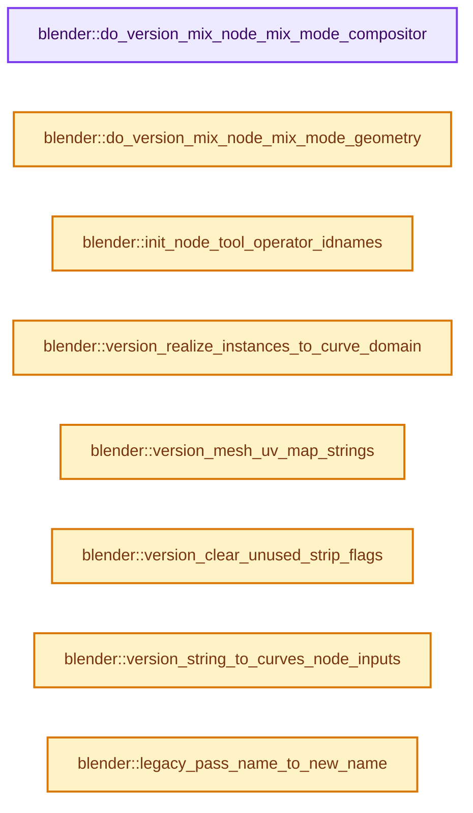
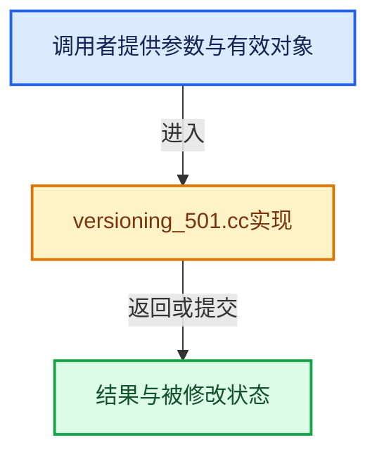

# 实现依赖专题：source/blender/blenloader/intern/versioning_501.cc

[实现依赖导航](../../../README.md) · [符号索引](../../../../00-课程指南/02-源码与提交索引/符号依赖与实现索引.md)

本专题从正文实际调用进入，集中保存共享实现。函数有稳定锚点，可从调用处直接跳到对应完整函数；递归与互相调用通过回链组织。

## 本文件的实现关系






## 完整成员与函数实现

<a id="f-3d6d4765a7b8e046"></a>

### `blender::do_version_mix_node_mix_mode_compositor`

实现位置：[source/blender/blenloader/intern/versioning_501.cc](../../../../../../../../source/blender/blenloader/intern/versioning_501.cc) · L57—L133。

接口参数：

- `bNodeTree &node_tree`
- `bNode &node`

**教学注释版**

<!-- annotated:52bebe0cbbb650 -->

```cpp
static void do_version_mix_node_mix_mode_compositor(bNodeTree &node_tree, bNode &node)
{
  if (!version_node_ensure_storage_or_invalidate(node)) {
    return;
  }
  const NodeShaderMix *data = reinterpret_cast<NodeShaderMix *>(node.storage);
  if (data->data_type != SOCK_RGBA) {
    return;
  }

  if (data->blend_type != MA_RAMP_BLEND) {
    return;
  }

  bNodeSocket *first_input = bke::node_find_socket(node, SOCK_IN, "A_Color"_ustr);
  bNodeSocket *output = bke::node_find_socket(node, SOCK_OUT, "Result_Color"_ustr);

  /* Find the link going into the inputs of the node. */
  bNodeLink *first_link = nullptr;
  for (bNodeLink &link : node_tree.links) {
    if (link.tosock == first_input) {
      first_link = &link;
    }
  }

  bNode &separate_node = version_node_add_empty(node_tree, "CompositorNodeSeparateColor");
  /* Preserve the muted state on the new node so restoring all nodes later behaves the same way. */
  SET_FLAG_FROM_TEST(separate_node.flag, node.flag & NODE_MUTED, NODE_MUTED);
  separate_node.parent = node.parent;
  separate_node.location[0] = node.location[0] - 10.0f;
  separate_node.location[1] = node.location[1];
  NodeCMPCombSepColor *storage = MEM_new<NodeCMPCombSepColor>(__func__);
  storage->mode = CMP_NODE_COMBSEP_COLOR_RGB;
  separate_node.storage = storage;

  bNodeSocket &separate_input = version_node_add_socket(
      node_tree, separate_node, SOCK_IN, "NodeSocketColor", "Image");
  bNodeSocket &separate_alpha_output = version_node_add_socket(
      node_tree, separate_node, SOCK_OUT, "NodeSocketFloat", "Alpha");

  copy_v4_v4(separate_input.default_value_typed<bNodeSocketValueRGBA>()->value,
             first_input->default_value_typed<bNodeSocketValueRGBA>()->value);
  if (first_link) {
    version_node_add_link(
        node_tree, *first_link->fromnode, *first_link->fromsock, separate_node, separate_input);
  }

  bNode &set_alpha_node = version_node_add_empty(node_tree, "CompositorNodeSetAlpha");
  SET_FLAG_FROM_TEST(set_alpha_node.flag, node.flag & NODE_MUTED, NODE_MUTED);
  set_alpha_node.parent = node.parent;
  set_alpha_node.location[0] = node.location[0] - 10.0f;
  set_alpha_node.location[1] = node.location[1];
  set_alpha_node.storage = MEM_new<NodeCMPCombSepColor>(__func__);

  bNodeSocket &set_alpha_image_input = version_node_add_socket(
      node_tree, set_alpha_node, SOCK_IN, "NodeSocketColor", "Image");
  bNodeSocket &set_alpha_alpha_input = version_node_add_socket(
      node_tree, set_alpha_node, SOCK_IN, "NodeSocketFloat", "Alpha");
  bNodeSocket &set_alpha_type_input = version_node_add_socket(
      node_tree, set_alpha_node, SOCK_IN, "NodeSocketMenu", "Type");
  bNodeSocket &set_alpha_output = version_node_add_socket(
      node_tree, set_alpha_node, SOCK_OUT, "NodeSocketColor", "Image");

  set_alpha_type_input.default_value_typed<bNodeSocketValueMenu>()->value =
      CMP_NODE_SETALPHA_MODE_REPLACE_ALPHA;
  version_node_add_link(node_tree, node, *output, set_alpha_node, set_alpha_image_input);
  version_node_add_link(
      node_tree, separate_node, separate_alpha_output, set_alpha_node, set_alpha_alpha_input);

  for (bNodeLink &link : node_tree.links.items_reversed_mutable()) {
    if (link.fromsock == output && link.tonode != &set_alpha_node) {
      version_node_add_link(
          node_tree, set_alpha_node, set_alpha_output, *link.tonode, *link.tosock);
      bke::node_remove_link(&node_tree, link);
    }
  }
}
```

<details>
<summary>核对原始源码：source/blender/blenloader/intern/versioning_501.cc · L57—L133</summary>

<!-- original:52bebe0cbbb650:source/blender/blenloader/intern/versioning_501.cc:57:133 -->

```cpp
static void do_version_mix_node_mix_mode_compositor(bNodeTree &node_tree, bNode &node)
{
  if (!version_node_ensure_storage_or_invalidate(node)) {
    return;
  }
  const NodeShaderMix *data = reinterpret_cast<NodeShaderMix *>(node.storage);
  if (data->data_type != SOCK_RGBA) {
    return;
  }

  if (data->blend_type != MA_RAMP_BLEND) {
    return;
  }

  bNodeSocket *first_input = bke::node_find_socket(node, SOCK_IN, "A_Color"_ustr);
  bNodeSocket *output = bke::node_find_socket(node, SOCK_OUT, "Result_Color"_ustr);

  /* Find the link going into the inputs of the node. */
  bNodeLink *first_link = nullptr;
  for (bNodeLink &link : node_tree.links) {
    if (link.tosock == first_input) {
      first_link = &link;
    }
  }

  bNode &separate_node = version_node_add_empty(node_tree, "CompositorNodeSeparateColor");
  /* Preserve the muted state on the new node so restoring all nodes later behaves the same way. */
  SET_FLAG_FROM_TEST(separate_node.flag, node.flag & NODE_MUTED, NODE_MUTED);
  separate_node.parent = node.parent;
  separate_node.location[0] = node.location[0] - 10.0f;
  separate_node.location[1] = node.location[1];
  NodeCMPCombSepColor *storage = MEM_new<NodeCMPCombSepColor>(__func__);
  storage->mode = CMP_NODE_COMBSEP_COLOR_RGB;
  separate_node.storage = storage;

  bNodeSocket &separate_input = version_node_add_socket(
      node_tree, separate_node, SOCK_IN, "NodeSocketColor", "Image");
  bNodeSocket &separate_alpha_output = version_node_add_socket(
      node_tree, separate_node, SOCK_OUT, "NodeSocketFloat", "Alpha");

  copy_v4_v4(separate_input.default_value_typed<bNodeSocketValueRGBA>()->value,
             first_input->default_value_typed<bNodeSocketValueRGBA>()->value);
  if (first_link) {
    version_node_add_link(
        node_tree, *first_link->fromnode, *first_link->fromsock, separate_node, separate_input);
  }

  bNode &set_alpha_node = version_node_add_empty(node_tree, "CompositorNodeSetAlpha");
  SET_FLAG_FROM_TEST(set_alpha_node.flag, node.flag & NODE_MUTED, NODE_MUTED);
  set_alpha_node.parent = node.parent;
  set_alpha_node.location[0] = node.location[0] - 10.0f;
  set_alpha_node.location[1] = node.location[1];
  set_alpha_node.storage = MEM_new<NodeCMPCombSepColor>(__func__);

  bNodeSocket &set_alpha_image_input = version_node_add_socket(
      node_tree, set_alpha_node, SOCK_IN, "NodeSocketColor", "Image");
  bNodeSocket &set_alpha_alpha_input = version_node_add_socket(
      node_tree, set_alpha_node, SOCK_IN, "NodeSocketFloat", "Alpha");
  bNodeSocket &set_alpha_type_input = version_node_add_socket(
      node_tree, set_alpha_node, SOCK_IN, "NodeSocketMenu", "Type");
  bNodeSocket &set_alpha_output = version_node_add_socket(
      node_tree, set_alpha_node, SOCK_OUT, "NodeSocketColor", "Image");

  set_alpha_type_input.default_value_typed<bNodeSocketValueMenu>()->value =
      CMP_NODE_SETALPHA_MODE_REPLACE_ALPHA;
  version_node_add_link(node_tree, node, *output, set_alpha_node, set_alpha_image_input);
  version_node_add_link(
      node_tree, separate_node, separate_alpha_output, set_alpha_node, set_alpha_alpha_input);

  for (bNodeLink &link : node_tree.links.items_reversed_mutable()) {
    if (link.fromsock == output && link.tonode != &set_alpha_node) {
      version_node_add_link(
          node_tree, set_alpha_node, set_alpha_output, *link.tonode, *link.tosock);
      bke::node_remove_link(&node_tree, link);
    }
  }
}
```

</details>

**沿实际写入检查状态**

- `first_link = &link;`
- `separate_node.parent = node.parent;`
- `separate_node.location[0] = node.location[0] - 10.0f;`
- `separate_node.location[1] = node.location[1];`
- `storage->mode = CMP_NODE_COMBSEP_COLOR_RGB;`
- `separate_node.storage = storage;`
- `set_alpha_node.parent = node.parent;`
- `set_alpha_node.location[0] = node.location[0] - 10.0f;`
- `set_alpha_node.location[1] = node.location[1];`
- `set_alpha_node.storage = MEM_new<NodeCMPCombSepColor>(__func__);`

**继续追踪实现**

- `version_node_ensure_storage_or_invalidate` → [blender::version_node_ensure_storage_or_invalidate · L389](versioning_common.cc.md#f-72131ae3b96134c2)。
- `bke::node_find_socket` → [blender::bke::node_find_socket · L3036](../../../02-BKE几何与数据/intern/node.cc.md#f-cbf9dec71aff5b59)；[blender::bke::node_find_socket · L3047](../../../02-BKE几何与数据/intern/node.cc.md#f-4a7a677634b7fbd1)。同名重载需按实参类型选择。
- `version_node_add_empty` → [blender::version_node_add_empty · L250](versioning_common.cc.md#f-5f6c9b1704901087)。
- `SET_FLAG_FROM_TEST` → [SET_FLAG_FROM_TEST · L557](../../../01-BLI基础库/BLI_utildefines.hh.md#m-8e0dc83e01a8)。宏定义由构建条件选择。
- `MEM_new<NodeCMPCombSepColor>` → [MEM_new · L351](../../../07-Intern运行时与平台/guardedalloc/MEM_guardedalloc.h.md#f-115f9b6784f89912)。
- `version_node_add_socket` → [blender::version_node_add_socket · L332](versioning_common.cc.md#f-846a4268eff6ea5d)。
- `copy_v4_v4` → [blender::copy_v4_v4 · L54](../../../01-BLI基础库/intern/math_vector_inline.cc.md#f-0cf225fc326edf4a)。
- `separate_input.default_value_typed<bNodeSocketValueRGBA>` → [blender::bNodeSocket::default_value_typed · L1134](../../../02-BKE几何与数据/BKE_node_runtime.hh.md#f-ce490d0e5a28d98d)；[blender::bNodeSocket::default_value_typed · L1139](../../../02-BKE几何与数据/BKE_node_runtime.hh.md#f-392726ff93a0389d)。同名重载需按实参类型选择。
- `first_input->default_value_typed<bNodeSocketValueRGBA>` → [blender::bNodeSocket::default_value_typed · L1134](../../../02-BKE几何与数据/BKE_node_runtime.hh.md#f-ce490d0e5a28d98d)；[blender::bNodeSocket::default_value_typed · L1139](../../../02-BKE几何与数据/BKE_node_runtime.hh.md#f-392726ff93a0389d)。同名重载需按实参类型选择。
- `version_node_add_link` → [blender::version_node_add_link · L365](versioning_common.cc.md#f-93b7d089bdf6807c)。
- `set_alpha_type_input.default_value_typed<bNodeSocketValueMenu>` → [blender::bNodeSocket::default_value_typed · L1134](../../../02-BKE几何与数据/BKE_node_runtime.hh.md#f-ce490d0e5a28d98d)；[blender::bNodeSocket::default_value_typed · L1139](../../../02-BKE几何与数据/BKE_node_runtime.hh.md#f-392726ff93a0389d)。同名重载需按实参类型选择。
- `node_tree.links.items_reversed_mutable` → [调用协议](../../../../00-课程指南/01-路线与规范/模板宏与动态分派协议.md)：接收对象类型依赖auto、返回值或模板实例；不按同名猜测目标。调用位置L126。
- `bke::node_remove_link` → [blender::bke::node_remove_link · L4676](../../../02-BKE几何与数据/intern/node.cc.md#f-3cf1faf3e4cf3dd2)。

<a id="f-5b0a66912c3d8ed6"></a>

### `blender::do_version_mix_node_mix_mode_geometry`

实现位置：[source/blender/blenloader/intern/versioning_501.cc](../../../../../../../../source/blender/blenloader/intern/versioning_501.cc) · L138—L252。

接口参数：

- `bNodeTree &node_tree`
- `bNode &node`

**教学注释版**

<!-- annotated:920a35a8ecc66e -->

```cpp
static void do_version_mix_node_mix_mode_geometry(bNodeTree &node_tree, bNode &node)
{
  if (!version_node_ensure_storage_or_invalidate(node)) {
    return;
  }
  const NodeShaderMix *data = reinterpret_cast<NodeShaderMix *>(node.storage);
  if (data->data_type != SOCK_RGBA) {
    return;
  }

  if (data->blend_type != MA_RAMP_BLEND) {
    return;
  }

  bNodeSocket *first_input = bke::node_find_socket(node, SOCK_IN, "A_Color"_ustr);
  bNodeSocket *output = bke::node_find_socket(node, SOCK_OUT, "Result_Color"_ustr);

  /* Find the link going into the inputs of the node. */
  bNodeLink *first_link = nullptr;
  for (bNodeLink &link : node_tree.links) {
    if (link.tosock == first_input) {
      first_link = &link;
    }
  }

  bNode &separate_alpha_node = version_node_add_empty(node_tree, "FunctionNodeSeparateColor");
  separate_alpha_node.parent = node.parent;
  separate_alpha_node.location[0] = node.location[0] - 10.0f;
  separate_alpha_node.location[1] = node.location[1];
  NodeCombSepColor *separate_alpha_storage = MEM_new<NodeCombSepColor>(__func__);
  separate_alpha_storage->mode = NODE_COMBSEP_COLOR_RGB;
  separate_alpha_node.storage = separate_alpha_storage;

  bNodeSocket &separate_alpha_input = version_node_add_socket(
      node_tree, separate_alpha_node, SOCK_IN, "NodeSocketColor", "Color");
  bNodeSocket &separate_alpha_output = version_node_add_socket(
      node_tree, separate_alpha_node, SOCK_OUT, "NodeSocketFloat", "Alpha");

  copy_v4_v4(separate_alpha_input.default_value_typed<bNodeSocketValueRGBA>()->value,
             first_input->default_value_typed<bNodeSocketValueRGBA>()->value);
  if (first_link) {
    version_node_add_link(node_tree,
                          *first_link->fromnode,
                          *first_link->fromsock,
                          separate_alpha_node,
                          separate_alpha_input);
  }

  bNode &separate_color_node = version_node_add_empty(node_tree, "FunctionNodeSeparateColor");
  separate_color_node.parent = node.parent;
  separate_color_node.location[0] = node.location[0] - 10.0f;
  separate_color_node.location[1] = node.location[1];
  NodeCombSepColor *separate_color_storage = MEM_new<NodeCombSepColor>(__func__);
  separate_color_storage->mode = NODE_COMBSEP_COLOR_RGB;
  separate_color_node.storage = separate_color_storage;

  bNodeSocket &separate_color_input = version_node_add_socket(
      node_tree, separate_color_node, SOCK_IN, "NodeSocketColor", "Color");
  bNodeSocket &separate_color_red_output = version_node_add_socket(
      node_tree, separate_color_node, SOCK_OUT, "NodeSocketFloat", "Red");
  bNodeSocket &separate_color_green_output = version_node_add_socket(
      node_tree, separate_color_node, SOCK_OUT, "NodeSocketFloat", "Green");
  bNodeSocket &separate_color_blue_output = version_node_add_socket(
      node_tree, separate_color_node, SOCK_OUT, "NodeSocketFloat", "Blue");

  version_node_add_link(node_tree, node, *output, separate_color_node, separate_color_input);

  bNode &combine_color_node = version_node_add_empty(node_tree, "FunctionNodeCombineColor");
  combine_color_node.parent = node.parent;
  combine_color_node.location[0] = node.location[0] - 10.0f;
  combine_color_node.location[1] = node.location[1];
  NodeCombSepColor *combine_color_storage = MEM_new<NodeCombSepColor>(__func__);
  combine_color_storage->mode = NODE_COMBSEP_COLOR_RGB;
  combine_color_node.storage = combine_color_storage;

  bNodeSocket &combine_color_red_input = version_node_add_socket(
      node_tree, combine_color_node, SOCK_IN, "NodeSocketFloat", "Red");
  bNodeSocket &combine_color_green_input = version_node_add_socket(
      node_tree, combine_color_node, SOCK_IN, "NodeSocketFloat", "Green");
  bNodeSocket &combine_color_blue_input = version_node_add_socket(
      node_tree, combine_color_node, SOCK_IN, "NodeSocketFloat", "Blue");
  bNodeSocket &combine_color_alpha_input = version_node_add_socket(
      node_tree, combine_color_node, SOCK_IN, "NodeSocketFloat", "Alpha");
  bNodeSocket &combine_color_output = version_node_add_socket(
      node_tree, combine_color_node, SOCK_OUT, "NodeSocketColor", "Color");

  version_node_add_link(node_tree,
                        separate_color_node,
                        separate_color_red_output,
                        combine_color_node,
                        combine_color_red_input);
  version_node_add_link(node_tree,
                        separate_color_node,
                        separate_color_green_output,
                        combine_color_node,
                        combine_color_green_input);
  version_node_add_link(node_tree,
                        separate_color_node,
                        separate_color_blue_output,
                        combine_color_node,
                        combine_color_blue_input);
  version_node_add_link(node_tree,
                        separate_alpha_node,
                        separate_alpha_output,
                        combine_color_node,
                        combine_color_alpha_input);

  for (bNodeLink &link : node_tree.links.items_reversed_mutable()) {
    if (link.fromsock == output && link.tonode != &separate_color_node) {
      version_node_add_link(
          node_tree, combine_color_node, combine_color_output, *link.tonode, *link.tosock);
      bke::node_remove_link(&node_tree, link);
    }
  }
}
```

<details>
<summary>核对原始源码：source/blender/blenloader/intern/versioning_501.cc · L138—L252</summary>

<!-- original:920a35a8ecc66e:source/blender/blenloader/intern/versioning_501.cc:138:252 -->

```cpp
static void do_version_mix_node_mix_mode_geometry(bNodeTree &node_tree, bNode &node)
{
  if (!version_node_ensure_storage_or_invalidate(node)) {
    return;
  }
  const NodeShaderMix *data = reinterpret_cast<NodeShaderMix *>(node.storage);
  if (data->data_type != SOCK_RGBA) {
    return;
  }

  if (data->blend_type != MA_RAMP_BLEND) {
    return;
  }

  bNodeSocket *first_input = bke::node_find_socket(node, SOCK_IN, "A_Color"_ustr);
  bNodeSocket *output = bke::node_find_socket(node, SOCK_OUT, "Result_Color"_ustr);

  /* Find the link going into the inputs of the node. */
  bNodeLink *first_link = nullptr;
  for (bNodeLink &link : node_tree.links) {
    if (link.tosock == first_input) {
      first_link = &link;
    }
  }

  bNode &separate_alpha_node = version_node_add_empty(node_tree, "FunctionNodeSeparateColor");
  separate_alpha_node.parent = node.parent;
  separate_alpha_node.location[0] = node.location[0] - 10.0f;
  separate_alpha_node.location[1] = node.location[1];
  NodeCombSepColor *separate_alpha_storage = MEM_new<NodeCombSepColor>(__func__);
  separate_alpha_storage->mode = NODE_COMBSEP_COLOR_RGB;
  separate_alpha_node.storage = separate_alpha_storage;

  bNodeSocket &separate_alpha_input = version_node_add_socket(
      node_tree, separate_alpha_node, SOCK_IN, "NodeSocketColor", "Color");
  bNodeSocket &separate_alpha_output = version_node_add_socket(
      node_tree, separate_alpha_node, SOCK_OUT, "NodeSocketFloat", "Alpha");

  copy_v4_v4(separate_alpha_input.default_value_typed<bNodeSocketValueRGBA>()->value,
             first_input->default_value_typed<bNodeSocketValueRGBA>()->value);
  if (first_link) {
    version_node_add_link(node_tree,
                          *first_link->fromnode,
                          *first_link->fromsock,
                          separate_alpha_node,
                          separate_alpha_input);
  }

  bNode &separate_color_node = version_node_add_empty(node_tree, "FunctionNodeSeparateColor");
  separate_color_node.parent = node.parent;
  separate_color_node.location[0] = node.location[0] - 10.0f;
  separate_color_node.location[1] = node.location[1];
  NodeCombSepColor *separate_color_storage = MEM_new<NodeCombSepColor>(__func__);
  separate_color_storage->mode = NODE_COMBSEP_COLOR_RGB;
  separate_color_node.storage = separate_color_storage;

  bNodeSocket &separate_color_input = version_node_add_socket(
      node_tree, separate_color_node, SOCK_IN, "NodeSocketColor", "Color");
  bNodeSocket &separate_color_red_output = version_node_add_socket(
      node_tree, separate_color_node, SOCK_OUT, "NodeSocketFloat", "Red");
  bNodeSocket &separate_color_green_output = version_node_add_socket(
      node_tree, separate_color_node, SOCK_OUT, "NodeSocketFloat", "Green");
  bNodeSocket &separate_color_blue_output = version_node_add_socket(
      node_tree, separate_color_node, SOCK_OUT, "NodeSocketFloat", "Blue");

  version_node_add_link(node_tree, node, *output, separate_color_node, separate_color_input);

  bNode &combine_color_node = version_node_add_empty(node_tree, "FunctionNodeCombineColor");
  combine_color_node.parent = node.parent;
  combine_color_node.location[0] = node.location[0] - 10.0f;
  combine_color_node.location[1] = node.location[1];
  NodeCombSepColor *combine_color_storage = MEM_new<NodeCombSepColor>(__func__);
  combine_color_storage->mode = NODE_COMBSEP_COLOR_RGB;
  combine_color_node.storage = combine_color_storage;

  bNodeSocket &combine_color_red_input = version_node_add_socket(
      node_tree, combine_color_node, SOCK_IN, "NodeSocketFloat", "Red");
  bNodeSocket &combine_color_green_input = version_node_add_socket(
      node_tree, combine_color_node, SOCK_IN, "NodeSocketFloat", "Green");
  bNodeSocket &combine_color_blue_input = version_node_add_socket(
      node_tree, combine_color_node, SOCK_IN, "NodeSocketFloat", "Blue");
  bNodeSocket &combine_color_alpha_input = version_node_add_socket(
      node_tree, combine_color_node, SOCK_IN, "NodeSocketFloat", "Alpha");
  bNodeSocket &combine_color_output = version_node_add_socket(
      node_tree, combine_color_node, SOCK_OUT, "NodeSocketColor", "Color");

  version_node_add_link(node_tree,
                        separate_color_node,
                        separate_color_red_output,
                        combine_color_node,
                        combine_color_red_input);
  version_node_add_link(node_tree,
                        separate_color_node,
                        separate_color_green_output,
                        combine_color_node,
                        combine_color_green_input);
  version_node_add_link(node_tree,
                        separate_color_node,
                        separate_color_blue_output,
                        combine_color_node,
                        combine_color_blue_input);
  version_node_add_link(node_tree,
                        separate_alpha_node,
                        separate_alpha_output,
                        combine_color_node,
                        combine_color_alpha_input);

  for (bNodeLink &link : node_tree.links.items_reversed_mutable()) {
    if (link.fromsock == output && link.tonode != &separate_color_node) {
      version_node_add_link(
          node_tree, combine_color_node, combine_color_output, *link.tonode, *link.tosock);
      bke::node_remove_link(&node_tree, link);
    }
  }
}
```

</details>

**沿实际写入检查状态**

- `first_link = &link;`
- `separate_alpha_node.parent = node.parent;`
- `separate_alpha_node.location[0] = node.location[0] - 10.0f;`
- `separate_alpha_node.location[1] = node.location[1];`
- `separate_alpha_storage->mode = NODE_COMBSEP_COLOR_RGB;`
- `separate_alpha_node.storage = separate_alpha_storage;`
- `separate_color_node.parent = node.parent;`
- `separate_color_node.location[0] = node.location[0] - 10.0f;`
- `separate_color_node.location[1] = node.location[1];`
- `separate_color_storage->mode = NODE_COMBSEP_COLOR_RGB;`
- `separate_color_node.storage = separate_color_storage;`
- `combine_color_node.parent = node.parent;`
- `combine_color_node.location[0] = node.location[0] - 10.0f;`
- `combine_color_node.location[1] = node.location[1];`
- `combine_color_storage->mode = NODE_COMBSEP_COLOR_RGB;`
- `combine_color_node.storage = combine_color_storage;`

**继续追踪实现**

- `version_node_ensure_storage_or_invalidate` → [blender::version_node_ensure_storage_or_invalidate · L389](versioning_common.cc.md#f-72131ae3b96134c2)。
- `bke::node_find_socket` → [blender::bke::node_find_socket · L3036](../../../02-BKE几何与数据/intern/node.cc.md#f-cbf9dec71aff5b59)；[blender::bke::node_find_socket · L3047](../../../02-BKE几何与数据/intern/node.cc.md#f-4a7a677634b7fbd1)。同名重载需按实参类型选择。
- `version_node_add_empty` → [blender::version_node_add_empty · L250](versioning_common.cc.md#f-5f6c9b1704901087)。
- `MEM_new<NodeCombSepColor>` → [MEM_new · L351](../../../07-Intern运行时与平台/guardedalloc/MEM_guardedalloc.h.md#f-115f9b6784f89912)。
- `version_node_add_socket` → [blender::version_node_add_socket · L332](versioning_common.cc.md#f-846a4268eff6ea5d)。
- `copy_v4_v4` → [blender::copy_v4_v4 · L54](../../../01-BLI基础库/intern/math_vector_inline.cc.md#f-0cf225fc326edf4a)。
- `separate_alpha_input.default_value_typed<bNodeSocketValueRGBA>` → [blender::bNodeSocket::default_value_typed · L1134](../../../02-BKE几何与数据/BKE_node_runtime.hh.md#f-ce490d0e5a28d98d)；[blender::bNodeSocket::default_value_typed · L1139](../../../02-BKE几何与数据/BKE_node_runtime.hh.md#f-392726ff93a0389d)。同名重载需按实参类型选择。
- `first_input->default_value_typed<bNodeSocketValueRGBA>` → [blender::bNodeSocket::default_value_typed · L1134](../../../02-BKE几何与数据/BKE_node_runtime.hh.md#f-ce490d0e5a28d98d)；[blender::bNodeSocket::default_value_typed · L1139](../../../02-BKE几何与数据/BKE_node_runtime.hh.md#f-392726ff93a0389d)。同名重载需按实参类型选择。
- `version_node_add_link` → [blender::version_node_add_link · L365](versioning_common.cc.md#f-93b7d089bdf6807c)。
- `node_tree.links.items_reversed_mutable` → [调用协议](../../../../00-课程指南/01-路线与规范/模板宏与动态分派协议.md)：接收对象类型依赖auto、返回值或模板实例；不按同名猜测目标。调用位置L245。
- `bke::node_remove_link` → [blender::bke::node_remove_link · L4676](../../../02-BKE几何与数据/intern/node.cc.md#f-3cf1faf3e4cf3dd2)。

<a id="f-7c519444f7c84e25"></a>

### `blender::init_node_tool_operator_idnames`

实现位置：[source/blender/blenloader/intern/versioning_501.cc](../../../../../../../../source/blender/blenloader/intern/versioning_501.cc) · L254—L287。

接口参数：

- `Main &bmain`

**教学注释版**

<!-- annotated:5bc4df263aae6e -->

```cpp
static void init_node_tool_operator_idnames(Main &bmain)
{
  for (bNodeTree &group : bmain.nodetrees) {
    if (group.type != NTREE_GEOMETRY) {
      continue;
    }
    if (!group.geometry_node_asset_traits) {
      continue;
    }
    if (group.geometry_node_asset_traits->node_tool_idname) {
      continue;
    }
    std::string name_str = "geometry.";
    for (char c : StringRef(BKE_id_name(group.id))) {
      c = tolower(c);
      if ((c >= 'a' && c <= 'z') || (c >= '0' && c <= '9') || c == '_') {
        name_str.push_back(c);
      }
      else {
        const bool last_is_underscore = name_str[name_str.size() - 1] == '_';
        if (!last_is_underscore) {
          name_str.push_back('_');
        }
      }
    }
    group.geometry_node_asset_traits->node_tool_idname = BLI_strdupn(name_str.c_str(),
                                                                     name_str.size());
    if (group.id.asset_data) {
      auto property = bke::idprop::create(
          "node_tool_idname", StringRefNull(group.geometry_node_asset_traits->node_tool_idname));
      BKE_asset_metadata_idprop_ensure(group.id.asset_data, property.release());
    }
  }
}
```

<details>
<summary>核对原始源码：source/blender/blenloader/intern/versioning_501.cc · L254—L287</summary>

<!-- original:5bc4df263aae6e:source/blender/blenloader/intern/versioning_501.cc:254:287 -->

```cpp
static void init_node_tool_operator_idnames(Main &bmain)
{
  for (bNodeTree &group : bmain.nodetrees) {
    if (group.type != NTREE_GEOMETRY) {
      continue;
    }
    if (!group.geometry_node_asset_traits) {
      continue;
    }
    if (group.geometry_node_asset_traits->node_tool_idname) {
      continue;
    }
    std::string name_str = "geometry.";
    for (char c : StringRef(BKE_id_name(group.id))) {
      c = tolower(c);
      if ((c >= 'a' && c <= 'z') || (c >= '0' && c <= '9') || c == '_') {
        name_str.push_back(c);
      }
      else {
        const bool last_is_underscore = name_str[name_str.size() - 1] == '_';
        if (!last_is_underscore) {
          name_str.push_back('_');
        }
      }
    }
    group.geometry_node_asset_traits->node_tool_idname = BLI_strdupn(name_str.c_str(),
                                                                     name_str.size());
    if (group.id.asset_data) {
      auto property = bke::idprop::create(
          "node_tool_idname", StringRefNull(group.geometry_node_asset_traits->node_tool_idname));
      BKE_asset_metadata_idprop_ensure(group.id.asset_data, property.release());
    }
  }
}
```

</details>

**沿实际写入检查状态**

- `c = tolower(c);`
- `group.geometry_node_asset_traits->node_tool_idname = BLI_strdupn(name_str.c_str(),`

**继续追踪实现**

- `StringRef` → [blender::StringRef::StringRef · L555](../../../../01-基础容器与现代CPP/15-StringRef字符串视图.md#f-f6aca324a36faa7e)；[blender::StringRef::StringRef · L560](../../../../01-基础容器与现代CPP/15-StringRef字符串视图.md#f-ab9714781ca51bac)；[blender::StringRef::StringRef · L565](../../../../01-基础容器与现代CPP/15-StringRef字符串视图.md#f-95f0b483bbdd7739)；[blender::StringRef::StringRef · L570](../../../../01-基础容器与现代CPP/15-StringRef字符串视图.md#f-808d05699cb33334)；[blender::StringRef::StringRef · L631](../../../../01-基础容器与现代CPP/15-StringRef字符串视图.md#f-37788e5f3fa3b736)；[blender::StringRef::StringRef · L641](../../../../01-基础容器与现代CPP/15-StringRef字符串视图.md#f-11abd0510fb6b926)；[blender::StringRef::StringRef · L646](../../../../01-基础容器与现代CPP/15-StringRef字符串视图.md#f-8437dbd8a582eefd)；[blender::StringRef::StringRef · L651](../../../../01-基础容器与现代CPP/15-StringRef字符串视图.md#f-70bcb338de0db978)。同名重载需按实参类型选择。
- `BKE_id_name` → [blender::BKE_id_name · L1001](../../../02-BKE几何与数据/BKE_lib_id.hh.md#f-b9397f1fe1fcc017)；[blender::BKE_id_name · L1005](../../../02-BKE几何与数据/BKE_lib_id.hh.md#f-c026427d13979145)。同名重载需按实参类型选择。
- `tolower` → [调用协议](../../../../00-课程指南/01-路线与规范/模板宏与动态分派协议.md)：函数指针、局部可调用对象或未展开的宏；必须结合调用者环境。调用位置L268。
- `name_str.push_back` → [外部契约](https://eel.is/c++draft/)：这个边界按实际表达式及所属类型核对参数、返回值、寿命与失败行为。这里提供接口入口，不声称已解释该第三方版本的内部实现。
- `name_str.size` → [外部契约](https://eel.is/c++draft/)：这个边界按实际表达式及所属类型核对参数、返回值、寿命与失败行为。这里提供接口入口，不声称已解释该第三方版本的内部实现。
- `BLI_strdupn` → [blender::BLI_strdupn · L32](../../../01-BLI基础库/intern/string.cc.md#f-65dc033cf6e67cff)。
- `name_str.c_str` → [外部契约](https://eel.is/c++draft/)：这个边界按实际表达式及所属类型核对参数、返回值、寿命与失败行为。这里提供接口入口，不声称已解释该第三方版本的内部实现。
- `bke::idprop::create` → [blender::bke::idprop::create · L21](../../../02-BKE几何与数据/intern/idprop_create.cc.md#f-9f46f3367aea5850)；[blender::bke::idprop::create · L41](../../../02-BKE几何与数据/intern/idprop_create.cc.md#f-fb8f0fd79ae0a7b2)；[blender::bke::idprop::create · L51](../../../02-BKE几何与数据/intern/idprop_create.cc.md#f-3c724b83c1b70000)；[blender::bke::idprop::create · L61](../../../02-BKE几何与数据/intern/idprop_create.cc.md#f-3e8bfbe29fbc5b06)；[blender::bke::idprop::create · L69](../../../02-BKE几何与数据/intern/idprop_create.cc.md#f-da73ef629d404b53)；[blender::bke::idprop::create · L134](../../../02-BKE几何与数据/intern/idprop_create.cc.md#f-db9e605ad4939d5d)；[blender::bke::idprop::create · L141](../../../02-BKE几何与数据/intern/idprop_create.cc.md#f-1198c99845e5eb1f)；[blender::bke::idprop::create · L148](../../../02-BKE几何与数据/intern/idprop_create.cc.md#f-d9cb1affee65ed50)。同名重载需按实参类型选择。
- `StringRefNull` → [blender::StringRefNull::StringRefNull · L496](../../../../01-基础容器与现代CPP/15-StringRef字符串视图.md#f-936c98fc0d9ae39e)；[blender::StringRefNull::StringRefNull · L502](../../../../01-基础容器与现代CPP/15-StringRef字符串视图.md#f-cf03ac0c28007ee0)；[blender::StringRefNull::StringRefNull · L512](../../../../01-基础容器与现代CPP/15-StringRef字符串视图.md#f-8a14273318bc57e1)；[blender::StringRefNull::StringRefNull · L523](../../../../01-基础容器与现代CPP/15-StringRef字符串视图.md#f-e1cc63a4ff92775b)。同名重载需按实参类型选择。
- `BKE_asset_metadata_idprop_ensure` → [blender::BKE_asset_metadata_idprop_ensure · L172](../../../02-BKE几何与数据/intern/asset.cc.md#f-c66be3245706717c)。
- `property.release` → [调用协议](../../../../00-课程指南/01-路线与规范/模板宏与动态分派协议.md)：接收对象类型依赖auto、返回值或模板实例；不按同名猜测目标。调用位置L284。

<a id="f-97ccb4e454114029"></a>

### `blender::version_realize_instances_to_curve_domain`

实现位置：[source/blender/blenloader/intern/versioning_501.cc](../../../../../../../../source/blender/blenloader/intern/versioning_501.cc) · L289—L302。

接口参数：

- `Main &bmain`

**教学注释版**

<!-- annotated:0534ca1b5c5cd6 -->

```cpp
static void version_realize_instances_to_curve_domain(Main &bmain)
{
  for (bNodeTree &node_tree : bmain.nodetrees) {
    if (node_tree.type != NTREE_GEOMETRY) {
      continue;
    }
    for (bNode &node : node_tree.nodes) {
      if (node.type_legacy != GEO_NODE_REALIZE_INSTANCES) {
        continue;
      }
      node.custom1 |= GEO_NODE_REALIZE_TO_POINT_DOMAIN;
    }
  }
}
```

<details>
<summary>核对原始源码：source/blender/blenloader/intern/versioning_501.cc · L289—L302</summary>

<!-- original:0534ca1b5c5cd6:source/blender/blenloader/intern/versioning_501.cc:289:302 -->

```cpp
static void version_realize_instances_to_curve_domain(Main &bmain)
{
  for (bNodeTree &node_tree : bmain.nodetrees) {
    if (node_tree.type != NTREE_GEOMETRY) {
      continue;
    }
    for (bNode &node : node_tree.nodes) {
      if (node.type_legacy != GEO_NODE_REALIZE_INSTANCES) {
        continue;
      }
      node.custom1 |= GEO_NODE_REALIZE_TO_POINT_DOMAIN;
    }
  }
}
```

</details>

**沿实际写入检查状态**

- `node.custom1 |= GEO_NODE_REALIZE_TO_POINT_DOMAIN;`

**继续追踪实现**

本实现没有需要继续展开的显式调用；检查返回表达式、对象转换和调用者前置条件。

<a id="f-7b5507b5675d658e"></a>

### `blender::version_mesh_uv_map_strings`

实现位置：[source/blender/blenloader/intern/versioning_501.cc](../../../../../../../../source/blender/blenloader/intern/versioning_501.cc) · L304—L319。

接口参数：

- `Main &bmain`

**教学注释版**

<!-- annotated:c2c51ec3b4d024 -->

```cpp
static void version_mesh_uv_map_strings(Main &bmain)
{
  for (Mesh &mesh : bmain.meshes) {
    const CustomData *data = &mesh.corner_data;
    if (!mesh.active_uv_map_attribute) {
      if (const char *name = CustomData_get_active_layer_name(data, CD_PROP_FLOAT2)) {
        mesh.active_uv_map_attribute = BLI_strdup(name);
      }
    }
    if (!mesh.default_uv_map_attribute) {
      if (const char *name = CustomData_get_render_layer_name(data, CD_PROP_FLOAT2)) {
        mesh.default_uv_map_attribute = BLI_strdup(name);
      }
    }
  }
}
```

<details>
<summary>核对原始源码：source/blender/blenloader/intern/versioning_501.cc · L304—L319</summary>

<!-- original:c2c51ec3b4d024:source/blender/blenloader/intern/versioning_501.cc:304:319 -->

```cpp
static void version_mesh_uv_map_strings(Main &bmain)
{
  for (Mesh &mesh : bmain.meshes) {
    const CustomData *data = &mesh.corner_data;
    if (!mesh.active_uv_map_attribute) {
      if (const char *name = CustomData_get_active_layer_name(data, CD_PROP_FLOAT2)) {
        mesh.active_uv_map_attribute = BLI_strdup(name);
      }
    }
    if (!mesh.default_uv_map_attribute) {
      if (const char *name = CustomData_get_render_layer_name(data, CD_PROP_FLOAT2)) {
        mesh.default_uv_map_attribute = BLI_strdup(name);
      }
    }
  }
}
```

</details>

**沿实际写入检查状态**

- `mesh.active_uv_map_attribute = BLI_strdup(name);`
- `mesh.default_uv_map_attribute = BLI_strdup(name);`

**继续追踪实现**

- `CustomData_get_active_layer_name` → [blender::CustomData_get_active_layer_name · L2642](../../../02-BKE几何与数据/intern/customdata.cc.md#f-7270960aab2e3699)。
- `BLI_strdup` → [blender::BLI_strdup · L43](../../../01-BLI基础库/intern/string.cc.md#f-7e6d5c696c20c0e1)。
- `CustomData_get_render_layer_name` → [blender::CustomData_get_render_layer_name · L2649](../../../02-BKE几何与数据/intern/customdata.cc.md#f-46837f7f30739924)。

<a id="f-1a838820466b075a"></a>

### `blender::version_clear_unused_strip_flags`

实现位置：[source/blender/blenloader/intern/versioning_501.cc](../../../../../../../../source/blender/blenloader/intern/versioning_501.cc) · L321—L339。

接口参数：

- `Main &bmain`

**教学注释版**

<!-- annotated:83eeb0bbba8b09 -->

```cpp
static void version_clear_unused_strip_flags(Main &bmain)
{
  for (Scene &scene : bmain.scenes) {
    Editing *ed = seq::editing_get(&scene);
    if (ed != nullptr) {
      seq::foreach_strip(&ed->seqbase, [&](Strip *strip) {
        constexpr int flag_overlap = 1 << 3;
        constexpr int flag_ipo_frame_locked = 1 << 8;
        constexpr int flag_effect_not_loaded = 1 << 9;
        constexpr int flag_delete = 1 << 10;
        constexpr int flag_ignore_channel_lock = 1 << 16;
        constexpr int flag_show_offsets = 1 << 20;
        strip->flag &= ~eStripFlag(flag_overlap | flag_ipo_frame_locked | flag_effect_not_loaded |
                                   flag_delete | flag_ignore_channel_lock | flag_show_offsets);
        return true;
      });
    }
  }
}
```

<details>
<summary>核对原始源码：source/blender/blenloader/intern/versioning_501.cc · L321—L339</summary>

<!-- original:83eeb0bbba8b09:source/blender/blenloader/intern/versioning_501.cc:321:339 -->

```cpp
static void version_clear_unused_strip_flags(Main &bmain)
{
  for (Scene &scene : bmain.scenes) {
    Editing *ed = seq::editing_get(&scene);
    if (ed != nullptr) {
      seq::foreach_strip(&ed->seqbase, [&](Strip *strip) {
        constexpr int flag_overlap = 1 << 3;
        constexpr int flag_ipo_frame_locked = 1 << 8;
        constexpr int flag_effect_not_loaded = 1 << 9;
        constexpr int flag_delete = 1 << 10;
        constexpr int flag_ignore_channel_lock = 1 << 16;
        constexpr int flag_show_offsets = 1 << 20;
        strip->flag &= ~eStripFlag(flag_overlap | flag_ipo_frame_locked | flag_effect_not_loaded |
                                   flag_delete | flag_ignore_channel_lock | flag_show_offsets);
        return true;
      });
    }
  }
}
```

</details>

**沿实际写入检查状态**

- `strip->flag &= ~eStripFlag(flag_overlap | flag_ipo_frame_locked | flag_effect_not_loaded |`

**结果出口**

- `return true;`

**继续追踪实现**

- `seq::editing_get` → [blender::seq::editing_get · L304](../../sequencer/intern/sequencer.cc.md#f-6332e57a33c5dd16)。
- `seq::foreach_strip` → [blender::seq::foreach_strip · L60](../../sequencer/intern/iterator.cc.md#f-86cee6cf86eb707c)；[blender::seq::foreach_strip · L65](../../sequencer/intern/iterator.cc.md#f-f628b6218602a592)。同名重载需按实参类型选择。
- `eStripFlag` → [blender::eStripFlag](../../makesdna/DNA_sequence_types.h.md#t-63369f1fc0c7)。

<a id="f-4bde4d62824bb13b"></a>

### `blender::version_string_to_curves_node_inputs`

实现位置：[source/blender/blenloader/intern/versioning_501.cc](../../../../../../../../source/blender/blenloader/intern/versioning_501.cc) · L341—L372。

接口参数：

- `bNodeTree &tree`
- `bNode &node`

**教学注释版**

<!-- annotated:031d58ccee9390 -->

```cpp
static void version_string_to_curves_node_inputs(bNodeTree &tree, bNode &node)
{
  if (!node.storage) {
    return;
  }
  auto &storage = *reinterpret_cast<NodeGeometryStringToCurves *>(node.storage);
  if (!blender::bke::node_find_socket(node, SOCK_IN, "Font"_ustr)) {
    bNodeSocket &socket = version_node_add_socket(tree, node, SOCK_IN, "NodeSocketFont", "Font");
    socket.default_value_typed<bNodeSocketValueFont>()->value = reinterpret_cast<VFont *>(node.id);
    node.id = nullptr;
  }
  if (!blender::bke::node_find_socket(node, SOCK_IN, "Overflow"_ustr)) {
    bNodeSocket &socket = version_node_add_socket(
        tree, node, SOCK_IN, "NodeSocketMenu", "Overflow");
    socket.default_value_typed<bNodeSocketValueMenu>()->value = storage.overflow;
  }
  if (!blender::bke::node_find_socket(node, SOCK_IN, "Align X"_ustr)) {
    bNodeSocket &socket = version_node_add_socket(
        tree, node, SOCK_IN, "NodeSocketMenu", "Align X");
    socket.default_value_typed<bNodeSocketValueMenu>()->value = storage.align_x;
  }
  if (!blender::bke::node_find_socket(node, SOCK_IN, "Align Y"_ustr)) {
    bNodeSocket &socket = version_node_add_socket(
        tree, node, SOCK_IN, "NodeSocketMenu", "Align Y");
    socket.default_value_typed<bNodeSocketValueMenu>()->value = storage.align_y;
  }
  if (!blender::bke::node_find_socket(node, SOCK_IN, "Pivot Point"_ustr)) {
    bNodeSocket &socket = version_node_add_socket(
        tree, node, SOCK_IN, "NodeSocketMenu", "Pivot Point");
    socket.default_value_typed<bNodeSocketValueMenu>()->value = storage.pivot_mode;
  }
}
```

<details>
<summary>核对原始源码：source/blender/blenloader/intern/versioning_501.cc · L341—L372</summary>

<!-- original:031d58ccee9390:source/blender/blenloader/intern/versioning_501.cc:341:372 -->

```cpp
static void version_string_to_curves_node_inputs(bNodeTree &tree, bNode &node)
{
  if (!node.storage) {
    return;
  }
  auto &storage = *reinterpret_cast<NodeGeometryStringToCurves *>(node.storage);
  if (!blender::bke::node_find_socket(node, SOCK_IN, "Font"_ustr)) {
    bNodeSocket &socket = version_node_add_socket(tree, node, SOCK_IN, "NodeSocketFont", "Font");
    socket.default_value_typed<bNodeSocketValueFont>()->value = reinterpret_cast<VFont *>(node.id);
    node.id = nullptr;
  }
  if (!blender::bke::node_find_socket(node, SOCK_IN, "Overflow"_ustr)) {
    bNodeSocket &socket = version_node_add_socket(
        tree, node, SOCK_IN, "NodeSocketMenu", "Overflow");
    socket.default_value_typed<bNodeSocketValueMenu>()->value = storage.overflow;
  }
  if (!blender::bke::node_find_socket(node, SOCK_IN, "Align X"_ustr)) {
    bNodeSocket &socket = version_node_add_socket(
        tree, node, SOCK_IN, "NodeSocketMenu", "Align X");
    socket.default_value_typed<bNodeSocketValueMenu>()->value = storage.align_x;
  }
  if (!blender::bke::node_find_socket(node, SOCK_IN, "Align Y"_ustr)) {
    bNodeSocket &socket = version_node_add_socket(
        tree, node, SOCK_IN, "NodeSocketMenu", "Align Y");
    socket.default_value_typed<bNodeSocketValueMenu>()->value = storage.align_y;
  }
  if (!blender::bke::node_find_socket(node, SOCK_IN, "Pivot Point"_ustr)) {
    bNodeSocket &socket = version_node_add_socket(
        tree, node, SOCK_IN, "NodeSocketMenu", "Pivot Point");
    socket.default_value_typed<bNodeSocketValueMenu>()->value = storage.pivot_mode;
  }
}
```

</details>

**沿实际写入检查状态**

- `node.id = nullptr;`

**继续追踪实现**

- `blender::bke::node_find_socket` → [blender::bke::node_find_socket · L3036](../../../02-BKE几何与数据/intern/node.cc.md#f-cbf9dec71aff5b59)；[blender::bke::node_find_socket · L3047](../../../02-BKE几何与数据/intern/node.cc.md#f-4a7a677634b7fbd1)。同名重载需按实参类型选择。
- `version_node_add_socket` → [blender::version_node_add_socket · L332](versioning_common.cc.md#f-846a4268eff6ea5d)。
- `socket.default_value_typed<bNodeSocketValueFont>` → [blender::bNodeSocket::default_value_typed · L1134](../../../02-BKE几何与数据/BKE_node_runtime.hh.md#f-ce490d0e5a28d98d)；[blender::bNodeSocket::default_value_typed · L1139](../../../02-BKE几何与数据/BKE_node_runtime.hh.md#f-392726ff93a0389d)。同名重载需按实参类型选择。
- `socket.default_value_typed<bNodeSocketValueMenu>` → [blender::bNodeSocket::default_value_typed · L1134](../../../02-BKE几何与数据/BKE_node_runtime.hh.md#f-ce490d0e5a28d98d)；[blender::bNodeSocket::default_value_typed · L1139](../../../02-BKE几何与数据/BKE_node_runtime.hh.md#f-392726ff93a0389d)。同名重载需按实参类型选择。

<a id="f-6aa7679fe08d84e8"></a>

### `blender::legacy_pass_name_to_new_name`

实现位置：[source/blender/blenloader/intern/versioning_501.cc](../../../../../../../../source/blender/blenloader/intern/versioning_501.cc) · L374—L438。

接口参数：

- `const char *name`

**教学注释版**

<!-- annotated:78debd1697a50f -->

```cpp
static const char *legacy_pass_name_to_new_name(const char *name)
{
  if (STREQ(name, "DiffDir")) {
    return "Diffuse Direct";
  }
  if (STREQ(name, "DiffInd")) {
    return "Diffuse Indirect";
  }
  if (STREQ(name, "DiffCol")) {
    return "Diffuse Color";
  }
  if (STREQ(name, "GlossDir")) {
    return "Glossy Direct";
  }
  if (STREQ(name, "GlossInd")) {
    return "Glossy Indirect";
  }
  if (STREQ(name, "GlossCol")) {
    return "Glossy Color";
  }
  if (STREQ(name, "TransDir")) {
    return "Transmission Direct";
  }
  if (STREQ(name, "TransInd")) {
    return "Transmission Indirect";
  }
  if (STREQ(name, "TransCol")) {
    return "Transmission Color";
  }
  if (STREQ(name, "VolumeDir")) {
    return "Volume Direct";
  }
  if (STREQ(name, "VolumeInd")) {
    return "Volume Indirect";
  }
  if (STREQ(name, "VolumeCol")) {
    return "Volume Color";
  }
  if (STREQ(name, "AO")) {
    return "Ambient Occlusion";
  }
  if (STREQ(name, "Env")) {
    return "Environment";
  }
  if (STREQ(name, "IndexMA")) {
    return "Material Index";
  }
  if (STREQ(name, "IndexOB")) {
    return "Object Index";
  }
  if (STREQ(name, "GreasePencil")) {
    return "Grease Pencil";
  }
  if (STREQ(name, "Emit")) {
    return "Emission";
  }
  if (STREQ(name, "Z")) {
    return "Depth";
  }
  if (STREQ(name, "Speed")) {
    return "Vector";
  }

  return name;
}
```

<details>
<summary>核对原始源码：source/blender/blenloader/intern/versioning_501.cc · L374—L438</summary>

<!-- original:78debd1697a50f:source/blender/blenloader/intern/versioning_501.cc:374:438 -->

```cpp
static const char *legacy_pass_name_to_new_name(const char *name)
{
  if (STREQ(name, "DiffDir")) {
    return "Diffuse Direct";
  }
  if (STREQ(name, "DiffInd")) {
    return "Diffuse Indirect";
  }
  if (STREQ(name, "DiffCol")) {
    return "Diffuse Color";
  }
  if (STREQ(name, "GlossDir")) {
    return "Glossy Direct";
  }
  if (STREQ(name, "GlossInd")) {
    return "Glossy Indirect";
  }
  if (STREQ(name, "GlossCol")) {
    return "Glossy Color";
  }
  if (STREQ(name, "TransDir")) {
    return "Transmission Direct";
  }
  if (STREQ(name, "TransInd")) {
    return "Transmission Indirect";
  }
  if (STREQ(name, "TransCol")) {
    return "Transmission Color";
  }
  if (STREQ(name, "VolumeDir")) {
    return "Volume Direct";
  }
  if (STREQ(name, "VolumeInd")) {
    return "Volume Indirect";
  }
  if (STREQ(name, "VolumeCol")) {
    return "Volume Color";
  }
  if (STREQ(name, "AO")) {
    return "Ambient Occlusion";
  }
  if (STREQ(name, "Env")) {
    return "Environment";
  }
  if (STREQ(name, "IndexMA")) {
    return "Material Index";
  }
  if (STREQ(name, "IndexOB")) {
    return "Object Index";
  }
  if (STREQ(name, "GreasePencil")) {
    return "Grease Pencil";
  }
  if (STREQ(name, "Emit")) {
    return "Emission";
  }
  if (STREQ(name, "Z")) {
    return "Depth";
  }
  if (STREQ(name, "Speed")) {
    return "Vector";
  }

  return name;
}
```

</details>

**结果出口**

- `return "Diffuse Direct";`
- `return "Diffuse Indirect";`
- `return "Diffuse Color";`
- `return "Glossy Direct";`
- `return "Glossy Indirect";`
- `return "Glossy Color";`
- `return "Transmission Direct";`
- `return "Transmission Indirect";`
- `return "Transmission Color";`
- `return "Volume Direct";`
- `return "Volume Indirect";`
- `return "Volume Color";`
- `return "Ambient Occlusion";`
- `return "Environment";`
- `return "Material Index";`
- `return "Object Index";`
- `return "Grease Pencil";`
- `return "Emission";`
- `return "Depth";`
- `return "Vector";`
- `return name;`

**继续追踪实现**

- `STREQ` → [STREQ · L112](../../../07-Intern运行时与平台/ghost/intern/GHOST_utildefines.hh.md#m-9549fb6aafd2)；[STREQ · L451](../../../01-BLI基础库/BLI_utildefines.hh.md#m-c7b745bcfad2)；[STREQ · L55](../../../07-Intern运行时与平台/clog/clog.cc.md#m-96e78f386894)。宏定义由构建条件选择。

<a id="f-788a7132f1586beb"></a>

### `blender::do_version_light_remove_use_nodes`

实现位置：[source/blender/blenloader/intern/versioning_501.cc](../../../../../../../../source/blender/blenloader/intern/versioning_501.cc) · L440—L500。

接口参数：

- `Main *bmain`
- `Light *light`

**教学注释版**

<!-- annotated:0df064a19d1a1c -->

```cpp
static void do_version_light_remove_use_nodes(Main *bmain, Light *light)
{
  if (light->use_nodes) {
    return;
  }

  /* Users defined a light node tree, but deactivated it by disabling "Use Nodes". So we
   * simulate the same effect by creating a new Light Output node and setting it to active. */
  bNodeTree *ntree = light->nodetree;
  if (ntree == nullptr) {
    /* In case the light was defined through Python API it might have been missing a node tree.
     */
    ntree = bke::node_tree_add_tree_embedded(
        bmain, &light->id, "Light Node Tree Versioning", "ShaderNodeTree");
  }

  bNode *old_output = nullptr;
  for (bNode &node : ntree->nodes) {
    if (STREQ(node.idname, "ShaderNodeOutputLight") && (node.flag & NODE_DO_OUTPUT)) {
      old_output = &node;
      old_output->flag &= ~NODE_DO_OUTPUT;
    }
  }

  bNode &new_output = version_node_add_empty(*ntree, "ShaderNodeOutputLight");
  bNodeSocket &output_surface_input = version_node_add_socket(
      *ntree, new_output, SOCK_IN, "NodeSocketShader", "Surface");
  new_output.flag |= NODE_DO_OUTPUT;

  bNode &emission = version_node_add_empty(*ntree, "ShaderNodeEmission");
  bNodeSocket &emission_color_input = version_node_add_socket(
      *ntree, emission, SOCK_IN, "NodeSocketColor", "Color");
  bNodeSocket &emission_strength_input = version_node_add_socket(
      *ntree, emission, SOCK_IN, "NodeSocketFloat", "Strength");
  bNodeSocket &emission_output = version_node_add_socket(
      *ntree, emission, SOCK_OUT, "NodeSocketShader", "Emission");

  version_node_add_link(*ntree, emission, emission_output, new_output, output_surface_input);

  bNodeSocketValueRGBA *rgba = emission_color_input.default_value_typed<bNodeSocketValueRGBA>();
  rgba->value[0] = 1.0f;
  rgba->value[1] = 1.0f;
  rgba->value[2] = 1.0f;
  rgba->value[3] = 1.0f;
  emission_strength_input.default_value_typed<bNodeSocketValueFloat>()->value = 1.0f;

  if (old_output != nullptr) {
    /* Position the newly created node after the old output. Assume the old output node is at
     * the far right of the node tree. */
    emission.location[0] = old_output->location[0] + 1.5f * old_output->width;
    emission.location[1] = old_output->location[1];
  }
  else {
    /* Use default position, see #node_tree_shader_default() */
    emission.location[0] = -200.0f;
    emission.location[1] = 100.0f;
  }

  new_output.location[0] = emission.location[0] + 2.0f * emission.width;
  new_output.location[1] = emission.location[1];
}
```

<details>
<summary>核对原始源码：source/blender/blenloader/intern/versioning_501.cc · L440—L500</summary>

<!-- original:0df064a19d1a1c:source/blender/blenloader/intern/versioning_501.cc:440:500 -->

```cpp
static void do_version_light_remove_use_nodes(Main *bmain, Light *light)
{
  if (light->use_nodes) {
    return;
  }

  /* Users defined a light node tree, but deactivated it by disabling "Use Nodes". So we
   * simulate the same effect by creating a new Light Output node and setting it to active. */
  bNodeTree *ntree = light->nodetree;
  if (ntree == nullptr) {
    /* In case the light was defined through Python API it might have been missing a node tree.
     */
    ntree = bke::node_tree_add_tree_embedded(
        bmain, &light->id, "Light Node Tree Versioning", "ShaderNodeTree");
  }

  bNode *old_output = nullptr;
  for (bNode &node : ntree->nodes) {
    if (STREQ(node.idname, "ShaderNodeOutputLight") && (node.flag & NODE_DO_OUTPUT)) {
      old_output = &node;
      old_output->flag &= ~NODE_DO_OUTPUT;
    }
  }

  bNode &new_output = version_node_add_empty(*ntree, "ShaderNodeOutputLight");
  bNodeSocket &output_surface_input = version_node_add_socket(
      *ntree, new_output, SOCK_IN, "NodeSocketShader", "Surface");
  new_output.flag |= NODE_DO_OUTPUT;

  bNode &emission = version_node_add_empty(*ntree, "ShaderNodeEmission");
  bNodeSocket &emission_color_input = version_node_add_socket(
      *ntree, emission, SOCK_IN, "NodeSocketColor", "Color");
  bNodeSocket &emission_strength_input = version_node_add_socket(
      *ntree, emission, SOCK_IN, "NodeSocketFloat", "Strength");
  bNodeSocket &emission_output = version_node_add_socket(
      *ntree, emission, SOCK_OUT, "NodeSocketShader", "Emission");

  version_node_add_link(*ntree, emission, emission_output, new_output, output_surface_input);

  bNodeSocketValueRGBA *rgba = emission_color_input.default_value_typed<bNodeSocketValueRGBA>();
  rgba->value[0] = 1.0f;
  rgba->value[1] = 1.0f;
  rgba->value[2] = 1.0f;
  rgba->value[3] = 1.0f;
  emission_strength_input.default_value_typed<bNodeSocketValueFloat>()->value = 1.0f;

  if (old_output != nullptr) {
    /* Position the newly created node after the old output. Assume the old output node is at
     * the far right of the node tree. */
    emission.location[0] = old_output->location[0] + 1.5f * old_output->width;
    emission.location[1] = old_output->location[1];
  }
  else {
    /* Use default position, see #node_tree_shader_default() */
    emission.location[0] = -200.0f;
    emission.location[1] = 100.0f;
  }

  new_output.location[0] = emission.location[0] + 2.0f * emission.width;
  new_output.location[1] = emission.location[1];
}
```

</details>

**沿实际写入检查状态**

- `ntree = bke::node_tree_add_tree_embedded(`
- `old_output = &node;`
- `old_output->flag &= ~NODE_DO_OUTPUT;`
- `new_output.flag |= NODE_DO_OUTPUT;`
- `rgba->value[0] = 1.0f;`
- `rgba->value[1] = 1.0f;`
- `rgba->value[2] = 1.0f;`
- `rgba->value[3] = 1.0f;`
- `emission.location[0] = old_output->location[0] + 1.5f * old_output->width;`
- `emission.location[1] = old_output->location[1];`
- `emission.location[0] = -200.0f;`
- `emission.location[1] = 100.0f;`
- `new_output.location[0] = emission.location[0] + 2.0f * emission.width;`
- `new_output.location[1] = emission.location[1];`

**继续追踪实现**

- `bke::node_tree_add_tree_embedded` → [blender::bke::node_tree_add_tree_embedded · L5005](../../../02-BKE几何与数据/intern/node.cc.md#f-8357c25dd4ab30ef)。
- `STREQ` → [STREQ · L112](../../../07-Intern运行时与平台/ghost/intern/GHOST_utildefines.hh.md#m-9549fb6aafd2)；[STREQ · L451](../../../01-BLI基础库/BLI_utildefines.hh.md#m-c7b745bcfad2)；[STREQ · L55](../../../07-Intern运行时与平台/clog/clog.cc.md#m-96e78f386894)。宏定义由构建条件选择。
- `version_node_add_empty` → [blender::version_node_add_empty · L250](versioning_common.cc.md#f-5f6c9b1704901087)。
- `version_node_add_socket` → [blender::version_node_add_socket · L332](versioning_common.cc.md#f-846a4268eff6ea5d)。
- `version_node_add_link` → [blender::version_node_add_link · L365](versioning_common.cc.md#f-93b7d089bdf6807c)。
- `emission_color_input.default_value_typed<bNodeSocketValueRGBA>` → [blender::bNodeSocket::default_value_typed · L1134](../../../02-BKE几何与数据/BKE_node_runtime.hh.md#f-ce490d0e5a28d98d)；[blender::bNodeSocket::default_value_typed · L1139](../../../02-BKE几何与数据/BKE_node_runtime.hh.md#f-392726ff93a0389d)。同名重载需按实参类型选择。
- `emission_strength_input.default_value_typed<bNodeSocketValueFloat>` → [blender::bNodeSocket::default_value_typed · L1134](../../../02-BKE几何与数据/BKE_node_runtime.hh.md#f-ce490d0e5a28d98d)；[blender::bNodeSocket::default_value_typed · L1139](../../../02-BKE几何与数据/BKE_node_runtime.hh.md#f-392726ff93a0389d)。同名重载需按实参类型选择。

<a id="f-ba63a669c6b03bae"></a>

### `blender::do_version_render_layers_node_albedo_normal_swap`

实现位置：[source/blender/blenloader/intern/versioning_501.cc](../../../../../../../../source/blender/blenloader/intern/versioning_501.cc) · L505—L520。

接口参数：

- `bNode &node`

**教学注释版**

<!-- annotated:cdb22c649e5a8c -->

```cpp
static void do_version_render_layers_node_albedo_normal_swap(bNode &node)
{
  bNodeSocket *socket_denoise_normal = nullptr;
  bNodeSocket *socket_denoise_albedo = nullptr;
  for (bNodeSocket &socket : node.outputs) {
    if (STREQ(socket.identifier, "Denoising Normal")) {
      socket_denoise_normal = &socket;
    }
    if (STREQ(socket.identifier, "Denoising Albedo")) {
      socket_denoise_albedo = &socket;
    }
  }
  if (socket_denoise_albedo && socket_denoise_normal) {
    BLI_listbase_swaplinks(&node.outputs, socket_denoise_normal, socket_denoise_albedo);
  }
}
```

<details>
<summary>核对原始源码：source/blender/blenloader/intern/versioning_501.cc · L505—L520</summary>

<!-- original:cdb22c649e5a8c:source/blender/blenloader/intern/versioning_501.cc:505:520 -->

```cpp
static void do_version_render_layers_node_albedo_normal_swap(bNode &node)
{
  bNodeSocket *socket_denoise_normal = nullptr;
  bNodeSocket *socket_denoise_albedo = nullptr;
  for (bNodeSocket &socket : node.outputs) {
    if (STREQ(socket.identifier, "Denoising Normal")) {
      socket_denoise_normal = &socket;
    }
    if (STREQ(socket.identifier, "Denoising Albedo")) {
      socket_denoise_albedo = &socket;
    }
  }
  if (socket_denoise_albedo && socket_denoise_normal) {
    BLI_listbase_swaplinks(&node.outputs, socket_denoise_normal, socket_denoise_albedo);
  }
}
```

</details>

**沿实际写入检查状态**

- `socket_denoise_normal = &socket;`
- `socket_denoise_albedo = &socket;`

**继续追踪实现**

- `STREQ` → [STREQ · L112](../../../07-Intern运行时与平台/ghost/intern/GHOST_utildefines.hh.md#m-9549fb6aafd2)；[STREQ · L451](../../../01-BLI基础库/BLI_utildefines.hh.md#m-c7b745bcfad2)；[STREQ · L55](../../../07-Intern运行时与平台/clog/clog.cc.md#m-96e78f386894)。宏定义由构建条件选择。
- `BLI_listbase_swaplinks` → [blender::BLI_listbase_swaplinks · L171](../../../01-BLI基础库/intern/listbase.cc.md#f-7603d3f980be3243)。

<a id="f-a20cf3c78e17fc4c"></a>

### `blender::free_compositor_forward_compatibility_storage`

实现位置：[source/blender/blenloader/intern/versioning_501.cc](../../../../../../../../source/blender/blenloader/intern/versioning_501.cc) · L527—L581。

接口参数：

- `bNode &node`

**教学注释版**

<!-- annotated:436de702910ca1 -->

```cpp
static void free_compositor_forward_compatibility_storage(bNode &node)
{
  if (!node.storage) {
    return;
  }

  switch (node.type_legacy) {
    case CMP_NODE_BOKEHIMAGE:
      MEM_delete(static_cast<NodeBokehImage *>(node.storage));
      break;
    case CMP_NODE_MASK:
      MEM_delete(static_cast<NodeMask *>(node.storage));
      break;
    case CMP_NODE_ANTIALIASING:
      MEM_delete(static_cast<NodeAntiAliasingData *>(node.storage));
      break;
    case CMP_NODE_VECBLUR:
      MEM_delete(static_cast<NodeBlurData *>(node.storage));
      break;
    case CMP_NODE_CHROMA_MATTE:
    case CMP_NODE_COLOR_MATTE:
    case CMP_NODE_DIFF_MATTE:
    case CMP_NODE_LUMA_MATTE:
      MEM_delete(static_cast<NodeChroma *>(node.storage));
      break;
    case CMP_NODE_COLORCORRECTION:
      MEM_delete(static_cast<NodeColorCorrection *>(node.storage));
      break;
    case CMP_NODE_MASK_BOX:
      MEM_delete(static_cast<NodeBoxMask *>(node.storage));
      break;
    case CMP_NODE_MASK_ELLIPSE:
      MEM_delete(static_cast<NodeEllipseMask *>(node.storage));
      break;
    case CMP_NODE_SUNBEAMS_DEPRECATED:
      MEM_delete(static_cast<NodeSunBeams *>(node.storage));
      break;
    case CMP_NODE_DBLUR:
      MEM_delete(static_cast<NodeDBlurData *>(node.storage));
      break;
    case CMP_NODE_BILATERALBLUR:
      MEM_delete(static_cast<NodeBilateralBlurData *>(node.storage));
      break;
    case CMP_NODE_CROP:
      MEM_delete(static_cast<NodeTwoXYs *>(node.storage));
      break;
    case CMP_NODE_COLORBALANCE:
      MEM_delete(static_cast<NodeColorBalance *>(node.storage));
      break;
    default:
      return;
  }

  node.storage = nullptr;
}
```

<details>
<summary>核对原始源码：source/blender/blenloader/intern/versioning_501.cc · L527—L581</summary>

<!-- original:436de702910ca1:source/blender/blenloader/intern/versioning_501.cc:527:581 -->

```cpp
static void free_compositor_forward_compatibility_storage(bNode &node)
{
  if (!node.storage) {
    return;
  }

  switch (node.type_legacy) {
    case CMP_NODE_BOKEHIMAGE:
      MEM_delete(static_cast<NodeBokehImage *>(node.storage));
      break;
    case CMP_NODE_MASK:
      MEM_delete(static_cast<NodeMask *>(node.storage));
      break;
    case CMP_NODE_ANTIALIASING:
      MEM_delete(static_cast<NodeAntiAliasingData *>(node.storage));
      break;
    case CMP_NODE_VECBLUR:
      MEM_delete(static_cast<NodeBlurData *>(node.storage));
      break;
    case CMP_NODE_CHROMA_MATTE:
    case CMP_NODE_COLOR_MATTE:
    case CMP_NODE_DIFF_MATTE:
    case CMP_NODE_LUMA_MATTE:
      MEM_delete(static_cast<NodeChroma *>(node.storage));
      break;
    case CMP_NODE_COLORCORRECTION:
      MEM_delete(static_cast<NodeColorCorrection *>(node.storage));
      break;
    case CMP_NODE_MASK_BOX:
      MEM_delete(static_cast<NodeBoxMask *>(node.storage));
      break;
    case CMP_NODE_MASK_ELLIPSE:
      MEM_delete(static_cast<NodeEllipseMask *>(node.storage));
      break;
    case CMP_NODE_SUNBEAMS_DEPRECATED:
      MEM_delete(static_cast<NodeSunBeams *>(node.storage));
      break;
    case CMP_NODE_DBLUR:
      MEM_delete(static_cast<NodeDBlurData *>(node.storage));
      break;
    case CMP_NODE_BILATERALBLUR:
      MEM_delete(static_cast<NodeBilateralBlurData *>(node.storage));
      break;
    case CMP_NODE_CROP:
      MEM_delete(static_cast<NodeTwoXYs *>(node.storage));
      break;
    case CMP_NODE_COLORBALANCE:
      MEM_delete(static_cast<NodeColorBalance *>(node.storage));
      break;
    default:
      return;
  }

  node.storage = nullptr;
}
```

</details>

**沿实际写入检查状态**

- `node.storage = nullptr;`

**继续追踪实现**

- `MEM_delete` → [MEM_delete · L400](../../../07-Intern运行时与平台/guardedalloc/MEM_guardedalloc.h.md#f-9049ffdd1682887c)。

<a id="f-830a949fd25db48f"></a>

### `blender::convert_brush_flags_to_type`

实现位置：[source/blender/blenloader/intern/versioning_501.cc](../../../../../../../../source/blender/blenloader/intern/versioning_501.cc) · L583—L615。

接口参数：

- `Brush &brush`

**教学注释版**

<!-- annotated:a6cf8c7101e6ad -->

```cpp
static void convert_brush_flags_to_type(Brush &brush)
{
  /* BRUSH_AIRBRUSH was replaced with BRUSH_UNUSED_1 in 29c9353429f4b60c6e4ad234a4d6392a1f513079
   * and subsequently re-used for BRUSH_HARDNESS_PRESSURE in 5.3 subversion 22. */
  constexpr eBrushFlags BRUSH_AIRBRUSH = eBrushFlags(1 << 0);
  if (brush.flag & BRUSH_AIRBRUSH) {
    brush.flag &= ~BRUSH_AIRBRUSH;
    brush.stroke_method = BRUSH_STROKE_AIRBRUSH;
  }
  else if (brush.flag & BRUSH_UNUSED_2) {
    brush.flag &= ~BRUSH_UNUSED_2;
    brush.stroke_method = BRUSH_STROKE_ANCHORED;
  }
  else if (brush.flag & BRUSH_UNUSED_3) {
    brush.flag &= ~BRUSH_UNUSED_3;
    brush.stroke_method = BRUSH_STROKE_SPACE;
  }
  else if (brush.flag & BRUSH_UNUSED_4) {
    brush.flag &= ~BRUSH_UNUSED_4;
    brush.stroke_method = BRUSH_STROKE_DRAG_DOT;
  }
  else if (brush.flag & BRUSH_UNUSED_5) {
    brush.flag &= ~BRUSH_UNUSED_5;
    brush.stroke_method = BRUSH_STROKE_LINE;
  }
  else if (brush.flag & BRUSH_UNUSED_6) {
    brush.flag &= ~BRUSH_UNUSED_6;
    brush.stroke_method = BRUSH_STROKE_CURVE;
  }
  else {
    brush.stroke_method = BRUSH_STROKE_DOTS;
  }
}
```

<details>
<summary>核对原始源码：source/blender/blenloader/intern/versioning_501.cc · L583—L615</summary>

<!-- original:a6cf8c7101e6ad:source/blender/blenloader/intern/versioning_501.cc:583:615 -->

```cpp
static void convert_brush_flags_to_type(Brush &brush)
{
  /* BRUSH_AIRBRUSH was replaced with BRUSH_UNUSED_1 in 29c9353429f4b60c6e4ad234a4d6392a1f513079
   * and subsequently re-used for BRUSH_HARDNESS_PRESSURE in 5.3 subversion 22. */
  constexpr eBrushFlags BRUSH_AIRBRUSH = eBrushFlags(1 << 0);
  if (brush.flag & BRUSH_AIRBRUSH) {
    brush.flag &= ~BRUSH_AIRBRUSH;
    brush.stroke_method = BRUSH_STROKE_AIRBRUSH;
  }
  else if (brush.flag & BRUSH_UNUSED_2) {
    brush.flag &= ~BRUSH_UNUSED_2;
    brush.stroke_method = BRUSH_STROKE_ANCHORED;
  }
  else if (brush.flag & BRUSH_UNUSED_3) {
    brush.flag &= ~BRUSH_UNUSED_3;
    brush.stroke_method = BRUSH_STROKE_SPACE;
  }
  else if (brush.flag & BRUSH_UNUSED_4) {
    brush.flag &= ~BRUSH_UNUSED_4;
    brush.stroke_method = BRUSH_STROKE_DRAG_DOT;
  }
  else if (brush.flag & BRUSH_UNUSED_5) {
    brush.flag &= ~BRUSH_UNUSED_5;
    brush.stroke_method = BRUSH_STROKE_LINE;
  }
  else if (brush.flag & BRUSH_UNUSED_6) {
    brush.flag &= ~BRUSH_UNUSED_6;
    brush.stroke_method = BRUSH_STROKE_CURVE;
  }
  else {
    brush.stroke_method = BRUSH_STROKE_DOTS;
  }
}
```

</details>

**沿实际写入检查状态**

- `brush.flag &= ~BRUSH_AIRBRUSH;`
- `brush.stroke_method = BRUSH_STROKE_AIRBRUSH;`
- `brush.flag &= ~BRUSH_UNUSED_2;`
- `brush.stroke_method = BRUSH_STROKE_ANCHORED;`
- `brush.flag &= ~BRUSH_UNUSED_3;`
- `brush.stroke_method = BRUSH_STROKE_SPACE;`
- `brush.flag &= ~BRUSH_UNUSED_4;`
- `brush.stroke_method = BRUSH_STROKE_DRAG_DOT;`
- `brush.flag &= ~BRUSH_UNUSED_5;`
- `brush.stroke_method = BRUSH_STROKE_LINE;`
- `brush.flag &= ~BRUSH_UNUSED_6;`
- `brush.stroke_method = BRUSH_STROKE_CURVE;`
- `brush.stroke_method = BRUSH_STROKE_DOTS;`

**继续追踪实现**

- `eBrushFlags` → [blender::eBrushFlags](../../makesdna/DNA_brush_enums.h.md#t-eb63f73df41e)。

<a id="f-dd2252775ab7c159"></a>

### `blender::do_versions_after_linking_501`

实现位置：[source/blender/blenloader/intern/versioning_501.cc](../../../../../../../../source/blender/blenloader/intern/versioning_501.cc) · L617—L688。

接口参数：

- `FileData *fd`
- `Main *bmain`

**教学注释版**

<!-- annotated:4d6faf35b29682 -->

```cpp
void do_versions_after_linking_501(FileData *fd, Main *bmain)
{
  /* Some blend files were saved with an invalid active viewer key, possibly due to a bug that
   * was fixed already in c8cb24121f, but blend files were never updated. So starting in 5.1, we
   * fix those files by essentially doing what ED_node_set_active_viewer_key is supposed to do at
   * load time during versioning. Note that the invalid active viewer will just cause a harmless
   * assert, so this does not need to exist in previous releases. */
  if (!MAIN_VERSION_FILE_ATLEAST(bmain, 501, 0)) {
    for (bScreen &screen : bmain->screens) {
      for (ScrArea &area : screen.areabase) {
        for (SpaceLink &space : area.spacedata) {
          if (space.spacetype == SPACE_NODE) {
            SpaceNode *space_node = reinterpret_cast<SpaceNode *>(&space);
            bNodeTreePath *path = space_node->treepath.last();
            if (space_node->nodetree && path) {
              space_node->nodetree->active_viewer_key = path->parent_key;
            }
          }
        }
      }
    }
  }

  if (!MAIN_VERSION_FILE_ATLEAST(bmain, 501, 0)) {
    version_clear_unused_strip_flags(*bmain);
  }

  if (!MAIN_VERSION_FILE_ATLEAST(bmain, 501, 24)) {
    /* Note: For legacy Grease Pencil objects (#OB_GPENCIL_LEGACY) this is handled as part of
     * bke::greasepencil::convert::legacy_main. */
    bke::greasepencil::convert::material_stroke_fill_toggles_to_attributes(
        *bmain, {}, *fd->reports);
    /* Set the stroke mode for all brushes. */
    for (Brush &brush : bmain->brushes) {
      if (BrushGpencilSettings *settings = brush.gpencil_settings) {
        if (Material *material = settings->material) {
          BLI_assert(material->gp_style != nullptr);
          SET_FLAG_FROM_TEST(settings->flag2,
                             (material->gp_style->flag & GP_MATERIAL_STROKE_SHOW) != 0,
                             GP_BRUSH_USE_STROKE);
          SET_FLAG_FROM_TEST(settings->flag2,
                             (material->gp_style->flag & GP_MATERIAL_FILL_SHOW) != 0,
                             GP_BRUSH_USE_FILL);
        }
        else {
          settings->flag2 |= GP_BRUSH_USE_STROKE;
          settings->flag2 &= ~GP_BRUSH_USE_FILL;
        }
      }
    }
    /* Set the color to transparent for when the stroke/fill is disabled. */
    for (Material &material : bmain->materials) {
      if (material.gp_style == nullptr) {
        continue;
      }
      MaterialGPencilStyle &gp_style = *material.gp_style;
      if ((gp_style.flag & GP_MATERIAL_STROKE_SHOW) == 0) {
        gp_style.stroke_rgba[3] = 0.0f;
      }
      if ((gp_style.flag & GP_MATERIAL_FILL_SHOW) == 0) {
        gp_style.fill_rgba[3] = 0.0f;
      }
    }
  }

  /**
   * Always bump subversion in BKE_blender_version.h when adding versioning
   * code here, and wrap it inside a MAIN_VERSION_FILE_ATLEAST check.
   *
   * \note Keep this message at the bottom of the function.
   */
}
```

<details>
<summary>核对原始源码：source/blender/blenloader/intern/versioning_501.cc · L617—L688</summary>

<!-- original:4d6faf35b29682:source/blender/blenloader/intern/versioning_501.cc:617:688 -->

```cpp
void do_versions_after_linking_501(FileData *fd, Main *bmain)
{
  /* Some blend files were saved with an invalid active viewer key, possibly due to a bug that
   * was fixed already in c8cb24121f, but blend files were never updated. So starting in 5.1, we
   * fix those files by essentially doing what ED_node_set_active_viewer_key is supposed to do at
   * load time during versioning. Note that the invalid active viewer will just cause a harmless
   * assert, so this does not need to exist in previous releases. */
  if (!MAIN_VERSION_FILE_ATLEAST(bmain, 501, 0)) {
    for (bScreen &screen : bmain->screens) {
      for (ScrArea &area : screen.areabase) {
        for (SpaceLink &space : area.spacedata) {
          if (space.spacetype == SPACE_NODE) {
            SpaceNode *space_node = reinterpret_cast<SpaceNode *>(&space);
            bNodeTreePath *path = space_node->treepath.last();
            if (space_node->nodetree && path) {
              space_node->nodetree->active_viewer_key = path->parent_key;
            }
          }
        }
      }
    }
  }

  if (!MAIN_VERSION_FILE_ATLEAST(bmain, 501, 0)) {
    version_clear_unused_strip_flags(*bmain);
  }

  if (!MAIN_VERSION_FILE_ATLEAST(bmain, 501, 24)) {
    /* Note: For legacy Grease Pencil objects (#OB_GPENCIL_LEGACY) this is handled as part of
     * bke::greasepencil::convert::legacy_main. */
    bke::greasepencil::convert::material_stroke_fill_toggles_to_attributes(
        *bmain, {}, *fd->reports);
    /* Set the stroke mode for all brushes. */
    for (Brush &brush : bmain->brushes) {
      if (BrushGpencilSettings *settings = brush.gpencil_settings) {
        if (Material *material = settings->material) {
          BLI_assert(material->gp_style != nullptr);
          SET_FLAG_FROM_TEST(settings->flag2,
                             (material->gp_style->flag & GP_MATERIAL_STROKE_SHOW) != 0,
                             GP_BRUSH_USE_STROKE);
          SET_FLAG_FROM_TEST(settings->flag2,
                             (material->gp_style->flag & GP_MATERIAL_FILL_SHOW) != 0,
                             GP_BRUSH_USE_FILL);
        }
        else {
          settings->flag2 |= GP_BRUSH_USE_STROKE;
          settings->flag2 &= ~GP_BRUSH_USE_FILL;
        }
      }
    }
    /* Set the color to transparent for when the stroke/fill is disabled. */
    for (Material &material : bmain->materials) {
      if (material.gp_style == nullptr) {
        continue;
      }
      MaterialGPencilStyle &gp_style = *material.gp_style;
      if ((gp_style.flag & GP_MATERIAL_STROKE_SHOW) == 0) {
        gp_style.stroke_rgba[3] = 0.0f;
      }
      if ((gp_style.flag & GP_MATERIAL_FILL_SHOW) == 0) {
        gp_style.fill_rgba[3] = 0.0f;
      }
    }
  }

  /**
   * Always bump subversion in BKE_blender_version.h when adding versioning
   * code here, and wrap it inside a MAIN_VERSION_FILE_ATLEAST check.
   *
   * \note Keep this message at the bottom of the function.
   */
}
```

</details>

**沿实际写入检查状态**

- `space_node->nodetree->active_viewer_key = path->parent_key;`
- `settings->flag2 |= GP_BRUSH_USE_STROKE;`
- `settings->flag2 &= ~GP_BRUSH_USE_FILL;`
- `gp_style.stroke_rgba[3] = 0.0f;`
- `gp_style.fill_rgba[3] = 0.0f;`

**继续追踪实现**

- `MAIN_VERSION_FILE_ATLEAST` → [MAIN_VERSION_FILE_ATLEAST · L946](../../../02-BKE几何与数据/BKE_main.hh.md#m-f0c0a8da9411)。宏定义由构建条件选择。
- `space_node->treepath.last` → [调用协议](../../../../00-课程指南/01-路线与规范/模板宏与动态分派协议.md)：接收对象类型依赖auto、返回值或模板实例；不按同名猜测目标。调用位置L630。
- `version_clear_unused_strip_flags` → [blender::version_clear_unused_strip_flags · L321](versioning_501.cc.md#f-1a838820466b075a)。
- `bke::greasepencil::convert::material_stroke_fill_toggles_to_attributes` → [blender::bke::greasepencil::convert::material_stroke_fill_toggles_to_attributes · L3260](../../../02-BKE几何与数据/intern/grease_pencil_convert_legacy.cc.md#f-49f87cc96b4b30ed)。
- `BLI_assert` → [BLI_assert · L48](../../../01-BLI基础库/BLI_assert.hh.md#m-57a88495704d)；[BLI_assert · L63](../../../01-BLI基础库/BLI_assert.hh.md#m-d07050020cb5)。宏定义由构建条件选择。
- `SET_FLAG_FROM_TEST` → [SET_FLAG_FROM_TEST · L557](../../../01-BLI基础库/BLI_utildefines.hh.md#m-8e0dc83e01a8)。宏定义由构建条件选择。

<a id="f-9966f53ddd3056a0"></a>

### `blender::blo_do_versions_501`

实现位置：[source/blender/blenloader/intern/versioning_501.cc](../../../../../../../../source/blender/blenloader/intern/versioning_501.cc) · L690—L935。

接口参数：

- `FileData *`
- `Library *`
- `Main *bmain`

**教学注释版**

<!-- annotated:3059d3d547f3fb -->

```cpp
void blo_do_versions_501(FileData * /*fd*/, Library * /*lib*/, Main *bmain)
{
  if (!MAIN_VERSION_FILE_ATLEAST(bmain, 501, 1)) {
    FOREACH_NODETREE_BEGIN (bmain, node_tree, id) {
      if (node_tree->type == NTREE_COMPOSIT) {
        for (bNode &node : node_tree->nodes) {
          if (node.type_legacy == SH_NODE_MIX) {
            do_version_mix_node_mix_mode_compositor(*node_tree, node);
          }
        }
      }
      else if (node_tree->type == NTREE_GEOMETRY) {
        for (bNode &node : node_tree->nodes) {
          if (node.type_legacy == SH_NODE_MIX) {
            do_version_mix_node_mix_mode_geometry(*node_tree, node);
          }
        }
      }
    }
    FOREACH_NODETREE_END;
  }

  if (!MAIN_VERSION_FILE_ATLEAST(bmain, 501, 5)) {
    version_realize_instances_to_curve_domain(*bmain);
  }

  if (!MAIN_VERSION_FILE_ATLEAST(bmain, 501, 7)) {
    version_mesh_uv_map_strings(*bmain);
  }

  if (!MAIN_VERSION_FILE_ATLEAST(bmain, 501, 8)) {
    for (Object &obj : bmain->objects) {
      if (!obj.pose) {
        continue;
      }
      for (bPoseChannel &pose_bone : obj.pose->chanbase) {
        /* Those flags were previously unused, so to be safe we clear them. */
        pose_bone.flag &= ~(POSE_SELECTED_ROOT | POSE_SELECTED_TIP);
      }
    }
  }

  if (!MAIN_VERSION_FILE_ATLEAST(bmain, 501, 9)) {
    init_node_tool_operator_idnames(*bmain);

    for (Scene &scene : bmain->scenes) {
      scene.r.ffcodecdata.custom_constant_rate_factor = 23;
    }
  }

  if (!MAIN_VERSION_FILE_ATLEAST(bmain, 501, 10)) {
    for (wmWindowManager &wm : bmain->wm) {
      wm.xr.session_settings.view_scale = 1.0f;
    }
  }

  if (!MAIN_VERSION_FILE_ATLEAST(bmain, 501, 12)) {
    FOREACH_NODETREE_BEGIN (bmain, node_tree, id) {
      if (node_tree->type == NTREE_COMPOSIT) {
        version_node_input_socket_name(node_tree, CMP_NODE_CRYPTOMATTE_LEGACY, "image", "Image");
      }
    }
    FOREACH_NODETREE_END;
  }

  if (!MAIN_VERSION_FILE_ATLEAST(bmain, 501, 13)) {
    FOREACH_NODETREE_BEGIN (bmain, node_tree, id) {
      if (node_tree->type == NTREE_COMPOSIT) {
        for (bNode &node : node_tree->nodes) {
          if (node.type_legacy == CMP_NODE_R_LAYERS) {
            for (bNodeSocket &socket : node.outputs) {
              const char *new_pass_name = legacy_pass_name_to_new_name(socket.name);
              STRNCPY(socket.name, new_pass_name);
              const char *new_pass_identifier = legacy_pass_name_to_new_name(socket.identifier);
              version_node_socket_identifier_set(socket, new_pass_identifier);
            }
          }
        }
      }
    }
    FOREACH_NODETREE_END;
  }

  if (!MAIN_VERSION_FILE_ATLEAST(bmain, 501, 14)) {
    for (bScreen &screen : bmain->screens) {
      for (ScrArea &area : screen.areabase) {
        for (SpaceLink &sl : area.spacedata) {
          if (sl.spacetype == SPACE_IMAGE) {
            SpaceImage *sima = reinterpret_cast<SpaceImage *>(&sl);
            sima->uv_edge_opacity = sima->uv_opacity;
          }
        }
      }
    }
  }

  if (!MAIN_VERSION_FILE_ATLEAST(bmain, 501, 16)) {
    for (Scene &scene : bmain->scenes) {
      if (scene.toolsettings) {
        scene.toolsettings->anim_mirror_object = nullptr;
        scene.toolsettings->anim_relative_object = nullptr;
        scene.toolsettings->anim_mirror_bone[0] = '\0';
      }
    }
  }

  /* This has no version check and always runs for all versions because there is forward
   * compatibility code at write time that reallocates the storage, so we need to free it
   * regardless of the version. */
  FOREACH_NODETREE_BEGIN (bmain, node_tree, id) {
    if (node_tree->type == NTREE_COMPOSIT) {
      for (bNode &node : node_tree->nodes) {
        if (ELEM(node.type_legacy, CMP_NODE_IMAGE, CMP_NODE_R_LAYERS)) {
          for (bNodeSocket &socket : node.outputs) {
            if (socket.storage) {
              // [讲解] MEM_delete_void：以原始存储释放约定调用当前后端。
              MEM_delete_void(socket.storage);
              socket.storage = nullptr;
            }
          }
        }
      }
    }
  }
  FOREACH_NODETREE_END;

  if (!MAIN_VERSION_FILE_ATLEAST(bmain, 501, 15)) {
    for (Light &light : bmain->lights) {
      do_version_light_remove_use_nodes(bmain, &light);
    }
  }

  if (!MAIN_VERSION_FILE_ATLEAST(bmain, 501, 17)) {
    FOREACH_NODETREE_BEGIN (bmain, node_tree, id) {
      if (node_tree->type == NTREE_COMPOSIT) {
        for (bNode &node : node_tree->nodes) {
          if (node.type_legacy == CMP_NODE_MOVIEDISTORTION) {
            if (node.storage) {
              BKE_tracking_distortion_free(static_cast<MovieDistortion *>(node.storage));
            }
            node.storage = nullptr;
          }
        }
      }
    }
    FOREACH_NODETREE_END;
  }

  if (!MAIN_VERSION_FILE_ATLEAST(bmain, 501, 18)) {
    FOREACH_NODETREE_BEGIN (bmain, tree, id) {
      if (tree->type == NTREE_GEOMETRY) {
        for (bNode &node : tree->nodes) {
          if (node.type_legacy == GEO_NODE_STRING_TO_CURVES) {
            version_string_to_curves_node_inputs(*tree, node);
          }
        }
      }
    }
    FOREACH_NODETREE_END;
  }

  if (!MAIN_VERSION_FILE_ATLEAST(bmain, 501, 19)) {
    for (Mesh &mesh : bmain->meshes) {
      bke::mesh_convert_customdata_to_storage(mesh);
    }
  }

  if (!MAIN_VERSION_FILE_ATLEAST(bmain, 501, 20)) {
    for (Scene &scene : bmain->scenes) {
      SequencerToolSettings *seq_ts = seq::tool_settings_ensure(&scene);
      constexpr eSequencerSnapMode SEQ_SNAP_TO_FRAME_RANGE_OLD = eSequencerSnapMode(1 << 8);
      /* Snap to frame range was bit 8, now bit 9, to make room for snap to increment in bit 8.
       */
      if (seq_ts->snap_mode & SEQ_SNAP_TO_FRAME_RANGE_OLD) {
        seq_ts->snap_mode &= ~SEQ_SNAP_TO_FRAME_RANGE_OLD;
        seq_ts->snap_mode |= SEQ_SNAP_TO_FRAME_RANGE;
      }
    }
  }

  if (!MAIN_VERSION_FILE_ATLEAST(bmain, 501, 21)) {
    FOREACH_NODETREE_BEGIN (bmain, node_tree, id) {
      if (node_tree->type == NTREE_COMPOSIT) {
        for (bNode &node : node_tree->nodes) {
          if (node.type_legacy == CMP_NODE_R_LAYERS) {
            do_version_render_layers_node_albedo_normal_swap(node);
          }
        }
      }
    }
    FOREACH_NODETREE_END;
  }

  if (!MAIN_VERSION_FILE_ATLEAST(bmain, 501, 22)) {
    FOREACH_NODETREE_BEGIN (bmain, node_tree, id) {
      if (node_tree->type == NTREE_COMPOSIT) {
        for (bNode &node : node_tree->nodes) {
          free_compositor_forward_compatibility_storage(node);
        }
      }
    }
    FOREACH_NODETREE_END;
  }

  if (!MAIN_VERSION_FILE_ATLEAST(bmain, 501, 23)) {
    for (Brush &brush : bmain->brushes) {
      convert_brush_flags_to_type(brush);
    }
  }

  if (!MAIN_VERSION_FILE_ATLEAST(bmain, 501, 24)) {
    FOREACH_NODETREE_BEGIN (bmain, node_tree, id) {
      if (node_tree->type == NTREE_COMPOSIT) {
        /* The 'Viewer Region' option was removed from the UI. */
        node_tree->flag &= ~NTREE_VIEWER_BORDER;
      }
    }
    FOREACH_NODETREE_END;
  }

  if (!MAIN_VERSION_FILE_ATLEAST(bmain, 501, 25)) {
    for (Scene &scene : bmain->scenes) {
      scene.eevee.direct_light_intensity = 1.0f;
      scene.eevee.indirect_light_intensity = 1.0f;
    }
  }

  if (!MAIN_VERSION_FILE_ATLEAST(bmain, 501, 27)) {
    for (Scene &scene : bmain->scenes) {
      if (scene.toolsettings) {
        const short snap_geom_old = SCE_SNAP_TO_VERTEX | SCE_SNAP_TO_EDGE | SCE_SNAP_TO_FACE |
                                    SCE_SNAP_TO_EDGE_MIDPOINT | SCE_SNAP_TO_EDGE_PERPENDICULAR;
        static_assert(snap_geom_old == 63);
        if (scene.toolsettings->snap_mode_tools == snap_geom_old) {
          scene.toolsettings->snap_mode_tools = SCE_SNAP_TO_GEOM;
        }
      }
    }
  }

  /**
   * Always bump subversion in BKE_blender_version.h when adding versioning
   * code here, and wrap it inside a MAIN_VERSION_FILE_ATLEAST check.
   *
   * \note Keep this message at the bottom of the function.
   */
}
```

<details>
<summary>核对原始源码：source/blender/blenloader/intern/versioning_501.cc · L690—L935</summary>

<!-- original:3059d3d547f3fb:source/blender/blenloader/intern/versioning_501.cc:690:935 -->

```cpp
void blo_do_versions_501(FileData * /*fd*/, Library * /*lib*/, Main *bmain)
{
  if (!MAIN_VERSION_FILE_ATLEAST(bmain, 501, 1)) {
    FOREACH_NODETREE_BEGIN (bmain, node_tree, id) {
      if (node_tree->type == NTREE_COMPOSIT) {
        for (bNode &node : node_tree->nodes) {
          if (node.type_legacy == SH_NODE_MIX) {
            do_version_mix_node_mix_mode_compositor(*node_tree, node);
          }
        }
      }
      else if (node_tree->type == NTREE_GEOMETRY) {
        for (bNode &node : node_tree->nodes) {
          if (node.type_legacy == SH_NODE_MIX) {
            do_version_mix_node_mix_mode_geometry(*node_tree, node);
          }
        }
      }
    }
    FOREACH_NODETREE_END;
  }

  if (!MAIN_VERSION_FILE_ATLEAST(bmain, 501, 5)) {
    version_realize_instances_to_curve_domain(*bmain);
  }

  if (!MAIN_VERSION_FILE_ATLEAST(bmain, 501, 7)) {
    version_mesh_uv_map_strings(*bmain);
  }

  if (!MAIN_VERSION_FILE_ATLEAST(bmain, 501, 8)) {
    for (Object &obj : bmain->objects) {
      if (!obj.pose) {
        continue;
      }
      for (bPoseChannel &pose_bone : obj.pose->chanbase) {
        /* Those flags were previously unused, so to be safe we clear them. */
        pose_bone.flag &= ~(POSE_SELECTED_ROOT | POSE_SELECTED_TIP);
      }
    }
  }

  if (!MAIN_VERSION_FILE_ATLEAST(bmain, 501, 9)) {
    init_node_tool_operator_idnames(*bmain);

    for (Scene &scene : bmain->scenes) {
      scene.r.ffcodecdata.custom_constant_rate_factor = 23;
    }
  }

  if (!MAIN_VERSION_FILE_ATLEAST(bmain, 501, 10)) {
    for (wmWindowManager &wm : bmain->wm) {
      wm.xr.session_settings.view_scale = 1.0f;
    }
  }

  if (!MAIN_VERSION_FILE_ATLEAST(bmain, 501, 12)) {
    FOREACH_NODETREE_BEGIN (bmain, node_tree, id) {
      if (node_tree->type == NTREE_COMPOSIT) {
        version_node_input_socket_name(node_tree, CMP_NODE_CRYPTOMATTE_LEGACY, "image", "Image");
      }
    }
    FOREACH_NODETREE_END;
  }

  if (!MAIN_VERSION_FILE_ATLEAST(bmain, 501, 13)) {
    FOREACH_NODETREE_BEGIN (bmain, node_tree, id) {
      if (node_tree->type == NTREE_COMPOSIT) {
        for (bNode &node : node_tree->nodes) {
          if (node.type_legacy == CMP_NODE_R_LAYERS) {
            for (bNodeSocket &socket : node.outputs) {
              const char *new_pass_name = legacy_pass_name_to_new_name(socket.name);
              STRNCPY(socket.name, new_pass_name);
              const char *new_pass_identifier = legacy_pass_name_to_new_name(socket.identifier);
              version_node_socket_identifier_set(socket, new_pass_identifier);
            }
          }
        }
      }
    }
    FOREACH_NODETREE_END;
  }

  if (!MAIN_VERSION_FILE_ATLEAST(bmain, 501, 14)) {
    for (bScreen &screen : bmain->screens) {
      for (ScrArea &area : screen.areabase) {
        for (SpaceLink &sl : area.spacedata) {
          if (sl.spacetype == SPACE_IMAGE) {
            SpaceImage *sima = reinterpret_cast<SpaceImage *>(&sl);
            sima->uv_edge_opacity = sima->uv_opacity;
          }
        }
      }
    }
  }

  if (!MAIN_VERSION_FILE_ATLEAST(bmain, 501, 16)) {
    for (Scene &scene : bmain->scenes) {
      if (scene.toolsettings) {
        scene.toolsettings->anim_mirror_object = nullptr;
        scene.toolsettings->anim_relative_object = nullptr;
        scene.toolsettings->anim_mirror_bone[0] = '\0';
      }
    }
  }

  /* This has no version check and always runs for all versions because there is forward
   * compatibility code at write time that reallocates the storage, so we need to free it
   * regardless of the version. */
  FOREACH_NODETREE_BEGIN (bmain, node_tree, id) {
    if (node_tree->type == NTREE_COMPOSIT) {
      for (bNode &node : node_tree->nodes) {
        if (ELEM(node.type_legacy, CMP_NODE_IMAGE, CMP_NODE_R_LAYERS)) {
          for (bNodeSocket &socket : node.outputs) {
            if (socket.storage) {
              MEM_delete_void(socket.storage);
              socket.storage = nullptr;
            }
          }
        }
      }
    }
  }
  FOREACH_NODETREE_END;

  if (!MAIN_VERSION_FILE_ATLEAST(bmain, 501, 15)) {
    for (Light &light : bmain->lights) {
      do_version_light_remove_use_nodes(bmain, &light);
    }
  }

  if (!MAIN_VERSION_FILE_ATLEAST(bmain, 501, 17)) {
    FOREACH_NODETREE_BEGIN (bmain, node_tree, id) {
      if (node_tree->type == NTREE_COMPOSIT) {
        for (bNode &node : node_tree->nodes) {
          if (node.type_legacy == CMP_NODE_MOVIEDISTORTION) {
            if (node.storage) {
              BKE_tracking_distortion_free(static_cast<MovieDistortion *>(node.storage));
            }
            node.storage = nullptr;
          }
        }
      }
    }
    FOREACH_NODETREE_END;
  }

  if (!MAIN_VERSION_FILE_ATLEAST(bmain, 501, 18)) {
    FOREACH_NODETREE_BEGIN (bmain, tree, id) {
      if (tree->type == NTREE_GEOMETRY) {
        for (bNode &node : tree->nodes) {
          if (node.type_legacy == GEO_NODE_STRING_TO_CURVES) {
            version_string_to_curves_node_inputs(*tree, node);
          }
        }
      }
    }
    FOREACH_NODETREE_END;
  }

  if (!MAIN_VERSION_FILE_ATLEAST(bmain, 501, 19)) {
    for (Mesh &mesh : bmain->meshes) {
      bke::mesh_convert_customdata_to_storage(mesh);
    }
  }

  if (!MAIN_VERSION_FILE_ATLEAST(bmain, 501, 20)) {
    for (Scene &scene : bmain->scenes) {
      SequencerToolSettings *seq_ts = seq::tool_settings_ensure(&scene);
      constexpr eSequencerSnapMode SEQ_SNAP_TO_FRAME_RANGE_OLD = eSequencerSnapMode(1 << 8);
      /* Snap to frame range was bit 8, now bit 9, to make room for snap to increment in bit 8.
       */
      if (seq_ts->snap_mode & SEQ_SNAP_TO_FRAME_RANGE_OLD) {
        seq_ts->snap_mode &= ~SEQ_SNAP_TO_FRAME_RANGE_OLD;
        seq_ts->snap_mode |= SEQ_SNAP_TO_FRAME_RANGE;
      }
    }
  }

  if (!MAIN_VERSION_FILE_ATLEAST(bmain, 501, 21)) {
    FOREACH_NODETREE_BEGIN (bmain, node_tree, id) {
      if (node_tree->type == NTREE_COMPOSIT) {
        for (bNode &node : node_tree->nodes) {
          if (node.type_legacy == CMP_NODE_R_LAYERS) {
            do_version_render_layers_node_albedo_normal_swap(node);
          }
        }
      }
    }
    FOREACH_NODETREE_END;
  }

  if (!MAIN_VERSION_FILE_ATLEAST(bmain, 501, 22)) {
    FOREACH_NODETREE_BEGIN (bmain, node_tree, id) {
      if (node_tree->type == NTREE_COMPOSIT) {
        for (bNode &node : node_tree->nodes) {
          free_compositor_forward_compatibility_storage(node);
        }
      }
    }
    FOREACH_NODETREE_END;
  }

  if (!MAIN_VERSION_FILE_ATLEAST(bmain, 501, 23)) {
    for (Brush &brush : bmain->brushes) {
      convert_brush_flags_to_type(brush);
    }
  }

  if (!MAIN_VERSION_FILE_ATLEAST(bmain, 501, 24)) {
    FOREACH_NODETREE_BEGIN (bmain, node_tree, id) {
      if (node_tree->type == NTREE_COMPOSIT) {
        /* The 'Viewer Region' option was removed from the UI. */
        node_tree->flag &= ~NTREE_VIEWER_BORDER;
      }
    }
    FOREACH_NODETREE_END;
  }

  if (!MAIN_VERSION_FILE_ATLEAST(bmain, 501, 25)) {
    for (Scene &scene : bmain->scenes) {
      scene.eevee.direct_light_intensity = 1.0f;
      scene.eevee.indirect_light_intensity = 1.0f;
    }
  }

  if (!MAIN_VERSION_FILE_ATLEAST(bmain, 501, 27)) {
    for (Scene &scene : bmain->scenes) {
      if (scene.toolsettings) {
        const short snap_geom_old = SCE_SNAP_TO_VERTEX | SCE_SNAP_TO_EDGE | SCE_SNAP_TO_FACE |
                                    SCE_SNAP_TO_EDGE_MIDPOINT | SCE_SNAP_TO_EDGE_PERPENDICULAR;
        static_assert(snap_geom_old == 63);
        if (scene.toolsettings->snap_mode_tools == snap_geom_old) {
          scene.toolsettings->snap_mode_tools = SCE_SNAP_TO_GEOM;
        }
      }
    }
  }

  /**
   * Always bump subversion in BKE_blender_version.h when adding versioning
   * code here, and wrap it inside a MAIN_VERSION_FILE_ATLEAST check.
   *
   * \note Keep this message at the bottom of the function.
   */
}
```

</details>

**沿实际写入检查状态**

- `pose_bone.flag &= ~(POSE_SELECTED_ROOT | POSE_SELECTED_TIP);`
- `scene.r.ffcodecdata.custom_constant_rate_factor = 23;`
- `wm.xr.session_settings.view_scale = 1.0f;`
- `sima->uv_edge_opacity = sima->uv_opacity;`
- `scene.toolsettings->anim_mirror_object = nullptr;`
- `scene.toolsettings->anim_relative_object = nullptr;`
- `scene.toolsettings->anim_mirror_bone[0] = '\0';`
- `socket.storage = nullptr;`
- `node.storage = nullptr;`
- `seq_ts->snap_mode &= ~SEQ_SNAP_TO_FRAME_RANGE_OLD;`
- `seq_ts->snap_mode |= SEQ_SNAP_TO_FRAME_RANGE;`
- `node_tree->flag &= ~NTREE_VIEWER_BORDER;`
- `scene.eevee.direct_light_intensity = 1.0f;`
- `scene.eevee.indirect_light_intensity = 1.0f;`
- `scene.toolsettings->snap_mode_tools = SCE_SNAP_TO_GEOM;`

**继续追踪实现**

- `MAIN_VERSION_FILE_ATLEAST` → [MAIN_VERSION_FILE_ATLEAST · L946](../../../02-BKE几何与数据/BKE_main.hh.md#m-f0c0a8da9411)。宏定义由构建条件选择。
- `do_version_mix_node_mix_mode_compositor` → [blender::do_version_mix_node_mix_mode_compositor · L57](versioning_501.cc.md#f-3d6d4765a7b8e046)。
- `do_version_mix_node_mix_mode_geometry` → [blender::do_version_mix_node_mix_mode_geometry · L138](versioning_501.cc.md#f-5b0a66912c3d8ed6)。
- `version_realize_instances_to_curve_domain` → [blender::version_realize_instances_to_curve_domain · L289](versioning_501.cc.md#f-97ccb4e454114029)。
- `version_mesh_uv_map_strings` → [blender::version_mesh_uv_map_strings · L304](versioning_501.cc.md#f-7b5507b5675d658e)。
- `init_node_tool_operator_idnames` → [blender::init_node_tool_operator_idnames · L254](versioning_501.cc.md#f-7c519444f7c84e25)。
- `version_node_input_socket_name` → [blender::version_node_input_socket_name · L198](versioning_common.cc.md#f-7bc10a617bce857b)。
- `legacy_pass_name_to_new_name` → [blender::legacy_pass_name_to_new_name · L374](versioning_501.cc.md#f-6aa7679fe08d84e8)。
- `STRNCPY` → [blender::STRNCPY · L690](../../../01-BLI基础库/BLI_string.hh.md#f-6b2d861724026be6)。
- `version_node_socket_identifier_set` → [blender::version_node_socket_identifier_set · L179](versioning_common.cc.md#f-15a2cb7eae2868c2)。
- `ELEM` → [ELEM · L88](../../../07-Intern运行时与平台/ghost/intern/GHOST_utildefines.hh.md#m-d28724a15928)；[ELEM · L135](../../../01-BLI基础库/BLI_utildefines.hh.md#m-d6572de7cae0)。宏定义由构建条件选择。
- `MEM_delete_void` → [MEM_delete_void · L647](../../../07-Intern运行时与平台/guardedalloc/MEM_guardedalloc.h.md#f-642896c7c62ff8b9)；[MEM_delete_void · L109](../../../07-Intern运行时与平台/guardedalloc/intern/mallocn.cc.md#f-9a07b26421f2bee6)。同名重载需按实参类型选择。
- `do_version_light_remove_use_nodes` → [blender::do_version_light_remove_use_nodes · L440](versioning_501.cc.md#f-788a7132f1586beb)。
- `BKE_tracking_distortion_free` → [blender::BKE_tracking_distortion_free · L2414](../../../02-BKE几何与数据/intern/tracking.cc.md#f-04497fa514d55329)。
- `version_string_to_curves_node_inputs` → [blender::version_string_to_curves_node_inputs · L341](versioning_501.cc.md#f-4bde4d62824bb13b)。
- `bke::mesh_convert_customdata_to_storage` → [blender::bke::mesh_convert_customdata_to_storage · L228](../../../02-BKE几何与数据/intern/attribute_legacy_convert.cc.md#f-72a0d56a18af837a)。
- `seq::tool_settings_ensure` → [blender::seq::tool_settings_ensure · L393](../../sequencer/intern/sequencer.cc.md#f-af1a4d92b8dd56b2)。
- `eSequencerSnapMode` → [blender::eSequencerSnapMode](../../makesdna/DNA_scene_types.h.md#t-4c7d0f526323)。
- `do_version_render_layers_node_albedo_normal_swap` → [blender::do_version_render_layers_node_albedo_normal_swap · L505](versioning_501.cc.md#f-ba63a669c6b03bae)。
- `free_compositor_forward_compatibility_storage` → [blender::free_compositor_forward_compatibility_storage · L527](versioning_501.cc.md#f-a20cf3c78e17fc4c)。
- `convert_brush_flags_to_type` → [blender::convert_brush_flags_to_type · L583](versioning_501.cc.md#f-830a949fd25db48f)。
