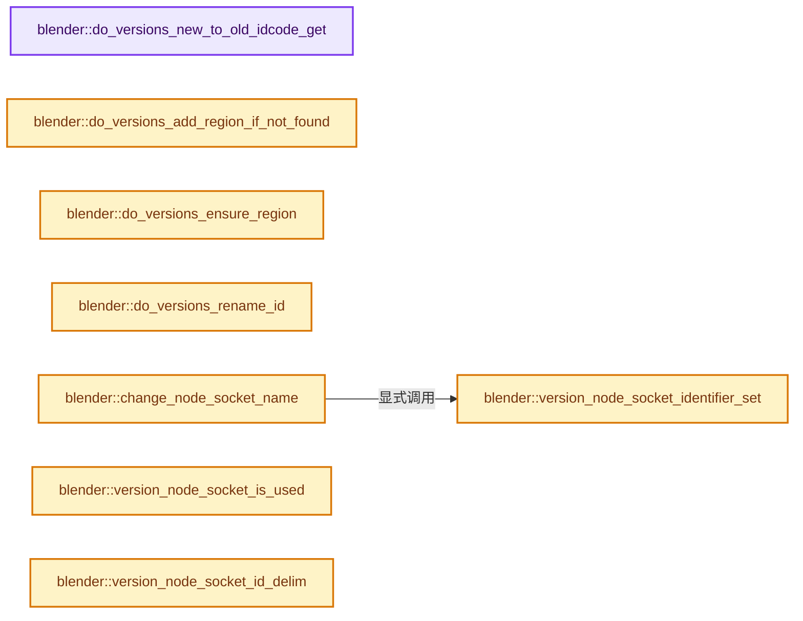
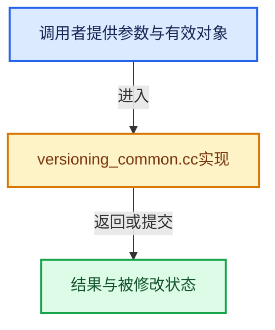

# 实现依赖专题：source/blender/blenloader/intern/versioning_common.cc

[实现依赖导航](../../../README.md) · [符号索引](../../../../00-课程指南/02-源码与提交索引/符号依赖与实现索引.md)

本专题从正文实际调用进入，集中保存共享实现。函数有稳定锚点，可从调用处直接跳到对应完整函数；递归与互相调用通过回链组织。

## 本文件的实现关系






## 完整成员与函数实现

<a id="f-5ae05937433cf098"></a>

### `blender::do_versions_new_to_old_idcode_get`

实现位置：[source/blender/blenloader/intern/versioning_common.cc](../../../../../../../../source/blender/blenloader/intern/versioning_common.cc) · L60—L69。

接口参数：

- `const short id_code_new`

**教学注释版**

<!-- annotated:b1b4b321463270 -->

```cpp
short do_versions_new_to_old_idcode_get(const short id_code_new)
{
  switch (id_code_new) {
    case ID_GP:
      /* ID_GD_LEGACY (Grease Pencil v2) is now converted to ID_GP (Grease Pencil v3). */
      return ID_GD_LEGACY;
    default:
      return ID_LINK_PLACEHOLDER;
  }
}
```

<details>
<summary>核对原始源码：source/blender/blenloader/intern/versioning_common.cc · L60—L69</summary>

<!-- original:b1b4b321463270:source/blender/blenloader/intern/versioning_common.cc:60:69 -->

```cpp
short do_versions_new_to_old_idcode_get(const short id_code_new)
{
  switch (id_code_new) {
    case ID_GP:
      /* ID_GD_LEGACY (Grease Pencil v2) is now converted to ID_GP (Grease Pencil v3). */
      return ID_GD_LEGACY;
    default:
      return ID_LINK_PLACEHOLDER;
  }
}
```

</details>

**结果出口**

- `return ID_GD_LEGACY;`
- `return ID_LINK_PLACEHOLDER;`

**继续追踪实现**

本实现没有需要继续展开的显式调用；检查返回表达式、对象转换和调用者前置条件。

<a id="f-c439e80c0eaf4554"></a>

### `blender::do_versions_add_region_if_not_found`

实现位置：[source/blender/blenloader/intern/versioning_common.cc](../../../../../../../../source/blender/blenloader/intern/versioning_common.cc) · L71—L90。

接口参数：

- `ListBaseT<ARegion> *regionbase`
- `int region_type`
- `const char *`
- `int link_after_region_type`

**教学注释版**

<!-- annotated:965d31678a2532 -->

```cpp
ARegion *do_versions_add_region_if_not_found(ListBaseT<ARegion> *regionbase,
                                             int region_type,
                                             const char * /*allocname*/,
                                             int link_after_region_type)
{
  ARegion *link_after_region = nullptr;
  for (ARegion &region : *regionbase) {
    if (region.regiontype == region_type) {
      return nullptr;
    }
    if (region.regiontype == link_after_region_type) {
      link_after_region = &region;
    }
  }

  ARegion *new_region = BKE_area_region_new();
  new_region->regiontype = eRegion_Type(region_type);
  BLI_insertlinkafter(regionbase, link_after_region, new_region);
  return new_region;
}
```

<details>
<summary>核对原始源码：source/blender/blenloader/intern/versioning_common.cc · L71—L90</summary>

<!-- original:965d31678a2532:source/blender/blenloader/intern/versioning_common.cc:71:90 -->

```cpp
ARegion *do_versions_add_region_if_not_found(ListBaseT<ARegion> *regionbase,
                                             int region_type,
                                             const char * /*allocname*/,
                                             int link_after_region_type)
{
  ARegion *link_after_region = nullptr;
  for (ARegion &region : *regionbase) {
    if (region.regiontype == region_type) {
      return nullptr;
    }
    if (region.regiontype == link_after_region_type) {
      link_after_region = &region;
    }
  }

  ARegion *new_region = BKE_area_region_new();
  new_region->regiontype = eRegion_Type(region_type);
  BLI_insertlinkafter(regionbase, link_after_region, new_region);
  return new_region;
}
```

</details>

**沿实际写入检查状态**

- `link_after_region = &region;`
- `new_region->regiontype = eRegion_Type(region_type);`

**结果出口**

- `return nullptr;`
- `return new_region;`

**继续追踪实现**

- `BKE_area_region_new` → [blender::BKE_area_region_new · L520](../../../02-BKE几何与数据/intern/screen.cc.md#f-65d2bf9c04020290)。
- `eRegion_Type` → [blender::eRegion_Type](../../makesdna/DNA_screen_types.h.md#t-be2ec445059c)。
- `BLI_insertlinkafter` → [blender::BLI_insertlinkafter · L339](../../../01-BLI基础库/intern/listbase.cc.md#f-fb34ee702e68c1d5)。

<a id="f-ecca97fd547de179"></a>

### `blender::do_versions_ensure_region`

实现位置：[source/blender/blenloader/intern/versioning_common.cc](../../../../../../../../source/blender/blenloader/intern/versioning_common.cc) · L92—L111。

接口参数：

- `ListBaseT<ARegion> *regionbase`
- `int region_type`
- `const char *`
- `int link_after_region_type`

**教学注释版**

<!-- annotated:7f3450efac47d4 -->

```cpp
ARegion *do_versions_ensure_region(ListBaseT<ARegion> *regionbase,
                                   int region_type,
                                   const char * /*allocname*/,
                                   int link_after_region_type)
{
  ARegion *link_after_region = nullptr;
  for (ARegion &region : *regionbase) {
    if (region.regiontype == region_type) {
      return &region;
    }
    if (region.regiontype == link_after_region_type) {
      link_after_region = &region;
    }
  }

  ARegion *new_region = BKE_area_region_new();
  new_region->regiontype = eRegion_Type(region_type);
  BLI_insertlinkafter(regionbase, link_after_region, new_region);
  return new_region;
}
```

<details>
<summary>核对原始源码：source/blender/blenloader/intern/versioning_common.cc · L92—L111</summary>

<!-- original:7f3450efac47d4:source/blender/blenloader/intern/versioning_common.cc:92:111 -->

```cpp
ARegion *do_versions_ensure_region(ListBaseT<ARegion> *regionbase,
                                   int region_type,
                                   const char * /*allocname*/,
                                   int link_after_region_type)
{
  ARegion *link_after_region = nullptr;
  for (ARegion &region : *regionbase) {
    if (region.regiontype == region_type) {
      return &region;
    }
    if (region.regiontype == link_after_region_type) {
      link_after_region = &region;
    }
  }

  ARegion *new_region = BKE_area_region_new();
  new_region->regiontype = eRegion_Type(region_type);
  BLI_insertlinkafter(regionbase, link_after_region, new_region);
  return new_region;
}
```

</details>

**沿实际写入检查状态**

- `link_after_region = &region;`
- `new_region->regiontype = eRegion_Type(region_type);`

**结果出口**

- `return &region;`
- `return new_region;`

**继续追踪实现**

- `BKE_area_region_new` → [blender::BKE_area_region_new · L520](../../../02-BKE几何与数据/intern/screen.cc.md#f-65d2bf9c04020290)。
- `eRegion_Type` → [blender::eRegion_Type](../../makesdna/DNA_screen_types.h.md#t-be2ec445059c)。
- `BLI_insertlinkafter` → [blender::BLI_insertlinkafter · L339](../../../01-BLI基础库/intern/listbase.cc.md#f-fb34ee702e68c1d5)。

<a id="f-f1590a2c89016495"></a>

### `blender::do_versions_rename_id`

实现位置：[source/blender/blenloader/intern/versioning_common.cc](../../../../../../../../source/blender/blenloader/intern/versioning_common.cc) · L113—L135。

接口参数：

- `Main *bmain`
- `const short id_type`
- `const char *name_src`
- `const char *name_dst`

**教学注释版**

<!-- annotated:d5607ed8d5b743 -->

```cpp
ID *do_versions_rename_id(Main *bmain,
                          const short id_type,
                          const char *name_src,
                          const char *name_dst)
{
  /* We can ignore libraries */
  ListBaseT<ID> *lb = which_libbase(bmain, id_type);
  ID *id = nullptr;
  for (ID &idtest : *lb) {
    if (!ID_IS_LINKED(&idtest)) {
      if (STREQ(idtest.name + 2, name_src)) {
        id = &idtest;
      }
      if (STREQ(idtest.name + 2, name_dst)) {
        return nullptr;
      }
    }
  }
  if (id != nullptr) {
    BKE_libblock_rename(*bmain, *id, name_dst);
  }
  return id;
}
```

<details>
<summary>核对原始源码：source/blender/blenloader/intern/versioning_common.cc · L113—L135</summary>

<!-- original:d5607ed8d5b743:source/blender/blenloader/intern/versioning_common.cc:113:135 -->

```cpp
ID *do_versions_rename_id(Main *bmain,
                          const short id_type,
                          const char *name_src,
                          const char *name_dst)
{
  /* We can ignore libraries */
  ListBaseT<ID> *lb = which_libbase(bmain, id_type);
  ID *id = nullptr;
  for (ID &idtest : *lb) {
    if (!ID_IS_LINKED(&idtest)) {
      if (STREQ(idtest.name + 2, name_src)) {
        id = &idtest;
      }
      if (STREQ(idtest.name + 2, name_dst)) {
        return nullptr;
      }
    }
  }
  if (id != nullptr) {
    BKE_libblock_rename(*bmain, *id, name_dst);
  }
  return id;
}
```

</details>

**沿实际写入检查状态**

- `id = &idtest;`

**结果出口**

- `return nullptr;`
- `return id;`

**继续追踪实现**

- `which_libbase` → [blender::which_libbase · L1073](../../../02-BKE几何与数据/intern/main.cc.md#f-87eb528420a3faf0)。
- `ID_IS_LINKED` → [ID_IS_LINKED · L697](../../makesdna/DNA_ID.h.md#m-7e1e1e9b20e6)。宏定义由构建条件选择。
- `STREQ` → [STREQ · L112](../../../07-Intern运行时与平台/ghost/intern/GHOST_utildefines.hh.md#m-9549fb6aafd2)；[STREQ · L451](../../../01-BLI基础库/BLI_utildefines.hh.md#m-c7b745bcfad2)；[STREQ · L55](../../../07-Intern运行时与平台/clog/clog.cc.md#m-96e78f386894)。宏定义由构建条件选择。
- `BKE_libblock_rename` → [blender::BKE_libblock_rename · L2632](../../../02-BKE几何与数据/intern/lib_id.cc.md#f-10ccb7870b932b6c)。

<a id="f-6c58925ee725f570"></a>

### `blender::change_node_socket_name`

实现位置：[source/blender/blenloader/intern/versioning_common.cc](../../../../../../../../source/blender/blenloader/intern/versioning_common.cc) · L137—L149。

接口参数：

- `ListBaseT<bNodeSocket> *sockets`
- `const char *old_name`
- `const char *new_name`

**教学注释版**

<!-- annotated:b5500ab40bf723 -->

```cpp
static void change_node_socket_name(ListBaseT<bNodeSocket> *sockets,
                                    const char *old_name,
                                    const char *new_name)
{
  for (bNodeSocket &socket : *sockets) {
    if (STREQ(socket.name, old_name)) {
      STRNCPY_UTF8(socket.name, new_name);
    }
    if (STREQ(socket.identifier, old_name)) {
      version_node_socket_identifier_set(socket, new_name);
    }
  }
}
```

<details>
<summary>核对原始源码：source/blender/blenloader/intern/versioning_common.cc · L137—L149</summary>

<!-- original:b5500ab40bf723:source/blender/blenloader/intern/versioning_common.cc:137:149 -->

```cpp
static void change_node_socket_name(ListBaseT<bNodeSocket> *sockets,
                                    const char *old_name,
                                    const char *new_name)
{
  for (bNodeSocket &socket : *sockets) {
    if (STREQ(socket.name, old_name)) {
      STRNCPY_UTF8(socket.name, new_name);
    }
    if (STREQ(socket.identifier, old_name)) {
      version_node_socket_identifier_set(socket, new_name);
    }
  }
}
```

</details>

**继续追踪实现**

- `STREQ` → [STREQ · L112](../../../07-Intern运行时与平台/ghost/intern/GHOST_utildefines.hh.md#m-9549fb6aafd2)；[STREQ · L451](../../../01-BLI基础库/BLI_utildefines.hh.md#m-c7b745bcfad2)；[STREQ · L55](../../../07-Intern运行时与平台/clog/clog.cc.md#m-96e78f386894)。宏定义由构建条件选择。
- `STRNCPY_UTF8` → [STRNCPY_UTF8 · L335](../../../01-BLI基础库/BLI_string_utf8.hh.md#m-222967f0ab6a)。宏定义由构建条件选择。
- `version_node_socket_identifier_set` → [blender::version_node_socket_identifier_set · L179](versioning_common.cc.md#f-15a2cb7eae2868c2)。

<a id="f-e68671c3ba22c902"></a>

### `blender::version_node_socket_is_used`

实现位置：[source/blender/blenloader/intern/versioning_common.cc](../../../../../../../../source/blender/blenloader/intern/versioning_common.cc) · L151—L155。

接口参数：

- `bNodeSocket *sock`

**教学注释版**

<!-- annotated:17278a3a4c9edb -->

```cpp
bool version_node_socket_is_used(bNodeSocket *sock)
{
  BLI_assert(sock != nullptr);
  return sock->flag & SOCK_IS_LINKED;
}
```

<details>
<summary>核对原始源码：source/blender/blenloader/intern/versioning_common.cc · L151—L155</summary>

<!-- original:17278a3a4c9edb:source/blender/blenloader/intern/versioning_common.cc:151:155 -->

```cpp
bool version_node_socket_is_used(bNodeSocket *sock)
{
  BLI_assert(sock != nullptr);
  return sock->flag & SOCK_IS_LINKED;
}
```

</details>

**结果出口**

- `return sock->flag & SOCK_IS_LINKED;`

**继续追踪实现**

- `BLI_assert` → [BLI_assert · L48](../../../01-BLI基础库/BLI_assert.hh.md#m-57a88495704d)；[BLI_assert · L63](../../../01-BLI基础库/BLI_assert.hh.md#m-d07050020cb5)。宏定义由构建条件选择。

<a id="f-ff91ad19531c4c3b"></a>

### `blender::version_node_socket_id_delim`

实现位置：[source/blender/blenloader/intern/versioning_common.cc](../../../../../../../../source/blender/blenloader/intern/versioning_common.cc) · L157—L177。

接口参数：

- `bNodeSocket *socket`

**教学注释版**

<!-- annotated:c8ae9fffbdc89c -->

```cpp
void version_node_socket_id_delim(bNodeSocket *socket)
{
  StringRef name = socket->name;
  StringRef id = socket->identifier;

  if (!id.startswith(name)) {
    /* We only need to affect the case where the identifier starts with the name. */
    return;
  }

  StringRef id_number = id.drop_known_prefix(name);
  if (id_number.is_empty()) {
    /* The name was already unique, and didn't need numbers at the end for the id. */
    return;
  }

  if (id_number.startswith(".")) {
    socket->identifier[name.size()] = '_';
    socket->runtime->identifier_ustr = UString(socket->identifier);
  }
}
```

<details>
<summary>核对原始源码：source/blender/blenloader/intern/versioning_common.cc · L157—L177</summary>

<!-- original:c8ae9fffbdc89c:source/blender/blenloader/intern/versioning_common.cc:157:177 -->

```cpp
void version_node_socket_id_delim(bNodeSocket *socket)
{
  StringRef name = socket->name;
  StringRef id = socket->identifier;

  if (!id.startswith(name)) {
    /* We only need to affect the case where the identifier starts with the name. */
    return;
  }

  StringRef id_number = id.drop_known_prefix(name);
  if (id_number.is_empty()) {
    /* The name was already unique, and didn't need numbers at the end for the id. */
    return;
  }

  if (id_number.startswith(".")) {
    socket->identifier[name.size()] = '_';
    socket->runtime->identifier_ustr = UString(socket->identifier);
  }
}
```

</details>

**沿实际写入检查状态**

- `socket->runtime->identifier_ustr = UString(socket->identifier);`

**继续追踪实现**

- `id.startswith` → [blender::StringRefBase::startswith · L269](../../../../01-基础容器与现代CPP/15-StringRef字符串视图.md#f-78237ccfe249bfa5)。
- `id.drop_known_prefix` → [blender::StringRef::drop_known_prefix · L590](../../../../01-基础容器与现代CPP/15-StringRef字符串视图.md#f-4800aaabdc73488d)。
- `id_number.is_empty` → [blender::Bounds<T>::is_empty · L533](../../../../12-空间数据结构与几何算法/07-Bounds与BVH对比.md#f-55ac376b3d0a0944)；[blender::GVArrayCommon::is_empty · L767](../../../../04-虚拟数组与索引选择/05-GVArray运行时类型.md#f-c1da602ffc5555f9)；[blender::StringRefBase::is_empty · L201](../../../../01-基础容器与现代CPP/15-StringRef字符串视图.md#f-9f6c3d2da1cb1796)；[blender::KDTreeNew<T>::is_empty · L498](../../../../12-空间数据结构与几何算法/05-K近邻与范围查询.md#f-67f0ff91cf00b00b)。同名重载需按实参类型选择。
- `id_number.startswith` → [blender::StringRefBase::startswith · L269](../../../../01-基础容器与现代CPP/15-StringRef字符串视图.md#f-78237ccfe249bfa5)。
- `name.size` → [blender::Bounds<T>::size · L543](../../../../12-空间数据结构与几何算法/07-Bounds与BVH对比.md#f-fcce88c0824fcd97)；[blender::GVArrayImpl::size · L651](../../../../04-虚拟数组与索引选择/05-GVArray运行时类型.md#f-f23d3d1f3b110f1e)；[blender::GVArrayCommon::size · L759](../../../../04-虚拟数组与索引选择/05-GVArray运行时类型.md#f-0856784f4e4fd3c9)；[blender::StringRefBase::size · L196](../../../../01-基础容器与现代CPP/15-StringRef字符串视图.md#f-60d4631c74931d2e)；[blender::KDTreeNew<T>::size · L493](../../../../12-空间数据结构与几何算法/05-K近邻与范围查询.md#f-233c05ce6d5c8d39)；[blender::MainAllIDsIterator::size · L1291](../../../02-BKE几何与数据/intern/main.cc.md#f-520d1311c646452f)；[blender::GLSourcesBaked::size · L1541](../../gpu/opengl/gl_shader.cc.md#f-5b5b539d533c6792)。同名重载需按实参类型选择。
- `UString` → [blender::UString::UString · L65](../../../01-BLI基础库/BLI_ustring.hh.md#f-af044c001f6ab696)；[blender::UString::UString · L68](../../../01-BLI基础库/BLI_ustring.hh.md#f-acdd59bd65bf3333)；[blender::UString::UString · L69](../../../01-BLI基础库/BLI_ustring.hh.md#f-bc4cac73ffd771a5)。同名重载需按实参类型选择。

<a id="f-15a2cb7eae2868c2"></a>

### `blender::version_node_socket_identifier_set`

实现位置：[source/blender/blenloader/intern/versioning_common.cc](../../../../../../../../source/blender/blenloader/intern/versioning_common.cc) · L179—L183。

接口参数：

- `bNodeSocket &socket`
- `const StringRefNull identifier`

**教学注释版**

<!-- annotated:a5f613f31f32cd -->

```cpp
void version_node_socket_identifier_set(bNodeSocket &socket, const StringRefNull identifier)
{
  STRNCPY_UTF8(socket.identifier, identifier.c_str());
  socket.runtime->identifier_ustr = UString(socket.identifier);
}
```

<details>
<summary>核对原始源码：source/blender/blenloader/intern/versioning_common.cc · L179—L183</summary>

<!-- original:a5f613f31f32cd:source/blender/blenloader/intern/versioning_common.cc:179:183 -->

```cpp
void version_node_socket_identifier_set(bNodeSocket &socket, const StringRefNull identifier)
{
  STRNCPY_UTF8(socket.identifier, identifier.c_str());
  socket.runtime->identifier_ustr = UString(socket.identifier);
}
```

</details>

**沿实际写入检查状态**

- `socket.runtime->identifier_ustr = UString(socket.identifier);`

**继续追踪实现**

- `STRNCPY_UTF8` → [STRNCPY_UTF8 · L335](../../../01-BLI基础库/BLI_string_utf8.hh.md#m-222967f0ab6a)。宏定义由构建条件选择。
- `identifier.c_str` → [blender::StringRefNull::c_str · L544](../../../../01-基础容器与现代CPP/15-StringRef字符串视图.md#f-4a8bbfe1e6d00757)。
- `UString` → [blender::UString::UString · L65](../../../01-BLI基础库/BLI_ustring.hh.md#f-af044c001f6ab696)；[blender::UString::UString · L68](../../../01-BLI基础库/BLI_ustring.hh.md#f-acdd59bd65bf3333)；[blender::UString::UString · L69](../../../01-BLI基础库/BLI_ustring.hh.md#f-bc4cac73ffd771a5)。同名重载需按实参类型选择。

<a id="f-f6103c52dc09628f"></a>

### `blender::version_node_socket_name`

实现位置：[source/blender/blenloader/intern/versioning_common.cc](../../../../../../../../source/blender/blenloader/intern/versioning_common.cc) · L185—L196。

接口参数：

- `bNodeTree *ntree`
- `const int node_type`
- `const char *old_name`
- `const char *new_name`

**教学注释版**

<!-- annotated:85d79bfa43da8a -->

```cpp
void version_node_socket_name(bNodeTree *ntree,
                              const int node_type,
                              const char *old_name,
                              const char *new_name)
{
  for (bNode *node : ntree->all_nodes()) {
    if (node->type_legacy == node_type) {
      change_node_socket_name(&node->inputs, old_name, new_name);
      change_node_socket_name(&node->outputs, old_name, new_name);
    }
  }
}
```

<details>
<summary>核对原始源码：source/blender/blenloader/intern/versioning_common.cc · L185—L196</summary>

<!-- original:85d79bfa43da8a:source/blender/blenloader/intern/versioning_common.cc:185:196 -->

```cpp
void version_node_socket_name(bNodeTree *ntree,
                              const int node_type,
                              const char *old_name,
                              const char *new_name)
{
  for (bNode *node : ntree->all_nodes()) {
    if (node->type_legacy == node_type) {
      change_node_socket_name(&node->inputs, old_name, new_name);
      change_node_socket_name(&node->outputs, old_name, new_name);
    }
  }
}
```

</details>

**继续追踪实现**

- `ntree->all_nodes` → [blender::bNodeTree::all_nodes · L500](../../../02-BKE几何与数据/BKE_node_runtime.hh.md#f-cda455cbcc6c7f36)；[blender::bNodeTree::all_nodes · L505](../../../02-BKE几何与数据/BKE_node_runtime.hh.md#f-358b65e5678f8a32)。同名重载需按实参类型选择。
- `change_node_socket_name` → [blender::change_node_socket_name · L137](versioning_common.cc.md#f-6c58925ee725f570)。

<a id="f-7bc10a617bce857b"></a>

### `blender::version_node_input_socket_name`

实现位置：[source/blender/blenloader/intern/versioning_common.cc](../../../../../../../../source/blender/blenloader/intern/versioning_common.cc) · L198—L208。

接口参数：

- `bNodeTree *ntree`
- `const int node_type`
- `const char *old_name`
- `const char *new_name`

**教学注释版**

<!-- annotated:cafde658b6db1a -->

```cpp
void version_node_input_socket_name(bNodeTree *ntree,
                                    const int node_type,
                                    const char *old_name,
                                    const char *new_name)
{
  for (bNode *node : ntree->all_nodes()) {
    if (node->type_legacy == node_type) {
      change_node_socket_name(&node->inputs, old_name, new_name);
    }
  }
}
```

<details>
<summary>核对原始源码：source/blender/blenloader/intern/versioning_common.cc · L198—L208</summary>

<!-- original:cafde658b6db1a:source/blender/blenloader/intern/versioning_common.cc:198:208 -->

```cpp
void version_node_input_socket_name(bNodeTree *ntree,
                                    const int node_type,
                                    const char *old_name,
                                    const char *new_name)
{
  for (bNode *node : ntree->all_nodes()) {
    if (node->type_legacy == node_type) {
      change_node_socket_name(&node->inputs, old_name, new_name);
    }
  }
}
```

</details>

**继续追踪实现**

- `ntree->all_nodes` → [blender::bNodeTree::all_nodes · L500](../../../02-BKE几何与数据/BKE_node_runtime.hh.md#f-cda455cbcc6c7f36)；[blender::bNodeTree::all_nodes · L505](../../../02-BKE几何与数据/BKE_node_runtime.hh.md#f-358b65e5678f8a32)。同名重载需按实参类型选择。
- `change_node_socket_name` → [blender::change_node_socket_name · L137](versioning_common.cc.md#f-6c58925ee725f570)。

<a id="f-e7964084381ccf06"></a>

### `blender::version_node_output_socket_name`

实现位置：[source/blender/blenloader/intern/versioning_common.cc](../../../../../../../../source/blender/blenloader/intern/versioning_common.cc) · L210—L220。

接口参数：

- `bNodeTree *ntree`
- `const int node_type`
- `const char *old_name`
- `const char *new_name`

**教学注释版**

<!-- annotated:3063bf6dac8578 -->

```cpp
void version_node_output_socket_name(bNodeTree *ntree,
                                     const int node_type,
                                     const char *old_name,
                                     const char *new_name)
{
  for (bNode *node : ntree->all_nodes()) {
    if (node->type_legacy == node_type) {
      change_node_socket_name(&node->outputs, old_name, new_name);
    }
  }
}
```

<details>
<summary>核对原始源码：source/blender/blenloader/intern/versioning_common.cc · L210—L220</summary>

<!-- original:3063bf6dac8578:source/blender/blenloader/intern/versioning_common.cc:210:220 -->

```cpp
void version_node_output_socket_name(bNodeTree *ntree,
                                     const int node_type,
                                     const char *old_name,
                                     const char *new_name)
{
  for (bNode *node : ntree->all_nodes()) {
    if (node->type_legacy == node_type) {
      change_node_socket_name(&node->outputs, old_name, new_name);
    }
  }
}
```

</details>

**继续追踪实现**

- `ntree->all_nodes` → [blender::bNodeTree::all_nodes · L500](../../../02-BKE几何与数据/BKE_node_runtime.hh.md#f-cda455cbcc6c7f36)；[blender::bNodeTree::all_nodes · L505](../../../02-BKE几何与数据/BKE_node_runtime.hh.md#f-358b65e5678f8a32)。同名重载需按实参类型选择。
- `change_node_socket_name` → [blender::change_node_socket_name · L137](versioning_common.cc.md#f-6c58925ee725f570)。

<a id="f-40493a67fa50dc56"></a>

### `blender::legacy_socket_idname_to_socket_type`

实现位置：[source/blender/blenloader/intern/versioning_common.cc](../../../../../../../../source/blender/blenloader/intern/versioning_common.cc) · L222—L248。

接口参数：

- `StringRef idname`

**教学注释版**

<!-- annotated:e9bef2f0b7fa54 -->

```cpp
StringRef legacy_socket_idname_to_socket_type(StringRef idname)
{
  using string_pair = std::pair<const char *, const char *>;
  static const string_pair subtypes_map[] = {{"NodeSocketFloatUnsigned", "NodeSocketFloat"},
                                             {"NodeSocketFloatPercentage", "NodeSocketFloat"},
                                             {"NodeSocketFloatFactor", "NodeSocketFloat"},
                                             {"NodeSocketFloatAngle", "NodeSocketFloat"},
                                             {"NodeSocketFloatTime", "NodeSocketFloat"},
                                             {"NodeSocketFloatTimeAbsolute", "NodeSocketFloat"},
                                             {"NodeSocketFloatDistance", "NodeSocketFloat"},
                                             {"NodeSocketIntUnsigned", "NodeSocketInt"},
                                             {"NodeSocketIntPercentage", "NodeSocketInt"},
                                             {"NodeSocketIntFactor", "NodeSocketInt"},
                                             {"NodeSocketVectorTranslation", "NodeSocketVector"},
                                             {"NodeSocketVectorDirection", "NodeSocketVector"},
                                             {"NodeSocketVectorVelocity", "NodeSocketVector"},
                                             {"NodeSocketVectorAcceleration", "NodeSocketVector"},
                                             {"NodeSocketVectorEuler", "NodeSocketVector"},
                                             {"NodeSocketVectorXYZ", "NodeSocketVector"}};
  for (const string_pair &pair : subtypes_map) {
    if (pair.first == idname) {
      return pair.second;
    }
  }
  /* Unchanged socket idname. */
  return idname;
}
```

<details>
<summary>核对原始源码：source/blender/blenloader/intern/versioning_common.cc · L222—L248</summary>

<!-- original:e9bef2f0b7fa54:source/blender/blenloader/intern/versioning_common.cc:222:248 -->

```cpp
StringRef legacy_socket_idname_to_socket_type(StringRef idname)
{
  using string_pair = std::pair<const char *, const char *>;
  static const string_pair subtypes_map[] = {{"NodeSocketFloatUnsigned", "NodeSocketFloat"},
                                             {"NodeSocketFloatPercentage", "NodeSocketFloat"},
                                             {"NodeSocketFloatFactor", "NodeSocketFloat"},
                                             {"NodeSocketFloatAngle", "NodeSocketFloat"},
                                             {"NodeSocketFloatTime", "NodeSocketFloat"},
                                             {"NodeSocketFloatTimeAbsolute", "NodeSocketFloat"},
                                             {"NodeSocketFloatDistance", "NodeSocketFloat"},
                                             {"NodeSocketIntUnsigned", "NodeSocketInt"},
                                             {"NodeSocketIntPercentage", "NodeSocketInt"},
                                             {"NodeSocketIntFactor", "NodeSocketInt"},
                                             {"NodeSocketVectorTranslation", "NodeSocketVector"},
                                             {"NodeSocketVectorDirection", "NodeSocketVector"},
                                             {"NodeSocketVectorVelocity", "NodeSocketVector"},
                                             {"NodeSocketVectorAcceleration", "NodeSocketVector"},
                                             {"NodeSocketVectorEuler", "NodeSocketVector"},
                                             {"NodeSocketVectorXYZ", "NodeSocketVector"}};
  for (const string_pair &pair : subtypes_map) {
    if (pair.first == idname) {
      return pair.second;
    }
  }
  /* Unchanged socket idname. */
  return idname;
}
```

</details>

**结果出口**

- `return pair.second;`
- `return idname;`

**继续追踪实现**

本实现没有需要继续展开的显式调用；检查返回表达式、对象转换和调用者前置条件。

<a id="f-5f6c9b1704901087"></a>

### `blender::version_node_add_empty`

实现位置：[source/blender/blenloader/intern/versioning_common.cc](../../../../../../../../source/blender/blenloader/intern/versioning_common.cc) · L250—L272。

接口参数：

- `bNodeTree &ntree`
- `const char *idname`

**教学注释版**

<!-- annotated:c0ba9deeaec44d -->

```cpp
bNode &version_node_add_empty(bNodeTree &ntree, const char *idname)
{
  bke::bNodeType *ntype = bke::node_type_find(UString(idname));

  bNode *node = MEM_new<bNode>(__func__);
  node->runtime = MEM_new<bke::bNodeRuntime>(__func__);
  BLI_addtail(&ntree.nodes, node);
  bke::node_unique_id(ntree, *node);

  STRNCPY(node->idname, idname);
  DATA_(ntype->ui_name).copy_utf8_truncated(node->name);
  bke::node_unique_name(ntree, *node);

  node->flag = NODE_SELECT | NODE_OPTIONS | NODE_INIT;
  node->width = ntype->default_width;
  node->height = ntype->height;
  node->color[0] = node->color[1] = node->color[2] = 0.608;

  node->type_legacy = ntype->type_legacy;

  BKE_ntree_update_tag_node_new(&ntree, node);
  return *node;
}
```

<details>
<summary>核对原始源码：source/blender/blenloader/intern/versioning_common.cc · L250—L272</summary>

<!-- original:c0ba9deeaec44d:source/blender/blenloader/intern/versioning_common.cc:250:272 -->

```cpp
bNode &version_node_add_empty(bNodeTree &ntree, const char *idname)
{
  bke::bNodeType *ntype = bke::node_type_find(UString(idname));

  bNode *node = MEM_new<bNode>(__func__);
  node->runtime = MEM_new<bke::bNodeRuntime>(__func__);
  BLI_addtail(&ntree.nodes, node);
  bke::node_unique_id(ntree, *node);

  STRNCPY(node->idname, idname);
  DATA_(ntype->ui_name).copy_utf8_truncated(node->name);
  bke::node_unique_name(ntree, *node);

  node->flag = NODE_SELECT | NODE_OPTIONS | NODE_INIT;
  node->width = ntype->default_width;
  node->height = ntype->height;
  node->color[0] = node->color[1] = node->color[2] = 0.608;

  node->type_legacy = ntype->type_legacy;

  BKE_ntree_update_tag_node_new(&ntree, node);
  return *node;
}
```

</details>

**沿实际写入检查状态**

- `node->runtime = MEM_new<bke::bNodeRuntime>(__func__);`
- `node->flag = NODE_SELECT | NODE_OPTIONS | NODE_INIT;`
- `node->width = ntype->default_width;`
- `node->height = ntype->height;`
- `node->color[0] = node->color[1] = node->color[2] = 0.608;`
- `node->type_legacy = ntype->type_legacy;`

**结果出口**

- `return *node;`

**继续追踪实现**

- `bke::node_type_find` → [blender::bke::node_type_find · L2883](../../../02-BKE几何与数据/intern/node.cc.md#f-43bb33d661e48fe2)。
- `UString` → [blender::UString::UString · L65](../../../01-BLI基础库/BLI_ustring.hh.md#f-af044c001f6ab696)；[blender::UString::UString · L68](../../../01-BLI基础库/BLI_ustring.hh.md#f-acdd59bd65bf3333)；[blender::UString::UString · L69](../../../01-BLI基础库/BLI_ustring.hh.md#f-bc4cac73ffd771a5)。同名重载需按实参类型选择。
- `MEM_new<bNode>` → [MEM_new · L351](../../../07-Intern运行时与平台/guardedalloc/MEM_guardedalloc.h.md#f-115f9b6784f89912)。
- `MEM_new<bke::bNodeRuntime>` → [MEM_new · L351](../../../07-Intern运行时与平台/guardedalloc/MEM_guardedalloc.h.md#f-115f9b6784f89912)。
- `BLI_addtail` → [blender::BLI_addtail · L118](../../../01-BLI基础库/intern/listbase.cc.md#f-4fb027713fa3115b)。
- `bke::node_unique_id` → [blender::bke::node_unique_id · L4244](../../../02-BKE几何与数据/intern/node.cc.md#f-ad473ad36f0ca0b9)。
- `STRNCPY` → [blender::STRNCPY · L690](../../../01-BLI基础库/BLI_string.hh.md#f-6b2d861724026be6)。
- `DATA_(ntype->ui_name).copy_utf8_truncated` → [调用协议](../../../../00-课程指南/01-路线与规范/模板宏与动态分派协议.md)：接收对象类型依赖auto、返回值或模板实例；不按同名猜测目标。调用位置L260。
- `DATA_` → [DATA_ · L52](../../blentranslation/BLT_translation.hh.md#m-178736083f83)。宏定义由构建条件选择。
- `bke::node_unique_name` → [blender::bke::node_unique_name · L4238](../../../02-BKE几何与数据/intern/node.cc.md#f-fb3ea2e8319c3590)。
- `BKE_ntree_update_tag_node_new` → [blender::BKE_ntree_update_tag_node_new · L2279](../../../02-BKE几何与数据/intern/node_tree_update.cc.md#f-8555329847fd0e77)。

<a id="f-07d72836f4d06ee6"></a>

### `blender::version_node_remove`

实现位置：[source/blender/blenloader/intern/versioning_common.cc](../../../../../../../../source/blender/blenloader/intern/versioning_common.cc) · L323—L330。

接口参数：

- `bNodeTree &ntree`
- `bNode &node`

**教学注释版**

<!-- annotated:6821ea7dee3fc2 -->

```cpp
void version_node_remove(bNodeTree &ntree, bNode &node)
{
  bke::node_unlink_node(ntree, node);
  bke::node_unlink_attached(&ntree, &node);

  bke::node_free_node(&ntree, node);
  bke::node_rebuild_id_vector(ntree);
}
```

<details>
<summary>核对原始源码：source/blender/blenloader/intern/versioning_common.cc · L323—L330</summary>

<!-- original:6821ea7dee3fc2:source/blender/blenloader/intern/versioning_common.cc:323:330 -->

```cpp
void version_node_remove(bNodeTree &ntree, bNode &node)
{
  bke::node_unlink_node(ntree, node);
  bke::node_unlink_attached(&ntree, &node);

  bke::node_free_node(&ntree, node);
  bke::node_rebuild_id_vector(ntree);
}
```

</details>

**继续追踪实现**

- `bke::node_unlink_node` → [blender::bke::node_unlink_node · L5026](../../../02-BKE几何与数据/intern/node.cc.md#f-b3a685af63211f1f)。
- `bke::node_unlink_attached` → [blender::bke::node_unlink_attached · L5053](../../../02-BKE几何与数据/intern/node.cc.md#f-7483994c8064e066)。
- `bke::node_free_node` → [blender::bke::node_free_node · L5073](../../../02-BKE几何与数据/intern/node.cc.md#f-a8d760c20889bd3a)。
- `bke::node_rebuild_id_vector` → [blender::bke::node_rebuild_id_vector · L5062](../../../02-BKE几何与数据/intern/node.cc.md#f-897243d54e778162)。

<a id="f-846a4268eff6ea5d"></a>

### `blender::version_node_add_socket`

实现位置：[source/blender/blenloader/intern/versioning_common.cc](../../../../../../../../source/blender/blenloader/intern/versioning_common.cc) · L332—L363。

接口参数：

- `bNodeTree &ntree`
- `bNode &node`
- `const eNodeSocketInOut in_out`
- `const char *idname`
- `const char *identifier`

**教学注释版**

<!-- annotated:5838a8ba175c7f -->

```cpp
bNodeSocket &version_node_add_socket(bNodeTree &ntree,
                                     bNode &node,
                                     const eNodeSocketInOut in_out,
                                     const char *idname,
                                     const char *identifier)
{
  bke::bNodeSocketType *stype = bke::node_socket_type_find(idname);
  BLI_assert(stype != nullptr);

  bNodeSocket *socket = MEM_new<bNodeSocket>(__func__);
  socket->runtime = MEM_new<bke::bNodeSocketRuntime>(__func__);
  socket->in_out = in_out;
  socket->limit = (in_out == SOCK_IN ? 1 : 0xFFF);
  socket->type = stype->type;

  STRNCPY_UTF8(socket->idname, idname);
  STRNCPY_UTF8(socket->identifier, identifier);
  socket->runtime->identifier_ustr = UString(socket->identifier);
  STRNCPY_UTF8(socket->name, identifier);

  if (in_out == SOCK_IN) {
    BLI_addtail(&node.inputs, socket);
  }
  else {
    BLI_addtail(&node.outputs, socket);
  }

  socket->default_value = bke::socket_value_new(stype->type, stype->subtype);

  BKE_ntree_update_tag_socket_new(&ntree, socket);
  return *socket;
}
```

<details>
<summary>核对原始源码：source/blender/blenloader/intern/versioning_common.cc · L332—L363</summary>

<!-- original:5838a8ba175c7f:source/blender/blenloader/intern/versioning_common.cc:332:363 -->

```cpp
bNodeSocket &version_node_add_socket(bNodeTree &ntree,
                                     bNode &node,
                                     const eNodeSocketInOut in_out,
                                     const char *idname,
                                     const char *identifier)
{
  bke::bNodeSocketType *stype = bke::node_socket_type_find(idname);
  BLI_assert(stype != nullptr);

  bNodeSocket *socket = MEM_new<bNodeSocket>(__func__);
  socket->runtime = MEM_new<bke::bNodeSocketRuntime>(__func__);
  socket->in_out = in_out;
  socket->limit = (in_out == SOCK_IN ? 1 : 0xFFF);
  socket->type = stype->type;

  STRNCPY_UTF8(socket->idname, idname);
  STRNCPY_UTF8(socket->identifier, identifier);
  socket->runtime->identifier_ustr = UString(socket->identifier);
  STRNCPY_UTF8(socket->name, identifier);

  if (in_out == SOCK_IN) {
    BLI_addtail(&node.inputs, socket);
  }
  else {
    BLI_addtail(&node.outputs, socket);
  }

  socket->default_value = bke::socket_value_new(stype->type, stype->subtype);

  BKE_ntree_update_tag_socket_new(&ntree, socket);
  return *socket;
}
```

</details>

**沿实际写入检查状态**

- `socket->runtime = MEM_new<bke::bNodeSocketRuntime>(__func__);`
- `socket->in_out = in_out;`
- `socket->limit = (in_out == SOCK_IN ? 1 : 0xFFF);`
- `socket->type = stype->type;`
- `socket->runtime->identifier_ustr = UString(socket->identifier);`
- `socket->default_value = bke::socket_value_new(stype->type, stype->subtype);`

**结果出口**

- `return *socket;`

**继续追踪实现**

- `bke::node_socket_type_find` → [blender::bke::node_socket_type_find · L2966](../../../02-BKE几何与数据/intern/node.cc.md#f-69979d36f9912943)。
- `BLI_assert` → [BLI_assert · L48](../../../01-BLI基础库/BLI_assert.hh.md#m-57a88495704d)；[BLI_assert · L63](../../../01-BLI基础库/BLI_assert.hh.md#m-d07050020cb5)。宏定义由构建条件选择。
- `MEM_new<bNodeSocket>` → [MEM_new · L351](../../../07-Intern运行时与平台/guardedalloc/MEM_guardedalloc.h.md#f-115f9b6784f89912)。
- `MEM_new<bke::bNodeSocketRuntime>` → [MEM_new · L351](../../../07-Intern运行时与平台/guardedalloc/MEM_guardedalloc.h.md#f-115f9b6784f89912)。
- `STRNCPY_UTF8` → [STRNCPY_UTF8 · L335](../../../01-BLI基础库/BLI_string_utf8.hh.md#m-222967f0ab6a)。宏定义由构建条件选择。
- `UString` → [blender::UString::UString · L65](../../../01-BLI基础库/BLI_ustring.hh.md#f-af044c001f6ab696)；[blender::UString::UString · L68](../../../01-BLI基础库/BLI_ustring.hh.md#f-acdd59bd65bf3333)；[blender::UString::UString · L69](../../../01-BLI基础库/BLI_ustring.hh.md#f-bc4cac73ffd771a5)。同名重载需按实参类型选择。
- `BLI_addtail` → [blender::BLI_addtail · L118](../../../01-BLI基础库/intern/listbase.cc.md#f-4fb027713fa3115b)。
- `bke::socket_value_new` → [blender::bke::socket_value_new · L3274](../../../02-BKE几何与数据/intern/node.cc.md#f-35fdb7130a8eeed6)。
- `BKE_ntree_update_tag_socket_new` → [blender::BKE_ntree_update_tag_socket_new · L2294](../../../02-BKE几何与数据/intern/node_tree_update.cc.md#f-4e8b5b5568f8fe2b)。

<a id="f-93b7d089bdf6807c"></a>

### `blender::version_node_add_link`

实现位置：[source/blender/blenloader/intern/versioning_common.cc](../../../../../../../../source/blender/blenloader/intern/versioning_common.cc) · L365—L387。

接口参数：

- `bNodeTree &ntree`
- `bNode &node_a`
- `bNodeSocket &socket_a`
- `bNode &node_b`
- `bNodeSocket &socket_b`

**教学注释版**

<!-- annotated:0b791e3e8ce1ce -->

```cpp
bNodeLink &version_node_add_link(
    bNodeTree &ntree, bNode &node_a, bNodeSocket &socket_a, bNode &node_b, bNodeSocket &socket_b)
{
  BLI_assert(socket_a.in_out != socket_b.in_out);
  if (socket_a.in_out == SOCK_IN) {
    return version_node_add_link(ntree, node_b, socket_b, node_a, socket_a);
  }
  bNode &node_from = node_a;
  bNodeSocket &socket_from = socket_a;
  bNode &node_to = node_b;
  bNodeSocket &socket_to = socket_b;

  bNodeLink *link = MEM_new<bNodeLink>(__func__);
  link->fromnode = &node_from;
  link->fromsock = &socket_from;
  link->tonode = &node_to;
  link->tosock = &socket_to;

  BLI_addtail(&ntree.links, link);

  BKE_ntree_update_tag_link_added(&ntree, link);
  return *link;
}
```

<details>
<summary>核对原始源码：source/blender/blenloader/intern/versioning_common.cc · L365—L387</summary>

<!-- original:0b791e3e8ce1ce:source/blender/blenloader/intern/versioning_common.cc:365:387 -->

```cpp
bNodeLink &version_node_add_link(
    bNodeTree &ntree, bNode &node_a, bNodeSocket &socket_a, bNode &node_b, bNodeSocket &socket_b)
{
  BLI_assert(socket_a.in_out != socket_b.in_out);
  if (socket_a.in_out == SOCK_IN) {
    return version_node_add_link(ntree, node_b, socket_b, node_a, socket_a);
  }
  bNode &node_from = node_a;
  bNodeSocket &socket_from = socket_a;
  bNode &node_to = node_b;
  bNodeSocket &socket_to = socket_b;

  bNodeLink *link = MEM_new<bNodeLink>(__func__);
  link->fromnode = &node_from;
  link->fromsock = &socket_from;
  link->tonode = &node_to;
  link->tosock = &socket_to;

  BLI_addtail(&ntree.links, link);

  BKE_ntree_update_tag_link_added(&ntree, link);
  return *link;
}
```

</details>

**沿实际写入检查状态**

- `link->fromnode = &node_from;`
- `link->fromsock = &socket_from;`
- `link->tonode = &node_to;`
- `link->tosock = &socket_to;`

**结果出口**

- `return version_node_add_link(ntree, node_b, socket_b, node_a, socket_a);`
- `return *link;`

**继续追踪实现**

- `BLI_assert` → [BLI_assert · L48](../../../01-BLI基础库/BLI_assert.hh.md#m-57a88495704d)；[BLI_assert · L63](../../../01-BLI基础库/BLI_assert.hh.md#m-d07050020cb5)。宏定义由构建条件选择。
- `version_node_add_link` → [blender::version_node_add_link · L365](versioning_common.cc.md#f-93b7d089bdf6807c)。
- `MEM_new<bNodeLink>` → [MEM_new · L351](../../../07-Intern运行时与平台/guardedalloc/MEM_guardedalloc.h.md#f-115f9b6784f89912)。
- `BLI_addtail` → [blender::BLI_addtail · L118](../../../01-BLI基础库/intern/listbase.cc.md#f-4fb027713fa3115b)。
- `BKE_ntree_update_tag_link_added` → [blender::BKE_ntree_update_tag_link_added · L2339](../../../02-BKE几何与数据/intern/node_tree_update.cc.md#f-3a301d9f9830414d)。

<a id="f-72131ae3b96134c2"></a>

### `blender::version_node_ensure_storage_or_invalidate`

实现位置：[source/blender/blenloader/intern/versioning_common.cc](../../../../../../../../source/blender/blenloader/intern/versioning_common.cc) · L389—L400。

接口参数：

- `bNode &node`

**教学注释版**

<!-- annotated:4d90a038c3f84a -->

```cpp
bool version_node_ensure_storage_or_invalidate(bNode &node)
{
  /* Accept node if storage is valid. */
  if (node.storage != nullptr) {
    return true;
  }

  /* Invalidate the type identifiers to prevent invalid access where storage data is expected
   * (#154086). */
  bke::node_set_undefined_type(node);
  return false;
}
```

<details>
<summary>核对原始源码：source/blender/blenloader/intern/versioning_common.cc · L389—L400</summary>

<!-- original:4d90a038c3f84a:source/blender/blenloader/intern/versioning_common.cc:389:400 -->

```cpp
bool version_node_ensure_storage_or_invalidate(bNode &node)
{
  /* Accept node if storage is valid. */
  if (node.storage != nullptr) {
    return true;
  }

  /* Invalidate the type identifiers to prevent invalid access where storage data is expected
   * (#154086). */
  bke::node_set_undefined_type(node);
  return false;
}
```

</details>

**结果出口**

- `return true;`
- `return false;`

**继续追踪实现**

- `bke::node_set_undefined_type` → [blender::bke::node_set_undefined_type · L5667](../../../02-BKE几何与数据/intern/node.cc.md#f-b3a505ef63898a07)。

<a id="f-8937a61934845ed4"></a>

### `blender::version_node_add_socket_if_not_exist`

实现位置：[source/blender/blenloader/intern/versioning_common.cc](../../../../../../../../source/blender/blenloader/intern/versioning_common.cc) · L402—L416。

接口参数：

- `bNodeTree *ntree`
- `bNode *node`
- `int in_out`
- `int type`
- `int subtype`
- `const char *identifier`
- `const char *name`

**教学注释版**

<!-- annotated:ed6110b298d475 -->

```cpp
bNodeSocket *version_node_add_socket_if_not_exist(bNodeTree *ntree,
                                                  bNode *node,
                                                  int in_out,
                                                  int type,
                                                  int subtype,
                                                  const char *identifier,
                                                  const char *name)
{
  bNodeSocket *sock = bke::node_find_socket(*node, eNodeSocketInOut(in_out), UString(identifier));
  if (sock != nullptr) {
    return sock;
  }
  return bke::node_add_static_socket(
      *ntree, *node, eNodeSocketInOut(in_out), type, subtype, identifier, name);
}
```

<details>
<summary>核对原始源码：source/blender/blenloader/intern/versioning_common.cc · L402—L416</summary>

<!-- original:ed6110b298d475:source/blender/blenloader/intern/versioning_common.cc:402:416 -->

```cpp
bNodeSocket *version_node_add_socket_if_not_exist(bNodeTree *ntree,
                                                  bNode *node,
                                                  int in_out,
                                                  int type,
                                                  int subtype,
                                                  const char *identifier,
                                                  const char *name)
{
  bNodeSocket *sock = bke::node_find_socket(*node, eNodeSocketInOut(in_out), UString(identifier));
  if (sock != nullptr) {
    return sock;
  }
  return bke::node_add_static_socket(
      *ntree, *node, eNodeSocketInOut(in_out), type, subtype, identifier, name);
}
```

</details>

**结果出口**

- `return sock;`
- `return bke::node_add_static_socket(`

**继续追踪实现**

- `bke::node_find_socket` → [blender::bke::node_find_socket · L3036](../../../02-BKE几何与数据/intern/node.cc.md#f-cbf9dec71aff5b59)；[blender::bke::node_find_socket · L3047](../../../02-BKE几何与数据/intern/node.cc.md#f-4a7a677634b7fbd1)。同名重载需按实参类型选择。
- `eNodeSocketInOut` → [blender::eNodeSocketInOut](../../makesdna/DNA_node_types.h.md#t-d43f55593f9d)。
- `UString` → [blender::UString::UString · L65](../../../01-BLI基础库/BLI_ustring.hh.md#f-af044c001f6ab696)；[blender::UString::UString · L68](../../../01-BLI基础库/BLI_ustring.hh.md#f-acdd59bd65bf3333)；[blender::UString::UString · L69](../../../01-BLI基础库/BLI_ustring.hh.md#f-bc4cac73ffd771a5)。同名重载需按实参类型选择。
- `bke::node_add_static_socket` → [blender::bke::node_add_static_socket · L3980](../../../02-BKE几何与数据/intern/node.cc.md#f-d6d2fde9e1919837)。

<a id="f-e0ed4ba75759e332"></a>

### `blender::version_node_tree_clear_interface`

实现位置：[source/blender/blenloader/intern/versioning_common.cc](../../../../../../../../source/blender/blenloader/intern/versioning_common.cc) · L418—L421。

接口参数：

- `bNodeTree &ntree`

**教学注释版**

<!-- annotated:2e46a644775b10 -->

```cpp
void version_node_tree_clear_interface(bNodeTree &ntree)
{
  ntree.tree_interface.clear_items();
}
```

<details>
<summary>核对原始源码：source/blender/blenloader/intern/versioning_common.cc · L418—L421</summary>

<!-- original:2e46a644775b10:source/blender/blenloader/intern/versioning_common.cc:418:421 -->

```cpp
void version_node_tree_clear_interface(bNodeTree &ntree)
{
  ntree.tree_interface.clear_items();
}
```

</details>

**继续追踪实现**

- `ntree.tree_interface.clear_items` → [调用协议](../../../../00-课程指南/01-路线与规范/模板宏与动态分派协议.md)：接收对象类型依赖auto、返回值或模板实例；不按同名猜测目标。调用位置L420。

<a id="f-fab2efd04b0f6579"></a>

### `blender::version_node_id`

实现位置：[source/blender/blenloader/intern/versioning_common.cc](../../../../../../../../source/blender/blenloader/intern/versioning_common.cc) · L423—L432。

接口参数：

- `bNodeTree *ntree`
- `const int node_type`
- `const char *new_name`

**教学注释版**

<!-- annotated:f4317b22d0a35e -->

```cpp
void version_node_id(bNodeTree *ntree, const int node_type, const char *new_name)
{
  for (bNode *node : ntree->all_nodes()) {
    if (node->type_legacy == node_type) {
      if (!STREQ(node->idname, new_name)) {
        STRNCPY(node->idname, new_name);
      }
    }
  }
}
```

<details>
<summary>核对原始源码：source/blender/blenloader/intern/versioning_common.cc · L423—L432</summary>

<!-- original:f4317b22d0a35e:source/blender/blenloader/intern/versioning_common.cc:423:432 -->

```cpp
void version_node_id(bNodeTree *ntree, const int node_type, const char *new_name)
{
  for (bNode *node : ntree->all_nodes()) {
    if (node->type_legacy == node_type) {
      if (!STREQ(node->idname, new_name)) {
        STRNCPY(node->idname, new_name);
      }
    }
  }
}
```

</details>

**继续追踪实现**

- `ntree->all_nodes` → [blender::bNodeTree::all_nodes · L500](../../../02-BKE几何与数据/BKE_node_runtime.hh.md#f-cda455cbcc6c7f36)；[blender::bNodeTree::all_nodes · L505](../../../02-BKE几何与数据/BKE_node_runtime.hh.md#f-358b65e5678f8a32)。同名重载需按实参类型选择。
- `STREQ` → [STREQ · L112](../../../07-Intern运行时与平台/ghost/intern/GHOST_utildefines.hh.md#m-9549fb6aafd2)；[STREQ · L451](../../../01-BLI基础库/BLI_utildefines.hh.md#m-c7b745bcfad2)；[STREQ · L55](../../../07-Intern运行时与平台/clog/clog.cc.md#m-96e78f386894)。宏定义由构建条件选择。
- `STRNCPY` → [blender::STRNCPY · L690](../../../01-BLI基础库/BLI_string.hh.md#f-6b2d861724026be6)。

<a id="f-b97e48d207c0c04a"></a>

### `blender::version_node_socket_index_animdata_ex`

实现位置：[source/blender/blenloader/intern/versioning_common.cc](../../../../../../../../source/blender/blenloader/intern/versioning_common.cc) · L437—L482。

接口参数：

- `Main *bmain`
- `const int node_tree_type`
- `const FunctionRef<bool(const bNode *)> node_match_fn`
- `const bNode *`
- `const int socket_index_orig`
- `const int socket_index_offset`
- `const int total_number_of_sockets`

**教学注释版**

<!-- annotated:c771acab89fa1d -->

```cpp
static void version_node_socket_index_animdata_ex(
    Main *bmain,
    const int node_tree_type,
    const FunctionRef<bool(const bNode *)> node_match_fn,
    const int socket_index_orig,
    const int socket_index_offset,
    const int total_number_of_sockets)
{

  /* The for loop for the input ids is at the top level otherwise we lose the animation
   * keyframe data. Not sure what causes that, so I (Sybren) moved the code here from
   * versioning_290.cc as-is (structure-wise). */
  const DriverMap driver_map = BKE_animdata_build_driver_target_map(*bmain);
  for (int input_index = total_number_of_sockets - 1; input_index >= socket_index_orig;
       input_index--)
  {
    FOREACH_NODETREE_BEGIN (bmain, ntree, _owner_id) {
      if (ntree->type != node_tree_type) {
        continue;
      }

      for (bNode *node : ntree->all_nodes()) {
        if (!node_match_fn(node)) {
          continue;
        }

        char node_name_escaped[sizeof(node->name) * 2];
        BLI_str_escape(node_name_escaped, node->name, sizeof(node_name_escaped));
        char *rna_path_prefix = BLI_sprintfN("nodes[\"%s\"].inputs", node_name_escaped);

        const int new_index = input_index + socket_index_offset;
        /* Note: this should not use `owner_id`, as in the case of embedded node trees, that is set
         * to the owning ID (like a material owning its shader node tree). It's the node tree
         * itself that needs its animation versioned. */
        BKE_animdata_fix_paths(ntree->id,
                               rna_path_prefix,
                               RNA_path_number_to_infix(input_index),
                               RNA_path_number_to_infix(new_index),
                               /*verify_paths=*/false,
                               driver_map);
        MEM_delete(rna_path_prefix);
      }
    }
    FOREACH_NODETREE_END;
  }
}
```

<details>
<summary>核对原始源码：source/blender/blenloader/intern/versioning_common.cc · L437—L482</summary>

<!-- original:c771acab89fa1d:source/blender/blenloader/intern/versioning_common.cc:437:482 -->

```cpp
static void version_node_socket_index_animdata_ex(
    Main *bmain,
    const int node_tree_type,
    const FunctionRef<bool(const bNode *)> node_match_fn,
    const int socket_index_orig,
    const int socket_index_offset,
    const int total_number_of_sockets)
{

  /* The for loop for the input ids is at the top level otherwise we lose the animation
   * keyframe data. Not sure what causes that, so I (Sybren) moved the code here from
   * versioning_290.cc as-is (structure-wise). */
  const DriverMap driver_map = BKE_animdata_build_driver_target_map(*bmain);
  for (int input_index = total_number_of_sockets - 1; input_index >= socket_index_orig;
       input_index--)
  {
    FOREACH_NODETREE_BEGIN (bmain, ntree, _owner_id) {
      if (ntree->type != node_tree_type) {
        continue;
      }

      for (bNode *node : ntree->all_nodes()) {
        if (!node_match_fn(node)) {
          continue;
        }

        char node_name_escaped[sizeof(node->name) * 2];
        BLI_str_escape(node_name_escaped, node->name, sizeof(node_name_escaped));
        char *rna_path_prefix = BLI_sprintfN("nodes[\"%s\"].inputs", node_name_escaped);

        const int new_index = input_index + socket_index_offset;
        /* Note: this should not use `owner_id`, as in the case of embedded node trees, that is set
         * to the owning ID (like a material owning its shader node tree). It's the node tree
         * itself that needs its animation versioned. */
        BKE_animdata_fix_paths(ntree->id,
                               rna_path_prefix,
                               RNA_path_number_to_infix(input_index),
                               RNA_path_number_to_infix(new_index),
                               /*verify_paths=*/false,
                               driver_map);
        MEM_delete(rna_path_prefix);
      }
    }
    FOREACH_NODETREE_END;
  }
}
```

</details>

**继续追踪实现**

- `BKE_animdata_build_driver_target_map` → [blender::BKE_animdata_build_driver_target_map · L980](../../../02-BKE几何与数据/intern/anim_data.cc.md#f-756c69b4ccf4bd7c)。
- `ntree->all_nodes` → [调用协议](../../../../00-课程指南/01-路线与规范/模板宏与动态分派协议.md)：接收对象类型依赖auto、返回值或模板实例；不按同名猜测目标。调用位置L458。
- `node_match_fn` → [调用协议](../../../../00-课程指南/01-路线与规范/模板宏与动态分派协议.md)：局部可调用对象，须结合其初始化与捕获环境。调用位置L459。
- `BLI_str_escape` → [blender::BLI_str_escape · L335](../../../01-BLI基础库/intern/string.cc.md#f-ade392f6fb397ef6)；[blender::BLI_str_escape · L366](../../../01-BLI基础库/intern/string.cc.md#f-56725a2c129075c6)。同名重载需按实参类型选择。
- `BLI_sprintfN` → [blender::BLI_sprintfN · L296](../../../01-BLI基础库/intern/string.cc.md#f-bfbc2f7076298fc0)。
- `BKE_animdata_fix_paths` → [blender::BKE_animdata_fix_paths · L1001](../../../02-BKE几何与数据/intern/anim_data.cc.md#f-ba061b4dce9eccbc)；[blender::BKE_animdata_fix_paths · L1044](../../../02-BKE几何与数据/intern/anim_data.cc.md#f-d7648451f6591b0b)。同名重载需按实参类型选择。
- `RNA_path_number_to_infix` → [blender::RNA_path_number_to_infix · L1422](../../makesrna/intern/rna_path.cc.md#f-903f4c4efe958947)。
- `MEM_delete` → [MEM_delete · L400](../../../07-Intern运行时与平台/guardedalloc/MEM_guardedalloc.h.md#f-9049ffdd1682887c)。

<a id="f-27c2e2a91a515631"></a>

### `blender::version_node_socket_index_animdata`

实现位置：[source/blender/blenloader/intern/versioning_common.cc](../../../../../../../../source/blender/blenloader/intern/versioning_common.cc) · L484—L498。

接口参数：

- `Main *bmain`
- `const int node_tree_type`
- `const int node_type`
- `const int socket_index_orig`
- `const int socket_index_offset`
- `const int total_number_of_sockets`

**教学注释版**

<!-- annotated:1b5489dcbcd740 -->

```cpp
void version_node_socket_index_animdata(Main *bmain,
                                        const int node_tree_type,
                                        const int node_type,
                                        const int socket_index_orig,
                                        const int socket_index_offset,
                                        const int total_number_of_sockets)
{
  version_node_socket_index_animdata_ex(
      bmain,
      node_tree_type,
      [node_type](const bNode *node) -> bool { return node->type_legacy == node_type; },
      socket_index_orig,
      socket_index_offset,
      total_number_of_sockets);
}
```

<details>
<summary>核对原始源码：source/blender/blenloader/intern/versioning_common.cc · L484—L498</summary>

<!-- original:1b5489dcbcd740:source/blender/blenloader/intern/versioning_common.cc:484:498 -->

```cpp
void version_node_socket_index_animdata(Main *bmain,
                                        const int node_tree_type,
                                        const int node_type,
                                        const int socket_index_orig,
                                        const int socket_index_offset,
                                        const int total_number_of_sockets)
{
  version_node_socket_index_animdata_ex(
      bmain,
      node_tree_type,
      [node_type](const bNode *node) -> bool { return node->type_legacy == node_type; },
      socket_index_orig,
      socket_index_offset,
      total_number_of_sockets);
}
```

</details>

**继续追踪实现**

- `version_node_socket_index_animdata_ex` → [blender::version_node_socket_index_animdata_ex · L437](versioning_common.cc.md#f-b97e48d207c0c04a)。

<a id="f-522ccbf91978b798"></a>

### `blender::version_node_socket_index_animdata`

实现位置：[source/blender/blenloader/intern/versioning_common.cc](../../../../../../../../source/blender/blenloader/intern/versioning_common.cc) · L500—L515。

接口参数：

- `Main *bmain`
- `const int node_tree_type`
- `const char *node_idname`
- `const int socket_index_orig`
- `const int socket_index_offset`
- `const int total_number_of_sockets`

**教学注释版**

<!-- annotated:94706e4a4ee9f7 -->

```cpp
void version_node_socket_index_animdata(Main *bmain,
                                        const int node_tree_type,
                                        const char *node_idname,
                                        const int socket_index_orig,
                                        const int socket_index_offset,
                                        const int total_number_of_sockets)
{
  const StringRef node_idname_ref(node_idname);
  version_node_socket_index_animdata_ex(
      bmain,
      node_tree_type,
      [node_idname_ref](const bNode *node) -> bool { return node_idname_ref == node->idname; },
      socket_index_orig,
      socket_index_offset,
      total_number_of_sockets);
}
```

<details>
<summary>核对原始源码：source/blender/blenloader/intern/versioning_common.cc · L500—L515</summary>

<!-- original:94706e4a4ee9f7:source/blender/blenloader/intern/versioning_common.cc:500:515 -->

```cpp
void version_node_socket_index_animdata(Main *bmain,
                                        const int node_tree_type,
                                        const char *node_idname,
                                        const int socket_index_orig,
                                        const int socket_index_offset,
                                        const int total_number_of_sockets)
{
  const StringRef node_idname_ref(node_idname);
  version_node_socket_index_animdata_ex(
      bmain,
      node_tree_type,
      [node_idname_ref](const bNode *node) -> bool { return node_idname_ref == node->idname; },
      socket_index_orig,
      socket_index_offset,
      total_number_of_sockets);
}
```

</details>

**继续追踪实现**

- `version_node_socket_index_animdata_ex` → [blender::version_node_socket_index_animdata_ex · L437](versioning_common.cc.md#f-b97e48d207c0c04a)。

<a id="f-6809d6759769c2c4"></a>

### `blender::version_socket_update_is_used`

实现位置：[source/blender/blenloader/intern/versioning_common.cc](../../../../../../../../source/blender/blenloader/intern/versioning_common.cc) · L517—L531。

接口参数：

- `bNodeTree *ntree`

**教学注释版**

<!-- annotated:3adbbcba5a62c3 -->

```cpp
void version_socket_update_is_used(bNodeTree *ntree)
{
  for (bNode *node : ntree->all_nodes()) {
    for (bNodeSocket &socket : node->inputs) {
      socket.flag &= ~SOCK_IS_LINKED;
    }
    for (bNodeSocket &socket : node->outputs) {
      socket.flag &= ~SOCK_IS_LINKED;
    }
  }
  for (bNodeLink &link : ntree->links) {
    link.fromsock->flag |= SOCK_IS_LINKED;
    link.tosock->flag |= SOCK_IS_LINKED;
  }
}
```

<details>
<summary>核对原始源码：source/blender/blenloader/intern/versioning_common.cc · L517—L531</summary>

<!-- original:3adbbcba5a62c3:source/blender/blenloader/intern/versioning_common.cc:517:531 -->

```cpp
void version_socket_update_is_used(bNodeTree *ntree)
{
  for (bNode *node : ntree->all_nodes()) {
    for (bNodeSocket &socket : node->inputs) {
      socket.flag &= ~SOCK_IS_LINKED;
    }
    for (bNodeSocket &socket : node->outputs) {
      socket.flag &= ~SOCK_IS_LINKED;
    }
  }
  for (bNodeLink &link : ntree->links) {
    link.fromsock->flag |= SOCK_IS_LINKED;
    link.tosock->flag |= SOCK_IS_LINKED;
  }
}
```

</details>

**沿实际写入检查状态**

- `socket.flag &= ~SOCK_IS_LINKED;`
- `link.fromsock->flag |= SOCK_IS_LINKED;`
- `link.tosock->flag |= SOCK_IS_LINKED;`

**继续追踪实现**

- `ntree->all_nodes` → [blender::bNodeTree::all_nodes · L500](../../../02-BKE几何与数据/BKE_node_runtime.hh.md#f-cda455cbcc6c7f36)；[blender::bNodeTree::all_nodes · L505](../../../02-BKE几何与数据/BKE_node_runtime.hh.md#f-358b65e5678f8a32)。同名重载需按实参类型选择。

<a id="f-a415fda3f23445e7"></a>

### `blender::do_versions_add_region`

实现位置：[source/blender/blenloader/intern/versioning_common.cc](../../../../../../../../source/blender/blenloader/intern/versioning_common.cc) · L533—L538。

接口参数：

- `int regiontype`
- `const char *`

**教学注释版**

<!-- annotated:3a560de69dcfcc -->

```cpp
ARegion *do_versions_add_region(int regiontype, const char * /*name*/)
{
  ARegion *region = BKE_area_region_new();
  region->regiontype = eRegion_Type(regiontype);
  return region;
}
```

<details>
<summary>核对原始源码：source/blender/blenloader/intern/versioning_common.cc · L533—L538</summary>

<!-- original:3a560de69dcfcc:source/blender/blenloader/intern/versioning_common.cc:533:538 -->

```cpp
ARegion *do_versions_add_region(int regiontype, const char * /*name*/)
{
  ARegion *region = BKE_area_region_new();
  region->regiontype = eRegion_Type(regiontype);
  return region;
}
```

</details>

**沿实际写入检查状态**

- `region->regiontype = eRegion_Type(regiontype);`

**结果出口**

- `return region;`

**继续追踪实现**

- `BKE_area_region_new` → [blender::BKE_area_region_new · L520](../../../02-BKE几何与数据/intern/screen.cc.md#f-65d2bf9c04020290)。
- `eRegion_Type` → [blender::eRegion_Type](../../makesdna/DNA_screen_types.h.md#t-be2ec445059c)。

<a id="f-dae2f60ea2df950f"></a>

### `blender::node_tree_relink_with_socket_id_map`

实现位置：[source/blender/blenloader/intern/versioning_common.cc](../../../../../../../../source/blender/blenloader/intern/versioning_common.cc) · L540—L571。

接口参数：

- `bNodeTree &ntree`
- `bNode &old_node`
- `bNode &new_node`
- `const Map<std::string, std::string> &map`

**教学注释版**

<!-- annotated:1d8e5100ef1e62 -->

```cpp
void node_tree_relink_with_socket_id_map(bNodeTree &ntree,
                                         bNode &old_node,
                                         bNode &new_node,
                                         const Map<std::string, std::string> &map)
{
  for (bNodeLink &link : ntree.links.items_mutable()) {
    if (link.tonode == &old_node) {
      bNodeSocket *old_socket = link.tosock;
      if (old_socket->is_available()) {
        // [讲解] map.lookup_ptr_as：按键查找对应项。
        if (const std::string *new_identifier = map.lookup_ptr_as(old_socket->identifier)) {
          bNodeSocket *new_socket = bke::node_find_socket(
              *&new_node, SOCK_IN, UString(*new_identifier));
          link.tonode = &new_node;
          link.tosock = new_socket;
          old_socket->link = nullptr;
        }
      }
    }
    if (link.fromnode == &old_node) {
      bNodeSocket *old_socket = link.fromsock;
      if (old_socket->is_available()) {
        if (const std::string *new_identifier = map.lookup_ptr_as(old_socket->identifier)) {
          bNodeSocket *new_socket = bke::node_find_socket(
              *&new_node, SOCK_OUT, UString(*new_identifier));
          link.fromnode = &new_node;
          link.fromsock = new_socket;
          old_socket->link = nullptr;
        }
      }
    }
  }
}
```

<details>
<summary>核对原始源码：source/blender/blenloader/intern/versioning_common.cc · L540—L571</summary>

<!-- original:1d8e5100ef1e62:source/blender/blenloader/intern/versioning_common.cc:540:571 -->

```cpp
void node_tree_relink_with_socket_id_map(bNodeTree &ntree,
                                         bNode &old_node,
                                         bNode &new_node,
                                         const Map<std::string, std::string> &map)
{
  for (bNodeLink &link : ntree.links.items_mutable()) {
    if (link.tonode == &old_node) {
      bNodeSocket *old_socket = link.tosock;
      if (old_socket->is_available()) {
        if (const std::string *new_identifier = map.lookup_ptr_as(old_socket->identifier)) {
          bNodeSocket *new_socket = bke::node_find_socket(
              *&new_node, SOCK_IN, UString(*new_identifier));
          link.tonode = &new_node;
          link.tosock = new_socket;
          old_socket->link = nullptr;
        }
      }
    }
    if (link.fromnode == &old_node) {
      bNodeSocket *old_socket = link.fromsock;
      if (old_socket->is_available()) {
        if (const std::string *new_identifier = map.lookup_ptr_as(old_socket->identifier)) {
          bNodeSocket *new_socket = bke::node_find_socket(
              *&new_node, SOCK_OUT, UString(*new_identifier));
          link.fromnode = &new_node;
          link.fromsock = new_socket;
          old_socket->link = nullptr;
        }
      }
    }
  }
}
```

</details>

**沿实际写入检查状态**

- `link.tonode = &new_node;`
- `link.tosock = new_socket;`
- `old_socket->link = nullptr;`
- `link.fromnode = &new_node;`
- `link.fromsock = new_socket;`

**继续追踪实现**

- `ntree.links.items_mutable` → [调用协议](../../../../00-课程指南/01-路线与规范/模板宏与动态分派协议.md)：接收对象类型依赖auto、返回值或模板实例；不按同名猜测目标。调用位置L545。
- `old_socket->is_available` → [blender::bNodeSocket::is_available · L1041](../../../02-BKE几何与数据/BKE_node_runtime.hh.md#f-24ff02531a14ce08)。
- `map.lookup_ptr_as` → [blender::Map::lookup_ptr_as · L516](../../../../02-哈希表与关联数据结构/04-Map查找与键访问.md#f-c82b929e8b2a18fb)；[blender::Map::lookup_ptr_as · L521](../../../../02-哈希表与关联数据结构/04-Map查找与键访问.md#f-6350d153de2baf1d)。同名重载需按实参类型选择。
- `bke::node_find_socket` → [blender::bke::node_find_socket · L3036](../../../02-BKE几何与数据/intern/node.cc.md#f-cbf9dec71aff5b59)；[blender::bke::node_find_socket · L3047](../../../02-BKE几何与数据/intern/node.cc.md#f-4a7a677634b7fbd1)。同名重载需按实参类型选择。
- `UString` → [blender::UString::UString · L65](../../../01-BLI基础库/BLI_ustring.hh.md#f-af044c001f6ab696)；[blender::UString::UString · L68](../../../01-BLI基础库/BLI_ustring.hh.md#f-acdd59bd65bf3333)；[blender::UString::UString · L69](../../../01-BLI基础库/BLI_ustring.hh.md#f-bc4cac73ffd771a5)。同名重载需按实参类型选择。

<a id="f-ccbe1c12131b6b73"></a>

### `blender::find_connected_links`

实现位置：[source/blender/blenloader/intern/versioning_common.cc](../../../../../../../../source/blender/blenloader/intern/versioning_common.cc) · L573—L582。

接口参数：

- `bNodeTree *ntree`
- `bNodeSocket *in_socket`

**教学注释版**

<!-- annotated:eff7ef10618db4 -->

```cpp
static Vector<bNodeLink *> find_connected_links(bNodeTree *ntree, bNodeSocket *in_socket)
{
  Vector<bNodeLink *> links;
  for (bNodeLink &link : ntree->links) {
    if (link.tosock == in_socket) {
      // [讲解] links.append：在尾部建立新元素，必要时先扩大存储。
      links.append(&link);
    }
  }
  return links;
}
```

<details>
<summary>核对原始源码：source/blender/blenloader/intern/versioning_common.cc · L573—L582</summary>

<!-- original:eff7ef10618db4:source/blender/blenloader/intern/versioning_common.cc:573:582 -->

```cpp
static Vector<bNodeLink *> find_connected_links(bNodeTree *ntree, bNodeSocket *in_socket)
{
  Vector<bNodeLink *> links;
  for (bNodeLink &link : ntree->links) {
    if (link.tosock == in_socket) {
      links.append(&link);
    }
  }
  return links;
}
```

</details>

**结果出口**

- `return links;`

**继续追踪实现**

- `links.append` → [blender::Vector::append · L498](../../../../01-基础容器与现代CPP/11-Vector插入删除与重排.md#f-5bde268a69e443ec)；[blender::Vector::append · L502](../../../../01-基础容器与现代CPP/11-Vector插入删除与重排.md#f-591e0b15e6308532)。同名重载需按实参类型选择。

<a id="f-9d25c2adda63fe59"></a>

### `blender::add_realize_instances_before_socket`

实现位置：[source/blender/blenloader/intern/versioning_common.cc](../../../../../../../../source/blender/blenloader/intern/versioning_common.cc) · L584—L605。

接口参数：

- `bNodeTree *ntree`
- `bNode *node`
- `bNodeSocket *geometry_socket`

**教学注释版**

<!-- annotated:eb531f90bd0a54 -->

```cpp
void add_realize_instances_before_socket(bNodeTree *ntree,
                                         bNode *node,
                                         bNodeSocket *geometry_socket)
{
  BLI_assert(geometry_socket->type == SOCK_GEOMETRY);
  Vector<bNodeLink *> links = find_connected_links(ntree, geometry_socket);
  for (bNodeLink *link : links) {
    /* If the realize instances node is already before this socket, no need to continue. */
    if (link->fromnode->type_legacy == GEO_NODE_REALIZE_INSTANCES) {
      return;
    }

    bNode *realize_node = bke::node_add_static_node(nullptr, *ntree, GEO_NODE_REALIZE_INSTANCES);
    realize_node->parent = node->parent;
    realize_node->locx_legacy = node->locx_legacy - 100;
    realize_node->locy_legacy = node->locy_legacy;
    bke::node_add_link(
        *ntree, *link->fromnode, *link->fromsock, *realize_node, *realize_node->inputs.first());
    link->fromnode = realize_node;
    link->fromsock = realize_node->outputs.first();
  }
}
```

<details>
<summary>核对原始源码：source/blender/blenloader/intern/versioning_common.cc · L584—L605</summary>

<!-- original:eb531f90bd0a54:source/blender/blenloader/intern/versioning_common.cc:584:605 -->

```cpp
void add_realize_instances_before_socket(bNodeTree *ntree,
                                         bNode *node,
                                         bNodeSocket *geometry_socket)
{
  BLI_assert(geometry_socket->type == SOCK_GEOMETRY);
  Vector<bNodeLink *> links = find_connected_links(ntree, geometry_socket);
  for (bNodeLink *link : links) {
    /* If the realize instances node is already before this socket, no need to continue. */
    if (link->fromnode->type_legacy == GEO_NODE_REALIZE_INSTANCES) {
      return;
    }

    bNode *realize_node = bke::node_add_static_node(nullptr, *ntree, GEO_NODE_REALIZE_INSTANCES);
    realize_node->parent = node->parent;
    realize_node->locx_legacy = node->locx_legacy - 100;
    realize_node->locy_legacy = node->locy_legacy;
    bke::node_add_link(
        *ntree, *link->fromnode, *link->fromsock, *realize_node, *realize_node->inputs.first());
    link->fromnode = realize_node;
    link->fromsock = realize_node->outputs.first();
  }
}
```

</details>

**沿实际写入检查状态**

- `realize_node->parent = node->parent;`
- `realize_node->locx_legacy = node->locx_legacy - 100;`
- `realize_node->locy_legacy = node->locy_legacy;`
- `link->fromnode = realize_node;`
- `link->fromsock = realize_node->outputs.first();`

**继续追踪实现**

- `BLI_assert` → [BLI_assert · L48](../../../01-BLI基础库/BLI_assert.hh.md#m-57a88495704d)；[BLI_assert · L63](../../../01-BLI基础库/BLI_assert.hh.md#m-d07050020cb5)。宏定义由构建条件选择。
- `find_connected_links` → [blender::find_connected_links · L573](versioning_common.cc.md#f-ccbe1c12131b6b73)。
- `bke::node_add_static_node` → [blender::bke::node_add_static_node · L4283](../../../02-BKE几何与数据/intern/node.cc.md#f-aaa71011c0fa550b)。
- `bke::node_add_link` → [blender::bke::node_add_link · L4638](../../../02-BKE几何与数据/intern/node.cc.md#f-e4b0f883348f0d24)。
- `realize_node->inputs.first` → [调用协议](../../../../00-课程指南/01-路线与规范/模板宏与动态分派协议.md)：接收对象类型依赖auto、返回值或模板实例；不按同名猜测目标。调用位置L601。
- `realize_node->outputs.first` → [调用协议](../../../../00-课程指南/01-路线与规范/模板宏与动态分派协议.md)：接收对象类型依赖auto、返回值或模板实例；不按同名猜测目标。调用位置L603。

<a id="f-3809c86da7c876d6"></a>

### `blender::version_cycles_node_socket_float_value`

实现位置：[source/blender/blenloader/intern/versioning_common.cc](../../../../../../../../source/blender/blenloader/intern/versioning_common.cc) · L607—L611。

接口参数：

- `bNodeSocket *socket`

**教学注释版**

<!-- annotated:5eb73f80e2b718 -->

```cpp
float *version_cycles_node_socket_float_value(bNodeSocket *socket)
{
  bNodeSocketValueFloat *socket_data = static_cast<bNodeSocketValueFloat *>(socket->default_value);
  return &socket_data->value;
}
```

<details>
<summary>核对原始源码：source/blender/blenloader/intern/versioning_common.cc · L607—L611</summary>

<!-- original:5eb73f80e2b718:source/blender/blenloader/intern/versioning_common.cc:607:611 -->

```cpp
float *version_cycles_node_socket_float_value(bNodeSocket *socket)
{
  bNodeSocketValueFloat *socket_data = static_cast<bNodeSocketValueFloat *>(socket->default_value);
  return &socket_data->value;
}
```

</details>

**结果出口**

- `return &socket_data->value;`

**继续追踪实现**

本实现没有需要继续展开的显式调用；检查返回表达式、对象转换和调用者前置条件。

<a id="f-b5e614b56bf64978"></a>

### `blender::version_cycles_node_socket_rgba_value`

实现位置：[source/blender/blenloader/intern/versioning_common.cc](../../../../../../../../source/blender/blenloader/intern/versioning_common.cc) · L613—L617。

接口参数：

- `bNodeSocket *socket`

**教学注释版**

<!-- annotated:17f2fda619d93f -->

```cpp
float *version_cycles_node_socket_rgba_value(bNodeSocket *socket)
{
  bNodeSocketValueRGBA *socket_data = static_cast<bNodeSocketValueRGBA *>(socket->default_value);
  return socket_data->value;
}
```

<details>
<summary>核对原始源码：source/blender/blenloader/intern/versioning_common.cc · L613—L617</summary>

<!-- original:17f2fda619d93f:source/blender/blenloader/intern/versioning_common.cc:613:617 -->

```cpp
float *version_cycles_node_socket_rgba_value(bNodeSocket *socket)
{
  bNodeSocketValueRGBA *socket_data = static_cast<bNodeSocketValueRGBA *>(socket->default_value);
  return socket_data->value;
}
```

</details>

**结果出口**

- `return socket_data->value;`

**继续追踪实现**

本实现没有需要继续展开的显式调用；检查返回表达式、对象转换和调用者前置条件。

<a id="f-4213d1dd98dfcd78"></a>

### `blender::version_cycles_node_socket_vector_value`

实现位置：[source/blender/blenloader/intern/versioning_common.cc](../../../../../../../../source/blender/blenloader/intern/versioning_common.cc) · L619—L624。

接口参数：

- `bNodeSocket *socket`

**教学注释版**

<!-- annotated:cc47c5457da485 -->

```cpp
float *version_cycles_node_socket_vector_value(bNodeSocket *socket)
{
  bNodeSocketValueVector *socket_data = static_cast<bNodeSocketValueVector *>(
      socket->default_value);
  return socket_data->value;
}
```

<details>
<summary>核对原始源码：source/blender/blenloader/intern/versioning_common.cc · L619—L624</summary>

<!-- original:cc47c5457da485:source/blender/blenloader/intern/versioning_common.cc:619:624 -->

```cpp
float *version_cycles_node_socket_vector_value(bNodeSocket *socket)
{
  bNodeSocketValueVector *socket_data = static_cast<bNodeSocketValueVector *>(
      socket->default_value);
  return socket_data->value;
}
```

</details>

**结果出口**

- `return socket_data->value;`

**继续追踪实现**

本实现没有需要继续展开的显式调用；检查返回表达式、对象转换和调用者前置条件。

<a id="f-000ad58fb3c87ef2"></a>

### `blender::version_cycles_properties_from_ID`

实现位置：[source/blender/blenloader/intern/versioning_common.cc](../../../../../../../../source/blender/blenloader/intern/versioning_common.cc) · L626—L630。

接口参数：

- `ID *id`

**教学注释版**

<!-- annotated:2e8aaa638c9982 -->

```cpp
IDProperty *version_cycles_properties_from_ID(ID *id)
{
  IDProperty *idprop = IDP_ID_system_properties_get(id);
  return (idprop) ? IDP_GetPropertyTypeFromGroup(idprop, "cycles", IDP_GROUP) : nullptr;
}
```

<details>
<summary>核对原始源码：source/blender/blenloader/intern/versioning_common.cc · L626—L630</summary>

<!-- original:2e8aaa638c9982:source/blender/blenloader/intern/versioning_common.cc:626:630 -->

```cpp
IDProperty *version_cycles_properties_from_ID(ID *id)
{
  IDProperty *idprop = IDP_ID_system_properties_get(id);
  return (idprop) ? IDP_GetPropertyTypeFromGroup(idprop, "cycles", IDP_GROUP) : nullptr;
}
```

</details>

**结果出口**

- `return (idprop) ? IDP_GetPropertyTypeFromGroup(idprop, "cycles", IDP_GROUP) : nullptr;`

**继续追踪实现**

- `IDP_ID_system_properties_get` → [blender::IDP_ID_system_properties_get · L1018](../../../02-BKE几何与数据/intern/idprop.cc.md#f-2794317d13ee9a2d)。
- `IDP_GetPropertyTypeFromGroup` → [blender::IDP_GetPropertyTypeFromGroup · L839](../../../02-BKE几何与数据/intern/idprop.cc.md#f-816338f061202619)。

<a id="f-9e9a93e63367661d"></a>

### `blender::version_cycles_properties_from_view_layer`

实现位置：[source/blender/blenloader/intern/versioning_common.cc](../../../../../../../../source/blender/blenloader/intern/versioning_common.cc) · L632—L636。

接口参数：

- `ViewLayer *view_layer`

**教学注释版**

<!-- annotated:93adb9aeb738e6 -->

```cpp
IDProperty *version_cycles_properties_from_view_layer(ViewLayer *view_layer)
{
  IDProperty *idprop = view_layer->system_properties;
  return (idprop) ? IDP_GetPropertyTypeFromGroup(idprop, "cycles", IDP_GROUP) : nullptr;
}
```

<details>
<summary>核对原始源码：source/blender/blenloader/intern/versioning_common.cc · L632—L636</summary>

<!-- original:93adb9aeb738e6:source/blender/blenloader/intern/versioning_common.cc:632:636 -->

```cpp
IDProperty *version_cycles_properties_from_view_layer(ViewLayer *view_layer)
{
  IDProperty *idprop = view_layer->system_properties;
  return (idprop) ? IDP_GetPropertyTypeFromGroup(idprop, "cycles", IDP_GROUP) : nullptr;
}
```

</details>

**结果出口**

- `return (idprop) ? IDP_GetPropertyTypeFromGroup(idprop, "cycles", IDP_GROUP) : nullptr;`

**继续追踪实现**

- `IDP_GetPropertyTypeFromGroup` → [blender::IDP_GetPropertyTypeFromGroup · L839](../../../02-BKE几何与数据/intern/idprop.cc.md#f-816338f061202619)。

<a id="f-3de3bbc28e520a6d"></a>

### `blender::version_cycles_properties_from_render_layer`

实现位置：[source/blender/blenloader/intern/versioning_common.cc](../../../../../../../../source/blender/blenloader/intern/versioning_common.cc) · L638—L642。

接口参数：

- `SceneRenderLayer *render_layer`

**教学注释版**

<!-- annotated:3e93c4397bc785 -->

```cpp
IDProperty *version_cycles_properties_from_render_layer(SceneRenderLayer *render_layer)
{
  IDProperty *idprop = render_layer->prop;
  return (idprop) ? IDP_GetPropertyTypeFromGroup(idprop, "cycles", IDP_GROUP) : nullptr;
}
```

<details>
<summary>核对原始源码：source/blender/blenloader/intern/versioning_common.cc · L638—L642</summary>

<!-- original:3e93c4397bc785:source/blender/blenloader/intern/versioning_common.cc:638:642 -->

```cpp
IDProperty *version_cycles_properties_from_render_layer(SceneRenderLayer *render_layer)
{
  IDProperty *idprop = render_layer->prop;
  return (idprop) ? IDP_GetPropertyTypeFromGroup(idprop, "cycles", IDP_GROUP) : nullptr;
}
```

</details>

**结果出口**

- `return (idprop) ? IDP_GetPropertyTypeFromGroup(idprop, "cycles", IDP_GROUP) : nullptr;`

**继续追踪实现**

- `IDP_GetPropertyTypeFromGroup` → [blender::IDP_GetPropertyTypeFromGroup · L839](../../../02-BKE几何与数据/intern/idprop.cc.md#f-816338f061202619)。

<a id="f-719ec55b70b583f4"></a>

### `blender::version_cycles_property_float`

实现位置：[source/blender/blenloader/intern/versioning_common.cc](../../../../../../../../source/blender/blenloader/intern/versioning_common.cc) · L644—L648。

接口参数：

- `IDProperty *idprop`
- `const char *name`
- `float default_value`

**教学注释版**

<!-- annotated:a4fd913a9ee35e -->

```cpp
float version_cycles_property_float(IDProperty *idprop, const char *name, float default_value)
{
  IDProperty *prop = IDP_GetPropertyTypeFromGroup(idprop, name, IDP_FLOAT);
  return (prop) ? IDP_float_get(prop) : default_value;
}
```

<details>
<summary>核对原始源码：source/blender/blenloader/intern/versioning_common.cc · L644—L648</summary>

<!-- original:a4fd913a9ee35e:source/blender/blenloader/intern/versioning_common.cc:644:648 -->

```cpp
float version_cycles_property_float(IDProperty *idprop, const char *name, float default_value)
{
  IDProperty *prop = IDP_GetPropertyTypeFromGroup(idprop, name, IDP_FLOAT);
  return (prop) ? IDP_float_get(prop) : default_value;
}
```

</details>

**结果出口**

- `return (prop) ? IDP_float_get(prop) : default_value;`

**继续追踪实现**

- `IDP_GetPropertyTypeFromGroup` → [blender::IDP_GetPropertyTypeFromGroup · L839](../../../02-BKE几何与数据/intern/idprop.cc.md#f-816338f061202619)。
- `IDP_float_get` → [IDP_float_get · L339](../../../02-BKE几何与数据/BKE_idprop.hh.md#m-cc419e289062)。宏定义由构建条件选择。

<a id="f-c64b6c87ad9a7d3e"></a>

### `blender::version_cycles_property_int`

实现位置：[source/blender/blenloader/intern/versioning_common.cc](../../../../../../../../source/blender/blenloader/intern/versioning_common.cc) · L650—L654。

接口参数：

- `IDProperty *idprop`
- `const char *name`
- `int default_value`

**教学注释版**

<!-- annotated:78842720e23094 -->

```cpp
int version_cycles_property_int(IDProperty *idprop, const char *name, int default_value)
{
  IDProperty *prop = IDP_GetPropertyTypeFromGroup(idprop, name, IDP_INT);
  return (prop) ? IDP_int_get(prop) : default_value;
}
```

<details>
<summary>核对原始源码：source/blender/blenloader/intern/versioning_common.cc · L650—L654</summary>

<!-- original:78842720e23094:source/blender/blenloader/intern/versioning_common.cc:650:654 -->

```cpp
int version_cycles_property_int(IDProperty *idprop, const char *name, int default_value)
{
  IDProperty *prop = IDP_GetPropertyTypeFromGroup(idprop, name, IDP_INT);
  return (prop) ? IDP_int_get(prop) : default_value;
}
```

</details>

**结果出口**

- `return (prop) ? IDP_int_get(prop) : default_value;`

**继续追踪实现**

- `IDP_GetPropertyTypeFromGroup` → [blender::IDP_GetPropertyTypeFromGroup · L839](../../../02-BKE几何与数据/intern/idprop.cc.md#f-816338f061202619)。
- `IDP_int_get` → [IDP_int_get · L311](../../../02-BKE几何与数据/BKE_idprop.hh.md#m-921e5bc3f26e)。宏定义由构建条件选择。

<a id="f-d9c6f9749ed26ccf"></a>

### `blender::version_cycles_property_int_set`

实现位置：[source/blender/blenloader/intern/versioning_common.cc](../../../../../../../../source/blender/blenloader/intern/versioning_common.cc) · L656—L664。

接口参数：

- `IDProperty *idprop`
- `const char *name`
- `int value`

**教学注释版**

<!-- annotated:d6ea2ea43382a1 -->

```cpp
void version_cycles_property_int_set(IDProperty *idprop, const char *name, int value)
{
  if (IDProperty *prop = IDP_GetPropertyTypeFromGroup(idprop, name, IDP_INT)) {
    IDP_int_set(prop, value);
  }
  else {
    IDP_AddToGroup(idprop, bke::idprop::create(name, value).release());
  }
}
```

<details>
<summary>核对原始源码：source/blender/blenloader/intern/versioning_common.cc · L656—L664</summary>

<!-- original:d6ea2ea43382a1:source/blender/blenloader/intern/versioning_common.cc:656:664 -->

```cpp
void version_cycles_property_int_set(IDProperty *idprop, const char *name, int value)
{
  if (IDProperty *prop = IDP_GetPropertyTypeFromGroup(idprop, name, IDP_INT)) {
    IDP_int_set(prop, value);
  }
  else {
    IDP_AddToGroup(idprop, bke::idprop::create(name, value).release());
  }
}
```

</details>

**继续追踪实现**

- `IDP_GetPropertyTypeFromGroup` → [blender::IDP_GetPropertyTypeFromGroup · L839](../../../02-BKE几何与数据/intern/idprop.cc.md#f-816338f061202619)。
- `IDP_int_set` → [IDP_int_set · L312](../../../02-BKE几何与数据/BKE_idprop.hh.md#m-e6029d8f612d)。宏定义由构建条件选择。
- `IDP_AddToGroup` → [blender::IDP_AddToGroup · L788](../../../02-BKE几何与数据/intern/idprop.cc.md#f-35f2075430483def)。
- `bke::idprop::create(name, value).release` → [调用协议](../../../../00-课程指南/01-路线与规范/模板宏与动态分派协议.md)：接收对象类型依赖auto、返回值或模板实例；不按同名猜测目标。调用位置L662。
- `bke::idprop::create` → [blender::bke::idprop::create · L21](../../../02-BKE几何与数据/intern/idprop_create.cc.md#f-9f46f3367aea5850)；[blender::bke::idprop::create · L41](../../../02-BKE几何与数据/intern/idprop_create.cc.md#f-fb8f0fd79ae0a7b2)；[blender::bke::idprop::create · L51](../../../02-BKE几何与数据/intern/idprop_create.cc.md#f-3c724b83c1b70000)；[blender::bke::idprop::create · L61](../../../02-BKE几何与数据/intern/idprop_create.cc.md#f-3e8bfbe29fbc5b06)；[blender::bke::idprop::create · L69](../../../02-BKE几何与数据/intern/idprop_create.cc.md#f-da73ef629d404b53)；[blender::bke::idprop::create · L134](../../../02-BKE几何与数据/intern/idprop_create.cc.md#f-db9e605ad4939d5d)；[blender::bke::idprop::create · L141](../../../02-BKE几何与数据/intern/idprop_create.cc.md#f-1198c99845e5eb1f)；[blender::bke::idprop::create · L148](../../../02-BKE几何与数据/intern/idprop_create.cc.md#f-d9cb1affee65ed50)。同名重载需按实参类型选择。

<a id="f-c0d65d30569da9e3"></a>

### `blender::version_cycles_property_boolean`

实现位置：[source/blender/blenloader/intern/versioning_common.cc](../../../../../../../../source/blender/blenloader/intern/versioning_common.cc) · L666—L669。

接口参数：

- `IDProperty *idprop`
- `const char *name`
- `bool default_value`

**教学注释版**

<!-- annotated:e900695897b36d -->

```cpp
bool version_cycles_property_boolean(IDProperty *idprop, const char *name, bool default_value)
{
  return version_cycles_property_int(idprop, name, default_value);
}
```

<details>
<summary>核对原始源码：source/blender/blenloader/intern/versioning_common.cc · L666—L669</summary>

<!-- original:e900695897b36d:source/blender/blenloader/intern/versioning_common.cc:666:669 -->

```cpp
bool version_cycles_property_boolean(IDProperty *idprop, const char *name, bool default_value)
{
  return version_cycles_property_int(idprop, name, default_value);
}
```

</details>

**结果出口**

- `return version_cycles_property_int(idprop, name, default_value);`

**继续追踪实现**

- `version_cycles_property_int` → [blender::version_cycles_property_int · L650](versioning_common.cc.md#f-c64b6c87ad9a7d3e)。

<a id="f-37f92ec9e1b577a7"></a>

### `blender::version_cycles_property_boolean_set`

实现位置：[source/blender/blenloader/intern/versioning_common.cc](../../../../../../../../source/blender/blenloader/intern/versioning_common.cc) · L671—L674。

接口参数：

- `IDProperty *idprop`
- `const char *name`
- `bool value`

**教学注释版**

<!-- annotated:4c1fe1940bce15 -->

```cpp
void version_cycles_property_boolean_set(IDProperty *idprop, const char *name, bool value)
{
  version_cycles_property_int_set(idprop, name, value);
}
```

<details>
<summary>核对原始源码：source/blender/blenloader/intern/versioning_common.cc · L671—L674</summary>

<!-- original:4c1fe1940bce15:source/blender/blenloader/intern/versioning_common.cc:671:674 -->

```cpp
void version_cycles_property_boolean_set(IDProperty *idprop, const char *name, bool value)
{
  version_cycles_property_int_set(idprop, name, value);
}
```

</details>

**继续追踪实现**

- `version_cycles_property_int_set` → [blender::version_cycles_property_int_set · L656](versioning_common.cc.md#f-d9c6f9749ed26ccf)。

<a id="f-5a6cc282b2548703"></a>

### `blender::version_cycles_visibility_properties_from_ID`

实现位置：[source/blender/blenloader/intern/versioning_common.cc](../../../../../../../../source/blender/blenloader/intern/versioning_common.cc) · L676—L680。

接口参数：

- `ID *id`

**教学注释版**

<!-- annotated:431e397d1d49fd -->

```cpp
IDProperty *version_cycles_visibility_properties_from_ID(ID *id)
{
  IDProperty *idprop = IDP_ID_system_properties_get(id);
  return (idprop) ? IDP_GetPropertyTypeFromGroup(idprop, "cycles_visibility", IDP_GROUP) : nullptr;
}
```

<details>
<summary>核对原始源码：source/blender/blenloader/intern/versioning_common.cc · L676—L680</summary>

<!-- original:431e397d1d49fd:source/blender/blenloader/intern/versioning_common.cc:676:680 -->

```cpp
IDProperty *version_cycles_visibility_properties_from_ID(ID *id)
{
  IDProperty *idprop = IDP_ID_system_properties_get(id);
  return (idprop) ? IDP_GetPropertyTypeFromGroup(idprop, "cycles_visibility", IDP_GROUP) : nullptr;
}
```

</details>

**结果出口**

- `return (idprop) ? IDP_GetPropertyTypeFromGroup(idprop, "cycles_visibility", IDP_GROUP) : nullptr;`

**继续追踪实现**

- `IDP_ID_system_properties_get` → [blender::IDP_ID_system_properties_get · L1018](../../../02-BKE几何与数据/intern/idprop.cc.md#f-2794317d13ee9a2d)。
- `IDP_GetPropertyTypeFromGroup` → [blender::IDP_GetPropertyTypeFromGroup · L839](../../../02-BKE几何与数据/intern/idprop.cc.md#f-816338f061202619)。

<a id="f-ff8329d11a0e4ab2"></a>

### `blender::version_update_node_input`

实现位置：[source/blender/blenloader/intern/versioning_common.cc](../../../../../../../../source/blender/blenloader/intern/versioning_common.cc) · L682—L725。

接口参数：

- `bNodeTree *ntree`
- `FunctionRef<bool(bNode *)> check_node`
- `bNode *`
- `const char *socket_identifier`
- `FunctionRef<void(bNode *, bNodeSocket *)> update_input`
- `bNode *`
- `bNodeSocket *`
- `FunctionRef<void(bNode *, bNodeSocket *, bNode *, bNodeSocket *)> update_input_link`
- `bNode *`
- `bNodeSocket *`
- `bNode *`
- `bNodeSocket *`

**教学注释版**

<!-- annotated:2115884d9f0aa2 -->

```cpp
void version_update_node_input(
    bNodeTree *ntree,
    FunctionRef<bool(bNode *)> check_node,
    const char *socket_identifier,
    FunctionRef<void(bNode *, bNodeSocket *)> update_input,
    FunctionRef<void(bNode *, bNodeSocket *, bNode *, bNodeSocket *)> update_input_link)
{
  bool need_update = false;

  /* Iterate backwards from end so we don't encounter newly added links. */
  for (bNodeLink &link : ntree->links.items_reversed_mutable()) {
    /* Detect link to replace. */
    bNode *fromnode = link.fromnode;
    bNodeSocket *fromsock = link.fromsock;
    bNode *tonode = link.tonode;
    bNodeSocket *tosock = link.tosock;

    if (!(tonode != nullptr && check_node(tonode) && STREQ(tosock->identifier, socket_identifier)))
    {
      continue;
    }

    /* Replace links with updated equivalent */
    bke::node_remove_link(ntree, link);
    update_input_link(fromnode, fromsock, tonode, tosock);

    need_update = true;
  }

  /* Update sockets and/or their default values.
   * Do this after the link update in case it changes the identifier. */
  for (bNode &node : ntree->nodes) {
    if (check_node(&node)) {
      bNodeSocket *input = bke::node_find_socket(node, SOCK_IN, UString(socket_identifier));
      if (input != nullptr) {
        update_input(&node, input);
      }
    }
  }

  if (need_update) {
    version_socket_update_is_used(ntree);
  }
}
```

<details>
<summary>核对原始源码：source/blender/blenloader/intern/versioning_common.cc · L682—L725</summary>

<!-- original:2115884d9f0aa2:source/blender/blenloader/intern/versioning_common.cc:682:725 -->

```cpp
void version_update_node_input(
    bNodeTree *ntree,
    FunctionRef<bool(bNode *)> check_node,
    const char *socket_identifier,
    FunctionRef<void(bNode *, bNodeSocket *)> update_input,
    FunctionRef<void(bNode *, bNodeSocket *, bNode *, bNodeSocket *)> update_input_link)
{
  bool need_update = false;

  /* Iterate backwards from end so we don't encounter newly added links. */
  for (bNodeLink &link : ntree->links.items_reversed_mutable()) {
    /* Detect link to replace. */
    bNode *fromnode = link.fromnode;
    bNodeSocket *fromsock = link.fromsock;
    bNode *tonode = link.tonode;
    bNodeSocket *tosock = link.tosock;

    if (!(tonode != nullptr && check_node(tonode) && STREQ(tosock->identifier, socket_identifier)))
    {
      continue;
    }

    /* Replace links with updated equivalent */
    bke::node_remove_link(ntree, link);
    update_input_link(fromnode, fromsock, tonode, tosock);

    need_update = true;
  }

  /* Update sockets and/or their default values.
   * Do this after the link update in case it changes the identifier. */
  for (bNode &node : ntree->nodes) {
    if (check_node(&node)) {
      bNodeSocket *input = bke::node_find_socket(node, SOCK_IN, UString(socket_identifier));
      if (input != nullptr) {
        update_input(&node, input);
      }
    }
  }

  if (need_update) {
    version_socket_update_is_used(ntree);
  }
}
```

</details>

**沿实际写入检查状态**

- `need_update = true;`

**继续追踪实现**

- `ntree->links.items_reversed_mutable` → [调用协议](../../../../00-课程指南/01-路线与规范/模板宏与动态分派协议.md)：接收对象类型依赖auto、返回值或模板实例；不按同名猜测目标。调用位置L692。
- `check_node` → [调用协议](../../../../00-课程指南/01-路线与规范/模板宏与动态分派协议.md)：局部可调用对象，须结合其初始化与捕获环境。调用位置L699。
- `STREQ` → [STREQ · L112](../../../07-Intern运行时与平台/ghost/intern/GHOST_utildefines.hh.md#m-9549fb6aafd2)；[STREQ · L451](../../../01-BLI基础库/BLI_utildefines.hh.md#m-c7b745bcfad2)；[STREQ · L55](../../../07-Intern运行时与平台/clog/clog.cc.md#m-96e78f386894)。宏定义由构建条件选择。
- `bke::node_remove_link` → [blender::bke::node_remove_link · L4676](../../../02-BKE几何与数据/intern/node.cc.md#f-3cf1faf3e4cf3dd2)。
- `update_input_link` → [调用协议](../../../../00-课程指南/01-路线与规范/模板宏与动态分派协议.md)：局部可调用对象，须结合其初始化与捕获环境。调用位置L706。
- `bke::node_find_socket` → [blender::bke::node_find_socket · L3036](../../../02-BKE几何与数据/intern/node.cc.md#f-cbf9dec71aff5b59)；[blender::bke::node_find_socket · L3047](../../../02-BKE几何与数据/intern/node.cc.md#f-4a7a677634b7fbd1)。同名重载需按实参类型选择。
- `UString` → [blender::UString::UString · L65](../../../01-BLI基础库/BLI_ustring.hh.md#f-af044c001f6ab696)；[blender::UString::UString · L68](../../../01-BLI基础库/BLI_ustring.hh.md#f-acdd59bd65bf3333)；[blender::UString::UString · L69](../../../01-BLI基础库/BLI_ustring.hh.md#f-bc4cac73ffd771a5)。同名重载需按实参类型选择。
- `update_input` → [调用协议](../../../../00-课程指南/01-路线与规范/模板宏与动态分派协议.md)：局部可调用对象，须结合其初始化与捕获环境。调用位置L717。
- `version_socket_update_is_used` → [blender::version_socket_update_is_used · L517](versioning_common.cc.md#f-6809d6759769c2c4)。

<a id="f-be7ef6120cb7931a"></a>

### `blender::version_eevee_output_node_get`

实现位置：[source/blender/blenloader/intern/versioning_common.cc](../../../../../../../../source/blender/blenloader/intern/versioning_common.cc) · L727—L757。

接口参数：

- `bNodeTree *ntree`
- `int16_t node_type`

**教学注释版**

<!-- annotated:4049d963a2e4fd -->

```cpp
bNode *version_eevee_output_node_get(bNodeTree *ntree, int16_t node_type)
{
  bNode *output_node = nullptr;
  /* NOTE: duplicated from `ntreeShaderOutputNode` with small adjustments so it can be called
   * during versioning. */
  for (bNode &node : ntree->nodes) {
    if (node.type_legacy != node_type) {
      continue;
    }
    if (node.custom1 == SHD_OUTPUT_ALL) {
      if (output_node == nullptr) {
        output_node = &node;
      }
      else if (output_node->custom1 == SHD_OUTPUT_ALL) {
        if ((node.flag & NODE_DO_OUTPUT) && !(output_node->flag & NODE_DO_OUTPUT)) {
          output_node = &node;
        }
      }
    }
    else if (node.custom1 == SHD_OUTPUT_EEVEE) {
      if (output_node == nullptr) {
        output_node = &node;
      }
      else if ((node.flag & NODE_DO_OUTPUT) && !(output_node->flag & NODE_DO_OUTPUT)) {
        output_node = &node;
      }
    }
  }

  return output_node;
}
```

<details>
<summary>核对原始源码：source/blender/blenloader/intern/versioning_common.cc · L727—L757</summary>

<!-- original:4049d963a2e4fd:source/blender/blenloader/intern/versioning_common.cc:727:757 -->

```cpp
bNode *version_eevee_output_node_get(bNodeTree *ntree, int16_t node_type)
{
  bNode *output_node = nullptr;
  /* NOTE: duplicated from `ntreeShaderOutputNode` with small adjustments so it can be called
   * during versioning. */
  for (bNode &node : ntree->nodes) {
    if (node.type_legacy != node_type) {
      continue;
    }
    if (node.custom1 == SHD_OUTPUT_ALL) {
      if (output_node == nullptr) {
        output_node = &node;
      }
      else if (output_node->custom1 == SHD_OUTPUT_ALL) {
        if ((node.flag & NODE_DO_OUTPUT) && !(output_node->flag & NODE_DO_OUTPUT)) {
          output_node = &node;
        }
      }
    }
    else if (node.custom1 == SHD_OUTPUT_EEVEE) {
      if (output_node == nullptr) {
        output_node = &node;
      }
      else if ((node.flag & NODE_DO_OUTPUT) && !(output_node->flag & NODE_DO_OUTPUT)) {
        output_node = &node;
      }
    }
  }

  return output_node;
}
```

</details>

**沿实际写入检查状态**

- `output_node = &node;`

**结果出口**

- `return output_node;`

**继续追踪实现**

本实现没有需要继续展开的显式调用；检查返回表达式、对象转换和调用者前置条件。

<a id="f-c1a76d8ca5c25279"></a>

### `blender::all_scenes_use`

实现位置：[source/blender/blenloader/intern/versioning_common.cc](../../../../../../../../source/blender/blenloader/intern/versioning_common.cc) · L759—L778。

接口参数：

- `Main *bmain`
- `const Span<const char *> engines`

**教学注释版**

<!-- annotated:1190b3618c86a9 -->

```cpp
bool all_scenes_use(Main *bmain, const Span<const char *> engines)
{
  if (!bmain->scenes.first()) {
    return false;
  }

  for (Scene &scene : bmain->scenes) {
    bool match = false;
    for (const char *engine : engines) {
      if (STREQ(scene.r.engine, engine)) {
        match = true;
      }
    }
    if (!match) {
      return false;
    }
  }

  return true;
}
```

<details>
<summary>核对原始源码：source/blender/blenloader/intern/versioning_common.cc · L759—L778</summary>

<!-- original:1190b3618c86a9:source/blender/blenloader/intern/versioning_common.cc:759:778 -->

```cpp
bool all_scenes_use(Main *bmain, const Span<const char *> engines)
{
  if (!bmain->scenes.first()) {
    return false;
  }

  for (Scene &scene : bmain->scenes) {
    bool match = false;
    for (const char *engine : engines) {
      if (STREQ(scene.r.engine, engine)) {
        match = true;
      }
    }
    if (!match) {
      return false;
    }
  }

  return true;
}
```

</details>

**沿实际写入检查状态**

- `match = true;`

**结果出口**

- `return false;`
- `return true;`

**继续追踪实现**

- `bmain->scenes.first` → [调用协议](../../../../00-课程指南/01-路线与规范/模板宏与动态分派协议.md)：接收对象类型依赖auto、返回值或模板实例；不按同名猜测目标。调用位置L761。
- `STREQ` → [STREQ · L112](../../../07-Intern运行时与平台/ghost/intern/GHOST_utildefines.hh.md#m-9549fb6aafd2)；[STREQ · L451](../../../01-BLI基础库/BLI_utildefines.hh.md#m-c7b745bcfad2)；[STREQ · L55](../../../07-Intern运行时与平台/clog/clog.cc.md#m-96e78f386894)。宏定义由构建条件选择。

<a id="f-a119c99e7da5ebd7"></a>

### `blender::version_get_scene_compositor_node_tree`

实现位置：[source/blender/blenloader/intern/versioning_common.cc](../../../../../../../../source/blender/blenloader/intern/versioning_common.cc) · L780—L787。

接口参数：

- `Main *bmain`
- `Scene *scene`

**教学注释版**

<!-- annotated:bc1b81be949520 -->

```cpp
bNodeTree *version_get_scene_compositor_node_tree(Main *bmain, Scene *scene)
{
  if (!MAIN_VERSION_FILE_ATLEAST(bmain, 500, 4)) {
    return scene->nodetree;
  }

  return scene->compositing_node_group;
}
```

<details>
<summary>核对原始源码：source/blender/blenloader/intern/versioning_common.cc · L780—L787</summary>

<!-- original:bc1b81be949520:source/blender/blenloader/intern/versioning_common.cc:780:787 -->

```cpp
bNodeTree *version_get_scene_compositor_node_tree(Main *bmain, Scene *scene)
{
  if (!MAIN_VERSION_FILE_ATLEAST(bmain, 500, 4)) {
    return scene->nodetree;
  }

  return scene->compositing_node_group;
}
```

</details>

**结果出口**

- `return scene->nodetree;`
- `return scene->compositing_node_group;`

**继续追踪实现**

- `MAIN_VERSION_FILE_ATLEAST` → [MAIN_VERSION_FILE_ATLEAST · L946](../../../02-BKE几何与数据/BKE_main.hh.md#m-f0c0a8da9411)。宏定义由构建条件选择。

<a id="f-b3d97b4ecbab1ae8"></a>

### `blender::blendfile_or_libraries_versions_atleast`

实现位置：[source/blender/blenloader/intern/versioning_common.cc](../../../../../../../../source/blender/blenloader/intern/versioning_common.cc) · L789—L804。

接口参数：

- `Main *bmain`
- `const short versionfile`
- `const short subversionfile`

**教学注释版**

<!-- annotated:a2789cf2454660 -->

```cpp
static bool blendfile_or_libraries_versions_atleast(Main *bmain,
                                                    const short versionfile,
                                                    const short subversionfile)
{
  if (!MAIN_VERSION_FILE_ATLEAST(bmain, versionfile, subversionfile)) {
    return false;
  }

  for (Library &library : bmain->libraries) {
    if (!LIBRARY_VERSION_FILE_ATLEAST(&library, versionfile, subversionfile)) {
      return false;
    }
  }

  return true;
}
```

<details>
<summary>核对原始源码：source/blender/blenloader/intern/versioning_common.cc · L789—L804</summary>

<!-- original:a2789cf2454660:source/blender/blenloader/intern/versioning_common.cc:789:804 -->

```cpp
static bool blendfile_or_libraries_versions_atleast(Main *bmain,
                                                    const short versionfile,
                                                    const short subversionfile)
{
  if (!MAIN_VERSION_FILE_ATLEAST(bmain, versionfile, subversionfile)) {
    return false;
  }

  for (Library &library : bmain->libraries) {
    if (!LIBRARY_VERSION_FILE_ATLEAST(&library, versionfile, subversionfile)) {
      return false;
    }
  }

  return true;
}
```

</details>

**结果出口**

- `return false;`
- `return true;`

**继续追踪实现**

- `MAIN_VERSION_FILE_ATLEAST` → [MAIN_VERSION_FILE_ATLEAST · L946](../../../02-BKE几何与数据/BKE_main.hh.md#m-f0c0a8da9411)。宏定义由构建条件选择。
- `LIBRARY_VERSION_FILE_ATLEAST` → [LIBRARY_VERSION_FILE_ATLEAST · L963](../../../02-BKE几何与数据/BKE_main.hh.md#m-59e5e606f564)。宏定义由构建条件选择。

<a id="f-ec47e2f892361910"></a>

### `blender::do_versions_after_setup`

实现位置：[source/blender/blenloader/intern/versioning_common.cc](../../../../../../../../source/blender/blenloader/intern/versioning_common.cc) · L806—L919。

接口参数：

- `Main *new_bmain`
- `BlendfileLinkAppendContext *lapp_context`
- `BlendFileReadReport *reports`

**教学注释版**

<!-- annotated:bb027f833153f7 -->

```cpp
void do_versions_after_setup(Main *new_bmain,
                             BlendfileLinkAppendContext *lapp_context,
                             BlendFileReadReport *reports)
{
  /* WARNING: The code below may add IDs. These IDs _will_ be (by definition) conforming to current
   * code's version already, and _must not_ be *versioned* again.
   *
   * This means that when adding code here, _extreme_ care must be taken that it will not badly
   * affect these 'modern' IDs potentially added by already existing processing.
   *
   * Adding code here should only be done in exceptional cases.
   *
   * Some further points to keep in mind:
   *   - While typically versioning order should be respected in code below (i.e. versioning
   *     affecting older versions should be done first), _this is not a hard rule_. And it should
   *     not be assumed older code must not be checked when adding newer code.
   *   - Do not rely strongly on versioning numbers here. This code may be run on data from
   *     different Blender versions (through the usage of linked data), and all existing data have
   *     already been processed through the whole do_version during blendfile reading itself. So
   *     decision to apply some versioning on some data should mostly rely on the data itself.
   *   - Unlike the regular do_version code, this one should _not_ be assumed as 'valid forever'.
   *     It is closer to the Editing or BKE code in that respect, changes to the logic or data
   *     model of an ID will require a careful update here as well.
   *
   * Another critical weakness of this code is that it is currently _not_ performed on data linked
   * during an editing session, but only on data linked while reading a whole blendfile. This will
   * have to be fixed at some point.
   */

  /* NOTE: Version number is checked against Main version (i.e. current blend file version), AND
   * the versions of all the linked libraries. */

  if (!blendfile_or_libraries_versions_atleast(new_bmain, 250, 0)) {
    /* This happens here, because at this point in the versioning code there's
     * 'reports' available. */
    reports->pre_animato_file_loaded = true;
  }

  if (!blendfile_or_libraries_versions_atleast(new_bmain, 250, 0)) {
    for (Scene &scene : new_bmain->scenes) {
      if (scene.ed) {
        seq::doversion_250_sound_proxy_update(new_bmain, scene.ed);
      }
    }
  }

  if (!blendfile_or_libraries_versions_atleast(new_bmain, 302, 1)) {
    BKE_lib_override_library_main_proxy_convert(new_bmain, reports);
    /* Currently liboverride code can generate invalid namemap. This is a known issue, requires
     * #107847 to be properly fixed. */
    BKE_main_namemap_validate_and_fix(*new_bmain);
  }

  if (!blendfile_or_libraries_versions_atleast(new_bmain, 302, 3)) {
    /* Does not add any new IDs, but needs the full Main data-base. */
    BKE_lib_override_library_main_hierarchy_root_ensure(new_bmain);
  }

  if (!blendfile_or_libraries_versions_atleast(new_bmain, 402, 22)) {
    /* Initial auto smooth versioning started at (401, 2), but a bug caused the legacy flag to not
     * be cleared, so it is re-run in a later version when the bug is fixed and the versioning has
     * been made idempotent. */
    BKE_main_mesh_legacy_convert_auto_smooth(*new_bmain);
  }

  if (!blendfile_or_libraries_versions_atleast(new_bmain, 404, 2)) {
    /* Version all the action assignments of just-versioned datablocks. This MUST happen before the
     * GreasePencil conversion, as that assumes the Action Slots have already been assigned. */
    animrig::versioning::convert_legacy_action_assignments(*new_bmain, reports->reports);
  }

  if (!blendfile_or_libraries_versions_atleast(new_bmain, 403, 3)) {
    /* Convert all the legacy grease pencil objects. This does not touch annotations. */
    bke::greasepencil::convert::legacy_main(*new_bmain, lapp_context, *reports);
  }

  if (!blendfile_or_libraries_versions_atleast(new_bmain, 500, 4)) {
    for (Scene &scene : new_bmain->scenes) {
      bNodeTree *ntree = scene.nodetree;
      if (!ntree) {
        continue;
      }
      ntree->id.flag &= ~ID_FLAG_EMBEDDED_DATA;
      ntree->owner_id = nullptr;
      ntree->id.tag |= ID_TAG_NO_MAIN;

      scene.nodetree = nullptr;

      BKE_libblock_management_main_add(new_bmain, ntree);

      /* NOTE: The user count remains zero at this point. It will get automatically updated after
       * blend file reading is done. */
    }
  }

  if (!blendfile_or_libraries_versions_atleast(new_bmain, 501, 29)) {
    /* Clear modifier node trees if the tree type is undefined.
     * This can happen to generated auto-smooth node groups for unknown reasons (#152810). */
    for (Object &object : new_bmain->objects) {
      for (ModifierData &md : object.modifiers) {
        if (md.type != eModifierType_Nodes) {
          continue;
        }
        NodesModifierData &nmd = *reinterpret_cast<NodesModifierData *>(&md);
        if (nmd.node_group && !ID_MISSING(nmd.node_group) &&
            !STREQ(nmd.node_group->idname, "GeometryNodeTree"))
        {
          id_us_min(&nmd.node_group->id);
          nmd.node_group = nullptr;
        }
      }
    }
  }
}
```

<details>
<summary>核对原始源码：source/blender/blenloader/intern/versioning_common.cc · L806—L919</summary>

<!-- original:bb027f833153f7:source/blender/blenloader/intern/versioning_common.cc:806:919 -->

```cpp
void do_versions_after_setup(Main *new_bmain,
                             BlendfileLinkAppendContext *lapp_context,
                             BlendFileReadReport *reports)
{
  /* WARNING: The code below may add IDs. These IDs _will_ be (by definition) conforming to current
   * code's version already, and _must not_ be *versioned* again.
   *
   * This means that when adding code here, _extreme_ care must be taken that it will not badly
   * affect these 'modern' IDs potentially added by already existing processing.
   *
   * Adding code here should only be done in exceptional cases.
   *
   * Some further points to keep in mind:
   *   - While typically versioning order should be respected in code below (i.e. versioning
   *     affecting older versions should be done first), _this is not a hard rule_. And it should
   *     not be assumed older code must not be checked when adding newer code.
   *   - Do not rely strongly on versioning numbers here. This code may be run on data from
   *     different Blender versions (through the usage of linked data), and all existing data have
   *     already been processed through the whole do_version during blendfile reading itself. So
   *     decision to apply some versioning on some data should mostly rely on the data itself.
   *   - Unlike the regular do_version code, this one should _not_ be assumed as 'valid forever'.
   *     It is closer to the Editing or BKE code in that respect, changes to the logic or data
   *     model of an ID will require a careful update here as well.
   *
   * Another critical weakness of this code is that it is currently _not_ performed on data linked
   * during an editing session, but only on data linked while reading a whole blendfile. This will
   * have to be fixed at some point.
   */

  /* NOTE: Version number is checked against Main version (i.e. current blend file version), AND
   * the versions of all the linked libraries. */

  if (!blendfile_or_libraries_versions_atleast(new_bmain, 250, 0)) {
    /* This happens here, because at this point in the versioning code there's
     * 'reports' available. */
    reports->pre_animato_file_loaded = true;
  }

  if (!blendfile_or_libraries_versions_atleast(new_bmain, 250, 0)) {
    for (Scene &scene : new_bmain->scenes) {
      if (scene.ed) {
        seq::doversion_250_sound_proxy_update(new_bmain, scene.ed);
      }
    }
  }

  if (!blendfile_or_libraries_versions_atleast(new_bmain, 302, 1)) {
    BKE_lib_override_library_main_proxy_convert(new_bmain, reports);
    /* Currently liboverride code can generate invalid namemap. This is a known issue, requires
     * #107847 to be properly fixed. */
    BKE_main_namemap_validate_and_fix(*new_bmain);
  }

  if (!blendfile_or_libraries_versions_atleast(new_bmain, 302, 3)) {
    /* Does not add any new IDs, but needs the full Main data-base. */
    BKE_lib_override_library_main_hierarchy_root_ensure(new_bmain);
  }

  if (!blendfile_or_libraries_versions_atleast(new_bmain, 402, 22)) {
    /* Initial auto smooth versioning started at (401, 2), but a bug caused the legacy flag to not
     * be cleared, so it is re-run in a later version when the bug is fixed and the versioning has
     * been made idempotent. */
    BKE_main_mesh_legacy_convert_auto_smooth(*new_bmain);
  }

  if (!blendfile_or_libraries_versions_atleast(new_bmain, 404, 2)) {
    /* Version all the action assignments of just-versioned datablocks. This MUST happen before the
     * GreasePencil conversion, as that assumes the Action Slots have already been assigned. */
    animrig::versioning::convert_legacy_action_assignments(*new_bmain, reports->reports);
  }

  if (!blendfile_or_libraries_versions_atleast(new_bmain, 403, 3)) {
    /* Convert all the legacy grease pencil objects. This does not touch annotations. */
    bke::greasepencil::convert::legacy_main(*new_bmain, lapp_context, *reports);
  }

  if (!blendfile_or_libraries_versions_atleast(new_bmain, 500, 4)) {
    for (Scene &scene : new_bmain->scenes) {
      bNodeTree *ntree = scene.nodetree;
      if (!ntree) {
        continue;
      }
      ntree->id.flag &= ~ID_FLAG_EMBEDDED_DATA;
      ntree->owner_id = nullptr;
      ntree->id.tag |= ID_TAG_NO_MAIN;

      scene.nodetree = nullptr;

      BKE_libblock_management_main_add(new_bmain, ntree);

      /* NOTE: The user count remains zero at this point. It will get automatically updated after
       * blend file reading is done. */
    }
  }

  if (!blendfile_or_libraries_versions_atleast(new_bmain, 501, 29)) {
    /* Clear modifier node trees if the tree type is undefined.
     * This can happen to generated auto-smooth node groups for unknown reasons (#152810). */
    for (Object &object : new_bmain->objects) {
      for (ModifierData &md : object.modifiers) {
        if (md.type != eModifierType_Nodes) {
          continue;
        }
        NodesModifierData &nmd = *reinterpret_cast<NodesModifierData *>(&md);
        if (nmd.node_group && !ID_MISSING(nmd.node_group) &&
            !STREQ(nmd.node_group->idname, "GeometryNodeTree"))
        {
          id_us_min(&nmd.node_group->id);
          nmd.node_group = nullptr;
        }
      }
    }
  }
}
```

</details>

**沿实际写入检查状态**

- `reports->pre_animato_file_loaded = true;`
- `ntree->id.flag &= ~ID_FLAG_EMBEDDED_DATA;`
- `ntree->owner_id = nullptr;`
- `ntree->id.tag |= ID_TAG_NO_MAIN;`
- `scene.nodetree = nullptr;`
- `nmd.node_group = nullptr;`

**继续追踪实现**

- `blendfile_or_libraries_versions_atleast` → [blender::blendfile_or_libraries_versions_atleast · L789](versioning_common.cc.md#f-b3d97b4ecbab1ae8)。
- `seq::doversion_250_sound_proxy_update` → [blender::seq::doversion_250_sound_proxy_update · L1141](../../sequencer/intern/sequencer.cc.md#f-8ba9a27d49d855ef)。
- `BKE_lib_override_library_main_proxy_convert` → [blender::BKE_lib_override_library_main_proxy_convert · L120](../../../02-BKE几何与数据/intern/lib_override_proxy_conversion.cc.md#f-e7e18898ff7e75cc)。
- `BKE_main_namemap_validate_and_fix` → [blender::BKE_main_namemap_validate_and_fix · L775](../../../02-BKE几何与数据/intern/main_namemap.cc.md#f-7cabc7cfcf649303)。
- `BKE_lib_override_library_main_hierarchy_root_ensure` → [blender::BKE_lib_override_library_main_hierarchy_root_ensure · L2100](../../../02-BKE几何与数据/intern/lib_override.cc.md#f-2de0e6494b47e453)。
- `BKE_main_mesh_legacy_convert_auto_smooth` → [BKE_main_mesh_legacy_convert_auto_smooth · L2295](../../../02-BKE几何与数据/intern/mesh_legacy_convert.cc.md#f-84b0f3275114ca6e)。
- `animrig::versioning::convert_legacy_action_assignments` → [blender::animrig::versioning::convert_legacy_action_assignments · L177](../../animrig/intern/versioning.cc.md#f-17e6682c82478f1b)。
- `bke::greasepencil::convert::legacy_main` → [blender::bke::greasepencil::convert::legacy_main · L3087](../../../02-BKE几何与数据/intern/grease_pencil_convert_legacy.cc.md#f-187ea334e41a12b2)。
- `BKE_libblock_management_main_add` → [blender::BKE_libblock_management_main_add · L1201](../../../02-BKE几何与数据/intern/lib_id.cc.md#f-7712007249294893)。
- `ID_MISSING` → [ID_MISSING · L695](../../makesdna/DNA_ID.h.md#m-ab9a2a270fb3)。宏定义由构建条件选择。
- `STREQ` → [STREQ · L112](../../../07-Intern运行时与平台/ghost/intern/GHOST_utildefines.hh.md#m-9549fb6aafd2)；[STREQ · L451](../../../01-BLI基础库/BLI_utildefines.hh.md#m-c7b745bcfad2)；[STREQ · L55](../../../07-Intern运行时与平台/clog/clog.cc.md#m-96e78f386894)。宏定义由构建条件选择。
- `id_us_min` → [blender::id_us_min · L441](../../../02-BKE几何与数据/intern/lib_id.cc.md#f-c5e5246a79962257)。
