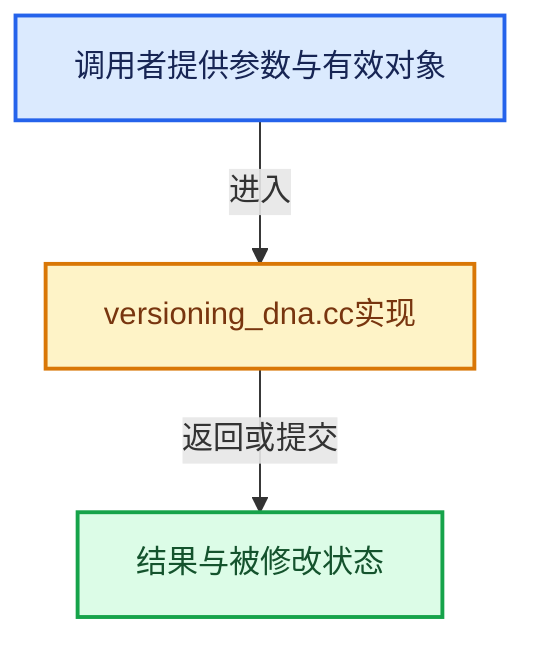

# 实现依赖专题：source/blender/blenloader/intern/versioning_dna.cc

[实现依赖导航](../../../README.md) · [符号索引](../../../../00-课程指南/02-源码与提交索引/符号依赖与实现索引.md)

本专题从正文实际调用进入，集中保存共享实现。函数有稳定锚点，可从调用处直接跳到对应完整函数；递归与互相调用通过回链组织。

## 本文件的实现关系





## 完整成员与函数实现

<a id="f-19b0b9b263924ffd"></a>

### `blender::blo_do_versions_dna`

实现位置：[source/blender/blenloader/intern/versioning_dna.cc](../../../../../../../../source/blender/blenloader/intern/versioning_dna.cc) · L17—L65。

接口参数：

- `SDNA *sdna`
- `const int versionfile`
- `const int subversionfile`

**教学注释版**

<!-- annotated:0e1f4f92e82c44 -->

```cpp
void blo_do_versions_dna(SDNA *sdna, const int versionfile, const int subversionfile)
{
#define DNA_VERSION_ATLEAST(ver, subver) \
  (versionfile > (ver) || (versionfile == (ver) && (subversionfile >= (subver))))

  if (!DNA_VERSION_ATLEAST(280, 2)) {
    /* Version files created in the 'blender2.8' branch
     * between October 2016, and November 2017 (>=280.0 and < 280.2). */
    if (versionfile >= 280) {
      DNA_sdna_patch_struct_by_name(sdna, "SceneLayer", "ViewLayer");
      DNA_sdna_patch_struct_member_by_name(
          sdna, "FileGlobal", "cur_render_layer", "cur_view_layer");
      DNA_sdna_patch_struct_member_by_name(
          sdna, "ParticleEditSettings", "scene_layer", "view_layer");
      DNA_sdna_patch_struct_member_by_name(sdna, "Scene", "active_layer", "active_view_layer");
      DNA_sdna_patch_struct_member_by_name(sdna, "Scene", "render_layers", "view_layers");
      DNA_sdna_patch_struct_member_by_name(sdna, "WorkSpace", "render_layer", "view_layer");
    }
  }

  if (!DNA_VERSION_ATLEAST(500, 51)) {
    /* These old struct names were only used by an experimental feature. They were renamed before
     * the feature became official. This versioning just allows to read old files but does not
     * provide forward compatibility. */
    DNA_sdna_patch_struct_by_name(sdna, "NodeGeometryClosureInput", "NodeClosureInput");
    DNA_sdna_patch_struct_by_name(sdna, "NodeGeometryClosureInputItem", "NodeClosureInputItem");
    DNA_sdna_patch_struct_by_name(sdna, "NodeGeometryClosureOutputItem", "NodeClosureOutputItem");
    DNA_sdna_patch_struct_by_name(sdna, "NodeGeometryClosureInputItems", "NodeClosureInputItems");
    DNA_sdna_patch_struct_by_name(
        sdna, "NodeGeometryClosureOutputItems", "NodeClosureOutputItems");
    DNA_sdna_patch_struct_by_name(sdna, "NodeGeometryClosureOutput", "NodeClosureOutput");
    DNA_sdna_patch_struct_by_name(
        sdna, "NodeGeometryEvaluateClosureInputItem", "NodeEvaluateClosureInputItem");
    DNA_sdna_patch_struct_by_name(
        sdna, "NodeGeometryEvaluateClosureOutputItem", "NodeEvaluateClosureOutputItem");
    DNA_sdna_patch_struct_by_name(
        sdna, "NodeGeometryEvaluateClosureInputItems", "NodeEvaluateClosureInputItems");
    DNA_sdna_patch_struct_by_name(
        sdna, "NodeGeometryEvaluateClosureOutputItems", "NodeEvaluateClosureOutputItems");
    DNA_sdna_patch_struct_by_name(sdna, "NodeGeometryEvaluateClosure", "NodeEvaluateClosure");
    DNA_sdna_patch_struct_by_name(sdna, "NodeGeometryCombineBundleItem", "NodeCombineBundleItem");
    DNA_sdna_patch_struct_by_name(sdna, "NodeGeometryCombineBundle", "NodeCombineBundle");
    DNA_sdna_patch_struct_by_name(
        sdna, "NodeGeometrySeparateBundleItem", "NodeSeparateBundleItem");
    DNA_sdna_patch_struct_by_name(sdna, "NodeGeometrySeparateBundle", "NodeSeparateBundle");
  }

#undef DNA_VERSION_ATLEAST
}
```

<details>
<summary>核对原始源码：source/blender/blenloader/intern/versioning_dna.cc · L17—L65</summary>

<!-- original:0e1f4f92e82c44:source/blender/blenloader/intern/versioning_dna.cc:17:65 -->

```cpp
void blo_do_versions_dna(SDNA *sdna, const int versionfile, const int subversionfile)
{
#define DNA_VERSION_ATLEAST(ver, subver) \
  (versionfile > (ver) || (versionfile == (ver) && (subversionfile >= (subver))))

  if (!DNA_VERSION_ATLEAST(280, 2)) {
    /* Version files created in the 'blender2.8' branch
     * between October 2016, and November 2017 (>=280.0 and < 280.2). */
    if (versionfile >= 280) {
      DNA_sdna_patch_struct_by_name(sdna, "SceneLayer", "ViewLayer");
      DNA_sdna_patch_struct_member_by_name(
          sdna, "FileGlobal", "cur_render_layer", "cur_view_layer");
      DNA_sdna_patch_struct_member_by_name(
          sdna, "ParticleEditSettings", "scene_layer", "view_layer");
      DNA_sdna_patch_struct_member_by_name(sdna, "Scene", "active_layer", "active_view_layer");
      DNA_sdna_patch_struct_member_by_name(sdna, "Scene", "render_layers", "view_layers");
      DNA_sdna_patch_struct_member_by_name(sdna, "WorkSpace", "render_layer", "view_layer");
    }
  }

  if (!DNA_VERSION_ATLEAST(500, 51)) {
    /* These old struct names were only used by an experimental feature. They were renamed before
     * the feature became official. This versioning just allows to read old files but does not
     * provide forward compatibility. */
    DNA_sdna_patch_struct_by_name(sdna, "NodeGeometryClosureInput", "NodeClosureInput");
    DNA_sdna_patch_struct_by_name(sdna, "NodeGeometryClosureInputItem", "NodeClosureInputItem");
    DNA_sdna_patch_struct_by_name(sdna, "NodeGeometryClosureOutputItem", "NodeClosureOutputItem");
    DNA_sdna_patch_struct_by_name(sdna, "NodeGeometryClosureInputItems", "NodeClosureInputItems");
    DNA_sdna_patch_struct_by_name(
        sdna, "NodeGeometryClosureOutputItems", "NodeClosureOutputItems");
    DNA_sdna_patch_struct_by_name(sdna, "NodeGeometryClosureOutput", "NodeClosureOutput");
    DNA_sdna_patch_struct_by_name(
        sdna, "NodeGeometryEvaluateClosureInputItem", "NodeEvaluateClosureInputItem");
    DNA_sdna_patch_struct_by_name(
        sdna, "NodeGeometryEvaluateClosureOutputItem", "NodeEvaluateClosureOutputItem");
    DNA_sdna_patch_struct_by_name(
        sdna, "NodeGeometryEvaluateClosureInputItems", "NodeEvaluateClosureInputItems");
    DNA_sdna_patch_struct_by_name(
        sdna, "NodeGeometryEvaluateClosureOutputItems", "NodeEvaluateClosureOutputItems");
    DNA_sdna_patch_struct_by_name(sdna, "NodeGeometryEvaluateClosure", "NodeEvaluateClosure");
    DNA_sdna_patch_struct_by_name(sdna, "NodeGeometryCombineBundleItem", "NodeCombineBundleItem");
    DNA_sdna_patch_struct_by_name(sdna, "NodeGeometryCombineBundle", "NodeCombineBundle");
    DNA_sdna_patch_struct_by_name(
        sdna, "NodeGeometrySeparateBundleItem", "NodeSeparateBundleItem");
    DNA_sdna_patch_struct_by_name(sdna, "NodeGeometrySeparateBundle", "NodeSeparateBundle");
  }

#undef DNA_VERSION_ATLEAST
}
```

</details>

**继续追踪实现**

- `DNA_VERSION_ATLEAST` → [调用协议](../../../../00-课程指南/01-路线与规范/模板宏与动态分派协议.md)：函数指针、局部可调用对象或未展开的宏；必须结合调用者环境。调用位置L22。
- `DNA_sdna_patch_struct_by_name` → [blender::DNA_sdna_patch_struct_by_name · L1823](../../makesdna/intern/dna_genfile.cc.md#f-08172b3381a1cd72)。
- `DNA_sdna_patch_struct_member_by_name` → [blender::DNA_sdna_patch_struct_member_by_name · L1873](../../makesdna/intern/dna_genfile.cc.md#f-1bb1b1dac018ff5a)。
