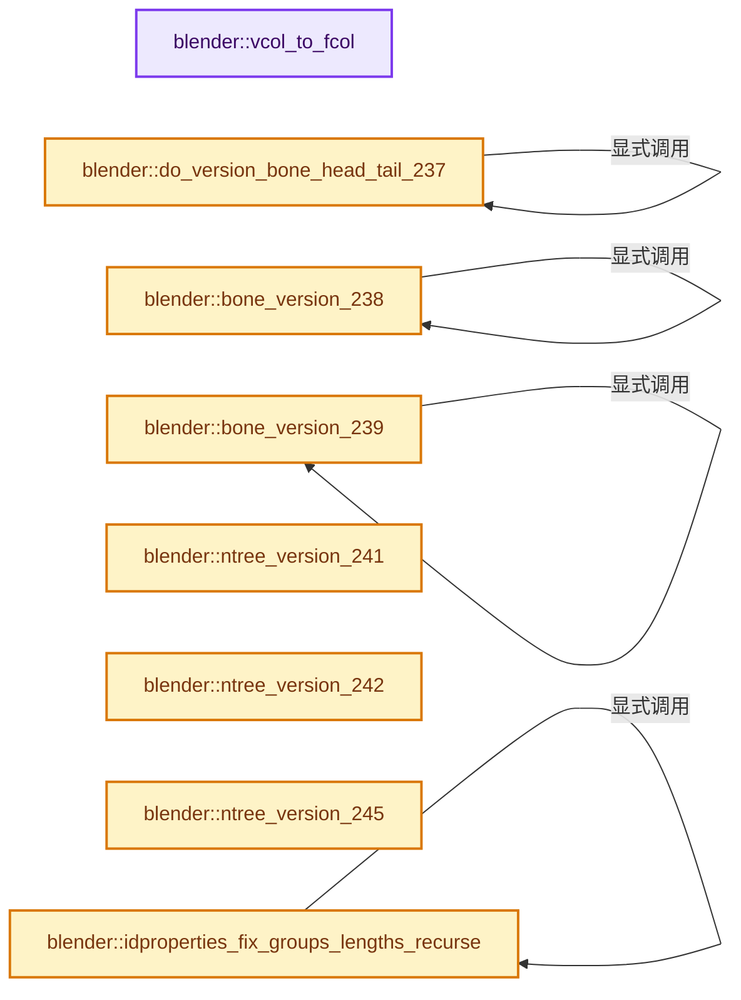
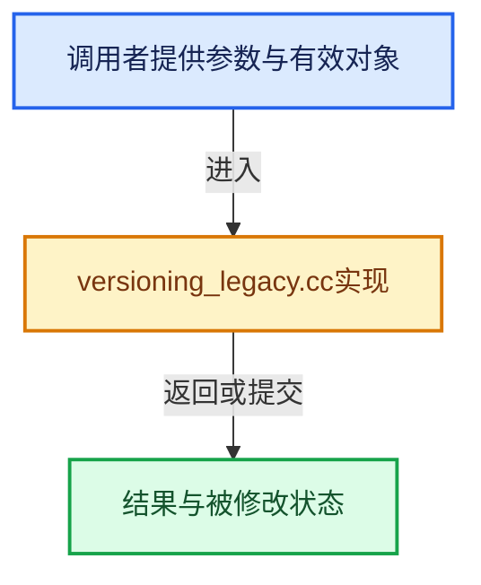

# 实现依赖专题：source/blender/blenloader/intern/versioning_legacy.cc

[实现依赖导航](../../../README.md) · [符号索引](../../../../00-课程指南/02-源码与提交索引/符号依赖与实现索引.md)

本专题从正文实际调用进入，集中保存共享实现。函数有稳定锚点，可从调用处直接跳到对应完整函数；递归与互相调用通过回链组织。

## 本文件的实现关系






## 完整成员与函数实现

<a id="f-fdafb9a5f0fb5e40"></a>

### `blender::vcol_to_fcol`

实现位置：[source/blender/blenloader/intern/versioning_legacy.cc](../../../../../../../../source/blender/blenloader/intern/versioning_legacy.cc) · L88—L111。

接口参数：

- `Mesh *mesh`

**教学注释版**

<!-- annotated:2d42b941e23120 -->

```cpp
static void vcol_to_fcol(Mesh *mesh)
{
  MFace *mface;
  uint *mcol, *mcoln, *mcolmain;
  int a;

  if (mesh->totface_legacy == 0 || mesh->mcol == nullptr) {
    return;
  }

  mcoln = mcolmain = MEM_new_array_uninitialized<uint>(4 * mesh->totface_legacy, "mcoln");
  mcol = reinterpret_cast<uint *>(mesh->mcol);
  mface = mesh->mface;
  for (a = mesh->totface_legacy; a > 0; a--, mface++) {
    mcoln[0] = mcol[mface->v1];
    mcoln[1] = mcol[mface->v2];
    mcoln[2] = mcol[mface->v3];
    mcoln[3] = mcol[mface->v4];
    mcoln += 4;
  }

  MEM_delete(mesh->mcol);
  mesh->mcol = reinterpret_cast<MCol *>(mcolmain);
}
```

<details>
<summary>核对原始源码：source/blender/blenloader/intern/versioning_legacy.cc · L88—L111</summary>

<!-- original:2d42b941e23120:source/blender/blenloader/intern/versioning_legacy.cc:88:111 -->

```cpp
static void vcol_to_fcol(Mesh *mesh)
{
  MFace *mface;
  uint *mcol, *mcoln, *mcolmain;
  int a;

  if (mesh->totface_legacy == 0 || mesh->mcol == nullptr) {
    return;
  }

  mcoln = mcolmain = MEM_new_array_uninitialized<uint>(4 * mesh->totface_legacy, "mcoln");
  mcol = reinterpret_cast<uint *>(mesh->mcol);
  mface = mesh->mface;
  for (a = mesh->totface_legacy; a > 0; a--, mface++) {
    mcoln[0] = mcol[mface->v1];
    mcoln[1] = mcol[mface->v2];
    mcoln[2] = mcol[mface->v3];
    mcoln[3] = mcol[mface->v4];
    mcoln += 4;
  }

  MEM_delete(mesh->mcol);
  mesh->mcol = reinterpret_cast<MCol *>(mcolmain);
}
```

</details>

**沿实际写入检查状态**

- `mcoln = mcolmain = MEM_new_array_uninitialized<uint>(4 * mesh->totface_legacy, "mcoln");`
- `mcol = reinterpret_cast<uint *>(mesh->mcol);`
- `mface = mesh->mface;`
- `mcoln[0] = mcol[mface->v1];`
- `mcoln[1] = mcol[mface->v2];`
- `mcoln[2] = mcol[mface->v3];`
- `mcoln[3] = mcol[mface->v4];`
- `mcoln += 4;`
- `mesh->mcol = reinterpret_cast<MCol *>(mcolmain);`

**继续追踪实现**

- `MEM_new_array_uninitialized<uint>` → [MEM_new_array_uninitialized · L608](../../../07-Intern运行时与平台/guardedalloc/MEM_guardedalloc.h.md#f-b7103eae8eb57b05)；[MEM_new_array_uninitialized · L129](../../../07-Intern运行时与平台/guardedalloc/intern/mallocn.cc.md#f-bf6ef4ddcfb6e5df)。同名重载需按实参类型选择。
- `MEM_delete` → [MEM_delete · L400](../../../07-Intern运行时与平台/guardedalloc/MEM_guardedalloc.h.md#f-9049ffdd1682887c)。

<a id="f-e26871f361023b25"></a>

### `blender::do_version_bone_head_tail_237`

实现位置：[source/blender/blenloader/intern/versioning_legacy.cc](../../../../../../../../source/blender/blenloader/intern/versioning_legacy.cc) · L113—L128。

接口参数：

- `Bone *bone`

**教学注释版**

<!-- annotated:a820015897fbf1 -->

```cpp
static void do_version_bone_head_tail_237(Bone *bone)
{
  float vec[3];

  /* head */
  copy_v3_v3(bone->arm_head, bone->arm_mat[3]);

  /* tail is in current local coord system */
  copy_v3_v3(vec, bone->arm_mat[1]);
  mul_v3_fl(vec, bone->length);
  add_v3_v3v3(bone->arm_tail, bone->arm_head, vec);

  for (Bone &child : bone->childbase) {
    do_version_bone_head_tail_237(&child);
  }
}
```

<details>
<summary>核对原始源码：source/blender/blenloader/intern/versioning_legacy.cc · L113—L128</summary>

<!-- original:a820015897fbf1:source/blender/blenloader/intern/versioning_legacy.cc:113:128 -->

```cpp
static void do_version_bone_head_tail_237(Bone *bone)
{
  float vec[3];

  /* head */
  copy_v3_v3(bone->arm_head, bone->arm_mat[3]);

  /* tail is in current local coord system */
  copy_v3_v3(vec, bone->arm_mat[1]);
  mul_v3_fl(vec, bone->length);
  add_v3_v3v3(bone->arm_tail, bone->arm_head, vec);

  for (Bone &child : bone->childbase) {
    do_version_bone_head_tail_237(&child);
  }
}
```

</details>

**继续追踪实现**

- `copy_v3_v3` → [blender::copy_v3_v3 · L47](../../../01-BLI基础库/intern/math_vector_inline.cc.md#f-037a0d5fa5060bd6)。
- `mul_v3_fl` → [blender::mul_v3_fl · L414](../../../01-BLI基础库/intern/math_vector_inline.cc.md#f-00165156a06d1224)。
- `add_v3_v3v3` → [blender::add_v3_v3v3 · L300](../../../01-BLI基础库/intern/math_vector_inline.cc.md#f-7343b459d0d3db69)。
- `do_version_bone_head_tail_237` → [blender::do_version_bone_head_tail_237 · L113](versioning_legacy.cc.md#f-e26871f361023b25)。

<a id="f-fcd7361dfa0e040e"></a>

### `blender::bone_version_238`

实现位置：[source/blender/blenloader/intern/versioning_legacy.cc](../../../../../../../../source/blender/blenloader/intern/versioning_legacy.cc) · L130—L142。

接口参数：

- `ListBaseT<Bone> *lb`

**教学注释版**

<!-- annotated:d2d60c14a5ed18 -->

```cpp
static void bone_version_238(ListBaseT<Bone> *lb)
{
  for (Bone &bone : *lb) {
    if (bone.rad_tail == 0.0f && bone.rad_head == 0.0f) {
      bone.rad_head = 0.25f * bone.length;
      bone.rad_tail = 0.1f * bone.length;

      bone.dist -= bone.rad_head;
      // [讲解] std::max：按比较关系选取较大值。本讲解中的增长公式同时满足最低请求和几何增长；若保存返回引用，还需注意实参寿命。
      bone.dist = std::max(bone.dist, 0.0f);
    }
    bone_version_238(&bone.childbase);
  }
}
```

<details>
<summary>核对原始源码：source/blender/blenloader/intern/versioning_legacy.cc · L130—L142</summary>

<!-- original:d2d60c14a5ed18:source/blender/blenloader/intern/versioning_legacy.cc:130:142 -->

```cpp
static void bone_version_238(ListBaseT<Bone> *lb)
{
  for (Bone &bone : *lb) {
    if (bone.rad_tail == 0.0f && bone.rad_head == 0.0f) {
      bone.rad_head = 0.25f * bone.length;
      bone.rad_tail = 0.1f * bone.length;

      bone.dist -= bone.rad_head;
      bone.dist = std::max(bone.dist, 0.0f);
    }
    bone_version_238(&bone.childbase);
  }
}
```

</details>

**沿实际写入检查状态**

- `bone.rad_head = 0.25f * bone.length;`
- `bone.rad_tail = 0.1f * bone.length;`
- `bone.dist -= bone.rad_head;`
- `bone.dist = std::max(bone.dist, 0.0f);`

**继续追踪实现**

- `std::max` → [外部契约](https://eel.is/c++draft/alg.min.max)：按比较关系选取较大值。本讲解中的增长公式同时满足最低请求和几何增长；若保存返回引用，还需注意实参寿命。
- `bone_version_238` → [blender::bone_version_238 · L130](versioning_legacy.cc.md#f-fcd7361dfa0e040e)。

<a id="f-c4008c750ef35e79"></a>

### `blender::bone_version_239`

实现位置：[source/blender/blenloader/intern/versioning_legacy.cc](../../../../../../../../source/blender/blenloader/intern/versioning_legacy.cc) · L144—L152。

接口参数：

- `ListBaseT<Bone> *lb`

**教学注释版**

<!-- annotated:bbb65babf5b4b6 -->

```cpp
static void bone_version_239(ListBaseT<Bone> *lb)
{
  for (Bone &bone : *lb) {
    if (bone.layer == 0) {
      bone.layer = 1;
    }
    bone_version_239(&bone.childbase);
  }
}
```

<details>
<summary>核对原始源码：source/blender/blenloader/intern/versioning_legacy.cc · L144—L152</summary>

<!-- original:bbb65babf5b4b6:source/blender/blenloader/intern/versioning_legacy.cc:144:152 -->

```cpp
static void bone_version_239(ListBaseT<Bone> *lb)
{
  for (Bone &bone : *lb) {
    if (bone.layer == 0) {
      bone.layer = 1;
    }
    bone_version_239(&bone.childbase);
  }
}
```

</details>

**沿实际写入检查状态**

- `bone.layer = 1;`

**继续追踪实现**

- `bone_version_239` → [blender::bone_version_239 · L144](versioning_legacy.cc.md#f-c4008c750ef35e79)。

<a id="f-8ed3857a170e5315"></a>

### `blender::ntree_version_241`

实现位置：[source/blender/blenloader/intern/versioning_legacy.cc](../../../../../../../../source/blender/blenloader/intern/versioning_legacy.cc) · L154—L178。

接口参数：

- `bNodeTree *ntree`

**教学注释版**

<!-- annotated:4bfe25a92ce43c -->

```cpp
static void ntree_version_241(bNodeTree *ntree)
{
  if (ntree->type == NTREE_COMPOSIT) {
    for (bNode &node : ntree->nodes) {
      if (node.type_legacy == CMP_NODE_BLUR) {
        if (node.storage == nullptr) {
          NodeBlurData *nbd = MEM_new<NodeBlurData>("node blur patch");
          nbd->sizex = node.custom1;
          nbd->sizey = node.custom2;
          nbd->filtertype = CMP_NODE_BLUR_TYPE_QUAD;
          node.storage = nbd;
        }
      }
      else if (node.type_legacy == CMP_NODE_VECBLUR) {
        if (node.storage == nullptr) {
          NodeBlurData *nbd = MEM_new<NodeBlurData>("node blur patch");
          nbd->samples = node.custom1;
          nbd->maxspeed = node.custom2;
          nbd->fac = 1.0f;
          node.storage = nbd;
        }
      }
    }
  }
}
```

<details>
<summary>核对原始源码：source/blender/blenloader/intern/versioning_legacy.cc · L154—L178</summary>

<!-- original:4bfe25a92ce43c:source/blender/blenloader/intern/versioning_legacy.cc:154:178 -->

```cpp
static void ntree_version_241(bNodeTree *ntree)
{
  if (ntree->type == NTREE_COMPOSIT) {
    for (bNode &node : ntree->nodes) {
      if (node.type_legacy == CMP_NODE_BLUR) {
        if (node.storage == nullptr) {
          NodeBlurData *nbd = MEM_new<NodeBlurData>("node blur patch");
          nbd->sizex = node.custom1;
          nbd->sizey = node.custom2;
          nbd->filtertype = CMP_NODE_BLUR_TYPE_QUAD;
          node.storage = nbd;
        }
      }
      else if (node.type_legacy == CMP_NODE_VECBLUR) {
        if (node.storage == nullptr) {
          NodeBlurData *nbd = MEM_new<NodeBlurData>("node blur patch");
          nbd->samples = node.custom1;
          nbd->maxspeed = node.custom2;
          nbd->fac = 1.0f;
          node.storage = nbd;
        }
      }
    }
  }
}
```

</details>

**沿实际写入检查状态**

- `nbd->sizex = node.custom1;`
- `nbd->sizey = node.custom2;`
- `nbd->filtertype = CMP_NODE_BLUR_TYPE_QUAD;`
- `node.storage = nbd;`
- `nbd->samples = node.custom1;`
- `nbd->maxspeed = node.custom2;`
- `nbd->fac = 1.0f;`

**继续追踪实现**

- `MEM_new<NodeBlurData>` → [MEM_new · L351](../../../07-Intern运行时与平台/guardedalloc/MEM_guardedalloc.h.md#f-115f9b6784f89912)。

<a id="f-b797b3acb14da49d"></a>

### `blender::ntree_version_242`

实现位置：[source/blender/blenloader/intern/versioning_legacy.cc](../../../../../../../../source/blender/blenloader/intern/versioning_legacy.cc) · L180—L194。

接口参数：

- `bNodeTree *ntree`

**教学注释版**

<!-- annotated:04aa146a98a6c4 -->

```cpp
static void ntree_version_242(bNodeTree *ntree)
{
  if (ntree->type == NTREE_COMPOSIT) {
    for (bNode &node : ntree->nodes) {
      if (node.type_legacy == CMP_NODE_HUE_SAT) {
        if (node.storage) {
          NodeHueSat *nhs = static_cast<NodeHueSat *>(node.storage);
          if (nhs->val == 0.0f) {
            nhs->val = 1.0f;
          }
        }
      }
    }
  }
}
```

<details>
<summary>核对原始源码：source/blender/blenloader/intern/versioning_legacy.cc · L180—L194</summary>

<!-- original:04aa146a98a6c4:source/blender/blenloader/intern/versioning_legacy.cc:180:194 -->

```cpp
static void ntree_version_242(bNodeTree *ntree)
{
  if (ntree->type == NTREE_COMPOSIT) {
    for (bNode &node : ntree->nodes) {
      if (node.type_legacy == CMP_NODE_HUE_SAT) {
        if (node.storage) {
          NodeHueSat *nhs = static_cast<NodeHueSat *>(node.storage);
          if (nhs->val == 0.0f) {
            nhs->val = 1.0f;
          }
        }
      }
    }
  }
}
```

</details>

**沿实际写入检查状态**

- `nhs->val = 1.0f;`

**继续追踪实现**

本实现没有需要继续展开的显式调用；检查返回表达式、对象转换和调用者前置条件。

<a id="f-3b804fc5ab2de56b"></a>

### `blender::ntree_version_245`

实现位置：[source/blender/blenloader/intern/versioning_legacy.cc](../../../../../../../../source/blender/blenloader/intern/versioning_legacy.cc) · L196—L231。

接口参数：

- `FileData *fd`
- `Library *`
- `bNodeTree *ntree`

**教学注释版**

<!-- annotated:921cd093e0f7b2 -->

```cpp
static void ntree_version_245(FileData *fd, Library * /*lib*/, bNodeTree *ntree)
{
  NodeTwoFloats *ntf;
  ID *nodeid;
  Image *image;
  ImageUser *iuser;

  if (ntree->type == NTREE_COMPOSIT) {
    for (bNode &node : ntree->nodes) {
      if (node.type_legacy == CMP_NODE_ALPHAOVER) {
        if (!node.storage) {
          ntf = MEM_new<NodeTwoFloats>("NodeTwoFloats");
          node.storage = ntf;
          if (node.custom1) {
            ntf->x = 1.0f;
          }
        }
      }

      /* fix for temporary flag changes during 245 cycle */
      nodeid = static_cast<ID *>(
          blo_do_versions_newlibadr(fd, &ntree->id, ID_IS_LINKED(ntree), node.id));
      if (node.storage && nodeid && GS(nodeid->name) == ID_IM) {
        image = id_cast<Image *>(nodeid);
        iuser = static_cast<ImageUser *>(node.storage);
        if (iuser->flag & eImageUser_Flag(IMA_OLD_PREMUL)) {
          iuser->flag &= ~eImageUser_Flag(IMA_OLD_PREMUL);
        }
        if (iuser->flag & eImageUser_Flag(IMA_DO_PREMUL)) {
          image->flag &= ~IMA_OLD_PREMUL;
          image->alpha_mode = IMA_ALPHA_STRAIGHT;
        }
      }
    }
  }
}
```

<details>
<summary>核对原始源码：source/blender/blenloader/intern/versioning_legacy.cc · L196—L231</summary>

<!-- original:921cd093e0f7b2:source/blender/blenloader/intern/versioning_legacy.cc:196:231 -->

```cpp
static void ntree_version_245(FileData *fd, Library * /*lib*/, bNodeTree *ntree)
{
  NodeTwoFloats *ntf;
  ID *nodeid;
  Image *image;
  ImageUser *iuser;

  if (ntree->type == NTREE_COMPOSIT) {
    for (bNode &node : ntree->nodes) {
      if (node.type_legacy == CMP_NODE_ALPHAOVER) {
        if (!node.storage) {
          ntf = MEM_new<NodeTwoFloats>("NodeTwoFloats");
          node.storage = ntf;
          if (node.custom1) {
            ntf->x = 1.0f;
          }
        }
      }

      /* fix for temporary flag changes during 245 cycle */
      nodeid = static_cast<ID *>(
          blo_do_versions_newlibadr(fd, &ntree->id, ID_IS_LINKED(ntree), node.id));
      if (node.storage && nodeid && GS(nodeid->name) == ID_IM) {
        image = id_cast<Image *>(nodeid);
        iuser = static_cast<ImageUser *>(node.storage);
        if (iuser->flag & eImageUser_Flag(IMA_OLD_PREMUL)) {
          iuser->flag &= ~eImageUser_Flag(IMA_OLD_PREMUL);
        }
        if (iuser->flag & eImageUser_Flag(IMA_DO_PREMUL)) {
          image->flag &= ~IMA_OLD_PREMUL;
          image->alpha_mode = IMA_ALPHA_STRAIGHT;
        }
      }
    }
  }
}
```

</details>

**沿实际写入检查状态**

- `ntf = MEM_new<NodeTwoFloats>("NodeTwoFloats");`
- `node.storage = ntf;`
- `ntf->x = 1.0f;`
- `nodeid = static_cast<ID *>(`
- `image = id_cast<Image *>(nodeid);`
- `iuser = static_cast<ImageUser *>(node.storage);`
- `iuser->flag &= ~eImageUser_Flag(IMA_OLD_PREMUL);`
- `image->flag &= ~IMA_OLD_PREMUL;`
- `image->alpha_mode = IMA_ALPHA_STRAIGHT;`

**继续追踪实现**

- `MEM_new<NodeTwoFloats>` → [MEM_new · L351](../../../07-Intern运行时与平台/guardedalloc/MEM_guardedalloc.h.md#f-115f9b6784f89912)。
- `blo_do_versions_newlibadr` → [blo_do_versions_newlibadr · L1503](readfile.cc.md#f-811939cbb5a0e459)。
- `ID_IS_LINKED` → [ID_IS_LINKED · L697](../../makesdna/DNA_ID.h.md#m-7e1e1e9b20e6)。宏定义由构建条件选择。
- `GS` → [blender::GS · L410](../../makesdna/DNA_ID.h.md#f-c3ff509f79f21b05)。
- `id_cast<Image *>` → [blender::id_cast · L1417](../../makesdna/DNA_ID.h.md#f-6c8ac6412850ac5a)。
- `eImageUser_Flag` → [blender::eImageUser_Flag](../../makesdna/DNA_image_types.h.md#t-474c44ce5fac)。

<a id="f-1d3eb9f46650c295"></a>

### `blender::idproperties_fix_groups_lengths_recurse`

实现位置：[source/blender/blenloader/intern/versioning_legacy.cc](../../../../../../../../source/blender/blenloader/intern/versioning_legacy.cc) · L233—L248。

接口参数：

- `IDProperty *prop`

**教学注释版**

<!-- annotated:cb9da9291e153a -->

```cpp
static void idproperties_fix_groups_lengths_recurse(IDProperty *prop)
{
  IDProperty *loop;
  int i;

  for (loop = prop->data.group.first(), i = 0; loop; loop = loop->next, i++) {
    if (loop->type == IDP_GROUP) {
      idproperties_fix_groups_lengths_recurse(loop);
    }
  }

  if (prop->len != i) {
    printf("Found and fixed bad id property group length.\n");
    prop->len = i;
  }
}
```

<details>
<summary>核对原始源码：source/blender/blenloader/intern/versioning_legacy.cc · L233—L248</summary>

<!-- original:cb9da9291e153a:source/blender/blenloader/intern/versioning_legacy.cc:233:248 -->

```cpp
static void idproperties_fix_groups_lengths_recurse(IDProperty *prop)
{
  IDProperty *loop;
  int i;

  for (loop = prop->data.group.first(), i = 0; loop; loop = loop->next, i++) {
    if (loop->type == IDP_GROUP) {
      idproperties_fix_groups_lengths_recurse(loop);
    }
  }

  if (prop->len != i) {
    printf("Found and fixed bad id property group length.\n");
    prop->len = i;
  }
}
```

</details>

**沿实际写入检查状态**

- `prop->len = i;`

**继续追踪实现**

- `prop->data.group.first` → [调用协议](../../../../00-课程指南/01-路线与规范/模板宏与动态分派协议.md)：接收对象类型依赖auto、返回值或模板实例；不按同名猜测目标。调用位置L238。
- `idproperties_fix_groups_lengths_recurse` → [blender::idproperties_fix_groups_lengths_recurse · L233](versioning_legacy.cc.md#f-1d3eb9f46650c295)。
- `printf` → [外部契约](https://eel.is/c++draft/)：这个边界按实际表达式及所属类型核对参数、返回值、寿命与失败行为。这里提供接口入口，不声称已解释该第三方版本的内部实现。

<a id="f-b7d8f1986176b930"></a>

### `blender::idproperties_fix_group_lengths`

实现位置：[source/blender/blenloader/intern/versioning_legacy.cc](../../../../../../../../source/blender/blenloader/intern/versioning_legacy.cc) · L250—L257。

接口参数：

- `const ListBaseT<T> &idlist`

**教学注释版**

<!-- annotated:b4c138c2a6d608 -->

```cpp
template<typename T> static void idproperties_fix_group_lengths(const ListBaseT<T> &idlist)
{
  for (ID &id : idlist.template cast<ID>()) {
    if (id.properties) {
      idproperties_fix_groups_lengths_recurse(id.properties);
    }
  }
}
```

<details>
<summary>核对原始源码：source/blender/blenloader/intern/versioning_legacy.cc · L250—L257</summary>

<!-- original:b4c138c2a6d608:source/blender/blenloader/intern/versioning_legacy.cc:250:257 -->

```cpp
template<typename T> static void idproperties_fix_group_lengths(const ListBaseT<T> &idlist)
{
  for (ID &id : idlist.template cast<ID>()) {
    if (id.properties) {
      idproperties_fix_groups_lengths_recurse(id.properties);
    }
  }
}
```

</details>

**继续追踪实现**

- `idlist.template cast<ID>` → [blender::ListBaseT::cast · L186](../../makesdna/DNA_listBase.h.md#f-3ed7e795eed6a902)；[blender::ListBaseT::cast · L191](../../makesdna/DNA_listBase.h.md#f-82b47073c05302b7)。同名重载需按实参类型选择。
- `idproperties_fix_groups_lengths_recurse` → [blender::idproperties_fix_groups_lengths_recurse · L233](versioning_legacy.cc.md#f-1d3eb9f46650c295)。

<a id="f-29ee8f4caad7fcdd"></a>

### `blender::customdata_version_242`

实现位置：[source/blender/blenloader/intern/versioning_legacy.cc](../../../../../../../../source/blender/blenloader/intern/versioning_legacy.cc) · L259—L345。

接口参数：

- `Mesh *mesh`

**教学注释版**

<!-- annotated:5a0f0ff4cf33a9 -->

```cpp
static void customdata_version_242(Mesh *mesh)
{
  CustomDataLayer *layer;
  MTFace *mtf;
  MCol *mcol;
  TFace *tf;
  int a, mtfacen, mcoln;

  if (!mesh->vert_data.totlayer) {
    CustomData_add_layer_with_data(
        &mesh->vert_data, CD_MVERT, mesh->mvert, mesh->verts_num, nullptr);

    if (mesh->dvert) {
      CustomData_add_layer_with_data(
          &mesh->vert_data, CD_MDEFORMVERT, mesh->dvert, mesh->verts_num, nullptr);
    }
  }

  if (!mesh->edge_data.totlayer) {
    CustomData_add_layer_with_data(
        &mesh->edge_data, CD_MEDGE, mesh->medge, mesh->edges_num, nullptr);
  }

  if (!mesh->fdata_legacy.totlayer) {
    CustomData_add_layer_with_data(
        &mesh->fdata_legacy, CD_MFACE, mesh->mface, mesh->totface_legacy, nullptr);

    if (mesh->tface) {
      if (mesh->mcol) {
        MEM_delete(mesh->mcol);
      }

      mesh->mcol = static_cast<MCol *>(CustomData_add_layer(
          &mesh->fdata_legacy, CD_MCOL, CD_SET_DEFAULT, mesh->totface_legacy));
      mesh->mtface = static_cast<MTFace *>(CustomData_add_layer(
          &mesh->fdata_legacy, CD_MTFACE, CD_SET_DEFAULT, mesh->totface_legacy));

      mtf = mesh->mtface;
      mcol = mesh->mcol;
      tf = mesh->tface;

      for (a = 0; a < mesh->totface_legacy; a++, mtf++, tf++, mcol += 4) {
        // [讲解] memcpy：复制字节，源与目标不应重叠。类型生命周期、对齐和可复制表示须由调用者证明，不是任意对象的复制构造。
        memcpy(mcol, tf->col, sizeof(tf->col));
        memcpy(mtf->uv, tf->uv, sizeof(tf->uv));
      }

      MEM_delete(mesh->tface);
      mesh->tface = nullptr;
    }
    else if (mesh->mcol) {
      CustomData_add_layer_with_data(
          &mesh->fdata_legacy, CD_MCOL, mesh->mcol, mesh->totface_legacy, nullptr);
    }
  }

  if (mesh->tface) {
    MEM_delete(mesh->tface);
    mesh->tface = nullptr;
  }

  for (a = 0, mtfacen = 0, mcoln = 0; a < mesh->fdata_legacy.totlayer; a++) {
    layer = &mesh->fdata_legacy.layers[a];

    if (layer->type == CD_MTFACE) {
      if (layer->name[0] == 0) {
        if (mtfacen == 0) {
          STRNCPY_UTF8(layer->name, "UVMap");
        }
        else {
          SNPRINTF_UTF8(layer->name, "UVMap.%.3d", mtfacen);
        }
      }
      mtfacen++;
    }
    else if (layer->type == CD_MCOL) {
      if (layer->name[0] == 0) {
        if (mcoln == 0) {
          STRNCPY_UTF8(layer->name, "Col");
        }
        else {
          SNPRINTF_UTF8(layer->name, "Col.%.3d", mcoln);
        }
      }
      mcoln++;
    }
  }
}
```

<details>
<summary>核对原始源码：source/blender/blenloader/intern/versioning_legacy.cc · L259—L345</summary>

<!-- original:5a0f0ff4cf33a9:source/blender/blenloader/intern/versioning_legacy.cc:259:345 -->

```cpp
static void customdata_version_242(Mesh *mesh)
{
  CustomDataLayer *layer;
  MTFace *mtf;
  MCol *mcol;
  TFace *tf;
  int a, mtfacen, mcoln;

  if (!mesh->vert_data.totlayer) {
    CustomData_add_layer_with_data(
        &mesh->vert_data, CD_MVERT, mesh->mvert, mesh->verts_num, nullptr);

    if (mesh->dvert) {
      CustomData_add_layer_with_data(
          &mesh->vert_data, CD_MDEFORMVERT, mesh->dvert, mesh->verts_num, nullptr);
    }
  }

  if (!mesh->edge_data.totlayer) {
    CustomData_add_layer_with_data(
        &mesh->edge_data, CD_MEDGE, mesh->medge, mesh->edges_num, nullptr);
  }

  if (!mesh->fdata_legacy.totlayer) {
    CustomData_add_layer_with_data(
        &mesh->fdata_legacy, CD_MFACE, mesh->mface, mesh->totface_legacy, nullptr);

    if (mesh->tface) {
      if (mesh->mcol) {
        MEM_delete(mesh->mcol);
      }

      mesh->mcol = static_cast<MCol *>(CustomData_add_layer(
          &mesh->fdata_legacy, CD_MCOL, CD_SET_DEFAULT, mesh->totface_legacy));
      mesh->mtface = static_cast<MTFace *>(CustomData_add_layer(
          &mesh->fdata_legacy, CD_MTFACE, CD_SET_DEFAULT, mesh->totface_legacy));

      mtf = mesh->mtface;
      mcol = mesh->mcol;
      tf = mesh->tface;

      for (a = 0; a < mesh->totface_legacy; a++, mtf++, tf++, mcol += 4) {
        memcpy(mcol, tf->col, sizeof(tf->col));
        memcpy(mtf->uv, tf->uv, sizeof(tf->uv));
      }

      MEM_delete(mesh->tface);
      mesh->tface = nullptr;
    }
    else if (mesh->mcol) {
      CustomData_add_layer_with_data(
          &mesh->fdata_legacy, CD_MCOL, mesh->mcol, mesh->totface_legacy, nullptr);
    }
  }

  if (mesh->tface) {
    MEM_delete(mesh->tface);
    mesh->tface = nullptr;
  }

  for (a = 0, mtfacen = 0, mcoln = 0; a < mesh->fdata_legacy.totlayer; a++) {
    layer = &mesh->fdata_legacy.layers[a];

    if (layer->type == CD_MTFACE) {
      if (layer->name[0] == 0) {
        if (mtfacen == 0) {
          STRNCPY_UTF8(layer->name, "UVMap");
        }
        else {
          SNPRINTF_UTF8(layer->name, "UVMap.%.3d", mtfacen);
        }
      }
      mtfacen++;
    }
    else if (layer->type == CD_MCOL) {
      if (layer->name[0] == 0) {
        if (mcoln == 0) {
          STRNCPY_UTF8(layer->name, "Col");
        }
        else {
          SNPRINTF_UTF8(layer->name, "Col.%.3d", mcoln);
        }
      }
      mcoln++;
    }
  }
}
```

</details>

**沿实际写入检查状态**

- `mesh->mcol = static_cast<MCol *>(CustomData_add_layer(`
- `mesh->mtface = static_cast<MTFace *>(CustomData_add_layer(`
- `mtf = mesh->mtface;`
- `mcol = mesh->mcol;`
- `tf = mesh->tface;`
- `mesh->tface = nullptr;`
- `layer = &mesh->fdata_legacy.layers[a];`

**继续追踪实现**

- `CustomData_add_layer_with_data` → [blender::CustomData_add_layer_with_data · L2869](../../../02-BKE几何与数据/intern/customdata.cc.md#f-86d78a7ca5858ad6)。
- `MEM_delete` → [MEM_delete · L400](../../../07-Intern运行时与平台/guardedalloc/MEM_guardedalloc.h.md#f-9049ffdd1682887c)。
- `CustomData_add_layer` → [blender::CustomData_add_layer · L2851](../../../02-BKE几何与数据/intern/customdata.cc.md#f-4c7988e825541059)。
- `memcpy` → [外部契约](https://eel.is/c++draft/cstring.syn)：复制字节，源与目标不应重叠。类型生命周期、对齐和可复制表示须由调用者证明，不是任意对象的复制构造。
- `STRNCPY_UTF8` → [STRNCPY_UTF8 · L335](../../../01-BLI基础库/BLI_string_utf8.hh.md#m-222967f0ab6a)。宏定义由构建条件选择。
- `SNPRINTF_UTF8` → [SNPRINTF_UTF8 · L340](../../../01-BLI基础库/BLI_string_utf8.hh.md#m-5e57d7a30c64)。宏定义由构建条件选择。

<a id="f-97d4d5207c4f9c67"></a>

### `blender::customdata_version_243`

实现位置：[source/blender/blenloader/intern/versioning_legacy.cc](../../../../../../../../source/blender/blenloader/intern/versioning_legacy.cc) · L348—L357。

接口参数：

- `Mesh *mesh`

**教学注释版**

<!-- annotated:b01b1a3ed415f8 -->

```cpp
static void customdata_version_243(Mesh *mesh)
{
  CustomDataLayer *layer;
  int a;

  for (a = 0; a < mesh->fdata_legacy.totlayer; a++) {
    layer = &mesh->fdata_legacy.layers[a];
    layer->active_rnd = layer->active;
  }
}
```

<details>
<summary>核对原始源码：source/blender/blenloader/intern/versioning_legacy.cc · L348—L357</summary>

<!-- original:b01b1a3ed415f8:source/blender/blenloader/intern/versioning_legacy.cc:348:357 -->

```cpp
static void customdata_version_243(Mesh *mesh)
{
  CustomDataLayer *layer;
  int a;

  for (a = 0; a < mesh->fdata_legacy.totlayer; a++) {
    layer = &mesh->fdata_legacy.layers[a];
    layer->active_rnd = layer->active;
  }
}
```

</details>

**沿实际写入检查状态**

- `layer = &mesh->fdata_legacy.layers[a];`
- `layer->active_rnd = layer->active;`

**继续追踪实现**

本实现没有需要继续展开的显式调用；检查返回表达式、对象转换和调用者前置条件。

<a id="f-a48e9aac3701e887"></a>

### `blender::do_version_ntree_242_2`

实现位置：[source/blender/blenloader/intern/versioning_legacy.cc](../../../../../../../../source/blender/blenloader/intern/versioning_legacy.cc) · L360—L386。

接口参数：

- `bNodeTree *ntree`

**教学注释版**

<!-- annotated:d7854e43ac1619 -->

```cpp
static void do_version_ntree_242_2(bNodeTree *ntree)
{
  if (ntree->type == NTREE_COMPOSIT) {
    for (bNode &node : ntree->nodes) {
      if (ELEM(node.type_legacy, CMP_NODE_IMAGE, CMP_NODE_VIEWER)) {
        /* only image had storage */
        if (node.storage) {
          NodeImageAnim *nia = static_cast<NodeImageAnim *>(node.storage);
          ImageUser *iuser = MEM_new<ImageUser>("ima user node");

          iuser->frames = nia->frames;
          iuser->sfra = nia->sfra;
          iuser->offset = nia->nr - 1;
          iuser->cycl = nia->cyclic;

          node.storage = iuser;
          MEM_delete(nia);
        }
        else {
          ImageUser *iuser = MEM_new<ImageUser>("node image user");
          iuser->sfra = 1;
          node.storage = iuser;
        }
      }
    }
  }
}
```

<details>
<summary>核对原始源码：source/blender/blenloader/intern/versioning_legacy.cc · L360—L386</summary>

<!-- original:d7854e43ac1619:source/blender/blenloader/intern/versioning_legacy.cc:360:386 -->

```cpp
static void do_version_ntree_242_2(bNodeTree *ntree)
{
  if (ntree->type == NTREE_COMPOSIT) {
    for (bNode &node : ntree->nodes) {
      if (ELEM(node.type_legacy, CMP_NODE_IMAGE, CMP_NODE_VIEWER)) {
        /* only image had storage */
        if (node.storage) {
          NodeImageAnim *nia = static_cast<NodeImageAnim *>(node.storage);
          ImageUser *iuser = MEM_new<ImageUser>("ima user node");

          iuser->frames = nia->frames;
          iuser->sfra = nia->sfra;
          iuser->offset = nia->nr - 1;
          iuser->cycl = nia->cyclic;

          node.storage = iuser;
          MEM_delete(nia);
        }
        else {
          ImageUser *iuser = MEM_new<ImageUser>("node image user");
          iuser->sfra = 1;
          node.storage = iuser;
        }
      }
    }
  }
}
```

</details>

**沿实际写入检查状态**

- `iuser->frames = nia->frames;`
- `iuser->sfra = nia->sfra;`
- `iuser->offset = nia->nr - 1;`
- `iuser->cycl = nia->cyclic;`
- `node.storage = iuser;`
- `iuser->sfra = 1;`

**继续追踪实现**

- `ELEM` → [ELEM · L88](../../../07-Intern运行时与平台/ghost/intern/GHOST_utildefines.hh.md#m-d28724a15928)；[ELEM · L135](../../../01-BLI基础库/BLI_utildefines.hh.md#m-d6572de7cae0)。宏定义由构建条件选择。
- `MEM_new<ImageUser>` → [MEM_new · L351](../../../07-Intern运行时与平台/guardedalloc/MEM_guardedalloc.h.md#f-115f9b6784f89912)。
- `MEM_delete` → [MEM_delete · L400](../../../07-Intern运行时与平台/guardedalloc/MEM_guardedalloc.h.md#f-9049ffdd1682887c)。

<a id="f-8ae7c14fc1cdd4a2"></a>

### `blender::do_version_free_effect_245`

实现位置：[source/blender/blenloader/intern/versioning_legacy.cc](../../../../../../../../source/blender/blenloader/intern/versioning_legacy.cc) · L388—L399。

接口参数：

- `Effect *eff`

**教学注释版**

<!-- annotated:b80c472b8604d7 -->

```cpp
static void do_version_free_effect_245(Effect *eff)
{
  PartEff *paf;

  if (eff->type == EFF_PARTICLE) {
    paf = reinterpret_cast<PartEff *>(eff);
    if (paf->keys) {
      MEM_delete(paf->keys);
    }
  }
  MEM_delete(eff);
}
```

<details>
<summary>核对原始源码：source/blender/blenloader/intern/versioning_legacy.cc · L388—L399</summary>

<!-- original:b80c472b8604d7:source/blender/blenloader/intern/versioning_legacy.cc:388:399 -->

```cpp
static void do_version_free_effect_245(Effect *eff)
{
  PartEff *paf;

  if (eff->type == EFF_PARTICLE) {
    paf = reinterpret_cast<PartEff *>(eff);
    if (paf->keys) {
      MEM_delete(paf->keys);
    }
  }
  MEM_delete(eff);
}
```

</details>

**沿实际写入检查状态**

- `paf = reinterpret_cast<PartEff *>(eff);`

**继续追踪实现**

- `MEM_delete` → [MEM_delete · L400](../../../07-Intern运行时与平台/guardedalloc/MEM_guardedalloc.h.md#f-9049ffdd1682887c)。

<a id="f-4f1cbdf48353ef63"></a>

### `blender::do_version_free_effects_245`

实现位置：[source/blender/blenloader/intern/versioning_legacy.cc](../../../../../../../../source/blender/blenloader/intern/versioning_legacy.cc) · L401—L406。

接口参数：

- `ListBaseT<Effect> *lb`

**教学注释版**

<!-- annotated:5a14f6141104c6 -->

```cpp
static void do_version_free_effects_245(ListBaseT<Effect> *lb)
{
  while (Effect *eff = static_cast<Effect *>(BLI_pophead(lb))) {
    do_version_free_effect_245(eff);
  }
}
```

<details>
<summary>核对原始源码：source/blender/blenloader/intern/versioning_legacy.cc · L401—L406</summary>

<!-- original:5a14f6141104c6:source/blender/blenloader/intern/versioning_legacy.cc:401:406 -->

```cpp
static void do_version_free_effects_245(ListBaseT<Effect> *lb)
{
  while (Effect *eff = static_cast<Effect *>(BLI_pophead(lb))) {
    do_version_free_effect_245(eff);
  }
}
```

</details>

**继续追踪实现**

- `BLI_pophead` → [blender::BLI_pophead · L259](../../../01-BLI基础库/intern/listbase.cc.md#f-c1491382e532f81c)。
- `do_version_free_effect_245` → [blender::do_version_free_effect_245 · L388](versioning_legacy.cc.md#f-8ae7c14fc1cdd4a2)。

<a id="f-2d7d662fb5a681ef"></a>

### `blender::do_version_constraints_245`

实现位置：[source/blender/blenloader/intern/versioning_legacy.cc](../../../../../../../../source/blender/blenloader/intern/versioning_legacy.cc) · L408—L420。

接口参数：

- `ListBaseT<bConstraint> *lb`

**教学注释版**

<!-- annotated:0036d951ac20ca -->

```cpp
static void do_version_constraints_245(ListBaseT<bConstraint> *lb)
{
  for (bConstraint &con : *lb) {
    if (con.type == CONSTRAINT_TYPE_LOCLIKE) {
      bLocateLikeConstraint *data = static_cast<bLocateLikeConstraint *>(con.data);

      /* new headtail functionality makes Bone-Tip function obsolete */
      if (data->flag & LOCLIKE_TIP) {
        con.headtail = 1.0f;
      }
    }
  }
}
```

<details>
<summary>核对原始源码：source/blender/blenloader/intern/versioning_legacy.cc · L408—L420</summary>

<!-- original:0036d951ac20ca:source/blender/blenloader/intern/versioning_legacy.cc:408:420 -->

```cpp
static void do_version_constraints_245(ListBaseT<bConstraint> *lb)
{
  for (bConstraint &con : *lb) {
    if (con.type == CONSTRAINT_TYPE_LOCLIKE) {
      bLocateLikeConstraint *data = static_cast<bLocateLikeConstraint *>(con.data);

      /* new headtail functionality makes Bone-Tip function obsolete */
      if (data->flag & LOCLIKE_TIP) {
        con.headtail = 1.0f;
      }
    }
  }
}
```

</details>

**沿实际写入检查状态**

- `con.headtail = 1.0f;`

**继续追踪实现**

本实现没有需要继续展开的显式调用；检查返回表达式、对象转换和调用者前置条件。

<a id="f-65d8bf32e125d549"></a>

### `blender::blo_do_version_old_trackto_to_constraints`

实现位置：[source/blender/blenloader/intern/versioning_legacy.cc](../../../../../../../../source/blender/blenloader/intern/versioning_legacy.cc) · L422—L437。

接口参数：

- `Object *ob`

**教学注释版**

<!-- annotated:646f7a076adc8a -->

```cpp
void blo_do_version_old_trackto_to_constraints(Object *ob)
{
  /* create new trackto constraint from the relationship */
  if (ob->track) {
    bConstraint *con = BKE_constraint_add_for_object(ob, "AutoTrack", CONSTRAINT_TYPE_TRACKTO);
    bTrackToConstraint *data = static_cast<bTrackToConstraint *>(con->data);

    /* copy tracking settings from the object */
    data->tar = ob->track;
    data->reserved1 = eTrackToAxis_Modes(ob->trackflag);
    data->reserved2 = eUpAxis_Modes(ob->upflag);
  }

  /* clear old track setting */
  ob->track = nullptr;
}
```

<details>
<summary>核对原始源码：source/blender/blenloader/intern/versioning_legacy.cc · L422—L437</summary>

<!-- original:646f7a076adc8a:source/blender/blenloader/intern/versioning_legacy.cc:422:437 -->

```cpp
void blo_do_version_old_trackto_to_constraints(Object *ob)
{
  /* create new trackto constraint from the relationship */
  if (ob->track) {
    bConstraint *con = BKE_constraint_add_for_object(ob, "AutoTrack", CONSTRAINT_TYPE_TRACKTO);
    bTrackToConstraint *data = static_cast<bTrackToConstraint *>(con->data);

    /* copy tracking settings from the object */
    data->tar = ob->track;
    data->reserved1 = eTrackToAxis_Modes(ob->trackflag);
    data->reserved2 = eUpAxis_Modes(ob->upflag);
  }

  /* clear old track setting */
  ob->track = nullptr;
}
```

</details>

**沿实际写入检查状态**

- `data->tar = ob->track;`
- `data->reserved1 = eTrackToAxis_Modes(ob->trackflag);`
- `data->reserved2 = eUpAxis_Modes(ob->upflag);`
- `ob->track = nullptr;`

**继续追踪实现**

- `BKE_constraint_add_for_object` → [blender::BKE_constraint_add_for_object · L6260](../../../02-BKE几何与数据/intern/constraint.cc.md#f-2e2518d3972467eb)。
- `eTrackToAxis_Modes` → [blender::eTrackToAxis_Modes](../../makesdna/DNA_constraint_types.h.md#t-2edf23707ffa)。
- `eUpAxis_Modes` → [blender::eUpAxis_Modes](../../makesdna/DNA_constraint_types.h.md#t-4760176105d3)。

<a id="f-f1a7750fa52b6494"></a>

### `blender::blo_do_versions_pre250`

实现位置：[source/blender/blenloader/intern/versioning_legacy.cc](../../../../../../../../source/blender/blenloader/intern/versioning_legacy.cc) · L456—L2418。

接口参数：

- `FileData *fd`
- `Library *lib`
- `Main *bmain`

**教学注释版**

<!-- annotated:28d7a036d213da -->

```cpp
void blo_do_versions_pre250(FileData *fd, Library *lib, Main *bmain)
{
  /* WATCH IT!!!: pointers from libdata have not been converted */

  if (bmain->versionfile == 100) {
    /* tex->extend and tex->imageflag have changed: */
    Tex *tex = bmain->textures.first();
    while (tex) {
      if (BLO_readfile_id_runtime_tags(tex->id).needs_linking) {
        if (tex->extend == 0) {
          if (tex->xrepeat || tex->yrepeat) {
            tex->extend = TEX_REPEAT;
          }
          else {
            tex->extend = TEX_EXTEND;
            tex->xrepeat = tex->yrepeat = 1;
          }
        }
      }
      tex = static_cast<Tex *>(tex->id.next);
    }
  }

  if (bmain->versionfile <= 101) {
    /* frame mapping */
    Scene *sce = bmain->scenes.first();
    while (sce) {
      sce->r.framapto = 100;
      sce->r.images = 100;
      sce->r.framelen = 1.0;
      sce = static_cast<Scene *>(sce->id.next);
    }
  }

  if (bmain->versionfile <= 103) {
    /* new variable in object: colbits */
    Object *ob = bmain->objects.first();
    int a;
    while (ob) {
      ob->colbits = 0;
      if (ob->totcol) {
        for (a = 0; a < ob->totcol; a++) {
          if (ob->mat[a]) {
            ob->colbits |= (1 << a);
          }
        }
      }
      ob = static_cast<Object *>(ob->id.next);
    }
  }

  if (bmain->versionfile <= 104) {
    /* timeoffs moved */
    Object *ob = bmain->objects.first();
    while (ob) {
      if (ob->transflag & 1) {
        ob->transflag &= ~eObject_TransFlag(1);
      }
      ob = static_cast<Object *>(ob->id.next);
    }
  }

  if (bmain->versionfile <= 106) {
    /* mcol changed */
    Mesh *mesh = bmain->meshes.first();
    while (mesh) {
      if (mesh->mcol) {
        vcol_to_fcol(mesh);
      }
      mesh = static_cast<Mesh *>(mesh->id.next);
    }
  }

  if (bmain->versionfile <= 107) {
    Object *ob;
    ob = bmain->objects.first();
    while (ob) {
      if (ob->dt == 0) {
        ob->dt = OB_SOLID;
      }
      ob = static_cast<Object *>(ob->id.next);
    }
  }

  if (bmain->versionfile <= 109) {
    /* New variable: `gridlines`. */
    bScreen *screen = bmain->screens.first();
    while (screen) {
      ScrArea *area = screen->areabase.first();
      while (area) {
        SpaceLink *sl = area->spacedata.first_as<SpaceLink>();
        while (sl) {
          if (sl->spacetype == SPACE_VIEW3D) {
            View3D *v3d = reinterpret_cast<View3D *>(sl);

            if (v3d->gridlines == 0) {
              v3d->gridlines = 20;
            }
          }
          sl = sl->next;
        }
        area = area->next;
      }
      screen = static_cast<bScreen *>(screen->id.next);
    }
  }

  if (bmain->versionfile <= 134) {
    Tex *tex = bmain->textures.first();
    while (tex) {
      if ((tex->rfac == 0.0f) && (tex->gfac == 0.0f) && (tex->bfac == 0.0f)) {
        tex->rfac = 1.0f;
        tex->gfac = 1.0f;
        tex->bfac = 1.0f;
        tex->filtersize = 1.0f;
      }
      tex = static_cast<Tex *>(tex->id.next);
    }
  }

  if (bmain->versionfile <= 140) {
    /* r-g-b-fac in texture */
    Tex *tex = bmain->textures.first();
    while (tex) {
      if ((tex->rfac == 0.0f) && (tex->gfac == 0.0f) && (tex->bfac == 0.0f)) {
        tex->rfac = 1.0f;
        tex->gfac = 1.0f;
        tex->bfac = 1.0f;
        tex->filtersize = 1.0f;
      }
      tex = static_cast<Tex *>(tex->id.next);
    }
  }

  if (bmain->versionfile <= 153) {
    Scene *sce = bmain->scenes.first();
    while (sce) {
      if (sce->r.motion_blur_shutter == 0.0f) {
        sce->r.motion_blur_shutter = 1.0f;
      }
      sce = static_cast<Scene *>(sce->id.next);
    }
  }

  if (bmain->versionfile <= 163) {
    Scene *sce = bmain->scenes.first();
    while (sce) {
      if (sce->r.frs_sec == 0) {
        sce->r.frs_sec = 25;
      }
      sce = static_cast<Scene *>(sce->id.next);
    }
  }

  if (bmain->versionfile <= 164) {
    Mesh *mesh = bmain->meshes.first();
    while (mesh) {
      mesh->smoothresh_legacy = 30;
      mesh = static_cast<Mesh *>(mesh->id.next);
    }
  }

  if (bmain->versionfile <= 165) {
    Mesh *mesh = bmain->meshes.first();
    TFace *tface;
    int nr;
    char *cp;

    while (mesh) {
      if (mesh->tface) {
        nr = mesh->totface_legacy;
        tface = mesh->tface;
        while (nr--) {
          int j;
          for (j = 0; j < 4; j++) {
            int k;
            cp = (reinterpret_cast<char *>(&tface->col[j])) + 1;
            for (k = 0; k < 3; k++) {
              cp[k] = (cp[k] > 126) ? 255 : cp[k] * 2;
            }
          }

          tface++;
        }
      }
      mesh = static_cast<Mesh *>(mesh->id.next);
    }
  }

  if (bmain->versionfile <= 169) {
    Mesh *mesh = bmain->meshes.first();
    while (mesh) {
      if (mesh->subdiv == 0) {
        mesh->subdiv = 1;
      }
      mesh = static_cast<Mesh *>(mesh->id.next);
    }
  }

  if (bmain->versionfile <= 169) {
    bScreen *screen = bmain->screens.first();
    while (screen) {
      ScrArea *area = screen->areabase.first();
      while (area) {
        SpaceLink *sl = area->spacedata.first_as<SpaceLink>();
        while (sl) {
          if (sl->spacetype == SPACE_GRAPH) {
            SpaceGraph *sipo = reinterpret_cast<SpaceGraph *>(sl);
            sipo->v2d.max[0] = 15000.0;
          }
          sl = sl->next;
        }
        area = area->next;
      }
      screen = static_cast<bScreen *>(screen->id.next);
    }
  }

  if (bmain->versionfile <= 170) {
    Object *ob = bmain->objects.first();
    PartEff *paf;
    while (ob) {
      paf = BKE_object_do_version_give_parteff_245(ob);
      if (paf) {
        if (paf->staticstep == 0) {
          paf->staticstep = 5;
        }
      }
      ob = static_cast<Object *>(ob->id.next);
    }
  }

  if (bmain->versionfile <= 171) {
    bScreen *screen = bmain->screens.first();
    while (screen) {
      ScrArea *area = screen->areabase.first();
      while (area) {
        SpaceLink *sl = area->spacedata.first_as<SpaceLink>();
        while (sl) {
          if (sl->spacetype == SPACE_TEXT) {
            SpaceText *st = reinterpret_cast<SpaceText *>(sl);
            st->line_height = 12;
          }
          sl = sl->next;
        }
        area = area->next;
      }
      screen = static_cast<bScreen *>(screen->id.next);
    }
  }

  if (bmain->versionfile <= 173) {
    int a, b;
    Mesh *mesh = bmain->meshes.first();
    while (mesh) {
      if (mesh->tface) {
        TFace *tface = mesh->tface;
        for (a = 0; a < mesh->totface_legacy; a++, tface++) {
          for (b = 0; b < 4; b++) {
            tface->uv[b][0] /= 32767.0f;
            tface->uv[b][1] /= 32767.0f;
          }
        }
      }
      mesh = static_cast<Mesh *>(mesh->id.next);
    }
  }

  if (bmain->versionfile <= 204) {
    bSound *sound;

    sound = bmain->sounds.first();
    while (sound) {
      if (sound->volume < 0.01f) {
        sound->volume = 1.0f;
      }
      sound = static_cast<bSound *>(sound->id.next);
    }
  }

  if (bmain->versionfile <= 212) {
    bSound *sound;
    Mesh *mesh;

    sound = bmain->sounds.first();
    while (sound) {
      sound->max_gain = 1.0;
      sound->min_gain = 0.0;
      sound->distance = 1.0;

      if (sound->attenuation > 0.0f) {
        sound->flags |= SOUND_FLAGS_3D;
      }
      else {
        sound->flags &= ~SOUND_FLAGS_3D;
      }

      sound = static_cast<bSound *>(sound->id.next);
    }

    /* `mesh->subdiv` changed to reflect the actual reparametrization
     * better, and S-meshes were removed - if it was a S-mesh make
     * it a subsurf, and reset the subdivision level because subsurf
     * takes a lot more work to calculate. */
    for (mesh = bmain->meshes.first(); mesh; mesh = static_cast<Mesh *>(mesh->id.next)) {
      constexpr eMesh_Flag ME_SMESH = eMesh_Flag(1 << 6);
      constexpr eMesh_Flag ME_SUBSURF = eMesh_Flag(1 << 7);
      if (mesh->flag & ME_SMESH) {
        mesh->flag &= ~ME_SMESH;
        mesh->flag |= ME_SUBSURF;

        mesh->subdiv = 1;
      }
      else {
        if (mesh->subdiv < 2) {
          mesh->subdiv = 1;
        }
        else {
          mesh->subdiv--;
        }
      }
    }
  }

  if (bmain->versionfile <= 220) {
    Mesh *mesh;

    /* Began using alpha component of vertex colors, but
     * old file vertex colors are undefined, reset them
     * to be fully opaque. -zr
     */
    for (mesh = bmain->meshes.first(); mesh; mesh = static_cast<Mesh *>(mesh->id.next)) {
      if (mesh->mcol) {
        int i;

        for (i = 0; i < mesh->totface_legacy * 4; i++) {
          MCol *mcol = &mesh->mcol[i];
          mcol->a = 255;
        }
      }
      if (mesh->tface) {
        int i, j;

        for (i = 0; i < mesh->totface_legacy; i++) {
          TFace *tf = &(static_cast<TFace *>(mesh->tface))[i];

          for (j = 0; j < 4; j++) {
            char *col = reinterpret_cast<char *>(&tf->col[j]);

            col[0] = 255;
          }
        }
      }
    }
  }

  if (bmain->versionfile <= 223) {
    VFont *vf;
    for (vf = bmain->fonts.first(); vf; vf = static_cast<VFont *>(vf->id.next)) {
      if (BLI_str_endswith(vf->filepath, ".Bfont")) {
        STRNCPY(vf->filepath, FO_BUILTIN_NAME);
      }
    }
  }

  if (bmain->versionfile <= 224) {
    bSound *sound;
    Mesh *mesh;
    bScreen *screen;

    for (sound = bmain->sounds.first(); sound; sound = static_cast<bSound *>(sound->id.next)) {
      if (sound->packedfile) {
        if (sound->newpackedfile == nullptr) {
          sound->newpackedfile = sound->packedfile;
        }
        sound->packedfile = nullptr;
      }
    }
    /* Make sure that old subsurf meshes don't have zero subdivision level for rendering */
    for (mesh = bmain->meshes.first(); mesh; mesh = static_cast<Mesh *>(mesh->id.next)) {
      constexpr eMesh_Flag ME_SUBSURF = eMesh_Flag(1 << 7);
      if ((mesh->flag & ME_SUBSURF) && (mesh->subdivr == 0)) {
        mesh->subdivr = mesh->subdiv;
      }
    }

    /* some oldfile patch, moved from set_func_space */
    for (screen = bmain->screens.first(); screen; screen = static_cast<bScreen *>(screen->id.next))
    {
      for (ScrArea &area : screen->areabase) {
        for (SpaceLink &sl : area.spacedata) {
          if (sl.spacetype == SPACE_GRAPH) {
            SpaceSeq *sseq = reinterpret_cast<SpaceSeq *>(&sl);
            sseq->v2d.keeptot = {};
          }
        }
      }
    }
  }

  if (bmain->versionfile <= 227) {
    Scene *sce;
    bScreen *screen;
    Object *ob;

    /* NOTE(@theeth): As of now, this insures that the transition from the old Track system
     * to the new full constraint Track is painless for everyone. */
    ob = bmain->objects.first();

    while (ob) {
      ListBaseT<bConstraint> &list = ob->constraints;

      /* check for already existing TrackTo constraint
       * set their track and up flag correctly
       */

      for (bConstraint &curcon : list) {
        if (curcon.type == CONSTRAINT_TYPE_TRACKTO) {
          bTrackToConstraint *data = static_cast<bTrackToConstraint *>(curcon.data);
          data->reserved1 = eTrackToAxis_Modes(ob->trackflag);
          data->reserved2 = eUpAxis_Modes(ob->upflag);
        }
      }

      if (ob->type == OB_ARMATURE) {
        if (ob->pose) {
          for (bPoseChannel &pchan : ob->pose->chanbase) {
            for (bConstraint &curcon : pchan.constraints) {
              if (curcon.type == CONSTRAINT_TYPE_TRACKTO) {
                bTrackToConstraint *data = static_cast<bTrackToConstraint *>(curcon.data);
                data->reserved1 = eTrackToAxis_Modes(ob->trackflag);
                data->reserved2 = eUpAxis_Modes(ob->upflag);
              }
            }
          }
        }
      }

      /* Change Ob->Track in real TrackTo constraint */
      blo_do_version_old_trackto_to_constraints(ob);

      ob = static_cast<Object *>(ob->id.next);
    }

    for (sce = bmain->scenes.first(); sce; sce = static_cast<Scene *>(sce->id.next)) {
      sce->audio.mixrate = 48000;
      sce->audio.flag |= AUDIO_SCRUB;
    }

    /* patch for old wrong max view2d settings, allows zooming out more */
    for (screen = bmain->screens.first(); screen; screen = static_cast<bScreen *>(screen->id.next))
    {
      for (ScrArea &area : screen->areabase) {
        for (SpaceLink &sl : area.spacedata) {
          if (sl.spacetype == SPACE_ACTION) {
            SpaceAction *sac = reinterpret_cast<SpaceAction *>(&sl);
            sac->v2d.max[0] = 32000;
          }
          else if (sl.spacetype == SPACE_NLA) {
            SpaceNla *sla = reinterpret_cast<SpaceNla *>(&sl);
            sla->v2d.max[0] = 32000;
          }
        }
      }
    }
  }

  if (bmain->versionfile <= 228) {
    bScreen *screen;
    Object *ob;

    /* As of now, this insures that the transition from the old Track system
     * to the new full constraint Track is painless for everyone.
     */
    ob = bmain->objects.first();

    while (ob) {
      ListBaseT<bConstraint> &list = ob->constraints;

      /* check for already existing TrackTo constraint
       * set their track and up flag correctly */

      for (bConstraint &curcon : list) {
        if (curcon.type == CONSTRAINT_TYPE_TRACKTO) {
          bTrackToConstraint *data = static_cast<bTrackToConstraint *>(curcon.data);
          data->reserved1 = eTrackToAxis_Modes(ob->trackflag);
          data->reserved2 = eUpAxis_Modes(ob->upflag);
        }
      }

      if (ob->type == OB_ARMATURE) {
        if (ob->pose) {
          for (bPoseChannel &pchan : ob->pose->chanbase) {
            for (bConstraint &curcon : pchan.constraints) {
              if (curcon.type == CONSTRAINT_TYPE_TRACKTO) {
                bTrackToConstraint *data = static_cast<bTrackToConstraint *>(curcon.data);
                data->reserved1 = eTrackToAxis_Modes(ob->trackflag);
                data->reserved2 = eUpAxis_Modes(ob->upflag);
              }
            }
          }
        }
      }

      ob = static_cast<Object *>(ob->id.next);
    }

    /* convert old mainb values for new button panels */
    for (screen = bmain->screens.first(); screen; screen = static_cast<bScreen *>(screen->id.next))
    {
      for (ScrArea &area : screen->areabase) {
        for (SpaceLink &sl : area.spacedata) {
          if (sl.spacetype == SPACE_PROPERTIES) {
            SpaceProperties *sbuts = reinterpret_cast<SpaceProperties *>(&sl);

            sbuts->v2d.maxzoom = 1.2f;

            if (sbuts->mainb == eSpaceButtons_Context(BUTS_LAMP)) {
              sbuts->mainb = eSpaceButtons_Context(CONTEXT_SHADING);
              // sbuts->tab[CONTEXT_SHADING] = TAB_SHADING_LAMP;
            }
            else if (sbuts->mainb == eSpaceButtons_Context(BUTS_MAT)) {
              sbuts->mainb = eSpaceButtons_Context(CONTEXT_SHADING);
              // sbuts->tab[CONTEXT_SHADING] = TAB_SHADING_MAT;
            }
            else if (sbuts->mainb == eSpaceButtons_Context(BUTS_TEX)) {
              sbuts->mainb = eSpaceButtons_Context(CONTEXT_SHADING);
              // sbuts->tab[CONTEXT_SHADING] = TAB_SHADING_TEX;
            }
            else if (sbuts->mainb == eSpaceButtons_Context(BUTS_ANIM)) {
              sbuts->mainb = eSpaceButtons_Context(CONTEXT_OBJECT);
            }
            else if (sbuts->mainb == eSpaceButtons_Context(BUTS_WORLD)) {
              sbuts->mainb = eSpaceButtons_Context(CONTEXT_SCENE);
              // sbuts->tab[CONTEXT_SCENE] = TAB_SCENE_WORLD;
            }
            else if (sbuts->mainb == eSpaceButtons_Context(BUTS_RENDER)) {
              sbuts->mainb = eSpaceButtons_Context(CONTEXT_SCENE);
              // sbuts->tab[CONTEXT_SCENE] = TAB_SCENE_RENDER;
            }
            else if (sbuts->mainb == eSpaceButtons_Context(BUTS_FPAINT)) {
              sbuts->mainb = eSpaceButtons_Context(CONTEXT_EDITING);
            }
            else if (sbuts->mainb == eSpaceButtons_Context(BUTS_RADIO)) {
              sbuts->mainb = eSpaceButtons_Context(CONTEXT_SHADING);
              // sbuts->tab[CONTEXT_SHADING] = TAB_SHADING_RAD;
            }
            else if (sbuts->mainb == eSpaceButtons_Context(BUTS_CONSTRAINT)) {
              sbuts->mainb = eSpaceButtons_Context(CONTEXT_OBJECT);
            }
            else if (sbuts->mainb == eSpaceButtons_Context(BUTS_SCRIPT)) {
              sbuts->mainb = eSpaceButtons_Context(CONTEXT_OBJECT);
            }
            else if (sbuts->mainb == eSpaceButtons_Context(BUTS_EDIT)) {
              sbuts->mainb = eSpaceButtons_Context(CONTEXT_EDITING);
            }
            else {
              sbuts->mainb = eSpaceButtons_Context(CONTEXT_SCENE);
            }
          }
        }
      }
    }
  }

  /* NOTE(@ton): made this 230 instead of 229,
   * to be sure (files from the `tuhopuu` branch) and this is a reliable check anyway
   * nevertheless, we might need to think over a fitness (initialize)
   * check apart from the do_versions(). */

  if (bmain->versionfile <= 230) {
    bScreen *screen;

    /* New variable block-scale, for panels in any area. */
    for (screen = bmain->screens.first(); screen; screen = static_cast<bScreen *>(screen->id.next))
    {
      for (ScrArea &area : screen->areabase) {
        for (SpaceLink &sl : area.spacedata) {
          /* added: 5x better zoom in for action */
          if (sl.spacetype == SPACE_ACTION) {
            SpaceAction *sac = reinterpret_cast<SpaceAction *>(&sl);
            sac->v2d.maxzoom = 50;
          }
        }
      }
    }
  }

  if (bmain->versionfile <= 231) {
    bScreen *screen = bmain->screens.first();

    /* new bit flags for showing/hiding grid floor and axes */

    while (screen) {
      ScrArea *area = screen->areabase.first();
      while (area) {
        SpaceLink *sl = area->spacedata.first_as<SpaceLink>();
        while (sl) {
          if (sl->spacetype == SPACE_VIEW3D) {
            View3D *v3d = reinterpret_cast<View3D *>(sl);

            if (v3d->gridflag == 0) {
              v3d->gridflag |= V3D_SHOW_X;
              v3d->gridflag |= V3D_SHOW_Y;
              v3d->gridflag |= V3D_SHOW_FLOOR;
              v3d->gridflag &= ~V3D_SHOW_Z;
            }
          }
          sl = sl->next;
        }
        area = area->next;
      }
      screen = static_cast<bScreen *>(screen->id.next);
    }
  }

  if (bmain->versionfile <= 232) {
    Tex *tex = bmain->textures.first();
    World *wrld = bmain->worlds.first();
    bScreen *screen;

    while (tex) {
      if ((tex->flag & (TEX_CHECKER_ODD + TEX_CHECKER_EVEN)) == 0) {
        tex->flag |= TEX_CHECKER_ODD;
      }
      /* Copied from kernel `texture.cc`. */
      if (tex->ns_outscale == 0.0f) {
        /* musgrave */
        tex->mg_H = 1.0f;
        tex->mg_lacunarity = 2.0f;
        tex->mg_octaves = 2.0f;
        tex->mg_offset = 1.0f;
        tex->mg_gain = 1.0f;
        tex->ns_outscale = 1.0f;
        /* distnoise */
        tex->dist_amount = 1.0f;
        /* voronoi */
        tex->vn_w1 = 1.0f;
        tex->vn_mexp = 2.5f;
      }
      tex = static_cast<Tex *>(tex->id.next);
    }

    while (wrld) {
      if (wrld->aodist == 0.0f) {
        wrld->aodist = 10.0f;
      }
      if (wrld->aoenergy == 0.0f) {
        wrld->aoenergy = 1.0f;
      }
      wrld = static_cast<World *>(wrld->id.next);
    }

    /* New variable block-scale, for panels in any area, do again because new
     * areas didn't initialize it to 0.7 yet. */
    for (screen = bmain->screens.first(); screen; screen = static_cast<bScreen *>(screen->id.next))
    {
      for (ScrArea &area : screen->areabase) {
        for (SpaceLink &sl : area.spacedata) {
          /* added: 5x better zoom in for nla */
          if (sl.spacetype == SPACE_NLA) {
            SpaceNla *snla = reinterpret_cast<SpaceNla *>(&sl);
            snla->v2d.maxzoom = 50;
          }
        }
      }
    }
  }

  if (bmain->versionfile <= 233) {
    bScreen *screen;

    for (screen = bmain->screens.first(); screen; screen = static_cast<bScreen *>(screen->id.next))
    {
      for (ScrArea &area : screen->areabase) {
        for (SpaceLink &sl : area.spacedata) {
          if (sl.spacetype == SPACE_VIEW3D) {
            View3D *v3d = reinterpret_cast<View3D *>(&sl);
            v3d->flag |= V3D_SELECT_OUTLINE;
          }
        }
      }
    }
  }

  if (bmain->versionfile <= 234) {
    bScreen *screen;

    for (screen = bmain->screens.first(); screen; screen = static_cast<bScreen *>(screen->id.next))
    {
      for (ScrArea &area : screen->areabase) {
        for (SpaceLink &sl : area.spacedata) {
          if (sl.spacetype == SPACE_TEXT) {
            SpaceText *st = reinterpret_cast<SpaceText *>(&sl);
            if (st->tabnumber == 0) {
              st->tabnumber = 2;
            }
          }
        }
      }
    }
  }

  if (bmain->versionfile <= 235) {
    Tex *tex = bmain->textures.first();
    Scene *sce = bmain->scenes.first();
    Editing *ed;

    while (tex) {
      if (tex->nabla == 0.0f) {
        tex->nabla = 0.025f;
      }
      tex = static_cast<Tex *>(tex->id.next);
    }
    while (sce) {
      ed = sce->ed;
      if (ed) {
        seq::foreach_strip(&sce->ed->seqbase, strip_set_alpha_mode_cb, nullptr);
      }

      sce = static_cast<Scene *>(sce->id.next);
    }
  }

  if (bmain->versionfile <= 236) {
    Object *ob;
    Camera *cam = bmain->cameras.first();

    while (cam) {
      if (cam->ortho_scale == 0.0f) {
        cam->ortho_scale = 256.0f / cam->lens;
        if (cam->type == CAM_ORTHO) {
          printf("NOTE: ortho render has changed, tweak new Camera 'scale' value.\n");
        }
      }
      cam = static_cast<Camera *>(cam->id.next);
    }
    /* Force oops draw if depsgraph was set. */
    /* Set time line var. */

    /* softbody init new vars */
    for (ob = bmain->objects.first(); ob; ob = static_cast<Object *>(ob->id.next)) {
      if (ob->soft) {
        if (ob->soft->defgoal == 0.0f) {
          ob->soft->defgoal = 0.7f;
        }
        if (ob->soft->physics_speed == 0.0f) {
          ob->soft->physics_speed = 1.0f;
        }
      }
      if (ob->soft && ob->soft->vertgroup == 0) {
        bDeformGroup *locGroup = BKE_object_defgroup_find_name(ob, "SOFTGOAL");
        if (locGroup) {
          /* retrieve index for that group */
          ob->soft->vertgroup = 1 + BLI_findindex(&ob->defbase, locGroup);
        }
      }
    }
  }

  if (bmain->versionfile <= 237) {
    bArmature *arm;
    Object *ob;

    /* armature recode checks */
    for (arm = bmain->armatures.first(); arm; arm = static_cast<bArmature *>(arm->id.next)) {
      BKE_armature_where_is(arm);

      for (Bone &bone : arm->bonebase) {
        do_version_bone_head_tail_237(&bone);
      }
    }
    for (ob = bmain->objects.first(); ob; ob = static_cast<Object *>(ob->id.next)) {
      if (ob->parent) {
        Object *parent = static_cast<Object *>(
            blo_do_versions_newlibadr(fd, &ob->id, ID_IS_LINKED(ob), ob->parent));
        if (parent && parent->type == OB_LATTICE) {
          ob->partype = PARSKEL;
        }
      }

      /* NOTE: #BKE_pose_rebuild is further only called on leave edit-mode. */
      if (ob->type == OB_ARMATURE) {
        if (ob->pose) {
          BKE_pose_tag_recalc(bmain, ob->pose);
        }

        /* Cannot call stuff now (pointers!), done in #setup_app_data. */
        ob->id.recalc |= ID_RECALC_ALL;

        /* New generic X-ray option. */
        arm = static_cast<bArmature *>(
            blo_do_versions_newlibadr(fd, &ob->id, ID_IS_LINKED(ob), ob->data));
        enum { ARM_DRAWXRAY = (1 << 1) };
        if (arm->flag & eArmature_Flag(ARM_DRAWXRAY)) {
          ob->dtx |= OB_DRAW_IN_FRONT;
        }
      }
      else if (ob->type == OB_MESH) {
        Mesh *mesh = static_cast<Mesh *>(
            blo_do_versions_newlibadr(fd, &ob->id, ID_IS_LINKED(ob), ob->data));

        constexpr eMesh_Flag ME_SUBSURF = eMesh_Flag(1 << 7);
        constexpr eMesh_Flag ME_OPT_EDGES = eMesh_Flag(1 << 8);

        if (mesh->flag & ME_SUBSURF) {
          SubsurfModifierData *smd = reinterpret_cast<SubsurfModifierData *>(
              BKE_modifier_new(eModifierType_Subsurf));

          // [讲解] std::max<short>：按比较关系选取较大值。本讲解中的增长公式同时满足最低请求和几何增长；若保存返回引用，还需注意实参寿命。
          smd->levels = std::max<short>(1, mesh->subdiv);
          smd->renderLevels = std::max<short>(1, mesh->subdivr);
          smd->subdivType = mesh->subsurftype;

          smd->modifier.mode = ModifierMode{};
          if (mesh->subdiv != 0) {
            smd->modifier.mode |= ModifierMode(1);
          }
          if (mesh->subdivr != 0) {
            smd->modifier.mode |= ModifierMode(2);
          }

          if (mesh->flag & ME_OPT_EDGES) {
            smd->flags |= eSubsurfModifierFlag_ControlEdges;
          }

          BLI_addtail(&ob->modifiers, smd);

          BKE_modifier_unique_name(&ob->modifiers, reinterpret_cast<ModifierData *>(smd));
        }
      }

      /* follow path constraint needs to set the 'path' option in curves... */
      for (bConstraint &con : ob->constraints) {
        if (con.type == CONSTRAINT_TYPE_FOLLOWPATH) {
          bFollowPathConstraint *data = static_cast<bFollowPathConstraint *>(con.data);
          Object *obc = static_cast<Object *>(
              blo_do_versions_newlibadr(fd, &ob->id, ID_IS_LINKED(ob), data->tar));

          if (obc && obc->type == OB_CURVES_LEGACY) {
            Curve *cu = static_cast<Curve *>(
                blo_do_versions_newlibadr(fd, &obc->id, ID_IS_LINKED(obc), obc->data));
            if (cu) {
              cu->flag |= CU_PATH;
            }
          }
        }
      }
    }
  }

  if (bmain->versionfile <= 238) {
    Lattice *lt;
    Object *ob;
    bArmature *arm;
    Mesh *mesh;
    Key *key;
    Scene *sce = bmain->scenes.first();

    while (sce) {
      if (sce->toolsettings == nullptr) {
        sce->toolsettings = MEM_new<ToolSettings>("Tool Settings Struct");
        sce->toolsettings->doublimit = 0.001f;
      }
      sce = static_cast<Scene *>(sce->id.next);
    }

    for (lt = bmain->lattices.first(); lt; lt = static_cast<Lattice *>(lt->id.next)) {
      if (lt->fu == 0.0f && lt->fv == 0.0f && lt->fw == 0.0f) {
        calc_lat_fudu(lt->flag, lt->pntsu, &lt->fu, &lt->du);
        calc_lat_fudu(lt->flag, lt->pntsv, &lt->fv, &lt->dv);
        calc_lat_fudu(lt->flag, lt->pntsw, &lt->fw, &lt->dw);
      }
    }

    for (ob = bmain->objects.first(); ob; ob = static_cast<Object *>(ob->id.next)) {
      PartEff *paf;

      for (ModifierData &md : ob->modifiers) {
        if (md.type == eModifierType_Subsurf) {
          SubsurfModifierData *smd = reinterpret_cast<SubsurfModifierData *>(&md);

          smd->flags &= ~(eSubsurfModifierFlag_Incremental | eSubsurfModifierFlag_DebugIncr);
        }
      }

      if ((ob->softflag & OB_SB_ENABLE) && !BKE_modifiers_findby_type(ob, eModifierType_Softbody))
      {
        if (ob->softflag & OB_SB_POSTDEF) {
          ModifierData *md = ob->modifiers.first();

          while (md && BKE_modifier_get_info(md->type)->type == ModifierTypeType::OnlyDeform) {
            md = md->next;
          }

          BLI_insertlinkbefore(&ob->modifiers, md, BKE_modifier_new(eModifierType_Softbody));
        }
        else {
          BLI_addhead(&ob->modifiers, BKE_modifier_new(eModifierType_Softbody));
        }

        ob->softflag &= ~OB_SB_ENABLE;
      }

      if (ob->pose) {
        for (bPoseChannel &pchan : ob->pose->chanbase) {
          if (pchan.limitmin[0] == 0.0f && pchan.limitmax[0] == 0.0f) {
            pchan.limitmin[0] = pchan.limitmin[1] = pchan.limitmin[2] = -180.0f;
            pchan.limitmax[0] = pchan.limitmax[1] = pchan.limitmax[2] = 180.0f;

            for (bConstraint &con : pchan.constraints) {
              if (con.type == CONSTRAINT_TYPE_KINEMATIC) {
                bKinematicConstraint *data = static_cast<bKinematicConstraint *>(con.data);
                data->weight = 1.0f;
                data->orientweight = 1.0f;
                data->flag &= ~CONSTRAINT_IK_ROT;

                /* enforce conversion from old IK_TOPARENT to rootbone index */
                data->rootbone = -1;

                /* update_pose_etc handles rootbone == -1 */
                BKE_pose_tag_recalc(bmain, ob->pose);
              }
            }
          }
        }
      }

      paf = BKE_object_do_version_give_parteff_245(ob);
      if (paf) {
        if (paf->disp == 0) {
          paf->disp = 100;
        }
        if (paf->speedtex == 0) {
          paf->speedtex = 8;
        }
        if (paf->omat == 0) {
          paf->omat = 1;
        }
      }
    }

    for (arm = bmain->armatures.first(); arm; arm = static_cast<bArmature *>(arm->id.next)) {
      bone_version_238(&arm->bonebase);
      arm->deformflag |= ARM_DEF_VGROUP;
    }

    for (mesh = bmain->meshes.first(); mesh; mesh = static_cast<Mesh *>(mesh->id.next)) {
      if (!mesh->medge) {
        BKE_mesh_calc_edges_legacy(mesh);
      }
      else {
        BKE_mesh_strip_loose_faces(mesh);
      }
    }

    for (key = bmain->shapekeys.first(); key; key = static_cast<Key *>(key->id.next)) {
      int index = 1;

      for (KeyBlock &kb : key->block) {
        if (&kb == key->refkey) {
          if (kb.name[0] == 0) {
            STRNCPY_UTF8(kb.name, "Basis");
          }
        }
        else {
          if (kb.name[0] == 0) {
            SNPRINTF_UTF8(kb.name, "Key %d", index);
          }
          index++;
        }
      }
    }
  }

  if (bmain->versionfile <= 239) {
    bArmature *arm;
    Object *ob;
    Scene *sce = bmain->scenes.first();
    Camera *cam = bmain->cameras.first();
    int set_passepartout = 0;

    /* deformflag is local in modifier now */
    for (ob = bmain->objects.first(); ob; ob = static_cast<Object *>(ob->id.next)) {
      for (ModifierData &md : ob->modifiers) {
        if (md.type == eModifierType_Armature) {
          ArmatureModifierData *amd = reinterpret_cast<ArmatureModifierData *>(&md);
          if (amd->object && amd->deformflag == 0) {
            Object *oba = static_cast<Object *>(
                blo_do_versions_newlibadr(fd, &ob->id, ID_IS_LINKED(ob), amd->object));
            arm = static_cast<bArmature *>(
                blo_do_versions_newlibadr(fd, &oba->id, ID_IS_LINKED(oba), oba->data));
            amd->deformflag = arm->deformflag;
          }
        }
      }
    }

    for (arm = bmain->armatures.first(); arm; arm = static_cast<bArmature *>(arm->id.next)) {
      bone_version_239(&arm->bonebase);
      if (arm->layer == 0) {
        arm->layer = 1;
      }
    }

    for (; sce; sce = static_cast<Scene *>(sce->id.next)) {
      if (sce->r.scemode & R_PASSEPARTOUT) {
        set_passepartout = 1;
        sce->r.scemode &= ~R_PASSEPARTOUT;
      }
    }

    for (; cam; cam = static_cast<Camera *>(cam->id.next)) {
      if (set_passepartout) {
        cam->flag |= CAM_SHOWPASSEPARTOUT;
      }

      /* make sure old cameras have title safe on */
      if (!(cam->flag & CAM_SHOW_SAFE_MARGINS)) {
        cam->flag |= CAM_SHOW_SAFE_MARGINS;
      }

      /* set an appropriate camera passepartout alpha */
      if (!(cam->passepartalpha)) {
        cam->passepartalpha = 0.2f;
      }
    }
  }

  if (bmain->versionfile <= 241) {
    Object *ob;
    Scene *sce;
    bArmature *arm;
    bNodeTree *ntree;

    /* updating layers still */
    for (arm = bmain->armatures.first(); arm; arm = static_cast<bArmature *>(arm->id.next)) {
      bone_version_239(&arm->bonebase);
      if (arm->layer == 0) {
        arm->layer = 1;
      }
    }
    for (sce = bmain->scenes.first(); sce; sce = static_cast<Scene *>(sce->id.next)) {
      if (sce->audio.mixrate == 0) {
        sce->audio.mixrate = 48000;
      }

      /* We don't add default layer since blender2.8 because the layers
       * are now in Scene->view_layers and a default layer is created in
       * the doversion later on. */

      /* new layer flag for sky, was default for solid */
      for (SceneRenderLayer &srl : sce->r.layers) {
        if (srl.layflag & SCE_LAY_SOLID) {
          srl.layflag |= SCE_LAY_SKY;
        }
        srl.passflag &= (SCE_PASS_COMBINED | SCE_PASS_DEPTH | SCE_PASS_NORMAL | SCE_PASS_VECTOR);
      }

      /* node version changes */
      if (sce->nodetree) {
        ntree_version_241(sce->nodetree);
      }

      /* uv calculation options moved to toolsettings */
      if (sce->toolsettings->unwrapper == UVCALC_UNWRAP_METHOD_ANGLE) {
        sce->toolsettings->unwrapper = UVCALC_UNWRAP_METHOD_CONFORMAL;
        sce->toolsettings->uvcalc_flag = UVCALC_FILLHOLES;
      }
    }

    for (ntree = bmain->nodetrees.first(); ntree; ntree = static_cast<bNodeTree *>(ntree->id.next))
    {
      ntree_version_241(ntree);
    }

    /* for empty drawsize and drawtype */
    for (ob = bmain->objects.first(); ob; ob = static_cast<Object *>(ob->id.next)) {
      if (ob->empty_drawsize == 0.0f) {
        ob->empty_drawtype = OB_ARROWS;
        ob->empty_drawsize = 1.0;
      }
    }

    /* during 2.41 images with this name were used for viewer node output, lets fix that */
    if (bmain->versionfile == 241) {
      Image *ima;
      for (ima = bmain->images.first(); ima; ima = static_cast<Image *>(ima->id.next)) {
        if (STREQ(ima->filepath, "Compositor")) {
          BLI_strncpy_utf8(ima->id.name + 2, "Viewer Node", sizeof(ima->id.name) - 2);
          STRNCPY(ima->filepath, "Viewer Node");
        }
      }
    }
  }

  if (bmain->versionfile <= 242) {
    Scene *sce;
    bScreen *screen;
    Object *ob;
    Curve *cu;
    Material *ma;
    Mesh *mesh;
    Collection *collection;
    BezTriple *bezt;
    BPoint *bp;
    bNodeTree *ntree;
    int a;

    for (screen = bmain->screens.first(); screen; screen = static_cast<bScreen *>(screen->id.next))
    {
      ScrArea *area;
      area = screen->areabase.first();
      while (area) {
        for (SpaceLink &sl : area->spacedata) {
          if (sl.spacetype == SPACE_VIEW3D) {
            View3D *v3d = reinterpret_cast<View3D *>(&sl);
            if (v3d->gridsubdiv == 0) {
              v3d->gridsubdiv = 10;
            }
          }
        }
        area = area->next;
      }
    }

    for (sce = bmain->scenes.first(); sce; sce = static_cast<Scene *>(sce->id.next)) {
      enum {
        R_THREADS = (1 << 19),
      };
      if (sce->toolsettings->select_thresh == 0.0f) {
        sce->toolsettings->select_thresh = 0.01f;
      }
      if (sce->r.threads == 0) {
        if (sce->r.mode & R_THREADS) {
          sce->r.threads = 2;
        }
        else {
          sce->r.threads = 1;
        }
      }
      if (sce->nodetree) {
        ntree_version_242(sce->nodetree);
      }
    }

    for (ntree = bmain->nodetrees.first(); ntree; ntree = static_cast<bNodeTree *>(ntree->id.next))
    {
      ntree_version_242(ntree);
    }

    /* add default radius values to old curve points */
    for (cu = bmain->curves.first(); cu; cu = static_cast<Curve *>(cu->id.next)) {
      for (Nurb &nu : cu->nurb) {
        if (nu.bezt) {
          for (bezt = nu.bezt, a = 0; a < nu.pntsu; a++, bezt++) {
            if (!bezt->radius) {
              bezt->radius = 1.0;
            }
          }
        }
        else if (nu.bp) {
          for (bp = nu.bp, a = 0; a < nu.pntsu * nu.pntsv; a++, bp++) {
            if (!bp->radius) {
              bp->radius = 1.0;
            }
          }
        }
      }
    }

    for (ob = bmain->objects.first(); ob; ob = static_cast<Object *>(ob->id.next)) {
      ListBaseT<bConstraint> &list = ob->constraints;

      /* check for already existing MinMax (floor) constraint
       * and update the sticky flagging */

      for (bConstraint &curcon : list) {
        switch (curcon.type) {
          case CONSTRAINT_TYPE_ROTLIKE: {
            bRotateLikeConstraint *data = static_cast<bRotateLikeConstraint *>(curcon.data);

            /* version patch from buttons_object.c */
            if (data->flag == 0) {
              data->flag = ROTLIKE_X | ROTLIKE_Y | ROTLIKE_Z;
            }

            break;
          }
          default:
            break;
        }
      }

      if (ob->type == OB_ARMATURE) {
        if (ob->pose) {
          for (bPoseChannel &pchan : ob->pose->chanbase) {
            for (bConstraint &curcon : pchan.constraints) {
              switch (curcon.type) {
                case CONSTRAINT_TYPE_KINEMATIC: {
                  bKinematicConstraint *data = static_cast<bKinematicConstraint *>(curcon.data);
                  if (!(data->flag & CONSTRAINT_IK_POS)) {
                    data->flag |= CONSTRAINT_IK_POS;
                    data->flag |= CONSTRAINT_IK_STRETCH;
                  }
                  break;
                }
                case CONSTRAINT_TYPE_ROTLIKE: {
                  bRotateLikeConstraint *data = static_cast<bRotateLikeConstraint *>(curcon.data);

                  /* version patch from buttons_object.c */
                  if (data->flag == 0) {
                    data->flag = ROTLIKE_X | ROTLIKE_Y | ROTLIKE_Z;
                  }
                  break;
                }
                default:
                  break;
              }
            }
          }
        }
      }

      /* copy old object level track settings to curve modifiers */
      for (ModifierData &md : ob->modifiers) {
        if (md.type == eModifierType_Curve) {
          CurveModifierData *cmd = reinterpret_cast<CurveModifierData *>(&md);

          if (cmd->defaxis == 0) {
            cmd->defaxis = CurveModifierDefaultAxis(ob->trackflag + 1);
          }
        }
      }
    }

    for (ma = bmain->materials.first(); ma; ma = static_cast<Material *>(ma->id.next)) {
      if (ma->nodetree) {
        ntree_version_242(ma->nodetree);
      }
    }

    for (mesh = bmain->meshes.first(); mesh; mesh = static_cast<Mesh *>(mesh->id.next)) {
      customdata_version_242(mesh);
    }

    for (collection = bmain->collections.first(); collection;
         collection = static_cast<Collection *>(collection->id.next))
    {
      if (collection->layer == 0) {
        collection->layer = (1 << 20) - 1;
      }
    }

    /* now, subversion control! */
    if (bmain->subversionfile < 3) {
      Image *ima;
      Tex *tex;

      /* Image refactor initialize */
      for (ima = bmain->images.first(); ima; ima = static_cast<Image *>(ima->id.next)) {
        ima->source = IMA_SRC_FILE;
        ima->type = IMA_TYPE_IMAGE;

        ima->gen_x = 256;
        ima->gen_y = 256;
        ima->gen_type = eImageGenType(1);

        if (STREQLEN(ima->id.name + 2, "Viewer Node", sizeof(ima->id.name) - 2)) {
          ima->source = IMA_SRC_VIEWER;
          ima->type = IMA_TYPE_COMPOSITE;
        }
        if (STREQLEN(ima->id.name + 2, "Render Result", sizeof(ima->id.name) - 2)) {
          ima->source = IMA_SRC_VIEWER;
          ima->type = IMA_TYPE_R_RESULT;
        }
      }
      for (tex = bmain->textures.first(); tex; tex = static_cast<Tex *>(tex->id.next)) {
        enum {
          TEX_ANIMCYCLIC = (1 << 6),
          TEX_ANIM5 = (1 << 7),
        };

        if (tex->type == TEX_IMAGE && tex->ima) {
          ima = static_cast<Image *>(
              blo_do_versions_newlibadr(fd, &tex->id, ID_IS_LINKED(tex), tex->ima));
          if (tex->imaflag & eTex_ImaFlag(TEX_ANIM5)) {
            ima->source = IMA_SRC_MOVIE;
          }
        }
        tex->iuser.frames = tex->frames;
        tex->iuser.offset = tex->offset;
        tex->iuser.sfra = tex->sfra;
        tex->iuser.cycl = (tex->imaflag & eTex_ImaFlag(TEX_ANIMCYCLIC)) != 0;
      }
      for (sce = bmain->scenes.first(); sce; sce = static_cast<Scene *>(sce->id.next)) {
        if (sce->nodetree) {
          do_version_ntree_242_2(sce->nodetree);
        }
      }
      for (ntree = bmain->nodetrees.first(); ntree;
           ntree = static_cast<bNodeTree *>(ntree->id.next))
      {
        do_version_ntree_242_2(ntree);
      }
      for (ma = bmain->materials.first(); ma; ma = static_cast<Material *>(ma->id.next)) {
        if (ma->nodetree) {
          do_version_ntree_242_2(ma->nodetree);
        }
      }
    }
  }

  if (bmain->versionfile <= 243) {
    Object *ob = bmain->objects.first();

    for (; ob; ob = static_cast<Object *>(ob->id.next)) {
      for (bDeformGroup &curdef : ob->defbase) {
        /* replace an empty-string name with unique name */
        if (curdef.name[0] == '\0') {
          BKE_object_defgroup_unique_name(&curdef, ob);
        }
      }

      if (bmain->versionfile < 243 || bmain->subversionfile < 1) {
        /* translate old mirror modifier axis values to new flags */
        for (ModifierData &md : ob->modifiers) {
          if (md.type == eModifierType_Mirror) {
            MirrorModifierData *mmd = reinterpret_cast<MirrorModifierData *>(&md);

            switch (mmd->axis) {
              case 0:
                mmd->flag |= MOD_MIR_AXIS_X;
                break;
              case 1:
                mmd->flag |= MOD_MIR_AXIS_Y;
                break;
              case 2:
                mmd->flag |= MOD_MIR_AXIS_Z;
                break;
            }

            mmd->axis = 0;
          }
        }
      }
    }

    /* render layer added, this is not the active layer */
    if (bmain->versionfile <= 243 || bmain->subversionfile < 2) {
      Mesh *mesh;
      for (mesh = bmain->meshes.first(); mesh; mesh = static_cast<Mesh *>(mesh->id.next)) {
        customdata_version_243(mesh);
      }
    }
  }

  if (bmain->versionfile <= 244) {
    bScreen *screen;

    if (bmain->versionfile != 244 || bmain->subversionfile < 2) {
      /* correct older action editors - incorrect scrolling */
      for (screen = bmain->screens.first(); screen;
           screen = static_cast<bScreen *>(screen->id.next))
      {
        ScrArea *area;
        area = screen->areabase.first();
        while (area) {
          for (SpaceLink &sl : area->spacedata) {
            if (sl.spacetype == SPACE_ACTION) {
              SpaceAction *saction = reinterpret_cast<SpaceAction *>(&sl);

              saction->v2d.tot.ymin = -1000.0;
              saction->v2d.tot.ymax = 0.0;

              saction->v2d.cur.ymin = -75.0;
              saction->v2d.cur.ymax = 5.0;
            }
          }
          area = area->next;
        }
      }
    }
  }

  if (bmain->versionfile <= 245) {
    Scene *sce;
    Object *ob;
    Image *ima;
    Material *ma;
    ParticleSettings *part;
    bNodeTree *ntree;
    Tex *tex;

    /* unless the file was created 2.44.3 but not 2.45, update the constraints */
    if (!(bmain->versionfile == 244 && bmain->subversionfile == 3) &&
        ((bmain->versionfile < 245) || (bmain->versionfile == 245 && bmain->subversionfile == 0)))
    {
      for (ob = bmain->objects.first(); ob; ob = static_cast<Object *>(ob->id.next)) {
        ListBaseT<bConstraint> &list = ob->constraints;

        /* fix up constraints due to constraint recode changes (originally at 2.44.3) */
        for (bConstraint &curcon : list) {
          /* old CONSTRAINT_LOCAL check -> convert to CONSTRAINT_SPACE_LOCAL */
          if (curcon.flag & 0x20) {
            curcon.ownspace = CONSTRAINT_SPACE_LOCAL;
            curcon.tarspace = CONSTRAINT_SPACE_LOCAL;
          }

          switch (curcon.type) {
            case CONSTRAINT_TYPE_LOCLIMIT: {
              bLocLimitConstraint *data = static_cast<bLocLimitConstraint *>(curcon.data);

              /* old limit without parent option for objects */
              if (int(data->flag2)) {
                curcon.ownspace = CONSTRAINT_SPACE_LOCAL;
              }
              break;
            }
            default:
              break;
          }
        }

        /* correctly initialize constinv matrix */
        unit_m4(ob->constinv);

        if (ob->type == OB_ARMATURE) {
          if (ob->pose) {
            for (bPoseChannel &pchan : ob->pose->chanbase) {
              /* make sure constraints are all up to date */
              for (bConstraint &curcon : pchan.constraints) {
                /* old CONSTRAINT_LOCAL check -> convert to CONSTRAINT_SPACE_LOCAL */
                if (curcon.flag & 0x20) {
                  curcon.ownspace = CONSTRAINT_SPACE_LOCAL;
                  curcon.tarspace = CONSTRAINT_SPACE_LOCAL;
                }

                switch (curcon.type) {
                  case CONSTRAINT_TYPE_ACTION: {
                    bActionConstraint *data = static_cast<bActionConstraint *>(curcon.data);

                    /* 'data->local' used to mean that target was in local-space */
                    if (data->local) {
                      curcon.tarspace = CONSTRAINT_SPACE_LOCAL;
                    }
                    break;
                  }
                  default:
                    break;
                }
              }

              /* correctly initialize constinv matrix */
              unit_m4(pchan.constinv);
            }
          }
        }
      }
    }

    /* fix all versions before 2.45 */
    if (bmain->versionfile != 245) {

      /* Repair preview from 242 - 244. */
      for (ima = bmain->images.first(); ima; ima = static_cast<Image *>(ima->id.next)) {
        ima->preview = nullptr;
      }
    }

    /* add point caches */
    for (ob = bmain->objects.first(); ob; ob = static_cast<Object *>(ob->id.next)) {
      if (ob->soft && !ob->soft->pointcache) {
        ob->soft->pointcache = BKE_ptcache_add(&ob->soft->ptcaches);
      }

      for (ParticleSystem &psys : ob->particlesystem) {
        if (psys.pointcache) {
          if (psys.pointcache->flag & PTCACHE_BAKED &&
              (psys.pointcache->flag & PTCACHE_DISK_CACHE) == 0)
          {
            printf("Old memory cache isn't supported for particles, so re-bake the simulation!\n");
            psys.pointcache->flag &= ~PTCACHE_BAKED;
          }
        }
        else {
          psys.pointcache = BKE_ptcache_add(&psys.ptcaches);
        }
      }

      for (ModifierData &md : ob->modifiers) {
        if (md.type == eModifierType_Cloth) {
          ClothModifierData *clmd = reinterpret_cast<ClothModifierData *>(&md);
          if (!clmd->point_cache) {
            clmd->point_cache = BKE_ptcache_add(&clmd->ptcaches);
            clmd->point_cache->step = 1;
          }
        }
      }
    }

    for (ma = bmain->materials.first(); ma; ma = static_cast<Material *>(ma->id.next)) {
      if (ma->gloss_mir == 0.0f) {
        ma->gloss_mir = 1.0f;
      }
    }

    for (part = bmain->particles.first(); part;
         part = static_cast<ParticleSettings *>(part->id.next))
    {
      if (part->child_render_percent == 0) {
        part->child_render_percent = part->child_percent;
      }
    }

    for (sce = bmain->scenes.first(); sce; sce = static_cast<Scene *>(sce->id.next)) {
      if (sce->nodetree) {
        ntree_version_245(fd, lib, sce->nodetree);
      }

      if (sce->r.simplify_subsurf == 0) {
        sce->r.simplify_subsurf = 6;
        sce->r.simplify_particles = 1.0f;
      }
    }

    for (ntree = bmain->nodetrees.first(); ntree; ntree = static_cast<bNodeTree *>(ntree->id.next))
    {
      ntree_version_245(fd, lib, ntree);
    }

    /* fix for temporary flag changes during 245 cycle */
    for (ima = bmain->images.first(); ima; ima = static_cast<Image *>(ima->id.next)) {
      if (ima->flag & IMA_OLD_PREMUL) {
        ima->flag &= ~IMA_OLD_PREMUL;
        ima->alpha_mode = IMA_ALPHA_STRAIGHT;
      }
    }

    for (tex = bmain->textures.first(); tex; tex = static_cast<Tex *>(tex->id.next)) {
      if (int(tex->iuser.flag) & int(IMA_OLD_PREMUL)) {
        tex->iuser.flag &= ~eImageUser_Flag(IMA_OLD_PREMUL);
      }

      ima = static_cast<Image *>(
          blo_do_versions_newlibadr(fd, &tex->id, ID_IS_LINKED(tex), tex->ima));
      if (ima && (int(tex->iuser.flag) & int(IMA_DO_PREMUL))) {
        ima->flag &= ~IMA_OLD_PREMUL;
        ima->alpha_mode = IMA_ALPHA_STRAIGHT;
      }
    }
  }

  if (!MAIN_VERSION_FILE_ATLEAST(bmain, 245, 2)) {
    Image *ima;

    /* initialize 1:1 Aspect */
    for (ima = bmain->images.first(); ima; ima = static_cast<Image *>(ima->id.next)) {
      ima->aspx = ima->aspy = 1.0f;
    }
  }

  if (!MAIN_VERSION_FILE_ATLEAST(bmain, 245, 4)) {
    bArmature *arm;
    Object *ob;

    for (arm = bmain->armatures.first(); arm; arm = static_cast<bArmature *>(arm->id.next)) {
      arm->deformflag |= ARM_DEF_B_BONE_REST;
    }

    for (ob = bmain->objects.first(); ob; ob = static_cast<Object *>(ob->id.next)) {
      for (ModifierData &md : ob->modifiers) {
        if (md.type == eModifierType_Armature) {
          (reinterpret_cast<ArmatureModifierData *>(&md))->deformflag |= ARM_DEF_B_BONE_REST;
        }
      }
    }
  }

  if (!MAIN_VERSION_FILE_ATLEAST(bmain, 245, 5)) {
    /* foreground color needs to be something other than black */
    Scene *sce;
    for (sce = bmain->scenes.first(); sce; sce = static_cast<Scene *>(sce->id.next)) {
      sce->r.fg_stamp[0] = sce->r.fg_stamp[1] = sce->r.fg_stamp[2] = 0.8f;
      sce->r.fg_stamp[3] = 1.0f;  /* don't use text alpha yet */
      sce->r.bg_stamp[3] = 0.25f; /* make sure the background has full alpha */
    }
  }

  if (!MAIN_VERSION_FILE_ATLEAST(bmain, 245, 6)) {
    Scene *sce;
    /* fix frs_sec_base */
    for (sce = bmain->scenes.first(); sce; sce = static_cast<Scene *>(sce->id.next)) {
      if (sce->r.frs_sec_base == 0) {
        sce->r.frs_sec_base = 1;
      }
    }
  }

  if (!MAIN_VERSION_FILE_ATLEAST(bmain, 245, 7)) {
    Object *ob;

    for (ob = bmain->objects.first(); ob; ob = static_cast<Object *>(ob->id.next)) {
      if (ob->pose) {
        for (bPoseChannel &pchan : ob->pose->chanbase) {
          do_version_constraints_245(&pchan.constraints);
        }
      }
      do_version_constraints_245(&ob->constraints);

      if (ob->soft && ob->soft->keys) {
        SoftBody *sb = ob->soft;
        int k;

        for (k = 0; k < sb->totkey; k++) {
          if (sb->keys[k]) {
            MEM_delete(sb->keys[k]);
          }
        }

        MEM_delete(sb->keys);

        sb->keys = nullptr;
        sb->totkey = 0;
      }
    }
  }

  if (!MAIN_VERSION_FILE_ATLEAST(bmain, 245, 8)) {
    Scene *sce;
    Object *ob;

    for (ob = bmain->objects.first(); ob; ob = static_cast<Object *>(ob->id.next)) {
      if (ob->soft && ob->soft->keys) {
        SoftBody *sb = ob->soft;
        int k;

        for (k = 0; k < sb->totkey; k++) {
          if (sb->keys[k]) {
            MEM_delete(sb->keys[k]);
          }
        }

        MEM_delete(sb->keys);

        sb->keys = nullptr;
        sb->totkey = 0;
      }

      /* convert old particles to new system */
      PartEff *paf = BKE_object_do_version_give_parteff_245(ob);
      if (paf) {
        ParticleSystem *psys;
        ModifierData *md;
        ParticleSystemModifierData *psmd;
        ParticleSettings *part;

        /* create new particle system */
        psys = MEM_new<ParticleSystem>("particle_system");
        psys->pointcache = BKE_ptcache_add(&psys->ptcaches);

        /* Bad, but better not try to change this prehistorical code nowadays. */
        bmain->is_locked_for_linking = false;
        part = psys->part = BKE_particlesettings_add(bmain, "ParticleSettings");
        bmain->is_locked_for_linking = true;

        /* needed for proper libdata lookup */
        blo_do_versions_oldnewmap_insert(fd->libmap, psys->part, psys->part, 0);
        part->id.lib = ob->id.lib;

        part->id.us--;
        BLO_readfile_id_runtime_tags_for_write(part->id).needs_linking =
            BLO_readfile_id_runtime_tags(ob->id).needs_linking;

        psys->totpart = 0;
        psys->flag = PSYS_CURRENT;

        BLI_addtail(&ob->particlesystem, psys);

        md = BKE_modifier_new(eModifierType_ParticleSystem);
        SNPRINTF_UTF8(md->name, "ParticleSystem %i", ob->particlesystem.count());
        psmd = reinterpret_cast<ParticleSystemModifierData *>(md);
        psmd->psys = psys;
        BLI_addtail(&ob->modifiers, md);

        /* convert settings from old particle system */
        /* general settings */
        // [讲解] std::min：按比较关系选取较小值；截断范围时还需先满足非负和可表示范围，min本身不会证明边界安全。
        part->totpart = std::min(paf->totpart, 100000);
        part->sta = paf->sta;
        part->end = paf->end;
        part->lifetime = paf->lifetime;
        part->randlife = paf->randlife;
        psys->seed = paf->seed;
        part->disp = paf->disp;
        part->omat = paf->mat[0];
        part->hair_step = paf->totkey;

        part->force_group = paf->group;

        /* old system didn't interpolate between keypoints at render time */
        part->draw_step = part->ren_step = 0;

        /* physics */
        part->normfac = paf->normfac * 25.0f;
        part->obfac = paf->obfac;
        part->randfac = paf->randfac * 25.0f;
        part->dampfac = paf->damp;
        copy_v3_v3(part->acc, paf->force);

        /* flags */
        if (paf->stype & PAF_VECT) {
          if (paf->flag & PAF_STATIC) {
            /* new hair lifetime is always 100.0f */
            float fac = paf->lifetime / 100.0f;

            part->draw_as = PART_DRAW_PATH;
            part->type = PART_HAIR;
            psys->recalc |= ID_RECALC_PSYS_REDO;

            part->normfac *= fac;
            part->randfac *= fac;
          }
          else {
            part->draw_as = PART_DRAW_LINE;
            part->draw |= PART_DRAW_VEL_LENGTH;
            part->draw_line[1] = 0.04f;
          }
        }

        part->rotmode = PART_ROT_VEL;

        part->flag |= (paf->flag & PAF_BSPLINE) ? PART_HAIR_BSPLINE : eParticleFlag{};
        part->flag |= (paf->flag & PAF_TRAND) ? PART_TRAND : eParticleFlag{};
        part->flag |= (paf->flag & PAF_EDISTR) ? PART_EDISTR : eParticleFlag{};
        part->flag |= (paf->flag & PAF_UNBORN) ? PART_UNBORN : eParticleFlag{};
        part->flag |= (paf->flag & PAF_DIED) ? PART_DIED : eParticleFlag{};
        part->from = eParticleFrom(part->from | ((paf->flag & PAF_FACE) ? PART_FROM_FACE : 0));
        part->draw |= eParticleDrawFlag((paf->flag & PAF_SHOWE) ? PART_DRAW_EMITTER :
                                                                  eParticleDrawFlag{});

        psys->vgroup[PSYS_VG_DENSITY] = paf->vertgroup;
        psys->vgroup[PSYS_VG_VEL] = paf->vertgroup_v;
        psys->vgroup[PSYS_VG_LENGTH] = paf->vertgroup_v;

        /* Dupli-objects. */
        if (ob->transflag & OB_DUPLIVERTS) {
          Object *dup = bmain->objects.first();

          for (; dup; dup = static_cast<Object *>(dup->id.next)) {
            if (ob == blo_do_versions_newlibadr(fd, &dup->id, ID_IS_LINKED(dup), dup->parent)) {
              part->instance_object = dup;
              ob->transflag |= OB_DUPLIPARTS;
              ob->transflag &= ~OB_DUPLIVERTS;

              part->draw_as = PART_DRAW_OB;

              /* needed for proper libdata lookup */
              blo_do_versions_oldnewmap_insert(fd->libmap, dup, dup, 0);
            }
          }
        }

        {
          FluidsimModifierData *fluidmd = reinterpret_cast<FluidsimModifierData *>(
              BKE_modifiers_findby_type(ob, eModifierType_Fluidsim));
          if (fluidmd && fluidmd->fss && fluidmd->fss->type == OB_FLUIDSIM_PARTICLE) {
            part->type = PART_FLUID;
          }
        }

        do_version_free_effects_245(&ob->effect);

        printf("Old particle system converted to new system.\n");
      }
    }

    for (sce = bmain->scenes.first(); sce; sce = static_cast<Scene *>(sce->id.next)) {
      ParticleEditSettings *pset = &sce->toolsettings->particle;
      int a;

      if (pset->brush[0].size == 0) {
        pset->flag = PE_KEEP_LENGTHS | PE_LOCK_FIRST | PE_DEFLECT_EMITTER;
        pset->emitterdist = 0.25f;
        pset->totrekey = 5;
        pset->totaddkey = 5;

        for (a = 0; a < ARRAY_SIZE(pset->brush); a++) {
          pset->brush[a].strength = 50;
          pset->brush[a].size = 50;
          pset->brush[a].step = 10;
        }

        pset->brush[PE_BRUSH_CUT].strength = 100;
      }
    }
  }

  if (!MAIN_VERSION_FILE_ATLEAST(bmain, 245, 10)) {
    Object *ob;

    /* dupliface scale */
    for (ob = bmain->objects.first(); ob; ob = static_cast<Object *>(ob->id.next)) {
      ob->instance_faces_scale = 1.0f;
    }
  }

  if (!MAIN_VERSION_FILE_ATLEAST(bmain, 245, 14)) {
    Scene *sce;

    for (sce = bmain->scenes.first(); sce; sce = static_cast<Scene *>(sce->id.next)) {
      if (sce->ed) {
        seq::foreach_strip(&sce->ed->seqbase, strip_set_blend_mode_cb, nullptr);
      }
    }
  }

  /* fix broken group lengths in id properties */
  if (!MAIN_VERSION_FILE_ATLEAST(bmain, 245, 15)) {
    idproperties_fix_group_lengths(bmain->scenes);
    idproperties_fix_group_lengths(bmain->libraries);
    idproperties_fix_group_lengths(bmain->objects);
    idproperties_fix_group_lengths(bmain->meshes);
    idproperties_fix_group_lengths(bmain->curves);
    idproperties_fix_group_lengths(bmain->metaballs);
    idproperties_fix_group_lengths(bmain->materials);
    idproperties_fix_group_lengths(bmain->textures);
    idproperties_fix_group_lengths(bmain->images);
    idproperties_fix_group_lengths(bmain->lattices);
    idproperties_fix_group_lengths(bmain->lights);
    idproperties_fix_group_lengths(bmain->cameras);
    idproperties_fix_group_lengths(bmain->shapekeys);
    idproperties_fix_group_lengths(bmain->worlds);
    idproperties_fix_group_lengths(bmain->screens);
    idproperties_fix_group_lengths(bmain->fonts);
    idproperties_fix_group_lengths(bmain->texts);
    idproperties_fix_group_lengths(bmain->sounds);
    idproperties_fix_group_lengths(bmain->collections);
    idproperties_fix_group_lengths(bmain->armatures);
    idproperties_fix_group_lengths(bmain->actions);
    idproperties_fix_group_lengths(bmain->nodetrees);
    idproperties_fix_group_lengths(bmain->brushes);
    idproperties_fix_group_lengths(bmain->particles);
  }

  /* convert fluids to modifier */
  if (!MAIN_VERSION_FILE_ATLEAST(bmain, 246, 1)) {
    Object *ob;

    for (ob = bmain->objects.first(); ob; ob = static_cast<Object *>(ob->id.next)) {
      if (ob->fluidsimSettings) {
        FluidsimModifierData *fluidmd = reinterpret_cast<FluidsimModifierData *>(
            BKE_modifier_new(eModifierType_Fluidsim));
        BLI_addhead(&ob->modifiers, reinterpret_cast<ModifierData *>(fluidmd));

        MEM_delete(fluidmd->fss);
        fluidmd->fss = MEM_dupalloc(ob->fluidsimSettings);
        MEM_delete(ob->fluidsimSettings);

        fluidmd->fss->lastgoodframe = INT_MAX;
        fluidmd->fss->flag = eFluidsim_Flag{};
        fluidmd->fss->meshVelocities = nullptr;
      }
    }
  }

  if (!MAIN_VERSION_FILE_ATLEAST(bmain, 246, 1)) {
    Object *ob;
    for (ob = bmain->objects.first(); ob; ob = static_cast<Object *>(ob->id.next)) {
      if (ob->pd && (ob->pd->forcefield == PFIELD_WIND)) {
        ob->pd->f_noise = 0.0f;
      }
    }
  }

  /* set the curve radius interpolation to 2.47 default - easy */
  if (!MAIN_VERSION_FILE_ATLEAST(bmain, 247, 6)) {
    Curve *cu;

    for (cu = bmain->curves.first(); cu; cu = static_cast<Curve *>(cu->id.next)) {
      for (Nurb &nu : cu->nurb) {
        nu.radius_interp = 3;

        /* resolu and resolv are now used differently for surfaces
         * rather than using the resolution to define the entire number of divisions,
         * use it for the number of divisions per segment
         */
        if (nu.pntsv > 1) {
          nu.resolu = std::max(1, int((float(nu.resolu) / float(nu.pntsu)) + 0.5f));
          nu.resolv = std::max(1, int((float(nu.resolv) / float(nu.pntsv)) + 0.5f));
        }
      }
    }
  }

  if (!MAIN_VERSION_FILE_ATLEAST(bmain, 248, 2)) {
    Scene *sce;

    /* NOTE: these will need to be added for painting. */
    for (sce = bmain->scenes.first(); sce; sce = static_cast<Scene *>(sce->id.next)) {
      sce->toolsettings->imapaint.seam_bleed = 2;
      sce->toolsettings->imapaint.normal_angle = 80;
    }
  }

  if (!MAIN_VERSION_FILE_ATLEAST(bmain, 248, 3)) {
    bScreen *screen;

    /* adjust default settings for Animation Editors */
    for (screen = bmain->screens.first(); screen; screen = static_cast<bScreen *>(screen->id.next))
    {
      for (ScrArea &area : screen->areabase) {
        for (SpaceLink &sl : area.spacedata) {
          switch (sl.spacetype) {
            case SPACE_ACTION: {
              SpaceAction *sact = reinterpret_cast<SpaceAction *>(&sl);

              sact->mode = SACTCONT_DOPESHEET;
              sact->autosnap = SACTSNAP_FRAME;
              break;
            }
            case SPACE_GRAPH: {
              SpaceGraph *sipo = reinterpret_cast<SpaceGraph *>(&sl);
              sipo->autosnap = SACTSNAP_FRAME;
              break;
            }
            case SPACE_NLA: {
              SpaceNla *snla = reinterpret_cast<SpaceNla *>(&sl);
              snla->autosnap = SACTSNAP_FRAME;
              break;
            }
          }
        }
      }
    }
  }

  /* correct introduce of seed for wind force */
  if (bmain->versionfile < 249 && bmain->subversionfile < 1) {
    Object *ob;
    for (ob = bmain->objects.first(); ob; ob = static_cast<Object *>(ob->id.next)) {
      if (ob->pd) {
        ob->pd->seed = (uint(ceil(BLI_time_now_seconds())) + 1) % 128;
      }
    }
  }

  if (bmain->versionfile < 249 && bmain->subversionfile < 2) {
    Scene *sce = bmain->scenes.first();
    Editing *ed;

    while (sce) {
      ed = sce->ed;
      if (ed) {
        for (Strip &strip : *seq::active_seqbase_get(ed)) {
          if (strip.data && strip.data->proxy) {
            strip.data->proxy->quality = 90;
          }
        }
      }

      sce = static_cast<Scene *>(sce->id.next);
    }
  }
}
```

<details>
<summary>核对原始源码：source/blender/blenloader/intern/versioning_legacy.cc · L456—L2418</summary>

<!-- original:28d7a036d213da:source/blender/blenloader/intern/versioning_legacy.cc:456:2418 -->

```cpp
void blo_do_versions_pre250(FileData *fd, Library *lib, Main *bmain)
{
  /* WATCH IT!!!: pointers from libdata have not been converted */

  if (bmain->versionfile == 100) {
    /* tex->extend and tex->imageflag have changed: */
    Tex *tex = bmain->textures.first();
    while (tex) {
      if (BLO_readfile_id_runtime_tags(tex->id).needs_linking) {
        if (tex->extend == 0) {
          if (tex->xrepeat || tex->yrepeat) {
            tex->extend = TEX_REPEAT;
          }
          else {
            tex->extend = TEX_EXTEND;
            tex->xrepeat = tex->yrepeat = 1;
          }
        }
      }
      tex = static_cast<Tex *>(tex->id.next);
    }
  }

  if (bmain->versionfile <= 101) {
    /* frame mapping */
    Scene *sce = bmain->scenes.first();
    while (sce) {
      sce->r.framapto = 100;
      sce->r.images = 100;
      sce->r.framelen = 1.0;
      sce = static_cast<Scene *>(sce->id.next);
    }
  }

  if (bmain->versionfile <= 103) {
    /* new variable in object: colbits */
    Object *ob = bmain->objects.first();
    int a;
    while (ob) {
      ob->colbits = 0;
      if (ob->totcol) {
        for (a = 0; a < ob->totcol; a++) {
          if (ob->mat[a]) {
            ob->colbits |= (1 << a);
          }
        }
      }
      ob = static_cast<Object *>(ob->id.next);
    }
  }

  if (bmain->versionfile <= 104) {
    /* timeoffs moved */
    Object *ob = bmain->objects.first();
    while (ob) {
      if (ob->transflag & 1) {
        ob->transflag &= ~eObject_TransFlag(1);
      }
      ob = static_cast<Object *>(ob->id.next);
    }
  }

  if (bmain->versionfile <= 106) {
    /* mcol changed */
    Mesh *mesh = bmain->meshes.first();
    while (mesh) {
      if (mesh->mcol) {
        vcol_to_fcol(mesh);
      }
      mesh = static_cast<Mesh *>(mesh->id.next);
    }
  }

  if (bmain->versionfile <= 107) {
    Object *ob;
    ob = bmain->objects.first();
    while (ob) {
      if (ob->dt == 0) {
        ob->dt = OB_SOLID;
      }
      ob = static_cast<Object *>(ob->id.next);
    }
  }

  if (bmain->versionfile <= 109) {
    /* New variable: `gridlines`. */
    bScreen *screen = bmain->screens.first();
    while (screen) {
      ScrArea *area = screen->areabase.first();
      while (area) {
        SpaceLink *sl = area->spacedata.first_as<SpaceLink>();
        while (sl) {
          if (sl->spacetype == SPACE_VIEW3D) {
            View3D *v3d = reinterpret_cast<View3D *>(sl);

            if (v3d->gridlines == 0) {
              v3d->gridlines = 20;
            }
          }
          sl = sl->next;
        }
        area = area->next;
      }
      screen = static_cast<bScreen *>(screen->id.next);
    }
  }

  if (bmain->versionfile <= 134) {
    Tex *tex = bmain->textures.first();
    while (tex) {
      if ((tex->rfac == 0.0f) && (tex->gfac == 0.0f) && (tex->bfac == 0.0f)) {
        tex->rfac = 1.0f;
        tex->gfac = 1.0f;
        tex->bfac = 1.0f;
        tex->filtersize = 1.0f;
      }
      tex = static_cast<Tex *>(tex->id.next);
    }
  }

  if (bmain->versionfile <= 140) {
    /* r-g-b-fac in texture */
    Tex *tex = bmain->textures.first();
    while (tex) {
      if ((tex->rfac == 0.0f) && (tex->gfac == 0.0f) && (tex->bfac == 0.0f)) {
        tex->rfac = 1.0f;
        tex->gfac = 1.0f;
        tex->bfac = 1.0f;
        tex->filtersize = 1.0f;
      }
      tex = static_cast<Tex *>(tex->id.next);
    }
  }

  if (bmain->versionfile <= 153) {
    Scene *sce = bmain->scenes.first();
    while (sce) {
      if (sce->r.motion_blur_shutter == 0.0f) {
        sce->r.motion_blur_shutter = 1.0f;
      }
      sce = static_cast<Scene *>(sce->id.next);
    }
  }

  if (bmain->versionfile <= 163) {
    Scene *sce = bmain->scenes.first();
    while (sce) {
      if (sce->r.frs_sec == 0) {
        sce->r.frs_sec = 25;
      }
      sce = static_cast<Scene *>(sce->id.next);
    }
  }

  if (bmain->versionfile <= 164) {
    Mesh *mesh = bmain->meshes.first();
    while (mesh) {
      mesh->smoothresh_legacy = 30;
      mesh = static_cast<Mesh *>(mesh->id.next);
    }
  }

  if (bmain->versionfile <= 165) {
    Mesh *mesh = bmain->meshes.first();
    TFace *tface;
    int nr;
    char *cp;

    while (mesh) {
      if (mesh->tface) {
        nr = mesh->totface_legacy;
        tface = mesh->tface;
        while (nr--) {
          int j;
          for (j = 0; j < 4; j++) {
            int k;
            cp = (reinterpret_cast<char *>(&tface->col[j])) + 1;
            for (k = 0; k < 3; k++) {
              cp[k] = (cp[k] > 126) ? 255 : cp[k] * 2;
            }
          }

          tface++;
        }
      }
      mesh = static_cast<Mesh *>(mesh->id.next);
    }
  }

  if (bmain->versionfile <= 169) {
    Mesh *mesh = bmain->meshes.first();
    while (mesh) {
      if (mesh->subdiv == 0) {
        mesh->subdiv = 1;
      }
      mesh = static_cast<Mesh *>(mesh->id.next);
    }
  }

  if (bmain->versionfile <= 169) {
    bScreen *screen = bmain->screens.first();
    while (screen) {
      ScrArea *area = screen->areabase.first();
      while (area) {
        SpaceLink *sl = area->spacedata.first_as<SpaceLink>();
        while (sl) {
          if (sl->spacetype == SPACE_GRAPH) {
            SpaceGraph *sipo = reinterpret_cast<SpaceGraph *>(sl);
            sipo->v2d.max[0] = 15000.0;
          }
          sl = sl->next;
        }
        area = area->next;
      }
      screen = static_cast<bScreen *>(screen->id.next);
    }
  }

  if (bmain->versionfile <= 170) {
    Object *ob = bmain->objects.first();
    PartEff *paf;
    while (ob) {
      paf = BKE_object_do_version_give_parteff_245(ob);
      if (paf) {
        if (paf->staticstep == 0) {
          paf->staticstep = 5;
        }
      }
      ob = static_cast<Object *>(ob->id.next);
    }
  }

  if (bmain->versionfile <= 171) {
    bScreen *screen = bmain->screens.first();
    while (screen) {
      ScrArea *area = screen->areabase.first();
      while (area) {
        SpaceLink *sl = area->spacedata.first_as<SpaceLink>();
        while (sl) {
          if (sl->spacetype == SPACE_TEXT) {
            SpaceText *st = reinterpret_cast<SpaceText *>(sl);
            st->line_height = 12;
          }
          sl = sl->next;
        }
        area = area->next;
      }
      screen = static_cast<bScreen *>(screen->id.next);
    }
  }

  if (bmain->versionfile <= 173) {
    int a, b;
    Mesh *mesh = bmain->meshes.first();
    while (mesh) {
      if (mesh->tface) {
        TFace *tface = mesh->tface;
        for (a = 0; a < mesh->totface_legacy; a++, tface++) {
          for (b = 0; b < 4; b++) {
            tface->uv[b][0] /= 32767.0f;
            tface->uv[b][1] /= 32767.0f;
          }
        }
      }
      mesh = static_cast<Mesh *>(mesh->id.next);
    }
  }

  if (bmain->versionfile <= 204) {
    bSound *sound;

    sound = bmain->sounds.first();
    while (sound) {
      if (sound->volume < 0.01f) {
        sound->volume = 1.0f;
      }
      sound = static_cast<bSound *>(sound->id.next);
    }
  }

  if (bmain->versionfile <= 212) {
    bSound *sound;
    Mesh *mesh;

    sound = bmain->sounds.first();
    while (sound) {
      sound->max_gain = 1.0;
      sound->min_gain = 0.0;
      sound->distance = 1.0;

      if (sound->attenuation > 0.0f) {
        sound->flags |= SOUND_FLAGS_3D;
      }
      else {
        sound->flags &= ~SOUND_FLAGS_3D;
      }

      sound = static_cast<bSound *>(sound->id.next);
    }

    /* `mesh->subdiv` changed to reflect the actual reparametrization
     * better, and S-meshes were removed - if it was a S-mesh make
     * it a subsurf, and reset the subdivision level because subsurf
     * takes a lot more work to calculate. */
    for (mesh = bmain->meshes.first(); mesh; mesh = static_cast<Mesh *>(mesh->id.next)) {
      constexpr eMesh_Flag ME_SMESH = eMesh_Flag(1 << 6);
      constexpr eMesh_Flag ME_SUBSURF = eMesh_Flag(1 << 7);
      if (mesh->flag & ME_SMESH) {
        mesh->flag &= ~ME_SMESH;
        mesh->flag |= ME_SUBSURF;

        mesh->subdiv = 1;
      }
      else {
        if (mesh->subdiv < 2) {
          mesh->subdiv = 1;
        }
        else {
          mesh->subdiv--;
        }
      }
    }
  }

  if (bmain->versionfile <= 220) {
    Mesh *mesh;

    /* Began using alpha component of vertex colors, but
     * old file vertex colors are undefined, reset them
     * to be fully opaque. -zr
     */
    for (mesh = bmain->meshes.first(); mesh; mesh = static_cast<Mesh *>(mesh->id.next)) {
      if (mesh->mcol) {
        int i;

        for (i = 0; i < mesh->totface_legacy * 4; i++) {
          MCol *mcol = &mesh->mcol[i];
          mcol->a = 255;
        }
      }
      if (mesh->tface) {
        int i, j;

        for (i = 0; i < mesh->totface_legacy; i++) {
          TFace *tf = &(static_cast<TFace *>(mesh->tface))[i];

          for (j = 0; j < 4; j++) {
            char *col = reinterpret_cast<char *>(&tf->col[j]);

            col[0] = 255;
          }
        }
      }
    }
  }

  if (bmain->versionfile <= 223) {
    VFont *vf;
    for (vf = bmain->fonts.first(); vf; vf = static_cast<VFont *>(vf->id.next)) {
      if (BLI_str_endswith(vf->filepath, ".Bfont")) {
        STRNCPY(vf->filepath, FO_BUILTIN_NAME);
      }
    }
  }

  if (bmain->versionfile <= 224) {
    bSound *sound;
    Mesh *mesh;
    bScreen *screen;

    for (sound = bmain->sounds.first(); sound; sound = static_cast<bSound *>(sound->id.next)) {
      if (sound->packedfile) {
        if (sound->newpackedfile == nullptr) {
          sound->newpackedfile = sound->packedfile;
        }
        sound->packedfile = nullptr;
      }
    }
    /* Make sure that old subsurf meshes don't have zero subdivision level for rendering */
    for (mesh = bmain->meshes.first(); mesh; mesh = static_cast<Mesh *>(mesh->id.next)) {
      constexpr eMesh_Flag ME_SUBSURF = eMesh_Flag(1 << 7);
      if ((mesh->flag & ME_SUBSURF) && (mesh->subdivr == 0)) {
        mesh->subdivr = mesh->subdiv;
      }
    }

    /* some oldfile patch, moved from set_func_space */
    for (screen = bmain->screens.first(); screen; screen = static_cast<bScreen *>(screen->id.next))
    {
      for (ScrArea &area : screen->areabase) {
        for (SpaceLink &sl : area.spacedata) {
          if (sl.spacetype == SPACE_GRAPH) {
            SpaceSeq *sseq = reinterpret_cast<SpaceSeq *>(&sl);
            sseq->v2d.keeptot = {};
          }
        }
      }
    }
  }

  if (bmain->versionfile <= 227) {
    Scene *sce;
    bScreen *screen;
    Object *ob;

    /* NOTE(@theeth): As of now, this insures that the transition from the old Track system
     * to the new full constraint Track is painless for everyone. */
    ob = bmain->objects.first();

    while (ob) {
      ListBaseT<bConstraint> &list = ob->constraints;

      /* check for already existing TrackTo constraint
       * set their track and up flag correctly
       */

      for (bConstraint &curcon : list) {
        if (curcon.type == CONSTRAINT_TYPE_TRACKTO) {
          bTrackToConstraint *data = static_cast<bTrackToConstraint *>(curcon.data);
          data->reserved1 = eTrackToAxis_Modes(ob->trackflag);
          data->reserved2 = eUpAxis_Modes(ob->upflag);
        }
      }

      if (ob->type == OB_ARMATURE) {
        if (ob->pose) {
          for (bPoseChannel &pchan : ob->pose->chanbase) {
            for (bConstraint &curcon : pchan.constraints) {
              if (curcon.type == CONSTRAINT_TYPE_TRACKTO) {
                bTrackToConstraint *data = static_cast<bTrackToConstraint *>(curcon.data);
                data->reserved1 = eTrackToAxis_Modes(ob->trackflag);
                data->reserved2 = eUpAxis_Modes(ob->upflag);
              }
            }
          }
        }
      }

      /* Change Ob->Track in real TrackTo constraint */
      blo_do_version_old_trackto_to_constraints(ob);

      ob = static_cast<Object *>(ob->id.next);
    }

    for (sce = bmain->scenes.first(); sce; sce = static_cast<Scene *>(sce->id.next)) {
      sce->audio.mixrate = 48000;
      sce->audio.flag |= AUDIO_SCRUB;
    }

    /* patch for old wrong max view2d settings, allows zooming out more */
    for (screen = bmain->screens.first(); screen; screen = static_cast<bScreen *>(screen->id.next))
    {
      for (ScrArea &area : screen->areabase) {
        for (SpaceLink &sl : area.spacedata) {
          if (sl.spacetype == SPACE_ACTION) {
            SpaceAction *sac = reinterpret_cast<SpaceAction *>(&sl);
            sac->v2d.max[0] = 32000;
          }
          else if (sl.spacetype == SPACE_NLA) {
            SpaceNla *sla = reinterpret_cast<SpaceNla *>(&sl);
            sla->v2d.max[0] = 32000;
          }
        }
      }
    }
  }

  if (bmain->versionfile <= 228) {
    bScreen *screen;
    Object *ob;

    /* As of now, this insures that the transition from the old Track system
     * to the new full constraint Track is painless for everyone.
     */
    ob = bmain->objects.first();

    while (ob) {
      ListBaseT<bConstraint> &list = ob->constraints;

      /* check for already existing TrackTo constraint
       * set their track and up flag correctly */

      for (bConstraint &curcon : list) {
        if (curcon.type == CONSTRAINT_TYPE_TRACKTO) {
          bTrackToConstraint *data = static_cast<bTrackToConstraint *>(curcon.data);
          data->reserved1 = eTrackToAxis_Modes(ob->trackflag);
          data->reserved2 = eUpAxis_Modes(ob->upflag);
        }
      }

      if (ob->type == OB_ARMATURE) {
        if (ob->pose) {
          for (bPoseChannel &pchan : ob->pose->chanbase) {
            for (bConstraint &curcon : pchan.constraints) {
              if (curcon.type == CONSTRAINT_TYPE_TRACKTO) {
                bTrackToConstraint *data = static_cast<bTrackToConstraint *>(curcon.data);
                data->reserved1 = eTrackToAxis_Modes(ob->trackflag);
                data->reserved2 = eUpAxis_Modes(ob->upflag);
              }
            }
          }
        }
      }

      ob = static_cast<Object *>(ob->id.next);
    }

    /* convert old mainb values for new button panels */
    for (screen = bmain->screens.first(); screen; screen = static_cast<bScreen *>(screen->id.next))
    {
      for (ScrArea &area : screen->areabase) {
        for (SpaceLink &sl : area.spacedata) {
          if (sl.spacetype == SPACE_PROPERTIES) {
            SpaceProperties *sbuts = reinterpret_cast<SpaceProperties *>(&sl);

            sbuts->v2d.maxzoom = 1.2f;

            if (sbuts->mainb == eSpaceButtons_Context(BUTS_LAMP)) {
              sbuts->mainb = eSpaceButtons_Context(CONTEXT_SHADING);
              // sbuts->tab[CONTEXT_SHADING] = TAB_SHADING_LAMP;
            }
            else if (sbuts->mainb == eSpaceButtons_Context(BUTS_MAT)) {
              sbuts->mainb = eSpaceButtons_Context(CONTEXT_SHADING);
              // sbuts->tab[CONTEXT_SHADING] = TAB_SHADING_MAT;
            }
            else if (sbuts->mainb == eSpaceButtons_Context(BUTS_TEX)) {
              sbuts->mainb = eSpaceButtons_Context(CONTEXT_SHADING);
              // sbuts->tab[CONTEXT_SHADING] = TAB_SHADING_TEX;
            }
            else if (sbuts->mainb == eSpaceButtons_Context(BUTS_ANIM)) {
              sbuts->mainb = eSpaceButtons_Context(CONTEXT_OBJECT);
            }
            else if (sbuts->mainb == eSpaceButtons_Context(BUTS_WORLD)) {
              sbuts->mainb = eSpaceButtons_Context(CONTEXT_SCENE);
              // sbuts->tab[CONTEXT_SCENE] = TAB_SCENE_WORLD;
            }
            else if (sbuts->mainb == eSpaceButtons_Context(BUTS_RENDER)) {
              sbuts->mainb = eSpaceButtons_Context(CONTEXT_SCENE);
              // sbuts->tab[CONTEXT_SCENE] = TAB_SCENE_RENDER;
            }
            else if (sbuts->mainb == eSpaceButtons_Context(BUTS_FPAINT)) {
              sbuts->mainb = eSpaceButtons_Context(CONTEXT_EDITING);
            }
            else if (sbuts->mainb == eSpaceButtons_Context(BUTS_RADIO)) {
              sbuts->mainb = eSpaceButtons_Context(CONTEXT_SHADING);
              // sbuts->tab[CONTEXT_SHADING] = TAB_SHADING_RAD;
            }
            else if (sbuts->mainb == eSpaceButtons_Context(BUTS_CONSTRAINT)) {
              sbuts->mainb = eSpaceButtons_Context(CONTEXT_OBJECT);
            }
            else if (sbuts->mainb == eSpaceButtons_Context(BUTS_SCRIPT)) {
              sbuts->mainb = eSpaceButtons_Context(CONTEXT_OBJECT);
            }
            else if (sbuts->mainb == eSpaceButtons_Context(BUTS_EDIT)) {
              sbuts->mainb = eSpaceButtons_Context(CONTEXT_EDITING);
            }
            else {
              sbuts->mainb = eSpaceButtons_Context(CONTEXT_SCENE);
            }
          }
        }
      }
    }
  }

  /* NOTE(@ton): made this 230 instead of 229,
   * to be sure (files from the `tuhopuu` branch) and this is a reliable check anyway
   * nevertheless, we might need to think over a fitness (initialize)
   * check apart from the do_versions(). */

  if (bmain->versionfile <= 230) {
    bScreen *screen;

    /* New variable block-scale, for panels in any area. */
    for (screen = bmain->screens.first(); screen; screen = static_cast<bScreen *>(screen->id.next))
    {
      for (ScrArea &area : screen->areabase) {
        for (SpaceLink &sl : area.spacedata) {
          /* added: 5x better zoom in for action */
          if (sl.spacetype == SPACE_ACTION) {
            SpaceAction *sac = reinterpret_cast<SpaceAction *>(&sl);
            sac->v2d.maxzoom = 50;
          }
        }
      }
    }
  }

  if (bmain->versionfile <= 231) {
    bScreen *screen = bmain->screens.first();

    /* new bit flags for showing/hiding grid floor and axes */

    while (screen) {
      ScrArea *area = screen->areabase.first();
      while (area) {
        SpaceLink *sl = area->spacedata.first_as<SpaceLink>();
        while (sl) {
          if (sl->spacetype == SPACE_VIEW3D) {
            View3D *v3d = reinterpret_cast<View3D *>(sl);

            if (v3d->gridflag == 0) {
              v3d->gridflag |= V3D_SHOW_X;
              v3d->gridflag |= V3D_SHOW_Y;
              v3d->gridflag |= V3D_SHOW_FLOOR;
              v3d->gridflag &= ~V3D_SHOW_Z;
            }
          }
          sl = sl->next;
        }
        area = area->next;
      }
      screen = static_cast<bScreen *>(screen->id.next);
    }
  }

  if (bmain->versionfile <= 232) {
    Tex *tex = bmain->textures.first();
    World *wrld = bmain->worlds.first();
    bScreen *screen;

    while (tex) {
      if ((tex->flag & (TEX_CHECKER_ODD + TEX_CHECKER_EVEN)) == 0) {
        tex->flag |= TEX_CHECKER_ODD;
      }
      /* Copied from kernel `texture.cc`. */
      if (tex->ns_outscale == 0.0f) {
        /* musgrave */
        tex->mg_H = 1.0f;
        tex->mg_lacunarity = 2.0f;
        tex->mg_octaves = 2.0f;
        tex->mg_offset = 1.0f;
        tex->mg_gain = 1.0f;
        tex->ns_outscale = 1.0f;
        /* distnoise */
        tex->dist_amount = 1.0f;
        /* voronoi */
        tex->vn_w1 = 1.0f;
        tex->vn_mexp = 2.5f;
      }
      tex = static_cast<Tex *>(tex->id.next);
    }

    while (wrld) {
      if (wrld->aodist == 0.0f) {
        wrld->aodist = 10.0f;
      }
      if (wrld->aoenergy == 0.0f) {
        wrld->aoenergy = 1.0f;
      }
      wrld = static_cast<World *>(wrld->id.next);
    }

    /* New variable block-scale, for panels in any area, do again because new
     * areas didn't initialize it to 0.7 yet. */
    for (screen = bmain->screens.first(); screen; screen = static_cast<bScreen *>(screen->id.next))
    {
      for (ScrArea &area : screen->areabase) {
        for (SpaceLink &sl : area.spacedata) {
          /* added: 5x better zoom in for nla */
          if (sl.spacetype == SPACE_NLA) {
            SpaceNla *snla = reinterpret_cast<SpaceNla *>(&sl);
            snla->v2d.maxzoom = 50;
          }
        }
      }
    }
  }

  if (bmain->versionfile <= 233) {
    bScreen *screen;

    for (screen = bmain->screens.first(); screen; screen = static_cast<bScreen *>(screen->id.next))
    {
      for (ScrArea &area : screen->areabase) {
        for (SpaceLink &sl : area.spacedata) {
          if (sl.spacetype == SPACE_VIEW3D) {
            View3D *v3d = reinterpret_cast<View3D *>(&sl);
            v3d->flag |= V3D_SELECT_OUTLINE;
          }
        }
      }
    }
  }

  if (bmain->versionfile <= 234) {
    bScreen *screen;

    for (screen = bmain->screens.first(); screen; screen = static_cast<bScreen *>(screen->id.next))
    {
      for (ScrArea &area : screen->areabase) {
        for (SpaceLink &sl : area.spacedata) {
          if (sl.spacetype == SPACE_TEXT) {
            SpaceText *st = reinterpret_cast<SpaceText *>(&sl);
            if (st->tabnumber == 0) {
              st->tabnumber = 2;
            }
          }
        }
      }
    }
  }

  if (bmain->versionfile <= 235) {
    Tex *tex = bmain->textures.first();
    Scene *sce = bmain->scenes.first();
    Editing *ed;

    while (tex) {
      if (tex->nabla == 0.0f) {
        tex->nabla = 0.025f;
      }
      tex = static_cast<Tex *>(tex->id.next);
    }
    while (sce) {
      ed = sce->ed;
      if (ed) {
        seq::foreach_strip(&sce->ed->seqbase, strip_set_alpha_mode_cb, nullptr);
      }

      sce = static_cast<Scene *>(sce->id.next);
    }
  }

  if (bmain->versionfile <= 236) {
    Object *ob;
    Camera *cam = bmain->cameras.first();

    while (cam) {
      if (cam->ortho_scale == 0.0f) {
        cam->ortho_scale = 256.0f / cam->lens;
        if (cam->type == CAM_ORTHO) {
          printf("NOTE: ortho render has changed, tweak new Camera 'scale' value.\n");
        }
      }
      cam = static_cast<Camera *>(cam->id.next);
    }
    /* Force oops draw if depsgraph was set. */
    /* Set time line var. */

    /* softbody init new vars */
    for (ob = bmain->objects.first(); ob; ob = static_cast<Object *>(ob->id.next)) {
      if (ob->soft) {
        if (ob->soft->defgoal == 0.0f) {
          ob->soft->defgoal = 0.7f;
        }
        if (ob->soft->physics_speed == 0.0f) {
          ob->soft->physics_speed = 1.0f;
        }
      }
      if (ob->soft && ob->soft->vertgroup == 0) {
        bDeformGroup *locGroup = BKE_object_defgroup_find_name(ob, "SOFTGOAL");
        if (locGroup) {
          /* retrieve index for that group */
          ob->soft->vertgroup = 1 + BLI_findindex(&ob->defbase, locGroup);
        }
      }
    }
  }

  if (bmain->versionfile <= 237) {
    bArmature *arm;
    Object *ob;

    /* armature recode checks */
    for (arm = bmain->armatures.first(); arm; arm = static_cast<bArmature *>(arm->id.next)) {
      BKE_armature_where_is(arm);

      for (Bone &bone : arm->bonebase) {
        do_version_bone_head_tail_237(&bone);
      }
    }
    for (ob = bmain->objects.first(); ob; ob = static_cast<Object *>(ob->id.next)) {
      if (ob->parent) {
        Object *parent = static_cast<Object *>(
            blo_do_versions_newlibadr(fd, &ob->id, ID_IS_LINKED(ob), ob->parent));
        if (parent && parent->type == OB_LATTICE) {
          ob->partype = PARSKEL;
        }
      }

      /* NOTE: #BKE_pose_rebuild is further only called on leave edit-mode. */
      if (ob->type == OB_ARMATURE) {
        if (ob->pose) {
          BKE_pose_tag_recalc(bmain, ob->pose);
        }

        /* Cannot call stuff now (pointers!), done in #setup_app_data. */
        ob->id.recalc |= ID_RECALC_ALL;

        /* New generic X-ray option. */
        arm = static_cast<bArmature *>(
            blo_do_versions_newlibadr(fd, &ob->id, ID_IS_LINKED(ob), ob->data));
        enum { ARM_DRAWXRAY = (1 << 1) };
        if (arm->flag & eArmature_Flag(ARM_DRAWXRAY)) {
          ob->dtx |= OB_DRAW_IN_FRONT;
        }
      }
      else if (ob->type == OB_MESH) {
        Mesh *mesh = static_cast<Mesh *>(
            blo_do_versions_newlibadr(fd, &ob->id, ID_IS_LINKED(ob), ob->data));

        constexpr eMesh_Flag ME_SUBSURF = eMesh_Flag(1 << 7);
        constexpr eMesh_Flag ME_OPT_EDGES = eMesh_Flag(1 << 8);

        if (mesh->flag & ME_SUBSURF) {
          SubsurfModifierData *smd = reinterpret_cast<SubsurfModifierData *>(
              BKE_modifier_new(eModifierType_Subsurf));

          smd->levels = std::max<short>(1, mesh->subdiv);
          smd->renderLevels = std::max<short>(1, mesh->subdivr);
          smd->subdivType = mesh->subsurftype;

          smd->modifier.mode = ModifierMode{};
          if (mesh->subdiv != 0) {
            smd->modifier.mode |= ModifierMode(1);
          }
          if (mesh->subdivr != 0) {
            smd->modifier.mode |= ModifierMode(2);
          }

          if (mesh->flag & ME_OPT_EDGES) {
            smd->flags |= eSubsurfModifierFlag_ControlEdges;
          }

          BLI_addtail(&ob->modifiers, smd);

          BKE_modifier_unique_name(&ob->modifiers, reinterpret_cast<ModifierData *>(smd));
        }
      }

      /* follow path constraint needs to set the 'path' option in curves... */
      for (bConstraint &con : ob->constraints) {
        if (con.type == CONSTRAINT_TYPE_FOLLOWPATH) {
          bFollowPathConstraint *data = static_cast<bFollowPathConstraint *>(con.data);
          Object *obc = static_cast<Object *>(
              blo_do_versions_newlibadr(fd, &ob->id, ID_IS_LINKED(ob), data->tar));

          if (obc && obc->type == OB_CURVES_LEGACY) {
            Curve *cu = static_cast<Curve *>(
                blo_do_versions_newlibadr(fd, &obc->id, ID_IS_LINKED(obc), obc->data));
            if (cu) {
              cu->flag |= CU_PATH;
            }
          }
        }
      }
    }
  }

  if (bmain->versionfile <= 238) {
    Lattice *lt;
    Object *ob;
    bArmature *arm;
    Mesh *mesh;
    Key *key;
    Scene *sce = bmain->scenes.first();

    while (sce) {
      if (sce->toolsettings == nullptr) {
        sce->toolsettings = MEM_new<ToolSettings>("Tool Settings Struct");
        sce->toolsettings->doublimit = 0.001f;
      }
      sce = static_cast<Scene *>(sce->id.next);
    }

    for (lt = bmain->lattices.first(); lt; lt = static_cast<Lattice *>(lt->id.next)) {
      if (lt->fu == 0.0f && lt->fv == 0.0f && lt->fw == 0.0f) {
        calc_lat_fudu(lt->flag, lt->pntsu, &lt->fu, &lt->du);
        calc_lat_fudu(lt->flag, lt->pntsv, &lt->fv, &lt->dv);
        calc_lat_fudu(lt->flag, lt->pntsw, &lt->fw, &lt->dw);
      }
    }

    for (ob = bmain->objects.first(); ob; ob = static_cast<Object *>(ob->id.next)) {
      PartEff *paf;

      for (ModifierData &md : ob->modifiers) {
        if (md.type == eModifierType_Subsurf) {
          SubsurfModifierData *smd = reinterpret_cast<SubsurfModifierData *>(&md);

          smd->flags &= ~(eSubsurfModifierFlag_Incremental | eSubsurfModifierFlag_DebugIncr);
        }
      }

      if ((ob->softflag & OB_SB_ENABLE) && !BKE_modifiers_findby_type(ob, eModifierType_Softbody))
      {
        if (ob->softflag & OB_SB_POSTDEF) {
          ModifierData *md = ob->modifiers.first();

          while (md && BKE_modifier_get_info(md->type)->type == ModifierTypeType::OnlyDeform) {
            md = md->next;
          }

          BLI_insertlinkbefore(&ob->modifiers, md, BKE_modifier_new(eModifierType_Softbody));
        }
        else {
          BLI_addhead(&ob->modifiers, BKE_modifier_new(eModifierType_Softbody));
        }

        ob->softflag &= ~OB_SB_ENABLE;
      }

      if (ob->pose) {
        for (bPoseChannel &pchan : ob->pose->chanbase) {
          if (pchan.limitmin[0] == 0.0f && pchan.limitmax[0] == 0.0f) {
            pchan.limitmin[0] = pchan.limitmin[1] = pchan.limitmin[2] = -180.0f;
            pchan.limitmax[0] = pchan.limitmax[1] = pchan.limitmax[2] = 180.0f;

            for (bConstraint &con : pchan.constraints) {
              if (con.type == CONSTRAINT_TYPE_KINEMATIC) {
                bKinematicConstraint *data = static_cast<bKinematicConstraint *>(con.data);
                data->weight = 1.0f;
                data->orientweight = 1.0f;
                data->flag &= ~CONSTRAINT_IK_ROT;

                /* enforce conversion from old IK_TOPARENT to rootbone index */
                data->rootbone = -1;

                /* update_pose_etc handles rootbone == -1 */
                BKE_pose_tag_recalc(bmain, ob->pose);
              }
            }
          }
        }
      }

      paf = BKE_object_do_version_give_parteff_245(ob);
      if (paf) {
        if (paf->disp == 0) {
          paf->disp = 100;
        }
        if (paf->speedtex == 0) {
          paf->speedtex = 8;
        }
        if (paf->omat == 0) {
          paf->omat = 1;
        }
      }
    }

    for (arm = bmain->armatures.first(); arm; arm = static_cast<bArmature *>(arm->id.next)) {
      bone_version_238(&arm->bonebase);
      arm->deformflag |= ARM_DEF_VGROUP;
    }

    for (mesh = bmain->meshes.first(); mesh; mesh = static_cast<Mesh *>(mesh->id.next)) {
      if (!mesh->medge) {
        BKE_mesh_calc_edges_legacy(mesh);
      }
      else {
        BKE_mesh_strip_loose_faces(mesh);
      }
    }

    for (key = bmain->shapekeys.first(); key; key = static_cast<Key *>(key->id.next)) {
      int index = 1;

      for (KeyBlock &kb : key->block) {
        if (&kb == key->refkey) {
          if (kb.name[0] == 0) {
            STRNCPY_UTF8(kb.name, "Basis");
          }
        }
        else {
          if (kb.name[0] == 0) {
            SNPRINTF_UTF8(kb.name, "Key %d", index);
          }
          index++;
        }
      }
    }
  }

  if (bmain->versionfile <= 239) {
    bArmature *arm;
    Object *ob;
    Scene *sce = bmain->scenes.first();
    Camera *cam = bmain->cameras.first();
    int set_passepartout = 0;

    /* deformflag is local in modifier now */
    for (ob = bmain->objects.first(); ob; ob = static_cast<Object *>(ob->id.next)) {
      for (ModifierData &md : ob->modifiers) {
        if (md.type == eModifierType_Armature) {
          ArmatureModifierData *amd = reinterpret_cast<ArmatureModifierData *>(&md);
          if (amd->object && amd->deformflag == 0) {
            Object *oba = static_cast<Object *>(
                blo_do_versions_newlibadr(fd, &ob->id, ID_IS_LINKED(ob), amd->object));
            arm = static_cast<bArmature *>(
                blo_do_versions_newlibadr(fd, &oba->id, ID_IS_LINKED(oba), oba->data));
            amd->deformflag = arm->deformflag;
          }
        }
      }
    }

    for (arm = bmain->armatures.first(); arm; arm = static_cast<bArmature *>(arm->id.next)) {
      bone_version_239(&arm->bonebase);
      if (arm->layer == 0) {
        arm->layer = 1;
      }
    }

    for (; sce; sce = static_cast<Scene *>(sce->id.next)) {
      if (sce->r.scemode & R_PASSEPARTOUT) {
        set_passepartout = 1;
        sce->r.scemode &= ~R_PASSEPARTOUT;
      }
    }

    for (; cam; cam = static_cast<Camera *>(cam->id.next)) {
      if (set_passepartout) {
        cam->flag |= CAM_SHOWPASSEPARTOUT;
      }

      /* make sure old cameras have title safe on */
      if (!(cam->flag & CAM_SHOW_SAFE_MARGINS)) {
        cam->flag |= CAM_SHOW_SAFE_MARGINS;
      }

      /* set an appropriate camera passepartout alpha */
      if (!(cam->passepartalpha)) {
        cam->passepartalpha = 0.2f;
      }
    }
  }

  if (bmain->versionfile <= 241) {
    Object *ob;
    Scene *sce;
    bArmature *arm;
    bNodeTree *ntree;

    /* updating layers still */
    for (arm = bmain->armatures.first(); arm; arm = static_cast<bArmature *>(arm->id.next)) {
      bone_version_239(&arm->bonebase);
      if (arm->layer == 0) {
        arm->layer = 1;
      }
    }
    for (sce = bmain->scenes.first(); sce; sce = static_cast<Scene *>(sce->id.next)) {
      if (sce->audio.mixrate == 0) {
        sce->audio.mixrate = 48000;
      }

      /* We don't add default layer since blender2.8 because the layers
       * are now in Scene->view_layers and a default layer is created in
       * the doversion later on. */

      /* new layer flag for sky, was default for solid */
      for (SceneRenderLayer &srl : sce->r.layers) {
        if (srl.layflag & SCE_LAY_SOLID) {
          srl.layflag |= SCE_LAY_SKY;
        }
        srl.passflag &= (SCE_PASS_COMBINED | SCE_PASS_DEPTH | SCE_PASS_NORMAL | SCE_PASS_VECTOR);
      }

      /* node version changes */
      if (sce->nodetree) {
        ntree_version_241(sce->nodetree);
      }

      /* uv calculation options moved to toolsettings */
      if (sce->toolsettings->unwrapper == UVCALC_UNWRAP_METHOD_ANGLE) {
        sce->toolsettings->unwrapper = UVCALC_UNWRAP_METHOD_CONFORMAL;
        sce->toolsettings->uvcalc_flag = UVCALC_FILLHOLES;
      }
    }

    for (ntree = bmain->nodetrees.first(); ntree; ntree = static_cast<bNodeTree *>(ntree->id.next))
    {
      ntree_version_241(ntree);
    }

    /* for empty drawsize and drawtype */
    for (ob = bmain->objects.first(); ob; ob = static_cast<Object *>(ob->id.next)) {
      if (ob->empty_drawsize == 0.0f) {
        ob->empty_drawtype = OB_ARROWS;
        ob->empty_drawsize = 1.0;
      }
    }

    /* during 2.41 images with this name were used for viewer node output, lets fix that */
    if (bmain->versionfile == 241) {
      Image *ima;
      for (ima = bmain->images.first(); ima; ima = static_cast<Image *>(ima->id.next)) {
        if (STREQ(ima->filepath, "Compositor")) {
          BLI_strncpy_utf8(ima->id.name + 2, "Viewer Node", sizeof(ima->id.name) - 2);
          STRNCPY(ima->filepath, "Viewer Node");
        }
      }
    }
  }

  if (bmain->versionfile <= 242) {
    Scene *sce;
    bScreen *screen;
    Object *ob;
    Curve *cu;
    Material *ma;
    Mesh *mesh;
    Collection *collection;
    BezTriple *bezt;
    BPoint *bp;
    bNodeTree *ntree;
    int a;

    for (screen = bmain->screens.first(); screen; screen = static_cast<bScreen *>(screen->id.next))
    {
      ScrArea *area;
      area = screen->areabase.first();
      while (area) {
        for (SpaceLink &sl : area->spacedata) {
          if (sl.spacetype == SPACE_VIEW3D) {
            View3D *v3d = reinterpret_cast<View3D *>(&sl);
            if (v3d->gridsubdiv == 0) {
              v3d->gridsubdiv = 10;
            }
          }
        }
        area = area->next;
      }
    }

    for (sce = bmain->scenes.first(); sce; sce = static_cast<Scene *>(sce->id.next)) {
      enum {
        R_THREADS = (1 << 19),
      };
      if (sce->toolsettings->select_thresh == 0.0f) {
        sce->toolsettings->select_thresh = 0.01f;
      }
      if (sce->r.threads == 0) {
        if (sce->r.mode & R_THREADS) {
          sce->r.threads = 2;
        }
        else {
          sce->r.threads = 1;
        }
      }
      if (sce->nodetree) {
        ntree_version_242(sce->nodetree);
      }
    }

    for (ntree = bmain->nodetrees.first(); ntree; ntree = static_cast<bNodeTree *>(ntree->id.next))
    {
      ntree_version_242(ntree);
    }

    /* add default radius values to old curve points */
    for (cu = bmain->curves.first(); cu; cu = static_cast<Curve *>(cu->id.next)) {
      for (Nurb &nu : cu->nurb) {
        if (nu.bezt) {
          for (bezt = nu.bezt, a = 0; a < nu.pntsu; a++, bezt++) {
            if (!bezt->radius) {
              bezt->radius = 1.0;
            }
          }
        }
        else if (nu.bp) {
          for (bp = nu.bp, a = 0; a < nu.pntsu * nu.pntsv; a++, bp++) {
            if (!bp->radius) {
              bp->radius = 1.0;
            }
          }
        }
      }
    }

    for (ob = bmain->objects.first(); ob; ob = static_cast<Object *>(ob->id.next)) {
      ListBaseT<bConstraint> &list = ob->constraints;

      /* check for already existing MinMax (floor) constraint
       * and update the sticky flagging */

      for (bConstraint &curcon : list) {
        switch (curcon.type) {
          case CONSTRAINT_TYPE_ROTLIKE: {
            bRotateLikeConstraint *data = static_cast<bRotateLikeConstraint *>(curcon.data);

            /* version patch from buttons_object.c */
            if (data->flag == 0) {
              data->flag = ROTLIKE_X | ROTLIKE_Y | ROTLIKE_Z;
            }

            break;
          }
          default:
            break;
        }
      }

      if (ob->type == OB_ARMATURE) {
        if (ob->pose) {
          for (bPoseChannel &pchan : ob->pose->chanbase) {
            for (bConstraint &curcon : pchan.constraints) {
              switch (curcon.type) {
                case CONSTRAINT_TYPE_KINEMATIC: {
                  bKinematicConstraint *data = static_cast<bKinematicConstraint *>(curcon.data);
                  if (!(data->flag & CONSTRAINT_IK_POS)) {
                    data->flag |= CONSTRAINT_IK_POS;
                    data->flag |= CONSTRAINT_IK_STRETCH;
                  }
                  break;
                }
                case CONSTRAINT_TYPE_ROTLIKE: {
                  bRotateLikeConstraint *data = static_cast<bRotateLikeConstraint *>(curcon.data);

                  /* version patch from buttons_object.c */
                  if (data->flag == 0) {
                    data->flag = ROTLIKE_X | ROTLIKE_Y | ROTLIKE_Z;
                  }
                  break;
                }
                default:
                  break;
              }
            }
          }
        }
      }

      /* copy old object level track settings to curve modifiers */
      for (ModifierData &md : ob->modifiers) {
        if (md.type == eModifierType_Curve) {
          CurveModifierData *cmd = reinterpret_cast<CurveModifierData *>(&md);

          if (cmd->defaxis == 0) {
            cmd->defaxis = CurveModifierDefaultAxis(ob->trackflag + 1);
          }
        }
      }
    }

    for (ma = bmain->materials.first(); ma; ma = static_cast<Material *>(ma->id.next)) {
      if (ma->nodetree) {
        ntree_version_242(ma->nodetree);
      }
    }

    for (mesh = bmain->meshes.first(); mesh; mesh = static_cast<Mesh *>(mesh->id.next)) {
      customdata_version_242(mesh);
    }

    for (collection = bmain->collections.first(); collection;
         collection = static_cast<Collection *>(collection->id.next))
    {
      if (collection->layer == 0) {
        collection->layer = (1 << 20) - 1;
      }
    }

    /* now, subversion control! */
    if (bmain->subversionfile < 3) {
      Image *ima;
      Tex *tex;

      /* Image refactor initialize */
      for (ima = bmain->images.first(); ima; ima = static_cast<Image *>(ima->id.next)) {
        ima->source = IMA_SRC_FILE;
        ima->type = IMA_TYPE_IMAGE;

        ima->gen_x = 256;
        ima->gen_y = 256;
        ima->gen_type = eImageGenType(1);

        if (STREQLEN(ima->id.name + 2, "Viewer Node", sizeof(ima->id.name) - 2)) {
          ima->source = IMA_SRC_VIEWER;
          ima->type = IMA_TYPE_COMPOSITE;
        }
        if (STREQLEN(ima->id.name + 2, "Render Result", sizeof(ima->id.name) - 2)) {
          ima->source = IMA_SRC_VIEWER;
          ima->type = IMA_TYPE_R_RESULT;
        }
      }
      for (tex = bmain->textures.first(); tex; tex = static_cast<Tex *>(tex->id.next)) {
        enum {
          TEX_ANIMCYCLIC = (1 << 6),
          TEX_ANIM5 = (1 << 7),
        };

        if (tex->type == TEX_IMAGE && tex->ima) {
          ima = static_cast<Image *>(
              blo_do_versions_newlibadr(fd, &tex->id, ID_IS_LINKED(tex), tex->ima));
          if (tex->imaflag & eTex_ImaFlag(TEX_ANIM5)) {
            ima->source = IMA_SRC_MOVIE;
          }
        }
        tex->iuser.frames = tex->frames;
        tex->iuser.offset = tex->offset;
        tex->iuser.sfra = tex->sfra;
        tex->iuser.cycl = (tex->imaflag & eTex_ImaFlag(TEX_ANIMCYCLIC)) != 0;
      }
      for (sce = bmain->scenes.first(); sce; sce = static_cast<Scene *>(sce->id.next)) {
        if (sce->nodetree) {
          do_version_ntree_242_2(sce->nodetree);
        }
      }
      for (ntree = bmain->nodetrees.first(); ntree;
           ntree = static_cast<bNodeTree *>(ntree->id.next))
      {
        do_version_ntree_242_2(ntree);
      }
      for (ma = bmain->materials.first(); ma; ma = static_cast<Material *>(ma->id.next)) {
        if (ma->nodetree) {
          do_version_ntree_242_2(ma->nodetree);
        }
      }
    }
  }

  if (bmain->versionfile <= 243) {
    Object *ob = bmain->objects.first();

    for (; ob; ob = static_cast<Object *>(ob->id.next)) {
      for (bDeformGroup &curdef : ob->defbase) {
        /* replace an empty-string name with unique name */
        if (curdef.name[0] == '\0') {
          BKE_object_defgroup_unique_name(&curdef, ob);
        }
      }

      if (bmain->versionfile < 243 || bmain->subversionfile < 1) {
        /* translate old mirror modifier axis values to new flags */
        for (ModifierData &md : ob->modifiers) {
          if (md.type == eModifierType_Mirror) {
            MirrorModifierData *mmd = reinterpret_cast<MirrorModifierData *>(&md);

            switch (mmd->axis) {
              case 0:
                mmd->flag |= MOD_MIR_AXIS_X;
                break;
              case 1:
                mmd->flag |= MOD_MIR_AXIS_Y;
                break;
              case 2:
                mmd->flag |= MOD_MIR_AXIS_Z;
                break;
            }

            mmd->axis = 0;
          }
        }
      }
    }

    /* render layer added, this is not the active layer */
    if (bmain->versionfile <= 243 || bmain->subversionfile < 2) {
      Mesh *mesh;
      for (mesh = bmain->meshes.first(); mesh; mesh = static_cast<Mesh *>(mesh->id.next)) {
        customdata_version_243(mesh);
      }
    }
  }

  if (bmain->versionfile <= 244) {
    bScreen *screen;

    if (bmain->versionfile != 244 || bmain->subversionfile < 2) {
      /* correct older action editors - incorrect scrolling */
      for (screen = bmain->screens.first(); screen;
           screen = static_cast<bScreen *>(screen->id.next))
      {
        ScrArea *area;
        area = screen->areabase.first();
        while (area) {
          for (SpaceLink &sl : area->spacedata) {
            if (sl.spacetype == SPACE_ACTION) {
              SpaceAction *saction = reinterpret_cast<SpaceAction *>(&sl);

              saction->v2d.tot.ymin = -1000.0;
              saction->v2d.tot.ymax = 0.0;

              saction->v2d.cur.ymin = -75.0;
              saction->v2d.cur.ymax = 5.0;
            }
          }
          area = area->next;
        }
      }
    }
  }

  if (bmain->versionfile <= 245) {
    Scene *sce;
    Object *ob;
    Image *ima;
    Material *ma;
    ParticleSettings *part;
    bNodeTree *ntree;
    Tex *tex;

    /* unless the file was created 2.44.3 but not 2.45, update the constraints */
    if (!(bmain->versionfile == 244 && bmain->subversionfile == 3) &&
        ((bmain->versionfile < 245) || (bmain->versionfile == 245 && bmain->subversionfile == 0)))
    {
      for (ob = bmain->objects.first(); ob; ob = static_cast<Object *>(ob->id.next)) {
        ListBaseT<bConstraint> &list = ob->constraints;

        /* fix up constraints due to constraint recode changes (originally at 2.44.3) */
        for (bConstraint &curcon : list) {
          /* old CONSTRAINT_LOCAL check -> convert to CONSTRAINT_SPACE_LOCAL */
          if (curcon.flag & 0x20) {
            curcon.ownspace = CONSTRAINT_SPACE_LOCAL;
            curcon.tarspace = CONSTRAINT_SPACE_LOCAL;
          }

          switch (curcon.type) {
            case CONSTRAINT_TYPE_LOCLIMIT: {
              bLocLimitConstraint *data = static_cast<bLocLimitConstraint *>(curcon.data);

              /* old limit without parent option for objects */
              if (int(data->flag2)) {
                curcon.ownspace = CONSTRAINT_SPACE_LOCAL;
              }
              break;
            }
            default:
              break;
          }
        }

        /* correctly initialize constinv matrix */
        unit_m4(ob->constinv);

        if (ob->type == OB_ARMATURE) {
          if (ob->pose) {
            for (bPoseChannel &pchan : ob->pose->chanbase) {
              /* make sure constraints are all up to date */
              for (bConstraint &curcon : pchan.constraints) {
                /* old CONSTRAINT_LOCAL check -> convert to CONSTRAINT_SPACE_LOCAL */
                if (curcon.flag & 0x20) {
                  curcon.ownspace = CONSTRAINT_SPACE_LOCAL;
                  curcon.tarspace = CONSTRAINT_SPACE_LOCAL;
                }

                switch (curcon.type) {
                  case CONSTRAINT_TYPE_ACTION: {
                    bActionConstraint *data = static_cast<bActionConstraint *>(curcon.data);

                    /* 'data->local' used to mean that target was in local-space */
                    if (data->local) {
                      curcon.tarspace = CONSTRAINT_SPACE_LOCAL;
                    }
                    break;
                  }
                  default:
                    break;
                }
              }

              /* correctly initialize constinv matrix */
              unit_m4(pchan.constinv);
            }
          }
        }
      }
    }

    /* fix all versions before 2.45 */
    if (bmain->versionfile != 245) {

      /* Repair preview from 242 - 244. */
      for (ima = bmain->images.first(); ima; ima = static_cast<Image *>(ima->id.next)) {
        ima->preview = nullptr;
      }
    }

    /* add point caches */
    for (ob = bmain->objects.first(); ob; ob = static_cast<Object *>(ob->id.next)) {
      if (ob->soft && !ob->soft->pointcache) {
        ob->soft->pointcache = BKE_ptcache_add(&ob->soft->ptcaches);
      }

      for (ParticleSystem &psys : ob->particlesystem) {
        if (psys.pointcache) {
          if (psys.pointcache->flag & PTCACHE_BAKED &&
              (psys.pointcache->flag & PTCACHE_DISK_CACHE) == 0)
          {
            printf("Old memory cache isn't supported for particles, so re-bake the simulation!\n");
            psys.pointcache->flag &= ~PTCACHE_BAKED;
          }
        }
        else {
          psys.pointcache = BKE_ptcache_add(&psys.ptcaches);
        }
      }

      for (ModifierData &md : ob->modifiers) {
        if (md.type == eModifierType_Cloth) {
          ClothModifierData *clmd = reinterpret_cast<ClothModifierData *>(&md);
          if (!clmd->point_cache) {
            clmd->point_cache = BKE_ptcache_add(&clmd->ptcaches);
            clmd->point_cache->step = 1;
          }
        }
      }
    }

    for (ma = bmain->materials.first(); ma; ma = static_cast<Material *>(ma->id.next)) {
      if (ma->gloss_mir == 0.0f) {
        ma->gloss_mir = 1.0f;
      }
    }

    for (part = bmain->particles.first(); part;
         part = static_cast<ParticleSettings *>(part->id.next))
    {
      if (part->child_render_percent == 0) {
        part->child_render_percent = part->child_percent;
      }
    }

    for (sce = bmain->scenes.first(); sce; sce = static_cast<Scene *>(sce->id.next)) {
      if (sce->nodetree) {
        ntree_version_245(fd, lib, sce->nodetree);
      }

      if (sce->r.simplify_subsurf == 0) {
        sce->r.simplify_subsurf = 6;
        sce->r.simplify_particles = 1.0f;
      }
    }

    for (ntree = bmain->nodetrees.first(); ntree; ntree = static_cast<bNodeTree *>(ntree->id.next))
    {
      ntree_version_245(fd, lib, ntree);
    }

    /* fix for temporary flag changes during 245 cycle */
    for (ima = bmain->images.first(); ima; ima = static_cast<Image *>(ima->id.next)) {
      if (ima->flag & IMA_OLD_PREMUL) {
        ima->flag &= ~IMA_OLD_PREMUL;
        ima->alpha_mode = IMA_ALPHA_STRAIGHT;
      }
    }

    for (tex = bmain->textures.first(); tex; tex = static_cast<Tex *>(tex->id.next)) {
      if (int(tex->iuser.flag) & int(IMA_OLD_PREMUL)) {
        tex->iuser.flag &= ~eImageUser_Flag(IMA_OLD_PREMUL);
      }

      ima = static_cast<Image *>(
          blo_do_versions_newlibadr(fd, &tex->id, ID_IS_LINKED(tex), tex->ima));
      if (ima && (int(tex->iuser.flag) & int(IMA_DO_PREMUL))) {
        ima->flag &= ~IMA_OLD_PREMUL;
        ima->alpha_mode = IMA_ALPHA_STRAIGHT;
      }
    }
  }

  if (!MAIN_VERSION_FILE_ATLEAST(bmain, 245, 2)) {
    Image *ima;

    /* initialize 1:1 Aspect */
    for (ima = bmain->images.first(); ima; ima = static_cast<Image *>(ima->id.next)) {
      ima->aspx = ima->aspy = 1.0f;
    }
  }

  if (!MAIN_VERSION_FILE_ATLEAST(bmain, 245, 4)) {
    bArmature *arm;
    Object *ob;

    for (arm = bmain->armatures.first(); arm; arm = static_cast<bArmature *>(arm->id.next)) {
      arm->deformflag |= ARM_DEF_B_BONE_REST;
    }

    for (ob = bmain->objects.first(); ob; ob = static_cast<Object *>(ob->id.next)) {
      for (ModifierData &md : ob->modifiers) {
        if (md.type == eModifierType_Armature) {
          (reinterpret_cast<ArmatureModifierData *>(&md))->deformflag |= ARM_DEF_B_BONE_REST;
        }
      }
    }
  }

  if (!MAIN_VERSION_FILE_ATLEAST(bmain, 245, 5)) {
    /* foreground color needs to be something other than black */
    Scene *sce;
    for (sce = bmain->scenes.first(); sce; sce = static_cast<Scene *>(sce->id.next)) {
      sce->r.fg_stamp[0] = sce->r.fg_stamp[1] = sce->r.fg_stamp[2] = 0.8f;
      sce->r.fg_stamp[3] = 1.0f;  /* don't use text alpha yet */
      sce->r.bg_stamp[3] = 0.25f; /* make sure the background has full alpha */
    }
  }

  if (!MAIN_VERSION_FILE_ATLEAST(bmain, 245, 6)) {
    Scene *sce;
    /* fix frs_sec_base */
    for (sce = bmain->scenes.first(); sce; sce = static_cast<Scene *>(sce->id.next)) {
      if (sce->r.frs_sec_base == 0) {
        sce->r.frs_sec_base = 1;
      }
    }
  }

  if (!MAIN_VERSION_FILE_ATLEAST(bmain, 245, 7)) {
    Object *ob;

    for (ob = bmain->objects.first(); ob; ob = static_cast<Object *>(ob->id.next)) {
      if (ob->pose) {
        for (bPoseChannel &pchan : ob->pose->chanbase) {
          do_version_constraints_245(&pchan.constraints);
        }
      }
      do_version_constraints_245(&ob->constraints);

      if (ob->soft && ob->soft->keys) {
        SoftBody *sb = ob->soft;
        int k;

        for (k = 0; k < sb->totkey; k++) {
          if (sb->keys[k]) {
            MEM_delete(sb->keys[k]);
          }
        }

        MEM_delete(sb->keys);

        sb->keys = nullptr;
        sb->totkey = 0;
      }
    }
  }

  if (!MAIN_VERSION_FILE_ATLEAST(bmain, 245, 8)) {
    Scene *sce;
    Object *ob;

    for (ob = bmain->objects.first(); ob; ob = static_cast<Object *>(ob->id.next)) {
      if (ob->soft && ob->soft->keys) {
        SoftBody *sb = ob->soft;
        int k;

        for (k = 0; k < sb->totkey; k++) {
          if (sb->keys[k]) {
            MEM_delete(sb->keys[k]);
          }
        }

        MEM_delete(sb->keys);

        sb->keys = nullptr;
        sb->totkey = 0;
      }

      /* convert old particles to new system */
      PartEff *paf = BKE_object_do_version_give_parteff_245(ob);
      if (paf) {
        ParticleSystem *psys;
        ModifierData *md;
        ParticleSystemModifierData *psmd;
        ParticleSettings *part;

        /* create new particle system */
        psys = MEM_new<ParticleSystem>("particle_system");
        psys->pointcache = BKE_ptcache_add(&psys->ptcaches);

        /* Bad, but better not try to change this prehistorical code nowadays. */
        bmain->is_locked_for_linking = false;
        part = psys->part = BKE_particlesettings_add(bmain, "ParticleSettings");
        bmain->is_locked_for_linking = true;

        /* needed for proper libdata lookup */
        blo_do_versions_oldnewmap_insert(fd->libmap, psys->part, psys->part, 0);
        part->id.lib = ob->id.lib;

        part->id.us--;
        BLO_readfile_id_runtime_tags_for_write(part->id).needs_linking =
            BLO_readfile_id_runtime_tags(ob->id).needs_linking;

        psys->totpart = 0;
        psys->flag = PSYS_CURRENT;

        BLI_addtail(&ob->particlesystem, psys);

        md = BKE_modifier_new(eModifierType_ParticleSystem);
        SNPRINTF_UTF8(md->name, "ParticleSystem %i", ob->particlesystem.count());
        psmd = reinterpret_cast<ParticleSystemModifierData *>(md);
        psmd->psys = psys;
        BLI_addtail(&ob->modifiers, md);

        /* convert settings from old particle system */
        /* general settings */
        part->totpart = std::min(paf->totpart, 100000);
        part->sta = paf->sta;
        part->end = paf->end;
        part->lifetime = paf->lifetime;
        part->randlife = paf->randlife;
        psys->seed = paf->seed;
        part->disp = paf->disp;
        part->omat = paf->mat[0];
        part->hair_step = paf->totkey;

        part->force_group = paf->group;

        /* old system didn't interpolate between keypoints at render time */
        part->draw_step = part->ren_step = 0;

        /* physics */
        part->normfac = paf->normfac * 25.0f;
        part->obfac = paf->obfac;
        part->randfac = paf->randfac * 25.0f;
        part->dampfac = paf->damp;
        copy_v3_v3(part->acc, paf->force);

        /* flags */
        if (paf->stype & PAF_VECT) {
          if (paf->flag & PAF_STATIC) {
            /* new hair lifetime is always 100.0f */
            float fac = paf->lifetime / 100.0f;

            part->draw_as = PART_DRAW_PATH;
            part->type = PART_HAIR;
            psys->recalc |= ID_RECALC_PSYS_REDO;

            part->normfac *= fac;
            part->randfac *= fac;
          }
          else {
            part->draw_as = PART_DRAW_LINE;
            part->draw |= PART_DRAW_VEL_LENGTH;
            part->draw_line[1] = 0.04f;
          }
        }

        part->rotmode = PART_ROT_VEL;

        part->flag |= (paf->flag & PAF_BSPLINE) ? PART_HAIR_BSPLINE : eParticleFlag{};
        part->flag |= (paf->flag & PAF_TRAND) ? PART_TRAND : eParticleFlag{};
        part->flag |= (paf->flag & PAF_EDISTR) ? PART_EDISTR : eParticleFlag{};
        part->flag |= (paf->flag & PAF_UNBORN) ? PART_UNBORN : eParticleFlag{};
        part->flag |= (paf->flag & PAF_DIED) ? PART_DIED : eParticleFlag{};
        part->from = eParticleFrom(part->from | ((paf->flag & PAF_FACE) ? PART_FROM_FACE : 0));
        part->draw |= eParticleDrawFlag((paf->flag & PAF_SHOWE) ? PART_DRAW_EMITTER :
                                                                  eParticleDrawFlag{});

        psys->vgroup[PSYS_VG_DENSITY] = paf->vertgroup;
        psys->vgroup[PSYS_VG_VEL] = paf->vertgroup_v;
        psys->vgroup[PSYS_VG_LENGTH] = paf->vertgroup_v;

        /* Dupli-objects. */
        if (ob->transflag & OB_DUPLIVERTS) {
          Object *dup = bmain->objects.first();

          for (; dup; dup = static_cast<Object *>(dup->id.next)) {
            if (ob == blo_do_versions_newlibadr(fd, &dup->id, ID_IS_LINKED(dup), dup->parent)) {
              part->instance_object = dup;
              ob->transflag |= OB_DUPLIPARTS;
              ob->transflag &= ~OB_DUPLIVERTS;

              part->draw_as = PART_DRAW_OB;

              /* needed for proper libdata lookup */
              blo_do_versions_oldnewmap_insert(fd->libmap, dup, dup, 0);
            }
          }
        }

        {
          FluidsimModifierData *fluidmd = reinterpret_cast<FluidsimModifierData *>(
              BKE_modifiers_findby_type(ob, eModifierType_Fluidsim));
          if (fluidmd && fluidmd->fss && fluidmd->fss->type == OB_FLUIDSIM_PARTICLE) {
            part->type = PART_FLUID;
          }
        }

        do_version_free_effects_245(&ob->effect);

        printf("Old particle system converted to new system.\n");
      }
    }

    for (sce = bmain->scenes.first(); sce; sce = static_cast<Scene *>(sce->id.next)) {
      ParticleEditSettings *pset = &sce->toolsettings->particle;
      int a;

      if (pset->brush[0].size == 0) {
        pset->flag = PE_KEEP_LENGTHS | PE_LOCK_FIRST | PE_DEFLECT_EMITTER;
        pset->emitterdist = 0.25f;
        pset->totrekey = 5;
        pset->totaddkey = 5;

        for (a = 0; a < ARRAY_SIZE(pset->brush); a++) {
          pset->brush[a].strength = 50;
          pset->brush[a].size = 50;
          pset->brush[a].step = 10;
        }

        pset->brush[PE_BRUSH_CUT].strength = 100;
      }
    }
  }

  if (!MAIN_VERSION_FILE_ATLEAST(bmain, 245, 10)) {
    Object *ob;

    /* dupliface scale */
    for (ob = bmain->objects.first(); ob; ob = static_cast<Object *>(ob->id.next)) {
      ob->instance_faces_scale = 1.0f;
    }
  }

  if (!MAIN_VERSION_FILE_ATLEAST(bmain, 245, 14)) {
    Scene *sce;

    for (sce = bmain->scenes.first(); sce; sce = static_cast<Scene *>(sce->id.next)) {
      if (sce->ed) {
        seq::foreach_strip(&sce->ed->seqbase, strip_set_blend_mode_cb, nullptr);
      }
    }
  }

  /* fix broken group lengths in id properties */
  if (!MAIN_VERSION_FILE_ATLEAST(bmain, 245, 15)) {
    idproperties_fix_group_lengths(bmain->scenes);
    idproperties_fix_group_lengths(bmain->libraries);
    idproperties_fix_group_lengths(bmain->objects);
    idproperties_fix_group_lengths(bmain->meshes);
    idproperties_fix_group_lengths(bmain->curves);
    idproperties_fix_group_lengths(bmain->metaballs);
    idproperties_fix_group_lengths(bmain->materials);
    idproperties_fix_group_lengths(bmain->textures);
    idproperties_fix_group_lengths(bmain->images);
    idproperties_fix_group_lengths(bmain->lattices);
    idproperties_fix_group_lengths(bmain->lights);
    idproperties_fix_group_lengths(bmain->cameras);
    idproperties_fix_group_lengths(bmain->shapekeys);
    idproperties_fix_group_lengths(bmain->worlds);
    idproperties_fix_group_lengths(bmain->screens);
    idproperties_fix_group_lengths(bmain->fonts);
    idproperties_fix_group_lengths(bmain->texts);
    idproperties_fix_group_lengths(bmain->sounds);
    idproperties_fix_group_lengths(bmain->collections);
    idproperties_fix_group_lengths(bmain->armatures);
    idproperties_fix_group_lengths(bmain->actions);
    idproperties_fix_group_lengths(bmain->nodetrees);
    idproperties_fix_group_lengths(bmain->brushes);
    idproperties_fix_group_lengths(bmain->particles);
  }

  /* convert fluids to modifier */
  if (!MAIN_VERSION_FILE_ATLEAST(bmain, 246, 1)) {
    Object *ob;

    for (ob = bmain->objects.first(); ob; ob = static_cast<Object *>(ob->id.next)) {
      if (ob->fluidsimSettings) {
        FluidsimModifierData *fluidmd = reinterpret_cast<FluidsimModifierData *>(
            BKE_modifier_new(eModifierType_Fluidsim));
        BLI_addhead(&ob->modifiers, reinterpret_cast<ModifierData *>(fluidmd));

        MEM_delete(fluidmd->fss);
        fluidmd->fss = MEM_dupalloc(ob->fluidsimSettings);
        MEM_delete(ob->fluidsimSettings);

        fluidmd->fss->lastgoodframe = INT_MAX;
        fluidmd->fss->flag = eFluidsim_Flag{};
        fluidmd->fss->meshVelocities = nullptr;
      }
    }
  }

  if (!MAIN_VERSION_FILE_ATLEAST(bmain, 246, 1)) {
    Object *ob;
    for (ob = bmain->objects.first(); ob; ob = static_cast<Object *>(ob->id.next)) {
      if (ob->pd && (ob->pd->forcefield == PFIELD_WIND)) {
        ob->pd->f_noise = 0.0f;
      }
    }
  }

  /* set the curve radius interpolation to 2.47 default - easy */
  if (!MAIN_VERSION_FILE_ATLEAST(bmain, 247, 6)) {
    Curve *cu;

    for (cu = bmain->curves.first(); cu; cu = static_cast<Curve *>(cu->id.next)) {
      for (Nurb &nu : cu->nurb) {
        nu.radius_interp = 3;

        /* resolu and resolv are now used differently for surfaces
         * rather than using the resolution to define the entire number of divisions,
         * use it for the number of divisions per segment
         */
        if (nu.pntsv > 1) {
          nu.resolu = std::max(1, int((float(nu.resolu) / float(nu.pntsu)) + 0.5f));
          nu.resolv = std::max(1, int((float(nu.resolv) / float(nu.pntsv)) + 0.5f));
        }
      }
    }
  }

  if (!MAIN_VERSION_FILE_ATLEAST(bmain, 248, 2)) {
    Scene *sce;

    /* NOTE: these will need to be added for painting. */
    for (sce = bmain->scenes.first(); sce; sce = static_cast<Scene *>(sce->id.next)) {
      sce->toolsettings->imapaint.seam_bleed = 2;
      sce->toolsettings->imapaint.normal_angle = 80;
    }
  }

  if (!MAIN_VERSION_FILE_ATLEAST(bmain, 248, 3)) {
    bScreen *screen;

    /* adjust default settings for Animation Editors */
    for (screen = bmain->screens.first(); screen; screen = static_cast<bScreen *>(screen->id.next))
    {
      for (ScrArea &area : screen->areabase) {
        for (SpaceLink &sl : area.spacedata) {
          switch (sl.spacetype) {
            case SPACE_ACTION: {
              SpaceAction *sact = reinterpret_cast<SpaceAction *>(&sl);

              sact->mode = SACTCONT_DOPESHEET;
              sact->autosnap = SACTSNAP_FRAME;
              break;
            }
            case SPACE_GRAPH: {
              SpaceGraph *sipo = reinterpret_cast<SpaceGraph *>(&sl);
              sipo->autosnap = SACTSNAP_FRAME;
              break;
            }
            case SPACE_NLA: {
              SpaceNla *snla = reinterpret_cast<SpaceNla *>(&sl);
              snla->autosnap = SACTSNAP_FRAME;
              break;
            }
          }
        }
      }
    }
  }

  /* correct introduce of seed for wind force */
  if (bmain->versionfile < 249 && bmain->subversionfile < 1) {
    Object *ob;
    for (ob = bmain->objects.first(); ob; ob = static_cast<Object *>(ob->id.next)) {
      if (ob->pd) {
        ob->pd->seed = (uint(ceil(BLI_time_now_seconds())) + 1) % 128;
      }
    }
  }

  if (bmain->versionfile < 249 && bmain->subversionfile < 2) {
    Scene *sce = bmain->scenes.first();
    Editing *ed;

    while (sce) {
      ed = sce->ed;
      if (ed) {
        for (Strip &strip : *seq::active_seqbase_get(ed)) {
          if (strip.data && strip.data->proxy) {
            strip.data->proxy->quality = 90;
          }
        }
      }

      sce = static_cast<Scene *>(sce->id.next);
    }
  }
}
```

</details>

**沿实际写入检查状态**

- `tex->extend = TEX_REPEAT;`
- `tex->extend = TEX_EXTEND;`
- `tex->xrepeat = tex->yrepeat = 1;`
- `tex = static_cast<Tex *>(tex->id.next);`
- `sce->r.framapto = 100;`
- `sce->r.images = 100;`
- `sce->r.framelen = 1.0;`
- `sce = static_cast<Scene *>(sce->id.next);`
- `ob->colbits = 0;`
- `ob->colbits |= (1 << a);`
- `ob = static_cast<Object *>(ob->id.next);`
- `ob->transflag &= ~eObject_TransFlag(1);`
- `mesh = static_cast<Mesh *>(mesh->id.next);`
- `ob = bmain->objects.first();`
- `ob->dt = OB_SOLID;`
- `v3d->gridlines = 20;`
- `sl = sl->next;`
- `area = area->next;`
- `screen = static_cast<bScreen *>(screen->id.next);`
- `tex->rfac = 1.0f;`
- `tex->gfac = 1.0f;`
- `tex->bfac = 1.0f;`
- `tex->filtersize = 1.0f;`
- `sce->r.motion_blur_shutter = 1.0f;`
- `sce->r.frs_sec = 25;`
- `mesh->smoothresh_legacy = 30;`
- `nr = mesh->totface_legacy;`
- `tface = mesh->tface;`
- `cp = (reinterpret_cast<char *>(&tface->col[j])) + 1;`
- `cp[k] = (cp[k] > 126) ? 255 : cp[k] * 2;`
- `mesh->subdiv = 1;`
- `sipo->v2d.max[0] = 15000.0;`
- `paf = BKE_object_do_version_give_parteff_245(ob);`
- `paf->staticstep = 5;`
- `st->line_height = 12;`
- `sound = bmain->sounds.first();`
- `sound->volume = 1.0f;`
- `sound = static_cast<bSound *>(sound->id.next);`
- `sound->max_gain = 1.0;`
- `sound->min_gain = 0.0;`
- `sound->distance = 1.0;`
- `sound->flags |= SOUND_FLAGS_3D;`
- `sound->flags &= ~SOUND_FLAGS_3D;`
- `mesh->flag &= ~ME_SMESH;`
- `mesh->flag |= ME_SUBSURF;`
- `mcol->a = 255;`
- `col[0] = 255;`
- `sound->newpackedfile = sound->packedfile;`
- `sound->packedfile = nullptr;`
- `mesh->subdivr = mesh->subdiv;`
- `sseq->v2d.keeptot = {};`
- `data->reserved1 = eTrackToAxis_Modes(ob->trackflag);`
- `data->reserved2 = eUpAxis_Modes(ob->upflag);`
- `sce->audio.mixrate = 48000;`
- `sce->audio.flag |= AUDIO_SCRUB;`
- `sac->v2d.max[0] = 32000;`
- `sla->v2d.max[0] = 32000;`
- `sbuts->v2d.maxzoom = 1.2f;`
- `sbuts->mainb = eSpaceButtons_Context(CONTEXT_SHADING);`
- `sbuts->mainb = eSpaceButtons_Context(CONTEXT_OBJECT);`
- `sbuts->mainb = eSpaceButtons_Context(CONTEXT_SCENE);`
- `sbuts->mainb = eSpaceButtons_Context(CONTEXT_EDITING);`
- `sac->v2d.maxzoom = 50;`
- `v3d->gridflag |= V3D_SHOW_X;`
- `v3d->gridflag |= V3D_SHOW_Y;`
- `v3d->gridflag |= V3D_SHOW_FLOOR;`
- `v3d->gridflag &= ~V3D_SHOW_Z;`
- `tex->flag |= TEX_CHECKER_ODD;`
- `tex->mg_H = 1.0f;`
- `tex->mg_lacunarity = 2.0f;`
- `tex->mg_octaves = 2.0f;`
- `tex->mg_offset = 1.0f;`
- `tex->mg_gain = 1.0f;`
- `tex->ns_outscale = 1.0f;`
- `tex->dist_amount = 1.0f;`
- `tex->vn_w1 = 1.0f;`
- `tex->vn_mexp = 2.5f;`
- `wrld->aodist = 10.0f;`
- `wrld->aoenergy = 1.0f;`
- `wrld = static_cast<World *>(wrld->id.next);`
- `snla->v2d.maxzoom = 50;`
- `v3d->flag |= V3D_SELECT_OUTLINE;`
- `st->tabnumber = 2;`
- `tex->nabla = 0.025f;`
- `ed = sce->ed;`
- `cam->ortho_scale = 256.0f / cam->lens;`
- `cam = static_cast<Camera *>(cam->id.next);`
- `ob->soft->defgoal = 0.7f;`
- `ob->soft->physics_speed = 1.0f;`
- `ob->soft->vertgroup = 1 + BLI_findindex(&ob->defbase, locGroup);`
- `ob->partype = PARSKEL;`
- `ob->id.recalc |= ID_RECALC_ALL;`
- `arm = static_cast<bArmature *>(`
- `ob->dtx |= OB_DRAW_IN_FRONT;`
- `smd->levels = std::max<short>(1, mesh->subdiv);`
- `smd->renderLevels = std::max<short>(1, mesh->subdivr);`
- `smd->subdivType = mesh->subsurftype;`
- `smd->modifier.mode = ModifierMode{};`
- `smd->modifier.mode |= ModifierMode(1);`
- `smd->modifier.mode |= ModifierMode(2);`
- `smd->flags |= eSubsurfModifierFlag_ControlEdges;`
- `cu->flag |= CU_PATH;`
- `sce->toolsettings = MEM_new<ToolSettings>("Tool Settings Struct");`
- `sce->toolsettings->doublimit = 0.001f;`
- `smd->flags &= ~(eSubsurfModifierFlag_Incremental | eSubsurfModifierFlag_DebugIncr);`
- `md = md->next;`
- `ob->softflag &= ~OB_SB_ENABLE;`
- `pchan.limitmin[0] = pchan.limitmin[1] = pchan.limitmin[2] = -180.0f;`
- `pchan.limitmax[0] = pchan.limitmax[1] = pchan.limitmax[2] = 180.0f;`
- `data->weight = 1.0f;`
- `data->orientweight = 1.0f;`
- `data->flag &= ~CONSTRAINT_IK_ROT;`
- `data->rootbone = -1;`
- `paf->disp = 100;`
- `paf->speedtex = 8;`
- `paf->omat = 1;`
- `arm->deformflag |= ARM_DEF_VGROUP;`
- `amd->deformflag = arm->deformflag;`
- `arm->layer = 1;`
- `set_passepartout = 1;`
- `sce->r.scemode &= ~R_PASSEPARTOUT;`
- `cam->flag |= CAM_SHOWPASSEPARTOUT;`
- `cam->flag |= CAM_SHOW_SAFE_MARGINS;`
- `cam->passepartalpha = 0.2f;`
- `srl.layflag |= SCE_LAY_SKY;`
- `srl.passflag &= (SCE_PASS_COMBINED | SCE_PASS_DEPTH | SCE_PASS_NORMAL | SCE_PASS_VECTOR);`
- `sce->toolsettings->unwrapper = UVCALC_UNWRAP_METHOD_CONFORMAL;`
- `sce->toolsettings->uvcalc_flag = UVCALC_FILLHOLES;`
- `ob->empty_drawtype = OB_ARROWS;`
- `ob->empty_drawsize = 1.0;`
- `area = screen->areabase.first();`
- `v3d->gridsubdiv = 10;`
- `R_THREADS = (1 << 19),`
- `sce->toolsettings->select_thresh = 0.01f;`
- `sce->r.threads = 2;`
- `sce->r.threads = 1;`
- `bezt->radius = 1.0;`
- `bp->radius = 1.0;`
- `data->flag = ROTLIKE_X | ROTLIKE_Y | ROTLIKE_Z;`
- `data->flag |= CONSTRAINT_IK_POS;`
- `data->flag |= CONSTRAINT_IK_STRETCH;`
- `cmd->defaxis = CurveModifierDefaultAxis(ob->trackflag + 1);`
- `collection = static_cast<Collection *>(collection->id.next))`
- `collection->layer = (1 << 20) - 1;`
- `ima->source = IMA_SRC_FILE;`
- `ima->type = IMA_TYPE_IMAGE;`
- `ima->gen_x = 256;`
- `ima->gen_y = 256;`
- `ima->gen_type = eImageGenType(1);`
- `ima->source = IMA_SRC_VIEWER;`
- `ima->type = IMA_TYPE_COMPOSITE;`
- `ima->type = IMA_TYPE_R_RESULT;`
- `TEX_ANIMCYCLIC = (1 << 6),`
- `TEX_ANIM5 = (1 << 7),`
- `ima = static_cast<Image *>(`
- `ima->source = IMA_SRC_MOVIE;`
- `tex->iuser.frames = tex->frames;`
- `tex->iuser.offset = tex->offset;`
- `tex->iuser.sfra = tex->sfra;`
- `tex->iuser.cycl = (tex->imaflag & eTex_ImaFlag(TEX_ANIMCYCLIC)) != 0;`
- `ntree = static_cast<bNodeTree *>(ntree->id.next))`
- `mmd->flag |= MOD_MIR_AXIS_X;`
- `mmd->flag |= MOD_MIR_AXIS_Y;`
- `mmd->flag |= MOD_MIR_AXIS_Z;`
- `mmd->axis = 0;`
- `screen = static_cast<bScreen *>(screen->id.next))`
- `saction->v2d.tot.ymin = -1000.0;`
- `saction->v2d.tot.ymax = 0.0;`
- `saction->v2d.cur.ymin = -75.0;`
- `saction->v2d.cur.ymax = 5.0;`
- `curcon.ownspace = CONSTRAINT_SPACE_LOCAL;`
- `curcon.tarspace = CONSTRAINT_SPACE_LOCAL;`
- `ima->preview = nullptr;`
- `ob->soft->pointcache = BKE_ptcache_add(&ob->soft->ptcaches);`
- `psys.pointcache->flag &= ~PTCACHE_BAKED;`
- `psys.pointcache = BKE_ptcache_add(&psys.ptcaches);`
- `clmd->point_cache = BKE_ptcache_add(&clmd->ptcaches);`
- `clmd->point_cache->step = 1;`
- `ma->gloss_mir = 1.0f;`
- `part = static_cast<ParticleSettings *>(part->id.next))`
- `part->child_render_percent = part->child_percent;`
- `sce->r.simplify_subsurf = 6;`
- `sce->r.simplify_particles = 1.0f;`
- `ima->flag &= ~IMA_OLD_PREMUL;`
- `ima->alpha_mode = IMA_ALPHA_STRAIGHT;`
- `tex->iuser.flag &= ~eImageUser_Flag(IMA_OLD_PREMUL);`
- `ima->aspx = ima->aspy = 1.0f;`
- `arm->deformflag |= ARM_DEF_B_BONE_REST;`
- `sce->r.fg_stamp[0] = sce->r.fg_stamp[1] = sce->r.fg_stamp[2] = 0.8f;`
- `sce->r.fg_stamp[3] = 1.0f;  /* don't use text alpha yet */`
- `sce->r.bg_stamp[3] = 0.25f; /* make sure the background has full alpha */`
- `sce->r.frs_sec_base = 1;`
- `sb->keys = nullptr;`
- `sb->totkey = 0;`
- `psys = MEM_new<ParticleSystem>("particle_system");`
- `psys->pointcache = BKE_ptcache_add(&psys->ptcaches);`
- `bmain->is_locked_for_linking = false;`
- `part = psys->part = BKE_particlesettings_add(bmain, "ParticleSettings");`
- `bmain->is_locked_for_linking = true;`
- `part->id.lib = ob->id.lib;`
- `psys->totpart = 0;`
- `psys->flag = PSYS_CURRENT;`
- `md = BKE_modifier_new(eModifierType_ParticleSystem);`
- `psmd = reinterpret_cast<ParticleSystemModifierData *>(md);`
- `psmd->psys = psys;`
- `part->totpart = std::min(paf->totpart, 100000);`
- `part->sta = paf->sta;`
- `part->end = paf->end;`
- `part->lifetime = paf->lifetime;`
- `part->randlife = paf->randlife;`
- `psys->seed = paf->seed;`
- `part->disp = paf->disp;`
- `part->omat = paf->mat[0];`
- `part->hair_step = paf->totkey;`
- `part->force_group = paf->group;`
- `part->draw_step = part->ren_step = 0;`
- `part->normfac = paf->normfac * 25.0f;`
- `part->obfac = paf->obfac;`
- `part->randfac = paf->randfac * 25.0f;`
- `part->dampfac = paf->damp;`
- `part->draw_as = PART_DRAW_PATH;`
- `part->type = PART_HAIR;`
- `psys->recalc |= ID_RECALC_PSYS_REDO;`
- `part->normfac *= fac;`
- `part->randfac *= fac;`
- `part->draw_as = PART_DRAW_LINE;`
- `part->draw |= PART_DRAW_VEL_LENGTH;`
- `part->draw_line[1] = 0.04f;`
- `part->rotmode = PART_ROT_VEL;`
- `part->flag |= (paf->flag & PAF_BSPLINE) ? PART_HAIR_BSPLINE : eParticleFlag{};`
- `part->flag |= (paf->flag & PAF_TRAND) ? PART_TRAND : eParticleFlag{};`
- `part->flag |= (paf->flag & PAF_EDISTR) ? PART_EDISTR : eParticleFlag{};`
- `part->flag |= (paf->flag & PAF_UNBORN) ? PART_UNBORN : eParticleFlag{};`
- `part->flag |= (paf->flag & PAF_DIED) ? PART_DIED : eParticleFlag{};`
- `part->from = eParticleFrom(part->from | ((paf->flag & PAF_FACE) ? PART_FROM_FACE : 0));`
- `part->draw |= eParticleDrawFlag((paf->flag & PAF_SHOWE) ? PART_DRAW_EMITTER :`
- `psys->vgroup[PSYS_VG_DENSITY] = paf->vertgroup;`
- `psys->vgroup[PSYS_VG_VEL] = paf->vertgroup_v;`
- `psys->vgroup[PSYS_VG_LENGTH] = paf->vertgroup_v;`
- `part->instance_object = dup;`
- `ob->transflag |= OB_DUPLIPARTS;`
- `ob->transflag &= ~OB_DUPLIVERTS;`
- `part->draw_as = PART_DRAW_OB;`
- `part->type = PART_FLUID;`
- `pset->flag = PE_KEEP_LENGTHS | PE_LOCK_FIRST | PE_DEFLECT_EMITTER;`
- `pset->emitterdist = 0.25f;`
- `pset->totrekey = 5;`
- `pset->totaddkey = 5;`
- `pset->brush[a].strength = 50;`
- `pset->brush[a].size = 50;`
- `pset->brush[a].step = 10;`
- `pset->brush[PE_BRUSH_CUT].strength = 100;`
- `ob->instance_faces_scale = 1.0f;`
- `fluidmd->fss = MEM_dupalloc(ob->fluidsimSettings);`
- `fluidmd->fss->lastgoodframe = INT_MAX;`
- `fluidmd->fss->flag = eFluidsim_Flag{};`
- `fluidmd->fss->meshVelocities = nullptr;`
- `ob->pd->f_noise = 0.0f;`
- `nu.radius_interp = 3;`
- `nu.resolu = std::max(1, int((float(nu.resolu) / float(nu.pntsu)) + 0.5f));`
- `nu.resolv = std::max(1, int((float(nu.resolv) / float(nu.pntsv)) + 0.5f));`
- `sce->toolsettings->imapaint.seam_bleed = 2;`
- `sce->toolsettings->imapaint.normal_angle = 80;`
- `sact->mode = SACTCONT_DOPESHEET;`
- `sact->autosnap = SACTSNAP_FRAME;`
- `sipo->autosnap = SACTSNAP_FRAME;`
- `snla->autosnap = SACTSNAP_FRAME;`
- `ob->pd->seed = (uint(ceil(BLI_time_now_seconds())) + 1) % 128;`
- `strip.data->proxy->quality = 90;`

**继续追踪实现**

- `bmain->textures.first` → [调用协议](../../../../00-课程指南/01-路线与规范/模板宏与动态分派协议.md)：接收对象类型依赖auto、返回值或模板实例；不按同名猜测目标。调用位置L462。
- `BLO_readfile_id_runtime_tags` → [BLO_readfile_id_runtime_tags · L2218](readfile.cc.md#f-3a41f7f7c43b577e)。
- `bmain->scenes.first` → [调用协议](../../../../00-课程指南/01-路线与规范/模板宏与动态分派协议.md)：接收对象类型依赖auto、返回值或模板实例；不按同名猜测目标。调用位置L481。
- `bmain->objects.first` → [调用协议](../../../../00-课程指南/01-路线与规范/模板宏与动态分派协议.md)：接收对象类型依赖auto、返回值或模板实例；不按同名猜测目标。调用位置L492。
- `eObject_TransFlag` → [blender::eObject_TransFlag](../../makesdna/DNA_object_types.h.md#t-5588a39847f9)。
- `bmain->meshes.first` → [调用协议](../../../../00-课程指南/01-路线与规范/模板宏与动态分派协议.md)：接收对象类型依赖auto、返回值或模板实例；不按同名猜测目标。调用位置L520。
- `vcol_to_fcol` → [blender::vcol_to_fcol · L88](versioning_legacy.cc.md#f-fdafb9a5f0fb5e40)。
- `bmain->screens.first` → [调用协议](../../../../00-课程指南/01-路线与规范/模板宏与动态分派协议.md)：接收对象类型依赖auto、返回值或模板实例；不按同名猜测目标。调用位置L542。
- `screen->areabase.first` → [调用协议](../../../../00-课程指南/01-路线与规范/模板宏与动态分派协议.md)：接收对象类型依赖auto、返回值或模板实例；不按同名猜测目标。调用位置L544。
- `area->spacedata.first_as<SpaceLink>` → [调用协议](../../../../00-课程指南/01-路线与规范/模板宏与动态分派协议.md)：接收对象类型依赖auto、返回值或模板实例；不按同名猜测目标。调用位置L546。
- `BKE_object_do_version_give_parteff_245` → [blender::BKE_object_do_version_give_parteff_245 · L1162](../../../02-BKE几何与数据/intern/object.cc.md#f-2101f35ed15c27db)。
- `bmain->sounds.first` → [调用协议](../../../../00-课程指南/01-路线与规范/模板宏与动态分派协议.md)：接收对象类型依赖auto、返回值或模板实例；不按同名猜测目标。调用位置L727。
- `eMesh_Flag` → [blender::eMesh_Flag](../../makesdna/DNA_mesh_types.h.md#t-3596c578ed12)。
- `bmain->fonts.first` → [调用协议](../../../../00-课程指南/01-路线与规范/模板宏与动态分派协议.md)：接收对象类型依赖auto、返回值或模板实例；不按同名猜测目标。调用位置L814。
- `BLI_str_endswith` → [blender::BLI_str_endswith · L907](../../../01-BLI基础库/intern/string.cc.md#f-2bf007208258ff88)。
- `STRNCPY` → [blender::STRNCPY · L690](../../../01-BLI基础库/BLI_string.hh.md#f-6b2d861724026be6)。
- `eTrackToAxis_Modes` → [blender::eTrackToAxis_Modes](../../makesdna/DNA_constraint_types.h.md#t-2edf23707ffa)。
- `eUpAxis_Modes` → [blender::eUpAxis_Modes](../../makesdna/DNA_constraint_types.h.md#t-4760176105d3)。
- `blo_do_version_old_trackto_to_constraints` → [blender::blo_do_version_old_trackto_to_constraints · L422](versioning_legacy.cc.md#f-65d8bf32e125d549)。
- `eSpaceButtons_Context` → [blender::eSpaceButtons_Context](../../makesdna/DNA_space_enums.h.md#t-9357a943dafe)。
- `bmain->worlds.first` → [调用协议](../../../../00-课程指南/01-路线与规范/模板宏与动态分派协议.md)：接收对象类型依赖auto、返回值或模板实例；不按同名猜测目标。调用位置L1074。
- `seq::foreach_strip` → [blender::seq::foreach_strip · L60](../../sequencer/intern/iterator.cc.md#f-86cee6cf86eb707c)；[blender::seq::foreach_strip · L65](../../sequencer/intern/iterator.cc.md#f-f628b6218602a592)。同名重载需按实参类型选择。
- `bmain->cameras.first` → [调用协议](../../../../00-课程指南/01-路线与规范/模板宏与动态分派协议.md)：接收对象类型依赖auto、返回值或模板实例；不按同名猜测目标。调用位置L1182。
- `printf` → [外部契约](https://eel.is/c++draft/)：这个边界按实际表达式及所属类型核对参数、返回值、寿命与失败行为。这里提供接口入口，不声称已解释该第三方版本的内部实现。
- `BKE_object_defgroup_find_name` → [blender::BKE_object_defgroup_find_name · L530](../../../02-BKE几何与数据/intern/deform.cc.md#f-004e1942a859c423)。
- `BLI_findindex` → [blender::BLI_findindex · L593](../../../01-BLI基础库/intern/listbase.cc.md#f-cb9036f12bd486b7)。
- `bmain->armatures.first` → [调用协议](../../../../00-课程指南/01-路线与规范/模板宏与动态分派协议.md)：接收对象类型依赖auto、返回值或模板实例；不按同名猜测目标。调用位置L1221。
- `BKE_armature_where_is` → [blender::BKE_armature_where_is · L2924](../../../02-BKE几何与数据/intern/armature.cc.md#f-f82ea372b72919b0)。
- `do_version_bone_head_tail_237` → [blender::do_version_bone_head_tail_237 · L113](versioning_legacy.cc.md#f-e26871f361023b25)。
- `blo_do_versions_newlibadr` → [blo_do_versions_newlibadr · L1503](readfile.cc.md#f-811939cbb5a0e459)。
- `ID_IS_LINKED` → [ID_IS_LINKED · L697](../../makesdna/DNA_ID.h.md#m-7e1e1e9b20e6)。宏定义由构建条件选择。
- `BKE_pose_tag_recalc` → [blender::BKE_pose_tag_recalc · L1767](../../../02-BKE几何与数据/intern/action.cc.md#f-20f0f98c3077a464)。
- `eArmature_Flag` → [blender::eArmature_Flag](../../makesdna/DNA_armature_types.h.md#t-7aca154df161)。
- `BKE_modifier_new` → [blender::BKE_modifier_new · L169](../../../02-BKE几何与数据/intern/modifier.cc.md#f-2cf62e2f18a9b71f)。
- `std::max<short>` → [外部契约](https://eel.is/c++draft/alg.min.max)：按比较关系选取较大值。本讲解中的增长公式同时满足最低请求和几何增长；若保存返回引用，还需注意实参寿命。
- `ModifierMode` → [blender::ModifierMode](../../makesdna/DNA_modifier_types.h.md#t-2e244905d690)。
- `BLI_addtail` → [blender::BLI_addtail · L118](../../../01-BLI基础库/intern/listbase.cc.md#f-4fb027713fa3115b)。
- `BKE_modifier_unique_name` → [blender::BKE_modifier_unique_name · L231](../../../02-BKE几何与数据/intern/modifier.cc.md#f-bbd0fc56e175304e)。
- `MEM_new<ToolSettings>` → [MEM_new · L351](../../../07-Intern运行时与平台/guardedalloc/MEM_guardedalloc.h.md#f-115f9b6784f89912)。
- `bmain->lattices.first` → [调用协议](../../../../00-课程指南/01-路线与规范/模板宏与动态分派协议.md)：接收对象类型依赖auto、返回值或模板实例；不按同名猜测目标。调用位置L1322。
- `calc_lat_fudu` → [blender::calc_lat_fudu · L261](../../../02-BKE几何与数据/intern/lattice.cc.md#f-ab3049f15fa8750e)。
- `BKE_modifiers_findby_type` → [blender::BKE_modifiers_findby_type · L256](../../../02-BKE几何与数据/intern/modifier.cc.md#f-9f6b6b9b4343d30f)。
- `ob->modifiers.first` → [调用协议](../../../../00-课程指南/01-路线与规范/模板宏与动态分派协议.md)：接收对象类型依赖auto、返回值或模板实例；不按同名猜测目标。调用位置L1344。
- `BKE_modifier_get_info` → [blender::BKE_modifier_get_info · L120](../../../02-BKE几何与数据/intern/modifier.cc.md#f-88218d6d450f0291)。
- `BLI_insertlinkbefore` → [blender::BLI_insertlinkbefore · L378](../../../01-BLI基础库/intern/listbase.cc.md#f-b9a49151feaf9c08)。
- `BLI_addhead` → [blender::BLI_addhead · L98](../../../01-BLI基础库/intern/listbase.cc.md#f-fed3ad483fcdfeb9)。
- `bone_version_238` → [blender::bone_version_238 · L130](versioning_legacy.cc.md#f-fcd7361dfa0e040e)。
- `BKE_mesh_calc_edges_legacy` → [blender::BKE_mesh_calc_edges_legacy · L225](../../../02-BKE几何与数据/intern/mesh_legacy_convert.cc.md#f-3ab40d4b309599b2)。
- `BKE_mesh_strip_loose_faces` → [blender::BKE_mesh_strip_loose_faces · L260](../../../02-BKE几何与数据/intern/mesh_legacy_convert.cc.md#f-8ee9c80012faad98)。
- `bmain->shapekeys.first` → [调用协议](../../../../00-课程指南/01-路线与规范/模板宏与动态分派协议.md)：接收对象类型依赖auto、返回值或模板实例；不按同名猜测目标。调用位置L1411。
- `STRNCPY_UTF8` → [STRNCPY_UTF8 · L335](../../../01-BLI基础库/BLI_string_utf8.hh.md#m-222967f0ab6a)。宏定义由构建条件选择。
- `SNPRINTF_UTF8` → [SNPRINTF_UTF8 · L340](../../../01-BLI基础库/BLI_string_utf8.hh.md#m-5e57d7a30c64)。宏定义由构建条件选择。
- `bone_version_239` → [blender::bone_version_239 · L144](versioning_legacy.cc.md#f-c4008c750ef35e79)。
- `ntree_version_241` → [blender::ntree_version_241 · L154](versioning_legacy.cc.md#f-8ed3857a170e5315)。
- `bmain->nodetrees.first` → [调用协议](../../../../00-课程指南/01-路线与规范/模板宏与动态分派协议.md)：接收对象类型依赖auto、返回值或模板实例；不按同名猜测目标。调用位置L1526。
- `bmain->images.first` → [调用协议](../../../../00-课程指南/01-路线与规范/模板宏与动态分派协议.md)：接收对象类型依赖auto、返回值或模板实例；不按同名猜测目标。调用位置L1542。
- `STREQ` → [STREQ · L112](../../../07-Intern运行时与平台/ghost/intern/GHOST_utildefines.hh.md#m-9549fb6aafd2)；[STREQ · L451](../../../01-BLI基础库/BLI_utildefines.hh.md#m-c7b745bcfad2)；[STREQ · L55](../../../07-Intern运行时与平台/clog/clog.cc.md#m-96e78f386894)。宏定义由构建条件选择。
- `BLI_strncpy_utf8` → [blender::BLI_strncpy_utf8 · L404](../../../01-BLI基础库/intern/string_utf8.cc.md#f-ff7c5f28742085a0)。
- `ntree_version_242` → [blender::ntree_version_242 · L180](versioning_legacy.cc.md#f-b797b3acb14da49d)。
- `bmain->curves.first` → [调用协议](../../../../00-课程指南/01-路线与规范/模板宏与动态分派协议.md)：接收对象类型依赖auto、返回值或模板实例；不按同名猜测目标。调用位置L1607。
- `CurveModifierDefaultAxis` → [blender::CurveModifierDefaultAxis](../../makesdna/DNA_modifier_types.h.md#t-22f860df0640)。
- `bmain->materials.first` → [调用协议](../../../../00-课程指南/01-路线与规范/模板宏与动态分派协议.md)：接收对象类型依赖auto、返回值或模板实例；不按同名猜测目标。调用位置L1691。
- `customdata_version_242` → [blender::customdata_version_242 · L259](versioning_legacy.cc.md#f-29ee8f4caad7fcdd)。
- `bmain->collections.first` → [调用协议](../../../../00-课程指南/01-路线与规范/模板宏与动态分派协议.md)：接收对象类型依赖auto、返回值或模板实例；不按同名猜测目标。调用位置L1701。
- `eImageGenType` → [blender::eImageGenType](../../makesdna/DNA_image_types.h.md#t-ab3b80a5a716)。
- `STREQLEN` → [STREQLEN · L114](../../../07-Intern运行时与平台/ghost/intern/GHOST_utildefines.hh.md#m-4c9fb75cc1d1)；[STREQLEN · L453](../../../01-BLI基础库/BLI_utildefines.hh.md#m-c74c1422ab62)；[STREQLEN · L56](../../../07-Intern运行时与平台/clog/clog.cc.md#m-c4a18b1393b9)。宏定义由构建条件选择。
- `eTex_ImaFlag` → [blender::eTex_ImaFlag](../../makesdna/DNA_texture_types.h.md#t-c54cb693f58c)。
- `do_version_ntree_242_2` → [blender::do_version_ntree_242_2 · L360](versioning_legacy.cc.md#f-a48e9aac3701e887)。
- `BKE_object_defgroup_unique_name` → [blender::BKE_object_defgroup_unique_name · L758](../../../02-BKE几何与数据/intern/deform.cc.md#f-0396aa9001a114a7)。
- `customdata_version_243` → [blender::customdata_version_243 · L348](versioning_legacy.cc.md#f-97d4d5207c4f9c67)。
- `unit_m4` → [blender::unit_m4 · L55](../../../01-BLI基础库/intern/math_matrix_c.cc.md#f-e6cd812aae119176)。
- `BKE_ptcache_add` → [blender::BKE_ptcache_add · L2946](../../../02-BKE几何与数据/intern/pointcache.cc.md#f-38defead0f419693)。
- `bmain->particles.first` → [调用协议](../../../../00-课程指南/01-路线与规范/模板宏与动态分派协议.md)：接收对象类型依赖auto、返回值或模板实例；不按同名猜测目标。调用位置L1962。
- `ntree_version_245` → [blender::ntree_version_245 · L196](versioning_legacy.cc.md#f-3b804fc5ab2de56b)。
- `eImageUser_Flag` → [blender::eImageUser_Flag](../../makesdna/DNA_image_types.h.md#t-474c44ce5fac)。
- `MAIN_VERSION_FILE_ATLEAST` → [MAIN_VERSION_FILE_ATLEAST · L946](../../../02-BKE几何与数据/BKE_main.hh.md#m-f0c0a8da9411)。宏定义由构建条件选择。
- `do_version_constraints_245` → [blender::do_version_constraints_245 · L408](versioning_legacy.cc.md#f-2d7d662fb5a681ef)。
- `MEM_delete` → [MEM_delete · L400](../../../07-Intern运行时与平台/guardedalloc/MEM_guardedalloc.h.md#f-9049ffdd1682887c)。
- `MEM_new<ParticleSystem>` → [MEM_new · L351](../../../07-Intern运行时与平台/guardedalloc/MEM_guardedalloc.h.md#f-115f9b6784f89912)。
- `BKE_particlesettings_add` → [BKE_particlesettings_add · L4102](../../../02-BKE几何与数据/intern/particle.cc.md#f-4c1a995c1706dec6)。
- `blo_do_versions_oldnewmap_insert` → [blender::blo_do_versions_oldnewmap_insert · L305](readfile.cc.md#f-4799f7d63cd90c37)。
- `BLO_readfile_id_runtime_tags_for_write` → [BLO_readfile_id_runtime_tags_for_write · L2228](readfile.cc.md#f-3efb1ecb13c2ac94)。
- `ob->particlesystem.count` → [调用协议](../../../../00-课程指南/01-路线与规范/模板宏与动态分派协议.md)：接收对象类型依赖auto、返回值或模板实例；不按同名猜测目标。调用位置L2135。
- `std::min` → [外部契约](https://eel.is/c++draft/alg.min.max)：按比较关系选取较小值；截断范围时还需先满足非负和可表示范围，min本身不会证明边界安全。
- `copy_v3_v3` → [blender::copy_v3_v3 · L47](../../../01-BLI基础库/intern/math_vector_inline.cc.md#f-037a0d5fa5060bd6)。
- `eParticleFrom` → [blender::eParticleFrom](../../makesdna/DNA_particle_types.h.md#t-dbcd476846a8)。
- `eParticleDrawFlag` → [blender::eParticleDrawFlag](../../makesdna/DNA_particle_types.h.md#t-7d74bd346171)。
- `do_version_free_effects_245` → [blender::do_version_free_effects_245 · L401](versioning_legacy.cc.md#f-4f1cbdf48353ef63)。
- `ARRAY_SIZE` → [blender::ARRAY_SIZE · L608](../../../01-BLI基础库/BLI_utildefines.hh.md#f-eaec3a7e47b85c7c)。
- `idproperties_fix_group_lengths` → [blender::idproperties_fix_group_lengths · L250](versioning_legacy.cc.md#f-b7d8f1986176b930)。
- `MEM_dupalloc` → [MEM_dupalloc · L627](../../../07-Intern运行时与平台/guardedalloc/MEM_guardedalloc.h.md#f-78a72b71e3c57010)。
- `std::max` → [外部契约](https://eel.is/c++draft/alg.min.max)：按比较关系选取较大值。本讲解中的增长公式同时满足最低请求和几何增长；若保存返回引用，还需注意实参寿命。
- `ceil` → [外部契约](https://eel.is/c++draft/)：这个边界按实际表达式及所属类型核对参数、返回值、寿命与失败行为。这里提供接口入口，不声称已解释该第三方版本的内部实现。
- `BLI_time_now_seconds` → [blender::BLI_time_now_seconds · L30](../../../01-BLI基础库/intern/time.cc.md#f-78479f031bcc3c53)。
- `seq::active_seqbase_get` → [blender::seq::active_seqbase_get · L463](../../sequencer/intern/sequencer.cc.md#f-d423f2b50c326bea)。
