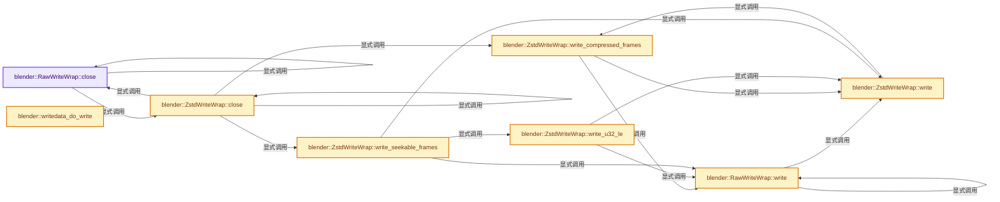
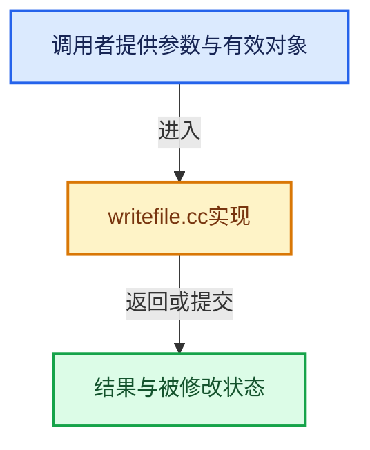

# 实现依赖专题：source/blender/blenloader/intern/writefile.cc

[实现依赖导航](../../../README.md) · [符号索引](../../../../00-课程指南/02-源码与提交索引/符号依赖与实现索引.md)

本专题从正文实际调用进入，集中保存共享实现。函数有稳定锚点，可从调用处直接跳到对应完整函数；递归与互相调用通过回链组织。

## 本文件的实现关系






## 完整成员与函数实现

<a id="f-919e29e563ebcf8c"></a>

### `blender::RawWriteWrap::close`

实现位置：[source/blender/blenloader/intern/writefile.cc](../../../../../../../../source/blender/blenloader/intern/writefile.cc) · L214—L217。

**教学注释版**

<!-- annotated:5abff8dbece9c5 -->

```cpp
bool RawWriteWrap::close()
{
  return (::close(file_handle) != -1);
}
```

<details>
<summary>核对原始源码：source/blender/blenloader/intern/writefile.cc · L214—L217</summary>

<!-- original:5abff8dbece9c5:source/blender/blenloader/intern/writefile.cc:214:217 -->

```cpp
bool RawWriteWrap::close()
{
  return (::close(file_handle) != -1);
}
```

</details>

**结果出口**

- `return (::close(file_handle) != -1);`

**继续追踪实现**

- `::close` → [blender::RawWriteWrap::close · L214](writefile.cc.md#f-919e29e563ebcf8c)；[blender::ZstdWriteWrap::close · L404](writefile.cc.md#f-78aad228a13e69b9)。同名重载需按实参类型选择。

<a id="f-b8864eef93e647d7"></a>

### `blender::RawWriteWrap::write`

实现位置：[source/blender/blenloader/intern/writefile.cc](../../../../../../../../source/blender/blenloader/intern/writefile.cc) · L218—L221。

接口参数：

- `const void *buf`
- `size_t buf_len`

**教学注释版**

<!-- annotated:3081a690a8abb7 -->

```cpp
bool RawWriteWrap::write(const void *buf, size_t buf_len)
{
  return ::write(file_handle, buf, buf_len) == buf_len;
}
```

<details>
<summary>核对原始源码：source/blender/blenloader/intern/writefile.cc · L218—L221</summary>

<!-- original:3081a690a8abb7:source/blender/blenloader/intern/writefile.cc:218:221 -->

```cpp
bool RawWriteWrap::write(const void *buf, size_t buf_len)
{
  return ::write(file_handle, buf, buf_len) == buf_len;
}
```

</details>

**结果出口**

- `return ::write(file_handle, buf, buf_len) == buf_len;`

**继续追踪实现**

- `::write` → [blender::RawWriteWrap::write · L218](writefile.cc.md#f-b8864eef93e647d7)；[blender::ZstdWriteWrap::write · L419](writefile.cc.md#f-5607b0c448a53c31)。同名重载需按实参类型选择。

<a id="f-c3aba60170aad513"></a>

### `blender::ZstdWriteWrap::write_compressed_frames`

实现位置：[source/blender/blenloader/intern/writefile.cc](../../../../../../../../source/blender/blenloader/intern/writefile.cc) · L334—L354。

**教学注释版**

<!-- annotated:529a8f71240734 -->

```cpp
void ZstdWriteWrap::write_compressed_frames()
{
  /* Loop over all pending frames in the correct ascendant order, and write them on disk until we
   * reach one which has not yet available compressed data. */
  // [讲解] frames.as_span：构造对当前有效元素区间的借用视图。
  for (const std::unique_ptr<ZstdFrame> &frame : frames.as_span().drop_front(next_frame)) {
    if (!frame->compressed_done) {
      /* This frame has not yet been compressed, cannot write further data. */
      break;
    }
    if (!write_error) [[likely]] {
      BLI_assert(frame->compressed_size > 0);
      const bool has_error = !base_wrap.write(frame->compressed_data, frame->compressed_size);
      if (has_error) [[unlikely]] {
        write_error = true;
      }
    }
    next_frame++;
    BLI_assert(frame->uncompressed_data == nullptr);
    MEM_SAFE_DELETE_VOID(frame->compressed_data);
  }
}
```

<details>
<summary>核对原始源码：source/blender/blenloader/intern/writefile.cc · L334—L354</summary>

<!-- original:529a8f71240734:source/blender/blenloader/intern/writefile.cc:334:354 -->

```cpp
void ZstdWriteWrap::write_compressed_frames()
{
  /* Loop over all pending frames in the correct ascendant order, and write them on disk until we
   * reach one which has not yet available compressed data. */
  for (const std::unique_ptr<ZstdFrame> &frame : frames.as_span().drop_front(next_frame)) {
    if (!frame->compressed_done) {
      /* This frame has not yet been compressed, cannot write further data. */
      break;
    }
    if (!write_error) [[likely]] {
      BLI_assert(frame->compressed_size > 0);
      const bool has_error = !base_wrap.write(frame->compressed_data, frame->compressed_size);
      if (has_error) [[unlikely]] {
        write_error = true;
      }
    }
    next_frame++;
    BLI_assert(frame->uncompressed_data == nullptr);
    MEM_SAFE_DELETE_VOID(frame->compressed_data);
  }
}
```

</details>

**沿实际写入检查状态**

- `write_error = true;`

**继续追踪实现**

- `frames.as_span().drop_front` → [调用协议](../../../../00-课程指南/01-路线与规范/模板宏与动态分派协议.md)：接收对象类型依赖auto、返回值或模板实例；不按同名猜测目标。调用位置L338。
- `frames.as_span` → [blender::Vector::as_span · L390](../../../../01-基础容器与现代CPP/10-Vector扩容与增长.md#f-e2eed03cefcdd2ff)。
- `BLI_assert` → [BLI_assert · L48](../../../01-BLI基础库/BLI_assert.hh.md#m-57a88495704d)；[BLI_assert · L63](../../../01-BLI基础库/BLI_assert.hh.md#m-d07050020cb5)。宏定义由构建条件选择。
- `base_wrap.write` → [blender::RawWriteWrap::write · L218](writefile.cc.md#f-b8864eef93e647d7)；[blender::ZstdWriteWrap::write · L419](writefile.cc.md#f-5607b0c448a53c31)。同名重载需按实参类型选择。
- `MEM_SAFE_DELETE_VOID` → [MEM_SAFE_DELETE_VOID · L448](../../../07-Intern运行时与平台/guardedalloc/MEM_guardedalloc.h.md#m-66e7eff3d7bc)。宏定义由构建条件选择。

<a id="f-69004e03e7b7e947"></a>

### `blender::ZstdWriteWrap::write_u32_le`

实现位置：[source/blender/blenloader/intern/writefile.cc](../../../../../../../../source/blender/blenloader/intern/writefile.cc) · L367—L373。

接口参数：

- `uint32_t val`

**教学注释版**

<!-- annotated:133d3578f73203 -->

```cpp
void ZstdWriteWrap::write_u32_le(uint32_t val)
{
  /* NOTE: this is endianness-sensitive.
   * This value must always be written as little-endian. */
  BLI_assert(ENDIAN_ORDER == L_ENDIAN);
  base_wrap.write(&val, sizeof(uint32_t));
}
```

<details>
<summary>核对原始源码：source/blender/blenloader/intern/writefile.cc · L367—L373</summary>

<!-- original:133d3578f73203:source/blender/blenloader/intern/writefile.cc:367:373 -->

```cpp
void ZstdWriteWrap::write_u32_le(uint32_t val)
{
  /* NOTE: this is endianness-sensitive.
   * This value must always be written as little-endian. */
  BLI_assert(ENDIAN_ORDER == L_ENDIAN);
  base_wrap.write(&val, sizeof(uint32_t));
}
```

</details>

**继续追踪实现**

- `BLI_assert` → [BLI_assert · L48](../../../01-BLI基础库/BLI_assert.hh.md#m-57a88495704d)；[BLI_assert · L63](../../../01-BLI基础库/BLI_assert.hh.md#m-d07050020cb5)。宏定义由构建条件选择。
- `base_wrap.write` → [blender::RawWriteWrap::write · L218](writefile.cc.md#f-b8864eef93e647d7)；[blender::ZstdWriteWrap::write · L419](writefile.cc.md#f-5607b0c448a53c31)。同名重载需按实参类型选择。

<a id="f-74ec81e6d4433311"></a>

### `blender::ZstdWriteWrap::write_seekable_frames`

实现位置：[source/blender/blenloader/intern/writefile.cc](../../../../../../../../source/blender/blenloader/intern/writefile.cc) · L375—L402。

**教学注释版**

<!-- annotated:ec399526938e4f -->

```cpp
void ZstdWriteWrap::write_seekable_frames()
{
  if (write_error) [[unlikely]] {
    /* Do not write a seek table if the data itself could not be fully written. */
    return;
  }

  /* Write seek table header (magic number and frame size). */
  write_u32_le(0x184D2A5E);

  // [讲解] frames.size：用end_减begin_得到活元素数量。
  const uint32_t num_frames = uint32_t(frames.size());
  /* Each frame consists of two u32, so 8 bytes each.
   * After the frames, a footer containing two u32 and one byte (9 bytes total) is written. */
  const uint32_t frame_size = num_frames * 8 + 9;
  write_u32_le(frame_size);

  /* Write seek table entries. */
  for (const std::unique_ptr<ZstdFrame> &frame : frames) {
    write_u32_le(frame->compressed_size);
    write_u32_le(frame->uncompressed_size);
  }

  /* Write seek table footer (number of frames, option flags and second magic number). */
  write_u32_le(num_frames);
  const char flags = 0; /* We don't store checksums for each frame. */
  base_wrap.write(&flags, 1);
  write_u32_le(0x8F92EAB1);
}
```

<details>
<summary>核对原始源码：source/blender/blenloader/intern/writefile.cc · L375—L402</summary>

<!-- original:ec399526938e4f:source/blender/blenloader/intern/writefile.cc:375:402 -->

```cpp
void ZstdWriteWrap::write_seekable_frames()
{
  if (write_error) [[unlikely]] {
    /* Do not write a seek table if the data itself could not be fully written. */
    return;
  }

  /* Write seek table header (magic number and frame size). */
  write_u32_le(0x184D2A5E);

  const uint32_t num_frames = uint32_t(frames.size());
  /* Each frame consists of two u32, so 8 bytes each.
   * After the frames, a footer containing two u32 and one byte (9 bytes total) is written. */
  const uint32_t frame_size = num_frames * 8 + 9;
  write_u32_le(frame_size);

  /* Write seek table entries. */
  for (const std::unique_ptr<ZstdFrame> &frame : frames) {
    write_u32_le(frame->compressed_size);
    write_u32_le(frame->uncompressed_size);
  }

  /* Write seek table footer (number of frames, option flags and second magic number). */
  write_u32_le(num_frames);
  const char flags = 0; /* We don't store checksums for each frame. */
  base_wrap.write(&flags, 1);
  write_u32_le(0x8F92EAB1);
}
```

</details>

**继续追踪实现**

- `write_u32_le` → [blender::ZstdWriteWrap::write_u32_le · L367](writefile.cc.md#f-69004e03e7b7e947)。
- `frames.size` → [blender::Vector::size · L780](../../../../01-基础容器与现代CPP/11-Vector插入删除与重排.md#f-714773731767349c)。
- `base_wrap.write` → [blender::RawWriteWrap::write · L218](writefile.cc.md#f-b8864eef93e647d7)；[blender::ZstdWriteWrap::write · L419](writefile.cc.md#f-5607b0c448a53c31)。同名重载需按实参类型选择。

<a id="f-78aad228a13e69b9"></a>

### `blender::ZstdWriteWrap::close`

实现位置：[source/blender/blenloader/intern/writefile.cc](../../../../../../../../source/blender/blenloader/intern/writefile.cc) · L404—L417。

**教学注释版**

<!-- annotated:977e9443ec50e7 -->

```cpp
bool ZstdWriteWrap::close()
{
  BLI_task_pool_work_and_wait(pool);
  BLI_task_pool_free(pool);
  pool = nullptr;

  write_compressed_frames();
  // [讲解] frames.size：用end_减begin_得到活元素数量。
  BLI_assert(next_frame == frames.size());

  write_seekable_frames();
  // [讲解] frames.clear：销毁所有有效元素，把size变为0，但保留原分配或内嵌容量。
  frames.clear();

  return base_wrap.close() && !write_error;
}
```

<details>
<summary>核对原始源码：source/blender/blenloader/intern/writefile.cc · L404—L417</summary>

<!-- original:977e9443ec50e7:source/blender/blenloader/intern/writefile.cc:404:417 -->

```cpp
bool ZstdWriteWrap::close()
{
  BLI_task_pool_work_and_wait(pool);
  BLI_task_pool_free(pool);
  pool = nullptr;

  write_compressed_frames();
  BLI_assert(next_frame == frames.size());

  write_seekable_frames();
  frames.clear();

  return base_wrap.close() && !write_error;
}
```

</details>

**沿实际写入检查状态**

- `pool = nullptr;`

**结果出口**

- `return base_wrap.close() && !write_error;`

**继续追踪实现**

- `BLI_task_pool_work_and_wait` → [BLI_task_pool_work_and_wait · L455](../../../../11-Depsgraph与并行任务系统/07-任务池与TBB接入.md#f-cece9e6aa22a9121)。
- `BLI_task_pool_free` → [BLI_task_pool_free · L441](../../../../11-Depsgraph与并行任务系统/07-任务池与TBB接入.md#f-b9af08e8b1362aaa)。
- `write_compressed_frames` → [blender::ZstdWriteWrap::write_compressed_frames · L334](writefile.cc.md#f-c3aba60170aad513)。
- `BLI_assert` → [BLI_assert · L48](../../../01-BLI基础库/BLI_assert.hh.md#m-57a88495704d)；[BLI_assert · L63](../../../01-BLI基础库/BLI_assert.hh.md#m-d07050020cb5)。宏定义由构建条件选择。
- `frames.size` → [blender::Vector::size · L780](../../../../01-基础容器与现代CPP/11-Vector插入删除与重排.md#f-714773731767349c)。
- `write_seekable_frames` → [blender::ZstdWriteWrap::write_seekable_frames · L375](writefile.cc.md#f-74ec81e6d4433311)。
- `frames.clear` → [blender::Vector::clear · L468](../../../../01-基础容器与现代CPP/10-Vector扩容与增长.md#f-d051bebff5275a43)。
- `base_wrap.close` → [blender::RawWriteWrap::close · L214](writefile.cc.md#f-919e29e563ebcf8c)；[blender::ZstdWriteWrap::close · L404](writefile.cc.md#f-78aad228a13e69b9)。同名重载需按实参类型选择。

<a id="f-5607b0c448a53c31"></a>

### `blender::ZstdWriteWrap::write`

实现位置：[source/blender/blenloader/intern/writefile.cc](../../../../../../../../source/blender/blenloader/intern/writefile.cc) · L419—L438。

接口参数：

- `const void *buf`
- `const size_t buf_len`

**教学注释版**

<!-- annotated:53f51607b38766 -->

```cpp
bool ZstdWriteWrap::write(const void *buf, const size_t buf_len)
{
  if (write_error) [[unlikely]] {
    return false;
  }

  void *uncompressed_data = MEM_new_uninitialized(buf_len, __func__);
  // [讲解] memcpy：复制字节，源与目标不应重叠。类型生命周期、对齐和可复制表示须由调用者证明，不是任意对象的复制构造。
  memcpy(uncompressed_data, buf, buf_len);

  // [讲解] std::make_unique<ZstdFrame>：创建独占拥有的对象，拥有关系可移动，get返回的借用指针不自动延长寿命。
  auto task = std::make_unique<ZstdFrame>();
  task->uncompressed_data = uncompressed_data;
  task->uncompressed_size = uint32_t(buf_len);
  ZstdFrame *frame_p = task.get();

  // [讲解] frames.append：在尾部建立新元素，必要时先扩大存储。
  frames.append(std::move(task));
  BLI_task_pool_push(pool, compress_task_run, frame_p, false, nullptr);

  write_compressed_frames();
  return true;
}
```

<details>
<summary>核对原始源码：source/blender/blenloader/intern/writefile.cc · L419—L438</summary>

<!-- original:53f51607b38766:source/blender/blenloader/intern/writefile.cc:419:438 -->

```cpp
bool ZstdWriteWrap::write(const void *buf, const size_t buf_len)
{
  if (write_error) [[unlikely]] {
    return false;
  }

  void *uncompressed_data = MEM_new_uninitialized(buf_len, __func__);
  memcpy(uncompressed_data, buf, buf_len);

  auto task = std::make_unique<ZstdFrame>();
  task->uncompressed_data = uncompressed_data;
  task->uncompressed_size = uint32_t(buf_len);
  ZstdFrame *frame_p = task.get();

  frames.append(std::move(task));
  BLI_task_pool_push(pool, compress_task_run, frame_p, false, nullptr);

  write_compressed_frames();
  return true;
}
```

</details>

**沿实际写入检查状态**

- `task->uncompressed_data = uncompressed_data;`
- `task->uncompressed_size = uint32_t(buf_len);`

**结果出口**

- `return false;`
- `return true;`

**继续追踪实现**

- `MEM_new_uninitialized` → [MEM_new_uninitialized · L590](../../../07-Intern运行时与平台/guardedalloc/MEM_guardedalloc.h.md#f-c773b2e5b8fe70e4)；[MEM_new_uninitialized · L124](../../../07-Intern运行时与平台/guardedalloc/intern/mallocn.cc.md#f-28a7e00a1e67f699)。同名重载需按实参类型选择。
- `memcpy` → [外部契约](https://eel.is/c++draft/cstring.syn)：复制字节，源与目标不应重叠。类型生命周期、对齐和可复制表示须由调用者证明，不是任意对象的复制构造。
- `std::make_unique<ZstdFrame>` → [外部契约](https://eel.is/c++draft/unique.ptr.create)：创建独占拥有的对象，拥有关系可移动，get返回的借用指针不自动延长寿命。
- `task.get` → [调用协议](../../../../00-课程指南/01-路线与规范/模板宏与动态分派协议.md)：接收对象类型依赖auto、返回值或模板实例；不按同名猜测目标。调用位置L431。
- `frames.append` → [blender::Vector::append · L498](../../../../01-基础容器与现代CPP/11-Vector插入删除与重排.md#f-5bde268a69e443ec)；[blender::Vector::append · L502](../../../../01-基础容器与现代CPP/11-Vector插入删除与重排.md#f-591e0b15e6308532)。同名重载需按实参类型选择。
- `std::move` → [外部契约](https://eel.is/c++draft/utility.forward)：把表达式转换成可供移动重载选择的值类别；不保证真的移动，不结束源对象寿命，对const值可能选择复制。
- `BLI_task_pool_push` → [BLI_task_pool_push · L446](../../../../11-Depsgraph与并行任务系统/07-任务池与TBB接入.md#f-16c248b3ea6653d2)。
- `write_compressed_frames` → [blender::ZstdWriteWrap::write_compressed_frames · L334](writefile.cc.md#f-c3aba60170aad513)。

<a id="f-855d91805cca5856"></a>

### `blender::writedata_do_write`

实现位置：[source/blender/blenloader/intern/writefile.cc](../../../../../../../../source/blender/blenloader/intern/writefile.cc) · L472—L496。

接口参数：

- `WriteData *wd`
- `const void *mem`
- `const size_t memlen`

**教学注释版**

<!-- annotated:2d99c34076c46f -->

```cpp
static void writedata_do_write(WriteData *wd, const void *mem, const size_t memlen)
{
  if ((wd == nullptr) || wd->validation_data.critical_error || (mem == nullptr) || memlen < 1) {
    return;
  }

  if (memlen > INT_MAX) {
    BLI_assert_msg(0, "Cannot write chunks bigger than INT_MAX.");
    return;
  }

  if (wd->validation_data.critical_error) [[unlikely]] {
    return;
  }

  /* Memory based save. */
  if (wd->use_memfile) {
    BLO_memfile_chunk_add(&wd->mem, static_cast<const char *>(mem), memlen);
  }
  else {
    if (!wd->ww->write(mem, memlen)) {
      wd->validation_data.critical_error = true;
    }
  }
}
```

<details>
<summary>核对原始源码：source/blender/blenloader/intern/writefile.cc · L472—L496</summary>

<!-- original:2d99c34076c46f:source/blender/blenloader/intern/writefile.cc:472:496 -->

```cpp
static void writedata_do_write(WriteData *wd, const void *mem, const size_t memlen)
{
  if ((wd == nullptr) || wd->validation_data.critical_error || (mem == nullptr) || memlen < 1) {
    return;
  }

  if (memlen > INT_MAX) {
    BLI_assert_msg(0, "Cannot write chunks bigger than INT_MAX.");
    return;
  }

  if (wd->validation_data.critical_error) [[unlikely]] {
    return;
  }

  /* Memory based save. */
  if (wd->use_memfile) {
    BLO_memfile_chunk_add(&wd->mem, static_cast<const char *>(mem), memlen);
  }
  else {
    if (!wd->ww->write(mem, memlen)) {
      wd->validation_data.critical_error = true;
    }
  }
}
```

</details>

**沿实际写入检查状态**

- `wd->validation_data.critical_error = true;`

**继续追踪实现**

- `BLI_assert_msg` → [BLI_assert_msg · L55](../../../01-BLI基础库/BLI_assert.hh.md#m-695eed20dceb)；[BLI_assert_msg · L64](../../../01-BLI基础库/BLI_assert.hh.md#m-7de5563de4db)。宏定义由构建条件选择。
- `BLO_memfile_chunk_add` → [blender::BLO_memfile_chunk_add · L135](undofile.cc.md#f-69214f2a3cf341ed)。
- `wd->ww->write` → [调用协议](../../../../00-课程指南/01-路线与规范/模板宏与动态分派协议.md)：接收对象类型依赖auto、返回值或模板实例；不按同名猜测目标。调用位置L492。

<a id="f-b4b2b5ba9ae900b3"></a>

### `blender::mywrite`

实现位置：[source/blender/blenloader/intern/writefile.cc](../../../../../../../../source/blender/blenloader/intern/writefile.cc) · L529—L576。

接口参数：

- `WriteData *wd`
- `const void *adr`
- `size_t len`

**教学注释版**

<!-- annotated:e03fd5a6894ba3 -->

```cpp
static void mywrite(WriteData *wd, const void *adr, size_t len)
{
  if (wd->validation_data.critical_error) [[unlikely]] {
    return;
  }

  if (adr == nullptr) [[unlikely]] {
    BLI_assert(0);
    return;
  }

#ifdef USE_WRITE_DATA_LEN
  wd->write_len += len;
#endif

  if (wd->buffer.buf == nullptr) {
    writedata_do_write(wd, adr, len);
  }
  else {
    /* If we have a single big chunk, write existing data in
     * buffer and write out big chunk in smaller pieces. */
    if (len > wd->buffer.chunk_size) {
      if (wd->buffer.used_len != 0) {
        writedata_do_write(wd, wd->buffer.buf, wd->buffer.used_len);
        wd->buffer.used_len = 0;
      }

      do {
        // [讲解] std::min：按比较关系选取较小值；截断范围时还需先满足非负和可表示范围，min本身不会证明边界安全。
        const size_t writelen = std::min(len, wd->buffer.chunk_size);
        writedata_do_write(wd, adr, writelen);
        adr = static_cast<const char *>(adr) + writelen;
        len -= writelen;
      } while (len > 0);

      return;
    }

    /* If data would overflow buffer, write out the buffer. */
    if (len + wd->buffer.used_len > wd->buffer.max_size - 1) {
      writedata_do_write(wd, wd->buffer.buf, wd->buffer.used_len);
      wd->buffer.used_len = 0;
    }

    /* Append data at end of buffer. */
    // [讲解] memcpy：复制字节，源与目标不应重叠。类型生命周期、对齐和可复制表示须由调用者证明，不是任意对象的复制构造。
    memcpy(&wd->buffer.buf[wd->buffer.used_len], adr, len);
    wd->buffer.used_len += len;
  }
}
```

<details>
<summary>核对原始源码：source/blender/blenloader/intern/writefile.cc · L529—L576</summary>

<!-- original:e03fd5a6894ba3:source/blender/blenloader/intern/writefile.cc:529:576 -->

```cpp
static void mywrite(WriteData *wd, const void *adr, size_t len)
{
  if (wd->validation_data.critical_error) [[unlikely]] {
    return;
  }

  if (adr == nullptr) [[unlikely]] {
    BLI_assert(0);
    return;
  }

#ifdef USE_WRITE_DATA_LEN
  wd->write_len += len;
#endif

  if (wd->buffer.buf == nullptr) {
    writedata_do_write(wd, adr, len);
  }
  else {
    /* If we have a single big chunk, write existing data in
     * buffer and write out big chunk in smaller pieces. */
    if (len > wd->buffer.chunk_size) {
      if (wd->buffer.used_len != 0) {
        writedata_do_write(wd, wd->buffer.buf, wd->buffer.used_len);
        wd->buffer.used_len = 0;
      }

      do {
        const size_t writelen = std::min(len, wd->buffer.chunk_size);
        writedata_do_write(wd, adr, writelen);
        adr = static_cast<const char *>(adr) + writelen;
        len -= writelen;
      } while (len > 0);

      return;
    }

    /* If data would overflow buffer, write out the buffer. */
    if (len + wd->buffer.used_len > wd->buffer.max_size - 1) {
      writedata_do_write(wd, wd->buffer.buf, wd->buffer.used_len);
      wd->buffer.used_len = 0;
    }

    /* Append data at end of buffer. */
    memcpy(&wd->buffer.buf[wd->buffer.used_len], adr, len);
    wd->buffer.used_len += len;
  }
}
```

</details>

**沿实际写入检查状态**

- `wd->write_len += len;`
- `wd->buffer.used_len = 0;`
- `adr = static_cast<const char *>(adr) + writelen;`
- `len -= writelen;`
- `wd->buffer.used_len += len;`

**继续追踪实现**

- `BLI_assert` → [BLI_assert · L48](../../../01-BLI基础库/BLI_assert.hh.md#m-57a88495704d)；[BLI_assert · L63](../../../01-BLI基础库/BLI_assert.hh.md#m-d07050020cb5)。宏定义由构建条件选择。
- `writedata_do_write` → [blender::writedata_do_write · L472](writefile.cc.md#f-855d91805cca5856)。
- `std::min` → [外部契约](https://eel.is/c++draft/alg.min.max)：按比较关系选取较小值；截断范围时还需先满足非负和可表示范围，min本身不会证明边界安全。
- `memcpy` → [外部契约](https://eel.is/c++draft/cstring.syn)：复制字节，源与目标不应重叠。类型生命周期、对齐和可复制表示须由调用者证明，不是任意对象的复制构造。

<a id="f-0c9ece9cb55ddd22"></a>

### `blender::write_at_address_validate`

实现位置：[source/blender/blenloader/intern/writefile.cc](../../../../../../../../source/blender/blenloader/intern/writefile.cc) · L761—L777。

接口参数：

- `WriteData *wd`
- `const int filecode`
- `const void *address`

**教学注释版**

<!-- annotated:efa89f6a8d0051 -->

```cpp
static bool write_at_address_validate(WriteData *wd, const int filecode, const void *address)
{
  /* Skip in undo case. */
  if (wd->use_memfile) {
    return true;
  }

  if (wd->is_writing_id && filecode == BLO_CODE_DATA) {
    if (!wd->validation_data.per_id_addresses_set.add(address)) {
      CLOG_ERROR(&LOG,
                 "Same identifier (old address) used several times for a same ID, skipping this "
                 "block to avoid critical corruption of the Blender file.");
      return false;
    }
  }
  return true;
}
```

<details>
<summary>核对原始源码：source/blender/blenloader/intern/writefile.cc · L761—L777</summary>

<!-- original:efa89f6a8d0051:source/blender/blenloader/intern/writefile.cc:761:777 -->

```cpp
static bool write_at_address_validate(WriteData *wd, const int filecode, const void *address)
{
  /* Skip in undo case. */
  if (wd->use_memfile) {
    return true;
  }

  if (wd->is_writing_id && filecode == BLO_CODE_DATA) {
    if (!wd->validation_data.per_id_addresses_set.add(address)) {
      CLOG_ERROR(&LOG,
                 "Same identifier (old address) used several times for a same ID, skipping this "
                 "block to avoid critical corruption of the Blender file.");
      return false;
    }
  }
  return true;
}
```

</details>

**结果出口**

- `return true;`
- `return false;`

**继续追踪实现**

- `wd->validation_data.per_id_addresses_set.add` → [调用协议](../../../../00-课程指南/01-路线与规范/模板宏与动态分派协议.md)：接收对象类型依赖auto、返回值或模板实例；不按同名猜测目标。调用位置L769。
- `CLOG_ERROR` → [CLOG_ERROR · L188](../../../07-Intern运行时与平台/clog/CLG_log.h.md#m-081575cdc8d0)。宏定义由构建条件选择。

<a id="f-a9bee03b4f396441"></a>

### `blender::write_bhead`

实现位置：[source/blender/blenloader/intern/writefile.cc](../../../../../../../../source/blender/blenloader/intern/writefile.cc) · L779—L814。

接口参数：

- `WriteData *wd`
- `const BHead &bhead`

**教学注释版**

<!-- annotated:76ceed6581a6b3 -->

```cpp
static void write_bhead(WriteData *wd, const BHead &bhead)
{
  if constexpr (sizeof(void *) == 4) {
    /* Always write #BHead4 in 32 bit builds. */
    BHead4 bh;
    bh.code = bhead.code;
    bh.old = uint32_t(uintptr_t(bhead.old));
    bh.nr = bhead.nr;
    bh.SDNAnr = bhead.SDNAnr;
    bh.len = bhead.len;
    mywrite(wd, &bh, sizeof(bh));
    return;
  }
  /* Write new #LargeBHead8 headers if enabled. Older Blender versions can't read those. */
  if (!USER_DEVELOPER_TOOL_TEST(&U, write_legacy_blend_file_format)) {
    if (SYSTEM_SUPPORTS_WRITING_FILE_VERSION_1) {
      static_assert(sizeof(BHead) == sizeof(LargeBHead8));
      mywrite(wd, &bhead, sizeof(bhead));
      return;
    }
  }
  /* Write older #SmallBHead8 headers so that Blender versions that don't support #LargeBHead8 can
   * read the file. */
  SmallBHead8 bh;
  bh.code = bhead.code;
  bh.old = uint64_t(bhead.old);
  bh.nr = bhead.nr;
  bh.SDNAnr = bhead.SDNAnr;
  bh.len = bhead.len;
  /* Check that the written buffer size is compatible with the limits of #SmallBHead8. */
  // [讲解] std::numeric_limits<decltype(bh.len)>::max：按比较关系选取较大值。本讲解中的增长公式同时满足最低请求和几何增长；若保存返回引用，还需注意实参寿命。
  if (bhead.len > std::numeric_limits<decltype(bh.len)>::max()) {
    CLOG_ERROR(&LOG, "Written .blend file is corrupt, because a memory block is too large.");
    return;
  }
  mywrite(wd, &bh, sizeof(bh));
}
```

<details>
<summary>核对原始源码：source/blender/blenloader/intern/writefile.cc · L779—L814</summary>

<!-- original:76ceed6581a6b3:source/blender/blenloader/intern/writefile.cc:779:814 -->

```cpp
static void write_bhead(WriteData *wd, const BHead &bhead)
{
  if constexpr (sizeof(void *) == 4) {
    /* Always write #BHead4 in 32 bit builds. */
    BHead4 bh;
    bh.code = bhead.code;
    bh.old = uint32_t(uintptr_t(bhead.old));
    bh.nr = bhead.nr;
    bh.SDNAnr = bhead.SDNAnr;
    bh.len = bhead.len;
    mywrite(wd, &bh, sizeof(bh));
    return;
  }
  /* Write new #LargeBHead8 headers if enabled. Older Blender versions can't read those. */
  if (!USER_DEVELOPER_TOOL_TEST(&U, write_legacy_blend_file_format)) {
    if (SYSTEM_SUPPORTS_WRITING_FILE_VERSION_1) {
      static_assert(sizeof(BHead) == sizeof(LargeBHead8));
      mywrite(wd, &bhead, sizeof(bhead));
      return;
    }
  }
  /* Write older #SmallBHead8 headers so that Blender versions that don't support #LargeBHead8 can
   * read the file. */
  SmallBHead8 bh;
  bh.code = bhead.code;
  bh.old = uint64_t(bhead.old);
  bh.nr = bhead.nr;
  bh.SDNAnr = bhead.SDNAnr;
  bh.len = bhead.len;
  /* Check that the written buffer size is compatible with the limits of #SmallBHead8. */
  if (bhead.len > std::numeric_limits<decltype(bh.len)>::max()) {
    CLOG_ERROR(&LOG, "Written .blend file is corrupt, because a memory block is too large.");
    return;
  }
  mywrite(wd, &bh, sizeof(bh));
}
```

</details>

**沿实际写入检查状态**

- `bh.code = bhead.code;`
- `bh.old = uint32_t(uintptr_t(bhead.old));`
- `bh.nr = bhead.nr;`
- `bh.SDNAnr = bhead.SDNAnr;`
- `bh.len = bhead.len;`
- `bh.old = uint64_t(bhead.old);`

**继续追踪实现**

- `mywrite` → [blender::mywrite · L529](writefile.cc.md#f-b4b2b5ba9ae900b3)。
- `USER_DEVELOPER_TOOL_TEST` → [USER_DEVELOPER_TOOL_TEST · L926](../../makesdna/DNA_userdef_types.h.md#m-86dc117d0e84)。宏定义由构建条件选择。
- `std::numeric_limits<decltype(bh.len)>::max` → [外部契约](https://eel.is/c++draft/alg.min.max)：按比较关系选取较大值。本讲解中的增长公式同时满足最低请求和几何增长；若保存返回引用，还需注意实参寿命。
- `CLOG_ERROR` → [CLOG_ERROR · L188](../../../07-Intern运行时与平台/clog/CLG_log.h.md#m-081575cdc8d0)。宏定义由构建条件选择。

<a id="f-364cd22f5de45bf6"></a>

### `blender::stable_id_from_hint`

实现位置：[source/blender/blenloader/intern/writefile.cc](../../../../../../../../source/blender/blenloader/intern/writefile.cc) · L824—L837。

接口参数：

- `const uint64_t hint`

**教学注释版**

<!-- annotated:bf4751d6a5a190 -->

```cpp
static uint64_t stable_id_from_hint(const uint64_t hint)
{
  /* Add a stride. This is not strictly necessary but may help with debugging later on because it's
   * easier to identify bad ids. */
  uint64_t stable_id = hint << 4;
  if (stable_id == 0) {
    /* Null values are reserved for nullptr. */
    stable_id = (1 << 4);
  }
  /* Remove the first bits, which are reserved for certain types of generated values (like
   * actual stable ids used in some cases when writing undo steps). */
  stable_id &= ~generated_address_id_mask;
  return stable_id;
}
```

<details>
<summary>核对原始源码：source/blender/blenloader/intern/writefile.cc · L824—L837</summary>

<!-- original:bf4751d6a5a190:source/blender/blenloader/intern/writefile.cc:824:837 -->

```cpp
static uint64_t stable_id_from_hint(const uint64_t hint)
{
  /* Add a stride. This is not strictly necessary but may help with debugging later on because it's
   * easier to identify bad ids. */
  uint64_t stable_id = hint << 4;
  if (stable_id == 0) {
    /* Null values are reserved for nullptr. */
    stable_id = (1 << 4);
  }
  /* Remove the first bits, which are reserved for certain types of generated values (like
   * actual stable ids used in some cases when writing undo steps). */
  stable_id &= ~generated_address_id_mask;
  return stable_id;
}
```

</details>

**沿实际写入检查状态**

- `stable_id = (1 << 4);`
- `stable_id &= ~generated_address_id_mask;`

**结果出口**

- `return stable_id;`

**继续追踪实现**

本实现没有需要继续展开的显式调用；检查返回表达式、对象转换和调用者前置条件。

<a id="f-324e3e5e38c53cf1"></a>

### `blender::get_next_stable_address_id`

实现位置：[source/blender/blenloader/intern/writefile.cc](../../../../../../../../source/blender/blenloader/intern/writefile.cc) · L839—L851。

接口参数：

- `WriteData &wd`
- `uint64_t &hint`

**教学注释版**

<!-- annotated:e350786434d36f -->

```cpp
static uint64_t get_next_stable_address_id(WriteData &wd, uint64_t &hint)
{
  uint64_t stable_id = stable_id_from_hint(hint);
  while (!wd.stable_address_ids.used_ids.add(stable_id)) {
    /* Generate a new hint because there is a collision. Collisions are generally expected to be
     * very rare. It can happen when #get_stable_pointer_hint_for_id produces values that are very
     * close for different IDs. */
    hint = XXH3_64bits(&hint, sizeof(uint64_t));
    stable_id = stable_id_from_hint(hint);
  }
  hint++;
  return stable_id;
}
```

<details>
<summary>核对原始源码：source/blender/blenloader/intern/writefile.cc · L839—L851</summary>

<!-- original:e350786434d36f:source/blender/blenloader/intern/writefile.cc:839:851 -->

```cpp
static uint64_t get_next_stable_address_id(WriteData &wd, uint64_t &hint)
{
  uint64_t stable_id = stable_id_from_hint(hint);
  while (!wd.stable_address_ids.used_ids.add(stable_id)) {
    /* Generate a new hint because there is a collision. Collisions are generally expected to be
     * very rare. It can happen when #get_stable_pointer_hint_for_id produces values that are very
     * close for different IDs. */
    hint = XXH3_64bits(&hint, sizeof(uint64_t));
    stable_id = stable_id_from_hint(hint);
  }
  hint++;
  return stable_id;
}
```

</details>

**沿实际写入检查状态**

- `hint = XXH3_64bits(&hint, sizeof(uint64_t));`
- `stable_id = stable_id_from_hint(hint);`

**结果出口**

- `return stable_id;`

**继续追踪实现**

- `stable_id_from_hint` → [blender::stable_id_from_hint · L824](writefile.cc.md#f-364cd22f5de45bf6)。
- `wd.stable_address_ids.used_ids.add` → [调用协议](../../../../00-课程指南/01-路线与规范/模板宏与动态分派协议.md)：接收对象类型依赖auto、返回值或模板实例；不按同名猜测目标。调用位置L842。
- `XXH3_64bits` → [调用协议](../../../../00-课程指南/01-路线与规范/模板宏与动态分派协议.md)：函数指针、局部可调用对象或未展开的宏；必须结合调用者环境。调用位置L846。

<a id="f-7b423808597e83b5"></a>

### `blender::get_address_id_int`

实现位置：[source/blender/blenloader/intern/writefile.cc](../../../../../../../../source/blender/blenloader/intern/writefile.cc) · L853—L869。

接口参数：

- `WriteData &wd`
- `const void *address`

**教学注释版**

<!-- annotated:11f1138c7fec6c -->

```cpp
static uint64_t get_address_id_int(WriteData &wd, const void *address)
{
  if (address == nullptr) {
    return 0;
  }
  /* In undo case, addresses are kept as-is, unless they have been tagged by specific functions
   * like `generated_pointer_tag`, in which case their value will already be in the
   * `pointer_map`. */
  if (wd.use_memfile) {
    return wd.stable_address_ids.pointer_map.lookup_default_as(
        address, reinterpret_cast<uint64_t>(address));
  }
  /* Either reuse an existing identifier or create a new one. */
  return wd.stable_address_ids.pointer_map.lookup_or_add_cb(address, [&]() {
    return get_next_stable_address_id(wd, wd.stable_address_ids.next_id_hint);
  });
}
```

<details>
<summary>核对原始源码：source/blender/blenloader/intern/writefile.cc · L853—L869</summary>

<!-- original:11f1138c7fec6c:source/blender/blenloader/intern/writefile.cc:853:869 -->

```cpp
static uint64_t get_address_id_int(WriteData &wd, const void *address)
{
  if (address == nullptr) {
    return 0;
  }
  /* In undo case, addresses are kept as-is, unless they have been tagged by specific functions
   * like `generated_pointer_tag`, in which case their value will already be in the
   * `pointer_map`. */
  if (wd.use_memfile) {
    return wd.stable_address_ids.pointer_map.lookup_default_as(
        address, reinterpret_cast<uint64_t>(address));
  }
  /* Either reuse an existing identifier or create a new one. */
  return wd.stable_address_ids.pointer_map.lookup_or_add_cb(address, [&]() {
    return get_next_stable_address_id(wd, wd.stable_address_ids.next_id_hint);
  });
}
```

</details>

**结果出口**

- `return 0;`
- `return wd.stable_address_ids.pointer_map.lookup_default_as(`
- `return wd.stable_address_ids.pointer_map.lookup_or_add_cb(address, [&]() {`
- `return get_next_stable_address_id(wd, wd.stable_address_ids.next_id_hint);`

**继续追踪实现**

- `wd.stable_address_ids.pointer_map.lookup_default_as` → [调用协议](../../../../00-课程指南/01-路线与规范/模板宏与动态分派协议.md)：接收对象类型依赖auto、返回值或模板实例；不按同名猜测目标。调用位置L862。
- `wd.stable_address_ids.pointer_map.lookup_or_add_cb` → [调用协议](../../../../00-课程指南/01-路线与规范/模板宏与动态分派协议.md)：接收对象类型依赖auto、返回值或模板实例；不按同名猜测目标。调用位置L866。
- `get_next_stable_address_id` → [blender::get_next_stable_address_id · L839](writefile.cc.md#f-324e3e5e38c53cf1)。

<a id="f-3de74bf56d6fedc5"></a>

### `blender::get_address_id`

实现位置：[source/blender/blenloader/intern/writefile.cc](../../../../../../../../source/blender/blenloader/intern/writefile.cc) · L871—L874。

接口参数：

- `WriteData &wd`
- `const void *address`

**教学注释版**

<!-- annotated:a29138132d8573 -->

```cpp
static const void *get_address_id(WriteData &wd, const void *address)
{
  return reinterpret_cast<const void *>(get_address_id_int(wd, address));
}
```

<details>
<summary>核对原始源码：source/blender/blenloader/intern/writefile.cc · L871—L874</summary>

<!-- original:a29138132d8573:source/blender/blenloader/intern/writefile.cc:871:874 -->

```cpp
static const void *get_address_id(WriteData &wd, const void *address)
{
  return reinterpret_cast<const void *>(get_address_id_int(wd, address));
}
```

</details>

**结果出口**

- `return reinterpret_cast<const void *>(get_address_id_int(wd, address));`

**继续追踪实现**

- `get_address_id_int` → [blender::get_address_id_int · L853](writefile.cc.md#f-7b423808597e83b5)。

<a id="f-4274afdf4a662cda"></a>

### `blender::get_address_id_for_undo`

实现位置：[source/blender/blenloader/intern/writefile.cc](../../../../../../../../source/blender/blenloader/intern/writefile.cc) · L885—L889。

接口参数：

- `WriteData &wd`

**教学注释版**

<!-- annotated:b739a2b3730899 -->

```cpp
static uint64_t get_address_id_for_undo(WriteData &wd)
{
  return get_next_stable_address_id(wd, wd.stable_address_ids.next_id_hint) |
         generated_address_id_on_undo_flag;
}
```

<details>
<summary>核对原始源码：source/blender/blenloader/intern/writefile.cc · L885—L889</summary>

<!-- original:b739a2b3730899:source/blender/blenloader/intern/writefile.cc:885:889 -->

```cpp
static uint64_t get_address_id_for_undo(WriteData &wd)
{
  return get_next_stable_address_id(wd, wd.stable_address_ids.next_id_hint) |
         generated_address_id_on_undo_flag;
}
```

</details>

**结果出口**

- `return get_next_stable_address_id(wd, wd.stable_address_ids.next_id_hint) |`

**继续追踪实现**

- `get_next_stable_address_id` → [blender::get_next_stable_address_id · L839](writefile.cc.md#f-324e3e5e38c53cf1)。

<a id="f-c4be47623ecd6f01"></a>

### `blender::writestruct_at_address_nr`

实现位置：[source/blender/blenloader/intern/writefile.cc](../../../../../../../../source/blender/blenloader/intern/writefile.cc) · L891—L984。

接口参数：

- `WriteData *wd`
- `const int filecode`
- `const int struct_nr`
- `const int64_t nr`
- `const void *adr`
- `const void *data`
- `const BlendStructWriterFn fn`

**教学注释版**

<!-- annotated:65c2ce04546b69 -->

```cpp
static void writestruct_at_address_nr(WriteData *wd,
                                      const int filecode,
                                      const int struct_nr,
                                      const int64_t nr,
                                      const void *adr,
                                      const void *data,
                                      const BlendStructWriterFn fn)
{
  BLI_assert(struct_nr > 0 && struct_nr <= dna::sdna_struct_id_get_max());

  if (adr == nullptr || data == nullptr || nr == 0) {
    return;
  }

  if (!write_at_address_validate(wd, filecode, adr)) {
    return;
  }

  const int64_t len_in_bytes = nr * DNA_struct_size(wd->sdna, struct_nr);
  if (!SYSTEM_SUPPORTS_WRITING_FILE_VERSION_1 ||
      USER_DEVELOPER_TOOL_TEST(&U, write_legacy_blend_file_format))
  {
    if (len_in_bytes > INT32_MAX) {
      CLOG_ERROR(&LOG, "Cannot write chunks bigger than INT_MAX.");
      return;
    }
  }

  /* Get the address identifier that will be written to the file. */
  const void *address_id = get_address_id(*wd, adr);

  const void *data_to_write;
  DynamicStackBuffer<16 * 1024> buffer_owner(len_in_bytes, 64);
  const dna::pointers::StructInfo &struct_info =
      wd->stable_address_ids.sdna_pointers->get_for_struct(struct_nr);

  const bool needs_general_pointer_remap = !wd->use_memfile && !struct_info.pointers.is_empty();
  const bool has_custom_fn = bool(fn);
  const bool can_write_raw_runtime_data = !needs_general_pointer_remap && !has_custom_fn;

  if (can_write_raw_runtime_data) {
    /* The passed in data contains no pointers, so it can be written without an additional copy. */
    data_to_write = data;
  }
  else {
    void *buffer = buffer_owner.buffer();
    data_to_write = buffer;
    // [讲解] memcpy：复制字节，源与目标不应重叠。类型生命周期、对齐和可复制表示须由调用者证明，不是任意对象的复制构造。
    memcpy(buffer, data, len_in_bytes);

    /* Optionally allow custom modifications to the struct data before it is written. */
    if (has_custom_fn) {
      for (const int i : IndexRange(nr)) {
        const int offset = i * struct_info.size_in_bytes;
        BlendStructWriterVoid struct_writer(
            *wd,
            struct_nr,
            {static_cast<char *>(POINTER_OFFSET(buffer, offset)), struct_info.size_in_bytes});
        fn(struct_writer);
      }
    }

    /* When writing to file, use stable pointers for everything. */
    if (needs_general_pointer_remap) {
      /* Overwrite pointers with their corresponding address identifiers. */
      for (const int i : IndexRange(nr)) {
        for (const dna::pointers::PointerInfo &pointer_info : struct_info.pointers) {
          const int offset = i * struct_info.size_in_bytes + pointer_info.offset;
          const void **p_ptr = reinterpret_cast<const void **>(POINTER_OFFSET(buffer, offset));
          const void *p_ptr_address_id = get_address_id(*wd, *p_ptr);
          *p_ptr = p_ptr_address_id;
        }
      }
    }
  }

  BHead bh;
  bh.code = filecode;
  bh.old = address_id;
  bh.nr = nr;
  bh.SDNAnr = struct_nr;
  bh.len = len_in_bytes;

  if (bh.len == 0) {
    return;
  }

  if (wd->debug_dst) {
    dna::print_structs_at_address(
        *wd->sdna, struct_nr, data_to_write, address_id, nr, *wd->debug_dst);
  }

  write_bhead(wd, bh);
  mywrite(wd, data_to_write, size_t(bh.len));
}
```

<details>
<summary>核对原始源码：source/blender/blenloader/intern/writefile.cc · L891—L984</summary>

<!-- original:65c2ce04546b69:source/blender/blenloader/intern/writefile.cc:891:984 -->

```cpp
static void writestruct_at_address_nr(WriteData *wd,
                                      const int filecode,
                                      const int struct_nr,
                                      const int64_t nr,
                                      const void *adr,
                                      const void *data,
                                      const BlendStructWriterFn fn)
{
  BLI_assert(struct_nr > 0 && struct_nr <= dna::sdna_struct_id_get_max());

  if (adr == nullptr || data == nullptr || nr == 0) {
    return;
  }

  if (!write_at_address_validate(wd, filecode, adr)) {
    return;
  }

  const int64_t len_in_bytes = nr * DNA_struct_size(wd->sdna, struct_nr);
  if (!SYSTEM_SUPPORTS_WRITING_FILE_VERSION_1 ||
      USER_DEVELOPER_TOOL_TEST(&U, write_legacy_blend_file_format))
  {
    if (len_in_bytes > INT32_MAX) {
      CLOG_ERROR(&LOG, "Cannot write chunks bigger than INT_MAX.");
      return;
    }
  }

  /* Get the address identifier that will be written to the file. */
  const void *address_id = get_address_id(*wd, adr);

  const void *data_to_write;
  DynamicStackBuffer<16 * 1024> buffer_owner(len_in_bytes, 64);
  const dna::pointers::StructInfo &struct_info =
      wd->stable_address_ids.sdna_pointers->get_for_struct(struct_nr);

  const bool needs_general_pointer_remap = !wd->use_memfile && !struct_info.pointers.is_empty();
  const bool has_custom_fn = bool(fn);
  const bool can_write_raw_runtime_data = !needs_general_pointer_remap && !has_custom_fn;

  if (can_write_raw_runtime_data) {
    /* The passed in data contains no pointers, so it can be written without an additional copy. */
    data_to_write = data;
  }
  else {
    void *buffer = buffer_owner.buffer();
    data_to_write = buffer;
    memcpy(buffer, data, len_in_bytes);

    /* Optionally allow custom modifications to the struct data before it is written. */
    if (has_custom_fn) {
      for (const int i : IndexRange(nr)) {
        const int offset = i * struct_info.size_in_bytes;
        BlendStructWriterVoid struct_writer(
            *wd,
            struct_nr,
            {static_cast<char *>(POINTER_OFFSET(buffer, offset)), struct_info.size_in_bytes});
        fn(struct_writer);
      }
    }

    /* When writing to file, use stable pointers for everything. */
    if (needs_general_pointer_remap) {
      /* Overwrite pointers with their corresponding address identifiers. */
      for (const int i : IndexRange(nr)) {
        for (const dna::pointers::PointerInfo &pointer_info : struct_info.pointers) {
          const int offset = i * struct_info.size_in_bytes + pointer_info.offset;
          const void **p_ptr = reinterpret_cast<const void **>(POINTER_OFFSET(buffer, offset));
          const void *p_ptr_address_id = get_address_id(*wd, *p_ptr);
          *p_ptr = p_ptr_address_id;
        }
      }
    }
  }

  BHead bh;
  bh.code = filecode;
  bh.old = address_id;
  bh.nr = nr;
  bh.SDNAnr = struct_nr;
  bh.len = len_in_bytes;

  if (bh.len == 0) {
    return;
  }

  if (wd->debug_dst) {
    dna::print_structs_at_address(
        *wd->sdna, struct_nr, data_to_write, address_id, nr, *wd->debug_dst);
  }

  write_bhead(wd, bh);
  mywrite(wd, data_to_write, size_t(bh.len));
}
```

</details>

**沿实际写入检查状态**

- `data_to_write = data;`
- `data_to_write = buffer;`
- `bh.code = filecode;`
- `bh.old = address_id;`
- `bh.nr = nr;`
- `bh.SDNAnr = struct_nr;`
- `bh.len = len_in_bytes;`

**继续追踪实现**

- `BLI_assert` → [BLI_assert · L48](../../../01-BLI基础库/BLI_assert.hh.md#m-57a88495704d)；[BLI_assert · L63](../../../01-BLI基础库/BLI_assert.hh.md#m-d07050020cb5)。宏定义由构建条件选择。
- `dna::sdna_struct_id_get_max` → [调用协议](../../../../00-课程指南/01-路线与规范/模板宏与动态分派协议.md)：函数指针、局部可调用对象或未展开的宏；必须结合调用者环境。调用位置L899。
- `write_at_address_validate` → [blender::write_at_address_validate · L761](writefile.cc.md#f-0c9ece9cb55ddd22)。
- `DNA_struct_size` → [blender::DNA_struct_size · L132](../../makesdna/intern/dna_genfile.cc.md#f-2d896c5eb6e153ca)。
- `USER_DEVELOPER_TOOL_TEST` → [USER_DEVELOPER_TOOL_TEST · L926](../../makesdna/DNA_userdef_types.h.md#m-86dc117d0e84)。宏定义由构建条件选择。
- `CLOG_ERROR` → [CLOG_ERROR · L188](../../../07-Intern运行时与平台/clog/CLG_log.h.md#m-081575cdc8d0)。宏定义由构建条件选择。
- `get_address_id` → [blender::get_address_id · L871](writefile.cc.md#f-3de74bf56d6fedc5)。
- `wd->stable_address_ids.sdna_pointers->get_for_struct` → [调用协议](../../../../00-课程指南/01-路线与规范/模板宏与动态分派协议.md)：接收对象类型依赖auto、返回值或模板实例；不按同名猜测目标。调用位置L925。
- `struct_info.pointers.is_empty` → [调用协议](../../../../00-课程指南/01-路线与规范/模板宏与动态分派协议.md)：接收对象类型依赖auto、返回值或模板实例；不按同名猜测目标。调用位置L927。
- `buffer_owner.buffer` → [blender::DynamicStackBuffer::buffer · L56](../../../01-BLI基础库/BLI_dynamic_stack_buffer.hh.md#f-2db8d46f5bef65b6)。
- `memcpy` → [外部契约](https://eel.is/c++draft/cstring.syn)：复制字节，源与目标不应重叠。类型生命周期、对齐和可复制表示须由调用者证明，不是任意对象的复制构造。
- `IndexRange` → [blender::IndexRange](../../../01-BLI基础库/BLI_index_range.hh.md#t-caa3466d6776)；[blender::gpu::shader::parser::IndexRange](../../gpu/shader_tool/utils.hh.md#t-82d2bd4ea71c)；[blender::IndexRange](../../makesdna/DNA_node_types.h.md#t-0448cc889d39)。
- `POINTER_OFFSET` → [POINTER_OFFSET · L316](../../../01-BLI基础库/BLI_utildefines.hh.md#m-c812e199f26c)。宏定义由构建条件选择。
- `fn` → [调用协议](../../../../00-课程指南/01-路线与规范/模板宏与动态分派协议.md)：局部可调用对象，须结合其初始化与捕获环境。调用位置L948。
- `dna::print_structs_at_address` → [blender::dna::print_structs_at_address · L2269](../../makesdna/intern/dna_genfile.cc.md#f-0670ca99d6ed6a1a)。
- `write_bhead` → [blender::write_bhead · L779](writefile.cc.md#f-a9bee03b4f396441)。
- `mywrite` → [blender::mywrite · L529](writefile.cc.md#f-b4b2b5ba9ae900b3)。

<a id="f-56a411a03902a3d8"></a>

### `blender::BlendStructWriterVoid::generated_ptr`

实现位置：[source/blender/blenloader/intern/writefile.cc](../../../../../../../../source/blender/blenloader/intern/writefile.cc) · L986—L1009。

接口参数：

- `const int64_t offset`

**教学注释版**

<!-- annotated:d6d4762da86580 -->

```cpp
void BlendStructWriterVoid::generated_ptr(const int64_t offset)
{
  if (!wd_->use_memfile) {
    /* When writing to file, all pointers are remapped to stable pointers. */
    return;
  }
#ifndef NDEBUG
  const dna::pointers::StructInfo &struct_info =
      wd_->stable_address_ids.sdna_pointers->get_for_struct(struct_nr_);
  BLI_assert(struct_info.has_pointer_at_offset(offset));
#else
  UNUSED_VARS_NDEBUG(struct_nr_);
#endif

  /* In undo case, replace generated pointers by corresponding stable pointers. */
  const void **p_ptr = reinterpret_cast<const void **>(POINTER_OFFSET(data_.data(), offset));
  if (!*p_ptr) {
    return;
  }
  /* Should exist if #generated_pointer_tag has been called before. */
  BLI_assert(wd_->stable_address_ids.pointer_map.contains(*p_ptr));
  const void *p_ptr_address_id = get_address_id(*wd_, *p_ptr);
  *p_ptr = p_ptr_address_id;
}
```

<details>
<summary>核对原始源码：source/blender/blenloader/intern/writefile.cc · L986—L1009</summary>

<!-- original:d6d4762da86580:source/blender/blenloader/intern/writefile.cc:986:1009 -->

```cpp
void BlendStructWriterVoid::generated_ptr(const int64_t offset)
{
  if (!wd_->use_memfile) {
    /* When writing to file, all pointers are remapped to stable pointers. */
    return;
  }
#ifndef NDEBUG
  const dna::pointers::StructInfo &struct_info =
      wd_->stable_address_ids.sdna_pointers->get_for_struct(struct_nr_);
  BLI_assert(struct_info.has_pointer_at_offset(offset));
#else
  UNUSED_VARS_NDEBUG(struct_nr_);
#endif

  /* In undo case, replace generated pointers by corresponding stable pointers. */
  const void **p_ptr = reinterpret_cast<const void **>(POINTER_OFFSET(data_.data(), offset));
  if (!*p_ptr) {
    return;
  }
  /* Should exist if #generated_pointer_tag has been called before. */
  BLI_assert(wd_->stable_address_ids.pointer_map.contains(*p_ptr));
  const void *p_ptr_address_id = get_address_id(*wd_, *p_ptr);
  *p_ptr = p_ptr_address_id;
}
```

</details>

**继续追踪实现**

- `wd_->stable_address_ids.sdna_pointers->get_for_struct` → [调用协议](../../../../00-课程指南/01-路线与规范/模板宏与动态分派协议.md)：接收对象类型依赖auto、返回值或模板实例；不按同名猜测目标。调用位置L994。
- `BLI_assert` → [BLI_assert · L48](../../../01-BLI基础库/BLI_assert.hh.md#m-57a88495704d)；[BLI_assert · L63](../../../01-BLI基础库/BLI_assert.hh.md#m-d07050020cb5)。宏定义由构建条件选择。
- `struct_info.has_pointer_at_offset` → [blender::dna::pointers::StructInfo::has_pointer_at_offset · L2077](../../makesdna/intern/dna_genfile.cc.md#f-d84d54384682a1cf)。
- `UNUSED_VARS_NDEBUG` → [UNUSED_VARS_NDEBUG · L526](../../../01-BLI基础库/BLI_utildefines.hh.md#m-fea439f7d366)；[UNUSED_VARS_NDEBUG · L528](../../../01-BLI基础库/BLI_utildefines.hh.md#m-a8f8cfac06c0)。宏定义由构建条件选择。
- `POINTER_OFFSET` → [POINTER_OFFSET · L316](../../../01-BLI基础库/BLI_utildefines.hh.md#m-c812e199f26c)。宏定义由构建条件选择。
- `data_.data` → [调用协议](../../../../00-课程指南/01-路线与规范/模板宏与动态分派协议.md)：接收对象类型依赖auto、返回值或模板实例；不按同名猜测目标。调用位置L1001。
- `wd_->stable_address_ids.pointer_map.contains` → [调用协议](../../../../00-课程指南/01-路线与规范/模板宏与动态分派协议.md)：接收对象类型依赖auto、返回值或模板实例；不按同名猜测目标。调用位置L1006。
- `get_address_id` → [blender::get_address_id · L871](writefile.cc.md#f-3de74bf56d6fedc5)。

<a id="f-7ff3221b68a41fb5"></a>

### `blender::writestruct_nr`

实现位置：[source/blender/blenloader/intern/writefile.cc](../../../../../../../../source/blender/blenloader/intern/writefile.cc) · L1011—L1019。

接口参数：

- `WriteData *wd`
- `const int filecode`
- `const int struct_nr`
- `const int64_t nr`
- `const void *adr`
- `const BlendStructWriterFn fn`

**教学注释版**

<!-- annotated:89ac9dff5bd35e -->

```cpp
static void writestruct_nr(WriteData *wd,
                           const int filecode,
                           const int struct_nr,
                           const int64_t nr,
                           const void *adr,
                           const BlendStructWriterFn fn)
{
  writestruct_at_address_nr(wd, filecode, struct_nr, nr, adr, adr, fn);
}
```

<details>
<summary>核对原始源码：source/blender/blenloader/intern/writefile.cc · L1011—L1019</summary>

<!-- original:89ac9dff5bd35e:source/blender/blenloader/intern/writefile.cc:1011:1019 -->

```cpp
static void writestruct_nr(WriteData *wd,
                           const int filecode,
                           const int struct_nr,
                           const int64_t nr,
                           const void *adr,
                           const BlendStructWriterFn fn)
{
  writestruct_at_address_nr(wd, filecode, struct_nr, nr, adr, adr, fn);
}
```

</details>

**继续追踪实现**

- `writestruct_at_address_nr` → [blender::writestruct_at_address_nr · L891](writefile.cc.md#f-c4be47623ecd6f01)。

<a id="f-6d4ec3008c4ce728"></a>

### `blender::write_raw_data_in_debug_file`

实现位置：[source/blender/blenloader/intern/writefile.cc](../../../../../../../../source/blender/blenloader/intern/writefile.cc) · L1021—L1048。

接口参数：

- `WriteData *wd`
- `const size_t len`
- `const void *address_id`
- `const void *data`

**教学注释版**

<!-- annotated:d8848dbdd5b1d0 -->

```cpp
static void write_raw_data_in_debug_file(WriteData *wd,
                                         const size_t len,
                                         const void *address_id,
                                         const void *data)
{
  fmt::memory_buffer buf;
  fmt::appender dst{buf};

  fmt::format_to(dst, "<Raw Data> at {} ({} bytes)\n", address_id, len);

  constexpr int bytes_per_row = 8;
  // [讲解] std::max<size_t>：按比较关系选取较大值。本讲解中的增长公式同时满足最低请求和几何增长；若保存返回引用，还需注意实参寿命。
  const int len_digits = std::to_string(std::max<size_t>(0, len - 1)).size();

  for (size_t i = 0; i < len; i++) {
    if (i % bytes_per_row == 0) {
      fmt::format_to(dst, "  {:{}}: ", i, len_digits);
    }
    fmt::format_to(dst, "{:02x} ", reinterpret_cast<const uint8_t *>(data)[i]);
    if (i % bytes_per_row == bytes_per_row - 1) {
      fmt::format_to(dst, "\n");
    }
  }
  if (len % bytes_per_row != 0) {
    fmt::format_to(dst, "\n");
  }

  *wd->debug_dst << fmt::to_string(buf);
}
```

<details>
<summary>核对原始源码：source/blender/blenloader/intern/writefile.cc · L1021—L1048</summary>

<!-- original:d8848dbdd5b1d0:source/blender/blenloader/intern/writefile.cc:1021:1048 -->

```cpp
static void write_raw_data_in_debug_file(WriteData *wd,
                                         const size_t len,
                                         const void *address_id,
                                         const void *data)
{
  fmt::memory_buffer buf;
  fmt::appender dst{buf};

  fmt::format_to(dst, "<Raw Data> at {} ({} bytes)\n", address_id, len);

  constexpr int bytes_per_row = 8;
  const int len_digits = std::to_string(std::max<size_t>(0, len - 1)).size();

  for (size_t i = 0; i < len; i++) {
    if (i % bytes_per_row == 0) {
      fmt::format_to(dst, "  {:{}}: ", i, len_digits);
    }
    fmt::format_to(dst, "{:02x} ", reinterpret_cast<const uint8_t *>(data)[i]);
    if (i % bytes_per_row == bytes_per_row - 1) {
      fmt::format_to(dst, "\n");
    }
  }
  if (len % bytes_per_row != 0) {
    fmt::format_to(dst, "\n");
  }

  *wd->debug_dst << fmt::to_string(buf);
}
```

</details>

**继续追踪实现**

- `fmt::format_to` → [外部契约](https://fmt.dev/latest/api/)：按fmt接口的格式字符串与参数类型契约使用，格式化不改变被格式化对象的拥有关系。
- `std::to_string(std::max<size_t>(0, len - 1)).size` → [外部契约](https://eel.is/c++draft/)：这个边界按实际表达式及所属类型核对参数、返回值、寿命与失败行为。这里提供接口入口，不声称已解释该第三方版本的内部实现。
- `std::to_string` → [外部契约](https://eel.is/c++draft/)：这个边界按实际表达式及所属类型核对参数、返回值、寿命与失败行为。这里提供接口入口，不声称已解释该第三方版本的内部实现。
- `std::max<size_t>` → [外部契约](https://eel.is/c++draft/alg.min.max)：按比较关系选取较大值。本讲解中的增长公式同时满足最低请求和几何增长；若保存返回引用，还需注意实参寿命。
- `fmt::to_string` → [外部契约](https://fmt.dev/latest/api/)：按fmt接口的格式字符串与参数类型契约使用，格式化不改变被格式化对象的拥有关系。

<a id="f-7a38851d42e13765"></a>

### `blender::writedata`

实现位置：[source/blender/blenloader/intern/writefile.cc](../../../../../../../../source/blender/blenloader/intern/writefile.cc) · L1053—L1088。

接口参数：

- `WriteData *wd`
- `const int filecode`
- `const void *data`
- `const size_t len`
- `const void *adr`

**教学注释版**

<!-- annotated:f6547655aca8f4 -->

```cpp
static void writedata(
    WriteData *wd, const int filecode, const void *data, const size_t len, const void *adr)
{
  if (data == nullptr || len == 0) {
    return;
  }

  if (!write_at_address_validate(wd, filecode, adr)) {
    return;
  }

  if ((!SYSTEM_SUPPORTS_WRITING_FILE_VERSION_1 ||
       USER_DEVELOPER_TOOL_TEST(&U, write_legacy_blend_file_format)) &&
      len > INT_MAX)
  {
    BLI_assert_msg(0, "Cannot write chunks bigger than INT_MAX.");
    return;
  }

  const void *address_id = get_address_id(*wd, adr);

  BHead bh;
  bh.code = filecode;
  bh.old = address_id;
  bh.nr = 1;
  BLI_STATIC_ASSERT(SDNA_RAW_DATA_STRUCT_INDEX == 0, "'raw data' SDNA struct index should be 0")
  bh.SDNAnr = SDNA_RAW_DATA_STRUCT_INDEX;
  bh.len = int64_t(len);

  if (wd->debug_dst) {
    write_raw_data_in_debug_file(wd, len, address_id, data);
  }

  write_bhead(wd, bh);
  mywrite(wd, data, len);
}
```

<details>
<summary>核对原始源码：source/blender/blenloader/intern/writefile.cc · L1053—L1088</summary>

<!-- original:f6547655aca8f4:source/blender/blenloader/intern/writefile.cc:1053:1088 -->

```cpp
static void writedata(
    WriteData *wd, const int filecode, const void *data, const size_t len, const void *adr)
{
  if (data == nullptr || len == 0) {
    return;
  }

  if (!write_at_address_validate(wd, filecode, adr)) {
    return;
  }

  if ((!SYSTEM_SUPPORTS_WRITING_FILE_VERSION_1 ||
       USER_DEVELOPER_TOOL_TEST(&U, write_legacy_blend_file_format)) &&
      len > INT_MAX)
  {
    BLI_assert_msg(0, "Cannot write chunks bigger than INT_MAX.");
    return;
  }

  const void *address_id = get_address_id(*wd, adr);

  BHead bh;
  bh.code = filecode;
  bh.old = address_id;
  bh.nr = 1;
  BLI_STATIC_ASSERT(SDNA_RAW_DATA_STRUCT_INDEX == 0, "'raw data' SDNA struct index should be 0")
  bh.SDNAnr = SDNA_RAW_DATA_STRUCT_INDEX;
  bh.len = int64_t(len);

  if (wd->debug_dst) {
    write_raw_data_in_debug_file(wd, len, address_id, data);
  }

  write_bhead(wd, bh);
  mywrite(wd, data, len);
}
```

</details>

**沿实际写入检查状态**

- `bh.code = filecode;`
- `bh.old = address_id;`
- `bh.nr = 1;`
- `bh.SDNAnr = SDNA_RAW_DATA_STRUCT_INDEX;`
- `bh.len = int64_t(len);`

**继续追踪实现**

- `write_at_address_validate` → [blender::write_at_address_validate · L761](writefile.cc.md#f-0c9ece9cb55ddd22)。
- `USER_DEVELOPER_TOOL_TEST` → [USER_DEVELOPER_TOOL_TEST · L926](../../makesdna/DNA_userdef_types.h.md#m-86dc117d0e84)。宏定义由构建条件选择。
- `BLI_assert_msg` → [BLI_assert_msg · L55](../../../01-BLI基础库/BLI_assert.hh.md#m-695eed20dceb)；[BLI_assert_msg · L64](../../../01-BLI基础库/BLI_assert.hh.md#m-7de5563de4db)。宏定义由构建条件选择。
- `get_address_id` → [blender::get_address_id · L871](writefile.cc.md#f-3de74bf56d6fedc5)。
- `BLI_STATIC_ASSERT` → [BLI_STATIC_ASSERT · L68](../../../01-BLI基础库/BLI_assert.hh.md#m-2847bd43464c)；[BLI_STATIC_ASSERT · L37](../../gpu/GPU_shader_shared_utils.hh.md#m-84775b53af8c)；[BLI_STATIC_ASSERT · L58](../../gpu/GPU_shader_shared_utils.hh.md#m-4227322768f0)。宏定义由构建条件选择。
- `write_raw_data_in_debug_file` → [blender::write_raw_data_in_debug_file · L1021](writefile.cc.md#f-6d4ec3008c4ce728)。
- `write_bhead` → [blender::write_bhead · L779](writefile.cc.md#f-a9bee03b4f396441)。
- `mywrite` → [blender::mywrite · L529](writefile.cc.md#f-b4b2b5ba9ae900b3)。

<a id="f-dbe002698b2ae7de"></a>

### `blender::writedata`

实现位置：[source/blender/blenloader/intern/writefile.cc](../../../../../../../../source/blender/blenloader/intern/writefile.cc) · L1090—L1093。

接口参数：

- `WriteData *wd`
- `const int filecode`
- `const size_t len`
- `const void *adr`

**教学注释版**

<!-- annotated:296399e25324d9 -->

```cpp
static void writedata(WriteData *wd, const int filecode, const size_t len, const void *adr)
{
  writedata(wd, filecode, adr, len, adr);
}
```

<details>
<summary>核对原始源码：source/blender/blenloader/intern/writefile.cc · L1090—L1093</summary>

<!-- original:296399e25324d9:source/blender/blenloader/intern/writefile.cc:1090:1093 -->

```cpp
static void writedata(WriteData *wd, const int filecode, const size_t len, const void *adr)
{
  writedata(wd, filecode, adr, len, adr);
}
```

</details>

**继续追踪实现**

- `writedata` → [blender::writedata · L1053](writefile.cc.md#f-7a38851d42e13765)；[blender::writedata · L1090](writefile.cc.md#f-dbe002698b2ae7de)。同名重载需按实参类型选择。

<a id="f-4f8a29ad8dc2903c"></a>

### `blender::writelist_nr`

实现位置：[source/blender/blenloader/intern/writefile.cc](../../../../../../../../source/blender/blenloader/intern/writefile.cc) · L1098—L1110。

接口参数：

- `WriteData *wd`
- `const int filecode`
- `const int struct_nr`
- `const ListBase *lb`
- `const BlendStructWriterFn fn`

**教学注释版**

<!-- annotated:b2a18ee8b7bf8c -->

```cpp
static void writelist_nr(WriteData *wd,
                         const int filecode,
                         const int struct_nr,
                         const ListBase *lb,
                         const BlendStructWriterFn fn)
{
  const Link *link = static_cast<Link *>(lb->first_);

  while (link) {
    writestruct_nr(wd, filecode, struct_nr, 1, link, fn);
    link = link->next;
  }
}
```

<details>
<summary>核对原始源码：source/blender/blenloader/intern/writefile.cc · L1098—L1110</summary>

<!-- original:b2a18ee8b7bf8c:source/blender/blenloader/intern/writefile.cc:1098:1110 -->

```cpp
static void writelist_nr(WriteData *wd,
                         const int filecode,
                         const int struct_nr,
                         const ListBase *lb,
                         const BlendStructWriterFn fn)
{
  const Link *link = static_cast<Link *>(lb->first_);

  while (link) {
    writestruct_nr(wd, filecode, struct_nr, 1, link, fn);
    link = link->next;
  }
}
```

</details>

**沿实际写入检查状态**

- `link = link->next;`

**继续追踪实现**

- `writestruct_nr` → [blender::writestruct_nr · L1011](writefile.cc.md#f-7ff3221b68a41fb5)。

<a id="f-575a0be6b62031df"></a>

### `blender::BlendWriter::is_undo`

实现位置：[source/blender/blenloader/intern/writefile.cc](../../../../../../../../source/blender/blenloader/intern/writefile.cc) · L2199—L2202。

**教学注释版**

<!-- annotated:32d6ac5be70bdb -->

```cpp
bool BlendWriter::is_undo() const
{
  return this->wd->use_memfile;
}
```

<details>
<summary>核对原始源码：source/blender/blenloader/intern/writefile.cc · L2199—L2202</summary>

<!-- original:32d6ac5be70bdb:source/blender/blenloader/intern/writefile.cc:2199:2202 -->

```cpp
bool BlendWriter::is_undo() const
{
  return this->wd->use_memfile;
}
```

</details>

**结果出口**

- `return this->wd->use_memfile;`

**继续追踪实现**

本实现没有需要继续展开的显式调用；检查返回表达式、对象转换和调用者前置条件。

<a id="f-885176a5d7529f0f"></a>

### `blender::BlendWriter::write_struct_by_name`

实现位置：[source/blender/blenloader/intern/writefile.cc](../../../../../../../../source/blender/blenloader/intern/writefile.cc) · L2208—L2213。

接口参数：

- `const char *struct_name`
- `const void *data`
- `const BlendStructWriterFn fn`

**教学注释版**

<!-- annotated:18a213900dd145 -->

```cpp
void BlendWriter::write_struct_by_name(const char *struct_name,
                                       const void *data,
                                       const BlendStructWriterFn fn)
{
  this->write_struct_array_by_name(struct_name, 1, data, fn);
}
```

<details>
<summary>核对原始源码：source/blender/blenloader/intern/writefile.cc · L2208—L2213</summary>

<!-- original:18a213900dd145:source/blender/blenloader/intern/writefile.cc:2208:2213 -->

```cpp
void BlendWriter::write_struct_by_name(const char *struct_name,
                                       const void *data,
                                       const BlendStructWriterFn fn)
{
  this->write_struct_array_by_name(struct_name, 1, data, fn);
}
```

</details>

**继续追踪实现**

- `this->write_struct_array_by_name` → [blender::BlendWriter::write_struct_array_by_name · L2215](writefile.cc.md#f-8882e5a35fb6e892)。

<a id="f-8882e5a35fb6e892"></a>

### `blender::BlendWriter::write_struct_array_by_name`

实现位置：[source/blender/blenloader/intern/writefile.cc](../../../../../../../../source/blender/blenloader/intern/writefile.cc) · L2215—L2226。

接口参数：

- `const char *struct_name`
- `const int64_t array_size`
- `const void *data`
- `const BlendStructWriterFn fn`

**教学注释版**

<!-- annotated:97471f3a4ea159 -->

```cpp
void BlendWriter::write_struct_array_by_name(const char *struct_name,
                                             const int64_t array_size,
                                             const void *data,
                                             const BlendStructWriterFn fn)
{
  int struct_id = this->struct_id_by_name(struct_name);
  if (struct_id == -1) [[unlikely]] {
    CLOG_ERROR(&LOG, "Can't find SDNA code <%s>", struct_name);
    return;
  }
  this->write_struct_array_by_id(struct_id, array_size, data, fn);
}
```

<details>
<summary>核对原始源码：source/blender/blenloader/intern/writefile.cc · L2215—L2226</summary>

<!-- original:97471f3a4ea159:source/blender/blenloader/intern/writefile.cc:2215:2226 -->

```cpp
void BlendWriter::write_struct_array_by_name(const char *struct_name,
                                             const int64_t array_size,
                                             const void *data,
                                             const BlendStructWriterFn fn)
{
  int struct_id = this->struct_id_by_name(struct_name);
  if (struct_id == -1) [[unlikely]] {
    CLOG_ERROR(&LOG, "Can't find SDNA code <%s>", struct_name);
    return;
  }
  this->write_struct_array_by_id(struct_id, array_size, data, fn);
}
```

</details>

**继续追踪实现**

- `this->struct_id_by_name` → [blender::BlendWriter::struct_id_by_name · L2288](writefile.cc.md#f-8584ce052046a774)。
- `CLOG_ERROR` → [CLOG_ERROR · L188](../../../07-Intern运行时与平台/clog/CLG_log.h.md#m-081575cdc8d0)。宏定义由构建条件选择。
- `this->write_struct_array_by_id` → [blender::BlendWriter::write_struct_array_by_id · L2252](writefile.cc.md#f-05789193154f1647)。

<a id="f-ff79190f75341e09"></a>

### `blender::BlendWriter::write_struct_by_id`

实现位置：[source/blender/blenloader/intern/writefile.cc](../../../../../../../../source/blender/blenloader/intern/writefile.cc) · L2228—L2233。

接口参数：

- `const int struct_id`
- `const void *data`
- `const BlendStructWriterFn fn`

**教学注释版**

<!-- annotated:2a0b640783686a -->

```cpp
void BlendWriter::write_struct_by_id(const int struct_id,
                                     const void *data,
                                     const BlendStructWriterFn fn)
{
  writestruct_nr(this->wd, BLO_CODE_DATA, struct_id, 1, data, fn);
}
```

<details>
<summary>核对原始源码：source/blender/blenloader/intern/writefile.cc · L2228—L2233</summary>

<!-- original:2a0b640783686a:source/blender/blenloader/intern/writefile.cc:2228:2233 -->

```cpp
void BlendWriter::write_struct_by_id(const int struct_id,
                                     const void *data,
                                     const BlendStructWriterFn fn)
{
  writestruct_nr(this->wd, BLO_CODE_DATA, struct_id, 1, data, fn);
}
```

</details>

**继续追踪实现**

- `writestruct_nr` → [blender::writestruct_nr · L1011](writefile.cc.md#f-7ff3221b68a41fb5)。

<a id="f-00b619d125ea56d2"></a>

### `blender::BlendWriter::write_struct_at_address_by_id`

实现位置：[source/blender/blenloader/intern/writefile.cc](../../../../../../../../source/blender/blenloader/intern/writefile.cc) · L2235—L2241。

接口参数：

- `const int struct_id`
- `const void *address`
- `const void *data`
- `const BlendStructWriterFn fn`

**教学注释版**

<!-- annotated:58857d85a80ac6 -->

```cpp
void BlendWriter::write_struct_at_address_by_id(const int struct_id,
                                                const void *address,
                                                const void *data,
                                                const BlendStructWriterFn fn)
{
  this->write_struct_at_address_by_id_with_filecode(BLO_CODE_DATA, struct_id, address, data, fn);
}
```

<details>
<summary>核对原始源码：source/blender/blenloader/intern/writefile.cc · L2235—L2241</summary>

<!-- original:58857d85a80ac6:source/blender/blenloader/intern/writefile.cc:2235:2241 -->

```cpp
void BlendWriter::write_struct_at_address_by_id(const int struct_id,
                                                const void *address,
                                                const void *data,
                                                const BlendStructWriterFn fn)
{
  this->write_struct_at_address_by_id_with_filecode(BLO_CODE_DATA, struct_id, address, data, fn);
}
```

</details>

**继续追踪实现**

- `this->write_struct_at_address_by_id_with_filecode` → [blender::BlendWriter::write_struct_at_address_by_id_with_filecode · L2243](writefile.cc.md#f-d1e04d47f857684c)。

<a id="f-d1e04d47f857684c"></a>

### `blender::BlendWriter::write_struct_at_address_by_id_with_filecode`

实现位置：[source/blender/blenloader/intern/writefile.cc](../../../../../../../../source/blender/blenloader/intern/writefile.cc) · L2243—L2250。

接口参数：

- `const int filecode`
- `const int struct_id`
- `const void *address`
- `const void *data`
- `const BlendStructWriterFn fn`

**教学注释版**

<!-- annotated:a398813717d470 -->

```cpp
void BlendWriter::write_struct_at_address_by_id_with_filecode(const int filecode,
                                                              const int struct_id,
                                                              const void *address,
                                                              const void *data,
                                                              const BlendStructWriterFn fn)
{
  writestruct_at_address_nr(this->wd, filecode, struct_id, 1, address, data, fn);
}
```

<details>
<summary>核对原始源码：source/blender/blenloader/intern/writefile.cc · L2243—L2250</summary>

<!-- original:a398813717d470:source/blender/blenloader/intern/writefile.cc:2243:2250 -->

```cpp
void BlendWriter::write_struct_at_address_by_id_with_filecode(const int filecode,
                                                              const int struct_id,
                                                              const void *address,
                                                              const void *data,
                                                              const BlendStructWriterFn fn)
{
  writestruct_at_address_nr(this->wd, filecode, struct_id, 1, address, data, fn);
}
```

</details>

**继续追踪实现**

- `writestruct_at_address_nr` → [blender::writestruct_at_address_nr · L891](writefile.cc.md#f-c4be47623ecd6f01)。

<a id="f-05789193154f1647"></a>

### `blender::BlendWriter::write_struct_array_by_id`

实现位置：[source/blender/blenloader/intern/writefile.cc](../../../../../../../../source/blender/blenloader/intern/writefile.cc) · L2252—L2258。

接口参数：

- `const int struct_id`
- `const int64_t array_size`
- `const void *data`
- `const BlendStructWriterFn fn`

**教学注释版**

<!-- annotated:d4b9cea4ce8a60 -->

```cpp
void BlendWriter::write_struct_array_by_id(const int struct_id,
                                           const int64_t array_size,
                                           const void *data,
                                           const BlendStructWriterFn fn)
{
  writestruct_nr(this->wd, BLO_CODE_DATA, struct_id, array_size, data, fn);
}
```

<details>
<summary>核对原始源码：source/blender/blenloader/intern/writefile.cc · L2252—L2258</summary>

<!-- original:d4b9cea4ce8a60:source/blender/blenloader/intern/writefile.cc:2252:2258 -->

```cpp
void BlendWriter::write_struct_array_by_id(const int struct_id,
                                           const int64_t array_size,
                                           const void *data,
                                           const BlendStructWriterFn fn)
{
  writestruct_nr(this->wd, BLO_CODE_DATA, struct_id, array_size, data, fn);
}
```

</details>

**继续追踪实现**

- `writestruct_nr` → [blender::writestruct_nr · L1011](writefile.cc.md#f-7ff3221b68a41fb5)。

<a id="f-9d11cc2160281318"></a>

### `blender::BlendWriter::write_struct_array_at_address_by_id`

实现位置：[source/blender/blenloader/intern/writefile.cc](../../../../../../../../source/blender/blenloader/intern/writefile.cc) · L2260—L2267。

接口参数：

- `const int struct_id`
- `const int64_t array_size`
- `const void *address`
- `const void *data`
- `const BlendStructWriterFn fn`

**教学注释版**

<!-- annotated:69964571c00979 -->

```cpp
void BlendWriter::write_struct_array_at_address_by_id(const int struct_id,
                                                      const int64_t array_size,
                                                      const void *address,
                                                      const void *data,
                                                      const BlendStructWriterFn fn)
{
  writestruct_at_address_nr(this->wd, BLO_CODE_DATA, struct_id, array_size, address, data, fn);
}
```

<details>
<summary>核对原始源码：source/blender/blenloader/intern/writefile.cc · L2260—L2267</summary>

<!-- original:69964571c00979:source/blender/blenloader/intern/writefile.cc:2260:2267 -->

```cpp
void BlendWriter::write_struct_array_at_address_by_id(const int struct_id,
                                                      const int64_t array_size,
                                                      const void *address,
                                                      const void *data,
                                                      const BlendStructWriterFn fn)
{
  writestruct_at_address_nr(this->wd, BLO_CODE_DATA, struct_id, array_size, address, data, fn);
}
```

</details>

**继续追踪实现**

- `writestruct_at_address_nr` → [blender::writestruct_at_address_nr · L891](writefile.cc.md#f-c4be47623ecd6f01)。

<a id="f-f91c965b13765bff"></a>

### `blender::BlendWriter::write_struct_list_by_id`

实现位置：[source/blender/blenloader/intern/writefile.cc](../../../../../../../../source/blender/blenloader/intern/writefile.cc) · L2269—L2274。

接口参数：

- `const int struct_id`
- `const ListBase *list`
- `const BlendStructWriterFn fn`

**教学注释版**

<!-- annotated:de19ea29068830 -->

```cpp
void BlendWriter::write_struct_list_by_id(const int struct_id,
                                          const ListBase *list,
                                          const BlendStructWriterFn fn)
{
  writelist_nr(this->wd, BLO_CODE_DATA, struct_id, list, fn);
}
```

<details>
<summary>核对原始源码：source/blender/blenloader/intern/writefile.cc · L2269—L2274</summary>

<!-- original:de19ea29068830:source/blender/blenloader/intern/writefile.cc:2269:2274 -->

```cpp
void BlendWriter::write_struct_list_by_id(const int struct_id,
                                          const ListBase *list,
                                          const BlendStructWriterFn fn)
{
  writelist_nr(this->wd, BLO_CODE_DATA, struct_id, list, fn);
}
```

</details>

**继续追踪实现**

- `writelist_nr` → [blender::writelist_nr · L1098](writefile.cc.md#f-4f8a29ad8dc2903c)。

<a id="f-8584ce052046a774"></a>

### `blender::BlendWriter::struct_id_by_name`

实现位置：[source/blender/blenloader/intern/writefile.cc](../../../../../../../../source/blender/blenloader/intern/writefile.cc) · L2288—L2292。

接口参数：

- `const char *struct_name`

**教学注释版**

<!-- annotated:d26b409b5ccae3 -->

```cpp
int BlendWriter::struct_id_by_name(const char *struct_name) const
{
  int struct_id = DNA_struct_find_with_alias(this->wd->sdna, struct_name);
  return struct_id;
}
```

<details>
<summary>核对原始源码：source/blender/blenloader/intern/writefile.cc · L2288—L2292</summary>

<!-- original:d26b409b5ccae3:source/blender/blenloader/intern/writefile.cc:2288:2292 -->

```cpp
int BlendWriter::struct_id_by_name(const char *struct_name) const
{
  int struct_id = DNA_struct_find_with_alias(this->wd->sdna, struct_name);
  return struct_id;
}
```

</details>

**结果出口**

- `return struct_id;`

**继续追踪实现**

- `DNA_struct_find_with_alias` → [blender::DNA_struct_find_with_alias · L260](../../makesdna/intern/dna_genfile.cc.md#f-f3b3eeba5ac5b125)。

<a id="f-451a35350fef2a62"></a>

### `blender::BlendWriter::write_raw`

实现位置：[source/blender/blenloader/intern/writefile.cc](../../../../../../../../source/blender/blenloader/intern/writefile.cc) · L2294—L2297。

接口参数：

- `size_t size_in_bytes`
- `const void *data`

**教学注释版**

<!-- annotated:00c3ac622bfaa8 -->

```cpp
void BlendWriter::write_raw(size_t size_in_bytes, const void *data)
{
  writedata(this->wd, BLO_CODE_DATA, size_in_bytes, data);
}
```

<details>
<summary>核对原始源码：source/blender/blenloader/intern/writefile.cc · L2294—L2297</summary>

<!-- original:00c3ac622bfaa8:source/blender/blenloader/intern/writefile.cc:2294:2297 -->

```cpp
void BlendWriter::write_raw(size_t size_in_bytes, const void *data)
{
  writedata(this->wd, BLO_CODE_DATA, size_in_bytes, data);
}
```

</details>

**继续追踪实现**

- `writedata` → [blender::writedata · L1053](writefile.cc.md#f-7a38851d42e13765)；[blender::writedata · L1090](writefile.cc.md#f-dbe002698b2ae7de)。同名重载需按实参类型选择。

<a id="f-18f11c85ee256180"></a>

### `blender::BlendWriter::write_char_array`

实现位置：[source/blender/blenloader/intern/writefile.cc](../../../../../../../../source/blender/blenloader/intern/writefile.cc) · L2299—L2302。

接口参数：

- `int64_t num`
- `const char *data`

**教学注释版**

<!-- annotated:26d8252bee6b90 -->

```cpp
void BlendWriter::write_char_array(int64_t num, const char *data)
{
  this->write_raw(sizeof(char) * size_t(num), data);
}
```

<details>
<summary>核对原始源码：source/blender/blenloader/intern/writefile.cc · L2299—L2302</summary>

<!-- original:26d8252bee6b90:source/blender/blenloader/intern/writefile.cc:2299:2302 -->

```cpp
void BlendWriter::write_char_array(int64_t num, const char *data)
{
  this->write_raw(sizeof(char) * size_t(num), data);
}
```

</details>

**继续追踪实现**

- `this->write_raw` → [blender::BlendWriter::write_raw · L2294](writefile.cc.md#f-451a35350fef2a62)。

<a id="f-5eea8dd3a1631ac8"></a>

### `blender::BlendWriter::write_int8_array`

实现位置：[source/blender/blenloader/intern/writefile.cc](../../../../../../../../source/blender/blenloader/intern/writefile.cc) · L2304—L2307。

接口参数：

- `int64_t num`
- `const int8_t *data`

**教学注释版**

<!-- annotated:7deefde9f4986d -->

```cpp
void BlendWriter::write_int8_array(int64_t num, const int8_t *data)
{
  this->write_raw(sizeof(int8_t) * size_t(num), data);
}
```

<details>
<summary>核对原始源码：source/blender/blenloader/intern/writefile.cc · L2304—L2307</summary>

<!-- original:7deefde9f4986d:source/blender/blenloader/intern/writefile.cc:2304:2307 -->

```cpp
void BlendWriter::write_int8_array(int64_t num, const int8_t *data)
{
  this->write_raw(sizeof(int8_t) * size_t(num), data);
}
```

</details>

**继续追踪实现**

- `this->write_raw` → [blender::BlendWriter::write_raw · L2294](writefile.cc.md#f-451a35350fef2a62)。

<a id="f-c9f578dfe7ff0191"></a>

### `blender::BlendWriter::write_int32_array`

实现位置：[source/blender/blenloader/intern/writefile.cc](../../../../../../../../source/blender/blenloader/intern/writefile.cc) · L2319—L2322。

接口参数：

- `int64_t num`
- `const int32_t *data`

**教学注释版**

<!-- annotated:a423485913ba7d -->

```cpp
void BlendWriter::write_int32_array(int64_t num, const int32_t *data)
{
  this->write_raw(sizeof(int32_t) * size_t(num), data);
}
```

<details>
<summary>核对原始源码：source/blender/blenloader/intern/writefile.cc · L2319—L2322</summary>

<!-- original:a423485913ba7d:source/blender/blenloader/intern/writefile.cc:2319:2322 -->

```cpp
void BlendWriter::write_int32_array(int64_t num, const int32_t *data)
{
  this->write_raw(sizeof(int32_t) * size_t(num), data);
}
```

</details>

**继续追踪实现**

- `this->write_raw` → [blender::BlendWriter::write_raw · L2294](writefile.cc.md#f-451a35350fef2a62)。

<a id="f-566325287e562d57"></a>

### `blender::BlendWriter::write_float_array`

实现位置：[source/blender/blenloader/intern/writefile.cc](../../../../../../../../source/blender/blenloader/intern/writefile.cc) · L2329—L2332。

接口参数：

- `int64_t num`
- `const float *data`

**教学注释版**

<!-- annotated:61d2b8b9cced21 -->

```cpp
void BlendWriter::write_float_array(int64_t num, const float *data)
{
  this->write_raw(sizeof(float) * size_t(num), data);
}
```

<details>
<summary>核对原始源码：source/blender/blenloader/intern/writefile.cc · L2329—L2332</summary>

<!-- original:61d2b8b9cced21:source/blender/blenloader/intern/writefile.cc:2329:2332 -->

```cpp
void BlendWriter::write_float_array(int64_t num, const float *data)
{
  this->write_raw(sizeof(float) * size_t(num), data);
}
```

</details>

**继续追踪实现**

- `this->write_raw` → [blender::BlendWriter::write_raw · L2294](writefile.cc.md#f-451a35350fef2a62)。

<a id="f-421ca8347d382cf0"></a>

### `blender::BlendWriter::write_double_array`

实现位置：[source/blender/blenloader/intern/writefile.cc](../../../../../../../../source/blender/blenloader/intern/writefile.cc) · L2334—L2337。

接口参数：

- `int64_t num`
- `const double *data`

**教学注释版**

<!-- annotated:977bbb4a2b9e8d -->

```cpp
void BlendWriter::write_double_array(int64_t num, const double *data)
{
  this->write_raw(sizeof(double) * size_t(num), data);
}
```

<details>
<summary>核对原始源码：source/blender/blenloader/intern/writefile.cc · L2334—L2337</summary>

<!-- original:977bbb4a2b9e8d:source/blender/blenloader/intern/writefile.cc:2334:2337 -->

```cpp
void BlendWriter::write_double_array(int64_t num, const double *data)
{
  this->write_raw(sizeof(double) * size_t(num), data);
}
```

</details>

**继续追踪实现**

- `this->write_raw` → [blender::BlendWriter::write_raw · L2294](writefile.cc.md#f-451a35350fef2a62)。

<a id="f-69ff03ba40bad67d"></a>

### `blender::BlendWriter::write_float3_array`

实现位置：[source/blender/blenloader/intern/writefile.cc](../../../../../../../../source/blender/blenloader/intern/writefile.cc) · L2339—L2342。

接口参数：

- `int64_t num`
- `const float *data`

**教学注释版**

<!-- annotated:ad3762b6fd06c3 -->

```cpp
void BlendWriter::write_float3_array(int64_t num, const float *data)
{
  this->write_raw(sizeof(float[3]) * size_t(num), data);
}
```

<details>
<summary>核对原始源码：source/blender/blenloader/intern/writefile.cc · L2339—L2342</summary>

<!-- original:ad3762b6fd06c3:source/blender/blenloader/intern/writefile.cc:2339:2342 -->

```cpp
void BlendWriter::write_float3_array(int64_t num, const float *data)
{
  this->write_raw(sizeof(float[3]) * size_t(num), data);
}
```

</details>

**继续追踪实现**

- `this->write_raw` → [blender::BlendWriter::write_raw · L2294](writefile.cc.md#f-451a35350fef2a62)。

<a id="f-cc1f2cbff41105e7"></a>

### `blender::BlendWriter::write_pointer_array`

实现位置：[source/blender/blenloader/intern/writefile.cc](../../../../../../../../source/blender/blenloader/intern/writefile.cc) · L2344—L2355。

接口参数：

- `int64_t num`
- `const void *data_ptr`

**教学注释版**

<!-- annotated:4e0da96aad251c -->

```cpp
void BlendWriter::write_pointer_array(int64_t num, const void *data_ptr)
{
  /* Create a temporary copy of the pointer array, because all pointers need to be remapped to
   * their stable address ids. */
  Array<const void *, 32> data = Span<const void *>(
      reinterpret_cast<const void *const *>(data_ptr), num);
  // [讲解] data.index_range：查询固定有效长度及其索引范围。
  for (const int64_t i : data.index_range()) {
    data[i] = get_address_id(*this->wd, data[i]);
  }

  // [讲解] data.data：提供数组的借用访问入口。
  writedata(this->wd, BLO_CODE_DATA, data.data(), data.as_span().size_in_bytes(), data_ptr);
}
```

<details>
<summary>核对原始源码：source/blender/blenloader/intern/writefile.cc · L2344—L2355</summary>

<!-- original:4e0da96aad251c:source/blender/blenloader/intern/writefile.cc:2344:2355 -->

```cpp
void BlendWriter::write_pointer_array(int64_t num, const void *data_ptr)
{
  /* Create a temporary copy of the pointer array, because all pointers need to be remapped to
   * their stable address ids. */
  Array<const void *, 32> data = Span<const void *>(
      reinterpret_cast<const void *const *>(data_ptr), num);
  for (const int64_t i : data.index_range()) {
    data[i] = get_address_id(*this->wd, data[i]);
  }

  writedata(this->wd, BLO_CODE_DATA, data.data(), data.as_span().size_in_bytes(), data_ptr);
}
```

</details>

**沿实际写入检查状态**

- `data[i] = get_address_id(*this->wd, data[i]);`

**继续追踪实现**

- `Span<const void *>` → [blender::Span · L214](../../../../01-基础容器与现代CPP/15-StringRef字符串视图.md#f-eea723436ab634ed)。
- `data.index_range` → [blender::Array::index_range · L371](../../../../01-基础容器与现代CPP/08-Array复制移动与销毁.md#f-50a09e14742887a0)。
- `get_address_id` → [blender::get_address_id · L871](writefile.cc.md#f-3de74bf56d6fedc5)。
- `writedata` → [blender::writedata · L1053](writefile.cc.md#f-7a38851d42e13765)；[blender::writedata · L1090](writefile.cc.md#f-dbe002698b2ae7de)。同名重载需按实参类型选择。
- `data.data` → [blender::Array::data · L323](../../../../01-基础容器与现代CPP/08-Array复制移动与销毁.md#f-95648c799002f4ba)；[blender::Array::data · L327](../../../../01-基础容器与现代CPP/08-Array复制移动与销毁.md#f-50c18301f8c40f9e)。同名重载需按实参类型选择。
- `data.as_span().size_in_bytes` → [调用协议](../../../../00-课程指南/01-路线与规范/模板宏与动态分派协议.md)：接收对象类型依赖auto、返回值或模板实例；不按同名猜测目标。调用位置L2354。
- `data.as_span` → [blender::Array::as_span · L254](../../../../01-基础容器与现代CPP/08-Array复制移动与销毁.md#f-05fc77056a242032)。

<a id="f-3fd83db72afbdcbe"></a>

### `blender::BlendWriter::write_string`

实现位置：[source/blender/blenloader/intern/writefile.cc](../../../../../../../../source/blender/blenloader/intern/writefile.cc) · L2357—L2362。

接口参数：

- `const char *data`

**教学注释版**

<!-- annotated:117d5f5dee4b73 -->

```cpp
void BlendWriter::write_string(const char *data)
{
  if (data != nullptr) {
    this->write_raw(strlen(data) + 1, data);
  }
}
```

<details>
<summary>核对原始源码：source/blender/blenloader/intern/writefile.cc · L2357—L2362</summary>

<!-- original:117d5f5dee4b73:source/blender/blenloader/intern/writefile.cc:2357:2362 -->

```cpp
void BlendWriter::write_string(const char *data)
{
  if (data != nullptr) {
    this->write_raw(strlen(data) + 1, data);
  }
}
```

</details>

**继续追踪实现**

- `this->write_raw` → [blender::BlendWriter::write_raw · L2294](writefile.cc.md#f-451a35350fef2a62)。
- `strlen` → [外部契约](https://eel.is/c++draft/)：这个边界按实际表达式及所属类型核对参数、返回值、寿命与失败行为。这里提供接口入口，不声称已解释该第三方版本的内部实现。

<a id="f-ab0ea35e3e80b4ed"></a>

### `blender::BlendWriter::generated_pointer_tag`

实现位置：[source/blender/blenloader/intern/writefile.cc](../../../../../../../../source/blender/blenloader/intern/writefile.cc) · L2364—L2377。

接口参数：

- `const void *data`

**教学注释版**

<!-- annotated:eff0fb9f0a5709 -->

```cpp
void BlendWriter::generated_pointer_tag(const void *data)
{
  if (!data) {
    return;
  }
  if (!this->is_undo()) {
    return;
  }
  const uint64_t address_id = get_address_id_for_undo(*this->wd);
  /* Check that the pointer has not been written before it was tagged as being generated. */
  BLI_assert(this->wd->stable_address_ids.pointer_map.lookup_default(data, address_id) ==
             address_id);
  this->wd->stable_address_ids.pointer_map.add(data, address_id);
}
```

<details>
<summary>核对原始源码：source/blender/blenloader/intern/writefile.cc · L2364—L2377</summary>

<!-- original:eff0fb9f0a5709:source/blender/blenloader/intern/writefile.cc:2364:2377 -->

```cpp
void BlendWriter::generated_pointer_tag(const void *data)
{
  if (!data) {
    return;
  }
  if (!this->is_undo()) {
    return;
  }
  const uint64_t address_id = get_address_id_for_undo(*this->wd);
  /* Check that the pointer has not been written before it was tagged as being generated. */
  BLI_assert(this->wd->stable_address_ids.pointer_map.lookup_default(data, address_id) ==
             address_id);
  this->wd->stable_address_ids.pointer_map.add(data, address_id);
}
```

</details>

**继续追踪实现**

- `this->is_undo` → [blender::BlendWriter::is_undo · L2199](writefile.cc.md#f-575a0be6b62031df)。
- `get_address_id_for_undo` → [blender::get_address_id_for_undo · L885](writefile.cc.md#f-4274afdf4a662cda)。
- `BLI_assert` → [BLI_assert · L48](../../../01-BLI基础库/BLI_assert.hh.md#m-57a88495704d)；[BLI_assert · L63](../../../01-BLI基础库/BLI_assert.hh.md#m-d07050020cb5)。宏定义由构建条件选择。
- `this->wd->stable_address_ids.pointer_map.lookup_default` → [调用协议](../../../../00-课程指南/01-路线与规范/模板宏与动态分派协议.md)：接收对象类型依赖auto、返回值或模板实例；不按同名猜测目标。调用位置L2374。
- `this->wd->stable_address_ids.pointer_map.add` → [调用协议](../../../../00-课程指南/01-路线与规范/模板宏与动态分派协议.md)：接收对象类型依赖auto、返回值或模板实例；不按同名猜测目标。调用位置L2376。

<a id="f-8ff84fc4bd6b7040"></a>

### `blender::BlendWriter::filepath`

实现位置：[source/blender/blenloader/intern/writefile.cc](../../../../../../../../source/blender/blenloader/intern/writefile.cc) · L2379—L2382。

**教学注释版**

<!-- annotated:ff9d63fd6d6357 -->

```cpp
StringRefNull BlendWriter::filepath() const
{
  return this->wd->filepath;
}
```

<details>
<summary>核对原始源码：source/blender/blenloader/intern/writefile.cc · L2379—L2382</summary>

<!-- original:ff9d63fd6d6357:source/blender/blenloader/intern/writefile.cc:2379:2382 -->

```cpp
StringRefNull BlendWriter::filepath() const
{
  return this->wd->filepath;
}
```

</details>

**结果出口**

- `return this->wd->filepath;`

**继续追踪实现**

本实现没有需要继续展开的显式调用；检查返回表达式、对象转换和调用者前置条件。

<a id="f-e666f6767154bed1"></a>

### `blender::BlendWriter::write_shared`

实现位置：[source/blender/blenloader/intern/writefile.cc](../../../../../../../../source/blender/blenloader/intern/writefile.cc) · L2384—L2416。

接口参数：

- `const void *data`
- `const size_t approximate_size_in_bytes`
- `const ImplicitSharingInfo *sharing_info`
- `const FunctionRef<void()> write_fn`

**教学注释版**

<!-- annotated:6c1028a43ef341 -->

```cpp
void BlendWriter::write_shared(const void *data,
                               const size_t approximate_size_in_bytes,
                               const ImplicitSharingInfo *sharing_info,
                               const FunctionRef<void()> write_fn)
{
  if (data == nullptr) {
    return;
  }
  const uint64_t address_id = get_address_id_int(*this->wd, data);
  if (this->is_undo()) {
    MemFile &memfile = *this->wd->mem.written_memfile;
    if (sharing_info != nullptr) {
      if (memfile.shared_storage == nullptr) {
        memfile.shared_storage = MEM_new<MemFileSharedStorage>(__func__);
      }
      if (memfile.shared_storage->sharing_info_by_address_id.add(address_id, {sharing_info, data}))
      {
        /* The undo-step takes (shared) ownership of the data, which also makes it immutable. */
        // [讲解] sharing_info->add_user：维护强拥有者数量。
        sharing_info->add_user();
        /* This size is an estimate, but good enough to count data with many users less. */
        memfile.size += approximate_size_in_bytes / sharing_info->strong_users();
        return;
      }
    }
  }
  if (sharing_info != nullptr) {
    if (!this->wd->per_id_written_shared_addresses.add(data)) {
      /* Was written already. */
      return;
    }
  }
  write_fn();
}
```

<details>
<summary>核对原始源码：source/blender/blenloader/intern/writefile.cc · L2384—L2416</summary>

<!-- original:6c1028a43ef341:source/blender/blenloader/intern/writefile.cc:2384:2416 -->

```cpp
void BlendWriter::write_shared(const void *data,
                               const size_t approximate_size_in_bytes,
                               const ImplicitSharingInfo *sharing_info,
                               const FunctionRef<void()> write_fn)
{
  if (data == nullptr) {
    return;
  }
  const uint64_t address_id = get_address_id_int(*this->wd, data);
  if (this->is_undo()) {
    MemFile &memfile = *this->wd->mem.written_memfile;
    if (sharing_info != nullptr) {
      if (memfile.shared_storage == nullptr) {
        memfile.shared_storage = MEM_new<MemFileSharedStorage>(__func__);
      }
      if (memfile.shared_storage->sharing_info_by_address_id.add(address_id, {sharing_info, data}))
      {
        /* The undo-step takes (shared) ownership of the data, which also makes it immutable. */
        sharing_info->add_user();
        /* This size is an estimate, but good enough to count data with many users less. */
        memfile.size += approximate_size_in_bytes / sharing_info->strong_users();
        return;
      }
    }
  }
  if (sharing_info != nullptr) {
    if (!this->wd->per_id_written_shared_addresses.add(data)) {
      /* Was written already. */
      return;
    }
  }
  write_fn();
}
```

</details>

**沿实际写入检查状态**

- `memfile.shared_storage = MEM_new<MemFileSharedStorage>(__func__);`
- `memfile.size += approximate_size_in_bytes / sharing_info->strong_users();`

**继续追踪实现**

- `get_address_id_int` → [blender::get_address_id_int · L853](writefile.cc.md#f-7b423808597e83b5)。
- `this->is_undo` → [blender::BlendWriter::is_undo · L2199](writefile.cc.md#f-575a0be6b62031df)。
- `MEM_new<MemFileSharedStorage>` → [MEM_new · L351](../../../07-Intern运行时与平台/guardedalloc/MEM_guardedalloc.h.md#f-115f9b6784f89912)。
- `memfile.shared_storage->sharing_info_by_address_id.add` → [调用协议](../../../../00-课程指南/01-路线与规范/模板宏与动态分派协议.md)：接收对象类型依赖auto、返回值或模板实例；不按同名猜测目标。调用位置L2399。
- `sharing_info->add_user` → [blender::ImplicitSharingInfo::add_user · L91](../../../../06-隐式共享与缓存系统/01-所有权与写时复制.md#f-741a32230373564f)。
- `sharing_info->strong_users` → [blender::ImplicitSharingInfo::strong_users · L133](../../../../06-隐式共享与缓存系统/01-所有权与写时复制.md#f-6d7b726e895320e3)。
- `this->wd->per_id_written_shared_addresses.add` → [调用协议](../../../../00-课程指南/01-路线与规范/模板宏与动态分派协议.md)：接收对象类型依赖auto、返回值或模板实例；不按同名猜测目标。调用位置L2410。
- `write_fn` → [调用协议](../../../../00-课程指南/01-路线与规范/模板宏与动态分派协议.md)：局部可调用对象，须结合其初始化与捕获环境。调用位置L2415。
