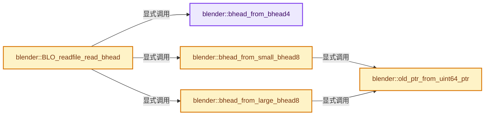

# 实现依赖专题：source/blender/blenloader_core/intern/blo_core_bhead.cc

[实现依赖导航](../../../README.md) · [符号索引](../../../../00-课程指南/02-源码与提交索引/符号依赖与实现索引.md)

本专题从正文实际调用进入，集中保存共享实现。函数有稳定锚点，可从调用处直接跳到对应完整函数；递归与互相调用通过回链组织。

## 本文件的实现关系




## 完整成员与函数实现

<a id="f-b53b45ece2a2d238"></a>

### `blender::bhead_from_bhead4`

实现位置：[source/blender/blenloader_core/intern/blo_core_bhead.cc](../../../../../../../../source/blender/blenloader_core/intern/blo_core_bhead.cc) · L11—L20。

接口参数：

- `const BHead4 &bhead4`

**教学注释版**

<!-- annotated:01535985a3159c -->

```cpp
static BHead bhead_from_bhead4(const BHead4 &bhead4)
{
  BHead bhead;
  bhead.code = bhead4.code;
  bhead.len = bhead4.len;
  bhead.old = reinterpret_cast<const void *>(uintptr_t(bhead4.old));
  bhead.SDNAnr = bhead4.SDNAnr;
  bhead.nr = bhead4.nr;
  return bhead;
}
```

<details>
<summary>核对原始源码：source/blender/blenloader_core/intern/blo_core_bhead.cc · L11—L20</summary>

<!-- original:01535985a3159c:source/blender/blenloader_core/intern/blo_core_bhead.cc:11:20 -->

```cpp
static BHead bhead_from_bhead4(const BHead4 &bhead4)
{
  BHead bhead;
  bhead.code = bhead4.code;
  bhead.len = bhead4.len;
  bhead.old = reinterpret_cast<const void *>(uintptr_t(bhead4.old));
  bhead.SDNAnr = bhead4.SDNAnr;
  bhead.nr = bhead4.nr;
  return bhead;
}
```

</details>

**沿实际写入检查状态**

- `bhead.code = bhead4.code;`
- `bhead.len = bhead4.len;`
- `bhead.old = reinterpret_cast<const void *>(uintptr_t(bhead4.old));`
- `bhead.SDNAnr = bhead4.SDNAnr;`
- `bhead.nr = bhead4.nr;`

**结果出口**

- `return bhead;`

**继续追踪实现**

本实现没有需要继续展开的显式调用；检查返回表达式、对象转换和调用者前置条件。

<a id="f-e8554d0d7b1c7e96"></a>

### `blender::old_ptr_from_uint64_ptr`

实现位置：[source/blender/blenloader_core/intern/blo_core_bhead.cc](../../../../../../../../source/blender/blenloader_core/intern/blo_core_bhead.cc) · L22—L30。

接口参数：

- `const uint64_t ptr`

**教学注释版**

<!-- annotated:c9648d7253a723 -->

```cpp
static const void *old_ptr_from_uint64_ptr(const uint64_t ptr)
{
  if constexpr (sizeof(void *) == 8) {
    return reinterpret_cast<const void *>(ptr);
  }
  else {
    return reinterpret_cast<const void *>(uintptr_t(uint32_from_uint64_ptr(ptr)));
  }
}
```

<details>
<summary>核对原始源码：source/blender/blenloader_core/intern/blo_core_bhead.cc · L22—L30</summary>

<!-- original:c9648d7253a723:source/blender/blenloader_core/intern/blo_core_bhead.cc:22:30 -->

```cpp
static const void *old_ptr_from_uint64_ptr(const uint64_t ptr)
{
  if constexpr (sizeof(void *) == 8) {
    return reinterpret_cast<const void *>(ptr);
  }
  else {
    return reinterpret_cast<const void *>(uintptr_t(uint32_from_uint64_ptr(ptr)));
  }
}
```

</details>

**结果出口**

- `return reinterpret_cast<const void *>(ptr);`
- `return reinterpret_cast<const void *>(uintptr_t(uint32_from_uint64_ptr(ptr)));`

**继续追踪实现**

- `uint32_from_uint64_ptr` → [blender::uint32_from_uint64_ptr · L124](../BLO_core_bhead.hh.md#f-6dd9432fa62dec81)。

<a id="f-6eb08cb5ad0a6fd7"></a>

### `blender::bhead_from_small_bhead8`

实现位置：[source/blender/blenloader_core/intern/blo_core_bhead.cc](../../../../../../../../source/blender/blenloader_core/intern/blo_core_bhead.cc) · L32—L41。

接口参数：

- `const SmallBHead8 &small_bhead8`

**教学注释版**

<!-- annotated:80203c0854eaf5 -->

```cpp
static BHead bhead_from_small_bhead8(const SmallBHead8 &small_bhead8)
{
  BHead bhead;
  bhead.code = small_bhead8.code;
  bhead.len = small_bhead8.len;
  bhead.old = old_ptr_from_uint64_ptr(small_bhead8.old);
  bhead.SDNAnr = small_bhead8.SDNAnr;
  bhead.nr = small_bhead8.nr;
  return bhead;
}
```

<details>
<summary>核对原始源码：source/blender/blenloader_core/intern/blo_core_bhead.cc · L32—L41</summary>

<!-- original:80203c0854eaf5:source/blender/blenloader_core/intern/blo_core_bhead.cc:32:41 -->

```cpp
static BHead bhead_from_small_bhead8(const SmallBHead8 &small_bhead8)
{
  BHead bhead;
  bhead.code = small_bhead8.code;
  bhead.len = small_bhead8.len;
  bhead.old = old_ptr_from_uint64_ptr(small_bhead8.old);
  bhead.SDNAnr = small_bhead8.SDNAnr;
  bhead.nr = small_bhead8.nr;
  return bhead;
}
```

</details>

**沿实际写入检查状态**

- `bhead.code = small_bhead8.code;`
- `bhead.len = small_bhead8.len;`
- `bhead.old = old_ptr_from_uint64_ptr(small_bhead8.old);`
- `bhead.SDNAnr = small_bhead8.SDNAnr;`
- `bhead.nr = small_bhead8.nr;`

**结果出口**

- `return bhead;`

**继续追踪实现**

- `old_ptr_from_uint64_ptr` → [blender::old_ptr_from_uint64_ptr · L22](blo_core_bhead.cc.md#f-e8554d0d7b1c7e96)。

<a id="f-a696cf944552fe3c"></a>

### `blender::bhead_from_large_bhead8`

实现位置：[source/blender/blenloader_core/intern/blo_core_bhead.cc](../../../../../../../../source/blender/blenloader_core/intern/blo_core_bhead.cc) · L43—L52。

接口参数：

- `const LargeBHead8 &large_bhead8`

**教学注释版**

<!-- annotated:5aa7ebb3d9e151 -->

```cpp
static BHead bhead_from_large_bhead8(const LargeBHead8 &large_bhead8)
{
  BHead bhead;
  bhead.code = large_bhead8.code;
  bhead.len = large_bhead8.len;
  bhead.old = old_ptr_from_uint64_ptr(large_bhead8.old);
  bhead.SDNAnr = large_bhead8.SDNAnr;
  bhead.nr = large_bhead8.nr;
  return bhead;
}
```

<details>
<summary>核对原始源码：source/blender/blenloader_core/intern/blo_core_bhead.cc · L43—L52</summary>

<!-- original:5aa7ebb3d9e151:source/blender/blenloader_core/intern/blo_core_bhead.cc:43:52 -->

```cpp
static BHead bhead_from_large_bhead8(const LargeBHead8 &large_bhead8)
{
  BHead bhead;
  bhead.code = large_bhead8.code;
  bhead.len = large_bhead8.len;
  bhead.old = old_ptr_from_uint64_ptr(large_bhead8.old);
  bhead.SDNAnr = large_bhead8.SDNAnr;
  bhead.nr = large_bhead8.nr;
  return bhead;
}
```

</details>

**沿实际写入检查状态**

- `bhead.code = large_bhead8.code;`
- `bhead.len = large_bhead8.len;`
- `bhead.old = old_ptr_from_uint64_ptr(large_bhead8.old);`
- `bhead.SDNAnr = large_bhead8.SDNAnr;`
- `bhead.nr = large_bhead8.nr;`

**结果出口**

- `return bhead;`

**继续追踪实现**

- `old_ptr_from_uint64_ptr` → [blender::old_ptr_from_uint64_ptr · L22](blo_core_bhead.cc.md#f-e8554d0d7b1c7e96)。

<a id="f-4f8b1983330311a0"></a>

### `blender::BLO_readfile_read_bhead`

实现位置：[source/blender/blenloader_core/intern/blo_core_bhead.cc](../../../../../../../../source/blender/blenloader_core/intern/blo_core_bhead.cc) · L54—L89。

接口参数：

- `FileReader *file`
- `const BHeadType type`

**教学注释版**

<!-- annotated:8b379b43d5fbcc -->

```cpp
std::optional<BHead> BLO_readfile_read_bhead(FileReader *file, const BHeadType type)
{
  /* NOTE: this is endianness-sensitive. */
  /* The various BHead data below would need to be switched if the read blend-file was saved from a
   * system using a different endianness. */
  switch (type) {
    case BHeadType::BHead4: {
      BHead4 bhead4{};
      bhead4.code = BLO_CODE_DATA;
      const int64_t readsize = file->read(file, &bhead4, sizeof(bhead4));
      if (readsize == sizeof(bhead4) || bhead4.code == BLO_CODE_ENDB) {
        return bhead_from_bhead4(bhead4);
      }
      break;
    }
    case BHeadType::SmallBHead8: {
      SmallBHead8 small_bhead8{};
      small_bhead8.code = BLO_CODE_DATA;
      const int64_t readsize = file->read(file, &small_bhead8, sizeof(small_bhead8));
      if (readsize == sizeof(small_bhead8) || small_bhead8.code == BLO_CODE_ENDB) {
        return bhead_from_small_bhead8(small_bhead8);
      }
      break;
    }
    case BHeadType::LargeBHead8: {
      LargeBHead8 large_bhead8{};
      large_bhead8.code = BLO_CODE_DATA;
      const int64_t readsize = file->read(file, &large_bhead8, sizeof(large_bhead8));
      if (readsize == sizeof(large_bhead8) || large_bhead8.code == BLO_CODE_ENDB) {
        return bhead_from_large_bhead8(large_bhead8);
      }
      break;
    }
  }
  return std::nullopt;
}
```

<details>
<summary>核对原始源码：source/blender/blenloader_core/intern/blo_core_bhead.cc · L54—L89</summary>

<!-- original:8b379b43d5fbcc:source/blender/blenloader_core/intern/blo_core_bhead.cc:54:89 -->

```cpp
std::optional<BHead> BLO_readfile_read_bhead(FileReader *file, const BHeadType type)
{
  /* NOTE: this is endianness-sensitive. */
  /* The various BHead data below would need to be switched if the read blend-file was saved from a
   * system using a different endianness. */
  switch (type) {
    case BHeadType::BHead4: {
      BHead4 bhead4{};
      bhead4.code = BLO_CODE_DATA;
      const int64_t readsize = file->read(file, &bhead4, sizeof(bhead4));
      if (readsize == sizeof(bhead4) || bhead4.code == BLO_CODE_ENDB) {
        return bhead_from_bhead4(bhead4);
      }
      break;
    }
    case BHeadType::SmallBHead8: {
      SmallBHead8 small_bhead8{};
      small_bhead8.code = BLO_CODE_DATA;
      const int64_t readsize = file->read(file, &small_bhead8, sizeof(small_bhead8));
      if (readsize == sizeof(small_bhead8) || small_bhead8.code == BLO_CODE_ENDB) {
        return bhead_from_small_bhead8(small_bhead8);
      }
      break;
    }
    case BHeadType::LargeBHead8: {
      LargeBHead8 large_bhead8{};
      large_bhead8.code = BLO_CODE_DATA;
      const int64_t readsize = file->read(file, &large_bhead8, sizeof(large_bhead8));
      if (readsize == sizeof(large_bhead8) || large_bhead8.code == BLO_CODE_ENDB) {
        return bhead_from_large_bhead8(large_bhead8);
      }
      break;
    }
  }
  return std::nullopt;
}
```

</details>

**沿实际写入检查状态**

- `bhead4.code = BLO_CODE_DATA;`
- `small_bhead8.code = BLO_CODE_DATA;`
- `large_bhead8.code = BLO_CODE_DATA;`

**结果出口**

- `return bhead_from_bhead4(bhead4);`
- `return bhead_from_small_bhead8(small_bhead8);`
- `return bhead_from_large_bhead8(large_bhead8);`
- `return std::nullopt;`

**继续追踪实现**

- `file->read` → [调用协议](../../../../00-课程指南/01-路线与规范/模板宏与动态分派协议.md)：由接收对象具体类型或运行时策略提供实现。调用位置L63。
- `bhead_from_bhead4` → [blender::bhead_from_bhead4 · L11](blo_core_bhead.cc.md#f-b53b45ece2a2d238)。
- `bhead_from_small_bhead8` → [blender::bhead_from_small_bhead8 · L32](blo_core_bhead.cc.md#f-6eb08cb5ad0a6fd7)。
- `bhead_from_large_bhead8` → [blender::bhead_from_large_bhead8 · L43](blo_core_bhead.cc.md#f-a696cf944552fe3c)。
