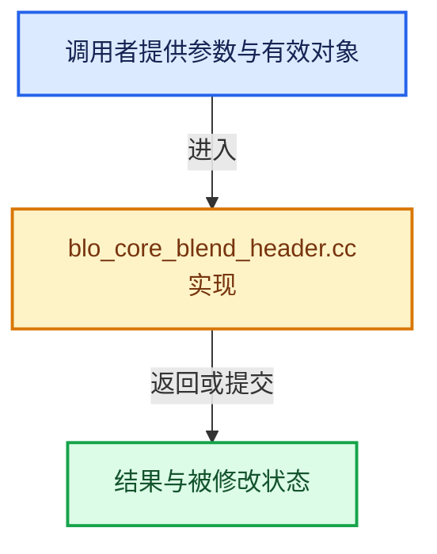

# 实现依赖专题：source/blender/blenloader_core/intern/blo_core_blend_header.cc

[实现依赖导航](../../../README.md) · [符号索引](../../../../00-课程指南/02-源码与提交索引/符号依赖与实现索引.md)

本专题从正文实际调用进入，集中保存共享实现。函数有稳定锚点，可从调用处直接跳到对应完整函数；递归与互相调用通过回链组织。

## 本文件的实现关系





## 完整成员与函数实现

<a id="f-3c2fe285c600d157"></a>

### `blender::BLO_readfile_blender_header_decode`

实现位置：[source/blender/blenloader_core/intern/blo_core_blend_header.cc](../../../../../../../../source/blender/blenloader_core/intern/blo_core_blend_header.cc) · L29—L127。

接口参数：

- `FileReader *file`

**教学注释版**

<!-- annotated:2197b2d4be8514 -->

```cpp
BlenderHeaderVariant BLO_readfile_blender_header_decode(FileReader *file)
{
  char header_bytes[MAX_SIZEOFBLENDERHEADER];
  /* We read the minimal number of header bytes first. If necessary, the remaining bytes are read
   * below. */
  int64_t readsize = file->read(file, header_bytes, MIN_SIZEOFBLENDERHEADER);
  if (readsize != MIN_SIZEOFBLENDERHEADER) {
    return BlenderHeaderInvalid{};
  }
  if (!STREQLEN(header_bytes, "BLENDER", 7)) {
    return BlenderHeaderInvalid{};
  }
  /* If the first 7 bytes are BLENDER, it is very likely that this is a newer version of the
   * blend-file format. If the rest of the decode fails, we can still report that this was a
   * Blender file of a potentially future version. */

  BlenderHeader header;
  /* In the old header format, the next bytes indicate the pointer size. In the new format a
   * version number comes next. */
  const bool is_legacy_header = ELEM(header_bytes[7], '_', '-');

  if (is_legacy_header) {
    header.file_format_version = 0;
    switch (header_bytes[7]) {
      case '_':
        header.pointer_size = 4;
        break;
      case '-':
        header.pointer_size = 8;
        break;
      default:
        return BlenderHeaderUnknown{};
    }
    switch (header_bytes[8]) {
      case 'v':
        header.endian = L_ENDIAN;
        break;
      case 'V':
        header.endian = B_ENDIAN;
        break;
      default:
        return BlenderHeaderUnknown{};
    }
    if (!isdigit(header_bytes[9]) || !isdigit(header_bytes[10]) || !isdigit(header_bytes[11])) {
      return BlenderHeaderUnknown{};
    }
    char version_str[4];
    // [讲解] memcpy：复制字节，源与目标不应重叠。类型生命周期、对齐和可复制表示须由调用者证明，不是任意对象的复制构造。
    memcpy(version_str, header_bytes + 9, 3);
    version_str[3] = '\0';
    header.file_version = atoi(version_str);
    return header;
  }

  if (!isdigit(header_bytes[7]) || !isdigit(header_bytes[8])) {
    return BlenderHeaderUnknown{};
  }
  char header_size_str[3];
  memcpy(header_size_str, header_bytes + 7, 2);
  header_size_str[2] = '\0';
  const int header_size = atoi(header_size_str);
  if (header_size != MAX_SIZEOFBLENDERHEADER) {
    return BlenderHeaderUnknown{};
  }

  /* Read remaining header bytes. */
  const int64_t remaining_bytes_to_read = header_size - MIN_SIZEOFBLENDERHEADER;
  readsize = file->read(file, header_bytes + MIN_SIZEOFBLENDERHEADER, remaining_bytes_to_read);
  if (readsize != remaining_bytes_to_read) {
    return BlenderHeaderUnknown{};
  }
  if (header_bytes[9] != '-') {
    return BlenderHeaderUnknown{};
  }
  header.pointer_size = 8;
  if (!isdigit(header_bytes[10]) || !isdigit(header_bytes[11])) {
    return BlenderHeaderUnknown{};
  }
  char blend_file_version_format_str[3];
  memcpy(blend_file_version_format_str, header_bytes + 10, 2);
  blend_file_version_format_str[2] = '\0';
  header.file_format_version = atoi(blend_file_version_format_str);
  if (header.file_format_version != 1) {
    return BlenderHeaderUnknown{};
  }
  if (header_bytes[12] != 'v') {
    return BlenderHeaderUnknown{};
  }
  header.endian = L_ENDIAN;
  if (!isdigit(header_bytes[13]) || !isdigit(header_bytes[14]) || !isdigit(header_bytes[15]) ||
      !isdigit(header_bytes[16]))
  {
    return BlenderHeaderUnknown{};
  }
  char version_str[5];
  memcpy(version_str, header_bytes + 13, 4);
  version_str[4] = '\0';
  header.file_version = std::atoi(version_str);
  return header;
}
```

<details>
<summary>核对原始源码：source/blender/blenloader_core/intern/blo_core_blend_header.cc · L29—L127</summary>

<!-- original:2197b2d4be8514:source/blender/blenloader_core/intern/blo_core_blend_header.cc:29:127 -->

```cpp
BlenderHeaderVariant BLO_readfile_blender_header_decode(FileReader *file)
{
  char header_bytes[MAX_SIZEOFBLENDERHEADER];
  /* We read the minimal number of header bytes first. If necessary, the remaining bytes are read
   * below. */
  int64_t readsize = file->read(file, header_bytes, MIN_SIZEOFBLENDERHEADER);
  if (readsize != MIN_SIZEOFBLENDERHEADER) {
    return BlenderHeaderInvalid{};
  }
  if (!STREQLEN(header_bytes, "BLENDER", 7)) {
    return BlenderHeaderInvalid{};
  }
  /* If the first 7 bytes are BLENDER, it is very likely that this is a newer version of the
   * blend-file format. If the rest of the decode fails, we can still report that this was a
   * Blender file of a potentially future version. */

  BlenderHeader header;
  /* In the old header format, the next bytes indicate the pointer size. In the new format a
   * version number comes next. */
  const bool is_legacy_header = ELEM(header_bytes[7], '_', '-');

  if (is_legacy_header) {
    header.file_format_version = 0;
    switch (header_bytes[7]) {
      case '_':
        header.pointer_size = 4;
        break;
      case '-':
        header.pointer_size = 8;
        break;
      default:
        return BlenderHeaderUnknown{};
    }
    switch (header_bytes[8]) {
      case 'v':
        header.endian = L_ENDIAN;
        break;
      case 'V':
        header.endian = B_ENDIAN;
        break;
      default:
        return BlenderHeaderUnknown{};
    }
    if (!isdigit(header_bytes[9]) || !isdigit(header_bytes[10]) || !isdigit(header_bytes[11])) {
      return BlenderHeaderUnknown{};
    }
    char version_str[4];
    memcpy(version_str, header_bytes + 9, 3);
    version_str[3] = '\0';
    header.file_version = atoi(version_str);
    return header;
  }

  if (!isdigit(header_bytes[7]) || !isdigit(header_bytes[8])) {
    return BlenderHeaderUnknown{};
  }
  char header_size_str[3];
  memcpy(header_size_str, header_bytes + 7, 2);
  header_size_str[2] = '\0';
  const int header_size = atoi(header_size_str);
  if (header_size != MAX_SIZEOFBLENDERHEADER) {
    return BlenderHeaderUnknown{};
  }

  /* Read remaining header bytes. */
  const int64_t remaining_bytes_to_read = header_size - MIN_SIZEOFBLENDERHEADER;
  readsize = file->read(file, header_bytes + MIN_SIZEOFBLENDERHEADER, remaining_bytes_to_read);
  if (readsize != remaining_bytes_to_read) {
    return BlenderHeaderUnknown{};
  }
  if (header_bytes[9] != '-') {
    return BlenderHeaderUnknown{};
  }
  header.pointer_size = 8;
  if (!isdigit(header_bytes[10]) || !isdigit(header_bytes[11])) {
    return BlenderHeaderUnknown{};
  }
  char blend_file_version_format_str[3];
  memcpy(blend_file_version_format_str, header_bytes + 10, 2);
  blend_file_version_format_str[2] = '\0';
  header.file_format_version = atoi(blend_file_version_format_str);
  if (header.file_format_version != 1) {
    return BlenderHeaderUnknown{};
  }
  if (header_bytes[12] != 'v') {
    return BlenderHeaderUnknown{};
  }
  header.endian = L_ENDIAN;
  if (!isdigit(header_bytes[13]) || !isdigit(header_bytes[14]) || !isdigit(header_bytes[15]) ||
      !isdigit(header_bytes[16]))
  {
    return BlenderHeaderUnknown{};
  }
  char version_str[5];
  memcpy(version_str, header_bytes + 13, 4);
  version_str[4] = '\0';
  header.file_version = std::atoi(version_str);
  return header;
}
```

</details>

**沿实际写入检查状态**

- `header.file_format_version = 0;`
- `header.pointer_size = 4;`
- `header.pointer_size = 8;`
- `header.endian = L_ENDIAN;`
- `header.endian = B_ENDIAN;`
- `version_str[3] = '\0';`
- `header.file_version = atoi(version_str);`
- `header_size_str[2] = '\0';`
- `readsize = file->read(file, header_bytes + MIN_SIZEOFBLENDERHEADER, remaining_bytes_to_read);`
- `blend_file_version_format_str[2] = '\0';`
- `header.file_format_version = atoi(blend_file_version_format_str);`
- `version_str[4] = '\0';`
- `header.file_version = std::atoi(version_str);`

**结果出口**

- `return BlenderHeaderInvalid{};`
- `return BlenderHeaderUnknown{};`
- `return header;`

**继续追踪实现**

- `file->read` → [调用协议](../../../../00-课程指南/01-路线与规范/模板宏与动态分派协议.md)：由接收对象具体类型或运行时策略提供实现。调用位置L34。
- `STREQLEN` → [STREQLEN · L114](../../../07-Intern运行时与平台/ghost/intern/GHOST_utildefines.hh.md#m-4c9fb75cc1d1)；[STREQLEN · L453](../../../01-BLI基础库/BLI_utildefines.hh.md#m-c74c1422ab62)；[STREQLEN · L56](../../../07-Intern运行时与平台/clog/clog.cc.md#m-c4a18b1393b9)。宏定义由构建条件选择。
- `ELEM` → [ELEM · L88](../../../07-Intern运行时与平台/ghost/intern/GHOST_utildefines.hh.md#m-d28724a15928)；[ELEM · L135](../../../01-BLI基础库/BLI_utildefines.hh.md#m-d6572de7cae0)。宏定义由构建条件选择。
- `isdigit` → [调用协议](../../../../00-课程指南/01-路线与规范/模板宏与动态分派协议.md)：函数指针、局部可调用对象或未展开的宏；必须结合调用者环境。调用位置L72。
- `memcpy` → [外部契约](https://eel.is/c++draft/cstring.syn)：复制字节，源与目标不应重叠。类型生命周期、对齐和可复制表示须由调用者证明，不是任意对象的复制构造。
- `atoi` → [调用协议](../../../../00-课程指南/01-路线与规范/模板宏与动态分派协议.md)：函数指针、局部可调用对象或未展开的宏；必须结合调用者环境。调用位置L78。
- `std::atoi` → [外部契约](https://eel.is/c++draft/)：这个边界按实际表达式及所属类型核对参数、返回值、寿命与失败行为。这里提供接口入口，不声称已解释该第三方版本的内部实现。
