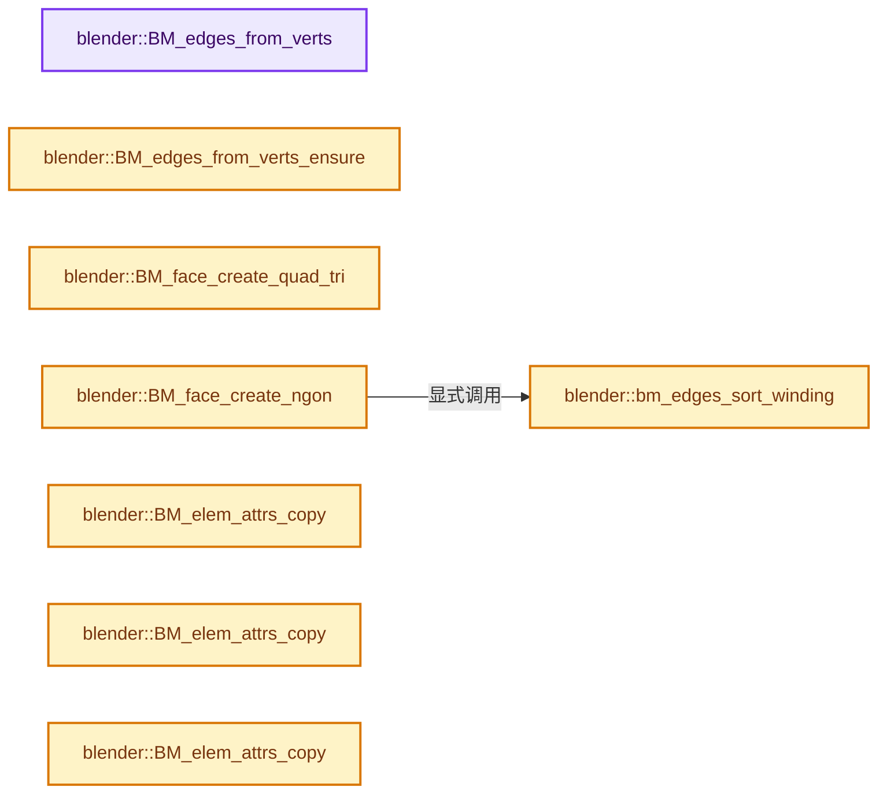
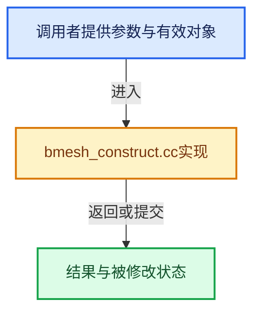

# 实现依赖专题：source/blender/bmesh/intern/bmesh_construct.cc

[实现依赖导航](../../../README.md) · [符号索引](../../../../00-课程指南/02-源码与提交索引/符号依赖与实现索引.md)

本专题从正文实际调用进入，集中保存共享实现。函数有稳定锚点，可从调用处直接跳到对应完整函数；递归与互相调用通过回链组织。

## 本文件的实现关系






## 完整成员与函数实现

<a id="f-3895da1ffbc89e9a"></a>

### `blender::BM_edges_from_verts`

实现位置：[source/blender/bmesh/intern/bmesh_construct.cc](../../../../../../../../source/blender/bmesh/intern/bmesh_construct.cc) · L44—L55。

接口参数：

- `BMEdge **edge_arr`
- `BMVert **vert_arr`
- `const int len`

**教学注释版**

<!-- annotated:1c72a71a172567 -->

```cpp
bool BM_edges_from_verts(BMEdge **edge_arr, BMVert **vert_arr, const int len)
{
  int i, i_prev = len - 1;
  for (i = 0; i < len; i++) {
    edge_arr[i_prev] = BM_edge_exists(vert_arr[i_prev], vert_arr[i]);
    if (edge_arr[i_prev] == nullptr) {
      return false;
    }
    i_prev = i;
  }
  return true;
}
```

<details>
<summary>核对原始源码：source/blender/bmesh/intern/bmesh_construct.cc · L44—L55</summary>

<!-- original:1c72a71a172567:source/blender/bmesh/intern/bmesh_construct.cc:44:55 -->

```cpp
bool BM_edges_from_verts(BMEdge **edge_arr, BMVert **vert_arr, const int len)
{
  int i, i_prev = len - 1;
  for (i = 0; i < len; i++) {
    edge_arr[i_prev] = BM_edge_exists(vert_arr[i_prev], vert_arr[i]);
    if (edge_arr[i_prev] == nullptr) {
      return false;
    }
    i_prev = i;
  }
  return true;
}
```

</details>

**沿实际写入检查状态**

- `edge_arr[i_prev] = BM_edge_exists(vert_arr[i_prev], vert_arr[i]);`
- `i_prev = i;`

**结果出口**

- `return false;`
- `return true;`

**继续追踪实现**

- `BM_edge_exists` → [blender::BM_edge_exists · L1551](bmesh_query.cc.md#f-f9a007e7659d480b)；[blender::BM_edge_exists · L1568](bmesh_query.cc.md#f-e774a553f01590ed)。同名重载需按实参类型选择。

<a id="f-6c80095793119036"></a>

### `blender::BM_edges_from_verts_ensure`

实现位置：[source/blender/bmesh/intern/bmesh_construct.cc](../../../../../../../../source/blender/bmesh/intern/bmesh_construct.cc) · L57—L65。

接口参数：

- `BMesh *bm`
- `BMEdge **edge_arr`
- `BMVert **vert_arr`
- `const int len`

**教学注释版**

<!-- annotated:c55089f1da6b81 -->

```cpp
void BM_edges_from_verts_ensure(BMesh *bm, BMEdge **edge_arr, BMVert **vert_arr, const int len)
{
  int i, i_prev = len - 1;
  for (i = 0; i < len; i++) {
    edge_arr[i_prev] = BM_edge_create(
        bm, vert_arr[i_prev], vert_arr[i], nullptr, BM_CREATE_NO_DOUBLE);
    i_prev = i;
  }
}
```

<details>
<summary>核对原始源码：source/blender/bmesh/intern/bmesh_construct.cc · L57—L65</summary>

<!-- original:c55089f1da6b81:source/blender/bmesh/intern/bmesh_construct.cc:57:65 -->

```cpp
void BM_edges_from_verts_ensure(BMesh *bm, BMEdge **edge_arr, BMVert **vert_arr, const int len)
{
  int i, i_prev = len - 1;
  for (i = 0; i < len; i++) {
    edge_arr[i_prev] = BM_edge_create(
        bm, vert_arr[i_prev], vert_arr[i], nullptr, BM_CREATE_NO_DOUBLE);
    i_prev = i;
  }
}
```

</details>

**沿实际写入检查状态**

- `edge_arr[i_prev] = BM_edge_create(`
- `i_prev = i;`

**继续追踪实现**

- `BM_edge_create` → [blender::BM_edge_create · L213](bmesh_core.cc.md#f-fc71228706cebaf6)。

<a id="f-ea0746084e51f36e"></a>

### `blender::BM_face_create_quad_tri`

实现位置：[source/blender/bmesh/intern/bmesh_construct.cc](../../../../../../../../source/blender/bmesh/intern/bmesh_construct.cc) · L67—L77。

接口参数：

- `BMesh *bm`
- `BMVert *v1`
- `BMVert *v2`
- `BMVert *v3`
- `BMVert *v4`
- `const BMFace *f_example`
- `const eBMCreateFlag create_flag`

**教学注释版**

<!-- annotated:9a961ceae69075 -->

```cpp
BMFace *BM_face_create_quad_tri(BMesh *bm,
                                BMVert *v1,
                                BMVert *v2,
                                BMVert *v3,
                                BMVert *v4,
                                const BMFace *f_example,
                                const eBMCreateFlag create_flag)
{
  BMVert *vtar[4] = {v1, v2, v3, v4};
  return BM_face_create_verts(bm, vtar, v4 ? 4 : 3, f_example, create_flag, true);
}
```

<details>
<summary>核对原始源码：source/blender/bmesh/intern/bmesh_construct.cc · L67—L77</summary>

<!-- original:9a961ceae69075:source/blender/bmesh/intern/bmesh_construct.cc:67:77 -->

```cpp
BMFace *BM_face_create_quad_tri(BMesh *bm,
                                BMVert *v1,
                                BMVert *v2,
                                BMVert *v3,
                                BMVert *v4,
                                const BMFace *f_example,
                                const eBMCreateFlag create_flag)
{
  BMVert *vtar[4] = {v1, v2, v3, v4};
  return BM_face_create_verts(bm, vtar, v4 ? 4 : 3, f_example, create_flag, true);
}
```

</details>

**结果出口**

- `return BM_face_create_verts(bm, vtar, v4 ? 4 : 3, f_example, create_flag, true);`

**继续追踪实现**

- `BM_face_create_verts` → [blender::BM_face_create_verts · L585](bmesh_core.cc.md#f-fd835ce429740b50)。

<a id="f-236c8970631ab480"></a>

### `blender::bm_edges_sort_winding`

实现位置：[source/blender/bmesh/intern/bmesh_construct.cc](../../../../../../../../source/blender/bmesh/intern/bmesh_construct.cc) · L134—L208。

接口参数：

- `BMVert *v1`
- `BMVert *v2`
- `BMEdge **edges`
- `const int len`
- `BMEdge **edges_sort`
- `BMVert **verts_sort`

**教学注释版**

<!-- annotated:5dd0da9e3bf331 -->

```cpp
static bool bm_edges_sort_winding(BMVert *v1,
                                  BMVert *v2,
                                  BMEdge **edges,
                                  const int len,
                                  BMEdge **edges_sort,
                                  BMVert **verts_sort)
{
  BMEdge *e_iter, *e_first;
  BMVert *v_iter;
  int i;

  /* all flags _must_ be cleared on exit! */
  for (i = 0; i < len; i++) {
    BM_ELEM_API_FLAG_ENABLE(edges[i], _FLAG_MF);
    BM_ELEM_API_FLAG_ENABLE(edges[i]->v1, _FLAG_MV);
    BM_ELEM_API_FLAG_ENABLE(edges[i]->v2, _FLAG_MV);
  }

  /* find first edge */
  i = 0;
  v_iter = v1;
  e_iter = e_first = v1->e;
  do {
    if (BM_ELEM_API_FLAG_TEST(e_iter, _FLAG_MF) && (BM_edge_other_vert(e_iter, v_iter) == v2)) {
      i = 1;
      break;
    }
  } while ((e_iter = bmesh_disk_edge_next(e_iter, v_iter)) != e_first);
  if (i == 0) {
    goto error;
  }

  i = 0;
  do {
    /* entering loop will always succeed */
    if (BM_ELEM_API_FLAG_TEST(e_iter, _FLAG_MF)) {
      if (BM_ELEM_API_FLAG_TEST(v_iter, _FLAG_MV) == false) [[unlikely]] {
        /* vert is in loop multiple times */
        goto error;
      }

      BM_ELEM_API_FLAG_DISABLE(e_iter, _FLAG_MF);
      edges_sort[i] = e_iter;

      BM_ELEM_API_FLAG_DISABLE(v_iter, _FLAG_MV);
      verts_sort[i] = v_iter;

      i += 1;

      /* walk onto the next vertex */
      v_iter = BM_edge_other_vert(e_iter, v_iter);
      if (i == len) {
        if (v_iter != verts_sort[0]) [[unlikely]] {
          goto error;
        }
        break;
      }

      e_first = e_iter;
    }
  } while ((e_iter = bmesh_disk_edge_next(e_iter, v_iter)) != e_first);

  if (i == len) {
    return true;
  }

error:
  for (i = 0; i < len; i++) {
    BM_ELEM_API_FLAG_DISABLE(edges[i], _FLAG_MF);
    BM_ELEM_API_FLAG_DISABLE(edges[i]->v1, _FLAG_MV);
    BM_ELEM_API_FLAG_DISABLE(edges[i]->v2, _FLAG_MV);
  }

  return false;
}
```

<details>
<summary>核对原始源码：source/blender/bmesh/intern/bmesh_construct.cc · L134—L208</summary>

<!-- original:5dd0da9e3bf331:source/blender/bmesh/intern/bmesh_construct.cc:134:208 -->

```cpp
static bool bm_edges_sort_winding(BMVert *v1,
                                  BMVert *v2,
                                  BMEdge **edges,
                                  const int len,
                                  BMEdge **edges_sort,
                                  BMVert **verts_sort)
{
  BMEdge *e_iter, *e_first;
  BMVert *v_iter;
  int i;

  /* all flags _must_ be cleared on exit! */
  for (i = 0; i < len; i++) {
    BM_ELEM_API_FLAG_ENABLE(edges[i], _FLAG_MF);
    BM_ELEM_API_FLAG_ENABLE(edges[i]->v1, _FLAG_MV);
    BM_ELEM_API_FLAG_ENABLE(edges[i]->v2, _FLAG_MV);
  }

  /* find first edge */
  i = 0;
  v_iter = v1;
  e_iter = e_first = v1->e;
  do {
    if (BM_ELEM_API_FLAG_TEST(e_iter, _FLAG_MF) && (BM_edge_other_vert(e_iter, v_iter) == v2)) {
      i = 1;
      break;
    }
  } while ((e_iter = bmesh_disk_edge_next(e_iter, v_iter)) != e_first);
  if (i == 0) {
    goto error;
  }

  i = 0;
  do {
    /* entering loop will always succeed */
    if (BM_ELEM_API_FLAG_TEST(e_iter, _FLAG_MF)) {
      if (BM_ELEM_API_FLAG_TEST(v_iter, _FLAG_MV) == false) [[unlikely]] {
        /* vert is in loop multiple times */
        goto error;
      }

      BM_ELEM_API_FLAG_DISABLE(e_iter, _FLAG_MF);
      edges_sort[i] = e_iter;

      BM_ELEM_API_FLAG_DISABLE(v_iter, _FLAG_MV);
      verts_sort[i] = v_iter;

      i += 1;

      /* walk onto the next vertex */
      v_iter = BM_edge_other_vert(e_iter, v_iter);
      if (i == len) {
        if (v_iter != verts_sort[0]) [[unlikely]] {
          goto error;
        }
        break;
      }

      e_first = e_iter;
    }
  } while ((e_iter = bmesh_disk_edge_next(e_iter, v_iter)) != e_first);

  if (i == len) {
    return true;
  }

error:
  for (i = 0; i < len; i++) {
    BM_ELEM_API_FLAG_DISABLE(edges[i], _FLAG_MF);
    BM_ELEM_API_FLAG_DISABLE(edges[i]->v1, _FLAG_MV);
    BM_ELEM_API_FLAG_DISABLE(edges[i]->v2, _FLAG_MV);
  }

  return false;
}
```

</details>

**沿实际写入检查状态**

- `i = 0;`
- `v_iter = v1;`
- `e_iter = e_first = v1->e;`
- `i = 1;`
- `edges_sort[i] = e_iter;`
- `verts_sort[i] = v_iter;`
- `i += 1;`
- `v_iter = BM_edge_other_vert(e_iter, v_iter);`
- `e_first = e_iter;`

**结果出口**

- `return true;`
- `return false;`

**继续追踪实现**

- `BM_ELEM_API_FLAG_ENABLE` → [BM_ELEM_API_FLAG_ENABLE · L67](bmesh_private.hh.md#m-f71d74e3af7b)。宏定义由构建条件选择。
- `BM_ELEM_API_FLAG_TEST` → [BM_ELEM_API_FLAG_TEST · L77](bmesh_private.hh.md#m-633a16510ffa)。宏定义由构建条件选择。
- `BM_edge_other_vert` → [blender::BM_edge_other_vert · L52](bmesh_query_inline.hh.md#f-464fb9614b23d180)。
- `bmesh_disk_edge_next` → [blender::bmesh_disk_edge_next · L59](bmesh_structure_inline.hh.md#f-bde0a66632cf5785)。
- `BM_ELEM_API_FLAG_DISABLE` → [BM_ELEM_API_FLAG_DISABLE · L72](bmesh_private.hh.md#m-2d2cdca90e2f)。宏定义由构建条件选择。

<a id="f-27f4404b702216b1"></a>

### `blender::BM_face_create_ngon`

实现位置：[source/blender/bmesh/intern/bmesh_construct.cc](../../../../../../../../source/blender/bmesh/intern/bmesh_construct.cc) · L210—L228。

接口参数：

- `BMesh *bm`
- `BMVert *v1`
- `BMVert *v2`
- `BMEdge **edges`
- `const int len`
- `const BMFace *f_example`
- `const eBMCreateFlag create_flag`

**教学注释版**

<!-- annotated:ebd2d290599104 -->

```cpp
BMFace *BM_face_create_ngon(BMesh *bm,
                            BMVert *v1,
                            BMVert *v2,
                            BMEdge **edges,
                            const int len,
                            const BMFace *f_example,
                            const eBMCreateFlag create_flag)
{
  Array<BMEdge *, BM_DEFAULT_NGON_STACK_SIZE> edges_sort(len);
  Array<BMVert *, BM_DEFAULT_NGON_STACK_SIZE> verts_sort(len);

  BLI_assert(len && v1 && v2 && edges && bm);

  // [讲解] edges_sort.data：提供数组的借用访问入口。
  if (bm_edges_sort_winding(v1, v2, edges, len, edges_sort.data(), verts_sort.data())) {
    return BM_face_create(bm, verts_sort.data(), edges_sort.data(), len, f_example, create_flag);
  }

  return nullptr;
}
```

<details>
<summary>核对原始源码：source/blender/bmesh/intern/bmesh_construct.cc · L210—L228</summary>

<!-- original:ebd2d290599104:source/blender/bmesh/intern/bmesh_construct.cc:210:228 -->

```cpp
BMFace *BM_face_create_ngon(BMesh *bm,
                            BMVert *v1,
                            BMVert *v2,
                            BMEdge **edges,
                            const int len,
                            const BMFace *f_example,
                            const eBMCreateFlag create_flag)
{
  Array<BMEdge *, BM_DEFAULT_NGON_STACK_SIZE> edges_sort(len);
  Array<BMVert *, BM_DEFAULT_NGON_STACK_SIZE> verts_sort(len);

  BLI_assert(len && v1 && v2 && edges && bm);

  if (bm_edges_sort_winding(v1, v2, edges, len, edges_sort.data(), verts_sort.data())) {
    return BM_face_create(bm, verts_sort.data(), edges_sort.data(), len, f_example, create_flag);
  }

  return nullptr;
}
```

</details>

**结果出口**

- `return BM_face_create(bm, verts_sort.data(), edges_sort.data(), len, f_example, create_flag);`
- `return nullptr;`

**继续追踪实现**

- `BLI_assert` → [BLI_assert · L48](../../../01-BLI基础库/BLI_assert.hh.md#m-57a88495704d)；[BLI_assert · L63](../../../01-BLI基础库/BLI_assert.hh.md#m-d07050020cb5)。宏定义由构建条件选择。
- `bm_edges_sort_winding` → [blender::bm_edges_sort_winding · L134](bmesh_construct.cc.md#f-236c8970631ab480)。
- `edges_sort.data` → [blender::Array::data · L323](../../../../01-基础容器与现代CPP/08-Array复制移动与销毁.md#f-95648c799002f4ba)；[blender::Array::data · L327](../../../../01-基础容器与现代CPP/08-Array复制移动与销毁.md#f-50c18301f8c40f9e)。同名重载需按实参类型选择。
- `verts_sort.data` → [blender::Array::data · L323](../../../../01-基础容器与现代CPP/08-Array复制移动与销毁.md#f-95648c799002f4ba)；[blender::Array::data · L327](../../../../01-基础容器与现代CPP/08-Array复制移动与销毁.md#f-50c18301f8c40f9e)。同名重载需按实参类型选择。
- `BM_face_create` → [blender::BM_face_create · L516](bmesh_core.cc.md#f-bff201f281bcc55d)。

<a id="f-ec0c0d58a048ea96"></a>

### `blender::BM_elem_attrs_copy`

实现位置：[source/blender/bmesh/intern/bmesh_construct.cc](../../../../../../../../source/blender/bmesh/intern/bmesh_construct.cc) · L333—L340。

接口参数：

- `BMesh *bm`
- `const BMCustomDataCopyMap &map`
- `const BMVert *src`
- `BMVert *dst`

**教学注释版**

<!-- annotated:bf814942e40b13 -->

```cpp
void BM_elem_attrs_copy(BMesh *bm, const BMCustomDataCopyMap &map, const BMVert *src, BMVert *dst)
{
  BLI_assert(src != dst);
  CustomData_bmesh_copy_block(bm->vdata, map, src->head.data, &dst->head.data);
  constexpr char hflag_mask = BM_ELEM_SELECT;
  dst->head.hflag = (dst->head.hflag & hflag_mask) | (src->head.hflag & ~hflag_mask);
  copy_v3_v3(dst->no, src->no);
}
```

<details>
<summary>核对原始源码：source/blender/bmesh/intern/bmesh_construct.cc · L333—L340</summary>

<!-- original:bf814942e40b13:source/blender/bmesh/intern/bmesh_construct.cc:333:340 -->

```cpp
void BM_elem_attrs_copy(BMesh *bm, const BMCustomDataCopyMap &map, const BMVert *src, BMVert *dst)
{
  BLI_assert(src != dst);
  CustomData_bmesh_copy_block(bm->vdata, map, src->head.data, &dst->head.data);
  constexpr char hflag_mask = BM_ELEM_SELECT;
  dst->head.hflag = (dst->head.hflag & hflag_mask) | (src->head.hflag & ~hflag_mask);
  copy_v3_v3(dst->no, src->no);
}
```

</details>

**沿实际写入检查状态**

- `dst->head.hflag = (dst->head.hflag & hflag_mask) | (src->head.hflag & ~hflag_mask);`

**继续追踪实现**

- `BLI_assert` → [BLI_assert · L48](../../../01-BLI基础库/BLI_assert.hh.md#m-57a88495704d)；[BLI_assert · L63](../../../01-BLI基础库/BLI_assert.hh.md#m-d07050020cb5)。宏定义由构建条件选择。
- `CustomData_bmesh_copy_block` → [blender::CustomData_bmesh_copy_block · L3681](../../../02-BKE几何与数据/intern/customdata.cc.md#f-d681531939b43aec)；[blender::CustomData_bmesh_copy_block · L3716](../../../02-BKE几何与数据/intern/customdata.cc.md#f-37799c7d006e0906)。同名重载需按实参类型选择。
- `copy_v3_v3` → [blender::copy_v3_v3 · L47](../../../01-BLI基础库/intern/math_vector_inline.cc.md#f-037a0d5fa5060bd6)。

<a id="f-80ae04d80fdc35ae"></a>

### `blender::BM_elem_attrs_copy`

实现位置：[source/blender/bmesh/intern/bmesh_construct.cc](../../../../../../../../source/blender/bmesh/intern/bmesh_construct.cc) · L341—L347。

接口参数：

- `BMesh *bm`
- `const BMCustomDataCopyMap &map`
- `const BMEdge *src`
- `BMEdge *dst`

**教学注释版**

<!-- annotated:7a8052d0a1b402 -->

```cpp
void BM_elem_attrs_copy(BMesh *bm, const BMCustomDataCopyMap &map, const BMEdge *src, BMEdge *dst)
{
  BLI_assert(src != dst);
  CustomData_bmesh_copy_block(bm->edata, map, src->head.data, &dst->head.data);
  constexpr char hflag_mask = BM_ELEM_SELECT;
  dst->head.hflag = (dst->head.hflag & hflag_mask) | (src->head.hflag & ~hflag_mask);
}
```

<details>
<summary>核对原始源码：source/blender/bmesh/intern/bmesh_construct.cc · L341—L347</summary>

<!-- original:7a8052d0a1b402:source/blender/bmesh/intern/bmesh_construct.cc:341:347 -->

```cpp
void BM_elem_attrs_copy(BMesh *bm, const BMCustomDataCopyMap &map, const BMEdge *src, BMEdge *dst)
{
  BLI_assert(src != dst);
  CustomData_bmesh_copy_block(bm->edata, map, src->head.data, &dst->head.data);
  constexpr char hflag_mask = BM_ELEM_SELECT;
  dst->head.hflag = (dst->head.hflag & hflag_mask) | (src->head.hflag & ~hflag_mask);
}
```

</details>

**沿实际写入检查状态**

- `dst->head.hflag = (dst->head.hflag & hflag_mask) | (src->head.hflag & ~hflag_mask);`

**继续追踪实现**

- `BLI_assert` → [BLI_assert · L48](../../../01-BLI基础库/BLI_assert.hh.md#m-57a88495704d)；[BLI_assert · L63](../../../01-BLI基础库/BLI_assert.hh.md#m-d07050020cb5)。宏定义由构建条件选择。
- `CustomData_bmesh_copy_block` → [blender::CustomData_bmesh_copy_block · L3681](../../../02-BKE几何与数据/intern/customdata.cc.md#f-d681531939b43aec)；[blender::CustomData_bmesh_copy_block · L3716](../../../02-BKE几何与数据/intern/customdata.cc.md#f-37799c7d006e0906)。同名重载需按实参类型选择。

<a id="f-dbcbb231c158b98b"></a>

### `blender::BM_elem_attrs_copy`

实现位置：[source/blender/bmesh/intern/bmesh_construct.cc](../../../../../../../../source/blender/bmesh/intern/bmesh_construct.cc) · L348—L356。

接口参数：

- `BMesh *bm`
- `const BMCustomDataCopyMap &map`
- `const BMFace *src`
- `BMFace *dst`

**教学注释版**

<!-- annotated:90d26161c8a2fc -->

```cpp
void BM_elem_attrs_copy(BMesh *bm, const BMCustomDataCopyMap &map, const BMFace *src, BMFace *dst)
{
  BLI_assert(src != dst);
  CustomData_bmesh_copy_block(bm->pdata, map, src->head.data, &dst->head.data);
  constexpr char hflag_mask = BM_ELEM_SELECT | BM_ELEM_SELECT_UV;
  dst->head.hflag = (dst->head.hflag & hflag_mask) | (src->head.hflag & ~hflag_mask);
  copy_v3_v3(dst->no, src->no);
  dst->mat_nr = src->mat_nr;
}
```

<details>
<summary>核对原始源码：source/blender/bmesh/intern/bmesh_construct.cc · L348—L356</summary>

<!-- original:90d26161c8a2fc:source/blender/bmesh/intern/bmesh_construct.cc:348:356 -->

```cpp
void BM_elem_attrs_copy(BMesh *bm, const BMCustomDataCopyMap &map, const BMFace *src, BMFace *dst)
{
  BLI_assert(src != dst);
  CustomData_bmesh_copy_block(bm->pdata, map, src->head.data, &dst->head.data);
  constexpr char hflag_mask = BM_ELEM_SELECT | BM_ELEM_SELECT_UV;
  dst->head.hflag = (dst->head.hflag & hflag_mask) | (src->head.hflag & ~hflag_mask);
  copy_v3_v3(dst->no, src->no);
  dst->mat_nr = src->mat_nr;
}
```

</details>

**沿实际写入检查状态**

- `dst->head.hflag = (dst->head.hflag & hflag_mask) | (src->head.hflag & ~hflag_mask);`
- `dst->mat_nr = src->mat_nr;`

**继续追踪实现**

- `BLI_assert` → [BLI_assert · L48](../../../01-BLI基础库/BLI_assert.hh.md#m-57a88495704d)；[BLI_assert · L63](../../../01-BLI基础库/BLI_assert.hh.md#m-d07050020cb5)。宏定义由构建条件选择。
- `CustomData_bmesh_copy_block` → [blender::CustomData_bmesh_copy_block · L3681](../../../02-BKE几何与数据/intern/customdata.cc.md#f-d681531939b43aec)；[blender::CustomData_bmesh_copy_block · L3716](../../../02-BKE几何与数据/intern/customdata.cc.md#f-37799c7d006e0906)。同名重载需按实参类型选择。
- `copy_v3_v3` → [blender::copy_v3_v3 · L47](../../../01-BLI基础库/intern/math_vector_inline.cc.md#f-037a0d5fa5060bd6)。

<a id="f-eafdea205e3abf45"></a>

### `blender::BM_elem_attrs_copy`

实现位置：[source/blender/bmesh/intern/bmesh_construct.cc](../../../../../../../../source/blender/bmesh/intern/bmesh_construct.cc) · L357—L363。

接口参数：

- `BMesh *bm`
- `const BMCustomDataCopyMap &map`
- `const BMLoop *src`
- `BMLoop *dst`

**教学注释版**

<!-- annotated:cadd975da3958a -->

```cpp
void BM_elem_attrs_copy(BMesh *bm, const BMCustomDataCopyMap &map, const BMLoop *src, BMLoop *dst)
{
  BLI_assert(src != dst);
  CustomData_bmesh_copy_block(bm->ldata, map, src->head.data, &dst->head.data);
  constexpr char hflag_mask = BM_ELEM_SELECT | BM_ELEM_SELECT_UV | BM_ELEM_SELECT_UV_EDGE;
  dst->head.hflag = (dst->head.hflag & hflag_mask) | (src->head.hflag & ~hflag_mask);
}
```

<details>
<summary>核对原始源码：source/blender/bmesh/intern/bmesh_construct.cc · L357—L363</summary>

<!-- original:cadd975da3958a:source/blender/bmesh/intern/bmesh_construct.cc:357:363 -->

```cpp
void BM_elem_attrs_copy(BMesh *bm, const BMCustomDataCopyMap &map, const BMLoop *src, BMLoop *dst)
{
  BLI_assert(src != dst);
  CustomData_bmesh_copy_block(bm->ldata, map, src->head.data, &dst->head.data);
  constexpr char hflag_mask = BM_ELEM_SELECT | BM_ELEM_SELECT_UV | BM_ELEM_SELECT_UV_EDGE;
  dst->head.hflag = (dst->head.hflag & hflag_mask) | (src->head.hflag & ~hflag_mask);
}
```

</details>

**沿实际写入检查状态**

- `dst->head.hflag = (dst->head.hflag & hflag_mask) | (src->head.hflag & ~hflag_mask);`

**继续追踪实现**

- `BLI_assert` → [BLI_assert · L48](../../../01-BLI基础库/BLI_assert.hh.md#m-57a88495704d)；[BLI_assert · L63](../../../01-BLI基础库/BLI_assert.hh.md#m-d07050020cb5)。宏定义由构建条件选择。
- `CustomData_bmesh_copy_block` → [blender::CustomData_bmesh_copy_block · L3681](../../../02-BKE几何与数据/intern/customdata.cc.md#f-d681531939b43aec)；[blender::CustomData_bmesh_copy_block · L3716](../../../02-BKE几何与数据/intern/customdata.cc.md#f-37799c7d006e0906)。同名重载需按实参类型选择。

<a id="f-a1b7dd83514bd4e2"></a>

### `blender::BM_elem_attrs_copy`

实现位置：[source/blender/bmesh/intern/bmesh_construct.cc](../../../../../../../../source/blender/bmesh/intern/bmesh_construct.cc) · L365—L372。

接口参数：

- `BMesh *bm`
- `const BMVert *src`
- `BMVert *dst`

**教学注释版**

<!-- annotated:736cb73167c8d7 -->

```cpp
void BM_elem_attrs_copy(BMesh *bm, const BMVert *src, BMVert *dst)
{
  BLI_assert(src != dst);
  CustomData_bmesh_copy_block(bm->vdata, src->head.data, &dst->head.data);
  constexpr char hflag_mask = BM_ELEM_SELECT;
  dst->head.hflag = (dst->head.hflag & hflag_mask) | (src->head.hflag & ~hflag_mask);
  copy_v3_v3(dst->no, src->no);
}
```

<details>
<summary>核对原始源码：source/blender/bmesh/intern/bmesh_construct.cc · L365—L372</summary>

<!-- original:736cb73167c8d7:source/blender/bmesh/intern/bmesh_construct.cc:365:372 -->

```cpp
void BM_elem_attrs_copy(BMesh *bm, const BMVert *src, BMVert *dst)
{
  BLI_assert(src != dst);
  CustomData_bmesh_copy_block(bm->vdata, src->head.data, &dst->head.data);
  constexpr char hflag_mask = BM_ELEM_SELECT;
  dst->head.hflag = (dst->head.hflag & hflag_mask) | (src->head.hflag & ~hflag_mask);
  copy_v3_v3(dst->no, src->no);
}
```

</details>

**沿实际写入检查状态**

- `dst->head.hflag = (dst->head.hflag & hflag_mask) | (src->head.hflag & ~hflag_mask);`

**继续追踪实现**

- `BLI_assert` → [BLI_assert · L48](../../../01-BLI基础库/BLI_assert.hh.md#m-57a88495704d)；[BLI_assert · L63](../../../01-BLI基础库/BLI_assert.hh.md#m-d07050020cb5)。宏定义由构建条件选择。
- `CustomData_bmesh_copy_block` → [blender::CustomData_bmesh_copy_block · L3681](../../../02-BKE几何与数据/intern/customdata.cc.md#f-d681531939b43aec)；[blender::CustomData_bmesh_copy_block · L3716](../../../02-BKE几何与数据/intern/customdata.cc.md#f-37799c7d006e0906)。同名重载需按实参类型选择。
- `copy_v3_v3` → [blender::copy_v3_v3 · L47](../../../01-BLI基础库/intern/math_vector_inline.cc.md#f-037a0d5fa5060bd6)。

<a id="f-e5833bc564364b26"></a>

### `blender::BM_elem_attrs_copy`

实现位置：[source/blender/bmesh/intern/bmesh_construct.cc](../../../../../../../../source/blender/bmesh/intern/bmesh_construct.cc) · L373—L379。

接口参数：

- `BMesh *bm`
- `const BMEdge *src`
- `BMEdge *dst`

**教学注释版**

<!-- annotated:49fdb9f50098c5 -->

```cpp
void BM_elem_attrs_copy(BMesh *bm, const BMEdge *src, BMEdge *dst)
{
  BLI_assert(src != dst);
  CustomData_bmesh_copy_block(bm->edata, src->head.data, &dst->head.data);
  constexpr char hflag_mask = BM_ELEM_SELECT;
  dst->head.hflag = (dst->head.hflag & hflag_mask) | (src->head.hflag & ~hflag_mask);
}
```

<details>
<summary>核对原始源码：source/blender/bmesh/intern/bmesh_construct.cc · L373—L379</summary>

<!-- original:49fdb9f50098c5:source/blender/bmesh/intern/bmesh_construct.cc:373:379 -->

```cpp
void BM_elem_attrs_copy(BMesh *bm, const BMEdge *src, BMEdge *dst)
{
  BLI_assert(src != dst);
  CustomData_bmesh_copy_block(bm->edata, src->head.data, &dst->head.data);
  constexpr char hflag_mask = BM_ELEM_SELECT;
  dst->head.hflag = (dst->head.hflag & hflag_mask) | (src->head.hflag & ~hflag_mask);
}
```

</details>

**沿实际写入检查状态**

- `dst->head.hflag = (dst->head.hflag & hflag_mask) | (src->head.hflag & ~hflag_mask);`

**继续追踪实现**

- `BLI_assert` → [BLI_assert · L48](../../../01-BLI基础库/BLI_assert.hh.md#m-57a88495704d)；[BLI_assert · L63](../../../01-BLI基础库/BLI_assert.hh.md#m-d07050020cb5)。宏定义由构建条件选择。
- `CustomData_bmesh_copy_block` → [blender::CustomData_bmesh_copy_block · L3681](../../../02-BKE几何与数据/intern/customdata.cc.md#f-d681531939b43aec)；[blender::CustomData_bmesh_copy_block · L3716](../../../02-BKE几何与数据/intern/customdata.cc.md#f-37799c7d006e0906)。同名重载需按实参类型选择。

<a id="f-297cf479a7b72bc0"></a>

### `blender::BM_elem_attrs_copy`

实现位置：[source/blender/bmesh/intern/bmesh_construct.cc](../../../../../../../../source/blender/bmesh/intern/bmesh_construct.cc) · L380—L388。

接口参数：

- `BMesh *bm`
- `const BMFace *src`
- `BMFace *dst`

**教学注释版**

<!-- annotated:fe6e50e72b757a -->

```cpp
void BM_elem_attrs_copy(BMesh *bm, const BMFace *src, BMFace *dst)
{
  BLI_assert(src != dst);
  constexpr char hflag_mask = BM_ELEM_SELECT | BM_ELEM_SELECT_UV;
  CustomData_bmesh_copy_block(bm->pdata, src->head.data, &dst->head.data);
  dst->head.hflag = (dst->head.hflag & hflag_mask) | (src->head.hflag & ~hflag_mask);
  copy_v3_v3(dst->no, src->no);
  dst->mat_nr = src->mat_nr;
}
```

<details>
<summary>核对原始源码：source/blender/bmesh/intern/bmesh_construct.cc · L380—L388</summary>

<!-- original:fe6e50e72b757a:source/blender/bmesh/intern/bmesh_construct.cc:380:388 -->

```cpp
void BM_elem_attrs_copy(BMesh *bm, const BMFace *src, BMFace *dst)
{
  BLI_assert(src != dst);
  constexpr char hflag_mask = BM_ELEM_SELECT | BM_ELEM_SELECT_UV;
  CustomData_bmesh_copy_block(bm->pdata, src->head.data, &dst->head.data);
  dst->head.hflag = (dst->head.hflag & hflag_mask) | (src->head.hflag & ~hflag_mask);
  copy_v3_v3(dst->no, src->no);
  dst->mat_nr = src->mat_nr;
}
```

</details>

**沿实际写入检查状态**

- `dst->head.hflag = (dst->head.hflag & hflag_mask) | (src->head.hflag & ~hflag_mask);`
- `dst->mat_nr = src->mat_nr;`

**继续追踪实现**

- `BLI_assert` → [BLI_assert · L48](../../../01-BLI基础库/BLI_assert.hh.md#m-57a88495704d)；[BLI_assert · L63](../../../01-BLI基础库/BLI_assert.hh.md#m-d07050020cb5)。宏定义由构建条件选择。
- `CustomData_bmesh_copy_block` → [blender::CustomData_bmesh_copy_block · L3681](../../../02-BKE几何与数据/intern/customdata.cc.md#f-d681531939b43aec)；[blender::CustomData_bmesh_copy_block · L3716](../../../02-BKE几何与数据/intern/customdata.cc.md#f-37799c7d006e0906)。同名重载需按实参类型选择。
- `copy_v3_v3` → [blender::copy_v3_v3 · L47](../../../01-BLI基础库/intern/math_vector_inline.cc.md#f-037a0d5fa5060bd6)。

<a id="f-9014de1117364c14"></a>

### `blender::BM_elem_attrs_copy`

实现位置：[source/blender/bmesh/intern/bmesh_construct.cc](../../../../../../../../source/blender/bmesh/intern/bmesh_construct.cc) · L389—L395。

接口参数：

- `BMesh *bm`
- `const BMLoop *src`
- `BMLoop *dst`

**教学注释版**

<!-- annotated:1947a00ef4f339 -->

```cpp
void BM_elem_attrs_copy(BMesh *bm, const BMLoop *src, BMLoop *dst)
{
  BLI_assert(src != dst);
  constexpr char hflag_mask = BM_ELEM_SELECT | BM_ELEM_SELECT_UV | BM_ELEM_SELECT_UV_EDGE;
  CustomData_bmesh_copy_block(bm->ldata, src->head.data, &dst->head.data);
  dst->head.hflag = (dst->head.hflag & hflag_mask) | (src->head.hflag & ~hflag_mask);
}
```

<details>
<summary>核对原始源码：source/blender/bmesh/intern/bmesh_construct.cc · L389—L395</summary>

<!-- original:1947a00ef4f339:source/blender/bmesh/intern/bmesh_construct.cc:389:395 -->

```cpp
void BM_elem_attrs_copy(BMesh *bm, const BMLoop *src, BMLoop *dst)
{
  BLI_assert(src != dst);
  constexpr char hflag_mask = BM_ELEM_SELECT | BM_ELEM_SELECT_UV | BM_ELEM_SELECT_UV_EDGE;
  CustomData_bmesh_copy_block(bm->ldata, src->head.data, &dst->head.data);
  dst->head.hflag = (dst->head.hflag & hflag_mask) | (src->head.hflag & ~hflag_mask);
}
```

</details>

**沿实际写入检查状态**

- `dst->head.hflag = (dst->head.hflag & hflag_mask) | (src->head.hflag & ~hflag_mask);`

**继续追踪实现**

- `BLI_assert` → [BLI_assert · L48](../../../01-BLI基础库/BLI_assert.hh.md#m-57a88495704d)；[BLI_assert · L63](../../../01-BLI基础库/BLI_assert.hh.md#m-d07050020cb5)。宏定义由构建条件选择。
- `CustomData_bmesh_copy_block` → [blender::CustomData_bmesh_copy_block · L3681](../../../02-BKE几何与数据/intern/customdata.cc.md#f-d681531939b43aec)；[blender::CustomData_bmesh_copy_block · L3716](../../../02-BKE几何与数据/intern/customdata.cc.md#f-37799c7d006e0906)。同名重载需按实参类型选择。

<a id="f-796dfdc4479870f6"></a>

### `blender::BM_elem_select_copy`

实现位置：[source/blender/bmesh/intern/bmesh_construct.cc](../../../../../../../../source/blender/bmesh/intern/bmesh_construct.cc) · L397—L408。

接口参数：

- `BMesh *bm_dst`
- `void *ele_dst_v`
- `const void *ele_src_v`

**教学注释版**

<!-- annotated:7e397bc7f048b5 -->

```cpp
void BM_elem_select_copy(BMesh *bm_dst, void *ele_dst_v, const void *ele_src_v)
{
  BMHeader *ele_dst = static_cast<BMHeader *>(ele_dst_v);
  const BMHeader *ele_src = static_cast<const BMHeader *>(ele_src_v);

  BLI_assert(ele_src->htype == ele_dst->htype);

  if ((ele_src->hflag & BM_ELEM_SELECT) != (ele_dst->hflag & BM_ELEM_SELECT)) {
    BM_elem_select_set(
        bm_dst, reinterpret_cast<BMElem *>(ele_dst), (ele_src->hflag & BM_ELEM_SELECT) != 0);
  }
}
```

<details>
<summary>核对原始源码：source/blender/bmesh/intern/bmesh_construct.cc · L397—L408</summary>

<!-- original:7e397bc7f048b5:source/blender/bmesh/intern/bmesh_construct.cc:397:408 -->

```cpp
void BM_elem_select_copy(BMesh *bm_dst, void *ele_dst_v, const void *ele_src_v)
{
  BMHeader *ele_dst = static_cast<BMHeader *>(ele_dst_v);
  const BMHeader *ele_src = static_cast<const BMHeader *>(ele_src_v);

  BLI_assert(ele_src->htype == ele_dst->htype);

  if ((ele_src->hflag & BM_ELEM_SELECT) != (ele_dst->hflag & BM_ELEM_SELECT)) {
    BM_elem_select_set(
        bm_dst, reinterpret_cast<BMElem *>(ele_dst), (ele_src->hflag & BM_ELEM_SELECT) != 0);
  }
}
```

</details>

**继续追踪实现**

- `BLI_assert` → [BLI_assert · L48](../../../01-BLI基础库/BLI_assert.hh.md#m-57a88495704d)；[BLI_assert · L63](../../../01-BLI基础库/BLI_assert.hh.md#m-d07050020cb5)。宏定义由构建条件选择。
- `BM_elem_select_set` → [blender::BM_elem_select_set · L925](bmesh_marking.cc.md#f-8b8dab22f7e15301)。

<a id="f-0c1de13c5d8b945d"></a>

### `blender::get_bmesh_custom_data`

实现位置：[source/blender/bmesh/intern/bmesh_construct.cc](../../../../../../../../source/blender/bmesh/intern/bmesh_construct.cc) · L460—L475。

接口参数：

- `BMesh &bm`
- `const bke::AttrDomain domain`

**教学注释版**

<!-- annotated:b069d71086c041 -->

```cpp
static CustomData &get_bmesh_custom_data(BMesh &bm, const bke::AttrDomain domain)
{
  switch (domain) {
    case bke::AttrDomain::Point:
      return bm.vdata;
    case bke::AttrDomain::Edge:
      return bm.edata;
    case bke::AttrDomain::Face:
      return bm.pdata;
    case bke::AttrDomain::Corner:
      return bm.ldata;
    default:
      BLI_assert_unreachable();
      return bm.vdata;
  }
}
```

<details>
<summary>核对原始源码：source/blender/bmesh/intern/bmesh_construct.cc · L460—L475</summary>

<!-- original:b069d71086c041:source/blender/bmesh/intern/bmesh_construct.cc:460:475 -->

```cpp
static CustomData &get_bmesh_custom_data(BMesh &bm, const bke::AttrDomain domain)
{
  switch (domain) {
    case bke::AttrDomain::Point:
      return bm.vdata;
    case bke::AttrDomain::Edge:
      return bm.edata;
    case bke::AttrDomain::Face:
      return bm.pdata;
    case bke::AttrDomain::Corner:
      return bm.ldata;
    default:
      BLI_assert_unreachable();
      return bm.vdata;
  }
}
```

</details>

**结果出口**

- `return bm.vdata;`
- `return bm.edata;`
- `return bm.pdata;`
- `return bm.ldata;`

**继续追踪实现**

- `BLI_assert_unreachable` → [BLI_assert_unreachable · L77](../../../01-BLI基础库/BLI_assert.hh.md#m-7a2d91a67d8e)。宏定义由构建条件选择。

<a id="f-136a664637202840"></a>

### `blender::BM_mesh_copy_init_customdata_from_mesh_array`

实现位置：[source/blender/bmesh/intern/bmesh_construct.cc](../../../../../../../../source/blender/bmesh/intern/bmesh_construct.cc) · L477—L523。

接口参数：

- `BMesh *bm_dst`
- `const Mesh *me_src_array[]`
- `const int me_src_array_len`
- `const BMAllocTemplate *allocsize`

**教学注释版**

<!-- annotated:1926c63cb48a94 -->

```cpp
void BM_mesh_copy_init_customdata_from_mesh_array(BMesh *bm_dst,
                                                  const Mesh *me_src_array[],
                                                  const int me_src_array_len,
                                                  const BMAllocTemplate *allocsize)

{
  if (allocsize == nullptr) {
    allocsize = &bm_mesh_allocsize_default;
  }

  bke::GeometrySet::GatheredAttributes attribute_info;
  for (int i = 0; i < me_src_array_len; i++) {
    const Mesh *me_src = me_src_array[i];
    for (const bke::Attribute &attr : me_src->attribute_storage.wrap()) {
      if (BM_attribute_stored_in_bmesh_builtin(attr.name())) {
        continue;
      }
      attribute_info.add(attr.name(), {attr.domain(), attr.data_type()});
    }
  }

  for (const int i : attribute_info.names.index_range()) {
    const StringRef name = attribute_info.names[i];
    const bke::AttrDomain domain = attribute_info.kinds[i].domain;
    const eCustomDataType data_type = *bke::attr_type_to_custom_data_type(
        attribute_info.kinds[i].data_type);
    CustomData &custom_data = get_bmesh_custom_data(*bm_dst, domain);
    CustomData_add_layer_named(&custom_data, data_type, CD_SET_DEFAULT, 0, name);
  }

  for (int i = 0; i < me_src_array_len; i++) {
    const Mesh *me_src = me_src_array[i];
    CustomData_merge_layout(
        &me_src->vert_data, &bm_dst->vdata, CD_MASK_BMESH.vmask, CD_SET_DEFAULT, 0);
    CustomData_merge_layout(
        &me_src->edge_data, &bm_dst->edata, CD_MASK_BMESH.emask, CD_SET_DEFAULT, 0);
    CustomData_merge_layout(
        &me_src->face_data, &bm_dst->pdata, CD_MASK_BMESH.pmask, CD_SET_DEFAULT, 0);
    CustomData_merge_layout(
        &me_src->corner_data, &bm_dst->ldata, CD_MASK_BMESH.lmask, CD_SET_DEFAULT, 0);
  }

  CustomData_bmesh_init_pool(&bm_dst->vdata, allocsize->totvert, BM_VERT);
  CustomData_bmesh_init_pool(&bm_dst->edata, allocsize->totedge, BM_EDGE);
  CustomData_bmesh_init_pool(&bm_dst->ldata, allocsize->totloop, BM_LOOP);
  CustomData_bmesh_init_pool(&bm_dst->pdata, allocsize->totface, BM_FACE);
}
```

<details>
<summary>核对原始源码：source/blender/bmesh/intern/bmesh_construct.cc · L477—L523</summary>

<!-- original:1926c63cb48a94:source/blender/bmesh/intern/bmesh_construct.cc:477:523 -->

```cpp
void BM_mesh_copy_init_customdata_from_mesh_array(BMesh *bm_dst,
                                                  const Mesh *me_src_array[],
                                                  const int me_src_array_len,
                                                  const BMAllocTemplate *allocsize)

{
  if (allocsize == nullptr) {
    allocsize = &bm_mesh_allocsize_default;
  }

  bke::GeometrySet::GatheredAttributes attribute_info;
  for (int i = 0; i < me_src_array_len; i++) {
    const Mesh *me_src = me_src_array[i];
    for (const bke::Attribute &attr : me_src->attribute_storage.wrap()) {
      if (BM_attribute_stored_in_bmesh_builtin(attr.name())) {
        continue;
      }
      attribute_info.add(attr.name(), {attr.domain(), attr.data_type()});
    }
  }

  for (const int i : attribute_info.names.index_range()) {
    const StringRef name = attribute_info.names[i];
    const bke::AttrDomain domain = attribute_info.kinds[i].domain;
    const eCustomDataType data_type = *bke::attr_type_to_custom_data_type(
        attribute_info.kinds[i].data_type);
    CustomData &custom_data = get_bmesh_custom_data(*bm_dst, domain);
    CustomData_add_layer_named(&custom_data, data_type, CD_SET_DEFAULT, 0, name);
  }

  for (int i = 0; i < me_src_array_len; i++) {
    const Mesh *me_src = me_src_array[i];
    CustomData_merge_layout(
        &me_src->vert_data, &bm_dst->vdata, CD_MASK_BMESH.vmask, CD_SET_DEFAULT, 0);
    CustomData_merge_layout(
        &me_src->edge_data, &bm_dst->edata, CD_MASK_BMESH.emask, CD_SET_DEFAULT, 0);
    CustomData_merge_layout(
        &me_src->face_data, &bm_dst->pdata, CD_MASK_BMESH.pmask, CD_SET_DEFAULT, 0);
    CustomData_merge_layout(
        &me_src->corner_data, &bm_dst->ldata, CD_MASK_BMESH.lmask, CD_SET_DEFAULT, 0);
  }

  CustomData_bmesh_init_pool(&bm_dst->vdata, allocsize->totvert, BM_VERT);
  CustomData_bmesh_init_pool(&bm_dst->edata, allocsize->totedge, BM_EDGE);
  CustomData_bmesh_init_pool(&bm_dst->ldata, allocsize->totloop, BM_LOOP);
  CustomData_bmesh_init_pool(&bm_dst->pdata, allocsize->totface, BM_FACE);
}
```

</details>

**沿实际写入检查状态**

- `allocsize = &bm_mesh_allocsize_default;`

**继续追踪实现**

- `me_src->attribute_storage.wrap` → [调用协议](../../../../00-课程指南/01-路线与规范/模板宏与动态分派协议.md)：接收对象类型依赖auto、返回值或模板实例；不按同名猜测目标。调用位置L490。
- `BM_attribute_stored_in_bmesh_builtin` → [blender::BM_attribute_stored_in_bmesh_builtin · L118](bmesh_mesh_convert.cc.md#f-c524291093f702fd)。
- `attr.name` → [调用协议](../../../../00-课程指南/01-路线与规范/模板宏与动态分派协议.md)：接收对象类型依赖auto、返回值或模板实例；不按同名猜测目标。调用位置L491。
- `attribute_info.add` → [blender::bke::GeometrySet::GatheredAttributes::add · L711](../../../../06-隐式共享与缓存系统/05-GeometrySet读写与复制.md#f-df0701c2f420bf1b)。
- `attr.domain` → [调用协议](../../../../00-课程指南/01-路线与规范/模板宏与动态分派协议.md)：接收对象类型依赖auto、返回值或模板实例；不按同名猜测目标。调用位置L494。
- `attr.data_type` → [调用协议](../../../../00-课程指南/01-路线与规范/模板宏与动态分派协议.md)：接收对象类型依赖auto、返回值或模板实例；不按同名猜测目标。调用位置L494。
- `attribute_info.names.index_range` → [调用协议](../../../../00-课程指南/01-路线与规范/模板宏与动态分派协议.md)：接收对象类型依赖auto、返回值或模板实例；不按同名猜测目标。调用位置L498。
- `bke::attr_type_to_custom_data_type` → [blender::bke::attr_type_to_custom_data_type · L193](../../../02-BKE几何与数据/intern/attribute_legacy_convert.cc.md#f-bb0105aef27ae3a3)。
- `get_bmesh_custom_data` → [blender::get_bmesh_custom_data · L460](bmesh_construct.cc.md#f-0c1de13c5d8b945d)。
- `CustomData_add_layer_named` → [blender::CustomData_add_layer_named · L2888](../../../02-BKE几何与数据/intern/customdata.cc.md#f-6cd4a60e28dc200e)。
- `CustomData_merge_layout` → [blender::CustomData_merge_layout · L2293](../../../02-BKE几何与数据/intern/customdata.cc.md#f-c80a3bfefa0b9ed9)。
- `CustomData_bmesh_init_pool` → [blender::CustomData_bmesh_init_pool · L3436](../../../02-BKE几何与数据/intern/customdata.cc.md#f-c036b3a7e4f11622)。
