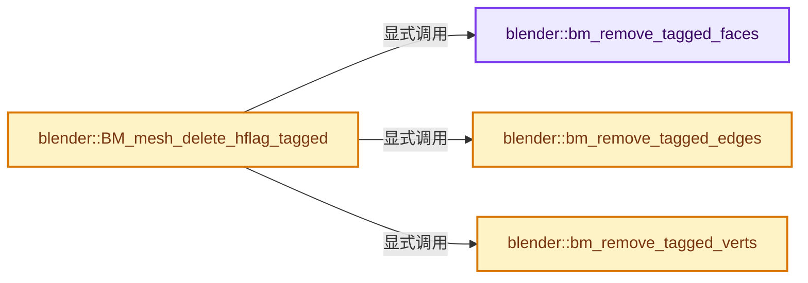
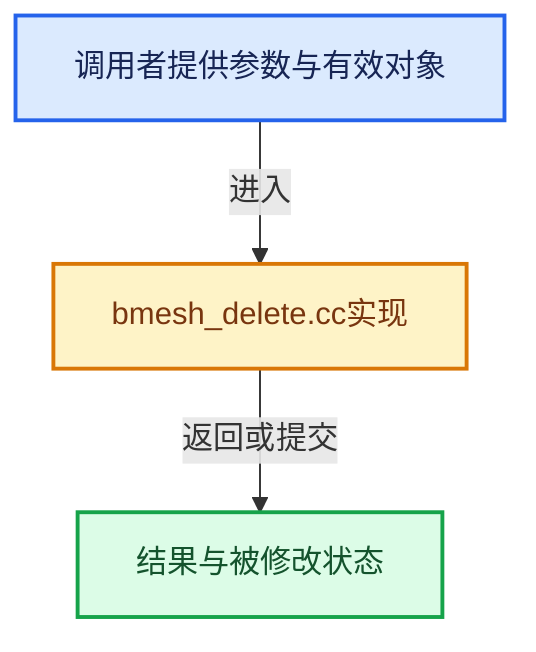

# 实现依赖专题：source/blender/bmesh/intern/bmesh_delete.cc

[实现依赖导航](../../../README.md) · [符号索引](../../../../00-课程指南/02-源码与提交索引/符号依赖与实现索引.md)

本专题从正文实际调用进入，集中保存共享实现。函数有稳定锚点，可从调用处直接跳到对应完整函数；递归与互相调用通过回链组织。

## 本文件的实现关系






## 完整成员与函数实现

<a id="f-28fd0fbf271d3771"></a>

### `blender::bm_remove_tagged_faces`

实现位置：[source/blender/bmesh/intern/bmesh_delete.cc](../../../../../../../../source/blender/bmesh/intern/bmesh_delete.cc) · L213—L223。

接口参数：

- `BMesh *bm`
- `const char hflag`

**教学注释版**

<!-- annotated:3036c40d81504d -->

```cpp
static void bm_remove_tagged_faces(BMesh *bm, const char hflag)
{
  BMFace *f, *f_next;
  BMIter iter;

  BM_ITER_MESH_MUTABLE (f, f_next, &iter, bm, BM_FACES_OF_MESH) {
    if (BM_elem_flag_test(f, hflag)) {
      BM_face_kill(bm, f);
    }
  }
}
```

<details>
<summary>核对原始源码：source/blender/bmesh/intern/bmesh_delete.cc · L213—L223</summary>

<!-- original:3036c40d81504d:source/blender/bmesh/intern/bmesh_delete.cc:213:223 -->

```cpp
static void bm_remove_tagged_faces(BMesh *bm, const char hflag)
{
  BMFace *f, *f_next;
  BMIter iter;

  BM_ITER_MESH_MUTABLE (f, f_next, &iter, bm, BM_FACES_OF_MESH) {
    if (BM_elem_flag_test(f, hflag)) {
      BM_face_kill(bm, f);
    }
  }
}
```

</details>

**继续追踪实现**

- `BM_ITER_MESH_MUTABLE` → [BM_ITER_MESH_MUTABLE · L83](bmesh_iterators.hh.md#m-2887500f7f76)；[BM_ITER_MESH_MUTABLE · L91](bmesh_iterators.hh.md#m-de2c06ab3bfc)。宏定义由构建条件选择。
- `BM_elem_flag_test` → [BM_elem_flag_test · L21](bmesh_inline.hh.md#m-2431d1179b41)。宏定义由构建条件选择。
- `BM_face_kill` → [blender::BM_face_kill · L957](bmesh_core.cc.md#f-fbdcd02b85e7db02)。

<a id="f-d1fedb67da54e432"></a>

### `blender::bm_remove_tagged_edges`

实现位置：[source/blender/bmesh/intern/bmesh_delete.cc](../../../../../../../../source/blender/bmesh/intern/bmesh_delete.cc) · L225—L235。

接口参数：

- `BMesh *bm`
- `const char hflag`

**教学注释版**

<!-- annotated:141c0990a31552 -->

```cpp
static void bm_remove_tagged_edges(BMesh *bm, const char hflag)
{
  BMEdge *e, *e_next;
  BMIter iter;

  BM_ITER_MESH_MUTABLE (e, e_next, &iter, bm, BM_EDGES_OF_MESH) {
    if (BM_elem_flag_test(e, hflag)) {
      BM_edge_kill(bm, e);
    }
  }
}
```

<details>
<summary>核对原始源码：source/blender/bmesh/intern/bmesh_delete.cc · L225—L235</summary>

<!-- original:141c0990a31552:source/blender/bmesh/intern/bmesh_delete.cc:225:235 -->

```cpp
static void bm_remove_tagged_edges(BMesh *bm, const char hflag)
{
  BMEdge *e, *e_next;
  BMIter iter;

  BM_ITER_MESH_MUTABLE (e, e_next, &iter, bm, BM_EDGES_OF_MESH) {
    if (BM_elem_flag_test(e, hflag)) {
      BM_edge_kill(bm, e);
    }
  }
}
```

</details>

**继续追踪实现**

- `BM_ITER_MESH_MUTABLE` → [BM_ITER_MESH_MUTABLE · L83](bmesh_iterators.hh.md#m-2887500f7f76)；[BM_ITER_MESH_MUTABLE · L91](bmesh_iterators.hh.md#m-de2c06ab3bfc)。宏定义由构建条件选择。
- `BM_elem_flag_test` → [BM_elem_flag_test · L21](bmesh_inline.hh.md#m-2431d1179b41)。宏定义由构建条件选择。
- `BM_edge_kill` → [blender::BM_edge_kill · L1056](bmesh_core.cc.md#f-e0ef5c4dacb541b2)。

<a id="f-ec365ea55bbfab68"></a>

### `blender::bm_remove_tagged_verts`

实现位置：[source/blender/bmesh/intern/bmesh_delete.cc](../../../../../../../../source/blender/bmesh/intern/bmesh_delete.cc) · L237—L247。

接口参数：

- `BMesh *bm`
- `const char hflag`

**教学注释版**

<!-- annotated:092627293f1573 -->

```cpp
static void bm_remove_tagged_verts(BMesh *bm, const char hflag)
{
  BMVert *v, *v_next;
  BMIter iter;

  BM_ITER_MESH_MUTABLE (v, v_next, &iter, bm, BM_VERTS_OF_MESH) {
    if (BM_elem_flag_test(v, hflag)) {
      BM_vert_kill(bm, v);
    }
  }
}
```

<details>
<summary>核对原始源码：source/blender/bmesh/intern/bmesh_delete.cc · L237—L247</summary>

<!-- original:092627293f1573:source/blender/bmesh/intern/bmesh_delete.cc:237:247 -->

```cpp
static void bm_remove_tagged_verts(BMesh *bm, const char hflag)
{
  BMVert *v, *v_next;
  BMIter iter;

  BM_ITER_MESH_MUTABLE (v, v_next, &iter, bm, BM_VERTS_OF_MESH) {
    if (BM_elem_flag_test(v, hflag)) {
      BM_vert_kill(bm, v);
    }
  }
}
```

</details>

**继续追踪实现**

- `BM_ITER_MESH_MUTABLE` → [BM_ITER_MESH_MUTABLE · L83](bmesh_iterators.hh.md#m-2887500f7f76)；[BM_ITER_MESH_MUTABLE · L91](bmesh_iterators.hh.md#m-de2c06ab3bfc)。宏定义由构建条件选择。
- `BM_elem_flag_test` → [BM_elem_flag_test · L21](bmesh_inline.hh.md#m-2431d1179b41)。宏定义由构建条件选择。
- `BM_vert_kill` → [blender::BM_vert_kill · L1068](bmesh_core.cc.md#f-0895632efe77ce45)。

<a id="f-a87db72189aa9858"></a>

### `blender::BM_mesh_delete_hflag_tagged`

实现位置：[source/blender/bmesh/intern/bmesh_delete.cc](../../../../../../../../source/blender/bmesh/intern/bmesh_delete.cc) · L261—L272。

接口参数：

- `BMesh *bm`
- `const char hflag`
- `const char htype`

**教学注释版**

<!-- annotated:69fc8e6933399f -->

```cpp
void BM_mesh_delete_hflag_tagged(BMesh *bm, const char hflag, const char htype)
{
  if (htype & BM_FACE) {
    bm_remove_tagged_faces(bm, hflag);
  }
  if (htype & BM_EDGE) {
    bm_remove_tagged_edges(bm, hflag);
  }
  if (htype & BM_VERT) {
    bm_remove_tagged_verts(bm, hflag);
  }
}
```

<details>
<summary>核对原始源码：source/blender/bmesh/intern/bmesh_delete.cc · L261—L272</summary>

<!-- original:69fc8e6933399f:source/blender/bmesh/intern/bmesh_delete.cc:261:272 -->

```cpp
void BM_mesh_delete_hflag_tagged(BMesh *bm, const char hflag, const char htype)
{
  if (htype & BM_FACE) {
    bm_remove_tagged_faces(bm, hflag);
  }
  if (htype & BM_EDGE) {
    bm_remove_tagged_edges(bm, hflag);
  }
  if (htype & BM_VERT) {
    bm_remove_tagged_verts(bm, hflag);
  }
}
```

</details>

**继续追踪实现**

- `bm_remove_tagged_faces` → [blender::bm_remove_tagged_faces · L213](bmesh_delete.cc.md#f-28fd0fbf271d3771)。
- `bm_remove_tagged_edges` → [blender::bm_remove_tagged_edges · L225](bmesh_delete.cc.md#f-d1fedb67da54e432)。
- `bm_remove_tagged_verts` → [blender::bm_remove_tagged_verts · L237](bmesh_delete.cc.md#f-ec365ea55bbfab68)。
